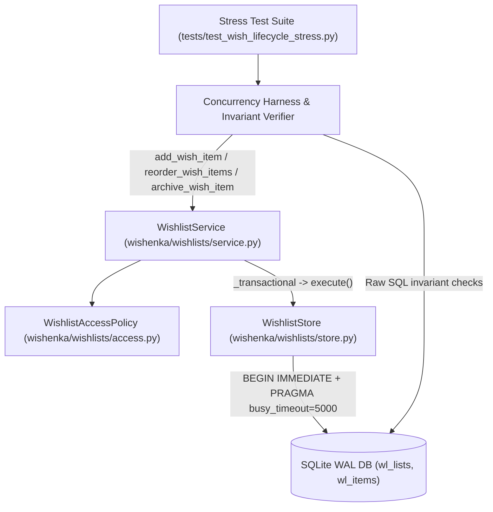

# WISHENKA-102: Стресс-тесты конкурентного изменения порядка и жизненного цикла желаний

## Research

### Анализ кодовой базы

1. **Доменный сервис (`wishenka/wishlists/service.py`):**
   - Целевые операции:
     - `WishlistService.add_wish_item(wishlist_id, actor, title, ...)` (строки 1117–1228): проверяет статус вишлиста (`ARCHIVED` / `DELETED`) и права (`WishlistAccessPolicy.can_add_or_edit_item`), вычисляет `next_order = max([it.display_order for it in wl.items], default=-1) + 1`, создаёт `WishItem` и добавляет в `wl.items` и `self._items`.
     - `WishlistService.reorder_wish_items(wishlist_id, actor, item_ids)` (строки 1513–1597): проверяет статус вишлиста и права, валидирует отсутствие дублей в `item_ids` и точное совпадение `set(item_ids) == {it.id for it in active_items}` (иначе `ValueError`), затем выставляет `display_order = 0..N-1` и сортирует `wl.items` по `(display_order, id)`.
     - `WishlistService.archive_wish_item(wishlist_id, item_id, actor, warn_on_delete_reserved=None)` (строки 1633–1699): проверяет статус вишлиста, права, принадлежность `item_id` к вишлисту и `not item.is_fully_received` (иначе `NothingRemainingError`), затем устанавливает `item.is_archived = True`.
   - Все публичные `async`-методы `WishlistService` автоматически декорированы `_transactional` (строки 117–139, 2866–2868). Для `add_wish_item`, `reorder_wish_items` и `archive_wish_item` функция `_inventory_scope` возвращает `None`, поэтому при наличии `self._store` вызов направляется в `WishlistStore.execute(call)`.

2. **Персистентность и SQLite WAL (`wishenka/wishlists/store.py`, `wishenka/wishlists/migrations.py`):**
   - `WishlistStore.initialize()` применяет миграции Alembic (`upgrade_to_head`) и включает `PRAGMA journal_mode=WAL`.
   - `_configure_immediate_transactions` на каждом подключении выставляет `isolation_level = None`, `PRAGMA foreign_keys=ON`, `PRAGMA busy_timeout=5000`, а на событии `begin` выполняет `BEGIN IMMEDIATE` (после `PRAGMA busy_timeout=5000`).
   - `WishlistStore.execute()` вызывает `_execute_once()` внутри `_immediate(work)`: внутри одной `BEGIN IMMEDIATE`-транзакции выполняется `_read(conn)` (гидратация `WishlistService` и `_StorageSnapshot`, где `wl_items` читаются с `ORDER BY display_order ASC, id ASC`), затем доменная операция над гидратированным сервисом, затем `_write(conn, service, snapshot)` (дифф и `INSERT`/`UPDATE`/`DELETE` в SQLite, включая `display_order` и `is_archived`), после чего `commit()`.
   - При исчерпании `busy_timeout` с `SQLITE_BUSY` `_raise_for_storage_error` маппит ошибку в `InventoryBusyError`.

3. **Существующие паттерны конкурентного тестирования (`tests/`):**
   - В `tests/test_wishlists_sqlite_repo.py` (`test_fifty_concurrent_reservations_do_not_overbook`) используется файловая SQLite БД в `tmp_path`, барьер синхронизации (`asyncio.Event` `ready` / `gate`), `asyncio.wait_for(asyncio.gather(*tasks), timeout=...)`, отмена незавершённых задач в `finally` и прямая проверка строк SQLite после завершения гонки.
   - В `tests/test_receipt_concurrency.py` и `tests/test_wishlist_api.py` проверяются гонки как через один `WishlistStore`, так и через несколько экземпляров `WishlistStore` на одном файле БД.
   - По требованиям `do-testing` и `pyproject.toml` все тесты должны иметь явный `@pytest.mark.timeout(...)` / `pytestmark`, а внутренние ожидания должны быть ограничены таймаутами.

### Внешний поиск (SQLite WAL + `aiosqlite` + SQLAlchemy Async)

По результатам поиска актуальных практик конкурентного тестирования SQLite WAL в `aiosqlite` + SQLAlchemy Async:
- Режим `BEGIN DEFERRED` в SQLite при параллельном чтении и последующей попытке обновления приводит к немедленному `SQLITE_BUSY` при эскалации блокировки, минуя `busy_timeout`. Использование `BEGIN IMMEDIATE` на старте транзакции сериализует писателей и позволяет конкурирующим корутинам корректно ожидать в пределах `busy_timeout`, а в режиме WAL читатели не блокируют писателей и наоборот.
- Для воспроизведения реальных гонок в `pytest-asyncio` необходимо запускать корутины одновременно через барьер и `asyncio.gather` (а не последовательно в цикле), поддерживать короткие транзакции и проверять итоговые инварианты напрямую в БД.

## Implementation Plan

1. **Создать модуль стресс- и конкурентного тестирования `tests/test_wish_lifecycle_stress.py`:**
   - Задать `pytestmark = pytest.mark.timeout(120)` и ограниченные таймауты на все внутренние барьеры и `asyncio.wait_for`.
   - Реализовать вспомогательную инфраструктуру:
     - инициализацию файловой БД SQLite WAL через `WishlistStore` (с проверкой `PRAGMA journal_mode == "wal"`, `PRAGMA foreign_keys == 1`, `PRAGMA busy_timeout == 5000`) и корректным `dispose()`;
     - барьерный раннер конкурентных задач (`asyncio.Event` + `asyncio.gather` + отмена зависших задач в `finally`);
     - проверщик инвариантов (`_assert_wishlist_invariants`), сверяющий состояние через `WishlistService` и прямые SQL-запросы к `wl_items`.
2. **Покрыть все целевые конкурентные сценарии из `10-requirements.md`:**
   - Параллельные перестановки `reorder_wish_items` (один `WishlistStore` и несколько `WishlistStore` на общей БД WAL, роли Owner и Co-author).
   - Параллельные `add_wish_item` + `reorder_wish_items`.
   - Параллельные `archive_wish_item` + `reorder_wish_items` + `add_wish_item` (включая проверку атомарного отклонения устаревших перестановок через `ValueError` без частичного изменения БД).
   - Смешанный многоволновой поток всех трёх операций от имени Владельца и Соавторов.
   - Изоляция между вишлистами под конкурентной нагрузкой на несколько независимых списков.
3. **Запуск и верификация:**
   - Выполнить `make analyze` и `make test` (или целевой прогон + полный `make check`) и убедиться в детерминированном прохождении без гонок и зависаний.

**Mandatory — Failing Repro (next Step 3):**
`N/A — no behavioral change`: задача `WISHENKA-102` является задачей технического долга исключительно на добавление автоматизированных стресс- и конкурентных тестов поверх существующей реализации `WishlistService` и `WishlistStore` без изменения продакшн-кода и бизнес-логики (согласно `10-requirements.md`: «в рамках задачи только автоматизированная верификация поведения под конкурентной и стрессовой нагрузкой»). Если при реализации стресс-тестов на Шаге 4 будет выявлен реальный дефект в продакшн-коде, он будет зафиксирован отдельно.

## Architecture

### Диаграмма модулей

### Описание модулей и ответственности

1. **`tests/test_wish_lifecycle_stress.py` (новый тестовый модуль):**
   - Содержит параметризованные и изолированные `async` стресс-сценарии (в каждом тесте собственная временная БД в `tmp_path`).
   - Координирует одновременный старт конкурентных корутин через барьер (`asyncio.Event`) и ограничивает время выполнения каждого батча через `asyncio.wait_for`.
   - Классифицирует исходы операций: успешное завершение vs ожидаемый доменный отказ (`ValueError` при устаревшем наборе `item_ids` в `reorder_wish_items`). Любые неожиданные ошибки (`InventoryBusyError`, `OperationalError`, `RuntimeError` и т.д.) немедленно проваливают тест.

2. **Вспомогательные компоненты внутри `tests/test_wish_lifecycle_stress.py`:**
   - **Store Lifecycle Helper (`_open_wal_store`):** создаёт `WishlistStore`, вызывает `initialize()`, проверяет `PRAGMA journal_mode == "wal"`, `PRAGMA foreign_keys == 1`, `PRAGMA busy_timeout == 5000` и гарантирует `dispose()` в `finally`.
   - **Barrier Runner (`_run_barrier_tasks`):** регистрирует готовность всех `N` корутин, открывает общий `gate`, ожидает завершения через `asyncio.wait_for(asyncio.gather(...), timeout=...)` и отменяет незавершённые задачи при ошибке/таймауте.
   - **Invariant Verifier (`_assert_wishlist_invariants`):** проверяет после каждой гонки:
     - множество активных `id` в `wl_items` (`is_archived = 0`) точно равно `expected_active_ids`;
     - множество архивных `id` в `wl_items` (`is_archived = 1`) точно равно `expected_archived_ids`;
     - значения `display_order` среди активных желаний вишлиста уникальны (без дублей); для чистых перестановок — строго образуют `[0, 1, ..., K-1]`;
     - порядок элементов, возвращаемый `WishlistService.get_wishlist_items`, согласован с данными в `wl_items`.

3. **Тестируемые продакшн-компоненты (без изменений в архитектуре):**
   - `WishlistService` (`wishenka/wishlists/service.py`) — доменная логика и проверка прав доступа (`OWNER`, `ADMIN`/`EDITOR` соавторы).
   - `WishlistStore` (`wishenka/wishlists/store.py`) — сериализация транзакций через `BEGIN IMMEDIATE` в SQLite WAL.

### Схема взаимодействия

1. Тест инициализирует `WishlistStore` (или несколько `WishlistStore` на одном файле БД в `tmp_path`) и наполняет вишлист начальными желаниями и соавторами.
2. Запускается группа конкурентных корутин (`add_wish_item`, `reorder_wish_items`, `archive_wish_item`) через единый барьер старта.
3. Каждая корутина вызывает метод `WishlistService(store=store)`, который через `_transactional` входит в `WishlistStore.execute()` -> `_immediate()` (`BEGIN IMMEDIATE`).
4. SQLite WAL сериализует конкурирующие транзакции записи без `SQLITE_BUSY` в пределах `busy_timeout = 5000` мс; при конкурентном изменении состава активных желаний опоздавший `reorder_wish_items` атомарно отклоняется с `ValueError` до записи в БД.
5. После завершения всех корутин `_assert_wishlist_invariants` проверяет состояние через `WishlistService` и прямым чтением таблицы `wl_items`.

### Выбранные архитектурные паттерны и обоснование

- **Barrier-synchronized `asyncio.gather`:** гарантирует реальное перекрытие и конкуренцию корутин за транзакционный вход, исключая последовательное выполнение.
- **Dual-source Verification (Service DTO + Raw SQL):** проверка как через публичное API сервиса, так и прямым SQL-запросом к `wl_items` исключает маскировку дефектов персистентности.
- **Multi-store Contention:** использование нескольких экземпляров `WishlistStore` на одном SQLite-файле моделирует конкуренцию разных воркеров/процессных пулов поверх WAL и `BEGIN IMMEDIATE`, не полагаясь на внутрипроцессные блокировки.
- **Strict Bounded Waits (`pytest.mark.timeout` + `asyncio.wait_for`):** соответствует правилам `do-testing` и гарантирует выявление взаимоблокировок без зависания CI.

### Основные интерфейсы

- `WishlistService(store=store)`:
  - `await add_wish_item(wishlist_id: int, actor: AuthenticatedUser, title: str, ...) -> WishItem`
  - `await reorder_wish_items(wishlist_id: int, actor: AuthenticatedUser, item_ids: list[int]) -> list[WishItemRecipientViewDTO | WishItemGifterViewDTO]`
  - `await archive_wish_item(wishlist_id: int, item_id: int, actor: AuthenticatedUser, ...) -> WishItemRecipientViewDTO | WishItemGifterViewDTO`
- `WishlistStore(database_url: str)`:
  - `await initialize() -> None`
  - `await execute(operation: Callable[[WishlistService], Awaitable[T]]) -> T`
  - `await dispose() -> None`

## Q&A

- **Нужно ли менять продакшн-код в рамках `WISHENKA-102`?**
  - *Ответ:* Нет, по требованиям `10-requirements.md` задача ограничена автоматизированной верификацией существующих операций `reorder_wish_items`, `add_wish_item`, `archive_wish_item` и транзакций SQLite WAL.
- **Почему при одновременном `add_wish_item` / `archive_wish_item` и `reorder_wish_items` допускается `ValueError`?**
  - *Ответ:* `reorder_wish_items` требует точного совпадения `item_ids` с текущим набором активных желаний в транзакции. Если параллельная транзакция добавления или архивации зафиксировалась раньше, перестановка со старым снимком ID должна атомарно отклониться с `ValueError` без частичного изменения `display_order`.
