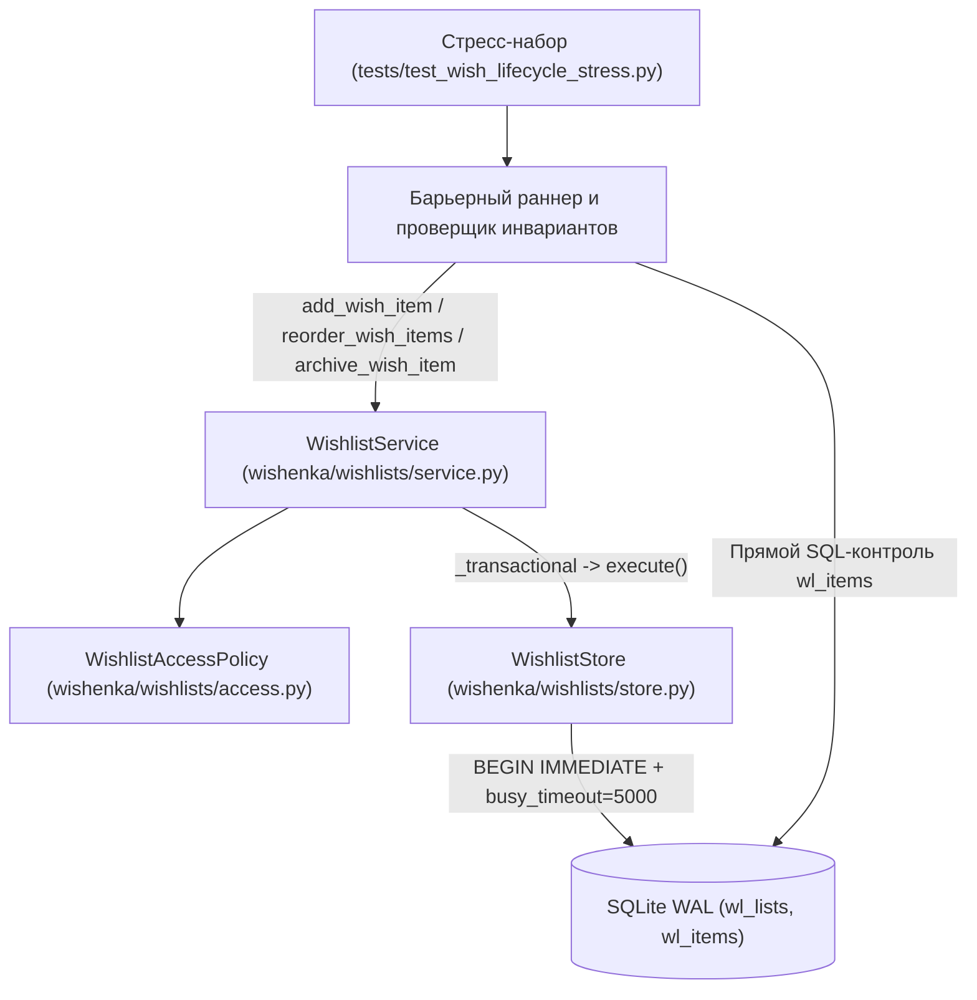

# Спецификация: WISHENKA-102 — Стресс-тесты конкурентного изменения порядка и жизненного цикла желаний

**Статус:** реализовано (тестовый набор и документация верификации)  
**Тип задачи:** технический долг (автоматизированная конкурентная и стресс-верификация)  
**Язык реализации:** Python  
**Основные артефакты:** `tests/test_wish_lifecycle_stress.py`, `doc/dev/testing.md`

## 1. Назначение и бизнес-цель

### 1.1. Контекст и постановка проблемы

Сервис **Telegram Wishlist Service** поддерживает совместные вишлисты, в которых Владелец, Администраторы и Участники (соавторы) могут одновременно редактировать список, а также поддерживает работу с нескольких точек входа (Telegram Mini App и Telegram-бот). При высокой активности или параллельном поступлении запросов на добавление желаний, изменение их порядка и архивацию неактуальных позиций возможны состояния гонки на уровне транзакций базы данных.

Без специализированного конкурентного тестирования подобные гонки могут приводить к потере желаний, дублированию значений порядка отображения (`display_order`), нарушению сортировки, отображению архивированных позиций в активном списке или зависаниям из-за блокировок SQLite.

### 1.2. Цели задачи

Обеспечить автоматизированную стресс- и конкурентную проверку целостности данных, порядка активных желаний и состояния жизненного цикла при одновременном выполнении ключевых операций (`add_wish_item`, `reorder_wish_items`, `archive_wish_item`) поверх существующей реализации `WishlistService` и `WishlistStore` (SQLite WAL + `BEGIN IMMEDIATE`) без изменения продакшн-кода и бизнес-логики.

### 1.3. Бизнес- и системная ценность

- **Для Владельцев и Соавторов:** гарантия того, что при одновременной работе с нескольких устройств или разными участниками ни одно желание не пропадает и не дублируется, а порядок активных элементов остаётся однозначным.
- **Для Дарителей:** гарантия получения согласованного и актуального перечня желаний без «битых» позиций и без утечки архивированных элементов в активный список.
- **Для команды разработки:** воспроизводимый автоматизированный контур в CI для раннего выявления состояний гонки, взаимных блокировок и нарушений транзакционных инвариантов при развитии доменного слоя.

### 1.4. Границы задачи (Scope и Non-Goals)

- **В рамках задачи:** только разработка и документирование автоматизированных стресс- и конкурентных тестов жизненного цикла желаний (`tests/test_wish_lifecycle_stress.py`, раздел в `doc/dev/testing.md`).
- **Вне рамок задачи:** изменение продакшн-модулей `wishenka/`, добавление новой пользовательской функциональности, модификация ролевой модели или принципа сюрприза (`specs/00-high.md`, `in-docs/spec.md`), а также нагрузочное тестирование бронирований подарков, уведомлений, Telegram-бота и интерфейса Mini App.

## 2. Функциональные требования и пользовательские сценарии

### 2.1. Роли и пользовательские сценарии

В сценариях верификации задействованы следующие роли:

| Роль в вишлисте | Обозначение в коде | Участие в сценариях |
| --------------- | ------------------ | ------------------- |
| Владелец | `WishlistRole.OWNER` | Создаёт вишлист, добавляет соавторов, выполняет добавление, перестановку и архивацию желаний |
| Администратор | `WishlistRole.ADMIN` | Соавтор, выполняющий параллельные операции добавления, перестановки и архивации |
| Участник | `WishlistRole.MEMBER` | Соавтор, выполняющий параллельные операции добавления, перестановки и архивации |
| Даритель | Внешний наблюдатель | Потребитель согласованного активного перечня желаний (проверяется через отсутствие рассинхронизации и утечек архива) |

Базовые пользовательские истории:

1. **Согласованное совместное редактирование (Владелец / Соавтор):** при параллельном изменении порядка, добавлении новых позиций и архивации неактуальных желаний с нескольких клиентов список сохраняет все неархивированные элементы и однозначный порядок без дублей.
2. **Непротиворечивое чтение списка (Даритель):** в процессе и после интенсивных параллельных изменений активный список не содержит архивированных желаний или некорректных позиций.
3. **Регрессионный контроль конкурентности (Команда разработки):** автоматизированные стресс-тесты выявляют гонки, ошибки блокировок SQLite и нарушения инвариантов до релиза изменений.

### 2.2. Покрываемые операции и поведение под конкуренцией

Система тестируется на трёх операциях `WishlistService` над общим вишлистом и над несколькими независимыми вишлистами:

1. **Изменение порядка (`reorder_wish_items`):**
   - **Вход:** `wishlist_id`, авторизованный `actor`, полный список `item_ids` активных желаний без дубликатов.
   - **Выход и поведение:** при совпадении `set(item_ids)` с текущим множеством активных желаний в транзакции присваивает `display_order = 0..N-1`, сортирует позиции и возвращает проекции `list[WishItemRecipientViewDTO | WishItemGifterViewDTO]`. Если параллельная транзакция добавления или архивации изменила состав активных желаний раньше, операция со старым снимком `item_ids` атомарно отклоняется исключением `ValueError` до записи в БД.
2. **Добавление желания (`add_wish_item`):**
   - **Вход:** `wishlist_id`, авторизованный `actor`, `title` (и опциональные атрибуты желания).
   - **Выход и поведение:** вычисляет `next_order = max(display_order, default=-1) + 1`, создаёт активное желание (`is_archived=False`) и возвращает `WishItem`.
3. **Архивация желания (`archive_wish_item`):**
   - **Вход:** `wishlist_id`, `item_id`, авторизованный `actor`, опциональный `warn_on_delete_reserved`.
   - **Выход и поведение:** при `not item.is_fully_received` переводит желание в архив (`is_archived=True`), сохраняя его вне активного списка, и возвращает проекцию элемента. Оставшиеся активные элементы сохраняют уникальные упорядоченные `display_order` (без принудительного переуплотнения до следующего `reorder_wish_items`).

Покрытые комбинированные направления нагрузки:

- множественные параллельные перестановки одного набора активных желаний (через один и через несколько экземпляров `WishlistStore`);
- параллельное добавление новых желаний одновременно с перестановкой существующих;
- параллельная архивация желаний одновременно с добавлением и перестановкой;
- многоволновой смешанный поток всех трёх операций от имени Владельца и Соавторов (`ADMIN`, `MEMBER`);
- параллельная нагрузка на несколько независимых вишлистов в одной БД.

### 2.3. Бизнес-инварианты целостности

После каждого конкурентного пакета операций автоматически проверяются следующие инварианты:

1. **Сохранность активного множества:** набор `id` в таблице `wl_items` с `is_archived = 0` в точности равен множеству всех добавленных и не архивированных желаний (`expected_active_ids`), без потерь и дубликатов.
2. **Сохранность и изоляция архива:** набор `id` в `wl_items` с `is_archived = 1` в точности равен множеству архивированных желаний (`expected_archived_ids`) и не пересекается с активным множеством.
3. **Уникальность и непрерывность порядка:** значения `display_order` среди активных желаний вишлиста строго уникальны; после чистых перестановок (или контрольного `reorder_wish_items`) они образуют непрерывную последовательность `0..K-1`.
4. **Согласованность сервиса и БД:** порядок и состав активных и архивных элементов, возвращаемый `WishlistService.get_wishlist_view()`, идентичен результатам прямого SQL-запроса к `wl_items` (`ORDER BY display_order ASC, id ASC`).
5. **Атомарность при конфликтах:** устаревшие запросы `reorder_wish_items` отклоняются с `ValueError` без частичного изменения `display_order`; прочие ошибки (включая `InventoryBusyError` или ошибки SQLAlchemy/SQLite) не допускаются.
6. **Межсписочная изоляция:** конкурентные мутации одного вишлиста не изменяют состав, порядок и статусы желаний других вишлистов в той же БД.

## 3. Архитектура, компоненты и интерфейсы

### 3.1. Диаграмма модулей и взаимодействия



### 3.2. Модули и компоненты

1. **Новый тестовый модуль `tests/test_wish_lifecycle_stress.py`:**
   - `_actor(user_id, name)` — формирует `AuthenticatedUser` с `auth_method="session_token"`.
   - `_open_wal_store(db_path)` — асинхронный контекстный менеджер, создающий `WishlistStore(f"sqlite+aiosqlite:///{db_path}")`, запускающий `initialize()`, проверяющий `PRAGMA journal_mode == "wal"`, `PRAGMA foreign_keys == 1`, `PRAGMA busy_timeout == 5000` и гарантирующий `await store.dispose()` в `finally`.
   - `_run_barrier_tasks(factories, *, barrier_timeout, batch_timeout)` — синхронизирует старт всех корутин через общий барьер (`asyncio.Event` `ready` и `gate`), выполняет `asyncio.wait_for(asyncio.gather(*tasks), timeout=batch_timeout)` и отменяет незавершённые задачи в `finally`.
   - `_seed_wishlist_with_items(store, *, owner, co_authors, item_count, title)` — создаёт участников в `users`, вишлист, связи участников и начальный набор активных желаний.
   - `_assert_wishlist_invariants(store, *, wishlist_id, actor, expected_active_ids, expected_archived_ids, require_contiguous_order=False)` — выполняет двухисточниковую сверку прямого SQL-запроса к `wl_items` и ответа `WishlistService.get_wishlist_view()`.
2. **Тестируемые продакшн-компоненты (без изменений):**
   - `WishlistService` (`wishenka/wishlists/service.py`): публичные методы декорированы `_transactional`. Для `add_wish_item`, `reorder_wish_items` и `archive_wish_item` область инвентарной блокировки `_inventory_scope` возвращает `None`, поэтому вызов при наличии `self._store` маршрутизируется в `WishlistStore.execute(call)`.
   - `WishlistAccessPolicy` (`wishenka/wishlists/access.py`): контролирует права редактирования (`can_add_or_edit_item`) для владельца и соавторов.
   - `WishlistStore` (`wishenka/wishlists/store.py`): `initialize()` приводит схему к Alembic head (`upgrade_to_head`) с WAL-режимом; `_configure_immediate_transactions` настраивает `isolation_level = None`, `PRAGMA foreign_keys=ON`, `PRAGMA busy_timeout=5000` и `BEGIN IMMEDIATE` на пишущих транзакциях; `execute()` -> `_execute_once()` -> `_immediate()` внутри одной транзакции выполняет `_read(conn)`, доменную операцию и `_write(conn, service, snapshot)`.

### 3.3. Контракты данных и основные интерфейсы

| Компонент / интерфейс | Сигнатура / поля | Назначение и контракт |
| --------------------- | ---------------- | --------------------- |
| `WishlistService.add_wish_item` | `(wishlist_id: int, actor: AuthenticatedUser, title: str, ...) -> WishItem` | Проверяет активный статус списка и права, добавляет `WishItem` с `display_order = max + 1` |
| `WishlistService.reorder_wish_items` | `(wishlist_id: int, actor: AuthenticatedUser, item_ids: list[int]) -> list[WishItemRecipientViewDTO \| WishItemGifterViewDTO]` | Требует отсутствие дублей и точное совпадение `set(item_ids)` с активными `id` (иначе `ValueError`), назначает `display_order = 0..N-1` |
| `WishlistService.archive_wish_item` | `(wishlist_id: int, item_id: int, actor: AuthenticatedUser, warn_on_delete_reserved: bool \| None = None) -> WishItemRecipientViewDTO \| WishItemGifterViewDTO` | Проверяет права и `not item.is_fully_received` (иначе `NothingRemainingError`), выставляет `is_archived = True` |
| `WishlistService.get_wishlist_view` | `(wishlist_id: int, current_user: AuthenticatedUser \| None = None) -> WishlistDetailViewDTO` | Проецирует активные (`items`) и для участников архивные (`archived_items`) желания в порядке `(display_order, created_at, id)` |
| `WishlistStore` | `WishlistStore(database_url: str)`, `initialize()`, `execute(operation)`, `dispose()` | Сериализует операции через `BEGIN IMMEDIATE`, транслирует ошибки блокировок в `InventoryBusyError` |
| Таблица `wl_items` | `id`, `wishlist_id`, `display_order`, `is_archived` | Хранит порядок и флаг архивации; читается при гидратации с `ORDER BY display_order ASC, id ASC` |

### 3.4. Переходы состояний и транзакционная модель

Жизненный цикл желания в охватываемом контуре:

- **Создание (`add_wish_item`):** переход в активное состояние (`is_archived = 0`, `display_order = max + 1`).
- **Перестановка (`reorder_wish_items`):** остаётся активным (`is_archived = 0`), обновляется `display_order` в диапазоне `0..N-1`; при несоответствии набора `item_ids` текущему активному множеству происходит откат транзакции с `ValueError` без изменения БД.
- **Архивация (`archive_wish_item`):** переход из активного состояния в архив (`is_archived = 1`); элемент исключается из активной выборки `wl_items`, но остаётся доступным в `archived_items` для участников вишлиста.

Использование `BEGIN IMMEDIATE` (вместо `BEGIN DEFERRED`) предотвращает немедленный `SQLITE_BUSY` при эскалации блокировки чтения до записи и позволяет конкурирующим транзакциям последовательно дожидаться освобождения пишущей блокировки в пределах `PRAGMA busy_timeout=5000`.

## 4. Нефункциональные требования, безопасность и наблюдаемость

### 4.1. Производительность, лимиты и детерминизм

- **Ограничения времени выполнения:**
  - таймаут тестового модуля: `pytestmark = pytest.mark.timeout(120)`;
  - ожидание готовности и открытия барьера: `_BARRIER_TIMEOUT_SECONDS = 15.0`;
  - ожидание завершения конкурентного пакета задач: `_BATCH_TIMEOUT_SECONDS = 45.0`;
  - лимит ожидания блокировки SQLite: `PRAGMA busy_timeout=5000` (5000 мс) и `connect_args={"timeout": 5}`.
- **Изоляция и воспроизводимость:** каждый тест создаёт собственный временный файл БД в `tmp_path` (наследует `WISHENKA_TEST_TMPDIR`; на медленном диске с высоким `fsync` рекомендуется `/dev/shm`) и гарантированно освобождает соединения через `dispose()`.
- **Наблюдаемое время прогона:** выполнение 6 стресс-тестов занимает `26.94s` на `/dev/shm` и `28.49s`–`33.21s` на стандартном временном хранилище (основной вклад вносят миграции Alembic `upgrade_to_head` при старте каждого теста и полная гидратация БД внутри `WishlistStore.execute()`).

### 4.2. Безопасность, доступ и защита приватности

- **Ролевой контроль доступа:** все целевые операции в тестах вызываются через публичные методы `WishlistService` от имени авторизованных ролей (`OWNER`, `ADMIN`, `MEMBER`) с прохождением проверок `WishlistAccessPolicy.can_add_or_edit_item`. Единственное прямое обращение к БД при подготовке данных — `INSERT OR IGNORE INTO users` в `_seed_wishlist_with_items` для регистрации участников, и прямое чтение `SELECT ... FROM wl_items` в `_assert_wishlist_invariants`.
- **Сохранение принципа сюрприза:** тестовые операции не изменяют проекцию представлений (`project_wish_item` в `get_wishlist_view`), видимость бронирований и политику сохранения броней при архивации; `PRAGMA foreign_keys = ON` проверяется при инициализации хранилища.

### 4.3. Наблюдаемость (логирование, метрики, диагностика)

- **Продакшн-логирование и метрики — N/A:** в рамках `WISHENKA-102` продакшн-код не модифицировался. Существующее структурированное логирование `WishlistService` (логгер `"wishenka.wishlists"`, события `item_created`, `items_reordered`, `item_reorder_invalid`, `item_archived`, `item_access_denied` и др.) сохранено без изменений; новые метрики Prometheus, дашборды Grafana, правила алертинга и интеграции с ELK/Loki не требуются и не добавлялись.
- **Диагностика в тестах:** `tests/test_wish_lifecycle_stress.py` не содержит отладочных `print` и обеспечивает диагностику гонок в CI через ограниченные таймауты (`120s` / `45s` / `15s`), явные проверки прагм SQLite (`wal`, `foreign_keys=1`, `busy_timeout=5000`), отлов неожиданных исключений и двухисточниковую сверку состояния (`WishlistService` vs raw SQL `wl_items`).

## 5. Верификация и критерии приёмки

### 5.1. Покрытые сценарии в `tests/test_wish_lifecycle_stress.py`

| Тестовый сценарий | Конфигурация нагрузки | Проверяемые условия и инварианты |
| ----------------- | --------------------- | -------------------------------- |
| `test_concurrent_reorders_single_store_preserve_permutation` | 1 `WishlistStore`, 8 желаний, 24 параллельных `reorder_wish_items`, роли `OWNER`, `MEMBER`, `ADMIN` | Все 24 результата — валидные перестановки; итоговый `display_order` непрерывен (`0..7`), сервис согласован с `wl_items` |
| `test_concurrent_reorders_multiple_stores_preserve_permutation` | 4 экземпляра `WishlistStore` на одном файле БД, 7 желаний, 20 параллельных `reorder_wish_items`, роли `OWNER`, `MEMBER` | Отсутствие `InventoryBusyError` и потери позиций при конкуренции между независимыми сторами; непрерывный `display_order` (`0..6`) |
| `test_concurrent_add_and_reorder_preserve_all_items` | 1 `WishlistStore`, 5 начальных желаний, 8 `add_wish_item` + 10 `reorder_wish_items`, роли `OWNER`, `ADMIN` | Сохранены все 13 активных желаний; устаревшие перестановки возвращают `ValueError`; контрольный `reorder_wish_items` восстанавливает `0..12` |
| `test_concurrent_archive_and_reorder_exclude_archived_items` | 1 `WishlistStore`, 8 начальных желаний, 3 `archive_wish_item` + 4 `add_wish_item` + 8 `reorder_wish_items`, роли `OWNER`, `MEMBER` | 9 активных и 3 архивных элемента без пересечений; уникальные `display_order`; устаревшие перестановки отклонены через `ValueError` |
| `test_mixed_lifecycle_waves_owner_and_coauthors` | 2 экземпляра `WishlistStore`, 6 начальных желаний, 3 волны по 4 `add_wish_item` + 1 `archive_wish_item` + 6 `reorder_wish_items`, роли `OWNER`, `ADMIN`, `MEMBER` | Инварианты активного и архивного множеств подтверждены после каждой волны на `stores[0]` и после финальной перестановки (`0..14`) на `stores[1]` |
| `test_concurrent_lifecycle_isolation_across_wishlists` | 1 `WishlistStore`, 3 независимых вишлиста по 5 желаний, суммарно 24 задачи (по 3 `add_wish_item` + 1 `archive_wish_item` + 4 `reorder_wish_items` на список) | Все 3 вишлиста сохраняют строго свои 7 активных и 1 архивное желание без взаимного влияния |

### 5.2. Критерии приёмки и результаты проверок

Задача считается принятой при выполнении следующих условий:

1. Все 6 стресс-сценариев в `tests/test_wish_lifecycle_stress.py` проходят стабильно и без таймаутов с явным `pytest.mark.timeout(120)`.
2. Подтверждены все 6 бизнес-инвариантов целостности из раздела 2.3 как через API `WishlistService`, так и прямыми запросами к SQLite.
3. Продакшн-код `wishenka/` остался нетронутым, а статический анализ и форматирование пройдены без ошибок.

Зафиксированные результаты проверок на финальном состоянии кода:

- **Линтер:** `.venv/bin/ruff check wishenka tests` — 0 ошибок и предупреждений.
- **Форматирование:** `.venv/bin/ruff format --check wishenka tests` — `202 files already formatted` (0 строк длиннее 100 символов в `tests/test_wish_lifecycle_stress.py`).
- **Типизация:** `.venv/bin/mypy wishenka tests` — `Success: no issues found in 202 source files`.
- **Стресс-набор:** `.venv/bin/pytest -n 0 tests/test_wish_lifecycle_stress.py` — `6 passed` (`26.94s` на `/dev/shm`, `28.49s`–`33.21s` на стандартном tmp).

Команды запуска:

```bash
.venv/bin/pytest tests/test_wish_lifecycle_stress.py
make test-serial PYTEST_ARGS="tests/test_wish_lifecycle_stress.py"
```

### 5.3. Известные ограничения и задачи дальнейшего развития

Из анализа технического долга (`60-tech-debt.md`) зафиксированы следующие ограничения (не блокирующие приёмку):

1. **Однопроцессная конкурентность `asyncio`:** multi-store тесты создают несколько экземпляров `WishlistStore` в рамках одного процесса и event loop Python; межпроцессная конкуренция на уровне ОС в текущем наборе не моделируется.
2. **Неуплотнённый `display_order` после архивации:** `WishlistService.archive_wish_item` выставляет `is_archived = True` без перенумерации оставшихся активных позиций, поэтому `require_contiguous_order=True` (`0..K-1`) в тестах смешанных волн проверяется после последующего `reorder_wish_items`.
3. **Непокрытые смежные гонки:** в рамках `WISHENKA-102` не проверялись конкурентные вызовы `restore_wish_item`, дублирующиеся `archive_wish_item` на один и тот же `item_id`, `update_wish_item` / `delete_wish_item` в гонке с `reorder_wish_items`, а также откат при исчерпании `busy_timeout=5000` (`InventoryBusyError`).
4. **Архитектурное наблюдение по производительности `WishlistStore.execute()`:** `_read`/`_write` гидратируют всю БД в память и сериализуются глобально через `BEGIN IMMEDIATE` на все вишлисты, что увеличивает накладные расходы при росте числа списков.
5. **Локальное дублирование фабрик в тестах и прогон полного набора:** фабрики `make_add` / `make_reorder` / `make_archive` и прямая инициализация `WishlistStore` в multi-store тестах могут быть унифицированы позже; полный прогон набора (`1124` элемента) в среде контейнера с ограничениями I/O превышал лимит 900с (`exit 124` на 51% с 9 предсуществующими/независимыми падениями `F`).

Заведённые задачи дальнейшего развития в Jira:

| Задача Jira | Приоритет / статус | Описание |
| ----------- | ------------------ | -------- |
| [WISHENKA-210](https://pypost.atlassian.net/browse/WISHENKA-210) | `NON-BLOCKER` | Вынести общие фабрики конкурентных операций и унифицировать инициализацию multi-store тестов через `_open_wal_store` в `tests/test_wish_lifecycle_stress.py` |
| [WISHENKA-211](https://pypost.atlassian.net/browse/WISHENKA-211) | `NON-BLOCKER` | Добавить стресс-тесты конкурентного `restore_wish_item`, `update_wish_item`, `delete_wish_item`, гонок `archive_wish_item` на один элемент и отката `InventoryBusyError` при исчерпании `busy_timeout` |
| [WISHENKA-212](https://pypost.atlassian.net/browse/WISHENKA-212) | `NON-BLOCKER` *(pre-existing)* | Расследовать таймаут 900с (`exit 124` на 51% из `1124` тестов) на контейнерном хранилище I/O и 9 предсуществующих/независимых падений |
| [WISHENKA-213](https://pypost.atlassian.net/browse/WISHENKA-213) | `NON-BLOCKER` | Оценить ограничение области гидратации `WishlistStore.execute()` / `_read()` / `_write()` рамками целевого `wishlist_id` или точечными SQL-обновлениями |
