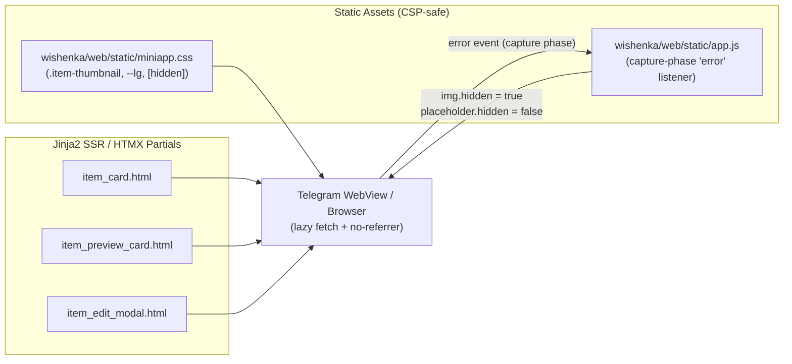

# WISHENKA-107: Lazy-loading, no-referrer и обработка битых внешних изображений товаров в TMA

## Research

1. **Инвентаризация рендеринга внешних изображений товаров в TMA**:
   - `wishenka/web/templates/partials/item_card.html` (строки 22–28): рендерит `` при наличии `item.image_url`, либо `
🎁
` при его отсутствии.
   - `wishenka/web/templates/partials/item_preview_card.html` (строки 18–22): рендерит `` при наличии `preview.image_url`; при отсутствии ссылки миниатюра не выводится.
   - `wishenka/web/templates/partials/item_edit_modal.html` (строки 141–147): рендерит `` при наличии `form.image_url`; при отсутствии ссылки блок превью не выводится.
   - В `wishenka/web/static/miniapp.js` внешние изображения товаров (`image_url`) не рендерятся — это экран-оболочка / домашний экран TMA.

2. **Ограничения Content Security Policy (CSP) и существующие инварианты**:
   - В `wishenka/web/routes/miniapp.py` (строки 50–53) заголовок `Content-Security-Policy` запрещает `'unsafe-inline'` для скриптов (`script-src 'self' https://telegram.org`), а `img-src 'self' https:` разрешает загрузку HTTPS-изображений.
   - В `tests/test_csp_inline_removal_repro.py` (`_assert_no_inline_scripts_or_handlers`) зафиксирован жёсткий контракт: страницы и HTMX-фрагменты (`item_card`, `item_preview_card`, `item_edit_modal`) не должны содержать ни встроенных `` в `wishenka/web/templates/base.html`) и таблицу стилей `wishenka/web/static/miniapp.css`.

3. **Поведение браузеров при `loading="lazy"`, `referrerpolicy="no-referrer"` и событиях `error` (по результатам веб-документации MDN / Web Specs)**:
   - `referrerpolicy="no-referrer"` на элементе `` гарантирует, что браузер/WebView не отправляет HTTP-заголовок `Referer` при запросе внешнего изображения (защита приватности и предотвращение блокировок по hotlink-политике).
   - `loading="lazy"` откладывает сетевой запрос изображения до приближения элемента к видимой области (viewport). Важная особенность спецификации: у отложенного изображения вне viewport свойство `img.complete` может быть `true` при `img.naturalWidth === 0` ещё до начала сетевого запроса. Поэтому **нельзя** проверять `img.complete && img.naturalWidth === 0` на `DOMContentLoaded` для `loading="lazy"` — это дало бы ложное срабатывание заглушки для ещё не загруженных карточек ниже экрана.
   - События `error` у элементов `` **не всплывают (do not bubble)**, но перехватываются в **фазе захвата (capture phase)** через `document.addEventListener('error', handler, true)`. Такой глобальный обработчик автоматически покрывает как первичную SSR-отрисовку, так и все динамически подгружаемые HTMX-фрагменты (`item_preview_card`, `item_edit_modal`, OOB-обновления `item_card`) без повторной привязки слушателей и без нарушения CSP.

4. **Особенности CSS-скрытия плейсхолдера в `miniapp.css`**:
   - В `wishenka/web/static/miniapp.css` (строки 88–95) класс `.item-thumbnail-placeholder` задаёт `display: flex; width: 3rem; height: 3rem; background: #f3e8ec;`.
   - Из-за явного `display: flex` HTML-атрибут `hidden` (который в user-agent стилях задаёт `display: none`) будет перекрыт, если в CSS явно не добавить `.item-thumbnail[hidden], .item-thumbnail-placeholder[hidden] { display: none; }`.
   - Классы `w-12`/`w-16` в шаблонах являются утилитарными метками без Tailwind-рантайма в `miniapp.css`, поэтому для соответствия размеров в модальном окне (`item_edit_modal.html`, 4rem × 4rem) и карточках (`item_card.html`, `item_preview_card.html`, 3rem × 3rem) необходимо явно описать `.item-thumbnail`, `.item-thumbnail--lg` и `.item-thumbnail-placeholder--lg` в `miniapp.css`.

## Implementation Plan

1. **Шаблоны Jinja2 (`wishenka/web/templates/partials/`)**:
   - В `item_card.html`: добавить `loading="lazy"`, `referrerpolicy="no-referrer"`, `data-img-fallback` на ``; рядом разместить скрытый плейсхолдер `
🎁
`. При `not item.image_url` поведение остаётся прежним (рендерится только видимый плейсхолдер).
   - В `item_preview_card.html`: добавить `loading="lazy"`, `referrerpolicy="no-referrer"`, `data-img-fallback` и класс `item-thumbnail` на ``; рядом разместить скрытый `
🎁
`. При отсутствии `preview.image_url` ничего не рендерится.
   - В `item_edit_modal.html`: добавить `loading="lazy"`, `referrerpolicy="no-referrer"`, `data-img-fallback` и классы `item-thumbnail item-thumbnail--lg` на ``; рядом разместить скрытый `
🎁
`. При отсутствии `form.image_url` блок превью не рендерится.

2. **Стили (`wishenka/web/static/miniapp.css`)**:
   - Определить `.item-thumbnail` (`width: 3rem; height: 3rem; object-fit: cover; border-radius: 0.375rem; flex-shrink: 0;`).
   - Добавить модификаторы `.item-thumbnail--lg, .item-thumbnail-placeholder--lg` (`width: 4rem; height: 4rem;`).
   - Дополнить `.item-thumbnail-placeholder` (`border-radius: 0.375rem; flex-shrink: 0;`) и добавить правило `.item-thumbnail[hidden], .item-thumbnail-placeholder[hidden] { display: none; }` (по аналогии с `.item-card-details[hidden]`).

3. **Клиентский обработчик ошибок (`wishenka/web/static/app.js`)**:
   - Добавить функцию `handleImageError(event)` и зарегистрировать глобальный capture-phase слушатель `document.addEventListener('error', handleImageError, true)`.
   - При срабатывании на `IMG[data-img-fallback]`: выставить `img.hidden = true` и найти соседний `.item-thumbnail-placeholder` в том же родителе (`img.parentElement.querySelector('.item-thumbnail-placeholder')`), сняв с него `hidden` (`placeholder.hidden = false`).
   - Проверить идемпотентность: повторное событие не должно ломать DOM, а при отсутствии соседнего плейсхолдера функция безопасно завершается.

**Mandatory — Failing Repro (next Step 3):**
- **Где живут красные тесты**: `tests/test_item_image_loading_repro.py` (с `@pytest.mark.timeout(30)` по требованиям `do-testing`).
- **Что проверяют**:
  1. SSR/HTMX-ответы для всех трёх контекстов (`GET /web/wishlists/{id}`, `GET /share/{token}`, `POST /web/wishlists/{id}/items/preview` с замоканным `ItemPreviewService`, `GET /web/wishlists/{id}/items/{item_id}/edit`):
     - `` содержит `loading="lazy"`, `referrerpolicy="no-referrer"`, `data-img-fallback`;
     - рядом присутствует `.item-thumbnail-placeholder` с атрибутом `hidden`;
     - отсутствуют inline-атрибуты `on*` (в т.ч. `onerror`), сохраняется совместимость с CSP;
     - при `image_url=None` в `item_preview_card` и `item_edit_modal` лишний плейсхолдер не добавляется, а в `item_card` плейсхолдер остаётся видимым (без `hidden`).
  2. Клиентский fallback в `app.js` (через Node VM без внешних сетевых запросов или локальный DOM-харнесс): загрузка `app.js`, рендеринг разметки `` + `.item-thumbnail-placeholder[hidden]`, диспатч события `error` на `` в capture-фазе — проверка, что `img.hidden === true` и `placeholder.hidden === false`.
  3. Наличие в `miniapp.css` правил `[hidden] { display: none; }` для `.item-thumbnail-placeholder` и `--lg` размеров.
- **Как воспроизводится падение до правки**: текущие шаблоны не имеют `loading="lazy"`, `referrerpolicy="no-referrer"`, `data-img-fallback` и скрытого `.item-thumbnail-placeholder`, а `app.js` не слушает `error` в capture-фазе — все проверки падают на текущем коде.
- **Последовательность**: исследование (Step 2) → красный тест (Step 3) → реализация в шаблонах, CSS и `app.js` до зелёных тестов (Step 4).

## Architecture

### System Module Diagram

### Module Descriptions & Responsibilities

1. **Jinja2 Partial Templates (`item_card.html`, `item_preview_card.html`, `item_edit_modal.html`)**:
   - Отвечают за декларативную разметку миниатюр с атрибутами `loading="lazy"`, `referrerpolicy="no-referrer"`, `data-img-fallback` и за парный скрытый элемент `.item-thumbnail-placeholder[hidden]`.
   - Сохраняют неизменное поведение при отсутствии `image_url`.
2. **`wishenka/web/static/app.js`**:
   - Отвечает за централизованную обработку ошибок загрузки изображений без inline-JS.
   - Использует глобальный перехват события `error` в capture-фазе (`document.addEventListener('error', ..., true)`), что одинаково работает для первичного DOM и динамических HTMX-вставок.
3. **`wishenka/web/static/miniapp.css`**:
   - Отвечает за единообразные размеры миниатюр и плейсхолдеров в двух масштабах (3rem × 3rem для карточек и превью, 4rem × 4rem для модального окна редактирования) и корректное скрытие через `[hidden] { display: none; }`.

### Module Interaction Scheme

1. Сервер рендерит HTML-фрагмент (`item_card`, `item_preview_card` или `item_edit_modal`) с `` (`loading="lazy"`, `referrerpolicy="no-referrer"`, `data-img-fallback`) и скрытым соседним `.item-thumbnail-placeholder[hidden]`.
2. Браузер/WebView откладывает загрузку изображения до попадания в viewport и при запросе не передаёт заголовок `Referer`.
3. Если внешний CDN возвращает ошибку (403, 404, таймаут, невалидный URL), браузер генерирует событие `error` на элементе ``.
4. Слушатель в `app.js` (capture-фаза) перехватывает событие, проверяет `target.matches('img[data-img-fallback]')`, скрывает `` (`hidden = true`) и отображает соседний `.item-thumbnail-placeholder` (`hidden = false`).

### Selected Architectural Patterns & Justification

- **Declarative Attributes + Capture-Phase Event Delegation**: вместо inline `onerror="..."` (запрещённого CSP `script-src 'self'`) и вместо ручной подписки на каждый `` после каждого `htmx:afterSwap` используется один capture-phase слушатель на `document`. Это минимизирует код, исключает утечки памяти и гонки при OOB/HTMX-обновлениях.
- **Pre-rendered Hidden Sibling Placeholder**: вместо создания DOM-элементов в JS и дублирования HTML/эмодзи/ARIA-атрибутов в JavaScript, плейсхолдер рендерится сервером в Jinja2 рядом с `` с атрибутом `hidden`. JS лишь переключает булево свойство `hidden`, что сохраняет SSR как единственный источник разметки и доступности (`aria-hidden="true"`).

### Main Interfaces / Contracts

- **HTML-контракт миниатюры с fallback**:
  - Элемент изображения: ``.
  - Парный плейсхолдер в том же родительском контейнере: `
🎁
`.
- **JS-контракт (`app.js`)**:
  - Обработчик `handleImageError(event)` реагирует только на `event.target` являющийся `HTMLImageElement` (`tagName === 'IMG'`) с атрибутом `data-img-fallback`.
  - Переключение состояния: `img.hidden = true;` и при наличии `placeholder = img.parentElement && img.parentElement.querySelector('.item-thumbnail-placeholder')` устанавливает `placeholder.hidden = false;`.
- **CSS-контракт (`miniapp.css`)**:
  - `.item-thumbnail[hidden], .item-thumbnail-placeholder[hidden] { display: none; }` гарантирует, что атрибут `hidden` всегда скрывает элемент поверх `display: flex`.
  - `.item-thumbnail--lg` / `.item-thumbnail-placeholder--lg` задают размер `4rem × 4rem` для модального окна редактирования.

## Q&A

1. **Почему нельзя использовать `onerror="this.style.display='none'..."` прямо в шаблонах?**
   - В `wishenka/web/routes/miniapp.py` действует строгая CSP без `'unsafe-inline'`, а `tests/test_csp_inline_removal_repro.py` явно запрещает любые `on*` атрибуты в шаблонах.
2. **Почему не используется проверка `img.complete && img.naturalWidth === 0` на `DOMContentLoaded`?**
   - Для `loading="lazy"` браузер может возвращать `complete === true` и `naturalWidth === 0` ещё до того, как карточка попадёт в viewport и начнётся загрузка. Проверка на `DOMContentLoaded` ошибочно скрывала бы валидные отложенные картинки.
3. **Затронут ли `wishenka/web/static/miniapp.js`?**
   - Нет. По результатам инвентаризации `miniapp.js` не рендерит внешние изображения товаров (`image_url`). Все три целевых представления рендерятся через Jinja2-шаблоны с подключением `app.js` и `miniapp.css` из `base.html`.
