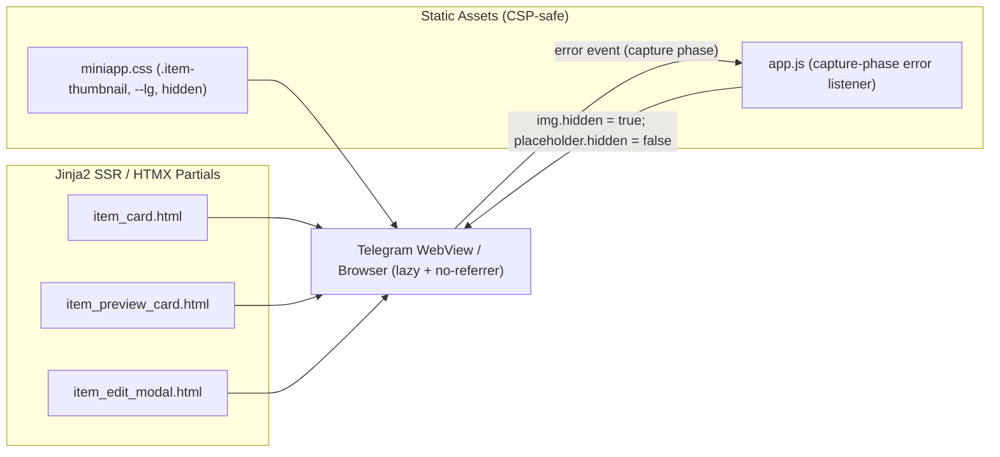
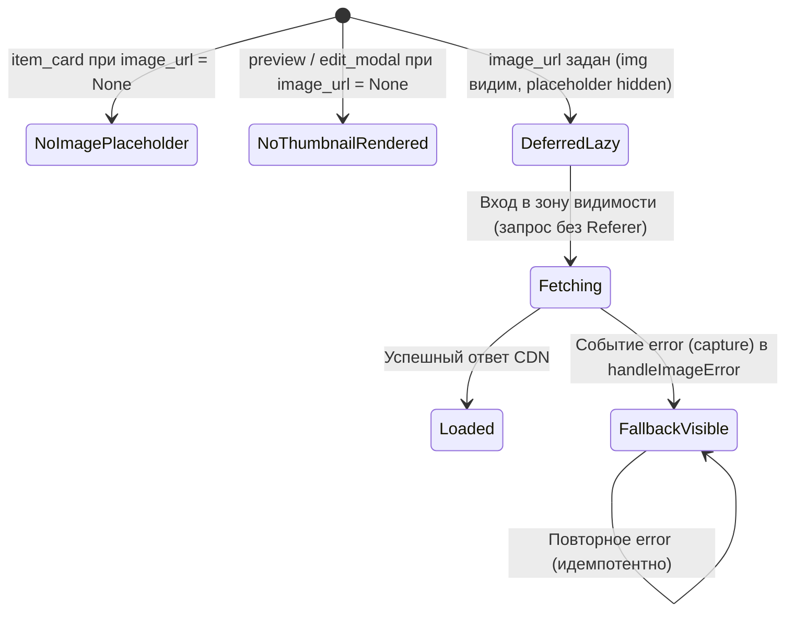

# Спецификация: WISHENKA-107 — Lazy-loading, no-referrer и обработка битых внешних изображений товаров в TMA

**Ключ задачи:** `WISHENKA-107` (устранение технического долга `DEBT-4` из `WISHENKA-14`)  
**Статус:** реализовано (см. [00-roadmap.md](file:///home/src/ai-tasks/WISHENKA-107/00-roadmap.md))  
**Платформы:** Telegram Mini App WebView (FastAPI SSR + HTMX + static CSS/JS)  
**Стек:** Python (Jinja2 / HTML), CSS, JavaScript  
**Связанные документы:** [00-high.md](file:///home/src/specs/00-high.md), [spec.md](file:///home/src/in-docs/spec.md), [miniapp.md](file:///home/src/doc/dev/miniapp.md)

## 1. Назначение и бизнес-цель

### 1.1. Постановка проблемы

В рамках задачи `WISHENKA-14` (`ai-tasks/WISHENKA-14/60-tech-debt.md`, пункт `DEBT-4`) было выявлено, что внешние изображения товаров (`image_url`) в серверных HTML-фрагментах Telegram Mini App (TMA) отображаются тегом `` напрямую, без защитных и оптимизирующих атрибутов и без клиентской обработки сбоев:

- **Отсутствие отложенной загрузки:** при открытии длинных вишлистов с десятками карточек браузер или Telegram WebView немедленно запрашивает все изображения одновременно, включая те, что находятся за пределами видимой области экрана.
- **Передача заголовка `Referer`:** при обращении к внешним CDN-серверам и маркетплейсам передаётся исходный адрес страницы, что приводит к утечке внутреннего URL приложения и к отказам в отдаче картинок со стороны площадок с политикой защиты от хотлинкинга.
- **Отображение «битых» иконок:** если ссылка на изображение устарела, ресурс удалён, вернул `403`/`404`, не ответил по таймауту или недоступен по сети, в интерфейсе отображается стандартный системный значок сломанной картинки вместо визуально согласованной заглушки.

### 1.2. Цели и границы решения

Цели задачи:

1. Включить отложенную загрузку (`loading="lazy"`) для всех внешних миниатюр товаров в TMA, чтобы сократить расход мобильного трафика и ускорить первичную отрисовку вишлистов.
2. Запретить передачу `Referer` при загрузке внешних изображений (`referrerpolicy="no-referrer"`), защитив приватность пользователей и снизив число hotlink-блокировок со стороны маркетплейсов.
3. Реализовать единый CSP-совместимый механизм замены недоступного изображения аккуратным плейсхолдером (`🎁`) без использования inline-скриптов и inline-обработчиков `onerror`.
4. Сохранить без регрессий поведение для позиций без ссылки на изображение (`image_url=None`) и покрыть все три контекста отображения автоматическими тестами.

Границы охвата (Scope / Out of Scope):

- **Входит в задачу:**
  - Карточка желания в списке вишлиста (`item_card.html`).
  - Карточка живого предпросмотра ссылки при быстром добавлении (`item_preview_card.html`).
  - Модальное окно создания и редактирования желания (`item_edit_modal.html`).
  - Стили размеров миниатюр и правила скрытия `[hidden]` (`miniapp.css`).
  - Централизованный capture-phase обработчик ошибок загрузки изображений (`app.js`).
  - Автоматизированное тестовое покрытие (`tests/test_item_image_loading_repro.py`).
- **Не входит в задачу:**
  - Серверное проксирование, скачивание и кэширование миниатюр на бэкенде.
  - Изменение бизнес-логики парсинга метаданных (`ItemPreviewService`) или хранения URL изображений в базе данных.
  - Изменение скрипта оболочки домашнего экрана (`wishenka/web/static/miniapp.js`), который внешние изображения товаров не рендерит.

### 1.3. Ценность для пользователей и системы

- **Для пользователей (Владелец, Участник, Даритель, Анонимный посетитель):** более быстрая загрузка вишлистов на мобильном соединении, корректное отображение товаров с маркетплейсов, фильтрующих `Referer`, и аккуратный визуальный вид карточек, предпросмотра и формы редактирования даже при недоступности внешнего CDN.
- **Для архитектуры системы:** чисто декларативное и CSP-безопасное решение на базе стандартных возможностей HTML/CSS/DOM, не создающее нагрузки на бэкенд и не требующее повторной инициализации слушателей после динамических HTMX-обновлений.

## 2. Функциональные требования и пользовательские сценарии

### 2.1. Поведение во всех TMA-представлениях с внешними изображениями

Обработка охватывает все три Jinja2-шаблона TMA, отображающих внешние изображения товаров (`item.image_url`, `preview.image_url`, `form.image_url`):

| Контекст | Шаблон и маршруты | Поведение при наличии `image_url` | Размер миниатюры | Поведение при `image_url=None` |
| --- | --- | --- | --- | --- |
| Карточка желания в списке | [item_card.html](file:///home/src/wishenka/web/templates/partials/item_card.html) (`GET /web/wishlists/{id}`, `GET /share/{token}`, `/card`, OOB/создание/правка) | Рендерится `` (`loading="lazy"`, `referrerpolicy="no-referrer"`, `data-img-fallback`, `class="item-thumbnail ..."`) и соседний скрытый `.item-thumbnail-placeholder` (`aria-hidden="true"`, `hidden`) | `3rem × 3rem` (`w-12 h-12`) | Рендерится только видимый `.item-thumbnail-placeholder` (без `hidden`) |
| Карточка предпросмотра | [item_preview_card.html](file:///home/src/wishenka/web/templates/partials/item_preview_card.html) (`POST /web/wishlists/{id}/items/preview`) | Рендерится `` (`loading="lazy"`, `referrerpolicy="no-referrer"`, `data-img-fallback`, `class="item-thumbnail ..."`) и соседний скрытый `.item-thumbnail-placeholder` (`aria-hidden="true"`, `hidden`) | `3rem × 3rem` (`w-12 h-12`) | Блок миниатюры и плейсхолдер не выводятся |
| Модальное окно редактирования / создания | [item_edit_modal.html](file:///home/src/wishenka/web/templates/partials/item_edit_modal.html) (`GET /web/wishlists/{id}/items/{item_id}/edit`, `/items/new`, ошибки `400`/`409`/`503`) | Рендерится `` (`loading="lazy"`, `referrerpolicy="no-referrer"`, `data-img-fallback`, `class="item-thumbnail item-thumbnail--lg ..."`) и соседний скрытый `.item-thumbnail-placeholder--lg` (`aria-hidden="true"`, `hidden`) | `4rem × 4rem` (`w-16 h-16`) с рамкой `border` | Блок превью изображения не выводится |

### 2.2. Атрибуты загрузки и механизм клиентского fallback

1. **Отложенная загрузка (`loading="lazy"`):** браузер/WebView откладывает сетевой запрос к внешнему URL изображения до приближения элемента к видимой области экрана (`viewport`).
2. **Запрет передачи `Referer` (`referrerpolicy="no-referrer"`):** при запросе внешнего изображения браузер/WebView не отправляет HTTP-заголовок `Referer` с адресом страницы TMA.
3. **Переключение на плейсхолдер при ошибке загрузки:**
   - Каждое внешнее изображение товара помечается атрибутом `data-img-fallback`.
   - Событие `error` у элемента `` не всплывает (`does not bubble`), поэтому клиентский обработчик регистрируется на `document` в фазе захвата (`useCapture = true`).
   - При возникновении `error` на элементе `IMG` с атрибутом `data-img-fallback` обработчик выставляет `img.hidden = true`, находит соседний `.item-thumbnail-placeholder` в том же родительском контейнере и снимает с него скрытие (`placeholder.hidden = false`).
4. **Отказоустойчивость и идемпотентность обработчика:**
   - Повторное событие `error` на уже переключённой карточке не нарушает состояние DOM (`img.hidden` остаётся `true`, `placeholder.hidden` — `false`).
   - События `error` от `` без `data-img-fallback` или от элементов с `tagName !== 'IMG'` игнорируются.
   - Если соседний `.item-thumbnail-placeholder` по какой-либо причине отсутствует в родительском элементе, `` безопасно скрывается без исключения.
5. **Отказ от проверки на `DOMContentLoaded`:** проверка вида `img.complete && img.naturalWidth === 0` при загрузке документа запрещена, так как для отложенных (`loading="lazy"`) изображений вне `viewport` браузер может возвращать `complete === true` и `naturalWidth === 0` ещё до начала сетевого запроса, что вызывало бы ложное скрытие валидных картинок.

### 2.3. Пользовательские сценарии

- **UC-107.1. Экономия трафика в длинном вишлисте:** Владелец, соавтор, даритель или анонимный посетитель открывает страницу вишлиста с большим числом желаний; браузер загружает миниатюры в области видимости сразу, а остальные — по мере прокрутки списка.
- **UC-107.2. Загрузка фото с площадок с hotlink-фильтрами:** При отображении товара с внешнего маркетплейса в списке, в карточке быстрого предпросмотра или в модальном окне редактирования WebView запрашивает картинку без заголовка `Referer`.
- **UC-107.3. Плавная замена битой ссылки на плейсхолдер:** Если внешний URL изображения недоступен (`403`, `404`, таймаут, ошибка сети или невалидный ресурс), вместо стандартной сломанной иконки отображается заглушка `🎁` в тех же габаритах (`3rem × 3rem` в списке и предпросмотре, `4rem × 4rem` в модальном окне) без сдвига вёрстки.
- **UC-107.4. Автоматическая работа на динамических HTMX-фрагментах:** При подгрузке карточки предпросмотра (`POST /items/preview`), открытии формы редактирования (`GET /items/{id}/edit`), добавлении или OOB-обновлении карточки желания fallback срабатывает сразу благодаря глобальной подписке в фазе захвата.
- **UC-107.5. Позиция без ссылки на изображение:** При `image_url=None` карточка желания в списке показывает видимый плейсхолдер, а карточка предпросмотра и форма редактирования не выводят лишних пустых заглушек.

### 2.4. Продуктовые и технические инварианты

1. **Совместимость с CSP:** все шаблоны и HTMX-фрагменты не содержат встроенных тегов `<script>` без `src` и inline-атрибутов `on*` (включая `onerror`).
2. **Доступность (Accessibility):** при наличии изображения сохраняется осмысленный текст `alt` (`item.title`, `preview.title or preview.store_name or 'Preview'` или локализованный ключ `web.item.image_preview_alt`), а декоративный плейсхолдер скрыт от скринридеров атрибутом `aria-hidden="true"`.
3. **Принцип сюрприза (Surprise Invariant):** переключение миниатюры на плейсхолдер выполняется чисто локально в представлении карточки/формы и не затрагивает проекции прав доступа, бронирования и скрытность данных о дарителях.
4. **Согласованность CSS `[hidden]`:** поскольку `.item-thumbnail-placeholder` задаёт `display: flex`, явное правило `[hidden] { display: none; }` обязательно, чтобы исключить одновременное отображение `` и заглушки.

## 3. Архитектура, компоненты и интерфейсы

### 3.1. Компонентная модель и взаимодействие



Модули и файлы, задействованные в реализации:

| Компонент | Файл | Роль в рамках `WISHENKA-107` |
| --- | --- | --- |
| Карточка желания | [item_card.html](file:///home/src/wishenka/web/templates/partials/item_card.html) | Рендер миниатюры `item.image_url` с атрибутами `loading="lazy"`, `referrerpolicy="no-referrer"`, `data-img-fallback` и скрытым `.item-thumbnail-placeholder`; при `not item.image_url` — видимый плейсхолдер |
| Карточка предпросмотра | [item_preview_card.html](file:///home/src/wishenka/web/templates/partials/item_preview_card.html) | Рендер миниатюры `preview.image_url` (классы `.item-thumbnail w-12 h-12`) со скрытым плейсхолдером; при отсутствии URL миниатюра не выводится |
| Модальное окно редактирования | [item_edit_modal.html](file:///home/src/wishenka/web/templates/partials/item_edit_modal.html) | Рендер увеличенного превью `form.image_url` (`.item-thumbnail--lg`, `.item-thumbnail-placeholder--lg`) со скрытым плейсхолдером; при отсутствии URL блок превью не выводится |
| Базовый шаблон | [base.html](file:///home/src/wishenka/web/templates/base.html) | Подключает `/static/miniapp.css` и `<script src="/static/app.js" defer></script>` для всех серверных страниц TMA |
| Клиентский скрипт | [app.js](file:///home/src/wishenka/web/static/app.js) | Определяет `handleImageError(event)` и регистрирует `document.addEventListener('error', handleImageError, true)` |
| Таблица стилей | [miniapp.css](file:///home/src/wishenka/web/static/miniapp.css) | Задаёт размеры `.item-thumbnail`, `.item-thumbnail-placeholder`, модификаторы `--lg` и правило `[hidden] { display: none; }` |

Обоснование выбранных архитектурных паттернов:

- **Declarative Attributes + Capture-Phase Event Delegation:** единый глобальный слушатель на `document` в фазе захвата заменяет inline `onerror` (запрещённый CSP) и исключает ручную переподписку после `htmx:afterSwap` или OOB-обновлений.
- **Pre-rendered Hidden Sibling Placeholder:** серверный шаблон Jinja2 остаётся единственным источником разметки, эмодзи `🎁` и атрибута `aria-hidden="true"`, а JavaScript лишь переключает булево свойство `.hidden`.

### 3.2. Контракты разметки, стилей и JavaScript

#### HTML-контракт миниатюры с fallback

В общем родительском контейнере при наличии URL рендерится пара из изображения и скрытого плейсхолдера (пример для карточки и предпросмотра в [item_card.html](file:///home/src/wishenka/web/templates/partials/item_card.html#L22-L32) и [item_preview_card.html](file:///home/src/wishenka/web/templates/partials/item_preview_card.html#L18-L26)):

```html

<div class="item-thumbnail-placeholder w-12 h-12 rounded" aria-hidden="true" hidden>🎁</div>
```

Для модального окна редактирования в [item_edit_modal.html](file:///home/src/wishenka/web/templates/partials/item_edit_modal.html#L146-L156) используются модификаторы `--lg` внутри обёртки `<div class="mt-2 flex items-center gap-2">`:

```html

<div class="item-thumbnail-placeholder item-thumbnail-placeholder--lg w-16 h-16 rounded border" aria-hidden="true" hidden>🎁</div>
```

#### CSS-контракт (`wishenka/web/static/miniapp.css`)

В [miniapp.css](file:///home/src/wishenka/web/static/miniapp.css#L88-L113) классы `w-12`/`w-16` дополнены явными правилами размеров и скрытия (так как в `miniapp.css` нет Tailwind-рантайма):

```css
.item-thumbnail {
  width: 3rem;
  height: 3rem;
  object-fit: cover;
  border-radius: 0.375rem;
  flex-shrink: 0;
}
.item-thumbnail-placeholder {
  display: flex;
  align-items: center;
  justify-content: center;
  width: 3rem;
  height: 3rem;
  border-radius: 0.375rem;
  flex-shrink: 0;
  background: #f3e8ec;
}
.item-thumbnail--lg,
.item-thumbnail-placeholder--lg {
  width: 4rem;
  height: 4rem;
}
.item-thumbnail[hidden],
.item-thumbnail-placeholder[hidden] {
  display: none;
}
```

#### JS-контракт (`wishenka/web/static/app.js`)

Обработчик `handleImageError(event)` в [app.js](file:///home/src/wishenka/web/static/app.js#L476-L489):

```javascript
function handleImageError(event) {
  const target = event && event.target;
  if (!target || target.tagName !== 'IMG' || !target.hasAttribute('data-img-fallback')) {
    return;
  }
  target.hidden = true;
  const parent = target.parentElement;
  const placeholder = parent && parent.querySelector('.item-thumbnail-placeholder');
  if (placeholder) {
    placeholder.hidden = false;
  }
}

document.addEventListener('error', handleImageError, true);
```

### 3.3. Переходы состояний миниатюры



При повторном серверном рендере фрагмента через HTMX (например, после сохранения нового URL изображения в модальном окне редактирования или OOB-обновления карточки) DOM-узел заменяется целиком, переводя миниатюру в актуальное начальное состояние.

## 4. Нефункциональные требования, безопасность и наблюдаемость

### 4.1. Производительность, трафик и ограничения

- **Отложенная загрузка без лишнего трафика:** `loading="lazy"` предотвращает одновременное скачивание изображений вне области просмотра при открытии больших списков желаний.
- **Отсутствие дополнительной нагрузки на сервер:** обработка ошибок происходит полностью в браузере/WebView; клиентские error-beacons на бэкенд не отправляются, а серверное проксирование изображений не выполняется.
- **Стабильность геометрии интерфейса:** фиксированные размеры `3rem × 3rem` (для карточек и предпросмотра) и `4rem × 4rem` (для модального окна) вместе с `flex-shrink: 0` и `object-fit: cover` сохраняют вёрстку при переходе между изображением и плейсхолдером.
- **Зависимость от внешних CDN:** при прямом запросе с клиента внешние CDN могут по-прежнему отклонять запросы по причинам, не связанным с `Referer` (региональные блокировки, антибот-фильтры, сбой TLS, несоответствие CSP `img-src 'self' https:`, устаревший URL); во всех этих случаях пользователь получает fallback-плейсхолдер.

### 4.2. Безопасность, CSP и приватность

- **Защита `Referer` на уровне элемента и ответа:** атрибут `referrerpolicy="no-referrer"` на каждом внешнем `` исключает утечку внутреннего адреса TMA при загрузке картинок и дополняет глобальный HTTP-заголовок `Referrer-Policy: no-referrer`, устанавливаемый `BrowserSecurityMiddleware`.
- **Строгая совместимость с Content Security Policy:** отсутствие inline `<script>` и атрибутов `on*` соответствует политике `script-src 'self' https://telegram.org` (заданной в [miniapp.py](file:///home/src/wishenka/web/routes/miniapp.py#L50-L53) с `img-src 'self' https:`) и контракту тестов `tests/test_csp_inline_removal_repro.py`.
- **Приватность и тайна сюрприза:** в клиентской обработке не фигурируют идентификаторы пользователей, токены (`public_token`, `invite_token`) или сведения о бронированиях.

### 4.3. Наблюдаемость: структурированное логирование и метрики

По итогам анализа наблюдаемости ([50-observability.md](file:///home/src/ai-tasks/WISHENKA-107/50-observability.md)):

- **Новые серверные логи и метрики: N/A** — задача не изменяет Python-обработчики маршрутов, доменные сервисы или таблицы SQLite.
- **Отказ от клиентских beacons и шума в консоли:** `handleImageError` намеренно не отправляет `fetch`/`sendBeacon` на сервер и не вызывает `console.log`/`console.warn`, чтобы падения сторонних CDN не создавали лишнюю нагрузку на сервер/БД, не провоцировали срабатывания CSRF/rate-limit и не записывали сторонние URL в серверные логи. При локальной отладке ошибки загрузки видны в DevTools браузера/WebView (вкладка Network).
- **Сохранение штатной телеметрии:** существующие серверные логгеры `wishenka.web.*` и `uvicorn.access` продолжают фиксировать рендеринг страниц и HTMX-фрагментов (`GET /web/wishlists/{id}`, `GET /share/{token}`, `POST /web/wishlists/{id}/items/preview`, `GET /web/wishlists/{id}/items/{item_id}/edit`).
- **Рекомендация на будущее:** если потребуется продуктовая аналитика доли недоступных изображений, её следует оценивать на стороне серверного предпросмотра (`ItemPreviewService`), а не клиентскими маяками при каждом рендере.

## 5. Верификация и критерии приёмки

### 5.1. Автоматизированные тестовые сценарии и результаты проверок

Автоматические тесты реализованы в [tests/test_item_image_loading_repro.py](file:///home/src/tests/test_item_image_loading_repro.py) (для всех тестов установлен `pytestmark = pytest.mark.timeout(30)`):

1. `test_item_card_renders_lazy_no_referrer_and_hidden_placeholder` (параметризован по `kind="owner"` через `GET /web/wishlists/{id}` и `kind="share"` через `GET /share/{token}`): проверяет наличие `loading="lazy"`, `referrerpolicy="no-referrer"`, `data-img-fallback`, класса `item-thumbnail` и соседнего `.item-thumbnail-placeholder[hidden][aria-hidden="true"]` при наличии `image_url`, отсутствие inline-атрибутов `on*`, а также сохранение видимого плейсхолдера без `` при `image_url=None`.
2. `test_item_preview_card_renders_lazy_no_referrer_and_hidden_placeholder` (`POST /web/wishlists/{id}/items/preview` с замоканным `ItemPreviewService.fetch_preview`): проверяет те же атрибуты, скрытый плейсхолдер и отсутствие `on*`.
3. `test_item_preview_card_without_image_renders_no_placeholder`: подтверждает, что при `image_url=None` в карточке предпросмотра не рендерятся ни ``, ни `.item-thumbnail-placeholder`.
4. `test_item_edit_modal_renders_lazy_no_referrer_and_hidden_placeholder` (`GET /web/wishlists/{id}/items/{item_id}/edit`): проверяет классы `.item-thumbnail` и `.item-thumbnail--lg`, `.item-thumbnail-placeholder--lg[hidden][aria-hidden="true"]`, атрибуты загрузки и отсутствие блока превью при `image_url=None`.
5. `test_app_js_handles_image_error_in_capture_phase` (выполнение [app.js](file:///home/src/wishenka/web/static/app.js) в Node `vm` с DOM-заглушками; пропускается, если `node` недоступен): проверяет регистрацию `error`-слушателя в capture-фазе (`useCapture === true`), переключение `img.hidden = true` и `placeholder.hidden = false`, идемпотентность при повторном событии, игнорирование `` без `data-img-fallback` и элементов с `tagName !== 'IMG'`, а также безопасное поведение при отсутствии соседнего плейсхолдера.
6. `test_miniapp_css_defines_hidden_and_thumbnail_sizes` (`GET /static/miniapp.css`): проверяет наличие правил `.item-thumbnail[hidden]`, `.item-thumbnail-placeholder[hidden]`, `.item-thumbnail`, `.item-thumbnail--lg` и `.item-thumbnail-placeholder--lg`.

Результаты проверок качества, зафиксированные в [40-code-cleanup.md](file:///home/src/ai-tasks/WISHENKA-107/40-code-cleanup.md):

- `.venv/bin/ruff check wishenka tests`: пройдено без замечаний (`All checks passed!`).
- `.venv/bin/ruff format --check wishenka tests`: пройдено без замечаний (241 файл отформатирован).
- `.venv/bin/mypy wishenka tests/test_item_image_loading_repro.py tests/test_csp_inline_removal_repro.py`: `Success: no issues found in 105 source files`.
- `.venv/bin/pytest -n 0 tests/test_item_image_loading_repro.py tests/test_csp_inline_removal_repro.py`: целевой прогон — `14 passed in 2.80s` (включая регрессионную проверку отсутствия inline-скриптов и обработчиков `on*` из `tests/test_csp_inline_removal_repro.py`).

*(Примечание: в журнале [00-roadmap.md](file:///home/src/ai-tasks/WISHENKA-107/00-roadmap.md) этапы STEP 1, 2, 4–8 и COMMIT отмечены `[x]`, а пункт STEP 3 оставлен со статусом `[/]`.)*

### 5.2. Критерии приёмки

Задача считается принятой при выполнении всех следующих условий:

1. Во всех трёх TMA-представлениях с внешними изображениями товаров (`item_card.html`, `item_preview_card.html`, `item_edit_modal.html`) каждый тег `` содержит `loading="lazy"`, `referrerpolicy="no-referrer"` и `data-img-fallback`.
2. Рядом с каждым таким `` в том же родительском элементе присутствует `.item-thumbnail-placeholder` с `aria-hidden="true"` и `hidden`.
3. При отсутствии ссылки на изображение (`image_url=None`) поведение не деградирует: в `item_card.html` отображается видимый плейсхолдер без `hidden`, а в `item_preview_card.html` и `item_edit_modal.html` миниатюра и заглушка отсутствуют.
4. При ошибке загрузки внешнего `img[data-img-fallback]` глобальный capture-phase обработчик `handleImageError` в `app.js` скрывает `` и отображает соседний `.item-thumbnail-placeholder` без inline-атрибутов `on*` и без ослабления CSP.
5. Правила CSS в `miniapp.css` обеспечивают габариты `3rem × 3rem` (карточка и предпросмотр) и `4rem × 4rem` (`--lg` в модальном окне) без искажения вёрстки и гарантируют скрытие элементов с атрибутом `hidden` поверх `display: flex`.
6. Линтер (`ruff`), проверка типов (`mypy`) и целевые тесты (`tests/test_item_image_loading_repro.py`, `tests/test_csp_inline_removal_repro.py`) проходят без ошибок.

### 5.3. Известные ограничения и задачи дальнейшего развития

По результатам анализа технического долга ([60-tech-debt.md](file:///home/src/ai-tasks/WISHENKA-107/60-tech-debt.md)) критических блокеров (`blocker`) не обнаружено. Зафиксированы следующие ограничения и `NON-BLOCKER` задачи:

- **Отсутствие реального браузерного E2E-теста для fallback и computed styles (`NON-BLOCKER`, Low → [WISHENKA-271](https://pypost.atlassian.net/browse/WISHENKA-271)):** `test_app_js_handles_image_error_in_capture_phase` тестирует `app.js` в Node `vm` на ручных заглушках `document`/`img` (и пропускается при отсутствии `node`). Требуется добавить тест на базе существующего Chromium/CDP-харнесса (`tests/browser_support.py`), который проверит реальный перехват не всплывающего `error` на сломанном URL (например, локальный маршрут 404), вычисленные стили `display: none` / `display: flex` для `[hidden]` и работу на динамически подменённых HTMX-фрагментах (`item_preview_card`, `item_edit_modal`, OOB `item_card`).
- **Незначительное дублирование разметки в шаблонах (`NON-BLOCKER`, Low → [WISHENKA-270](https://pypost.atlassian.net/browse/WISHENKA-270)):** пара `img[data-img-fallback]` + `.item-thumbnail-placeholder[hidden]` продублирована в трёх партиалах (`item_card.html`, `item_preview_card.html`, `item_edit_modal.html`); при добавлении новых экранов с миниатюрами стоит вынести её в общий Jinja2-макрос.
- **Отсутствие живого обновления превью при ручном редактировании URL в модальном окне:** изменение поля `#item-image-url-input` в `item_edit_modal.html` не перерисовывает и не сбрасывает миниатюру `4rem` на клиенте до отправки формы и серверного перерендера.
- **Жёстко заданные визуальные значения и легаси-утилиты:** символ `🎁` и цвет фона `#f3e8ec` в `.item-thumbnail-placeholder` заданы напрямую без CSS custom properties, а в шаблонах сохраняются прежние утилитарные классы (`w-12`, `h-12`, `w-16`, `h-16`, `rounded`, `border`) рядом с явными классами `.item-thumbnail` / `--lg`.
- **Прямые клиентские запросы к внешним CDN:** серверное проксирование/кэширование миниатюр не входит в текущую задачу; доступность изображений и их загрузка с третьих доменов по-прежнему зависят от поведения внешнего CDN в части блокировок вне `Referer`, сетевых сбоев и протухших ссылок.
