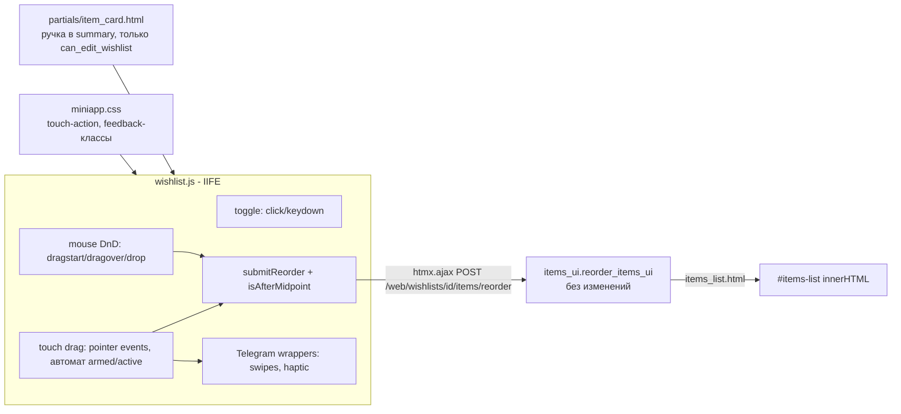

# WISHENKA-109: Touch-friendly drag-reorder списка желаний (Telegram mobile)

## Research

Дата исследования: 2026-11-14. Язык: Python (шаблоны, тесты) + JavaScript (`wishlist.js`), см.
`lsr-python`, `lsr-javascript`, `lsr-markdown`, `do-testing`. Содержимое веб-страниц использовано
только как данные. Факты, которые нельзя проверить без реального устройства, помечены
«проверить на Step 4».

### Что есть в коде (после WISHENKA-108)

- `wishenka/web/static/wishlist.js` (IIFE, `'use strict'`, делегированные слушатели на `document`):
  - toggle: `click`/`keydown` на `.item-card-summary`, исключения
    `a, button, input, select, textarea, [data-no-toggle]`;
  - mouse DnD: `dragstart` (карточка `.item-card[draggable="true"]`, переменная `dragged`),
    `dragover` (`preventDefault` внутри `#items-list`), `drop` (проверка id из
    `#items-list[data-wishlist-id]`, `window.htmx`; `after = clientY > rect.top + rect.height / 2`;
    `list.insertBefore` и затем `htmx.ajax('POST', '/web/wishlists/<id>/items/reorder', { target:
    '#items-list', swap: 'innerHTML', values: { item_ids } })`), `dragend`.
    Логика drop (проверки, вставка, сбор id, запрос) целиком внутри одного обработчика: для
    касаний её надо вынести (это зафиксировано в `ai-tasks/WISHENKA-108/60-tech-debt.md`,
    «Long `drop` handler», «address inside WISHENKA-109»).
- `partials/item_card.html`: корневой `.item-card` с `draggable="true"` только при
  `can_edit_wishlist`; `.item-card-summary` (`role="button"`, `tabindex="0"`, `aria-expanded`);
  `.item-drag-handle` (`⠿`) находится внутри
  `.item-card-details` (скрыт `hidden`), т. е. виден только у раскрытой карточки; рядом кнопки
  `btn-move-up`/`btn-move-down` (доступность, `data-no-toggle`).
- `miniapp.css:65`: `.item-drag-handle { cursor: grab; padding: .5rem; touch-action: none; }`.
  Для `.item-card-summary` задано лишь `cursor: pointer` (touch-action по умолчанию `auto`, свайп
  скроллит страницу).
- `base.html`: синхронные `telegram-web-app.js`, `htmx 1.9.12`, `json-enc` (unpkg, без SRI),
  затем `wishlist.js` с `defer`. Inline-скрипт остаётся (CSRF, `swapWishCard`, брони).
- Эндпоинт `POST /web/wishlists/{id}/items/reorder` (`items_ui.py:861`) принимает
  `item_ids: list[int]` формы, проверяет точную перестановку активных желаний (`400 Invalid item
  order` иначе), возвращает `partials/items_list.html`. Серверной правки не требуется
  (критерий 8).
- Перерисовка: все htmx-обновления идут внутрь `#items-list` (innerHTML/beforeend/OOB), сам
  `#items-list` не заменяется (инвариант WISHENKA-108, защищён тестом). После `innerHTML`-swap все
  карточки приходят с `aria-expanded="false"` (так уже происходит при mouse DnD и кнопках
  ↑/↓); `swapWishCard` (outerHTML одной карточки) сохраняет раскрытие только для броней.
- Существующие тесты, затрагиваемые разметкой: `tests/test_wish_items_list_reorder_ui.py:175`
  (`"item-drag-handle" in html` на странице владельца) и `:544` (`not in share_html`) остаются
  истинными при переносе ручки в summary.
- Браузерная инфраструктура: `tests/browser_support.py` (поиск/проба Chromium) и
  `tests/test_wishlist_management_browser.py` (запуск `uvicorn` в потоке, headless Chromium,
  CDP по WebSocket, собственный `send_command`; маркер `@pytest.mark.browser`, таймаут
  модуля 45 с). Хелперы CDP не вынесены в общий модуль. `Input.dispatchTouchEvent` в репозитории
  не используется.

### (a) Pointer events в собственном `wishlist.js` против SortableJS

Источники: [SortableJS README](https://github.com/SortableJS/Sortable) (опции `delay`,
`delayOnTouchOnly`, `touchStartThreshold`, `forceFallback`, рекомендованный CDN jsDelivr с
`@latest`; на странице нет сведений об известных проблемах iOS/WebView, 487 открытых issue),
[MDN Pointer events](https://developer.mozilla.org/en-US/docs/Web/API/Pointer_events).

| Критерий | Pointer events, свой код | SortableJS |
| -------- | ------------------------ | ---------- |
| Новая внешняя зависимость | нет | да: CDN-скрипт (jsDelivr/unpkg), без SRI, как htmx/telegram: расширяет долг «Unpinned CDN scripts» (WISHENKA-15) |
| Совместимость с CSP Mini App shell (`script-src 'self' https://telegram.org`) | не затрагивает | на странице shell (`GET /`) такой скрипт был бы заблокирован; сегодня он грузился бы только на `/web/*` без CSP, что закрывает путь к строгой CSP (цель WISHENKA-108) |
| Подтверждённая работа в Telegram WebView | требует ручной проверки | не подтверждена источником (в README нет данных) |
| Контракт с нашим сервером | полный контроль: полный список id, оптимистичная вставка, `htmx.ajax` | нужен адаптер `onEnd` -> тот же submit; Sortable двигает DOM сам |
| Взаимодействие с нативным mouse DnD | свой код включается только для `pointerType === 'touch'`, mouse DnD не трогаем | заменил бы весь существующий DnD (требование 7: mouse должен остаться как есть) и его тесты |
| Объём кода | порядка 150-200 строк JS | меньше нашего кода, но +~40 КБ чужого (оценка, не из источника; проверить на Step 4 при желании) |

Решение: **собственная реализация на Pointer Events**, без новых зависимостей. Обоснование:
(1) требования явно просят предпочесть отсутствие новой зависимости; (2) нужен только вертикальный
список, одно жестовое действие и один submit, что невелико; (3) существующий mouse DnD сохраняется
без переделки; (4) никакого расширения CDN-долга. Альтернатива (SortableJS с `forceFallback`,
`delayOnTouchOnly`) отклонена; пересмотр возможен, если ручной тест на реальных устройствах
(Step 4) покажет непреодолимые проблемы WebView. Это допущение фиксируется в Q&A.

### (b) Дизайн старта жеста: видимая ручка, а не long-press

Критерий 1 требует старт со свёрнутой карточки без её раскрытия, критерии 4, 5 и 15 требуют, чтобы
tap раскрывал, свайп скроллил, а перенос работал и у раскрытой карточки.

| Вариант | Плюсы | Минусы |
| ------- | ----- | ------ |
| Видимая ручка в summary (выбран) | обнаруживаема; не конфликтует со скроллом (`touch-action: none` только на ручке, остальная карточка скроллит); не нужен таймер и порог; одинаково работает у свёрнутой и раскрытой карточки (summary виден всегда); нет конфликта с tap-to-expand (ручка `data-no-toggle`) | занимает ~44 px по ширине compact-строки; свайп, начатый на ручке, не скроллит страницу |
| Long-press по всей карточке | не занимает места | не обнаруживаем; нужен таймер (напр. 400-500 мс) и порог движения (напр. 8-10 px); на iOS/Android long-press по тексту/изображению вызывает выделение, системное контекстное меню и `-webkit-touch-callout` (подавлять нужно на всей карточке, ломая выделение текста); решение «скролл против жеста» принимается после начала касания, а `touch-action` нельзя поменять посреди жеста (проверить на Step 4) |

Решение: **одна видимая ручка `⠿` в `.item-card-summary`, жест стартует сразу по `pointerdown`
на ручке (`pointerType === 'touch'`)**. Единственная ручка переносится из `.item-card-details`
в summary (не дублируется), поэтому тест `:175` остаётся верным и доступность не меняется:
summary имеет `role="button"`, потомки такой роли презентационные, поэтому ручка `aria-hidden="true"`;
путь для вспомогательных технологий остаётся прежним (кнопки ↑/↓ в раскрытой карточке, Enter/Space
для toggle).

Стадии жеста (конечный автомат на модульной переменной `touchDrag`):

1. `pointerdown` (touch, на `.item-drag-handle` внутри `.item-card[draggable="true"]` внутри
   `#items-list`, нет другого активного жеста): состояние `armed`, `setPointerCapture`,
   запоминается `pointerId` и стартовые координаты, `preventDefault` на `dragstart`
   (см. ниже), вызов `disableVerticalSwipes` (см. ниже).
2. `pointermove` с тем же `pointerId`: пока смещение меньше `DRAG_START_THRESHOLD_PX = 4` жест
   `armed` (тап по ручке ничего не делает и не раскрывает карточку); после порога жест `active`:
   карточка получает класс `is-touch-dragging`, `body` получает `is-touch-reordering`, один
   лёгкий haptic `impactOccurred('light')` (если доступен), стартует `requestAnimationFrame`
   цикл автоскролла. Далее каждый `pointermove` обновляет `translateY` перетаскиваемой карточки
   (визуально следует за пальцем) и вызывает `updateDropTarget`.
3. `pointerup`: если `active` и цель есть, один вызов общей `submitReorder(...)`; затем всегда
   `endTouchDrag()` (сброс классов, остановка rAF, `releasePointerCapture`, `enableVerticalSwipes`).
4. Любая отмена (раздел (c)) -> `cancelTouchDrag()`: сброс без отправки; DOM не менялся, значит
   список показывает серверный порядок.

Развёрнутая карточка (критерий 15): жест тот же. На время `active` на перетаскиваемую карточку
вешается класс `is-touch-dragging`, CSS скрывает у неё `.item-card-details`
(`display: none`), **атрибуты `hidden` и `aria-expanded` не меняются**, поэтому при отмене
состояние раскрытия сохраняется без потерь. После успешного reorder список перерисовывается
сервером (`innerHTML`), и все карточки приходят свёрнутыми. Это уже существующее поведение mouse DnD
и кнопок ↑/↓, оно не меняется (документируется в Step 8). Оно же объясняет, почему критерий
«состояние не теряется без уведомления» выполняется: потеря раскрытия после сохранения
происходит так же, как у остальных способов, и это зафиксировано в документации.

Конфликт с нативным DnD: `.item-card` остаётся `draggable="true"` (нужно для mouse). На touch
Chrome Android может начать нативное перетаскивание по долгому нажатию на draggable-элементе;
это породило бы `pointercancel` и двойную обработку. Защита: в существующем `dragstart`
добавляется ранний выход `if (touchDrag) { event.preventDefault(); return; }`. Дополнительно
(проверить на Step 4) возможна установка `card.draggable = false` на время `armed`/`active` и
восстановление в `endTouchDrag`. Выбор между ними делается по результату ручной проверки;
минимум обязателен `preventDefault` в `dragstart`.

Подавление «призрачного» клика: после `pointerup` браузер порождает `click`; с pointer capture
цель клика может оказаться предком (summary) и вызвать toggle. Защита: capture-фаза
`document.addEventListener('click', handler, true)`: если `suppressNextClick` выставлен (в конце
`active`-жеста, сбрасывается по `setTimeout(..., 0)` не позже ~400 мс), событие гасится
(`preventDefault`, `stopPropagation`). Критерий 4 («завершение drag не переключает карточку»).

Прокрутка (критерий 5): CSS `touch-action: none` только на `.item-drag-handle`; summary и тело
карточки не получают `touch-action` (остаются `auto`, вертикальный свайп скроллит). Ручка шириной не
меньше 44 px (`min-width/min-height: 44px`, паддинг) — критерий touch-target проекта.
Длинные списки: автоскролл (раздел (c)); запасной вариант — кнопки ↑/↓.

Только `pointerType === 'touch'`: для `mouse` работает существующий HTML5 DnD (двойной обработки
нет); `pen` оставлен нативному пути (на настольных ОС перо ведёт себя как мышь для DnD, на
планшетах обработка пером не нужна в задаче; допущение, зафиксировано в Q&A).

#### Telegram: свайп закрытия/сворачивания и haptic

Источник: [Telegram Mini Apps (Bot API)](https://core.telegram.org/bots/webapps) (страница
прочитана не целиком: прочитано 100000 из ~115000 символов; нужные разделы входят в прочитанную
часть).

- `WebApp.disableVerticalSwipes()` / `enableVerticalSwipes()` / `isVerticalSwipesEnabled`:
  **Bot API 7.7** (changelog от 7 июля 2024). Отключает свайпы вниз, сворачивающие/закрывающие
  Mini App; страница советует оставлять включёнными, если нет конфликта с жестами приложения.
  Даже при отключении пользователь может свернуть/закрыть приложение свайпом по шапке (платформенное
  ограничение, документируем).
- `WebApp.isVersionAtLeast(version)`: Bot API 6.1.
- `WebApp.HapticFeedback.impactOccurred(style)` (стили light/medium/heavy/rigid/soft) и
  `selectionChanged()`: Bot API 6.1+.
- `enableClosingConfirmation()`: Bot API 6.2; не используется (диалог закрытия не решает проблему и
  изменил бы поведение продукта).

Дизайн интеграции (вспомогательная функция `telegramWebApp()` возвращает `window.Telegram?.WebApp`
или `null`):

- В начале жеста (`pointerdown` на ручке): если `webApp` есть, `webApp.isVersionAtLeast('7.7')` и
  `webApp.isVerticalSwipesEnabled === true`, вызывается `disableVerticalSwipes()`; флаг
  `swipesWereEnabled = true` запоминается. В `endTouchDrag()` (и при любой отмене) вызывается
  `enableVerticalSwipes()` только если `swipesWereEnabled`. Так продукт не меняет глобальные настройки
  Mini App сверх длительности жеста и не включает то, что было выключено другим кодом.
- Любая ошибка вызова SDK глотается (`try/catch` вокруг SDK-вызовов, `console.warn` один раз),
  жест продолжается.
- Деградация: версия клиента `< 7.7`, SDK не загружен (CDN заблокирован, обычный браузер), `webApp`
  отсутствует: вызовов нет; жест работает, но на старых клиентах нисходящий свайп на ручке, особенно
  у самого верха списка, может свернуть Mini App (платформенное ограничение, документировать в
  Step 8, критерий 12/14). Telegram Web (браузер) не сворачивает окно свайпом.
- Haptic: `impactOccurred('light')` при переходе `armed -> active`, `selectionChanged()` при
  смене целевой карточки (не чаще одного раза за смену). Только при `isVersionAtLeast('6.1')`; без
  обязательности, тихая деградация.
- Не проверено: на каком этапе жеста нативная обёртка Telegram принимает решение о свайпе (на
  `touchstart` или по движению) и достаточно ли вызова `disableVerticalSwipes()` на `pointerdown`.
  Проверить на Step 4 на реальных iOS и Android клиентах (ручной чек-лист, раздел (d)). Если
  окажется недостаточно, запасной вариант: отключать свайпы на всё время нахождения на странице
  владельца (при наличии ручек). Решение будет внесено как отклонение в Step 4/7.
- Дополнительная защита (проверить на Step 4): на время жеста `html.is-touch-reordering
  { overscroll-behavior-y: contain; }` против pull-to-refresh/резинового скролла.

### (c) Детали жеста

**Pointer capture и отмена.** Источник: MDN Pointer events (на странице подтверждено: `pointercancel`
срабатывает, когда браузер решил трактовать касание как pan/zoom либо устройство деактивировано;
для touch неявный захват включается на `pointerdown`; захват снимается автоматически после
`pointerup`/`pointercancel`; `setPointerCapture` нужно вызывать после перемещений DOM; правило
«`touch-action` читается на старте касания, `preventDefault` на `pointermove` скролл не
останавливает» на этой странице не описано, формулировка берётся из спецификации
[Pointer Events](https://www.w3.org/TR/pointerevents/) и не проверялась в этом исследовании:
проверить на Step 4). Вывод: `touch-action: none` на ручке обязателен (CSS), а
не `preventDefault()` в обработчике.

Отмена (`cancelTouchDrag`, без запроса) по:

| Событие | Причина |
| ------- | ------- |
| `pointercancel` (тот же `pointerId`) | система забрала жест |
| `lostpointercapture` (до `pointerup`) | потеря захвата (например, перерисовка DOM) |
| `pointerdown` другого `pointerId` (второй палец) | критерий 6 |
| `keydown` `Escape` | отмена с клавиатуры/эмулятора |
| `visibilitychange` (`document.hidden`) и `window` `blur` | приложение свернуто |
| `htmx:beforeSwap` с целью `#items-list` | список перерисовывается, карточка может исчезнуть |
| `contextmenu` на ручке | подавляется во время жеста (`preventDefault`) |
| `pointerup` без цели (над собой, вне списка, цель не найдена) | ничего не отправляется (критерий 2) |

Перетаскиваемая карточка остаётся в DOM на месте всё время жеста (смещается только `transform`),
поэтому отмена не требует восстановления порядка. Перед `submitReorder` проверяется
`document.contains(card)` и что `card.parentElement` всё ещё `#items-list`.

**Определение цели.** На каждом `pointermove` и каждом кадре автоскролла:
`document.elementFromPoint(lastX, lastY)`; перетаскиваемая карточка при `active` получает
`pointer-events: none` (CSS `.is-touch-dragging`), чтобы не перекрывать собственный хит-тест.
Цель = `closest('.item-card')` внутри `#items-list`; `target === card` или не найдена -> цели нет.
`after = isAfterMidpoint(clientY, target.getBoundingClientRect())` (та же формула, что у mouse:
`clientY > rect.top + rect.height / 2`). Подсветка: `drop-before` или `drop-after` на цели
(убирается при смене/завершении).

**Общий код с mouse.** Выделяются функции (все внутри IIFE, без глобалов):

- `isAfterMidpoint(clientY, rect)` (чистая; используется в `drop` и в touch);
- `submitReorder(list, card, target, after)`: проверка `data-wishlist-id` и `window.htmx`
  (то же сообщение `console.warn`, что сегодня), `list.insertBefore(card, after ? target.nextSibling
  : target)`, сбор `item_ids`, единственный вызов `window.htmx.ajax('POST', ...)`. Возвращает
  `true`/`false`. `drop` вызывает её же. Это и есть единственная точка отправки (критерии 2, 8, 11:
  один запрос на жест).

Поведение `drop` для mouse не меняется (текст предупреждений и условия сохраняются).

**Автоскролл.** `requestAnimationFrame`-цикл при `active`: если `lastY` в пределах
`AUTOSCROLL_EDGE_PX = 64` от верхней/нижней границы окна (`window.innerHeight`), прокрутка
`window.scrollBy(0, ±speed)`, где `speed` линейно растёт от 0 до `AUTOSCROLL_MAX_PX = 14` за кадр
по глубине в зоне; после прокрутки пересчитывается цель по `elementFromPoint` и позиция
`translateY` (с учётом `scrollY`-дельты). Цикл останавливается в `endTouchDrag`. Источник чисел:
эвристика проекта (не из источника); проверить на Step 4 на устройстве. Запасной путь: кнопки
↑/↓.

**CSS (`miniapp.css`).**

- `.item-drag-handle`: `display: inline-flex; align-items: center; justify-content: center;
  min-width: 44px; min-height: 44px; touch-action: none; user-select: none;
  -webkit-user-select: none; -webkit-touch-callout: none; cursor: grab;` (padding и cursor
  сохраняются).
- `.item-card-summary`: без `touch-action` (guard-тест, что `none` на summary не появился).
- `.item-card.is-touch-dragging`: `position: relative; z-index: 10; opacity: .85;
  box-shadow: ...; pointer-events: none; will-change: transform;`
  и `.item-card.is-touch-dragging .item-card-details { display: none; }`.
- `.item-card.drop-before { box-shadow: 0 -3px 0 0 #6d28d9; }`,
  `.item-card.drop-after { box-shadow: 0 3px 0 0 #6d28d9; }` (цвет из текущей палитры файла).
- `body.is-touch-reordering { user-select: none; -webkit-user-select: none; }`.

**Гейт на владельца.** Ручка рендерится только внутри ``; JS стартует жест
только от `.item-drag-handle` внутри `.item-card[draggable="true"]` и `#items-list`. На странице
`/share/...` разметка не содержит ни ручки, ни `draggable` -> жест невозможен
(критерий 10). Серверные проверки прав не меняются.

**Повторная инициализация после swap.** Все слушатели (`pointerdown/move/up/cancel`,
`lostpointercapture`, `keydown`, `click` capture, `dragstart` и др.) делегированы на `document`
и регистрируются один раз при загрузке скрипта; перерисовка внутри `#items-list` их не затрагивает,
повторной инициализации нет, двойных срабатываний нет (критерий 11). Состояние `touchDrag`
сбрасывается `htmx:beforeSwap` (цель `#items-list`) и в `endTouchDrag`, гонка «новый жест при запросе
в полёте» допустима (сервер валидирует перестановку, при расхождении вернёт 400, как у mouse).
Существующее поведение при `400` (оптимистичная вставка остаётся в DOM до перезагрузки)
унаследовано от mouse DnD и не меняется в этой задаче.

### (d) Стратегия тестов

- JS-раннера нет (`package.json` отсутствует). Node есть на машине разработчика, но проект его не
  использует, добавлять раннер вне scope (требования). Поэтому: **Python-тесты, проверяющие
  токены статического скрипта, CSS и разметки**. Это слабые строковые проверки (комментарий может
  удовлетворить их; поведение жеста они не исполняют); так же сказано в
  `doc/dev/miniapp.md` §9.8.1 для WISHENKA-108.
- Настоящий touch-drag через CDP (`Emulation.setTouchEmulationEnabled`,
  `Input.dispatchTouchEvent` `touchStart/touchMove/touchEnd`) технически выполним в имеющейся
  инфраструктуре (headless Chromium, `send_command`), но требования относят браузерные тесты
  toggle/drag, включая touch-эмуляцию, к **WISHENKA-110** (Out of scope). Решение: **в этой задаче
  committed CDP-теста нет**; WISHENKA-110 ссылается на этот раздел и добавляет сценарии
  (touch-drag, tap-vs-drag, cancel, авто-скролл). Дублировать общий CDP-хелпер здесь не нужно.
- Вместо этого на Step 4 выполняется одноразовый ручной CDP-прогон (как в WISHENKA-108,
  не коммитится) и ручной чек-лист на реальных устройствах (Telegram iOS/Android, Telegram Web):
  1. тап по summary раскрывает/сворачивает; тап по ручке ничего не делает;
  2. перенос со свёрнутой карточки (верхняя/нижняя половина цели), перенос раскрытой карточки;
  3. вертикальный свайп по карточке вне ручки скроллит и ничего не переставляет;
  4. автоскролл у края на длинном списке;
  5. второй палец, сворачивание приложения, Escape (эмулятор): ничего не сохраняется;
  6. после reorder повторный перенос работает без перезагрузки, один запрос на жест;
  7. Mini App не сворачивается во время жеста (версии клиента >= 7.7) / задокументированное
     ограничение для старых клиентов;
  8. share-страница: ручки нет.
  Результат записывается в roadmap (Step 4).
- Все тесты: `pytestmark = pytest.mark.timeout(30)` (do-testing, уровень «pure unit/HTML
  inspection»), без сети и без браузера, без асинхронных ожиданий (кроме `asyncio.run(seed())`
  как в `test_wishlist_static_script.py`).

## Implementation Plan

1. **`partials/item_card.html`**: добавить `⠿` в начало `.item-card-summary` под
   ``; удалить старую ручку из `.item-actions`. Остальное (`draggable`,
   кнопки ↑/↓, `data-no-toggle`, роли) без изменений.
2. **`wishenka/web/static/wishlist.js`**: рефакторинг в общие `isAfterMidpoint` и `submitReorder`;
   `drop` вызывает `submitReorder`; новые константы (`DRAG_START_THRESHOLD_PX`,
   `AUTOSCROLL_EDGE_PX`, `AUTOSCROLL_MAX_PX`), состояние `touchDrag`, делегированные обработчики
   `pointerdown`, `pointermove`, `pointerup`, `pointercancel`, `lostpointercapture`, `keydown`
   (`Escape`), `visibilitychange`, `htmx:beforeSwap`, capture-`click` для подавления,
   `dragstart` guard, функции `startTouchDrag`, `updateDropTarget`, `autoScrollTick`,
   `endTouchDrag`, `cancelTouchDrag`, обёртки Telegram (`telegramWebApp`, `setSwipesDisabled`,
   `haptic`). Все SDK-вызовы под `try/catch`. JSDoc на всех функциях (`lsr-javascript`).
3. **`wishenka/web/static/miniapp.css`**: правила из раздела (c).
4. **Тесты**: новый файл `tests/test_wishlist_touch_reorder.py` (Step 3), правка существующих
   тестов не требуется (проверено: `:175`/`:544` остаются истинными; `test_wishlist_static_script.py`
   проверяет токены `dragstart`/`dragover`/`drop`/`dragend`/`/items/reorder`, которые остаются).
5. **Документация (Step 8)**: `doc/dev/miniapp.md` §9.8.1 (описать touch-жест, убрать «touch
   relies on move buttons until WISHENKA-109», обновить Known limits и Tests), строки
   `miniapp.md` 458-461 и 659-661 (раздел troubleshooting про `draggable`), `doc/dev/wishlists.md`
   около 293-302 (описание `wishlist.js`); `in-docs/spec.md` §5.4 / UC-03: правка не нужна, спецификация
   уже говорит «порядок можно менять вручную» без указания устройства (проверить формулировку на
   Step 8; править только при явном противоречии).
6. Ручной чек-лист и одноразовый CDP-прогон (раздел (d)); результат в roadmap.

Последовательность: исследование (этот шаг) -> красный тест (Step 3) -> разметка, CSS, JS до
зелёного (Step 4) -> ручные проверки -> документация (Step 8).

**Mandatory — Failing Repro (next Step 3):**

Файл `tests/test_wishlist_touch_reorder.py`, модульный `pytestmark = pytest.mark.timeout(30)`, стиль
и фикстура `seeded` как в `tests/test_wishlist_static_script.py` (изолированная SQLite, владелец и
два желания, `TestClient`, BeautifulSoup; без сети и браузера; детерминированно). Страницы
владельца и share запрашиваются теми же способами. Группы (все «красные» тесты падают на текущем коде
по указанным причинам; guard-тесты зелёные по замыслу и помечены в docstring):

- **A. Разметка владельца (красные).**
  - `test_owner_summary_contains_single_drag_handle`: в каждой `.item-card-summary` ровно один
    `.item-drag-handle` с `data-no-toggle` и `aria-hidden="true"`. Сейчас ручка в details: красный.
  - `test_owner_details_has_no_drag_handle`: ни одного `.item-drag-handle` внутри
    `.item-card-details` (ручка перенесена, не дублируется). Сейчас она там: красный.
- **B. Разметка и безопасность (guard, зелёные).**
  - `test_share_page_has_no_handle_or_draggable`: на `/share/<token>` нет `.item-drag-handle` и
    `[draggable]`.
  - `test_owner_cards_keep_draggable_and_move_buttons`: у владельца `draggable="true"`,
    `.btn-move-up`/`.btn-move-down` с `aria-label`, summary сохраняет `role/tabindex/aria-expanded`.
  - `test_no_new_third_party_scripts`: множество внешних `<script src>` равно
    {telegram-web-app.js, htmx.org@1.9.12, htmx json-enc}; нет `sortable`.
- **C. Токены `/static/wishlist.js` (красные; слабые проверки).** Для каждой пары тест
  параметризован: `pointerdown`, `pointermove`, `pointerup`, `pointercancel`,
  `lostpointercapture`, `setPointerCapture`, `elementFromPoint`, `'touch'`, `'Escape'`,
  `requestAnimationFrame`, `visibilitychange`, `htmx:beforeSwap`, `disableVerticalSwipes`,
  `enableVerticalSwipes`, `isVersionAtLeast`, `HapticFeedback`, `.item-drag-handle`,
  `is-touch-dragging`, `drop-before`, `drop-after`. Сейчас ни одного токена нет: красные.
  Структурные проверки: `body.count("htmx.ajax(") == 1` (единая точка отправки; сейчас 1, поэтому
  как guard) и `"pointerType" in body` (красный); `"submitReorder" in body` и
  `"isAfterMidpoint" in body` (красные).
  Docstring честно называет проверки строковыми.
- **D. CSS `/static/miniapp.css` (красные, кроме guard).** Извлечение блока правила регулярным
  выражением по селектору:
  - `.item-drag-handle` содержит `touch-action: none`, `user-select: none`,
    `-webkit-touch-callout: none`, `min-width: 44px` (красный: сейчас только `touch-action`, `cursor`,
    `padding`);
  - есть правила `.is-touch-dragging`, `.drop-before`, `.drop-after` (красный);
  - правило `.item-card-summary` не содержит `touch-action: none` (guard, зелёный).
- Последовательность: Step 3 пишет файл, запускает только его, фиксирует красный результат с
  причинами; production-код не меняется; Step 4 делает зелёным.

Известное ограничение репро: тесты C/D подтверждают наличие токенов, а не поведение жеста;
поведение проверяется ручным чек-листом и позже WISHENKA-110.

## Architecture

Модули и ответственность (клиентская часть; серверных изменений нет):

Взаимодействие: `pointerdown` на ручке запускает конечный автомат `touchDrag`; хит-тест
(`elementFromPoint`) определяет цель и половину; `pointerup` вызывает `submitReorder` (общий путь с
`drop`), который двигает DOM, собирает полный список id и отправляет один htmx-запрос; сервер валидирует
и возвращает список, `htmx` заменяет содержимое `#items-list`.

Паттерны и обоснование:

- **Делегирование на `document`** (как в WISHENKA-108): нет повторной инициализации после swap.
- **Один модульный автомат состояния** (`touchDrag = null | {state: 'armed'|'active', ...}`):
  один активный жест, второй палец отменяет.
- **Общий submit** (`submitReorder`, `isAfterMidpoint`): одинаковая семантика before/after и один
  контракт для mouse и touch; снимает долг «Long `drop` handler».
- **Прогрессивное улучшение**: Telegram-интеграция опциональна и деградирует молча.
- **Нет новых зависимостей**: раздел (a).

Интерфейсы:

- DOM-контракт (неизменный): `#items-list[data-wishlist-id]`, `.item-card[data-item-id]`,
  `.item-card[draggable="true"]` (владелец), `.item-card-summary`, `.item-card-details`.
- Новый DOM-контракт: `.item-drag-handle` внутри `.item-card-summary` (только владелец).
- CSS-классы состояния: `is-touch-dragging` (карточка), `drop-before`/`drop-after` (цель),
  `is-touch-reordering` (body/html).
- Сетевой контракт: `POST /web/wishlists/{id}/items/reorder`, форма `item_ids` (список всех активных
  id в новом порядке). Без изменений.
- Внутренние функции JS: `isAfterMidpoint(clientY: number, rect: DOMRect): boolean`;
  `submitReorder(list: Element, card: Element, target: Element, after: boolean): boolean`;
  `startTouchDrag`, `updateDropTarget(x, y)`, `autoScrollTick()`, `endTouchDrag()`,
  `cancelTouchDrag(reason)`; `telegramWebApp(): object | null`.
- Внешний API Telegram: `WebApp.isVersionAtLeast('7.7'|'6.1')`, `isVerticalSwipesEnabled`,
  `disableVerticalSwipes()`, `enableVerticalSwipes()`, `HapticFeedback.impactOccurred('light')`,
  `HapticFeedback.selectionChanged()`.

Соответствие критериям: 1 (ручка в summary, старт со свёрнутой карточки), 2 (общий
`isAfterMidpoint`, нет цели -> нет запроса), 3 (классы обратной связи, haptic), 4 (ручка
`data-no-toggle`, подавление призрачного click), 5 (`touch-action: none` только на ручке, автоскролл),
6 (раздел (c): таблица отмен, DOM не меняется до submit), 7 (mouse DnD и кнопки не тронуты),
8 (тот же эндпоинт, полный список), 9 (кнопки ↑/↓ и клавиатурный toggle не тронуты), 10 (разметка
только при `can_edit_wishlist`), 11 (делегирование, сброс по `htmx:beforeSwap`), 12 и 14
(Telegram API 7.7 и документированные пределы; ручная проверка), 13 (регрессия: полный прогон),
15 (CSS скрывает details на время жеста без изменения `aria-expanded`).

Риски и открытые проверки (все «проверить на Step 4»): достаточность `disableVerticalSwipes` на
`pointerdown`; поведение нативного DnD Chrome Android на `draggable` при touch; цель клика после
захвата указателя; пороги автоскролла; `elementFromPoint` с `pointer-events: none` на карточке в
iOS WebView.

## Q&A

- **Q: Почему не SortableJS?**
  A: Новая CDN-зависимость без SRI расширяет долг WISHENKA-15, закрывает путь к строгой CSP, не
  подтверждена для Telegram WebView и заменила бы рабочий mouse DnD. Задача сводится к одному
  вертикальному списку с одним жестом; своя реализация на Pointer Events (~150-200 строк) дешевле
  по рискам. Источник: [SortableJS README](https://github.com/SortableJS/Sortable).
- **Q: Почему ручка, а не long-press?**
  A: Ручка обнаруживаема, не требует таймера и порога, не борется с выделением текста и
  системным меню long-press, сохраняет скролл вне ручки. Недостаток (свайп с ручки не скроллит;
  ~44 px ширины в compact-строке) принят.
- **Q: Что с раскрытой карточкой?**
  A: Ручка в summary, поэтому жест тот же. На время жеста details скрываются классом, а
  `aria-expanded`/`hidden` не меняются; при отмене состояние цело; после сохранения список
  перерисовывается сервером и карточки свёрнуты (как после mouse DnD и ↑/↓ уже сегодня).
- **Q: Что с pen (перо)?**
  A: Только `touch` обрабатывается новым кодом, чтобы не двоить нативный DnD. Перо остаётся
  нативному пути. Допущение, не проверялось.
- **Q: Можно ли гарантировать, что Mini App не свернётся при жесте?**
  A: Нет, только на клиентах с Bot API 7.7+ после `disableVerticalSwipes()`; свайп по шапке всё
  равно сворачивает ([Telegram Mini Apps](https://core.telegram.org/bots/webapps)). На старых
  клиентах возможно сворачивание: платформенный предел, документируется (критерий 12/14).
  Достаточность вызова на `pointerdown` проверить на Step 4.
- **Q: Будет ли committed браузерный touch-тест?**
  A: Нет, он в WISHENKA-110 (Out of scope требований). Здесь: красные строковые тесты (слабые) плюс
  ручной чек-лист и одноразовый CDP-прогон на Step 4.
- **Q: Нужны ли изменения сервера или спецификации?**
  A: Сервер не меняется (критерий 8). `in-docs/spec.md` §5.4/UC-03 править только при явном
  противоречии (проверить на Step 8); основное обновление: `doc/dev/miniapp.md` §9.8.1 и
  `doc/dev/wishlists.md`.
- **Q: Что делать с оптимистичным порядком при `400`?**
  A: Унаследованное поведение mouse DnD, вне scope; кандидат в tech debt на Step 7.
- **Q: Что с WISHENKA-141 и WISHENKA-140?**
  A: Не зависим и не усложняем: URL остаётся в `submitReorder` (одно место, что облегчает
  WISHENKA-141), inline-скрипт не вводится.
- **Ссылки**: [Telegram Mini Apps](https://core.telegram.org/bots/webapps),
  [MDN Pointer events](https://developer.mozilla.org/en-US/docs/Web/API/Pointer_events),
  [SortableJS](https://github.com/SortableJS/Sortable),
  [W3C Pointer Events](https://www.w3.org/TR/pointerevents/) (не открывалась в этом исследовании),
  `ai-tasks/WISHENKA-108/20-architecture.md`, `ai-tasks/WISHENKA-108/60-tech-debt.md`,
  `ai-tasks/WISHENKA-109/10-requirements.md`.
