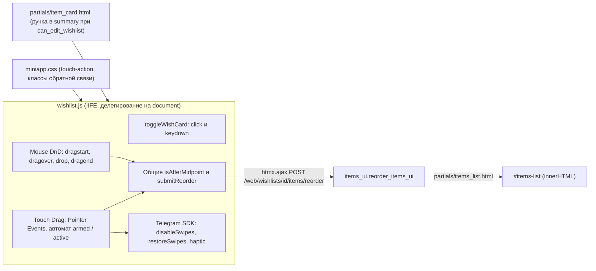
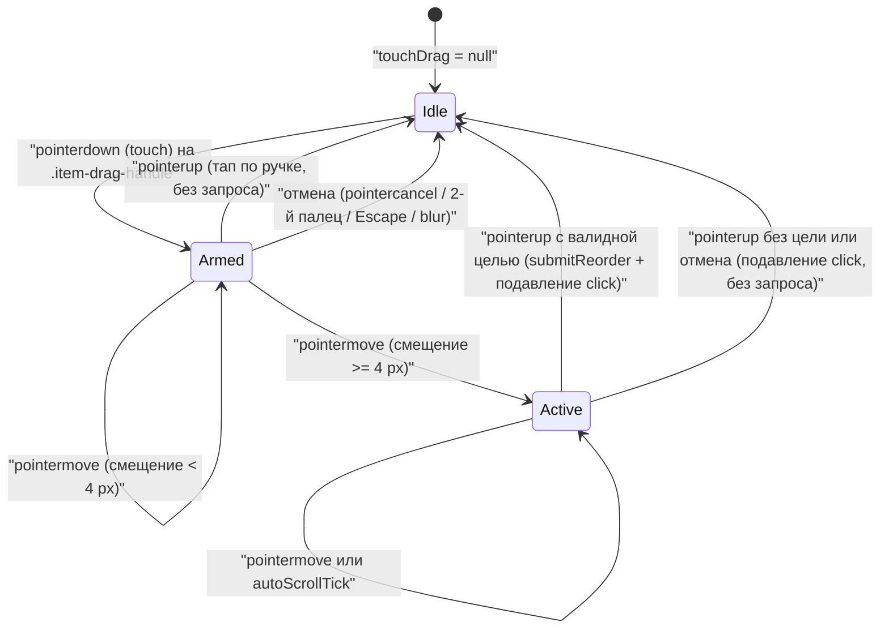

# Спецификация: WISHENKA-109 — Сенсорное изменение порядка желаний для мобильного Telegram

**Задача в Jira:** WISHENKA-109 (тип `Debt`, приоритет `Low`, оценка `3 SP`; источник: технический долг `WISHENKA-15`)  
**Платформы:** Telegram Mini App (iOS, Android, Telegram Web) и десктопные браузеры  
**Затронутые компоненты:** `wishenka/web/templates/partials/item_card.html`, `wishenka/web/static/wishlist.js`, `wishenka/web/static/miniapp.css`  
**Статус:** реализовано и принято (без изменений серверной логики и API)

## 1. Назначение и бизнес-цель

### 1.1. Контекст и проблема

В функциональной спецификации продукта (`in-docs/spec.md`, раздел 5.4) зафиксировано, что порядок карточек желаний в вишлисте можно менять вручную. После реализации `WISHENKA-108` ручное перетаскивание (`drag-and-drop`) работало исключительно через нативные события HTML5 Drag and Drop для мыши.

Большинство мобильных браузеров, включая встроенный WebView мобильного клиента Telegram, не генерируют события нативного HTML5 drag-and-drop при касании пальцем. Из-за этого на телефоне — предполагаемом основном устройстве пользователей Telegram Mini App (телеметрия использования в продукте не ведётся) — владелец или редактор списка не мог перетаскивать карточки и был вынужден пользоваться только кнопками `↑` / `↓`:

- существующий декоративный элемент ручки перетаскивания (`.item-drag-handle`) находился внутри скрытой по умолчанию панели деталей `.item-card-details` (`.item-actions`) и не имел собственного сенсорного обработчика;
- чтобы сдвинуть желание на несколько позиций, требовалось раскрыть карточку, нажать кнопку `↑` или `↓`, дождаться перерисовки списка сервером (после которой карточки приходят свёрнутыми) и повторять процедуру на каждом шаге.

### 1.2. Цели и бизнес-ценность

- **Паритет между устройствами:** обеспечить владельцам и соавторам вишлиста возможность менять порядок карточек перетаскиванием пальцем в мобильном Telegram так же удобно, как мышью на десктопе.
- **Снижение усилий при работе с длинными списками:** перенос карточки на произвольную позицию выполняется одним непрерывным жестом вместо серии пошаговых нажатий.
- **Сохранение всех существующих способов работы:** десктопное перетаскивание мышью, пошаговые кнопки `↑` / `↓` (клавиатура и вспомогательные технологии) и переключение деталей карточки по тапу продолжают работать без регрессий.

### 1.3. Границы задачи

В рамки задачи входит:

- перенос ручки перетаскивания в видимую сводку карточки (для редакторов) и реализация сенсорной сортировки на базе Pointer Events;
- визуальная обратная связь во время перетаскивания и автопрокрутка длинного списка у краёв экрана;
- надёжное разграничение тапа (раскрытие карточки), вертикального свайпа (прокрутка страницы) и перетаскивания;
- интеграция с Telegram WebApp SDK для блокировки сворачивания окна во время жеста и тактильной отдачи (с безопасной деградацией);
- обновление документации разработчика (`doc/dev/miniapp.md`, `doc/dev/wishlists.md`) и добавление автоматизированных статических проверок, допустимых без браузера.

В рамки задачи не входит:

- изменение серверного эндпоинта сортировки, правил валидации порядка, прав доступа, механики бронирований и архивных желаний;
- перетаскивание желаний между разными вишлистами, сортировка архивных желаний, множественный выбор, отмена действия (`undo`) и перетаскивание с клавиатуры (для неё остаются кнопки `↑` / `↓`);
- закоммиченные браузерные (Playwright/CDP) E2E-тесты переключения и сортировки, включая эмуляцию касаний (`WISHENKA-110`);
- устранение захардкоженного URL сортировки (`WISHENKA-141`), вынос оставшихся inline-скриптов (`WISHENKA-140`) и ужесточение заголовков Content-Security-Policy.

## 2. Функциональные требования и пользовательские сценарии

### 2.1. Роли и права доступа

| Роль / контекст | Отображение ручки | Сенсорное и мышиное перетаскивание | Кнопки `↑` / `↓` | Раскрытие карточки и бронирование |
| --- | --- | --- | --- | --- |
| Владелец / администратор / участник (`can_edit_wishlist`) | Да (в `.item-card-summary`) | Да | Да | По правилам своей роли и получателя |
| Гость / даритель по публичной ссылке (`/share/<token>`) | Нет | Нет (`draggable` отсутствует) | Нет | Да |
| Просмотр без прав редактирования | Нет | Нет | Нет | Да |

### 2.2. Поведение сенсорного перетаскивания и разграничение жестов

1. **Единая видимая точка старта:** единственная ручка `.item-drag-handle` (`⠿`, `data-no-toggle`, `aria-hidden="true"`, `title="Перетащить"`) отображается в начале строки `.item-card-summary` перед миниатюрой только при `can_edit_wishlist` и удаляется из `.item-actions`. Начинать перетаскивание можно как со свёрнутой, так и с уже раскрытой карточки.
2. **Изоляция типа ввода:** новый обработчик реагирует только на `pointerType === 'touch'`. Ввод мышью (`mouse`) и стилусом (`pen`) пропускается в нативный путь HTML5 DnD без двойной обработки.
3. **Порог активации и защита от случайного тапа:** при касании ручки жест переходит в состояние подготовки (`armed`) и становится активным (`active`) только после смещения указателя не менее чем на `DRAG_START_THRESHOLD_PX = 4` px. Короткий тап по ручке (меньше порога) ничего не делает: карточка не раскрывается (благодаря `data-no-toggle`), порядок не меняется и запрос не отправляется.
4. **Сохранение скролла и тапа на карточке:**
   - Тап по `.item-card-summary` вне ручки и вне исключённых интерактивных элементов (`a, button, input, select, textarea, [data-no-toggle]`) раскрывает или сворачивает детали карточки.
   - Вертикальный свайп по телу карточки или по `.item-card-summary` вне ручки прокручивает страницу штатным образом (`touch-action: none` задаётся только на `.item-drag-handle`).
   - Элементы управления внутри карточки (кнопки `↑` / `↓`, редактирование, архивирование, получение, бронирование, ссылки и поля форм) сохраняют свои действия и не запускают перетаскивание.
5. **Визуальная обратная связь и движение карточки:**
   - В активном состоянии перетаскиваемая карточка получает класс `is-touch-dragging`, визуально следует за пальцем по вертикали (`transform: translateY(...)` с учётом смещения прокрутки `window.scrollY`) и становится прозрачной для хит-теста (`pointer-events: none`).
   - На `body` и `html` добавляется класс `is-touch-reordering` для подавления выделения текста и предотвращения pull-to-refresh / overscroll.
   - При перетаскивании раскрытой карточки в реализации `WISHENKA-109` блок `.item-card-details` скрывается средствами CSS (`display: none`) без изменения атрибутов `hidden` и `aria-expanded`, чтобы при отмене жеста состояние раскрытия сохранилось.
   - При наведении на другую карточку внутри `#items-list` на цели выставляется класс `drop-before` (указатель в верхней половине) или `drop-after` (в нижней половине) по функции `isAfterMidpoint(clientY, rect)`.
6. **Автопрокрутка длинных списков:** пока жест активен и палец находится в пределах `AUTOSCROLL_EDGE_PX = 64` px от верхней или нижней границы окна (`window.innerHeight`), цикл `requestAnimationFrame` прокручивает страницу со скоростью до `AUTOSCROLL_MAX_PX = 14` px за кадр (линейно от глубины в зоне), корректирует `translateY` карточки и пересчитывает цель сброса.
7. **Завершение жеста и подавление «призрачного» клика:**
   - При отпускании пальца (`pointerup`) в состоянии `active`, если найдена целевая карточка внутри `#items-list`, отличная от перетаскиваемой, и сама карточка по-прежнему находится в `#items-list`, вызывается общая функция `submitReorder(list, card, target, after)`.
   - Сразу после завершения активного жеста (успешного сброса или отмены) на `CLICK_SUPPRESS_MS = 400` мс включается перехватчик `click` в capture-фазе, который гасит последующий синтетический клик (`preventDefault`, `stopPropagation`), чтобы окончание перетаскивания не переключало раскрытие карточки.
8. **Безопасная отмена:** жест отменяется без изменения порядка в DOM и без отправки запроса при любом из событий: `pointercancel`, `lostpointercapture`, касание вторым пальцем (`pointerdown` с другим `pointerId`), клавиша `Escape`, скрытие страницы (`visibilitychange` при `document.hidden`), потеря фокуса окном (`window` `blur`), перерисовка списка сервером (`htmx:beforeSwap` для `#items-list`), а также при сбросе на саму карточку или за пределы списка. Контекстное меню (`contextmenu`) и нативный `dragstart` во время жеста подавляются (`preventDefault`).

### 2.3. Пользовательские сценарии

- **UC-109-01. Сенсорное перетаскивание со свёрнутой карточки:** владелец списка на смартфоне нажимает на ручку `⠿` свёрнутой карточки и тянет её вниз. После смещения на `4` px карточка приподнимается (`is-touch-dragging`), звучит лёгкий тактильный отклик, над/под соседней карточкой появляется фиолетовая линия-индикатор. При отпускании карточка занимает новое место, отправляется один POST-запрос, и список обновляется с сервера.
- **UC-109-02. Перетаскивание раскрытой карточки и автоскролл:** владелец начинает жест с ручки уже раскрытой карточки и подводит палец к нижнему краю экрана. Список плавно прокручивается; если палец отпущен над другой карточкой, порядок сохраняется; если жест прерван, карточка остаётся на старом месте в раскрытом виде.
- **UC-109-03. Различение тапа, свайпа и перетаскивания:** короткий тап по заголовку или цене карточки раскрывает/сворачивает её; вертикальный свайп по телу карточки прокручивает страницу; короткий тап по ручке `⠿` не раскрывает карточку и не меняет порядок.
- **UC-109-04. Безопасная отмена прерванного жеста:** при появлении второго пальца на экране, звонке/сворачивании Telegram, системном перехвате жеста или нажатии `Escape` визуальное выделение снимается, классы и `transform` сбрасываются, а порядок карточек остаётся равным серверному.
- **UC-109-05. Повторная сортировка и гостевой режим:** после сохранения порядка повторное перетаскивание сразу работает без перезагрузки страницы. На публичной странице `/share/<token>` ручка и возможность перетаскивания отсутствуют.

### 2.4. Входные/выходные данные и продуктовые инварианты

- **Входные данные:** события указателя (`pointerdown`, `pointermove`, `pointerup`, `pointercancel`, `lostpointercapture`) с `pointerType === 'touch'` от `.item-drag-handle` внутри `.item-card[draggable="true"]`; координаты `clientX`, `clientY`, прокрутка `window.scrollY`, размеры окна `window.innerHeight`, идентификатор вишлиста `#items-list[data-wishlist-id]` и идентификаторы карточек `.item-card[data-item-id]`.
- **Выходные данные:** оптимистичная перестановка DOM-элемента в `#items-list` непосредственно перед отправкой, HTTP-запрос `POST /web/wishlists/{id}/items/reorder` с параметром формы `item_ids` (полный список ID активных желаний в новом порядке) и замена содержимого `#items-list` (`swap: 'innerHTML'`) серверным фрагментом `partials/items_list.html`.
- **Инварианты:**
  1. **Единая точка отправки:** мышиный и сенсорный пути перетаскивания завершаются вызовом общей `submitReorder`, содержащей единственный вызов `htmx.ajax` в `wishlist.js` (строго один запрос за завершённый жест).
  2. **Атомарность DOM до подтверждённого сброса:** порядок узлов в DOM не меняется во время перетаскивания — перемещается только `transform`, поэтому любая отмена гарантирует сохранение серверного порядка.
  3. **Полная перестановка активных желаний:** сервер принимает только точную перестановку всех активных желаний вишлиста; архивные желания в сортировке не участвуют.
  4. **Изоляция прав и тайны сюрприза:** перетаскивание доступно только редакторам списка; сведения о бронированиях и дарителях в механику сортировки не вовлечены.

## 3. Архитектура, компоненты и интерфейсы

### 3.1. Архитектурные решения и отклонённые альтернативы

- **Собственная реализация на Pointer Events вместо SortableJS:** выбрано расширение собственного статического скрипта `wishenka/web/static/wishlist.js` (~150–200 строк нового кода) без сторонних библиотек. Подключение `SortableJS` через CDN без SRI расширило бы долг «Unpinned CDN scripts» (`WISHENKA-15`), противоречило бы курсу на строгую CSP (`script-src 'self' https://telegram.org` на shell `GET /`) и потребовало бы замены рабочего HTML5 DnD для мыши.
- **Видимая ручка в `.item-card-summary` вместо `long-press` по всей карточке:** выбрана явная ручка `⠿`, так как она обнаруживаема без подсказок, не конфликтует с прокруткой (`touch-action: none` только на ручке) и не провоцирует системное выделение текста или контекстное меню при долгом удержании на iOS/Android. Принятый компромисс — область шириной `44` px в компактной строке и невозможность начать скролл страницы именно с ручки.
- **Делегирование слушателей на `document`:** все обработчики регистрируются один раз при загрузке скрипта (`defer`), поэтому после htmx-обновлений внутри `#items-list` повторная инициализация не требуется и исключаются двойные срабатывания.

### 3.2. Структура компонентов и контракты данных



Основные константы и функции `wishenka/web/static/wishlist.js` (внутри IIFE, без глобального экспорта):

| Элемент | Назначение |
| --- | --- |
| `DRAG_START_THRESHOLD_PX = 4` | Порог смещения в пикселях для перехода `armed -> active` |
| `AUTOSCROLL_EDGE_PX = 64` | Ширина верхней и нижней краевых зон окна для автопрокрутки |
| `AUTOSCROLL_MAX_PX = 14` | Максимальный сдвиг прокрутки в пикселях за один кадр `requestAnimationFrame` |
| `CLICK_SUPPRESS_MS = 400` | Окно подавления синтетического `click` после завершения `active`-жеста |
| `SWIPES_MIN_VERSION = '7.7'` | Минимальная версия Bot API для `disableVerticalSwipes` / `enableVerticalSwipes` |
| `HAPTIC_MIN_VERSION = '6.1'` | Минимальная версия Bot API для `HapticFeedback` |
| `isAfterMidpoint(clientY, rect)` | Чистая функция: возвращает `true`, если `clientY > rect.top + rect.height / 2` |
| `submitReorder(list, card, target, after)` | Общая функция проверки `data-wishlist-id` (`/^\d+$/`) и `window.htmx`, перемещения DOM-узла и отправки единственного `htmx.ajax('POST', ...)` |
| `activateTouchDrag(drag)` | Перевод жеста в `active`, добавление классов, `haptic('impact')`, запуск `autoScrollTick` |
| `moveDraggedCard(drag)` | Расчёт вертикального сдвига с учётом прокрутки и обновление `transform: translateY(...)` |
| `updateDropTarget(drag)` | Поиск цели через `document.elementFromPoint(drag.lastX, drag.lastY)`, обновление `drop-before` / `drop-after` и `haptic('selection')` |
| `autoScrollTick()` | Покадровый цикл `requestAnimationFrame` для автопрокрутки у краёв экрана |
| `armClickSuppression()` | Взвод `suppressNextClick` и перезапуск таймера через `clearTimeout(suppressTimer)` |
| `endTouchDrag()` / `cancelTouchDrag()` | Единая очистка состояния, `transform`, классов, rAF, pointer capture и восстановление свайпов |
| `telegramWebApp()`, `warnSdk()`, `disableSwipes()`, `restoreSwipes()`, `haptic()` | Защищённые обёртки над `window.Telegram.WebApp` |

Структура состояния `touchDrag` (`TouchDrag | null`):

```text
TouchDrag {
  state: 'armed' | 'active'
  pointerId: number
  handle: Element
  card: Element
  startX: number
  startY: number
  startScrollY: number
  lastX: number
  lastY: number
  target: Element | null
  after: boolean
  rafId: number
  swipesWereEnabled: boolean
}
```

### 3.3. Конечный автомат состояний touch-жеста



Переходы конечного автомата:

1. **`Idle -> Armed`:** `pointerdown` (`pointerType === 'touch'`) на `.item-drag-handle` внутри `.item-card[draggable="true"]` внутри `#items-list`. Фиксируются координаты и `startScrollY`, вызывается `handle.setPointerCapture(pointerId)` (best effort) и `disableSwipes()`.
2. **`Armed -> Active`:** при `pointermove` (того же `pointerId`) с `Math.hypot(dx, dy) >= 4` вызывается `activateTouchDrag(drag)`.
3. **`Armed -> Idle`:** при `pointerup` без достижения порога или при отмене вызывается `endTouchDrag()` / `cancelTouchDrag()`; подавление `click` не требуется (клик по ручке игнорируется атрибутом `data-no-toggle`), запрос не отправляется.
4. **`Active -> Idle` (успешный сброс):** при `pointerup` с `target !== null`, `list !== null`, `document.contains(card)` и `card.parentElement === list` выполняются `endTouchDrag()`, `armClickSuppression()` и `submitReorder(list, card, target, after)`.
5. **`Active -> Idle` (сброс без цели или отмена):** вызываются `armClickSuppression()` и `endTouchDrag()`; DOM остаётся нетронутым, запрос на сервер не уходит.

### 3.4. Сетевой контракт, DOM-разметка и CSS-состояния

- **DOM-контракт:**
  - `#items-list[data-wishlist-id]` — родительский контейнер списка; не заменяется при htmx-ответах (меняется только `innerHTML`).
  - `.item-card[data-item-id]` — карточка желания; атрибут `draggable="true"` рендерится только при `can_edit_wishlist`.
  - `.item-card-summary` — заголовок карточки (`role="button"`, `tabindex="0"`, `aria-expanded`); содержит `.item-drag-handle` (`data-no-toggle`, `aria-hidden="true"`, `title="Перетащить"`, символ `⠿`) перед миниатюрой только при `can_edit_wishlist`.
  - `.item-card-details` — скрытая панель деталей; в рамках `WISHENKA-109` содержит кнопки `btn-move-up` и `btn-move-down`, но не содержит `.item-drag-handle`.
- **Сетевой контракт (без изменений):**
  - `POST /web/wishlists/{id}/items/reorder` (`reorder_items_ui` в `wishenka/web/routes/items_ui.py`), поле формы `item_ids: list[int]`.
  - Успех: HTTP `200`, перерисованный фрагмент `partials/items_list.html` (все карточки возвращаются с `aria-expanded="false"`, как после mouse DnD и кнопок `↑` / `↓`).
  - Ошибка валидации перестановки: HTTP `400 Invalid item order`.
- **CSS-контракт (`wishenka/web/static/miniapp.css`):**
  - `.item-drag-handle`: `display: inline-flex; align-items: center; justify-content: center; min-width: 44px; min-height: 44px; cursor: grab; padding: .5rem; touch-action: none; user-select: none; -webkit-user-select: none; -webkit-touch-callout: none;`.
  - `.item-card-summary`: сохраняет `cursor: pointer;` и не получает `touch-action: none`.
  - `.item-card.is-touch-dragging`: `position: relative; z-index: 10; opacity: .85; box-shadow: 0 6px 18px rgba(0, 0, 0, .25); pointer-events: none; will-change: transform;` (а также правило `.item-card.is-touch-dragging .item-card-details { display: none; }` в рамках `WISHENKA-109`).
  - `.item-card.drop-before` / `.item-card.drop-after`: верхняя или нижняя акцентная полоса `3px` цвета `#6d28d9` (`box-shadow: 0 -3px 0 0 #6d28d9` / `0 3px 0 0 #6d28d9`).
  - `body.is-touch-reordering`: `user-select: none; -webkit-user-select: none;`.
  - `html.is-touch-reordering`: `overscroll-behavior-y: contain;`.

### 3.5. Интеграция с Telegram Mini App SDK

- **Подавление вертикальных свайпов сворачивания:** на `pointerdown` функция `disableSwipes()` проверяет наличие `window.Telegram?.WebApp`, `isVersionAtLeast('7.7')` и `isVerticalSwipesEnabled === true`, после чего вызывает `disableVerticalSwipes()` и запоминает `drag.swipesWereEnabled = true`. В `endTouchDrag()` функция `restoreSwipes()` вызывает `enableVerticalSwipes()` только если именно этот жест отключил свайпы, чтобы не нарушать глобальное состояние приложения.
- **Тактильная обратная связь:** при `isVersionAtLeast('6.1')` и наличии `HapticFeedback` вызываются `impactOccurred('light')` при активации жеста (`activateTouchDrag`) и `selectionChanged()` при переходе указателя на новую целевую карточку (`updateDropTarget`).
- **Отказоустойчивость:** все обращения к SDK обёрнуты в `try/catch`; при отсутствии SDK, блокировке CDN, старой версии клиента или исключении в методе жест продолжает работать без сбоев.

## 4. Нефункциональные требования, безопасность и наблюдаемость

### 4.1. Производительность, кэширование и технические ограничения

- **Размер статики и кэширование:** добавление логики touch-сортировки в `WISHENKA-109` увеличило объём `wishenka/web/static/wishlist.js` с `3 868` байт до `16 524` байт (`538` строк). Middleware безопасности (`wishenka/web/security.py`, строка 79, `WISHENKA-139`) выставляет `Cache-Control: no-store` для всех ответов, включая `/static/*`, поэтому обновления скрипта применяются немедленно на следующей загрузке страницы без cache-busting URL, но статика перекачивается при каждом визите.
- **Отрисовка и цикл автоскролла:** смещение карточки выполняется через GPU-дружественный `transform: translateY(...)` с `will-change: transform` без перестановки DOM-узлов до сброса. Однако в активной фазе цикл `requestAnimationFrame` выполняется непрерывно (даже когда скорость прокрутки равна нулю вне краевых зон), а `updateDropTarget` вызывает `elementFromPoint` и `getBoundingClientRect` при каждом `pointermove` и при каждом кадре прокрутки. Для десятков карточек накладные расходы малы; для сотен карточек на слабых устройствах возможна нагрузка на layout (не замерялась).
- **Частотно-зависимая скорость и зоны экрана:** шаг `AUTOSCROLL_MAX_PX = 14` px задан на кадр, а не на секунду (`~840` px/с при 60 Гц и `~1680` px/с при 120 Гц), а границы автоскролла рассчитываются от `window.innerHeight` без отдельного вычета высоты шапки Telegram и `safe-area-inset`.

### 4.2. Безопасность, CSP, приватность и доступность

- **Совместимость с CSP и отсутствие новых CDN-зависимостей:** в HTML не добавлены сторонние скрипты (`telegram-web-app.js`, `htmx.org@1.9.12` и `json-enc` остались единственными внешними тегами `<script src>`), не использован inline JavaScript. Оболочка Mini App (`GET /`) отдаётся с заголовком `default-src 'self'; script-src 'self' https://telegram.org; style-src 'self'; img-src 'self' https:; frame-ancestors https://web.telegram.org`, страницы `/web/*` собственного заголовка CSP не устанавливают; решение полностью совместимо с последующим ужесточением политики.
- **Контроль доступа и тайна сюрприза:** генерация `.item-drag-handle` и `draggable="true"` закрыта серверным флагом `can_edit_wishlist`. Посетители публичных ссылок не получают UI-инструментов сортировки; сервер при `POST /web/wishlists/{id}/items/reorder` сохраняет существующую проверку полномочий и принадлежности всех ID активному списку. Информация о бронированиях и дарителях не используется и не раскрывается.
- **Проверка входных параметров:** `submitReorder` допускает к подстановке в URL только числовой `data-wishlist-id` (`/^\d+$/`). При расхождении порядка (например, конкурентное изменение списка, HTTP `400` от сервера) в рамках `WISHENKA-109` сохранялось унаследованное от `WISHENKA-108` поведение: оптимистично вставленный порядок остаётся в DOM до перезагрузки страницы.
- **Доступность (Accessibility):** минимальный размер сенсорной области ручки `44 × 44` px; отключение выделения текста и системного меню iOS (`user-select: none`, `-webkit-touch-callout: none`). Ручка скрыта от скринридеров (`aria-hidden="true"`), поскольку находится внутри `.item-card-summary` с `role="button"` (потомки кнопки презентационные). Для пользователей клавиатуры и ассистивных технологий сохранены кнопки `.btn-move-up` и `.btn-move-down` с `aria-label` (соответствие требованиям альтернативы перетаскиванию WCAG 2.5.7) и управление раскрытием карточки клавишами `Enter` / `Space`.

### 4.3. Наблюдаемость: клиентская диагностика, серверные логи и метрики

- **Клиентское логирование (`console.warn`):** скрипт не логирует штатные жесты и не выводит крупные объекты данных. Используются ровно два диагностических предупреждения:
  1. `submitReorder`: `wishlist.js: reorder skipped: <causes>` при невалидном `#items-list[data-wishlist-id]` или отсутствии `window.htmx` (общее для мыши и касаний).
  2. `warnSdk(call, error)`: `wishlist.js: Telegram SDK call failed (<call>); later failures are not reported` с приложенным объектом ошибки, где `<call>` — одно из имён `disableVerticalSwipes`, `enableVerticalSwipes`, `HapticFeedback.impactOccurred`, `HapticFeedback.selectionChanged`. Выводится не более одного раза за загрузку страницы (флаг `sdkWarned`), чтобы не перегружать консоль при ошибках haptic во время движения.
- **Серверное структурированное логирование (не изменялось):**
  - `POST /web/wishlists/{id}/items/reorder`: при успехе — `INFO` событие `ui_items_reordered` (`wishlist_id`, `actor_id`, `user_id`, `item_count`); при ошибке перестановки (HTTP `400`) — `WARNING` событие `ui_items_reorder_rejected` (`wishlist_id`, `actor_id`, `user_id`, `reason=invalid_permutation`).
  - `POST /web/wishlists/{id}/items/{item_id}/move`: `INFO` `ui_item_moved` (`wishlist_id`, `item_id`, `actor_id`, `user_id`, `direction`) и `WARNING` `ui_items_reorder_rejected` при отклонении.
- **Ограничения наблюдаемости и метрики:**
  - Серверные логи не различают сортировку касанием и мышью (оба пути отправляют одинаковый запрос); отменённые и пропущенные на клиенте жесты не оставляют следа на сервере.
  - Системы сбора метрик (Prometheus, Grafana, алертинг) и клиентская телеметрия ошибок (`Sentry`, `onerror`, `sendBeacon`) в проекте отсутствуют (**N/A**); ответы `400` и `5xx` видны в access-логах Uvicorn.

## 5. Верификация и критерии приёмки

### 5.1. Критерии приёмки

1. **Старт со свёрнутой и раскрытой карточки (критерии 1, 15):** ручка `.item-drag-handle` видна в `.item-card-summary`, позволяет перетащить свёрнутую или раскрытую карточку и сохраняет новый порядок на сервере; при отмене раскрытое состояние не теряется.
2. **Точность вставки и безопасные сбросы (критерии 2, 6):** верхняя половина цели вставляет перед ней, нижняя — после неё; сброс на саму карточку, вне `#items-list` или при любой отмене (`pointercancel`, второй палец, `Escape`, `visibilitychange`, `blur`, `lostpointercapture`, `htmx:beforeSwap`) не меняет DOM и не отправляет запрос.
3. **Визуальный отклик и разграничение жестов (критерии 3, 4, 5):** отображаются `is-touch-dragging`, `drop-before` / `drop-after` и очищаются после жеста; тап по заголовку раскрывает карточку, тап по ручке ничего не делает, свайп вне ручки прокручивает страницу, а завершение перетаскивания не переключает карточку.
4. **Сохранение прежних путей, прав и контракта (критерии 7, 8, 9, 10, 11):** mouse DnD, кнопки `↑` / `↓` с `aria-label` и клавиатурный toggle работают как прежде; запрос уходит один раз через `submitReorder` с полным списком ID; повторное перетаскивание работает после htmx-перерисовки; страница `/share/<token>` не содержит ручку и `draggable`.
5. **Telegram Mini App, регрессия и документация (критерии 12, 13, 14):** на Bot API `7.7+` вертикальные свайпы отключаются на время жеста; существующие тесты и статический анализ проходят; обновлены `doc/dev/miniapp.md` (разделы 9.8, 9.8.1, troubleshooting) и `doc/dev/wishlists.md`.

### 5.2. Сценарии тестирования и результаты проверок

В рамках `WISHENKA-109` верификация проведена тремя способами (автоматизированный браузерный тест сознательно отложен в `WISHENKA-110`):

- **Автоматический модульный и текстовый набор (`tests/test_wishlist_touch_reorder.py`, 37 тестов с `pytestmark = pytest.mark.timeout(30)` без сети и браузера):**
  - *Группа A (разметка владельца):* наличие ровно одной `.item-drag-handle` (`data-no-toggle`, `aria-hidden="true"`) в каждой `.item-card-summary` и отсутствие ручки внутри `.item-card-details`.
  - *Группа B (защитные guard-проверки):* отсутствие `.item-drag-handle` и `[draggable]` на `/share/<token>`; сохранение `draggable="true"`, кнопок `.btn-move-up` / `.btn-move-down` с `aria-label`, `role="button"`, `tabindex="0"`, `aria-expanded="false"` у владельца; неизменность списка внешних `<script src>` (без `sortable`).
  - *Группа C (строковые проверки `wishlist.js`):* наличие токенов Pointer Events, отмены, автоскролла, классов обратной связи, обёрток Telegram SDK, общих `submitReorder` / `isAfterMidpoint` и ровно одного вызова `htmx.ajax(` (без комментариев).
  - *Группа D (проверки `miniapp.css`):* наличие touch-деклараций на `.item-drag-handle`, правил `.is-touch-dragging`, `.drop-before`, `.drop-after` и отсутствие `touch-action: none` на `.item-card-summary`.
- **Полный прогон и статический анализ (после финальных правок Шага 5/6):**
  - `make test`: **560 passed, 0 failed** (523 базовых + 37 новых тестов; включая `test_wishlist_static_script.py`, `test_wish_items_list_reorder_ui.py`, `test_wish_card_giver_controls.py`, `test_reservations_cabinet_ui.py`, `test_wish_items_tma_ui.py`).
  - `make analyze`: Ruff linter, Ruff format и Mypy (98 файлов) — без ошибок; `node --check wishenka/web/static/wishlist.js` — синтаксис валиден.
  - Повторная проверка на Шаге 6 (`test_wishlist_touch_reorder.py` + `test_wishlist_static_script.py`): 48 passed.
- **Одноразовый динамический прогон в Chromium CDP (не закоммичен; мобильный viewport `390×844`, эмуляция touch, оффлайн-заглушки `htmx.ajax` и `Telegram.WebApp`):**
  - подтверждено перетаскивание со свёрнутой и раскрытой карточки с отправкой ровно одного `POST /web/wishlists/1/items/reorder` (`[2, 3, 1]`), очисткой `transform` / классов и порядком вызовов Telegram SDK (`disable`, `impact`, `selection`, `enable`);
  - подтверждены: тап по ручке (без эффекта), тап по сводке (переключение `aria-expanded`), вертикальный свайп вне ручки (без drag), отмена (`touchCancel`, `Escape`, второй палец, сброс на себя — без запроса и с очисткой состояния) и прежняя работа синтетического mouse DnD;
  - путь автоскролла у краёв в этом прогоне не проверялся.

### 5.3. Известные ограничения и последующие задачи (Follow-ups)

Из анализа технического долга (`ai-tasks/WISHENKA-109/60-tech-debt.md`) **блокирующих замечаний нет**; выявленные ограничения и задачи развития распределены следующим образом:

| Идентификатор | Тип и приоритет | Содержание ограничения / последующей задачи |
| --- | --- | --- |
| `WISHENKA-143` | Новый `Debt` (2–3 SP) | Ручная проверка по 8-пунктному чек-листу на реальных устройствах (Telegram iOS, Telegram Android, Telegram Web, Chrome Android): проверка достаточности `disableVerticalSwipes()` в `pointerdown`, долгого нажатия `draggable="true"` в Chrome Android, удержания pointer capture при `pointer-events: none`, необходимости очистки подавления клика на следующем `pointerdown`, работы `overscroll-behavior-y: contain`, калибровки порога `4` px и перевода автоскролла на временную дельту. |
| `WISHENKA-142` | Новый `Debt` (1–2 SP, после `WISHENKA-143`) | UX перетаскивания раскрытой карточки: скрытие `.item-card-details` через `display: none` вызывает визуальный скачок нижележащих карточек вверх при преодолении порога `4` px; рассмотреть отказ от скрытия деталей или плавное сжатие/плейсхолдер. |
| `WISHENKA-144` | Новый `Debt` (1 SP, Low) | Чистка кода и стилей: перенос двух строк по 110 символов в `wishlist.js`, возможное разделение скрипта на модули (после `WISHENKA-140`) и вынос повторяющихся значений палитры (`#6d28d9`, `44px`) в CSS-переменные `miniapp.css`. |
| `WISHENKA-110` | Заметка к существующей задаче | Реализация закоммиченных браузерных Playwright/CDP-тестов всех сценариев touch-сортировки (включая автоскролл, отмены, подавление клика, `submitReorder` и `warnSdk`), а также удаление/сокращение хрупких строковых проверок из `test_wishlist_touch_reorder.py`. |
| `WISHENKA-141` | Заметка к существующей задаче | Замена захардкоженного URL `/web/wishlists/${wishlistId}/items/reorder` на `data-reorder-url`; после рефакторинга изменение локализовано в `submitReorder` и шаблонах. |
| `WISHENKA-140` | Заметка к существующей задаче | Повторное использование обёрток Telegram SDK (`telegramWebApp`, `warnSdk`, проверки версий) из `wishlist.js` при выносе оставшихся inline-скриптов. |
| `WISHENKA-139` | Заметка к существующей задаче | Пересмотр политики `Cache-Control: no-store` для выросших статических файлов `wishlist.js` и `miniapp.css`. |
| Прочие принятые ограничения | Без новых тикетов | На клиентах Telegram старее Bot API `7.7` или при свайпе за шапку окна Mini App может сворачиваться (платформенный предел); ввод стилусом (`pen`) идёт через нативный DnD; окно `CLICK_SUPPRESS_MS` длительностью `400` мс может подавить быстрый повторный тап, если браузер не сгенерировал `click` после drag; повторные ошибки Telegram SDK подавляются флагом `sdkWarned`. Ссылки без пересечений: `WISHENKA-126` (`core`), `WISHENKA-112`. |
