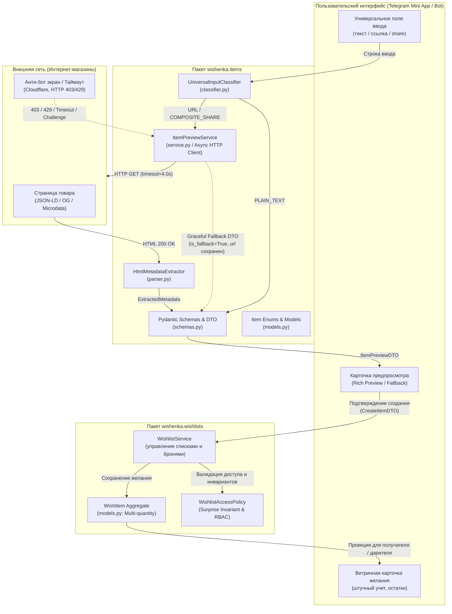

# WISHENKA-11: [Декомпозиция] Спецификация универсального ввода желаний, штучного учета и парсинга ссылок

## Research

### 1. Архитектурный контекст и предметная область

Задача **WISHENKA-11** развивает пользовательский контур добавления и управления желаниями в сервисе «Вишенка» (Telegram Wishlist Service). На основе утвержденной спецификации бизнес-требований (`10-requirements.md`), ролевой модели (`WISHENKA-6/20-architecture.md`) и базовой архитектуры (`doc/dev/architecture.md`) выделены четыре ключевые предметно-архитектурные области:

1. **Интеллектуальная маршрутизация ввода (Universal Input Processing)**:
   Пользователь Telegram не должен выбирать между текстовой заметкой и ссылкой на маркетплейс. Единое поле ввода обрабатывает:
   - Простой текст («Книга Чистый Код»);
   - Явный URL с протоколом (`https://ozon.ru/product/...`);
   - Неявный URL без схемы (`wildberries.ru/catalog/...`);
   - Составные сообщения системного меню «Поделиться» (мобильный шеринг маркетплейсов и браузеров, содержащий сопроводительный текст и ссылку в едином теле сообщения).

2. **Каскадное обогащение витринных метаданных (Structured E-Commerce Scraping)**:
   Для формирования привлекательной карточки (Rich Preview) система должна извлекать витринные атрибуты из современных веб-стандартов разметки с детерминированным приоритетом источников.

3. **Отказоустойчивость и анти-бот инвариант (Graceful Fallback & Anti-Bot Strategy)**:
   Торговые площадки (Ozon, Wildberries, Lamoda, Яндекс Маркет, зарубежные маркетплейсы) активно применяют средства защиты от скрапинга (Cloudflare Turnstile, reCAPTCHA, Incapsula, Kasada, HTTP 403 Forbidden, 429 Too Many Requests). В соответствии с ключевым продуктовым инвариантом сервиса:
   > *Ни один сетевой сбой, антибот-экран или нестандартная верстка магазина не должны приводить к потере ссылки или блокировке добавления желания.*
   Система **не производит** обход капчи или эмуляцию браузера (headless browsers / Puppeteer), а реализует детерминированную мягкую деградацию (Graceful Degradation) с жестким таймаутом 4.0 секунды и предзаполнением ручной формы.

4. **Штучный учет (Multi-quantity Accounting) и тайна сюрприза**:
   Поддержка многосоставных подарков (комплекты, наборы) с целочисленным учетом ($\ge 1$, до 1000), формулой свободного остатка $Available = Desired - Reserved - Fulfilled$, возможностью частичного бронирования несколькими независимыми дарителями и строгой маскировкой броней для адресата подарка (Surprise Invariant).

---

### 2. Исследование стандартов структурированных данных e-commerce

Для качественного формирования Rich Preview проанализированы 4 стандарта представления метаданных:

| Стандарт | Расположение в HTML | Преимущества | Извлекаемые атрибуты | Приоритет |
|---|---|---|---|:---:|
| **JSON-LD (Schema.org)** | `<script type="application/ld+json">` | Наиболее точные e-commerce данные; разделение товара (`Product`) и ценового предложения (`Offer`); числовые цены | `name`, `description`, `image` (URL / список), `offers.price`, `offers.priceCurrency`, `brand.name` | **1 (Высший)** |
| **OpenGraph (OG)** | `<meta property="og:*" content="...">` | Присутствует на 90%+ витринных страниц; содержит главное фото в высоком разрешении | `og:title`, `og:description`, `og:image`, `og:site_name`, `product:price:amount`, `product:price:currency` | **2** |
| **Microdata / RDFa** | HTML-атрибуты `itemscope`, `itemtype="schema.org/Product"`, `itemprop="..."` | Дублирует Schema.org в разметке элементов DOM; устойчив при отсутствии JSON-LD | `itemprop="name"`, `itemprop="price"`, `itemprop="priceCurrency"`, `itemprop="image"` | **3** |
| **HTML Meta & Title** | `<title>`, `<meta name="description">`, Twitter Cards | Базовый fallback для любого HTML-документа | `<title>`, `meta[name=description]`, `twitter:image`, `link[rel=icon]` | **4 (Низший)** |

#### Специфика извлечения и нормализации:
1. **Нормализация цен**:
   - Строки цен извлекаются в форматах `"1 490 ₽"`, `"1490.00"`, `"1,490.50"`, `"$49.99"`.
   - Регулярным выражением удаляются неразрывные пробелы (`\xa0`), пробельные разделители тысяч, буквенные суффиксы.
   - Запятая в качестве десятичного разделителя (`1490,50`) заменяется точкой.
   - Значение преобразуется в `int` (копейки отбрасываются при отсутствии либо сохраняются как целое число рублей/центов).
2. **Нормализация валют (ISO 4217)**:
   - Символы сопоставляются по словарю соответствий:
     - `₽`, `руб`, `руб.` $\to$ `RUB`
     - `$`, `usd` $\to$ `USD`
     - `€`, `eur` $\to$ `EUR`
     - `₸`, `kzt` $\to$ `KZT`
     - `Br`, `byn` $\to$ `BYN`
     - `£`, `gbp` $\to$ `GBP`
     - `¥`, `cny` $\to$ `CNY`
     - `TRY`, `GEL`, `AED` $\to$ сохраняются как валидные коды ISO 4217.
   - Если валюта отсутствует при указанной цене — подставляется системный дефолт `RUB`.
3. **Очистка заголовков от рекламного шума**:
   - Регулярными выражениями отсекаются типичные суффиксы витрин:
     - `\s*[-—|•]\s*(купить|интернет-магазин|по выгодной цене|в наличии|на маркетплейсе).*$`
     - Хвостовые названия магазинов (например, `\s*[-|]\s*OZON$`).
4. **Бренд площадки и фавикон**:
   - `store_name` определяется по цепочке: `og:site_name` $\to$ `brand.name` $\to$ сопоставление доменного имени (`ozon.ru` $\to$ "Ozon", `wildberries.ru` $\to$ "Wildberries", `market.yandex.ru` $\to$ "Яндекс Маркет", `lamoda.ru` $\to$ "Lamoda", `avito.ru` $\to$ "Авито") $\to$ чистый хост домена.
   - `store_icon_url` извлекается из `<link rel="icon">`, `<link rel="shortcut icon">`, `<link rel="apple-touch-icon">` с разрешением относительных ссылок через `urllib.parse.urljoin`, либо fallback на `https://{domain}/favicon.ico`.

---

### 3. Анализ паттернов мобильного шеринга (Mobile Share Patterns)

При вызове системного действия «Поделиться» (Share Sheet) из мобильных приложений маркетплейсов в Telegram передается составной текст. Типовые шаблоны:

1. **Ozon Android/iOS**:  
   `"Посмотри, какой классный товар: Наушники беспроводные https://ozon.ru/product/12345678/?from=share_android"`
2. **Wildberries**:  
   `"Смотри, что нашлось на Wildberries: Термокружка 500мл https://www.wildberries.ru/catalog/12345/detail.aspx"`
3. **Яндекс Маркет**:  
   `"Кофемашина DeLonghi https://market.yandex.ru/product--kofemashina/1012345?sku=123"`
4. **Чистый URL без схемы**:  
   `"wildberries.ru/catalog/98765/detail.aspx"` или `"ozon.ru/t/AbCdEf"`

#### Алгоритм синтаксического выявления (`UniversalInputClassifier`):
1. **Регулярное выражение для поиска URL**:
   - Явный протокол: `https?://[^\s<>"]+`
   - Доменная ссылка без протокола: `\b(?:[a-zA-Z0-9-]+\.)+(?:ru|com|org|net|by|kz|io|me|app|store|shop|market)(?:/[^\s<>"]*)?`
2. **Выделение компонентов**:
   - Если URL найден внутри строки:
     - Извлеченный URL нормализуется (при отсутствии схемы добавляется `https://`).
     - Сопроводительный текст очищается от URL и лишних пробелов/двоеточий.
     - Сопроводительный текст сохраняется в качестве `residual_text` (используется как предварительное описание/заметка или резервный заголовок).
   - Если URL не найден:
     - Вся строка классифицируется как `PLAIN_TEXT` (название желания).

---

### 4. Стратегия защиты от анти-бот блокировок (Graceful Degradation)

#### Анализ анти-бот экранов:
- **Cloudflare Turnstile / Managed Challenge**: статус HTTP 403 или HTTP 503, HTML содержит `<title>Just a moment...</title>`, `cf-mitigated`, `id="challenge-running"`, `_cf_chl_opt`.
- **WAF / Rate-limit**: статус HTTP 429 Too Many Requests или 403 Forbidden.
- **DDoS-Guard / Variti**: статус 403 / 503 с JavaScript-перенаправлением.

#### Архитектурное решение:
1. **Strict Timeout Budget**: Общий таймаут сетевого запроса составляет **4.0 секунды** (`httpx.Timeout(4.0, connect=2.0)`).
2. **Browser-like Headers**: Запрос отправляется с легитимным современным User-Agent браузера и стандартными заголовками `Accept`, `Accept-Language: ru-RU,ru;q=0.9,en;q=0.8`.
3. **Безусловная деградация (No-Captcha Rule)**:
   - При получении статусов 403, 429, 503, детекции сигнатур антибота в ответе либо наступлении таймаута:
   - Исключения перехватываются на уровне `ItemFetchService`.
   - Формируется объект предпросмотра `ItemPreviewDTO`:
     - `url`: нормализованная ссылка (сохранена 100%);
     - `title`: извлеченный `residual_text` шеринга либо `None`;
     - `store_name`: определен по доменному имени;
     - `is_fallback`: `True`;
     - `fallback_reason`: `"anti_bot_challenge"` | `"timeout"` | `"http_error"` | `"network_error"`.
   - Клиент Telegram Mini App / Web моментально получает ответ без задержки и открывает форму ручного ввода с предзаполненным URL.

---

### 5. Модель штучного учета (Multi-quantity Accounting)

#### Бизнес-инварианты:
1. `desired_quantity: int`:
   - $1 \le desired\_quantity \le 1000$.
   - Строгий запрет чисел с плавающей точкой (`float`), строк, нулей и отрицательных величин.
2. `reserved_quantity: int`:
   - Сумма активных броней дарителей: $\sum_{r \in active\_reservations} r.quantity$.
3. `fulfilled_quantity: int`:
   - Количество единиц, врученных получателю ($fulfilled\_quantity \ge 0$).
4. `available_quantity: int`:
   - Вычисляемое свойство:
     $$\text{available\_quantity} = \max(0, \text{desired\_quantity} - \text{reserved\_quantity} - \text{fulfilled\_quantity})$$
5. **Инвариант бронирования**:
   - Даритель может забронировать $q$ штук, где $1 \le q \le \text{available\_quantity}$.
   - При $q > \text{available\_quantity}$ выбрасывается `InsufficientQuantityError`.
6. **Инвариант редактирования автором**:
   - При попытке автора изменить `desired_quantity` проверяется условие:
     $$\text{new\_desired\_quantity} \ge (\text{reserved\_quantity} + \text{fulfilled\_quantity})$$
   - При нарушении операция отклоняется с исключением `CannotReduceQuantityBelowReservedError`.
7. **Инвариант тайны сюрприза (Surprise Invariant)**:
   - Получатель желания видит `desired_quantity` и `fulfilled_quantity`.
   - Поля `reserved_quantity`, `available_quantity`, `reservations`, `is_fully_reserved` для получателя **полностью исключены из проекции DTO**.

---

## Implementation Plan

### Высокоуровневые этапы реализации

1. **Фаза 1: Модели данных и классификатор ввода (`wishenka.items`)**
   - Создать пакет `wishenka/items/`.
   - Реализовать `wishenka/items/models.py`:
     - Перечисление `ItemPriority` (`HIGH`, `MEDIUM`, `LOW`).
     - Датакласс `ExtractedMetadata`.
     - Датакласс `InputClassificationResult` с типом ввода (`InputType`).
   - Реализовать `wishenka/items/classifier.py`:
     - Регулярные выражения для распознавания протокольных, беспротокольных и составных ссылок мобильного шеринга.
     - Нормализатор URL (добавление `https://`, очистка пробелов, удаление опасных символов).
     - Выделение `residual_text` для шеринг-сообщений.

2. **Фаза 2: Парсер структурированных данных и HTML (`wishenka/items/parser.py`)**
   - Реализация `HtmlMetadataExtractor` на базе `BeautifulSoup4`:
     - Извлечение JSON-LD (`application/ld+json`) со схемой `Product`/`Offer`.
     - Извлечение OpenGraph (`og:title`, `og:image`, `og:description`, `og:site_name`, `product:price:*`).
     - Извлечение Microdata (`itemprop="name"`, `itemprop="price"`).
     - Извлечение стандартных HTML-тегов (`<title>`, `<meta name="description">`, `<link rel="icon">`).
     - Нормализация цен (очистка от разделителей, конвертация в `int`) и сопоставление валют в ISO 4217.
     - Определение бренда магазина по словарю доменов и фавикона.

3. **Фаза 3: Сетевой сервис предпросмотра и Graceful Fallback (`wishenka/items/service.py`)**
   - Реализация асинхронного `ItemPreviewService`:
     - HTTP-клиент `httpx.AsyncClient` с таймаутом 4.0 сек, лимитом перенаправлений (max 5) и браузерными заголовками.
     - Детекция сигнатур анти-бот экранов (Cloudflare, капчи, HTTP 403/429/503).
     - Формирование `ItemPreviewDTO` в штатном и fallback-режимах.
   - Реализация `ItemService` (или расширение `WishlistService`):
     - CRUD желаний с поддержкой штучного учета, адресации, приоритетов и категорий.
     - Контроль инвариантов изменения количества ($\ge reserved + fulfilled$).
     - Проекция `WishItemRecipientViewDTO` и `WishItemGifterViewDTO` с новыми атрибутами.

4. **Фаза 4: Pydantic v2 DTO и API-схемы (`wishenka/items/schemas.py`)**
   - `ItemPreviewDTO` (результат предпросмотра, флаг `is_fallback`, `fallback_reason`).
   - `CreateItemDTO` (название, ссылка, цена, валюта, фото, желаемое количество, приоритет, категория, получатель).
   - `UpdateItemDTO` (частичное обновление полей с валидацией штучного учета).
   - Синхронизация и обратная совместимость с `wishenka/wishlists/schemas.py`.

---

### Mandatory — Failing Repro (next Step 3) Plan

- **Тестовый модуль**: `tests/test_item_input_parsing.py`
- **Фреймворк**: `pytest` + `pytest-asyncio`, с обязательным глобальным маркером таймаута:
  ```python
  import pytest

  pytestmark = pytest.mark.timeout(10)
  ```
- **Изоляция и внешние зависимости**: Все сетевые запросы HTTP мокируются с использованием `unittest.mock` / `respx` / мокирования вызовов `httpx.AsyncClient`. Живые сетевые вызовы во внешние маркетплейсы исключены, что обеспечивает 100% стабильность и детерминированность выполнения.
- **Состав тест-сьюта Failing Repro**:
  1. `TestUniversalInputClassification`:
     - `test_plain_text_classification`: строка `"Настольная игра Catan"` $\to$ тип `PLAIN_TEXT`, `extracted_url=None`, `title="Настольная игра Catan"`.
     - `test_explicit_https_url`: `"https://ozon.ru/product/12345"` $\to$ тип `EXPLICIT_URL`, URL нормализован.
     - `test_implicit_domain_url`: `"wildberries.ru/catalog/12345/detail.aspx"` $\to$ тип `IMPLICIT_URL`, нормализован до `https://wildberries.ru/catalog/12345/detail.aspx`.
     - `test_mobile_share_composite_text`: `"Смотри термос: https://wildberries.ru/catalog/123 супер вещь!"` $\to$ тип `COMPOSITE_SHARE`, URL извлечен, `residual_text="Смотри термос: супер вещь!"`.
  2. `TestHtmlMetadataExtraction`:
     - `test_extract_json_ld_product_and_offer`: HTML с JSON-LD извлекает наименование, цену `2490`, валюту `RUB`, главное фото и описание.
     - `test_extract_opengraph_fallback`: при отсутствии JSON-LD метаданные извлекаются из тегов `og:*`.
     - `test_extract_microdata_fallback`: при отсутствии JSON-LD и OG данные извлекаются из `itemscope`/`itemprop`.
     - `test_extract_standard_html_fallback`: при отсутствии разметки берется `<title>` и `<meta name="description">`.
     - `test_clean_title_and_price_formatting`: очистка рекламных суффиксов («... — купить по выгодной цене»), парсинг цен из `"1 999 ₽"` и `"$45.50"`.
     - `test_currency_normalization_iso_4217`: преобразование `₽` $\to$ `RUB`, `€` $\to$ `EUR`, `$` $\to$ `USD`.
  3. `TestGracefulFallbackAndAntiBot`:
     - `test_http_403_429_returns_fallback_preview`: ответ 403 Forbidden возвращает `ItemPreviewDTO(is_fallback=True, url=..., store_name="Ozon")` без выброса исключения пользователю.
     - `test_cloudflare_challenge_detection`: HTML с признаками Turnstile/Cloudflare распознается как `fallback_reason="anti_bot_challenge"`.
     - `test_network_timeout_returns_fallback`: симуляция таймаута `httpx.TimeoutException` возвращает fallback-превью с сохраненным URL.
  4. `TestMultiQuantityInvariants`:
     - `test_quantity_must_be_positive_integer`: попытка создания желания с количеством `0`, `-1` или `2.5` отклоняется валидацией.
     - `test_available_quantity_calculation`: $Desired(5) - Reserved(2) - Fulfilled(1) = Available(2)$.
     - `test_partial_reservations_by_multiple_gifters`: два разных дарителя резервируют по 2 единицы из 5, остаток 1.
     - `test_cannot_reduce_desired_quantity_below_reserved`: уменьшение количества с 5 до 2 при наличии 3 забронированных штук блокируется `CannotReduceQuantityBelowReservedError`.
  5. `TestSurpriseInvariantIntegrity`:
     - `test_recipient_view_multi_quantity_hides_reservations`: адресат видит `quantity=5`, но не имеет доступа к `reserved_quantity` и `available_quantity`.
- **Последовательность перехода к Step 3**:
  1. Создать файл тестов `tests/test_item_input_parsing.py`, импортирующий еще не созданные модули `wishenka.items.*`.
  2. Запустить `pytest tests/test_item_input_parsing.py` — убедиться, что тесты падают с красным статусом (ImportError / AttributeError / AssertionError).
  3. На Шаге 4 реализовать исходный код в `wishenka/items/` и обновить `wishenka/wishlists/` до полного позеленения всех тестов.

---

## Architecture

### 1. Архитектурная диаграмма системы и компонентов

Ниже представлена структура модулей и схема взаимодействия слоев при обработке универсального ввода, парсинге и управлении карточками желаний:



---

### 2. Декомпозиция модулей и зона ответственности

#### 2.1. `wishenka/items/models.py`
Отвечает за доменные перечисления и базовые структуры данных модуля товаров:
- `ItemPriority(StrEnum)`:
  - `HIGH = "high"` («Очень хочется»)
  - `MEDIUM = "medium"` («Буду рад», по умолчанию)
  - `LOW = "low"` («Если останется бюджет»)
- `InputType(StrEnum)`:
  - `PLAIN_TEXT = "plain_text"`
  - `EXPLICIT_URL = "explicit_url"`
  - `IMPLICIT_URL = "implicit_url"`
  - `COMPOSITE_SHARE = "composite_share"`
- `ExtractedMetadata(dataclass)`:
  - `title: str | None`
  - `description: str | None`
  - `image_url: str | None`
  - `price: int | None`
  - `currency: str`
  - `store_name: str | None`
  - `store_icon_url: str | None`
  - `raw_html_title: str | None`
- `InputClassificationResult(dataclass)`:
  - `input_type: InputType`
  - `normalized_url: str | None`
  - `residual_text: str | None`
  - `raw_input: str`

#### 2.2. `wishenka/items/classifier.py`
Отвечает за распознавание произвольной строки ввода:
- `UniversalInputClassifier`:
  - `classify(raw_text: str) -> InputClassificationResult`:
    1. Очистка от лидирующих и хвостовых пробельных символов.
    2. Поиск абсолютного URL с протоколом (`https?://[^\s<>"]+`). Если найден:
       - Если длина совпадения равна длине очищенной строки $\to$ `EXPLICIT_URL`.
       - Если в строке помимо URL присутствует другой текст $\to$ `COMPOSITE_SHARE`, оставшийся текст очищается и возвращается как `residual_text`.
    3. Поиск беспротокольной ссылки маркетплейса по regex известных доменов (`ozon.ru`, `wildberries.ru`, `market.yandex.ru`, `lamoda.ru`, `aliexpress.ru`, `amazon.com` и т.д.):
       - Добавляется схема `https://` $\to$ `IMPLICIT_URL`.
    4. Если совпадений нет $\to$ `PLAIN_TEXT`, `raw_text` становится названием желания.

#### 2.3. `wishenka/items/parser.py`
Отвечает за парсинг HTML-документа и извлечение структурированных данных:
- `HtmlMetadataExtractor`:
  - `extract(html: str, base_url: str) -> ExtractedMetadata`:
    1. **Каскад JSON-LD**:
       - Поиск всех тегов `<script type="application/ld+json">`.
       - Парсинг JSON с обработкой списков и `@graph`.
       - Поиск объектов с `@type == "Product"` или `@type == "IndividualProduct"`.
       - Извлечение наименования (`name`), описания (`description`), фото (`image`), предложений (`offers`).
       - Извлечение цены из `offers.price` или `offers[0].price`, валюты из `offers.priceCurrency`.
    2. **Каскад OpenGraph**:
       - Если поля не заполнены JSON-LD:
       - `title`: `og:title` $\to$ очистка от рекламных суффиксов.
       - `image_url`: `og:image` или `og:image:url` $\to$ `urljoin(base_url, img)`.
       - `description`: `og:description`.
       - `price`: `product:price:amount` или `og:price:amount`.
       - `currency`: `product:price:currency` или `og:price:currency`.
       - `store_name`: `og:site_name`.
    3. **Каскад Microdata / RDFa**:
       - Поиск тегов с атрибутом `itemprop="name"`, `itemprop="price"`, `itemprop="priceCurrency"`, `itemprop="image"`.
    4. **Каскад Standard HTML**:
       - `<title>` (с очисткой от шума).
       - `<meta name="description">` или `<meta property="twitter:description">`.
       - `<meta property="twitter:image">`.
       - Фавикон: `<link rel="icon">`, `<link rel="shortcut icon">`, `<link rel="apple-touch-icon">` с `urljoin(base_url, ...)` или `/favicon.ico`.
  - Вспомогательные функции:
    - `clean_title(raw_title: str) -> str`
    - `parse_price(raw_price: str | int | float) -> int | None`
    - `normalize_currency(raw_currency: str | None) -> str`
    - `derive_store_name(domain: str, og_site_name: str | None) -> str`

#### 2.4. `wishenka/items/service.py`
Отвечает за асинхронное получение данных по HTTP и оркестрацию предпросмотра:
- `ItemPreviewService`:
  - `async def fetch_preview(raw_input: str) -> ItemPreviewDTO`:
    1. Классифицирует ввод через `UniversalInputClassifier`.
    2. Если `PLAIN_TEXT`: моментально возвращает `ItemPreviewDTO(input_type=PLAIN_TEXT, title=raw_input, is_fallback=False)`.
    3. Если URL:
       - Выполняет GET-запрос через `httpx.AsyncClient` с таймаутом 4.0 сек.
       - Заголовки:
         ```python
         DEFAULT_HEADERS = {
             "User-Agent": (
                 "Mozilla/5.0 (iPhone; CPU iPhone OS 17_5 like Mac OS X) "
                 "AppleWebKit/605.1.15 (KHTML, like Gecko) Version/17.5 Mobile/15E148 Safari/604.1"
             ),
             "Accept": "text/html,application/xhtml+xml,application/xml;q=0.9,*/*;q=0.8",
             "Accept-Language": "ru-RU,ru;q=0.9,en;q=0.8",
         }
         ```
       - Проверяет статус и тело на сигнатуры WAF/Cloudflare:
         - Если `status_code in (403, 429, 503)` или обнаружен Turnstile $\to$ возвращает `ItemPreviewDTO(is_fallback=True, fallback_reason="anti_bot_challenge", url=url, store_name=domain_store, title=residual_text)`.
       - При исключении `httpx.TimeoutException` $\to$ возвращает `ItemPreviewDTO(is_fallback=True, fallback_reason="timeout", url=url, store_name=domain_store, title=residual_text)`.
       - При прочих сетевых ошибках $\to$ возвращает `ItemPreviewDTO(is_fallback=True, fallback_reason="network_error", url=url, store_name=domain_store, title=residual_text)`.
       - При успешном ответе (HTTP 200) $\to$ запускает `HtmlMetadataExtractor.extract(html, str(response.url))` и формирует полный `ItemPreviewDTO`.

#### 2.5. `wishenka/items/schemas.py`
Pydantic v2 DTO для взаимодействия с клиентом:
```python
class ItemPreviewDTO(BaseModel):
    model_config = ConfigDict(frozen=True)

    input_type: InputType
    url: str | None = None
    title: str | None = None
    description: str | None = None
    image_url: str | None = None
    price: int | None = None
    currency: str = "RUB"
    store_name: str | None = None
    store_icon_url: str | None = None
    is_fallback: bool = False
    fallback_reason: str | None = None


class CreateItemDTO(BaseModel):
    title: str = Field(..., min_length=1, max_length=255)
    description: str | None = Field(default=None, max_length=2000)
    link: str | None = Field(default=None, max_length=2048)
    image_url: str | None = Field(default=None, max_length=2048)
    price: int | None = Field(default=None, ge=0, le=999_999_999)
    currency: str = Field(default="RUB", max_length=10)
    quantity: int = Field(default=1, ge=1, le=1000)
    priority: ItemPriority = Field(default=ItemPriority.MEDIUM)
    category: str | None = Field(default=None, max_length=50)
    recipient_user_id: int | None = None
    recipient_name: str | None = Field(default=None, max_length=100)


class UpdateItemDTO(BaseModel):
    title: str | None = Field(default=None, min_length=1, max_length=255)
    description: str | None = Field(default=None, max_length=2000)
    link: str | None = Field(default=None, max_length=2048)
    image_url: str | None = Field(default=None, max_length=2048)
    price: int | None = Field(default=None, ge=0, le=999_999_999)
    currency: str | None = Field(default=None, max_length=10)
    quantity: int | None = Field(default=None, ge=1, le=1000)
    priority: ItemPriority | None = None
    category: str | None = Field(default=None, max_length=50)
    recipient_user_id: int | None = None
    recipient_name: str | None = Field(default=None, max_length=100)
```

---

### 3. Интеграция с пакетом `wishenka.wishlists`

#### 3.1. Расширение доменной модели `WishItem` (`wishenka/wishlists/models.py`)
Существующая сущность `WishItem` расширяется новыми полями без нарушения обратной совместимости:
```python
@dataclass
class WishItem:
    id: int = 0
    wishlist_id: int = 0
    title: str = ""
    description: str | None = None
    link: str | None = None
    image_url: str | None = None  # Новое: фото товара
    price: int | None = None
    currency: str = "RUB"
    store_name: str | None = None  # Новое: название магазина
    store_icon_url: str | None = None  # Новое: фавикон площадки
    quantity: int = 1  # Desired quantity (1..1000)
    received_quantity: int = 0  # Fulfilled quantity
    priority: ItemPriority = ItemPriority.MEDIUM  # Новое: приоритет
    category: str | None = None  # Новое: категория
    is_archived: bool = False
    recipient_user_id: int | None = None
    recipient_name: str | None = None
    wishlist: "Wishlist | None" = None
    reservations: list[Reservation] = field(default_factory=list)
    created_at: datetime = field(default_factory=lambda: datetime.now(UTC))
    updated_at: datetime = field(default_factory=lambda: datetime.now(UTC))

    @property
    def reserved_quantity(self) -> int:
        """Сумма забронированных единиц по всем активным броням."""
        return sum(r.quantity for r in self.reservations if r.status == ReservationStatus.ACTIVE)

    @property
    def available_quantity(self) -> int:
        """Свободный остаток для бронирования дарителями."""
        return max(0, self.quantity - self.received_quantity - self.reserved_quantity)
```

#### 3.2. Расширение DTO-проекций (`wishenka/wishlists/schemas.py`)
В `WishItemRecipientViewDTO` и `WishItemGifterViewDTO` добавляются витринные поля:
- `image_url: str | None = None`
- `store_name: str | None = None`
- `store_icon_url: str | None = None`
- `priority: ItemPriority = ItemPriority.MEDIUM`
- `category: str | None = None`

При этом **Surprise Invariant** строго соблюдается:
- Для `WishItemRecipientViewDTO` свойства `reserved_quantity`, `available_quantity`, `is_fully_reserved`, `my_reserved_quantity`, `is_reserved_by_me` по-прежнему отсутствуют.
- Для `WishItemGifterViewDTO` вычисляется актуальный `available_quantity` и флаг `is_fully_reserved = (available_quantity == 0)`.

#### 3.3. Бизнес-правила изменения количества в `WishlistService`
В методы `update_wish_item` и `create_reservation` сервиса закладываются инварианты:
1. При изменении `quantity`:
   ```python
   active_reserved = sum(r.quantity for r in item.reservations if r.status == ReservationStatus.ACTIVE)
   if new_quantity < (active_reserved + item.received_quantity):
       raise CannotReduceQuantityBelowReservedError(
           f"Cannot reduce quantity to {new_quantity}: {active_reserved} items are already reserved "
           f"and {item.received_quantity} items are fulfilled"
       )
   ```
2. При создании брони:
   ```python
   available = item.available_quantity
   if requested_quantity > available:
       raise InsufficientQuantityError(
           f"Requested quantity {requested_quantity} exceeds available quantity {available}"
       )
   ```

---

## Q&A

### В1: Почему для парсинга HTML выбран `BeautifulSoup4` вместо запуска headless-браузера (Playwright / Puppeteer)?
**О**: Запуск headless-браузеров создает критический оверхед по памяти (сотни мегабайт на инстанс Chromium), требует сложной инфраструктуры, увеличивает время холодного старта запроса до 5–10 секунд и противоречит легковесной архитектуре сервиса. Более того, современные WAF (Cloudflare Turnstile) детектируют headless-браузеры по `navigator.webdriver` и отпечаткам Canvas/WebGL. Легковесный парсер `BeautifulSoup4` в связке с `httpx` отрабатывает за 50–200 мс. При обнаружении анти-бота сервис мгновенно выполняет Graceful Fallback, давая пользователю возможность подтвердить название за 1 клик без ожидания тяжелого браузера.

### В2: Почему таймаут внешнего сетевого запроса установлен ровно в 4.0 секунды?
**О**: В экосистеме Telegram Mini App пользователь ожидает отклик интерфейса в пределах 2–3 секунд. Ожидание свыше 4 секунд воспринимается пользователем как зависание интерфейса («сервис сломался»). Бюджет в 4.0 секунды с тайм-аутом на соединение (connect timeout) в 2.0 секунды позволяет выполнить запрос даже к медленным интернет-магазинам, но гарантированно предотвращает зависание worker-потоков бэкенда и не блокирует пользователя.

### В3: Как обрабатываются мобильные шеринг-сообщения, если в них содержится сразу несколько ссылок?
**О**: Алгоритм `UniversalInputClassifier` производит поиск всех ссылок в тексте. Для формирования витринного предпросмотра и карточки берется первая валидная ссылка на товар. Вторая и последующие ссылки сохраняются в поле `residual_text` и автоматически переносятся в поле «Описание / Заметка» карточки желания, чтобы никакая пользовательская информация не была потеряна.

### В4: Что произойдет, если интернет-магазин вернул цену с копейками (например, `1499.90`)?
**О**: В модели данных `WishItem` и DTO цена хранится в виде целого числа (`int`), что предотвращает ошибки округления чисел с плавающей точкой в соответствии с архитектурным стандартом проекта. При парсинге дробные цены округляются по правилам банковского или математического округления до ближайшего целого (либо копейки отбрасываются). Если требуется хранить валюту в копейках/центах, для этого выделяется целочисленное представление в минорных единицах валюты (minor units), однако для пользовательского отображения подарков целое число рублей/долларов является общепринятым стандартом простоты.

### В5: Какова стратегия конкурентного бронирования нескольких штук одного желания?
**О**: При параллельных запросах бронирования от двух разных дарителей проверка свободного остатка `available_quantity` и уменьшение остатка выполняются атомарно внутри транзакции SQLite с режимом `WAL` и блокировкой записи `BEGIN IMMEDIATE`. Это гарантирует отсутствие состояния гонки (race condition) и исключает превышение суммарно забронированного количества над желаемым.
