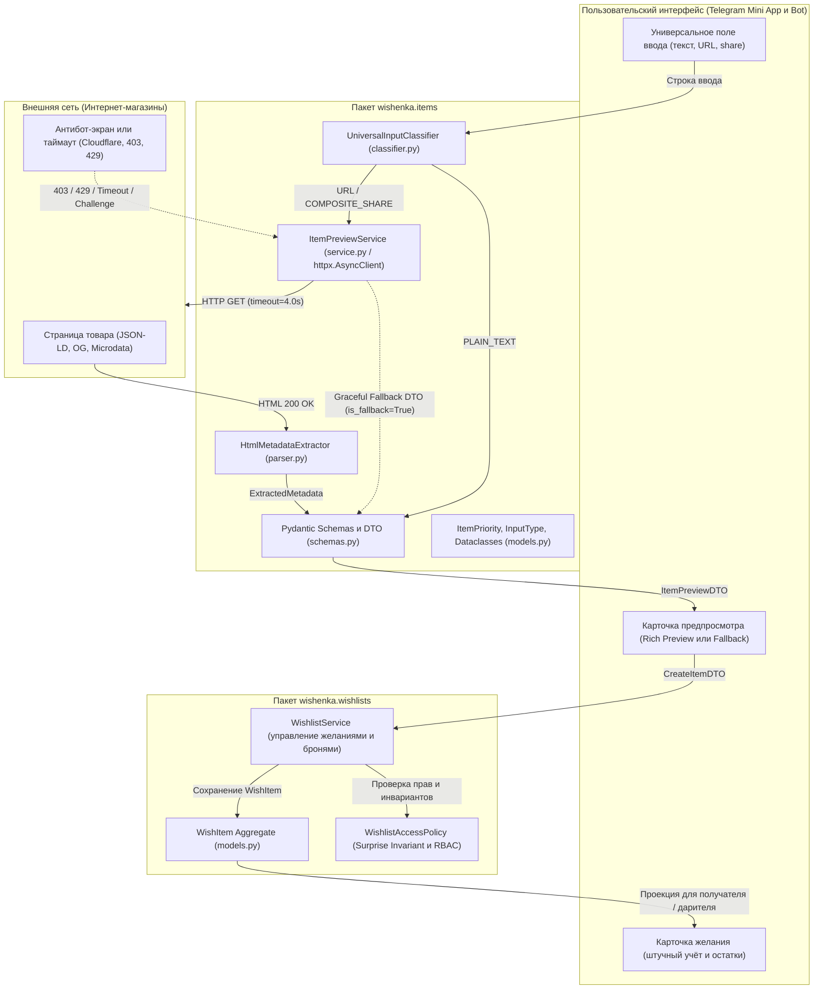

# Спецификация: WISHENKA-11 — Универсальный ввод желаний, парсинг ссылок и штучный учёт

**Версия документа:** 1.0  
**Задача Jira:** WISHENKA-11  
**Статус:** реализовано и принято (Steps 1–8)  
**Платформы и среда:** Telegram Bot + Telegram Mini App (Python 3.12+)

## 1. Назначение и бизнес-цель

### 1.1. Постановка проблемы

В сервисе **«Вишенка» (Telegram Wishlist Service)** добавление желания — главное и самое частое действие автора списка. Пользователи фиксируют подарки из разных источников: короткими текстовыми мыслями, прямыми веб-ссылками (часто скопированными без протокола `https://`) или длинными промо-сообщениями из системного меню «Поделиться» мобильных приложений маркетплейсов.

Необходимость вручную переключать режим ввода («ссылка» или «текст»), вырезать URL из текста шеринга, переписывать название и цену, а также сталкиваться с ошибками при блокировке магазина антибот-защитой (Cloudflare, капчи, HTTP 403) создаёт высокое трение и ведёт к потере желаний. Кроме того, подарки могут требоваться комплектами в нескольких экземплярах (например, стулья, бокалы, книги), а в совместных вишлистах желание может адресоваться конкретному соавтору, всем участникам или внешней персоне при строгом соблюдении тайны сюрприза.

### 1.2. Цели задачи

Задача **WISHENKA-11** формализует и реализует базовый продуктовый и архитектурный контур работы с желаниями:

1. **Универсальное поле ввода (Universal Input Field):** единый ввод строки любого формата без предварительных переключателей с автоматическим определением типа, нормализацией протокола и извлечением ссылки из мобильного шеринга.
2. **Автоматическое обогащение и Rich Preview:** каскадное извлечение витринных метаданных товара (название, описание, фотография, ориентировочная цена, валюта, бренд/название магазина, фавикон) по стандартам JSON-LD, OpenGraph, Microdata и HTML-тегов.
3. **Отказоустойчивость и Graceful Fallback:** гарантированное сохранение ссылки и бесшовный переход к ручному вводу при таймаутах, сетевых сбоях и антибот-блокировках без обхода капч.
4. **Модель штучного учёта (Multi-quantity Accounting):** поддержка целочисленного количества экземпляров (`1..1000`), вычисление свободного остатка, частичное бронирование независимыми дарителями и защита от уменьшения количества ниже занятых и полученных единиц.
5. **Адресация получателя и Тайна сюрприза:** назначение получателя в личных и совместных вишлистах с полным исключением данных о бронированиях из проекции получателя.
6. **Валидация и приоритет ручного ввода:** строгая проверка границ всех полей карточки и возможность отредактировать или удалить любое автозаполненное значение.

### 1.3. Ценность для пользователей и системы

- **Нулевой порог входа:** пользователь просто вставляет ссылку, промо-сообщение или фразу и получает готовую карточку желания за 1–2 действия.
- **Информативная витрина:** карточки автоматически обогащаются фотографией, ценой, валютой и меткой магазина, облегчая выбор дарителям.
- **Абсолютная толерантность к сбоям внешних сайтов:** ни одна капча или недоступность маркетплейса не приводит к потере ссылки и не блокирует добавление желания.
- **Предсказуемость координации и нагрузки:** целочисленный поштучный учёт исключает дубли и переполнение броней, а жёсткий таймаут предпросмотра (4,0 с) и отказ от тяжёлых headless-браузеров защищают ресурсы сервиса.

### 1.4. Границы задачи (Out of Scope)

В рамки **WISHENKA-11** не входят:

- Фоновый периодический мониторинг изменения цен по сохранённым ссылкам (цена фиксируется при создании или ручном редактировании карточки).
- Автоматическое оформление заказа и интеграция с корзинами магазинов (auto-checkout).
- Отдельная публичная веб-версия вне Telegram Bot и Telegram Mini App.
- OCR-распознавание скриншотов и чеков.
- Обработка платежей и совместный сбор средств (crowdfunding).

## 2. Функциональные требования и пользовательские сценарии

### 2.1. Универсальный ввод и классификация

Единая форма добавления желания (в нижней части экрана вишлиста в Mini App и в диалоге с Telegram-ботом) принимает произвольную строку и классифицирует её на четыре типа (`InputType`):

| Тип ввода | Критерий распознавания | Поведение и нормализация |
| --- | --- | --- |
| `plain_text` | Валидный URL в строке не найден (включая ложные фрагменты вроде слова `http`) | Исходный текст целиком становится названием желания (`residual_text`), сетевой запрос не выполняется |
| `explicit_url` | Вся очищенная строка является URL со схемой `http://` или `https://` | Схема сохраняется в том виде, как её указал пользователь; запускается извлечение метаданных |
| `implicit_url` | Строка без схемы соответствует шаблону домена и пути (например, `wildberries.ru/catalog/...`, `ozon.ru/t/...`) | К адресу добавляется протокол по умолчанию `https://`; запускается извлечение метаданных |
| `composite_share` | Строка содержит и URL (явный или неявный), и сопроводительный текст мобильного шеринга | Первый валидный URL нормализуется и отправляется на обогащение; остальной текст очищается от лишних пробелов и сохраняется в `residual_text` |

Правила обработки граничных случаев ввода:

- Лидирующие и замыкающие пробельные символы и переводы строк отсекаются.
- При наличии нескольких ссылок в одном сообщении для предпросмотра используется первая валидная ссылка, а оставшийся текст (включая последующие ссылки) сохраняется в `residual_text` и может использоваться как резервное название при fallback или заметка/описание.
- Реферальные и параметры адресации ссылки в базовом классификаторе WISHENKA-11 не искажаются, чтобы переход дарителя в магазин оставался рабочим.

### 2.2. Извлечение метаданных и Rich Preview

При распознавании URL сервис асинхронно загружает HTML-страницу товара и извлекает витринные атрибуты по строгому каскаду источников в порядке убывания специфичности:

1. **JSON-LD (Schema.org):** блоки `<script type="application/ld+json">` (включая массивы и вложенный `@graph`), объекты с `@type` `Product` или `IndividualProduct` — поля `name`, `description`, `image`, `brand.name`, `offers.price` / `offers[0].price`, `offers.priceCurrency`.
2. **OpenGraph (OG):** теги `og:title`, `og:description`, `og:image` / `og:image:url` (относительные пути преобразуются в абсолютные через `urljoin`), `og:site_name`, товарные теги `product:price:amount` / `og:price:amount`, `product:price:currency` / `og:price:currency`.
3. **Microdata / RDFa:** атрибуты `itemscope`, `itemtype`, `itemprop="name"`, `itemprop="description"`, `itemprop="image"`, `itemprop="price"`, `itemprop="priceCurrency"`.
4. **Стандартный HTML:** тег `<title>`, `<meta name="description">`, `twitter:description`, `twitter:image`, иконка `<link rel="icon">` / `shortcut icon` / `apple-touch-icon` с разрешением относительных путей либо fallback на `https://{domain}/favicon.ico`.

Правила нормализации извлечённых значений:

- **Очистка названия (`clean_title`):** удаление типового рекламного шума маркетплейсов («— купить по выгодной цене в интернет-магазине...», «в наличии», «• OZON», «| Wildberries» и др.).
- **Разбор цены (`parse_price`):** удаление неразрывных пробелов, разделителей тысяч и символов валют (например, `" 1 299 ₽ "` → `1299`, `"1,490.50"` → `1490`, `"$49.99"` → `49`). В базовой реализации WISHENKA-11 цена в контрактах представлена целым числом (`int | None`) для исключения погрешностей плавающей запятой (бизнес-требование допуска до 2 знаков после запятой учтено в спецификации требований как целевое). Если цена на странице отсутствует, поле остаётся `None` (не подменяется `0`), при этом явная цена `0` валидна для бесплатных товаров.
- **Нормализация валюты (`normalize_currency`):** приведение символов и обозначений к кодам ISO 4217 (`₽`, `руб`, `руб.` → `RUB`; `$`, `usd` → `USD`; `€`, `eur` → `EUR`; `₸`, `kzt` → `KZT`; `Br`, `byn` → `BYN`; `£`, `gbp` → `GBP`; `¥`, `cny` → `CNY`; сохранение `TRY`, `GEL`, `AED` и иных валидных кодов). При отсутствии или нераспознанности валюты подставляется `RUB`.
- **Определение магазина (`derive_store_name`):** по цепочке `og:site_name` → `brand` → словарь известных доменов (`ozon.ru` → `Ozon`, `wildberries.ru` → `Wildberries`, `market.yandex.ru` → `Яндекс Маркет`, `lamoda.ru` → `Lamoda`, `avito.ru` → `Авито` и др.) → очищенный домен.

Компактная карточка **Rich Preview** выводит фотографию, очищенное название, цену с валютой, имя и фавикон магазина и три действия:

- **«Добавить»:** мгновенное сохранение желания в текущий вишлист со значениями по умолчанию (`quantity=1`, средний приоритет).
- **«Подробнее / Изменить»:** переход к полной форме редактирования всех атрибутов карточки.
- **«Отмена»:** сброс черновика предпросмотра и очистка поля ввода.

Любое автоматически извлечённое поле пользователь может вручную изменить или очистить (при удалении ссылки карточка сохраняется как обычное текстовое желание без потери остальных атрибутов).

### 2.3. Отказоустойчивость и стратегия Graceful Fallback

> **Инвариант надёжности:** ни один сетевой сбой, превышение таймаута, HTTP-ошибка внешнего магазина или антибот-экран не должны приводить к потере введённой ссылки, аварийной ошибке интерфейса или блокировке добавления желания.

Правила мягкой деградации:

1. **Бюджет времени:** суммарное ожидание ответа магазина ограничено **4,0 с** (таймаут соединения — 2,0 с). По истечении бюджета запрос прерывается без показа технических ошибок.
2. **Обработка антибот-защиты (No-Captcha Rule):** при получении HTTP-статусов `403`, `429`, `503` либо обнаружении сигнатур Cloudflare Turnstile / WAF / капчи (`_cf_chl_opt`, `challenge-running`, `just a moment...`, `cf-mitigated`, `ddos-guard`, `access denied`, `waf`) сервис **не пытается** обходить защиту и **не просит** пользователя проходить стороннюю капчу.
3. **Режим ручного ввода (Fallback Mode):** возвращается предпросмотр с `is_fallback=True` и кодом причины (`fallback_reason`: `"anti_bot_challenge"`, `"timeout"` или `"http_error"`). Ссылка (`url`) и определённый по домену магазин (`store_name`) гарантированно сохраняются, для `composite_share` подставляется `residual_text`, а фокус в форме переводится на обязательное поле «Название».

### 2.4. Модель штучного учёта (Multi-quantity Accounting)

Поддержка многосоставных подарков (наборы посуды, стулья, книги) строится на целочисленной модели:

- **Требуемое количество (`quantity` / `desired_quantity`):** целое число от `1` до `1000` (по умолчанию `1`). Дробные, нулевые и отрицательные значения запрещены. Если `quantity == 1`, счётчик штук в компактной карточке скрыт; при `quantity > 1` отображается явно.
- **Забронированное количество (`reserved_quantity`):** сумма единиц во всех активных бронях (`ReservationStatus.ACTIVE`) данного желания.
- **Полученное количество (`received_quantity` / `fulfilled_quantity`):** количество уже вручённых и подтверждённых владельцем единиц (`>= 0`).
- **Доступный остаток (`available_quantity`):** вычисляется по формуле `available_quantity = max(0, quantity - received_quantity - reserved_quantity)`.

Инварианты операций над количествами:

1. **Инвариант бронирования:** даритель может забронировать целое количество `q` при условии `1 <= q <= available_quantity` (шаг `0` трактуется как отмена брони). Несколько дарителей могут параллельно бронировать части одного желания; попытка занять больше остатка отклоняется исключением `InsufficientQuantityError`.
2. **Инвариант уменьшения количества автором:** в рамках WISHENKA-11 при редактировании желания новое значение должно удовлетворять условию `new_quantity >= reserved_quantity + received_quantity`. Попытка уменьшить требуемое количество ниже уже забронированного и полученного объёма отклоняется исключением `CannotReduceQuantityBelowReservedError`.
3. **Частичное получение:** владелец может отметить получение части экземпляров; оставшаяся неполученная часть остаётся активной с пересчитанным остатком.

### 2.5. Адресация получателя и Тайна сюрприза

- **Личный вишлист:** адресатом любого желания безальтернативно является владелец списка; выбор получателя в форме скрыт.
- **Совместный вишлист:** форма позволяет назначить конкретного зарегистрированного соавтора списка (`recipient_user_id`), указать общее желание («Для всех») либо ввести имя внешней персоны без аккаунта Telegram (`recipient_name`, до 100 символов). По умолчанию адресатом выставляется автор.
- **Инвариант «Тайны сюрприза» (Surprise Invariant):** если пользователь назначен получателем конкретного желания (в том числе когда он является владельцем, администратором или участником совместного вишлиста), он сохраняет право видеть и редактировать карточку, но любые сведения о бронированиях (`reserved_quantity`, `available_quantity`, `is_fully_reserved`, `is_reserved_by_me`, `my_reserved_quantity`, `reservations`, статус покупки и личности дарителей) полностью исключаются из его проекции данных. Для общих желаний («Для всех») и внешних персон соавторы координируют бронирования открыто.

### 2.6. Валидация полей карточки желания

| Поле | Обязательность | Ограничения и формат | Поведение по умолчанию / при нарушении |
| --- | --- | --- | --- |
| `title` (Название) | Обязательно | Строка длиной `1..255` символов; запрещены строки только из пробелов | Отклонение валидацией (`ValidationError`), сохранение блокируется |
| `description` (Описание / заметка) | Необязательно | Строка длиной до `2000` символов | `None`; при превышении длины отклоняется валидатором |
| `link` (Ссылка на товар) | Необязательно | Веб-адрес (`http://` или `https://`) длиной до `2048` символов | `None`; карточка может существовать без ссылки |
| `image_url` (Фотография) | Необязательно | URL изображения длиной до `2048` символов | `None` (интерфейс показывает заглушку) |
| `price` (Ориентировочная цена) | Необязательно | Неотрицательное число от `0` до `999 999 999` (в DTO WISHENKA-11 — `int \| None`) | `None` (если цена не указана); отрицательные значения отклоняются |
| `currency` (Валюта) | Необязательно | Код ISO 4217 длиной до `10` символов | По умолчанию `"RUB"` |
| `quantity` (Количество) | Обязательно | Целое число от `1` до `1000` | По умолчанию `1`; `0`, отрицательные числа и дробные значения отклоняются |
| `priority` (Приоритет) | Необязательно | Значения перечисления `ItemPriority`: `high`, `medium`, `low` | По умолчанию `ItemPriority.MEDIUM` («Буду рад») |
| `category` (Категория) | Необязательно | Строка длиной до `50` символов | `None` |
| `recipient_user_id` / `recipient_name` | Контекстно обязательно | ID участника вишлиста или имя внешней персоны длиной до `100` символов | По умолчанию владелец/автор; в личном списке выбор скрыт |

### 2.7. Основные пользовательские сценарии

- **US-1 (Простой текст):** пользователь вводит «Книга Чистый Код» и нажимает «Добавить» — желание сохраняется мгновенно с `quantity=1` без ссылки и цены; при нажатии «Подробнее» пользователь дозаполняет цену, валюту и количество.
- **US-2 (Ссылка с авто-обогащением):** пользователь вставляет `https://ozon.ru/product/...` или беспротокольный адрес `wildberries.ru/catalog/123/detail.aspx` — система нормализует URL, извлекает метаданные из JSON-LD/OG и показывает Rich Preview с фото, ценой и названием магазина.
- **US-3 (Мобильный шеринг):** пользователь пересылает боту сообщение *«Глянь какая скидка на чайник! https://market.yandex.ru/product/456789»* — URL направляется на парсинг, а сопроводительный текст сохраняется в `residual_text`.
- **US-4 (Антибот и таймаут):** при вставке ссылки на магазин с Cloudflare Turnstile, HTTP 403 или таймаутом свыше 4 секунд система открывает форму ручного ввода с уже подставленной ссылкой и определённым по домену магазином.
- **US-5 (Штучный учёт):** автор создаёт желание с `quantity=4`, первый даритель бронирует 2 штуки (остаток `2`), второй бронирует 1 штуку (остаток `1`), попытка третьего забронировать 2 штуки отклоняется (`InsufficientQuantityError`), а попытка автора снизить `quantity` ниже суммы броней и получений блокируется (`CannotReduceQuantityBelowReservedError`).
- **US-6 (Получатель в совместном вишлисте):** автор указывает получателем сестру Анну (соавтора списка); Анна видит саму карточку в списке, но не видит статус и объём бронирований, тогда как остальные дарители видят остаток и могут бронировать подарок.

## 3. Архитектура, компоненты и интерфейсы

### 3.1. Компонентная схема и потоки данных

Реализация разделена на два взаимодействующих пакета: новый доменный модуль **`wishenka.items`** (классификация ввода, парсинг HTML, асинхронный предпросмотр, схемы ввода) и расширение пакета **`wishenka.wishlists`** (сущность `WishItem`, инварианты остатков, ролевые проекции DTO и сервис управления).



### 3.2. Модули и интерфейсы пакета `wishenka.items`

| Модуль | Основные символы и ответственность |
| --- | --- |
| `wishenka/items/models.py` | Перечисления `ItemPriority` (`HIGH="high"`, `MEDIUM="medium"`, `LOW="low"`), `InputType` (`PLAIN_TEXT`, `EXPLICIT_URL`, `IMPLICIT_URL`, `COMPOSITE_SHARE`); датаклассы `ExtractedMetadata` и `InputClassificationResult` |
| `wishenka/items/exceptions.py` | Исключения `ItemError(WishlistError)` и `InvalidItemDataError(ItemError)`; реэкспорт `CannotReduceQuantityBelowReservedError` и `InsufficientQuantityError` из `wishenka.wishlists.exceptions` |
| `wishenka/items/classifier.py` | `UniversalInputClassifier.classify(raw_text: str) -> InputClassificationResult` — распознавание явных URL (`https?://...`), неявных доменов с автодобавлением `https://`, извлечение `residual_text` из мобильного шеринга |
| `wishenka/items/parser.py` | `HtmlMetadataExtractor.extract(html: str, base_url: str) -> ExtractedMetadata` на базе `BeautifulSoup4`; каскадный обход `_find_jsonld_products` (включая `@graph` и списки), OpenGraph, Microdata, HTML; хелперы `clean_title`, `parse_price`, `normalize_currency`, `derive_store_name`, `extract_domain` |
| `wishenka/items/service.py` | `ItemPreviewService` с методами `async def fetch_preview(raw_input: str) -> ItemPreviewDTO` и алиасом `async def preview(raw_input: str) -> ItemPreviewDTO`; HTTP-клиент `httpx.AsyncClient` с таймаутом `4.0` с (`connect=2.0`), до 5 редиректов, мобильным `User-Agent` и `Accept-Language: ru-RU,ru;q=0.9,en;q=0.8`; детекция антибот-сигнатур и генерация fallback DTO |
| `wishenka/items/schemas.py` | Pydantic v2 DTO: `ItemPreviewDTO`, `CreateItemDTO`, `UpdateItemDTO` |
| `wishenka/items/__init__.py` | Централизованный публичный экспорт моделей, классификатора, парсера, сервиса, схем и исключений |

### 3.3. Контракты данных (DTO)

Контракты взаимодействия между слоями описаны в `wishenka/items/schemas.py` с использованием `pydantic.BaseModel`:

```python
class ItemPreviewDTO(BaseModel):
    model_config = ConfigDict(frozen=True)

    input_type: InputType
    url: str | None = None
    title: str | None = None
    description: str | None = None
    image_url: str | None = None
    price: int | None = None
    currency: str = "RUB"
    store_name: str | None = None
    store_icon_url: str | None = None
    is_fallback: bool = False
    fallback_reason: str | None = None


class CreateItemDTO(BaseModel):
    title: str = Field(..., min_length=1, max_length=255)
    description: str | None = Field(default=None, max_length=2000)
    link: str | None = Field(default=None, max_length=2048)
    image_url: str | None = Field(default=None, max_length=2048)
    price: int | None = Field(default=None, ge=0, le=999_999_999)
    currency: str = Field(default="RUB", max_length=10)
    quantity: int = Field(default=1, ge=1, le=1000)
    priority: ItemPriority = Field(default=ItemPriority.MEDIUM)
    category: str | None = Field(default=None, max_length=50)
    recipient_user_id: int | None = None
    recipient_name: str | None = Field(default=None, max_length=100)


class UpdateItemDTO(BaseModel):
    title: str | None = Field(default=None, min_length=1, max_length=255)
    description: str | None = Field(default=None, max_length=2000)
    link: str | None = Field(default=None, max_length=2048)
    image_url: str | None = Field(default=None, max_length=2048)
    price: int | None = Field(default=None, ge=0, le=999_999_999)
    currency: str | None = Field(default=None, max_length=10)
    quantity: int | None = Field(default=None, ge=1, le=1000)
    priority: ItemPriority | None = None
    category: str | None = Field(default=None, max_length=50)
    recipient_user_id: int | None = None
    recipient_name: str | None = Field(default=None, max_length=100)
```

### 3.4. Интеграция с `wishenka.wishlists` и переходы состояний

1. **Доменная модель `WishItem` (`wishenka/wishlists/models.py`):**
   - Расширена атрибутами `image_url`, `store_name`, `store_icon_url`, `priority` (`ItemPriority.MEDIUM`), `category`, `recipient_user_id`, `recipient_name`.
   - Вычисляемые свойства: `reserved_quantity` (сумма активных броней), `available_quantity` (`max(0, quantity - received_quantity - reserved_quantity)`), а также алиасы `desired_quantity` и `fulfilled_quantity`.
2. **Ролевые проекции (`wishenka/wishlists/schemas.py`):**
   - `WishItemRecipientViewDTO` включает витринные поля (`image_url`, `store_name`, `store_icon_url`, `priority`, `category`), `quantity` и `received_quantity`, но **полностью исключает** `reserved_quantity`, `available_quantity`, `is_fully_reserved`, `is_reserved_by_me`, `my_reserved_quantity` и список броней.
   - `WishItemGifterViewDTO` дополнительно предоставляет `available_quantity`, `is_fully_reserved`, `is_reserved_by_me` и `my_reserved_quantity`.
3. **Сервисный слой (`wishenka/wishlists/service.py`):**
   - `create_wishlist` поддерживает передачу `owner_id`.
   - `add_wish_item` создаёт карточку с начальным `quantity` и публикует событие `item_created`.
   - `update_wish_item` при уменьшении `quantity` проверяет инвариант блокировки ниже `reserved_quantity + received_quantity` и при нарушении выбрасывает `CannotReduceQuantityBelowReservedError`.
   - `create_reservation` проверяет `requested_quantity <= item.available_quantity` и при нехватке остатка выбрасывает `InsufficientQuantityError`.

**Переходы состояний предпросмотра (Preview Lifecycle):**

- `Raw Input` → `UniversalInputClassifier.classify`:
  - `PLAIN_TEXT` → мгновенный `ItemPreviewDTO(is_fallback=False, title=residual_text)`.
  - `EXPLICIT_URL` / `IMPLICIT_URL` / `COMPOSITE_SHARE` → `HTTP GET (<= 4.0s)`:
    - `200 OK` без сигнатур антибота → `HtmlMetadataExtractor.extract` → `ItemPreviewDTO(is_fallback=False)` (при ошибке парсера — `ItemPreviewDTO(is_fallback=True, fallback_reason="http_error")`).
    - `403` / `429` / `503` / Turnstile / WAF → `ItemPreviewDTO(is_fallback=True, fallback_reason="anti_bot_challenge")`.
    - `TimeoutException` → `ItemPreviewDTO(is_fallback=True, fallback_reason="timeout")`.
    - Прочие сетевые ошибки / `HTTP >= 400` → `ItemPreviewDTO(is_fallback=True, fallback_reason="http_error")`.

**Переходы состояний остатка желания (Inventory Lifecycle):**

- `Active (available_quantity == quantity)` → частичное бронирование → `Partially Reserved (0 < available_quantity < quantity)` → бронирование остатка → `Fully Reserved (available_quantity == 0)` → отметка получения (`received_quantity == quantity`) → `Fulfilled` или перенос в архив (`is_archived = True`).
- Отмена или уменьшение брони мгновенно возвращают освободившиеся единицы в `available_quantity`.

## 4. Нефункциональные требования, безопасность и наблюдаемость

### 4.1. Производительность и ограничения среды

- **Бюджет отклика:** сетевой вызов предпросмотра жёстко ограничен **4,0 секундами** (connect timeout `2,0` с), максимум 5 HTTP-перенаправлений; обработка текстового ввода происходит локально без сети.
- **Потребление ресурсов:** парсинг выполняется в памяти средствами `BeautifulSoup4` (`html.parser`) и скомпилированных регулярных выражений (50–200 мс на типовую страницу), без запуска headless-браузеров (экономия сотен мегабайт ОЗУ на инстанс).
- **Конкурентность остатков:** в целевой модели персистентности SQLite WAL конкурентные бронирования одного желания выполняются атомарно в транзакции с блокировкой `BEGIN IMMEDIATE`, исключая гонки (race conditions) и переполнение остатка.

### 4.2. Безопасность и приватность

- **Защита тайны сюрприза:** разграничение DTO-проекций (`WishItemRecipientViewDTO` vs `WishItemGifterViewDTO`) действует безусловно для любого получателя, включая владельца или администратора совместного вишлиста, указанного получателем данного желания.
- **Отказ от обхода антибот-защиты:** сервис никогда не подбирает и не обходит CAPTCHA/Turnstile и не перекладывает прохождение капчи магазина на пользователя.
- **Гигиена логов (No Sensitive Payload Leak):** в структурные логи запрещено записывать сырые HTML-документы, длинные пользовательские тексты (`residual_text`) и чувствительные параметры URL-запросов. Логируются только `url_domain`, `input_type`, флаги наличия метаданных, метрики времени (`duration_ms`) и идентификаторы сущностей.
- **Зафиксированные пробелы безопасности базовой версии WISHENKA-11:** в исходной реализации данной задачи отсутствовали валидация исходящих URL против приватных/внутренних IP-диапазонов (SSRF) и ограничение объёма потокового чтения тела HTTP-ответа (вынесено в приоритетный техдолг `WISHENKA-54`).

### 4.3. Наблюдаемость: структурное логирование и метрики

Логирование реализовано в модулях `wishenka.items` и `wishenka.wishlists` с передачей структурированного контекста (`extra`), совместимого с `wishenka.logging.JsonFormatter` (интеграция с ELK, Loki, Prometheus и Grafana):

| Уровень | Логгер | Событие (`event`) | Контекст и назначение |
| --- | --- | --- | --- |
| `ERROR` | `wishenka.items` | `item_metadata_parsing_error` | Непредвиденный сбой `HtmlMetadataExtractor`; `url_domain`, `duration_ms`, переход в fallback |
| `WARNING` | `wishenka.items` | `item_preview_timeout` | Превышение таймаута 4,0 с; `url_domain`, `duration_ms`, `fallback_reason="timeout"` |
| `WARNING` | `wishenka.items` | `item_preview_network_error` | Сетевой сбой / ошибка соединения; `url_domain`, `duration_ms`, `fallback_reason="http_error"` |
| `WARNING` | `wishenka.items` | `item_preview_http_error` | Ошибка HTTP `>= 400`; `status_code`, `url_domain`, `duration_ms` |
| `WARNING` | `wishenka.wishlists` | `item_quantity_reduction_rejected` | Попытка снизить `quantity` ниже занятых и полученных штук; `item_id`, `wishlist_id`, `requested_quantity`, `locked_quantity` |
| `WARNING` | `wishenka.wishlists` | `item_not_found` | Попытка обновить несуществующее желание; `item_id`, `actor_id` |
| `WARNING` | `wishenka.wishlists` | `item_mutation_blocked_archived` | Изменение желания в архивном списке; `item_id`, `wishlist_id` |
| `WARNING` | `wishenka.wishlists` | `item_mutation_blocked_deleted` | Изменение желания в удалённом списке; `item_id`, `wishlist_id` |
| `WARNING` | `wishenka.wishlists` | `access_denied` | Недостаточно прав для редактирования; `item_id`, `wishlist_id`, `actor_id` |
| `INFO` | `wishenka.items` | `metadata_extraction_completed` | Завершение парсинга; `url_domain`, `duration_ms`, `parser_stage="complete"`, `has_title`, `has_price`, `has_image` |
| `INFO` | `wishenka.items` | `item_preview_success` | Успешное формирование предпросмотра; `url_domain`, `duration_ms`, `input_type`, `is_fallback=False` |
| `INFO` | `wishenka.items` | `anti_bot_challenge_detected` | Обнаружение антибот-экрана / 403 / 429 / 503; `status_code`, `url_domain`, `duration_ms` |
| `INFO` | `wishenka.wishlists` | `item_created` | Добавление желания в вишлист; `item_id`, `wishlist_id`, `actor_id`, `quantity` |
| `INFO` | `wishenka.wishlists` | `item_updated` | Обновление желания и количества; `item_id`, `wishlist_id`, `actor_id`, `quantity`, `quantity_delta` |
| `DEBUG` | `wishenka.items` | `input_classified` | Классификация входа; `input_type`, `url_domain`, `has_residual` |
| `DEBUG` | `wishenka.items` | `metadata_extraction_started` | Старт парсинга HTML; `url_domain`, `parser_stage="start"`, длина HTML |
| `DEBUG` | `wishenka.items` | `metadata_stage_resolved` | Срабатывание каскада (`json_ld`, `opengraph`, `microdata`) |
| `DEBUG` | `wishenka.items` | `item_preview_plain_text` | Локальная обработка текстового ввода; `duration_ms` |

Ключевые метрики мониторинга и алертинга:

- **Производительность:** `duration_ms` для операций извлечения и предпросмотра; длина HTML-документа без хранения текста в логах.
- **Пропускная способность и бизнес-метрики:** счётчики событий `input_classified`, `item_preview_success`, `item_created`, `item_updated` (с `quantity_delta`).
- **Ошибки и здоровье интеграций:** доли `item_preview_timeout`, `item_preview_network_error`, `anti_bot_challenge_detected` (индикатор доступности внешних маркетплейсов), а также `item_quantity_reduction_rejected` (попытки нарушения инварианта остатков).

## 5. Верификация и критерии приёмки

### 5.1. Тестовые сценарии

Верификация выполнена изолированными автотестами (`pytest` + `pytest-asyncio`) с обязательным ограничением времени выполнения (`pytestmark = pytest.mark.timeout(10)`) и полным мокированием внешних HTTP-вызовов (`httpx.AsyncClient` / `_fetch_html`):

1. **`tests/test_item_input_parsing.py` (24 теста в 5 классах):**
   - `TestUniversalInputClassification`: классификация простого текста (включая спецсимволы), явных `https://` и `http://` ссылок, неявных доменов (`wildberries.ru/...`, `ozon.ru/t/...`) с автодобавлением `https://`, а также составных сообщений мобильного шеринга с выделением `residual_text`.
   - `TestHtmlMetadataExtraction`: каскадное извлечение из JSON-LD (`Product`/`Offer`), OpenGraph fallback, Microdata fallback, стандартного HTML (`<title>`, `<meta>`, favicon), очистка цен (`parse_price`), нормализация валют в ISO 4217 (`normalize_currency`), очистка заголовков от рекламного шума (`clean_title`).
   - `TestGracefulFallbackAndAntiBot`: мягкая деградация при HTTP 403/429, детекция Cloudflare Turnstile (`fallback_reason="anti_bot_challenge"`), обработка `httpx.TimeoutException` (`fallback_reason="timeout"`) с сохранением ссылки и имени магазина.
   - `TestMultiQuantityInvariants`: проверка границ `1..1000` в `CreateItemDTO` и `UpdateItemDTO`, вычисление `available_quantity`, параллельное частичное бронирование несколькими дарителями с выбросом `InsufficientQuantityError` при превышении остатка, запрет уменьшения количества ниже `reserved_quantity + received_quantity` (`CannotReduceQuantityBelowReservedError`).
   - `TestSurpriseInvariantIntegrity`: проверка отсутствия всех полей бронирования в `WishItemRecipientViewDTO` и их наличия в `WishItemGifterViewDTO`.
2. **`tests/test_item_observability.py` (5 сценариев с `caplog`):**
   - Структурные `DEBUG`-логи `UniversalInputClassifier.classify`;
   - Трассировка этапов `HtmlMetadataExtractor.extract` без утечки сырого HTML в сообщения или `extra`;
   - Логирование `ItemPreviewService` для `plain_text` и успешного парсинга;
   - Раздельное логирование отказов (`item_preview_timeout`, `item_preview_network_error`, `anti_bot_challenge_detected`, `item_preview_http_error`, `item_metadata_parsing_error`);
   - Логирование жизненного цикла количества в `WishlistService` (`item_created`, `item_updated` с `quantity_delta`, `item_quantity_reduction_rejected`, `item_not_found`, `item_mutation_blocked_archived`).

Результаты прохождения проверок при приёмке задачи WISHENKA-11:

- Целевой набор `tests/test_item_input_parsing.py`: **24/24** тестов пройдено.
- Полный прогон после Шага 4 (`make check` / `make test`): **65/65** тестов пройдено за `0.60` с; после добавления тестов наблюдаемости на Шагах 6–7 (`tests/test_item_observability.py`): **70/70** тестов пройдено без ошибок.
- Статический анализ (`make analyze`: Ruff lint, Ruff format, строгая проверка типов `mypy wishenka tests` по 32 исходным файлам): **0 ошибок и 0 предупреждений**.

### 5.2. Критерии приёмки (Definition of Done)

Задача считается выполненной при соблюдении следующих критериев:

1. Реализован и протестирован универсальный классификатор ввода (`plain_text`, `explicit_url`, `implicit_url`, `composite_share`) с нормализацией протокола `https://` и сохранением сопроводительного текста.
2. Обеспечено каскадное извлечение метаданных (JSON-LD → OpenGraph → Microdata → HTML), очистка заголовков, разбор цен и нормализация валют в ISO 4217.
3. Соблюдается строгий таймаут 4,0 с и механизм Graceful Fallback: при таймаутах, HTTP-ошибках и антибот-экранах ссылка и магазин не теряются, а пользователь переводится к ручному вводу.
4. Реализован целочисленный штучный учёт (`1..1000`) с формулой `available_quantity`, частичным бронированием разными дарителями и запретом уменьшения количества ниже суммы занятых и полученных единиц.
5. Обеспечена адресация подарков в совместных вишлистах и строгое соблюдение «Тайны сюрприза» на уровне DTO-проекций.
6. Все поля карточки валидируются согласно матрице ограничений; добавлено структурное логирование без утечки HTML и чувствительных параметров; пройдены `make analyze` и `make test` / `make check`.

### 5.3. Известные ограничения и план доработок

По итогам анализа технического долга (`60-tech-debt.md`) зафиксированы неблокирующие ограничения базовой реализации WISHENKA-11, вынесенные в отдельные задачи Jira под эпиком **WISHENKA-10**:

- **Синхронный парсинг в event loop:** `HtmlMetadataExtractor.extract` строит DOM в `BeautifulSoup4` синхронно, что на больших HTML-документах (> 1 МБ) при высокой конкурентности может задерживать цикл событий.
- **Отсутствие рендеринга клиентских SPA:** сайты без SSR, JSON-LD и OpenGraph-тегов деградируют в ручной ввод.
- **Отсутствие кэша предпросмотров, пула соединений и доменного throttling:** повторные запросы к одному URL создают новый `httpx.AsyncClient` и выполняют повторный сетевой вызов.
- **Отсутствие базовой SSRF-фильтрации, лимита размера ответа и тестов нестандартных кодировок:** не проверяются приватные IP и потоковое ограничение тела ответа, отсутствуют фикстуры для `Windows-1251` и сложных `@graph`-схем.

Заведённые follow-up задачи в Jira:

| Идентификатор | Задача Jira | Приоритет | Оценка | Краткое содержание |
| --- | --- | --- | --- | --- |
| DEBT-1 | [WISHENKA-52](https://pypost.atlassian.net/browse/WISHENKA-52) | Medium | 2.0 SP | Вынос парсинга HTML в `asyncio.to_thread` или переход на высокопроизводительный парсер (`selectolax`/`lxml`) |
| DEBT-2 | [WISHENKA-53](https://pypost.atlassian.net/browse/WISHENKA-53) | Medium | 3.0 SP | Общий пул `httpx.AsyncClient` (keep-alive) и LRU/TTL-кэш предпросмотров |
| DEBT-3 | [WISHENKA-54](https://pypost.atlassian.net/browse/WISHENKA-54) | High | 3.0 SP | Защита от SSRF (блокировка приватных и зарезервированных IP при DNS-резолве) и лимит потокового чтения ответа (2 МБ) |
| DEBT-4 | [WISHENKA-55](https://pypost.atlassian.net/browse/WISHENKA-55) | Low | 5.0 SP | Подключаемый конвейер экстракторов (`MetadataExtractor` protocol) для отдельных маркетплейсов (Ozon, Wildberries, Яндекс Маркет) |
| DEBT-5 | [WISHENKA-56](https://pypost.atlassian.net/browse/WISHENKA-56) | Low | 2.0 SP | Тесты нормализации устаревших кодировок (`Windows-1251`) и сложных вложенных JSON-LD `@graph` |
