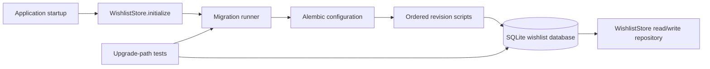

# WISHENKA-111: Controlled SQLite schema evolution

## Research

- The project already declares Alembic and SQLAlchemy in `pyproject.toml`; no new migration
  framework is needed.
- Alembic's [`stamp`](https://alembic.sqlalchemy.org/en/latest/api/commands.html) records a
  revision without executing migrations. It is therefore suitable for explicitly adopting a
  database that the prior application initializer has already brought to the current schema.
- Alembic documents that SQLite supports little `ALTER TABLE` functionality. For changes that
  need it, its [batch operations](https://alembic.sqlalchemy.org/en/latest/batch.html) recreate,
  copy, and rename a table while preserving the intended structure. This design keeps each
  revision SQLite-compatible and reviews foreign-key consequences before such an operation.
- `WishlistStore._initialize()` currently owns both base DDL and ad-hoc compatibility changes.
  In particular, it inspects `wl_lists` and `wl_items` before adding
  `warn_on_delete_reserved` and `display_order`. The migration boundary must replace this
  mutable runtime schema management with versioned revisions.

## Implementation Plan

1. Add an Alembic configuration and migration environment that obtains the SQLite URL from the
   same application configuration path used by the store.
2. Establish a baseline revision for the normalized wishlist schema, then add ordered revisions
   for `warn_on_delete_reserved`, `display_order`, and its ordering index. Revisions will be
   idempotent through Alembic's version tracking, not runtime `PRAGMA table_info` branching.
3. Change storage initialization to run the migration entry point before domain reads or writes;
   retain connection-local SQLite safety settings, but remove schema-evolution DDL from the
   store.
4. Define an explicit adoption rule for pre-version-table databases. Before any stamp, validate
   the complete normalized base-schema manifest described below. A database with neither
   `warn_on_delete_reserved` nor `display_order` is stamped at `base_normalized`; one with only
   `warn_on_delete_reserved` is stamped at `add_warn_on_delete_reserved`; one with both fields
   but no ordering index is stamped at `add_display_order`; and one with both fields and the
   ordering index is stamped at the current head. Each adopted database then upgrades normally.
   Any missing, extra, or incompatible structural marker fails safely with an actionable error;
   it is never stamped or silently modified.
5. Add automated coverage for a fresh database and a representative legacy database. Both must
   reach the same Alembic head revision while retaining legacy rows and values.

### Failing Repro for Step 3

Create a focused async pytest case under `tests/`, with the required timeout marker. It will
create a temporary SQLite database in the known legacy normalized shape: it has `wl_lists` and
`wl_items`, lacks `warn_on_delete_reserved` and `display_order`, and contains one list and item.
It will invoke the public initialization path and assert that the database has an Alembic version
at head, both missing fields and the ordering index, and the seeded records unchanged. On current
code, the version-table assertion fails because no Alembic environment or revision tracking
exists. Step 4 will add the migration path and make this test green without contacting external
services.

## Architecture

### Components and responsibilities

- **Application startup** invokes store initialization before handling wishlist traffic.
- **Migration runner** is the only runtime component permitted to move an existing schema
  forward. It creates or reads the Alembic version table and upgrades to the declared head.
- **Alembic configuration and environment** bind the application's SQLite URL to Alembic and
  configure SQLite-aware migration execution.
- **Revision scripts** are immutable, ordered records of structural changes. Each has forward
  behavior and a deliberate downgrade policy appropriate to the stored data.
- **WishlistStore** remains the transactional repository for wishlist domain data. It assumes a
  successfully migrated schema and no longer decides schema shape using application code.
- **Upgrade-path tests** create isolated SQLite files and verify fresh and legacy paths through
  the same public initialization contract.

### Interactions and interfaces

- **Application startup → `await WishlistStore.initialize()`**: completes migrations or raises
  before traffic is served.
- **Store initialization → `upgrade_to_head(database_url)`**: returns only after the target
  database reaches one known revision.
- **Migration runner → Alembic `upgrade(head)` / controlled `stamp(baseline)`**: uses one
  SQLite URL and a recorded version history.
- **Revision scripts → Alembic operations API**: applies one deterministic schema transition
  without domain writes.
- **Tests → public store initialization plus SQLite inspection**: prove schema version, required
  fields/index, and preserved seed data.

### Dependencies and patterns

- The store depends on the migration runner at startup; the runner depends on Alembic and
  SQLAlchemy, while revision scripts depend only on Alembic operations and schema definitions.
  Domain services do not depend on individual revision files.
- The design uses the **migration/versioned-change pattern**: append-only revisions describe
  schema history, and the database's version table selects the next transition.
- It also uses a **bootstrap/adoption pattern** for supported legacy databases: validate first,
  stamp only a known equivalent schema, then run normal upgrades. This avoids treating arbitrary
  SQLite files as trusted application state.
- The recognized adoption mappings are structural: `base_normalized` has neither later field;
  `add_warn_on_delete_reserved` has the list preference only; `add_display_order` has both
  fields but lacks the wishlist/order index; and head has all three additions. This lets a
  supported legacy file receive only transitions it still needs.

### Legacy adoption validation

The baseline revision owns a canonical normalized-schema manifest. The adoption check compares
SQLite metadata to that manifest before considering the three later structural markers. It
requires these application tables: `wl_lists`, `wl_members`, `wl_items`, `wl_reservations`,
`wl_favorites`, `wl_view_history`, `wl_tokens`, `wl_invite_tokens`, and `wl_counters`.

- Every required table must have the baseline revision's complete column set, SQLite affinity,
  nullability, primary-key shape, and declared default values. The check rejects legacy JSON
  `payload` columns and does not accept a table merely because its name exists.
- It must verify the baseline foreign keys and cascade actions for list/member, list/item,
  item/reservation, list/favorite, and list/view-history relationships; it also verifies the
  unique constraints for members and view history.
- It must verify every baseline lookup and uniqueness index (owner, status, tokens, members,
  item wishlist and recipient, reservations, favorites, history, and counters). The only
  permitted index difference is `idx_wl_items_order`, which identifies the transition from
  `add_display_order` to head.
- Only after the base manifest matches does the runner inspect
  `warn_on_delete_reserved`, `display_order`, and `idx_wl_items_order` to choose the exact
  revision to stamp. Any unrecognized column, missing constraint, changed foreign key, or
  unexpected index is an unsupported database and stops initialization without a stamp.
- SQLite constraints remain explicit. A revision needing table recreation uses Alembic batch
  operations and accounts for foreign-key enforcement; simple additive changes may use regular
  operations where SQLite supports them.

## Q&A

- **Why stamp a legacy database instead of replaying its already-applied historical changes?**
  The prior initializer has already created that known schema. Recording its equivalent baseline
  prevents duplicate structural changes, after validation proves it is safe to adopt.
- **Does this change wishlist features or permissions?** No. It changes only how the application
  reaches and records its supported database schema.
- **What happens to an unknown database layout?** Initialization stops with a clear error so an
  operator can inspect it; no best-effort destructive conversion is attempted.
