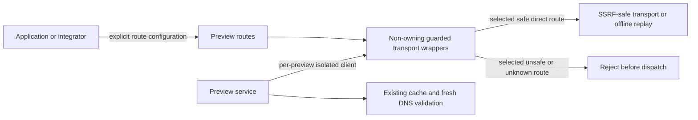

# WISHENKA-114: Supported preview transport integration

## Research

- HTTPX documents `AsyncClient(transport=..., mounts=..., trust_env=False)` and the
  `AsyncBaseTransport.handle_async_request` extension interface. Mounts route by URL pattern,
  with more specific matches taking priority. See
  [HTTPX transports](https://www.python-httpx.org/advanced/transports/) and
  [HTTPX API](https://www.python-httpx.org/api/).
- The public client API does not expose the selected transport, proxy configuration, or a way to
  copy its mounted routes. Client defaults combine cookies, headers and authentication with
  requests; see [HTTPX clients](https://www.python-httpx.org/advanced/clients/). Therefore neither
  copying an arbitrary client's configuration nor calling it directly can establish the required
  isolation and route safety. Treat opaque clients as unsupported and fail closed.
- Today `items/fetcher.py` reads `_transport_for_url`, `_transport`, `_pool`, and httpcore proxy
  types. The web lifecycle also marks a client with a private attribute. These are removed from
  the injected-client integration. `SSRFSafeTransport` itself currently uses httpcore internals
  to pin DNS at connection time; this separate existing safeguard must remain intact, not be
  removed or advertised as solved by this task. Its upgrade risk remains explicit.
- Project dependency `httpx>=0.28.0` has no upper bound. Define the verified compatibility range
  from the versions exercised by the repository and add explicit lower/upper tested versions to
  automation or dependency policy. Do not claim an untested future version is supported.

## Architecture



### Components and responsibilities

- **Preview route configuration:** a typed, immutable application-owned description with a
  default route and explicit HTTPX mount patterns. Each route is classified at construction as
  approved direct, offline replay, or denied. A bare `httpx.AsyncClient` has no inspectable
  trustworthy route contract and is rejected explicitly before any request. This is an
  intentional supported-integration restriction, not a fallback to its private attributes.
- **Supported caller integration:** expose a `PreviewTransportConfig` (or equivalent) through
  `ItemPreviewService` / `UrlMetadataService`; callers provide approved routes without an opaque
  client. A client combined with routes is rejected because the client-to-route match cannot be
  verified without private attributes. No discovery from the client is attempted.
  Production route factories construct the application's pinned-IP `SSRFSafeTransport` directly
  with no proxy, UDS or custom connector. They do not accept arbitrary transports, subclasses,
  wrappers, callbacks, or an `offline=True` assertion as proof of safety. Reject all proxy and
  unknown routes unless a future design provides equivalent connection safeguards.
  Unsupported plain clients fail safely to the normal editable/manual fallback, with a clear
  diagnostic and migration instructions; they are never closed or mutated.
- **Route mapping and denial:** build the isolated client's public `mounts` map using the
  declared patterns. Map permitted routes to non-owning wrappers and proxy/unknown routes to a
  rejecting transport. HTTPX itself chooses the most specific pattern for every hop; a selected
  denial never falls back to a less-specific direct transport. An unlisted/default route is
  denied unless the config explicitly supplies an approved default. Reject proxy and ambiguous
  configurations before network I/O, including redirect targets. Disable environment routing.
- **Per-preview client:** construct a new `httpx.AsyncClient` with `trust_env=False`, no ambient
  auth, default query parameters, caller hooks, cookies or headers; use a rejecting cookie jar,
  explicit preview headers, timeout and redirect handling. Each wrapper delegates only via the
  documented async transport interface and has a no-op `aclose` for borrowed routes. Thus close,
  cancellation and redirects do not mutate or close the caller's client or transports, and
  concurrent previews share only explicitly borrowed connection pools, never request state.
- **Safety:** keep URL scheme, credentials, host and DNS validation before cache lookup and on
  every request/redirect, and preserve pinned-IP validation at actual connect for every approved
  live route. Keep redirect limits, timeouts, streaming body caps and manual fallback. Offline
  replay uses the controlled fixture-only route described below, never an unverified inner
  transport. Use public request hooks or a guarded transport for checks; ensure check executes
  before route dispatch.
- **Ownership:** application lifespan constructs the pinned transport and route config once per
  application and closes the owned transport exactly once on normal exit, startup failure and
  exceptional shutdown. Each preview client owns only its non-owning wrappers and its cookie
  state. Standalone fetch constructs and closes its own safe transport. The integrator retains
  sole ownership of its client and explicitly supplied transports, including after cancellation.
  Ensure partial startup cleanup covers failures before the lifecycle yields.
- **Integration migration:** update the app, service, fetcher, cassette helpers and in-tree
  callers to the explicit config. Preserve plain text, caching, and metadata behavior; update
  documented public API examples. Legacy mock-only testing paths must not create a production
  security bypass; replace them with the controlled offline route below.

### Offline and route-configuration trust boundaries

- A controlled replay route is constructed from copied fixture data only. Its implementation
  creates responses from recorded bytes, fails closed on a miss, and has no live inner transport,
  callback, delegate, record mode, or refresh mode. Its replay interface cannot switch to a mode
  that performs I/O. Existing cassette recording uses a separate explicit safe direct path; a
  recording-capable cassette transport cannot be registered as an offline route.
- The offline cassette verification command runs the full preview service using a private
  fixture-only fetcher and follows recorded redirects without resolving DNS or changing the
  global DNS cache. It never accepts external transports. Normal preview retains per-hop DNS
  validation. Replay compares sanitized URLs so secrets omitted during recording still match.
- Production config accepts only the application's controlled direct, replay, and deny factories.
  An arbitrary `httpx.MockTransport`, its handler, an externally supplied cassette transport,
  and a network-capable object wrapped inside any of them are rejected at construction before
  dispatch. A Python caller able to execute arbitrary code is trusted application code; this
  contract prevents accidental registration of opaque routes, not hostile in-process execution.
- Each approved route is bound to its factory-created transport and checked again at dispatch;
  copying a route marker or replacing its transport cannot authorize a different transport. The
  direct transport requires the expected connection pool and pinned backend and fails closed if
  the backend cannot be installed or is replaced.
- On construction, snapshot the provided mount mapping into a new immutable mapping; never retain
  the caller's mutable mapping. Route descriptors also contain immutable values and controlled
  route handles, not mutable caller-owned policy objects. Validate and normalize patterns before
  exposing the snapshot. Compute cache route identity from that same snapshot, and ensure caller
  mutation after construction cannot alter selection, approval, or cache partitioning.

### Main interfaces

```python
@dataclass(frozen=True)
class PreviewTransportConfig:
    default: PreviewRoute  # approved direct, offline, or deny
    mounts: Mapping[str, PreviewRoute]  # defensive immutable snapshot at construction

# PreviewRoute is constructed by controlled safe-direct/offline/deny factories.
# Borrowed routes retain their owner's lifecycle. No route reads client internals.
async def fetch_preview(raw_input: str, *, routes: PreviewTransportConfig | None = None) -> Preview:
    ...
```

Exact names may follow existing types. The service-level configuration is the reusable default;
per-call routes override it only for that call. A cache hit still performs fresh safety checks and
must not allow a per-call route to reuse data from an unrelated route. Retain current bypass of
cache for per-call injected routes. A config for shared service routes must use existing cache
eligibility and avoid sharing cache entries across different route configurations.

## Implementation plan and failing repro

1. **Step 3, before product edits:** add offline tests in
   `tests/test_preview_supported_routes.py` that build a controlled mounted replay route, a
   denied proxy-pattern route and a public route config; assert the selected safe mount is used,
   a redirect into the denied route is rejected before its handler runs, and concurrent previews
   do not leak cookies, authorization or headers. Verify the owner's client and transport remain
   usable after success, failure and cancellation. Against current code these tests fail because
   the explicit public route contract does not exist, not because of a fixture/network failure.
2. Implement controlled route construction and isolation wrappers; migrate app lifecycle,
   standalone fetching and cassette replay. Keep per-hop validation, pinned-connect checks,
   cache policy and ownership. Replace private integration fields and proxy introspection.
3. Add tests rejecting arbitrary mocks and network-capable wrapped replay transports before
   dispatch, and prove controlled replay misses never invoke a network delegate. Mutate the
   original mounts mapping after construction and assert selection, denial, and cache identity
   remain unchanged. Add tests for specificity and default-deny, no network on proxy/unknown
   routes, redirects, startup exceptions, per-instance closure, response bounds, DNS/cache
   revalidation, and legacy
   unsupported clients. Exercise supported HTTPX versions in isolated environments and assert
   the integration does not access private HTTPX/httpcore members. Run focused security,
   resource-reuse, cassette and concurrent tests followed by the repository quality gates.
4. Document the explicit adapter contract, rejected configurations, lifecycle and upgrade
   matrix. Treat remaining internal connection pinning as a separately identified limitation.

## Q&A

- **Why not inspect a caller's client?** Its transport and proxy routing are private implementation
  details with no public introspection guarantee; assuming they are safe would violate DoD 3.
- **Are previously injected bare clients silently accepted?** No. Integrators register their
  routes explicitly; unsupported clients fail closed and remain usable by their owner.
- **Can direct mounts still work?** Yes. A declared approved direct/offline mount is selected by
  HTTPX public routing; only the owner closes its underlying transport.
- **Do proxy routes fall back to direct?** No. A selected proxy or unverifiable route is denied
  before a request, including on redirect. No traffic is silently rerouted around policy.
