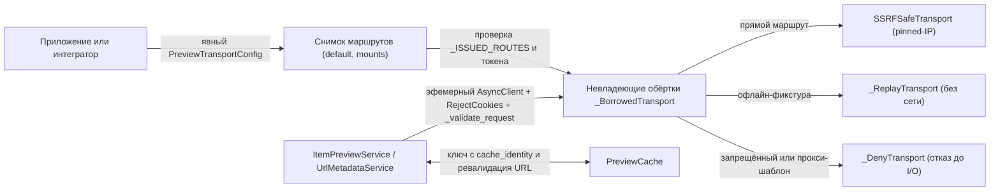

# Спецификация: WISHENKA-114 — Надёжные и безопасные маршруты клиентов предпросмотра ссылок

**Задача в Jira:** WISHENKA-114  
**Компоненты:** `wishenka.items` (`fetcher`, `service`, `ssrf`, `cassettes`), `wishenka.web.app`  
**Язык реализации:** Python (`httpx>=0.28.0,<0.29`)  
**Статус:** реализовано и проверено на фокусном наборе тестов (см. `ai-tasks/WISHENKA-114/00-roadmap.md`)

## 1. Назначение и бизнес-цель

### 1.1. Постановка проблемы

Подсистема предпросмотра товарных ссылок (`ItemPreviewService` и `UrlMetadataService`) обогащает ссылки пользователей метаданными (название, цена, валюта, изображение, магазин) с обязательной защитой от SSRF, редиректов во внутренние сети, превышения размера ответа и утечки приватных данных между запросами.

До изменений по задаче `WISHENKA-114` интеграция с внешне передаваемым или прикладным `httpx.AsyncClient` опиралась на недокументированные внутренние атрибуты HTTPX и httpcore (`_transport_for_url`, `_transport`, `_pool`, внутренние классы прокси httpcore), а также на приватный атрибут маркировки клиента в жизненном цикле веб-приложения (долг зафиксирован в `ai-tasks/WISHENKA-53/60-tech-debt.md`). Публичный API HTTPX не предоставляет средств безопасной инспекции уже сконфигурированного клиента, его смонтированных транспортов, прокси-правил и разделяемого состояния (`cookies`, `headers`, `auth`, `params`). Из-за этого:

- плановое обновление HTTPX или httpcore могло сломать генерацию предпросмотров либо незаметно обесценить проверку безопасности исходящего маршрута;
- непрозрачный (`opaque`) внешний клиент мог содержать небезопасный прокси, произвольный транспорт или разделяемые между запросами учётные данные и cookies;
- смешение ответственности за жизненный цикл транспорта создавало риск преждевременного закрытия или модификации клиентских ресурсов при завершении либо отмене отдельного предпросмотра.

### 1.2. Цели и ценность решения

1. **Контракт на базе документированного API:** перевести маршрутизацию предпросмотров на публичный интерфейс HTTPX (`AsyncClient(transport=..., mounts=..., trust_env=False)` и `AsyncBaseTransport.handle_async_request`) и зафиксировать поддерживаемый диапазон версий `httpx>=0.28.0,<0.29`.
2. **Политика отказа по умолчанию (fail-closed):** запретить непрозрачные `httpx.AsyncClient` и неконтролируемые прокси-/неизвестные маршруты на каждом шаге запроса и при каждом редиректе до DNS-резолвинга и сетевого ввода-вывода.
3. **Изоляция параллельных предпросмотров:** исключить передачу и смешивание cookies, заголовков `Authorization`, параметров запроса и состояния клиента между одновременными запросами и цепочками редиректов.
4. **Чёткое владение ресурсами:** отделить жизненный цикл разделяемого безопасного транспорта (приложение или интегратор) от эфемерного клиента конкретного запроса, гарантировав закрытие только собственных ресурсов.
5. **Сохранение пользовательского опыта:** сохранить прежние сценарии обогащения ссылок, работу с обычным текстом, переиспользование TCP/TLS-соединений, кэширование публичных ответов, антибот-деградацию и ручной ввод при блокировке.

### 1.3. Границы области действия (Scope)

В границы задачи входят интеграция маршрутов предпросмотра в `wishenka.items.fetcher`, `wishenka.items.service`, `wishenka.items.cassettes` и `wishenka.web.app`, контроль маршрутов на уровне `wishenka.items.ssrf`, структурированная диагностика отказов маршрутизации, а также обновление тестовой инфраструктуры и документации разработчика.

Вне рамок задачи остаются:

- изменение правил классификации ввода, парсинга HTML-метаданных, антибот-сигнатур, сохранения желаний и политики TTL/LRU-кэша;
- устранение отдельного существующего механизма пиннинга IP внутри `SSRFSafeTransport` через `pool._network_backend` (в рамках `WISHENKA-114` для него добавлены проверки целостности и fail-closed поведение, а полная замена вынесена в [WISHENKA-284](https://pypost.atlassian.net/browse/WISHENKA-284)).

## 2. Функциональные требования и пользовательские сценарии

### 2.1. Функциональные требования

#### FR-1. Явная конфигурация маршрутов вместо непрозрачных клиентов

- Вызывающий код передаёт явную конфигурацию `PreviewTransportConfig(default, mounts)` через параметр `routes` в `ItemPreviewService` (на уровне сервиса или конкретного вызова `fetch_preview` / `preview`) либо в `UrlMetadataService.fetch_and_extract` / `_fetch_html`.
- Если `routes` не переданы (и `client is None`), `UrlMetadataService._fetch_html` создаёт на время вызова собственный прямой маршрут `safe_direct_route()` и гарантированно закрывает его в блоке `finally`.
- Передача непрозрачного экземпляра `httpx.AsyncClient` в аргумент `client` (как при инициализации `ItemPreviewService`, так и при вызове методов `fetch_preview`, `preview`, `fetch_and_extract`, `_fetch_html`) отклоняется до DNS-запросов и сетевого I/O — даже при одновременной передаче `routes`.
- При отклонении непрозрачного клиента в `ItemPreviewService.fetch_preview` клиент вызывающей стороны не закрывается и не изменяется, а пользователь получает штатный редактируемый фолбэк `ItemPreviewDTO` с `is_fallback=True`, `fallback_reason="ssrf_blocked"`, очищенным URL, распознанным `store_name` и `residual_text` в `title`.

#### FR-2. Контролируемые фабрики и защита конфигурации маршрутов

- В рабочей и тестовой конфигурации предпросмотра допускаются только маршруты типа `PreviewRoute`, созданные тремя контролируемыми фабриками модуля `wishenka/items/fetcher.py`:
  - `safe_direct_route(*, limits=None)` — прямой маршрут на базе `SSRFSafeTransport` без прокси, Unix-сокетов (UDS) и сторонних коннекторов;
  - `offline_replay_route(responses, *, marketplace=None, scenario=None)` — маршрут офлайн-воспроизведения из неизменяемой копии фикстур (`_ReplayTransport`) без живого сетевого делегата, режима записи или обновления;
  - `deny_route()` — маршрут безусловного отказа (`_DenyTransport`), отклоняющий запрос до сетевого обмена с `SSRFBlockedError(..., reason="route_denied")`.
- `PreviewTransportConfig(default, mounts)` при создании проверяет непустоту и валидность каждого строкового шаблона (`httpx.URL(pattern)`), проверяет подлинность `default` и всех значений `mounts`, формирует защитный неизменяемый снимок `mounts` (`MappingProxyType`) и присваивает уникальную `cache_identity`.
- Регистрация произвольных `httpx.AsyncBaseTransport`, `httpx.MockTransport`, сторонних обёрток, подклассов, `CassetteTransport` или подмена `route.transport` после создания отклоняется исключением `ValueError("Unapproved preview route")` на этапе конструирования и повторно проверяется перед отправкой запроса.
- Мутация исходного словаря `mounts` после создания `PreviewTransportConfig` не влияет на выбор маршрута, отказы и ключ кэша.

#### FR-3. Выбор маршрута по специфичности и запрет отката для прокси

- Для каждого запроса в `UrlMetadataService._fetch_html` конструируется изолированный `httpx.AsyncClient`, которому передаются публичные `transport=_BorrowedTransport(selected.default)` и `mounts={key: _BorrowedTransport(route) ...}` с `trust_env=False`.
- Выбор обработчика на исходный запрос и на каждый шаг редиректа выполняет HTTPX по правилам специфичности шаблонов `mounts`.
- Если на исходный URL или на целевой URL редиректа срабатывает шаблон с `deny_route()` (например, для запрещённого домена, схемы или прокси-правила), выполнение немедленно завершается исключением `SSRFBlockedError(..., reason="route_denied")` без отката к менее специфичному прямому маршруту `default` и без выполнения обработчика или сетевого I/O.
- При конфигурации `default=deny_route()` любой URL, не попавший в явно разрешённые `mounts`, отклоняется по принципу default-deny.

#### FR-4. Изоляция запросов и сохранение существующей логики предпросмотра

- Каждый эфемерный `httpx.AsyncClient` создаётся с `trust_env=False`, `cookies=CookieJar(policy=RejectCookies())`, фиксированными `DEFAULT_HEADERS`, `DEFAULT_TIMEOUT` (`4.0s` всего, `2.0s` на подключение) и хуком запроса `_validate_request`.
- Политика `RejectCookies` запрещает как сохранение `Set-Cookie`, так и отправку заголовка `Cookie` на всём протяжении цепочки редиректов; `_validate_request` дополнительно удаляет `Cookie`, запрещает `Authorization` и выполняет `validate_url` перед каждым запросом и редиректом.
- Параллельные вызовы предпросмотра используют изолированные экземпляры клиентов, изоляцию пиннинга IP через `ContextVar` (`_pinned_ips_var`) и изоляцию цепочки ответов через `ContextVar` (`fetch_provenance`), разделяя только явно заимствованные пулы соединений разрешённых маршрутов.
- Классификация `PLAIN_TEXT`, очистка трекинг-параметров (`clean_url`), декодирование HTML (`decode_html`), парсинг метаданных в `asyncio.to_thread`, ограничение ответа в 2 МБ и антибот-деградация сохраняют прежнее поведение.

#### FR-5. Кэширование и повторная валидация маршрутов

- Кэш уровня сервиса (`PreviewCache`) задействуется только при отсутствии параметров вызова `routes`, `client` и сервисного `self.client` (`cacheable = client is None and routes is None and self.client is None`). Вызовы с разовым `routes` обходят сервисный кэш.
- Когда в `ItemPreviewService` задан сервисный `self.routes`, ключ кэша изолируется идентификатором снимка маршрутов: `f"{self.routes.cache_identity}:{target_url}"`. Разные конфигурации маршрутов никогда не переиспользуют записи друг друга.
- При попадании в кэш каждый URL сохранённой цепочки (`cached.urls`, включая исходный адрес и редиректы) заново проверяется через `validate_url(destination)` по текущему DNS и правилам безопасности. При ошибке ревалидации запись удаляется из кэша, а запрос завершается фолбэком `ssrf_blocked`.

#### FR-6. Владение ресурсами и жизненный цикл

- `lifespan` веб-приложения (`wishenka/web/app.py`) создаёт один `safe_direct_route` (с лимитами пула `20` соединений / `10` keep-alive / `5s` idle), один `PreviewCache` и один `ItemPreviewService` на экземпляр `FastAPI`.
- В блоке `finally` жизненного цикла (при штатном завершении, ошибке старта или исключительном выходе) выполняются `cache.clear()`, сброс `app.state.item_preview_service = None` и однократное закрытие принадлежащего приложению транспорта `await route.transport.aclose()`.
- Обёртка `_BorrowedTransport` не закрывает базовый `route.transport` при выходе из контекста эфемерного `AsyncClient`. Успех, ошибка или `asyncio.CancelledError` отдельного предпросмотра не закрывают транспорт владельца маршрута.

#### FR-7. Офлайн-кассеты и CLI-верификация

- Функция `cassette_replay_routes(cassette)` в `wishenka/items/cassettes.py` переносит записанные `GET`-взаимодействия в `PreviewTransportConfig(default=offline_replay_route(...), mounts={})` без сетевого транспорта и без изменений глобального `DNSCache`.
- При промахе офлайн-маршрута (`_ReplayTransport`) логируется `cassette_miss` и выбрасывается `CassetteMissError`; исключения семейства `CassetteError` пробрасываются из `ItemPreviewService.fetch_preview` и `UrlMetadataService.fetch_and_extract` без преобразования в `http_error`.
- Команда `python -m wishenka.items.cassettes --verify` проверяет эталонные YAML-кассеты через внутренний `OfflineMetadataService` (приватный фикстурный загрузчик без сетевого DNS и без записи в глобальный `DNSCache`), а режим `--mode record|refresh` использует изолированный прямой путь (`CassetteTransport` + `SSRFSafeTransport` + `_validate_request`) и отклоняет передачу пользовательского `inner_transport`.

### 2.2. Входы, выходы и ключевые инварианты

| Параметр / Контракт | Допустимые входы | Выход / Поведение | Инвариант безопасности |
| --- | --- | --- | --- |
| `ItemPreviewService.fetch_preview` | `raw_input`, опц. `routes: PreviewTransportConfig` | `ItemPreviewDTO` (метаданные или фолбэк) | Непрозрачный `client` не выполняет DNS/I/O и даёт `ssrf_blocked` |
| `PreviewTransportConfig` | `default: PreviewRoute`, `mounts: Mapping[str, PreviewRoute]` | Неизменяемый снимок с `cache_identity` | Отклоняет неподтверждённые транспорты (`ValueError`); нечувствителен к внешней мутации `mounts` |
| Прокси-/запрещённый mount | URL или редирект, попадающий под `deny_route()` | `SSRFBlockedError(..., reason="route_denied")` | Никогда не откатывается на менее специфичный `default` |
| Параллельные запросы | Одновременные вызовы на общем `routes` | Независимые `ItemPreviewDTO` | Zero leakage по `Cookie`, `Authorization`, `headers` и состоянию владельца |
| Попадание в `PreviewCache` | Сохранённые `cached.urls` при `cacheable=True` | Извлечённые метаданные после `validate_url` | Попадание в кэш не обходит актуальную проверку схемы и DNS |

### 2.3. Пользовательские и интеграторские сценарии

- **UC-01. Штатный предпросмотр ссылки в Mini App:** пользователь вставляет ссылку в форму быстрого добавления; запрос поступает в `app.state.item_preview_service`, разделяющий общий `safe_direct_route` и `PreviewCache`; каждый переход и редирект проверяется на схему, учётные данные, DNS и pinned-IP; пользователь получает редактируемую карточку предпросмотра или фолбэк при антиботе/SSRF.
- **UC-02. Явная маршрутизация и блокировка запрещённого редиректа:** интегратор или тест передаёт `PreviewTransportConfig` с `offline_replay_route(...)` на разрешённых доменах и `deny_route()` на прокси-/внутренних масках; разрешённый запрос получает фикстуру, а редирект в запрещённую зону отклоняется до вызова целевого обработчика и превращается в `fallback_reason="ssrf_blocked"`.
- **UC-03. Отказ устаревшего непрозрачного клиента:** вызывающий код передаёт собственный `httpx.AsyncClient` в `client=...`; подсистема не обращается к его приватным полям, не делает DNS- и HTTP-запросов, не закрывает клиент, записывает `item_preview_route_rejected` (`reason="unknown_route"`) и возвращает безопасный фолбэк `ItemPreviewDTO`.
- **UC-04. Параллельные предпросмотры и отмена запроса:** несколько одновременных задач запускаются на одном `PreviewTransportConfig`, часть из них получает `Set-Cookie` или отменяется (`CancelledError`); cookies отклоняются политикой `RejectCookies`, соседние задачи не получают чужих данных, а базовый транспорт владельца остаётся открытым и пригодным для последующих запросов.
- **UC-05. Автономная проверка маркетплейс-кассет:** запуск `python -m wishenka.items.cassettes --verify` прогоняет 10 эталонных YAML-кассет из `tests/cassettes/marketplaces/` через `OfflineMetadataService` и `cassette_replay_routes` полностью без сети, без DNS-обращений и без модификации `_dns_cache`.

## 3. Архитектура, компоненты и интерфейсы

### 3.1. Схема потоков обработки и владения маршрутами



### 3.2. Модули, классы и функции

| Модуль | Компонент / Символ | Назначение и ответственность |
| --- | --- | --- |
| `wishenka/items/fetcher.py` | `PreviewRoute` | Неизменяемая (`frozen=True`) обёртка над фабричным `transport` и приватным `_token`; регистрируется в таблице слабых ссылок `_ISSUED_ROUTES`. |
| `wishenka/items/fetcher.py` | `safe_direct_route`, `offline_replay_route`, `deny_route` | Единственные разрешённые фабрики создания `PreviewRoute`, связывающие экземпляр маршрута с исходным транспортом. |
| `wishenka/items/fetcher.py` | `PreviewTransportConfig` | Неизменяемый (`frozen=True, init=False`) снимок конфигурации (`default`, `mounts: MappingProxyType`, `cache_identity: str`). Валидирует шаблоны и подлинность маршрутов при создании и перед отправкой (`_validate_route`). |
| `wishenka/items/fetcher.py` | `_ReplayTransport`, `_DenyTransport`, `_BorrowedTransport` | Специализированные реализации `httpx.AsyncBaseTransport`: воспроизведение байтовых фикстур с промахом через `CassetteMissError`, немедленный отказ `route_denied` и невладеющее делегирование без закрытия ресурса владельца. |
| `wishenka/items/fetcher.py` | `RejectCookies`, `fetch_provenance`, `validate_url`, `_validate_request` | Изоляция состояния: запрет cookies, task-local фиксация цепочки редиректов для кэша, проверка схемы, учётных данных, заголовка `Authorization` и DNS перед каждым шагом. |
| `wishenka/items/fetcher.py` | `UrlMetadataService` | Выполнение `_fetch_html` (отказ на `client is not None`, выбор `routes` или создание временного `safe_direct_route`, эфемерный `AsyncClient`), потоковое чтение `_stream_and_read` (лимит 2 МБ, `decode_html`) и `fetch_and_extract` (с пробросом `CassetteError`). |
| `wishenka/items/service.py` | `ItemPreviewService` | Фасад предпросмотра (`fetch_preview` / `preview`): классификация ввода, очистка URL, партиционированный по `cache_identity` кэш с ревалидацией `cached.urls`, логирование `item_preview_route_rejected`, антибот-проверка и фолбэк. |
| `wishenka/items/ssrf.py` | `SSRFSafeTransport`, `SSRFSafeNetworkBackend` | Пиннинг валидированных IP на сокетном уровне (`_pinned_ips_var`), блокировка UDS/учётных данных/недопустимых схем, fail-closed проверка целостности `_pool` и `_network_backend` в `__init__` и перед каждым запросом. |
| `wishenka/items/preview_cache.py` | `PreviewCache`, `CacheEntry` | Ограниченный кэш уровня экземпляра приложения (`capacity=256`, `ttl=300`), сохраняющий `metadata` и кортеж всех URL цепочки `urls` при соблюдении строгих правил `Cache-Control: public`. |
| `wishenka/items/cassettes.py` | `cassette_replay_routes`, `CassetteTransport`, `_verify_all_reference_cassettes` | Конвертация кассеты в фикстурный `PreviewTransportConfig`, офлайн-проверка через приватный `OfflineMetadataService` без DNS, запись/обновление через `SSRFSafeTransport` без модификации глобального `DNSCache`. |
| `wishenka/web/app.py` | `create_app` / `lifespan` | Инициализация одного `safe_direct_route`, `PreviewCache` и `ItemPreviewService` на экземпляр приложения и гарантированное освобождение ресурсов в `finally`. |

### 3.3. Контракты данных и интерфейсов

```python
@dataclass(frozen=True)
class PreviewRoute:
    """Маршрут, созданный контролируемой фабрикой (safe_direct/offline_replay/deny)."""

    transport: httpx.AsyncBaseTransport
    _token: object


@dataclass(frozen=True, init=False)
class PreviewTransportConfig:
    """Неизменяемый снимок маршрутов с уникальной идентичностью кэша."""

    default: PreviewRoute
    mounts: Mapping[str, PreviewRoute]  # MappingProxyType после валидации
    cache_identity: str                 # uuid4().hex


def safe_direct_route(*, limits: httpx.Limits | None = None) -> PreviewRoute: ...
def deny_route() -> PreviewRoute: ...
def offline_replay_route(
    responses: Mapping[str, tuple[int, Mapping[str, str], bytes]],
    *,
    marketplace: str | None = None,
    scenario: str | None = None,
) -> PreviewRoute: ...
```

Основные точки вызова:

- `ItemPreviewService(url_metadata_service=None, client=None, cache=None, routes=None)` — метод `await fetch_preview(raw_input: str, client: httpx.AsyncClient | None = None, *, routes: PreviewTransportConfig | None = None) -> ItemPreviewDTO` (и псевдоним `preview`).
- `UrlMetadataService(max_bytes=MAX_RESPONSE_BYTES, timeout=DEFAULT_TIMEOUT)` — метод `await fetch_and_extract(url: str, client: httpx.AsyncClient | None = None, *, routes: PreviewTransportConfig | None = None) -> ExtractedMetadata`.
- `cassette_replay_routes(cassette: Cassette) -> PreviewTransportConfig` — публичный конструктор офлайн-конфигурации маршрутов по загруженной кассете.

### 3.4. Переходы состояний и конвейер обработки запроса

1. **Конструирование конфигурации маршрутов:**
   - `Raw default + mounts` $\rightarrow$ проверка шаблонов через `httpx.URL(pattern)` и проверка каждого `PreviewRoute` по `_ISSUED_ROUTES` / `_ROUTE_TOKEN` / допустимому классу транспорта $\rightarrow$ **Валидный `PreviewTransportConfig`** (фиксированный `MappingProxyType` и `cache_identity`) либо **`ValueError`** при обнаружении подмены или невалидного шаблона.
2. **Обработка одного запроса в `ItemPreviewService.fetch_preview`:**
   - **Классификация:** `PLAIN_TEXT` $\rightarrow$ немедленный возврат `ItemPreviewDTO(is_fallback=False)` без сетевых обращений; URL / `COMPOSITE_SHARE` $\rightarrow$ нормализация через `clean_url`.
   - **Проверка контракта клиента:** если `client is not None` или `self.client is not None` $\rightarrow$ `SSRFBlockedError(reason="unknown_route")` $\rightarrow$ событие `item_preview_route_rejected` $\rightarrow$ фолбэк `ItemPreviewDTO(fallback_reason="ssrf_blocked")`.
   - **Проверка кэша (при `cacheable=True`):**
     - `Cache Hit`: последовательная ревалидация всех `cached.urls` через `validate_url`; при успехе — возврат кэшированных метаданных; при сбое — удаление записи из `self.cache.entries` и фолбэк `ssrf_blocked`.
     - `Cache Miss` или разовый `routes`: переход к загрузке через `UrlMetadataService._fetch_html`.
   - **Загрузка и маршрутизация по переходам (включая редиректы):**
     - Префлайт-проверка исходного URL (`username`/`password`, `ALLOWED_SCHEMES`, `resolve_and_validate_host`).
     - Определение `selected`: переданный `routes` либо временный `safe_direct_route()`.
     - На каждый HTTP-переход: хук `_validate_request` (очистка `Cookie`, запрет `Authorization`, `validate_url`) $\rightarrow$ выбор маршрута по специфичности `mounts` / `default` средствами HTTPX $\rightarrow$ `_BorrowedTransport` повторно вызывает `_validate_route` $\rightarrow$ выполнение `_DenyTransport` (`route_denied`), `_ReplayTransport` (ответ из фикстуры или `CassetteMissError`) либо `SSRFSafeTransport` (проверка целостности `_safe_backend`, пиннинг IP в `_pinned_ips_var`, подключение по IP).
   - **Потоковое чтение и завершение:** проверка `Content-Length` и потокового лимита `2 МБ`, декодирование `decode_html`, антибот-анализ, извлечение метаданных в `asyncio.to_thread`, обновление кэша по `fetch_provenance`, закрытие эфемерного `preview_client` (и собственного временного `owned_route`, если он создавался) с сохранением открытости разделяемых маршрутов владельца.
3. **Жизненный цикл приложения (`wishenka/web/app.py`):**
   - `Startup`: создание `route = safe_direct_route(limits=limits)`, `PreviewCache()`, `ItemPreviewService(routes=..., cache=...)`.
   - `Active`: обработка параллельных предпросмотров с общим пулом и кэшем.
   - `Shutdown / Startup Failure`: очистка `cache.clear()`, сброс `app.state.item_preview_service = None`, однократный вызов `await route.transport.aclose()`.

## 4. Нефункциональные требования, безопасность и наблюдаемость

### 4.1. Производительность и ресурсные ограничения

- **Поддерживаемая версия HTTPX:** `httpx>=0.28.0,<0.29` (в разработке проверены версии `0.28.0` и `0.28.1`).
- **Сетевые бюджеты:** `DEFAULT_TIMEOUT = httpx.Timeout(4.0, connect=2.0)`; максимальный размер тела ответа `MAX_RESPONSE_BYTES = 2 * 1024 * 1024` (2 МБ) с немедленным прерыванием по `Content-Length` и по накопленным чанкам `aiter_bytes()`.
- **Пул соединений приложения:** `httpx.Limits(max_connections=20, max_keepalive_connections=10, keepalive_expiry=5)`.
- **Кэши:** `PreviewCache` ограничен `capacity=256` и `ttl=300` секунд на экземпляр приложения (кэширует только цепочки с явным `Cache-Control: public`, без query-строк, учётных данных, `Set-Cookie`, `Vary`, `WWW-Authenticate`); `DNSCache` ограничен `capacity=512` и `ttl=60.0` секунд без негативного кэширования.
- **Профиль задержек и компромиссы:** создание отдельного `httpx.AsyncClient` и `_BorrowedTransport` на каждый запрос, повторная проверка всех `cached.urls` при попадании в кэш и валидация каждого редиректа осознанно обменивают небольшую накладную задержку на изоляцию и безопасность. Отдельные нагрузочные бенчмарки в рамках `WISHENKA-114` не проводились; дублирование конкурентных промахов кэша и очередь пула потоков парсинга отслежены в `WISHENKA-53` и [WISHENKA-113](https://pypost.atlassian.net/browse/WISHENKA-113).

### 4.2. Инварианты безопасности и приватности

- **Отсутствие инспекции приватных полей клиента:** маршрутизация предпросмотров не обращается к приватным атрибутам `httpx.AsyncClient` (`_transport`, `_transport_for_url`, `_pool`) и не включает системные прокси (`trust_env=False`).
- **Защита подлинности маршрута:** привязка `PreviewRoute` через `_ISSUED_ROUTES` и `_ROUTE_TOKEN`, неизменяемость `PreviewTransportConfig.mounts` (`MappingProxyType`) и повторная валидация `_validate_route` при отправке защищают от случайной регистрации произвольных транспортов, моков или обёрток, а также от подмены транспорта после выдачи.
- **Запрет утечки секретов и сессий:**
  - `RejectCookies` исключает сохранение и передачу cookies между запросами и редиректами;
  - `_validate_request` и `SSRFSafeTransport` блокируют URL-учётные данные (`user:pass@`) и заголовок `Authorization`;
  - кэш `PreviewCache` отклоняет URL с query-параметрами и ответы с `Set-Cookie` / `Vary` / `WWW-Authenticate` / `private` / `no-store` / `no-cache`.
- **Контроль целостности транспорта на уровне соединений:** `SSRFSafeTransport` при конструировании проверяет точный тип `httpcore.AsyncConnectionPool` и наличие `httpcore.AsyncNetworkBackend`, а перед каждым запросом перепроверяет неизменность `_safe_pool` и `_safe_backend` (отказ с `reason="unsafe_backend"`). Блокируются Unix domain sockets (`reason="uds"`).
- **Приватность диагностических логов:** новое событие отказа маршрутизации `item_preview_route_rejected` не включает URL, путь запроса, query-параметры, заголовки, тело ответа, cookies, учётные данные и объект внешнего клиента. (При этом задача не расширялась на редактирование поля `url` в ранее существовавших событиях вроде `item_preview_ssrf_blocked` или `url_fetch_success`.)

### 4.3. Структурированное логирование и метрики

Все события пишутся под логгером `wishenka.items` в формате структурированных `extra`-полей:

| Событие | Уровень | Поля контекста | Условие и назначение |
| --- | :---: | --- | --- |
| `item_preview_route_rejected` | `WARNING` | `reason` (`"unknown_route"` \| `"route_denied"`), `input_type`, `duration_ms`, `fallback_reason="ssrf_blocked"` | Отклонение непрозрачного клиента (`unknown_route`) или запрещённого/прокси-маршрута (`route_denied`) без утечки URL, пути, query-значений и заголовков. |
| `item_preview_ssrf_blocked` | `WARNING` | `url`, `url_domain`, `host`, `ip`, `reason`, `input_type`, `duration_ms`, `fallback_reason="ssrf_blocked"` | Остальные SSRF-отказы (`credentials`, `unsafe_backend`, `uds`, запрещённые IP-диапазоны). |
| `preview_cache_lookup` | `DEBUG` | `cache_outcome` (`"hit"` \| `"miss"`) | Фиксация попадания/промаха кэша без записи URL или `cache_key`. |
| `cassette_miss` | `WARNING` | `method`, `uri` (после `sanitize_uri`), `cassette_path`, `marketplace`, `scenario` | Отсутствие взаимодействия при офлайн-воспроизведении до выброса `CassetteMissError`. |
| `cassette_replay_hit` | `DEBUG` | `method`, `status_code`, `mode`, `marketplace`, `scenario` (и `uri` в `CassetteTransport`) | Успешное воспроизведение взаимодействия из фикстуры. |
| `item_preview_success` / `*_timeout` / `*_http_error` / `*_anti_bot` | `INFO` / `WARNING` | `url_domain`, `duration_ms`, `input_type`, `fallback_reason` | Существующая телеметрия исходов и длительности предпросмотра. |

Отдельные счётчики Prometheus, Grafana или экспортёр метрик не добавлялись; частоту отказов маршрутов (`item_preview_route_rejected` с группировкой по `reason`) и время обработки (`duration_ms`) можно агрегировать из структурированных логов в системе сбора логов. Запуски и остановки приложения уже логируются на уровне `INFO` в `lifespan`.

## 5. Верификация и критерии приёмки

### 5.1. Тестовые сценарии и результаты проверок

Ключевые сценарии реализованы в `tests/test_preview_supported_routes.py` (с явными модульными таймаутами pytest) и связанных наборах `tests/test_preview_resource_reuse.py`, `tests/test_marketplace_cassettes.py`, `tests/test_item_observability.py`:

1. **Изоляция `DNSCache` при работе с кассетами:** офлайн-воспроизведение (`cassette_replay_routes`) и запись (`CassetteTransport`) не добавляют фиктивных записей в глобальный `_dns_cache`.
2. **Отказ непрозрачного клиента без побочных эффектов:** при передаче `client` (одиночно, конкурентно или совместно с `routes`) обработчик клиента и DNS не вызываются, сам клиент остаётся открытым и неизменным, возвращается фолбэк `ssrf_blocked`.
3. **Приоритет запрета и редиректы в запрещённые маршруты:** прокси-маска с `deny_route()` не обходится прямым маршрутом `default`, а редирект в `deny_route()` отклоняется до вызова обработчика.
4. **Параллельная изоляция и отмена задач:** одновременные запросы с общим `PreviewTransportConfig` не передают cookies, `Authorization` и заголовки между собой; завершение, ошибка или `CancelledError` одного запроса не закрывают транспорт владельца.
5. **Целостность конфигурации и защита от подмены:** `PreviewTransportConfig` отклоняет произвольные `MockTransport` и подменённые `route.transport`; мутация переданного словаря `mounts` после создания не меняет маршрутизацию, отказы и `cache_identity`; промах `_ReplayTransport` никогда не делегирует в сеть.
6. **Партиционирование кэша:** два разных `PreviewTransportConfig` не делят кэшированные записи одного URL.
7. **Наблюдаемость отказов маршрута:** параметризованные `caplog`-тесты для `unknown_route` и `route_denied` проверяют наличие полей события `item_preview_route_rejected` и отсутствие приватного пути и query-значения в сообщении и `extra`-полях.

**Фактически выполненные проверки (зафиксированы после изменений):**

- `make analyze`: пройдены Ruff lint, Ruff format (247 файлов) и mypy (247 исходных файлов); `git diff --check` без замечаний (`ai-tasks/WISHENKA-114/40-code-cleanup.md`).
- Фокусный набор тестов маршрутов, переиспользования ресурсов и кассет: **90 passed** (с одним предупреждением о зависимости, `ai-tasks/WISHENKA-114/40-code-cleanup.md`).
- Фокусный набор маршрутов и наблюдаемости (`make test PYTEST_JOBS=1 PYTEST_ARGS="tests/test_preview_supported_routes.py tests/test_item_observability.py -q"`): **23 passed** (`ai-tasks/WISHENKA-114/50-observability.md`).
- Обновлённый тест `test_url_tracking_params_cleaned_in_item_preview_service` в `tests/test_metadata_extractor_service.py`: пройден через `make test` (`ai-tasks/WISHENKA-114/60-tech-debt.md`).
- Полный прогон `make test PYTEST_JOBS=4` достиг лимита Makefile в 600 секунд на 45% и не завершил весь набор (см. известные ограничения ниже).

### 5.2. Критерии приёмки

Задача считается принятой при выполнении всех условий `10-requirements.md`:

1. Предпросмотр ссылок, ручной фолбэк, обработка `PLAIN_TEXT`, переиспользование соединений и кэш сохраняют работоспособность для маршрутов приложения, автономных вызовов и поддерживаемых явных конфигураций `PreviewTransportConfig`.
2. Интеграция маршрутизации использует только документированный публичный API HTTPX в рамках `httpx>=0.28.0,<0.29`, а поддерживаемый контракт и ограничения задокументированы в `doc/dev/items.md`.
3. Явно настроенные безопасные прямые маршруты продолжают работать, тогда как непрозрачные клиенты, прокси- и неподтверждённые маршруты (включая цели редиректов) отклоняются до сетевого обмена.
4. Проверки схемы, учётных данных, DNS/IP, таймауты и лимит ответа 2 МБ действуют на каждом переходе; попадание в кэш всегда сопровождается свежей проверкой безопасности всех URL цепочки.
5. Параллельные предпросмотры не обмениваются cookies, учётными данными, заголовками и состоянием; внешние ресурсы не закрываются и не мутируются подсистемой предпросмотра; приложение корректно закрывает свой транспорт при нормальном завершении, ошибке старта и аварийном выходе.
6. Автоматические регрессионные проверки покрывают интеграцию маршрутов, выбор прямого маршрута, отклонение прокси и небезопасных редиректов, конкурентную изоляцию, владение ресурсами и структурированное логирование отказов.

### 5.3. Известные ограничения и задачи технического долга

По результатам анализа в `ai-tasks/WISHENKA-114/60-tech-debt.md` зафиксированы следующие ограничения и неблокирующие follow-up задачи:

- **Неподдержка произвольных `httpx.AsyncClient` (осознанный компромисс безопасности):** вызывающий код, ранее передававший `client=`, должен перейти на `PreviewTransportConfig` (`safe_direct_route`, `offline_replay_route`, `deny_route`).
- **Офлайн-проверка кассет не заменяет живой DNS-тест:** `--verify` через приватный `OfflineMetadataService` проверяет парсинг и редиректы без DNS; живое разрешение имён и пиннинг продолжают проверяться отдельными тестами `SSRFSafeTransport`.
- **Зафиксированный верхний предел `httpx>=0.28.0,<0.29`:** обновления `httpx` и транзитивного `httpcore` требуют отдельной проверки совместимости перед развёртыванием.
- **NON-BLOCKER — High ([WISHENKA-284](https://pypost.atlassian.net/browse/WISHENKA-284)):** `wishenka/items/ssrf.py` по-прежнему устанавливает `SSRFSafeNetworkBackend` через приватные `_pool._network_backend` в HTTPX/httpcore (с fail-closed защитой при неожиданной структуре пула или подмене бэкенда). Требуется замена этого хука уровня соединений на поддерживаемый механизм и автоматизированная матрица проверки обновлений HTTPX/httpcore (DNS rebinding, TLS SNI, владение прямым маршрутом).
- **NON-BLOCKER — Medium ([WISHENKA-285](https://pypost.atlassian.net/browse/WISHENKA-285)):** необходимо расследовать и устранить таймаут полного прогона `make test PYTEST_JOBS=4` (остановка на 45% по 600-секундному лимиту) с сохранением ограниченных ожиданий, чтобы восстановить полный автоматический gate качества.
- **Связанные ранее открытые задачи (не дублируются):** три нестабильных теста i18n, наблюдавшиеся в логе до таймаута ([WISHENKA-283](https://pypost.atlassian.net/browse/WISHENKA-283)), нагрузка/отмена задач в пуле парсинга (`WISHENKA-113`), предупреждение об устаревании тестового клиента Starlette (`WISHENKA-41`).
