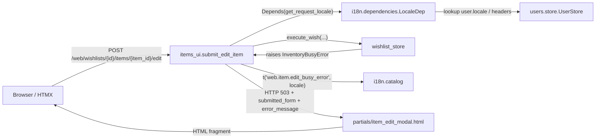

# WISHENKA-119: Russian Busy Message in the Wish Edit Modal

## Research

Inspection of the current codebase confirms that multi-locale support (`WISHENKA-89`) already implemented localized busy-error handling for the wish edit modal:

1. **Web Route (`wishenka/web/routes/items_ui.py`, `submit_edit_item`, lines 604–724)**:
   - Injects `locale: LocaleDep` (`wishenka/i18n/dependencies.py:get_request_locale`), which resolves the user's persisted `UserRecord.locale` (via `user_store.get_by_telegram_id`), falling back to `?lang=`, `Accept-Language`, and finally `DEFAULT_LOCALE` (`"en"`), and stores it on `request.state.locale`.
   - Captures `submitted_form` from the posted form fields before executing `wishlist_store.execute_wish(...)`.
   - On `InventoryBusyError`, logs `ui_item_edit_busy` and returns `templates.TemplateResponse` for `partials/item_edit_modal.html` with `status_code=503`, `form=submitted_form`, and `error_message=t("web.item.edit_busy_error", locale)`.
2. **Template & Context Processor (`wishenka/web/templates.py` & `wishenka/web/templates/partials/item_edit_modal.html`)**:
   - `_locale_context_processor` in `wishenka/web/templates.py` (lines 17–24) injects `locale` from `request.state.locale` into every template response.
   - `item_edit_modal.html` renders `#item-edit-sheet`, the `[role="alert"]` banner containing `{{ error_message }}`, and `#item-detailed-form` populated with `form.*` values so the modal stays open with all submitted fields preserved.
3. **i18n Catalog (`wishenka/i18n/catalog.py`)**:
   - `en` (`line 380`): `"web.item.edit_busy_error": "The wish was busy, the edit was not saved, and it can be submitted again."`
   - `ru` (`line 866`): `"web.item.edit_busy_error": "Желание было занято, изменения не сохранены — попробуйте отправить снова."`
   - Both strings state all three required facts (wish was busy, edit was not saved, can submit again) and name no gifter or reservation details (preserving the surprise invariant).
4. **JSON API (`wishenka/wishlists/exceptions.py`, line 61)**:
   - `InventoryBusyError` defaults to `"The wish was busy and the attempt changed nothing"`, keeping the JSON API HTTP 503 `detail` in English and free of gifter details.
5. **Existing Test Coverage (`tests/test_item_busy_responses.py`)**:
   - `test_item_api_busy_response_hides_gifter` verifies the English JSON API HTTP 503 response and gifter-hiding invariant.
   - `test_item_edit_busy_renders_submitted_fields` verifies the `en` (default) web edit modal HTTP 503 response, modal persistence, submitted field values, and unchanged stored wish title.
   - **Coverage Gap**: No test in `tests/test_item_busy_responses.py` currently exercises `submit_edit_item` under the Russian (`ru`) locale to verify the Russian busy alert, modal persistence, submitted field preservation, and gifter-hiding invariant.

## Implementation Plan

No production code changes are required because `WISHENKA-89` already wired `LocaleDep`, `web.item.edit_busy_error` (`en` and `ru`), and `submit_edit_item` to satisfy all business requirements in `10-requirements.md`.

In Step 4 (Development), add automated regression test coverage in `tests/test_item_busy_responses.py` for the Russian (`ru`) locale:
- Configure the wish owner's locale to `"ru"` (e.g., via `app.state.user_store.set_locale(OWNER_ID, "ru")`), trigger `InventoryBusyError` on `POST /web/wishlists/{wishlist_id}/items/{item_id}/edit`, and assert:
  - HTTP `503` with `text/html` content type;
  - `#item-edit-sheet` and `#item-detailed-form` remain rendered with all submitted field values intact;
  - `[role="alert"]` displays `"Желание было занято, изменения не сохранены — попробуйте отправить снова."` (and not the English busy string);
  - No gifter ID or gifter wording appears in the response;
  - Persisted wish data remains unchanged.
- Run `pytest tests/test_item_busy_responses.py` (with `@pytest.mark.timeout(...)` / module `pytestmark`) to confirm all `en`, `ru`, and API busy tests pass.

**Mandatory — Failing Repro (next Step 3):** `N/A — no behavioral change`. Production code (`wishenka/web/routes/items_ui.py`, `wishenka/i18n/catalog.py`, `wishenka/web/templates/partials/item_edit_modal.html`) already implements the required Russian and English busy-error behavior; only regression test verification for the `ru` locale is needed.

## Architecture

### System Module Diagram

### Modules and Responsibilities

| Module | Responsibility |
| ------ | -------------- |
| `wishenka/i18n/dependencies.py` | `LocaleDep` (`get_request_locale`) resolves the active `SupportedLocale` (`"ru"` or `"en"`) from `UserStore`, `?lang=`, or `Accept-Language`, defaulting to `"en"`, and sets `request.state.locale`. |
| `wishenka/i18n/catalog.py` | Stores localized message strings for `"en"` and `"ru"`, including `web.item.edit_busy_error` with all three required facts and no gifter details. |
| `wishenka/web/routes/items_ui.py` | `submit_edit_item` parses form fields into `submitted_form`, executes the update via `wishlist_store.execute_wish`, and on `InventoryBusyError` returns HTTP 503 with `partials/item_edit_modal.html` and localized `error_message`. |
| `wishenka/web/templates.py` | `_locale_context_processor` injects `locale` from `request.state.locale` into Jinja2 template contexts. |
| `wishenka/web/templates/partials/item_edit_modal.html` | Renders `#item-edit-sheet`, the `[role="alert"]` error banner, and `#item-detailed-form` pre-populated with `form.*` values. |
| `wishenka/wishlists/exceptions.py` | Defines `InventoryBusyError` with the stable English API detail `"The wish was busy and the attempt changed nothing"`. |
| `tests/test_item_busy_responses.py` | Regression tests for API 503, `en` modal 503, and (to be added in Step 4) `ru` modal 503. |

### Module Interaction Scheme

1. The wish owner submits `#item-detailed-form` via HTMX `POST /web/wishlists/{wishlist_id}/items/{item_id}/edit`.
2. FastAPI resolves `user` and `locale: LocaleDep` (`"ru"` or `"en"`).
3. `submit_edit_item` snapshots `submitted_form` and invokes `wishlist_store.execute_wish(...)`.
4. When the wish is busy, `InventoryBusyError` is raised and caught in `submit_edit_item`.
5. `submit_edit_item` translates `web.item.edit_busy_error` using `t(..., locale)` and renders `partials/item_edit_modal.html` with `status_code=503` and `form=submitted_form`.
6. The JSON API route continues to propagate `InventoryBusyError` as an HTTP 503 JSON response with the English `detail` string.

### Architectural Patterns and Justification

- **Dependency Injection (`LocaleDep`)**: Centralizes locale resolution across all web routes without duplicating header/profile lookup logic in route handlers.
- **Centralized i18n Catalog (`t(key, locale)`)**: Separates localized copy (`en`/`ru`) from route control flow and templates, ensuring consistent terminology and easy verification of invariants (e.g., surprise invariant).
- **HTMX Partial Re-rendering on Error (HTTP 503)**: Returning the modal partial with `submitted_form` preserves user input in place without losing form state or leaking domain internals.

### Main Interfaces

- `LocaleDep` (`wishenka/i18n/dependencies.py`): `Annotated[SupportedLocale, Depends(get_request_locale)]`
- `t(key: str, locale: SupportedLocale, **kwargs: Any) -> str` (`wishenka/i18n/translator.py` / `catalog.py`)
- `submit_edit_item(...) -> Response` (`wishenka/web/routes/items_ui.py`): returns `HTMLResponse` (HTTP 200 on success, HTTP 503 with `partials/item_edit_modal.html` on `InventoryBusyError`).

## Q&A

- **Were any gaps found in the existing `submit_edit_item` / `catalog.py` / `item_edit_modal.html` implementation?**
  No production gaps were found: `web.item.edit_busy_error` in both `ru` and `en` states all three required facts (wish busy, edit not saved, can submit again) without naming any gifter, `submit_edit_item` returns HTTP 503 with `submitted_form` and localized `error_message`, and the JSON API `InventoryBusyError` detail remains English. The only gap is missing `ru`-locale test coverage in `tests/test_item_busy_responses.py`.
- **Why is Step 3 marked `N/A — no behavioral change`?**
  Because the runtime behavior is already implemented and compliant; Step 4 will add the missing `ru`-locale regression test in `tests/test_item_busy_responses.py` and verify the suite passes.
