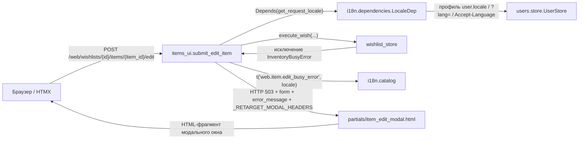

# Спецификация: WISHENKA-119 — Локализованное сообщение о занятости желания в окне редактирования

- **Задача в Jira:** WISHENKA-119
- **Статус:** реализовано (поведение в продакшен-коде внесено в WISHENKA-89, регрессионное покрытие завершено в WISHENKA-119)
- **Платформа:** Telegram Mini App (веб-интерфейс HTMX + JSON API)
- **Язык реализации и локали:** Python; поддерживаемые языки интерфейса — `ru`, `en` (по умолчанию `en`)

## 1. Назначение и бизнес-цель

### 1.1. Постановка проблемы

Ранее (зафиксировано как технический долг в WISHENKA-57) при попытке сохранить изменения желания через веб-модальное окно редактирования в момент временной занятости желания (`InventoryBusyError`) пользователь видел сообщение об ошибке на английском языке даже в том случае, если само модальное окно и интерфейс отображались на русском языке.

После внедрения многоязычной поддержки веб-интерфейса (`ru` и `en` с резервной локалью по умолчанию `"en"` в рамках WISHENKA-89) обработчик редактирования желания и каталог переводов уже поддерживали русскую локализацию ошибки занятости. Однако в наборе автоматических регрессионных тестов (`tests/test_item_busy_responses.py`) отсутствовала проверка русскоязычного сценария (`ru`), подтверждающая соответствие всем продуктовым требованиям и инвариантам.

### 1.2. Цели и ценность для пользователей и системы

- **Для владельца или соавтора вишлиста (локаль `ru` и `en`):** при временной блокировке желания обеспечивается понятное сообщение на активном языке пользователя о том, что желание занято, изменения не сохранены и форму можно отправить повторно, без потери введённых значений.
- **Для дарителя:** сохраняется тайна сюрприза — сообщение об ошибке занятости никогда не раскрывает факт бронирования, количество броней или личность дарителя.
- **Для потребителей JSON API:** сохраняется стабильный контракт API на английском языке (`HTTP 503` с неизменным полем `detail` без раскрытия сведений о дарителях).
- **Для надёжности системы:** устраняется пробел в регрессионном покрытии для локали `ru` без модификации продакшен-кода и параметров конкурентного доступа SQLite.

### 1.3. Границы задачи

- **Входит в область задачи:** локализованное сообщение об ошибке занятости в модальном окне редактирования желания (`ru` и `en`), ответ `HTTP 503`, сохранение модального окна открытым с введёнными пользователем значениями полей, соблюдение инварианта сюрприза, сохранение английского `detail` в JSON API и автоматическое регрессионное тестирование обоих языковых сценариев.
- **Не входит в область задачи:** изменение глобальной резервной локали по умолчанию (`"en"`), изменение параметров блокировок и повторных попыток SQLite (`PRAGMA busy_timeout = 5000`), а также корректировка других несвязанных сообщений UI и API.

## 2. Функциональные требования и пользовательские сценарии

### 2.1. Роли и основные сущности

- **Желание (Wish):** элемент вишлиста, редактируемый через веб-модальное окно или JSON API.
- **Владелец / соавтор желания (Wish Owner / Editor):** авторизованный участник с правами редактирования желания.
- **Даритель (Gifter):** пользователь, который мог забронировать экземпляры желания; его идентификатор, имя и сам факт бронирования скрыты от получателя и редактора.
- **Модальное окно редактирования (Edit Modal):** интерактивный диалог `#item-edit-sheet` с формой `#item-detailed-form` и областью уведомлений об ошибках `[role="alert"]`.
- **Локаль (Locale):** активный язык отображения пользователя (`"ru"` или `"en"`).

### 2.2. Пользовательские сценарии

1. **Сценарий 1. Занятость желания при редактировании в русской локали (`ru`):**
   - Владелец или соавтор с активной локалью `ru` отправляет форму редактирования (`POST /web/wishlists/{wishlist_id}/items/{item_id}/edit`).
   - При возникновении `InventoryBusyError` сервер возвращает `HTTP 503` (`text/html`), оставляет модальное окно `#item-edit-sheet` открытым, сохраняет все введённые поля формы и отображает в `[role="alert"]` русский текст: `«Желание было занято, изменения не сохранены — попробуйте отправить снова.»`.
2. **Сценарий 2. Занятость желания при редактировании в английской локали (`en` и локаль по умолчанию):**
   - Владелец или соавтор с локалью `en` (либо без явного предпочтения локали) отправляет форму редактирования, и при `InventoryBusyError` получает `HTTP 503` с открытым `#item-edit-sheet`, сохранёнными полями и текстом в `[role="alert"]`: `"The wish was busy, the edit was not saved, and it can be submitted again."`.
3. **Сценарий 3. Сохранение тайны сюрприза для дарителя:**
   - Ни при отображении ошибки в модальном окне (`ru`/`en`), ни в ответе JSON API не упоминаются идентификатор дарителя, имя дарителя или факт существования бронирования.
4. **Сценарий 4. Занятость желания в JSON API (`PATCH /api/wishlists/{wishlist_id}/items/{item_id}`):**
   - При `InventoryBusyError` API возвращает `HTTP 503` с неизменным английским телом `{"detail": "The wish was busy and the attempt changed nothing"}` без указания дарителя.

### 2.3. Функциональные требования, входы/выходы и инварианты

1. **Обязательное содержание сообщения в модальном окне:** в обеих локалях (`ru` и `en`) текст ошибки `web.item.edit_busy_error` обязан передавать три факта:
   - желание было занято;
   - изменения не сохранены;
   - форму можно отправить повторно.
2. **Определение активной локали запроса (`get_request_locale`):** приоритет источников локали:
   1. сохранённая локаль авторизованного пользователя из `UserStore` (`UserRecord.locale`);
   2. query-параметр `?lang=` (через `resolve_optional_locale`);
   3. HTTP-заголовок `Accept-Language` (через `resolve_accept_language`);
   4. локаль по умолчанию `DEFAULT_LOCALE` (`"en"`).
3. **Входные поля веб-формы редактирования:** `title`, `link`, `price`, `currency`, `quantity`, `description`, `image_url`, `priority`, `category`, а для совместных вишлистов также `recipient_user_id` и `recipient_name`.
4. **Поведение при ошибке занятости веб-формы:**
   - Выходной статус: `HTTP 503 Service Unavailable`, тип контента `text/html`.
   - Заголовки HTMX-перенаправления: `HX-Retarget: #item-modal-container` и `HX-Reswap: innerHTML`, что сохраняет модальное окно открытым на экране пользователя.
   - Все переданные пользователем значения полей формы подставляются обратно в `#item-detailed-form` (`input[name=...]`, `textarea[name="description"]`, `select[name=...] option[selected]`), а минимальное количество для поля `quantity` ограничивается снизу значением `max(1, received_quantity_snapshot)`.
   - Хранимое состояние желания в базе данных остаётся без изменений.
5. **Ключевые инварианты:**
   - **Инвариант сюрприза:** ответ об ошибке (HTML-модалка, JSON API, а также журналы событий) никогда не раскрывает личность дарителя, его `Telegram ID` или факт бронирования.
   - **Инвариант целостности данных:** отказ по причине занятости не изменяет поля желания в хранилище.
   - **Инвариант стабильности API:** JSON API не переводит сообщение `InventoryBusyError` и всегда возвращает английский `detail`.

## 3. Архитектура, компоненты и интерфейсы

### 3.1. Схема взаимодействия модулей

### 3.2. Модули и ответственность

| Модуль | Ответственность |
| --- | --- |
| `wishenka/i18n/locale.py` | Определяет `SupportedLocale = Literal["ru", "en"]`, `DEFAULT_LOCALE = "en"`, `SUPPORTED_LOCALES`, а также функции нормализации `resolve_optional_locale` и `resolve_accept_language`. |
| `wishenka/i18n/dependencies.py` | Предоставляет зависимость `LocaleDep` (`Annotated[SupportedLocale, Depends(get_request_locale)]`), вычисляет локаль запроса и сохраняет её в `request.state.locale`. |
| `wishenka/i18n/catalog.py` | Хранит словарь переводов `CATALOG` для `"en"` и `"ru"` (включая ключ `web.item.edit_busy_error`) и функцию `t(key, locale, **kwargs)` с безопасным откатом к `DEFAULT_LOCALE` или ключу. |
| `wishenka/web/templates.py` | Настраивает `Jinja2Templates`, регистрирует глобальную функцию `t` и контекст-процессор `_locale_context_processor`, передающий `locale` из `request.state.locale` во все шаблоны. |
| `wishenka/web/routes/items_ui.py` | Реализует обработчик `submit_edit_item`, разбор полей формы `_parse_item_modal_form`, перехват `InventoryBusyError`, рендеринг ошибки `_render_item_modal_error` и заголовки `_RETARGET_MODAL_HEADERS`. |
| `wishenka/web/templates/partials/item_edit_modal.html` | HTML-шаблон модального окна `#item-edit-sheet`, отображающий баннер `.alert.alert-error[role="alert"]` и форму `#item-detailed-form` с предзаполненными полями `form.*`. |
| `wishenka/wishlists/exceptions.py` | Определяет доменное исключение `InventoryBusyError` со стандартным английским текстом `"The wish was busy and the attempt changed nothing"`. |
| `wishenka/web/routes/items.py` | Содержит JSON API-обработчик `update_item` и обёртку `execute`, преобразующую `InventoryBusyError` в `HTTPException(status_code=503, detail=str(exc))`. |
| `tests/test_item_busy_responses.py` | Автоматические регрессионные тесты для JSON API (`HTTP 503`) и веб-модалки (`en-default` и `ru`). |

### 3.3. Контракты данных и интерфейсов

- **Веб-маршрут редактирования желания:** `POST /web/wishlists/{wishlist_id}/items/{item_id}/edit` (`submit_edit_item` в `wishenka/web/routes/items_ui.py`).
  - Зависимости: `request: Request`, `user: User`, `locale: LocaleDep`.
  - При `InventoryBusyError` вызывает `_render_item_modal_error(...)` с `status_code=503`, `form_data=parsed.form_data`, `min_quantity=max(1, received_quantity_snapshot)`, `is_collaborative=is_collaborative_snapshot`, `collaborative_members=collaborative_members_snapshot`, `error_message=t("web.item.edit_busy_error", locale)` и заголовками `_RETARGET_MODAL_HEADERS` (`HX-Retarget: #item-modal-container`, `HX-Reswap: innerHTML`).
- **Ключ каталога `web.item.edit_busy_error` (`wishenka/i18n/catalog.py`):**
  - `"en"`: `"The wish was busy, the edit was not saved, and it can be submitted again."`
  - `"ru"`: `"Желание было занято, изменения не сохранены — попробуйте отправить снова."`
- **Функция перевода (`wishenka/i18n/catalog.py`):** `t(key: str, locale: str | None = DEFAULT_LOCALE, **kwargs: Any) -> str` (принимает `"ru"` или откатывается к `DEFAULT_LOCALE = "en"`).
- **JSON API-маршрут редактирования желания:** `PATCH /api/wishlists/{wishlist_id}/items/{item_id}` (`update_item` с телом `UpdateItemDTO` в `wishenka/web/routes/items.py`).
  - При `InventoryBusyError` возвращает `HTTP 503` с телом JSON `{"detail": "The wish was busy and the attempt changed nothing"}`.

### 3.4. Переходы состояний при обработке запроса

1. **Получение формы и определение локали:** клиент отправляет HTMX-запрос `POST`; FastAPI через `LocaleDep` определяет `locale` (`"ru"` или `"en"`) и сохраняет её в `request.state.locale`.
2. **Снимок введённых данных:** `_parse_item_modal_form` очищает поля и сохраняет `parsed.form_data` до обращения к хранилищу (при ошибке валидации формы немедленно возвращается `HTTP 400`).
3. **Попытка транзакционного обновления:** `wishlist_store.execute_wish(..., item_id=item_id, operation_name="submit_edit_item")` снимает снимок метаданных (`received_quantity_snapshot`, `is_collaborative_snapshot`, `collaborative_members_snapshot`) и вызывает `svc.update_wish_item(...)`.
4. **Переход в состояние retryable-ошибки (`InventoryBusyError`):**
   - Транзакция не применяется; состояние желания в БД остаётся неизменным.
   - Обработчик фиксирует предупреждение `ui_item_edit_busy` в журнале.
   - Шаблон `partials/item_edit_modal.html` рендерится с кодом `503`, `form=parsed.form_data` и локализованным `error_message`.
   - Пользователь видит баннер `[role="alert"]` и сохранённые поля, после чего может повторно нажать кнопку сохранения без повторного заполнения формы.

## 4. Нефункциональные требования, безопасность и наблюдаемость

### 4.1. Производительность и ограничения

- Определение локали через `LocaleDep` выполняется один раз на запрос и не создаёт дополнительных обращений к БД поверх стандартной обработки запроса.
- Получение сообщения через `t("web.item.edit_busy_error", locale)` выполняет прямое чтение из словаря `CATALOG` в памяти без накладных расходов ввода-вывода.
- Настройки конкурентного доступа и таймаутов SQLite (`PRAGMA busy_timeout = 5000`) в рамках задачи не модифицируются.
- Для автоматических тестов в `tests/test_item_busy_responses.py` установлен явный таймаут выполнения `pytestmark = pytest.mark.timeout(30)`.

### 4.2. Безопасность, приватность и защита данных

- **Соблюдение тайны сюрприза в интерфейсе и API:** сообщения `web.item.edit_busy_error` (`ru` и `en`) и `InventoryBusyError` сформулированы нейтрально и не содержат `Telegram ID` дарителей, их имён, числа забронированных экземпляров или упоминаний о бронировании.
- **Минимизация данных в логах:** в событиях логирования запрещено записывать персональные данные дарителей, сведения о бронях, содержимое `submitted_form` или HTML-фрагменты ответов — передаются только скалярные идентификаторы (`wishlist_id`, `item_id`, `i18n_key`, `locale`).
- **Экранирование вывода в HTML:** в `partials/item_edit_modal.html` вывод `{{ error_message }}` и значений полей `form.*` проходит стандартное HTML-экранирование шаблонизатора Jinja2.

### 4.3. Наблюдаемость (структурированное логирование и метрики)

В задаче `WISHENKA-119` новые логгеры и сборщики метрик не добавлялись, так как продакшен-код уже оснащён структурированным логированием на базе стандартного модуля `logging` с полями `extra`:

- **`WARNING` (`ui_item_edit_busy`):** `wishenka/web/routes/items_ui.py` (`submit_edit_item`) при перехвате `InventoryBusyError` пишет сообщение `"Item edit was not saved because the wish was busy (item %s)"` с `extra={"event": "ui_item_edit_busy", "wishlist_id": wishlist_id, "item_id": item_id}`.
- **`WARNING` (`i18n_missing_translation_key`):** `wishenka/i18n/catalog.py` (`t`) при отсутствии ключа перевода пишет `"Missing translation key %s for locale %s"` с `extra={"event": "i18n_missing_translation_key", "i18n_key": key, "locale": target, "fallback_locale": DEFAULT_LOCALE | "key"}`.
- **`WARNING` (`item_inventory_busy`):** `wishenka/web/routes/items.py` (`execute`) при `InventoryBusyError` в JSON API пишет `"Item operation busy: %s"` с `extra={"event": "item_inventory_busy", "operation": operation}` и `item_id` (если задан).
- **`INFO` (`ui_item_edit_saved`):** `wishenka/web/routes/items_ui.py` (`submit_edit_item`) при успешном сохранении редактирования фиксирует событие `ui_item_edit_saved` с полями `wishlist_id`, `item_id`, `actor_id`, `user_id`, `quantity`, `has_recipient`.
- **Метрики и мониторинг:** отдельные Prometheus-метрики, дашборды Grafana и правила алертинга в рамках `WISHENKA-119` не вводятся (N/A); контроль частоты сбоев занятости опирается на ответы `HTTP 503` и агрегирование структурированных логов `ui_item_edit_busy` и `i18n_missing_translation_key`.

## 5. Верификация и критерии приёмки

### 5.1. Автоматические тестовые сценарии (`tests/test_item_busy_responses.py`)

| Тест / Параметр | Проверяемый сценарий | Проверяемые утверждения |
| --- | --- | --- |
| `test_item_api_busy_response_hides_gifter` | `PATCH /api/wishlists/{wishlist_id}/items/{item_id}` при `InventoryBusyError` и наличии брони дарителя (`GIFTER_ID`). | Статус `503`; JSON `{"detail": "The wish was busy and the attempt changed nothing"}`; в ответе отсутствуют `GIFTER_ID` и `"gifter"`. |
| `test_item_edit_busy_renders_submitted_fields[en-default]` | `POST /web/wishlists/{wishlist_id}/items/{item_id}/edit` без заданной локали пользователя (`locale=None`) при `InventoryBusyError`. | Статус `503` (`text/html`); открыт `#item-edit-sheet`; форма `#item-detailed-form` с `hx-post` и всеми введёнными полями (`title`, `link`, `price`, `currency`, `quantity`, `description`, `image_url`, `priority`, `category`); в `[role="alert"]` текст `"The wish was busy, the edit was not saved, and it can be submitted again."`; нет `GIFTER_ID`, `"gifter"` и `"дарител"`; сохранённый `title` желания остаётся `"Original"`. |
| `test_item_edit_busy_renders_submitted_fields[ru]` | `POST /web/wishlists/{wishlist_id}/items/{item_id}/edit` для пользователя с локалью `"ru"` (заданной через `UserStore.upsert_user` и `UserStore.set_locale`) при `InventoryBusyError`. | Статус `503` (`text/html`); открыт `#item-edit-sheet` и форма `#item-detailed-form` со всеми введёнными значениями; в `[role="alert"]` текст `"Желание было занято, изменения не сохранены — попробуйте отправить снова."`; нет `GIFTER_ID`, `"gifter"` и `"дарител"`; сохранённый `title` желания остаётся `"Original"`. |

По данным отчётных артефактов задачи (`00-roadmap.md`, `40-code-cleanup.md`, `50-observability.md`):

- прогон `.venv/bin/pytest tests/test_item_busy_responses.py -n 0 -q` завершился успешно (`3 passed`, с явным маркером `pytest.mark.timeout(30)`);
- статический анализ `make analyze` прошёл без замечаний (Ruff linter: `All checks passed!`, проверка форматирования: `199 files already formatted`, Mypy: `Success: no issues found in 199 source files`);
- полный набор тестов на этапе разработки (при неизменном в дальнейшем продакшен-коде) прошёл полностью (`447 + 659 = 1106` тестов).

### 5.2. Критерии приёмки

1. При отправке редактирования через веб-модалку в момент занятости желания возвращается `HTTP 503` (`text/html`), а `#item-edit-sheet` остаётся открытым.
2. Все поля, введённые пользователем в `#item-detailed-form`, сохраняются в повторно отрендеренной форме.
3. Исходные данные желания в хранилище не изменяются.
4. В русской локали (`ru`) баннер `[role="alert"]` отображает русское сообщение, содержащее все три обязательных факта (занятость желания, несохранение изменений, возможность повторной отправки); в английской локали (`en`, включая локаль по умолчанию) выводится эквивалентное английское сообщение.
5. Ни веб-модалка (`ru`/`en`), ни JSON API, ни структурированные логи не раскрывают личность дарителя или информацию о бронировании.
6. JSON API при занятости желания возвращает `HTTP 503` с неизменным английским `detail`.
7. Автоматические регрессионные тесты для `en-default`, `ru` и JSON API присутствуют в `tests/test_item_busy_responses.py` и проходят успешно.

### 5.3. Известные ограничения и задачи развития

Блокирующих замечаний (`BLOCKER`) для закрытия `WISHENKA-119` нет. По итогам анализа технического долга (`60-tech-debt.md`) зафиксированы два низкоприоритетных улучшения (`low` / `NON-BLOCKER`), вынесенные в задачу [WISHENKA-208](https://pypost.atlassian.net/browse/WISHENKA-208):

1. **Покрытие резервного пути `Accept-Language: ru` в `tests/test_item_busy_responses.py`:** сейчас сценарий `ru` проверяется через профиль в `user_store` (`set_locale`), но не проверяет напрямую запрос `POST /web/wishlists/{wishlist_id}/items/{item_id}/edit` с заголовком `Accept-Language: ru` при отсутствии сохранённого `UserRecord.locale` (риск низкий, так как `get_request_locale` и `resolve_accept_language` уже покрыты в `tests/test_i18n_unit.py` и `tests/test_i18n_sync.py`).
2. **Устаревшая строка документации (`docstring`) у `submit_edit_item` в `wishenka/web/routes/items_ui.py`:** текущая docstring описывает только ответ `409 Conflict` (Reduction Lock) и не упоминает повторный рендеринг модального окна с кодом `503 Service Unavailable` при `InventoryBusyError` (на работу программы не влияет).
