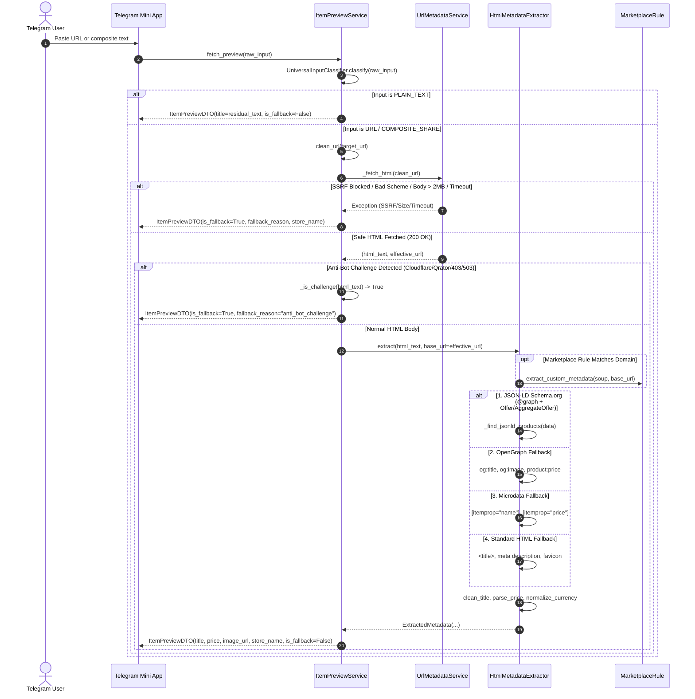
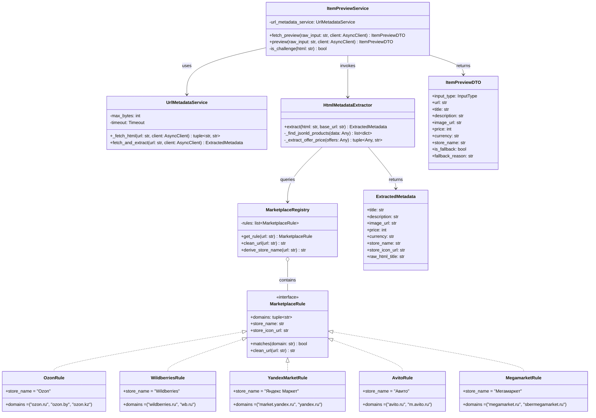

# WISHENKA-12: High-Level Architectural Design — Web Scraper & Metadata Extractor

## Research

### 1. Evaluation of Existing Implementation (`wishenka/items/`)

The existing codebase contains initial parsing and scraping facilities that proved foundational in WISHENKA-11:
- [`wishenka.items.parser.HtmlMetadataExtractor`](file:///home/src/wishenka/items/parser.py#L177): Implements a 4-stage cascade (JSON-LD $\rightarrow$ OpenGraph $\rightarrow$ Microdata $\rightarrow$ Standard HTML).
  - *Limitations identified*:
    1. **JSON-LD `@graph` structures**: Currently `_find_jsonld_products` searches recursively for objects with `@type == "Product"`. However, modern e-commerce sites (such as WordPress/WooCommerce, Ozon, and various retail storefronts) nest products inside a top-level `@graph` array where `@type` might be fully qualified (e.g. `https://schema.org/Product` or `http://schema.org/Product`) or a list of types `["Product", "IndividualProduct"]`.
    2. **Offer structures**: Currently only extracts `price` from `offers.get("price")`. When stores use `AggregateOffer`, the price is stored in `lowPrice` and/or `highPrice`. Furthermore, `offers` can be nested in an array or wrapped in an `@id` reference.
    3. **Image structures**: Currently handles simple strings or `dict` with `url` / `contentUrl`. Some marketplaces supply a list of image objects or relative URLs.
    4. **Pluggability**: The extraction logic and store mapping are hardcoded in a single class without a modular strategy pattern for marketplace-specific quirks.
- [`wishenka.items.parser.clean_title`](file:///home/src/wishenka/items/parser.py#L55): Uses regex patterns to strip marketplace slogans (e.g., `— купить в интернет-магазине...`). Needs extension for Avito, Megamarket, and mobile sharing prefixes.
- [`wishenka.items.parser.parse_price`](file:///home/src/wishenka/items/parser.py#L70): Normalizes numbers and separators. Needs to handle range indicators like `от 1 500 ₽` or discount labels.
- [`wishenka.items.parser.KNOWN_STORES`](file:///home/src/wishenka/items/parser.py#L37): Contains 14 domain-to-brand mappings. Lacks short domain aliases (e.g. `wb.ru`, `ozon.by`, `ozon.kz`, `m.avito.ru`, `megamarket.ru`).
- [`wishenka.items.fetcher.UrlMetadataService`](file:///home/src/wishenka/items/fetcher.py#L49): Provides safe HTTP fetching with SSRF checks (`SSRFSafeTransport`), non-blocking async DNS resolution, and streaming size enforcement ($2\text{ MB}$).
- [`wishenka.items.service.ItemPreviewService`](file:///home/src/wishenka/items/service.py#L34): Orchestrates classification, HTTP retrieval, anti-bot challenge detection, and fallback DTO generation.
  - *Limitations identified*:
    1. Anti-bot signatures in `CHALLENGE_SIGNATURES` are checked only in `service.py`, but should also be recognized at the fetcher level or encapsulated in a dedicated challenge detector.
    2. Missing signatures for Russian CDN/WAF providers such as **Qrator** (`qrator`, `qrator_jsid`, `qrator-js`) and HTTP 503 challenge screens.

### 2. Marketplace Metadata Structures & Specifics

#### Ozon (`ozon.ru`, `ozon.by`, `ozon.kz`)
- **Structure**: Uses dynamic Nuxt/React rendering. In raw server HTML, metadata is embedded in OpenGraph (`og:title`, `og:image`, `og:description`), JSON-LD `@graph`, and `<title>`.
- **Challenges**:
  - Aggressive bot mitigation (Cloudflare Turnstile, Kasada, or internal WAF). When intercepted, returns HTTP 403 or HTML challenge containing `_cf_chl_opt` or `challenge-running`.
  - Mobile sharing links contain query garbage: `?from=share_android`, `utm_medium`, `utm_campaign`.
- **Requirements**: Clean URLs from tracking parameters; detect WAF challenge; fallback to store name `Ozon` and user-provided title/link.

#### Wildberries (`wildberries.ru`, `wb.ru`)
- **Structure**: Often shared via short mobile link (`wb.ru/...`) or desktop URL (`wildberries.ru/catalog/<id>/detail.aspx`).
- **Metadata**: Static HTML generally contains OpenGraph tags (`og:title`, `og:image`) and Microdata.
- **Challenges**:
  - Frequent Qrator / Cloudflare screens when queried from cloud IPs.
  - Title often contains product name followed by `— купить в интернет-магазине Wildberries`.

#### Yandex Market (`market.yandex.ru`, `yandex.ru`)
- **Structure**: Standard OpenGraph tags (`og:title`, `og:image`, `og:description`, `og:site_name`), plus `product:price:amount` and `product:price:currency`.
- **Title cleaning**: Contains suffix `— купить в интернет-магазине по выгодной цене на Яндекс Маркете`.

#### Avito (`avito.ru`, `m.avito.ru`)
- **Structure**: Microdata (`[itemprop="name"]`, `[itemprop="price"]`, `[itemprop="priceCurrency"]`) and OpenGraph.
- **Challenges**: Qrator protection on high query rates.
- **Price**: Microdata price is often an exact integer string in rubles (`itemprop="price" content="25000"`).

#### Megamarket (`megamarket.ru`, `sbermegamarket.ru`)
- **Structure**: OpenGraph (`og:title`, `og:image`, `og:price:amount`), JSON-LD Product with `offers`.

### 3. OpenGraph, JSON-LD, and Microdata Hierarchy

The extraction cascade must strictly follow the hierarchy agreed in requirements:
1. **JSON-LD Schema.org**:
   - Priority 1 because Schema.org `Product` and `Offer` provide structured, typed fields (`name`, `price`, `priceCurrency`, `image`, `brand`), eliminating heuristic text parsing errors.
   - Support `@graph` container arrays.
   - Support both `Offer` (`price`) and `AggregateOffer` (`lowPrice`, `highPrice`).
   - Support Schema.org namespace variations (`http://schema.org/`, `https://schema.org/`, or unnamespaced).
2. **OpenGraph Tags**:
   - `og:title`, `og:description`, `og:image`, `og:image:url`, `og:site_name`.
   - `product:price:amount`, `product:price:currency`, `og:price:amount`, `og:price:currency`.
3. **Microdata (`itemprop`)**:
   - `[itemprop="name"]`, `[itemprop="image"]`, `[itemprop="description"]`, `[itemprop="price"]`, `[itemprop="priceCurrency"]`.
4. **Standard HTML Fallback**:
   - Document `<title>` (passed through `clean_title`), `<meta name="description">`, `<link rel="icon">` / `<link rel="apple-touch-icon">`.

### 4. Price & Currency Cleaning Rules

- **Price extraction**:
  - Extract numeric sequences considering space/non-breaking space (`\xa0`) as thousand separators.
  - Distinguish comma as decimal separator (`1 490,50` $\rightarrow$ `1490`) vs thousand separator (`1,490.50` $\rightarrow$ `1490`).
  - Handle prefixes: `от 2 490 ₽` $\rightarrow$ `2490`.
  - Always return integer minor units (whole currency units) without negative numbers.
- **Currency normalization**:
  - Support symbols and codes: `₽`, `руб`, `руб.`, `rub`, `rur` $\rightarrow$ `RUB`; `$`, `usd` $\rightarrow$ `USD`; `€`, `eur` $\rightarrow$ `EUR`; `₸`, `kzt` $\rightarrow$ `KZT`; `byn`, `br` $\rightarrow$ `BYN`; `£`, `gbp` $\rightarrow$ `GBP`; `¥`, `cny` $\rightarrow$ `CNY`; `try` $\rightarrow$ `TRY`; `gel` $\rightarrow$ `GEL`; `amd` $\rightarrow$ `AMD`.
  - Default to `RUB` if currency cannot be determined for Russian marketplaces or general links.

### 5. Anti-Bot and Challenge Signature Detection

Anti-bot challenges must be detected both by HTTP response status and body content analysis:
- **HTTP status codes**: 403 Forbidden, 429 Too Many Requests, 503 Service Unavailable.
- **Signatures in HTML**:
  - Cloudflare: `_cf_chl_opt`, `challenge-running`, `just a moment...`, `cf-mitigated`, `turnstile`, `checking your browser`.
  - Qrator: `qrator`, `qrator_jsid`, `qrator-js`.
  - DDoS-Guard: `ddos-guard`, `ddos guard`.
  - WAF / Generic Captcha: `access denied`, `waf`, `attention required`, `security check to proceed`.
- **Behavior**: When detected, do NOT raise an unhandled exception or return 500. Return a graceful degradation [`ItemPreviewDTO`](file:///home/src/wishenka/items/schemas.py#L11-L24) with:
  - `is_fallback = True`
  - `fallback_reason = "anti_bot_challenge"` (or `"http_error"`)
  - `store_name = derived_store_name` (e.g. `Ozon`, `Wildberries`, `Avito`)
  - `url = target_url`
  - `title = residual_user_text`

---

## Implementation Plan

### High-Level Sequence

1. **Phase 1: Failing Repro Test Design & Creation (Step 3)**
   - Create `tests/test_metadata_extractor_service.py` with comprehensive test suites verifying all gaps identified in research.
   - Run tests to confirm red/failing status prior to any production code changes.

2. **Phase 2: URL Normalization & Tracking Cleaner (Step 4, Iteration 1)**
   - Implement `clean_url(url: str) -> str` in `wishenka/items/parser.py`: strip tracking parameters (`utm_*`, `from=share*`, `_ref`, `fbclid`, `gclid`).
   - Expand `KNOWN_STORES` with short domains and mobile subdomains (`wb.ru`, `ozon.by`, `ozon.kz`, `m.avito.ru`, etc.).

3. **Phase 3: Robust JSON-LD `@graph` & `AggregateOffer` Support (Step 4, Iteration 2)**
   - Upgrade `_find_jsonld_products` to handle:
     - Root `@graph` dictionaries.
     - Full Schema.org URIs (`https://schema.org/Product`, `http://schema.org/Product`).
     - `AggregateOffer` with `lowPrice` and `highPrice`.
     - Image objects (`ImageObject` with `url` or `contentUrl`) and image arrays.

4. **Phase 4: Marketplace Strategies & Anti-Bot Detection Extension (Step 4, Iteration 3)**
   - Create modular marketplace helper rules in `wishenka/items/marketplaces.py` or within `parser.py` (Ozon, Wildberries, Yandex Market, Avito, Megamarket).
   - Expand `CHALLENGE_SIGNATURES` with Qrator (`qrator`, `qrator_jsid`, `qrator-js`) and 503 challenge handling.
   - Ensure `clean_title` strips marketplace-specific titles accurately.

5. **Phase 5: Verification & Quality Gate (Steps 4–5)**
   - Run complete test suite via `make check` / `pytest` ensuring 100% green tests.
   - Execute Step 5 code cleanup and Step 6 observability.

---

### Mandatory — Failing Repro Design (Next Step 3)

The failing repro test will be located at:
📁 **`tests/test_metadata_extractor_service.py`**

#### Desired Behavior Assertions:
1. **JSON-LD `@graph` and `AggregateOffer` Parsing**:
   - HTML with `@graph: [{"@type": "WebSite"}, {"@type": "https://schema.org/Product", "name": "Телевизор 55", "offers": {"@type": "AggregateOffer", "lowPrice": "49990", "priceCurrency": "RUB"}}]` must extract `title="Телевизор 55"`, `price=49990`, `currency="RUB"`.
   - HTML with ImageObject in JSON-LD `{"@type": "ImageObject", "contentUrl": "https://cdn.example.com/tv.jpg"}` must extract `image_url="https://cdn.example.com/tv.jpg"`.
2. **Marketplace Domain & Title De-Noising**:
   - `wb.ru/catalog/123/detail.aspx` must derive `store_name="Wildberries"`.
   - `ozon.kz/product/item-456/` must derive `store_name="Ozon"`.
   - `m.avito.ru/moskva/tovary/123` must derive `store_name="Авито"`.
   - `clean_title("Игровая приставка Sony PlayStation 5 — купить в интернет-магазине Мегамаркет")` must yield `"Игровая приставка Sony PlayStation 5"`.
   - `clean_title("Велосипед горный — объявление на Авито")` must yield `"Велосипед горный"`.
3. **Price & Currency Extraction Edge Cases**:
   - Price strings like `от 15 990 ₽` $\rightarrow$ `15990`.
   - Currency strings like `руб.` $\rightarrow$ `RUB`, `kzt` $\rightarrow$ `KZT`, `eur` $\rightarrow$ `EUR`.
4. **URL Tracking Cleanup**:
   - `https://ozon.ru/product/123/?from=share_android&utm_source=tg` $\rightarrow$ `https://ozon.ru/product/123/`.
5. **Anti-Bot Challenge Graceful Degradation (Mocked HTTP)**:
   - Response status 403 with Qrator body `<html><head><title>Qrator Protection</title></head><body><script src="qrator_jsid.js"></script></body></html>` returns `is_fallback=True`, `fallback_reason="anti_bot_challenge"`, `store_name="Wildberries"`.
   - Response status 503 with Cloudflare challenge body returns `is_fallback=True`, `fallback_reason="anti_bot_challenge"`.

#### How Failure is Forced Without Live External Dependencies:
- All test cases supply synthetic static HTML strings and mock HTTP responses (`httpx.Response`) via `unittest.mock.AsyncMock`.
- No live external network calls are made. Tests run hermetically and deterministically in under 1 second.
- The existing codebase fails these assertions because:
  - `_find_jsonld_products` does not handle `AggregateOffer` (`lowPrice`).
  - `KNOWN_STORES` does not recognize `wb.ru`, `ozon.kz`, `m.avito.ru`.
  - `CHALLENGE_SIGNATURES` does not detect Qrator signatures.
  - Tracking parameter stripping does not exist.

---

## Architecture

### Component Structure & Responsibilities

```text
+----------------------------------------------------------------------------------------------------+
|                                      User Input Entry                                              |
|                      (Raw link, composite share text, or marketplace URL)                         |
+----------------------------------------------------------------------------------------------------+
                                                   |
                                                   v
+----------------------------------------------------------------------------------------------------+
|                                    ItemPreviewService                                              |
|   1. Classify input (UniversalInputClassifier)                                                     |
|   2. Clean URL query tracking parameters (clean_url)                                               |
|   3. Fetch safe HTML stream via UrlMetadataService                                                 |
|   4. Detect anti-bot challenges (Cloudflare, Qrator, DDoS-GUARD, HTTP 403/429/503)                 |
|   5. Extract rich metadata via HtmlMetadataExtractor                                               |
|   6. Degrade gracefully on any network/security/bot failure                                        |
+----------------------------------------------------------------------------------------------------+
              |                                                               |
    (Safe Network Fetch)                                            (HTML Document Body)
              v                                                               v
+-----------------------------------------+         +------------------------------------------------+
|          UrlMetadataService             |         |             HtmlMetadataExtractor              |
|  - Scheme validation (http/https)       |         |   1. Marketplace Strategy / Rules (Domain)     |
|  - SSRF protection (SSRFSafeTransport)  |         |   2. JSON-LD Extractor (@graph + Offer/Agg)    |
|  - Streaming size limits (<= 2 MB)      |         |   3. OpenGraph Extractor (og:* / product:*)    |
|  - Connect (2.0s) / Read (4.0s) timeout |         |   4. Microdata Extractor ([itemprop])          |
+-----------------------------------------+         |   5. Standard HTML Fallback (<title>, icon)    |
                                                    |   6. Sanitization (clean_title, parse_price)   |
                                                    +------------------------------------------------+
                                                                              |
                                                                              v
                                                    +------------------------------------------------+
                                                    |                ItemPreviewDTO                  |
                                                    |   - title, description, image_url              |
                                                    |   - price, currency, store_name                |
                                                    |   - is_fallback, fallback_reason               |
                                                    +------------------------------------------------+
```

### Pluggable Marketplace Strategies and Rules

To support high cohesion and easy addition of future marketplaces without bloated conditional trees, the extraction engine introduces a lightweight, extensible rule-based architecture:

```python
class MarketplaceRule(Protocol):
    """Protocol for marketplace-specific extraction and normalization rules."""

    domains: tuple[str, ...]
    store_name: str
    store_icon_url: str | None

    def matches(self, domain: str) -> bool:
        """Check if rule matches the target domain."""
        ...

    def clean_url(self, url: str) -> str:
        """Strip tracking parameters and normalize canonical product URL."""
        ...

    def extract_custom_metadata(
        self,
        soup: BeautifulSoup,
        base_url: str,
    ) -> ExtractedMetadata | None:
        """Apply specialized parsing heuristics if standard cascade is insufficient."""
        ...
```

#### Supported Marketplace Rules:
- **`OzonRule`**:
  - Domains: `ozon.ru`, `ozon.by`, `ozon.kz`.
  - Store name: `Ozon`.
  - Tracking cleaner: removes `from`, `utm_*`, `_bqv_`, `sub_id`.
- **`WildberriesRule`**:
  - Domains: `wildberries.ru`, `wb.ru`.
  - Store name: `Wildberries`.
  - Tracking cleaner: removes `targetUrl`, `utm_*`.
- **`YandexMarketRule`**:
  - Domains: `market.yandex.ru`, `yandex.ru`.
  - Store name: `Яндекс Маркет`.
  - Tracking cleaner: removes `clid`, `utm_*`, `track`.
- **`AvitoRule`**:
  - Domains: `avito.ru`, `m.avito.ru`, `avito.st`.
  - Store name: `Авито`.
  - Tracking cleaner: removes `utm_*`, `src`.
- **`MegamarketRule`**:
  - Domains: `megamarket.ru`, `sbermegamarket.ru`.
  - Store name: `Мегамаркет`.
  - Tracking cleaner: removes `utm_*`, `promo`.

### Data Models and DTOs

#### [`ExtractedMetadata`](file:///home/src/wishenka/items/models.py#L24-L36)
```python
@dataclass
class ExtractedMetadata:
    """Rich e-commerce metadata extracted from web pages."""

    title: str | None = None
    description: str | None = None
    image_url: str | None = None
    price: int | None = None
    currency: str = "RUB"
    store_name: str | None = None
    store_icon_url: str | None = None
    raw_html_title: str | None = None
```

#### [`ItemPreviewDTO`](file:///home/src/wishenka/items/schemas.py#L11-L24)
```python
class ItemPreviewDTO(BaseModel):
    """Data transfer object for rendering item preview in frontend and TMA."""

    input_type: InputType
    url: str | None = None
    title: str | None = None
    description: str | None = None
    image_url: str | None = None
    price: int | None = None
    currency: str = "RUB"
    store_name: str | None = None
    store_icon_url: str | None = None
    is_fallback: bool = False
    fallback_reason: str | None = None
```

### Mermaid Diagrams

#### 1. Sequence Diagram: Metadata Extraction Pipeline with Cascading Fallbacks



#### 2. Class Diagram: Extraction Subsystem Architecture



---

## Q&A

### Q1: Should marketplace rules be implemented as separate classes or data-driven configuration?
**Answer**: A hybrid lightweight approach is best for Python 3.12: dataclasses / frozen rules with domain tuples, canonical regexes, and clean parameter lists registered in `MarketplaceRegistry`. This avoids heavyweight class hierarchies while providing high extensibility for future additions (e.g. AliExpress, Lamoda, Golden Apple).

### Q2: Why prioritize JSON-LD over OpenGraph when both are present?
**Answer**: OpenGraph tags are designed primarily for social media link sharing (Facebook, Telegram previews), where titles often include marketing slogans (e.g., `Купить в Москве по выгодной цене`) and prices are either omitted or combined with currency in freeform strings. JSON-LD (`Schema.org/Product`) provides structured, machine-readable data with explicit separation between `name`, numeric `price`, and ISO `priceCurrency`.

### Q3: How should we handle `AggregateOffer` where both `lowPrice` and `highPrice` exist?
**Answer**: Wishlist creators are typically interested in the minimum or entry price for the item (`lowPrice`). Therefore, the extractor checks `price` first, then `lowPrice`, and finally `highPrice`.

### Q4: Why is tracking parameter removal performed before fetching?
**Answer**: Stripping UTM, session, and referral query parameters (`utm_*`, `from=share*`, etc.) before fetching avoids cache misses on remote CDNs, reduces upstream redirect chains, and prevents tracking token leakage in server logs.

### Q5: How do we prevent false positives in anti-bot signature detection?
**Answer**: The challenge signatures (`_cf_chl_opt`, `turnstile`, `qrator_jsid`, `challenge-running`) are specific to known anti-bot challenge scripts. Generic phrases like `access denied` are only evaluated when accompanied by an HTTP error status (403, 429, 503) or when the response body is short ($< 5\text{ KB}$), preventing false positives on legitimate product pages describing security books or software tools.
