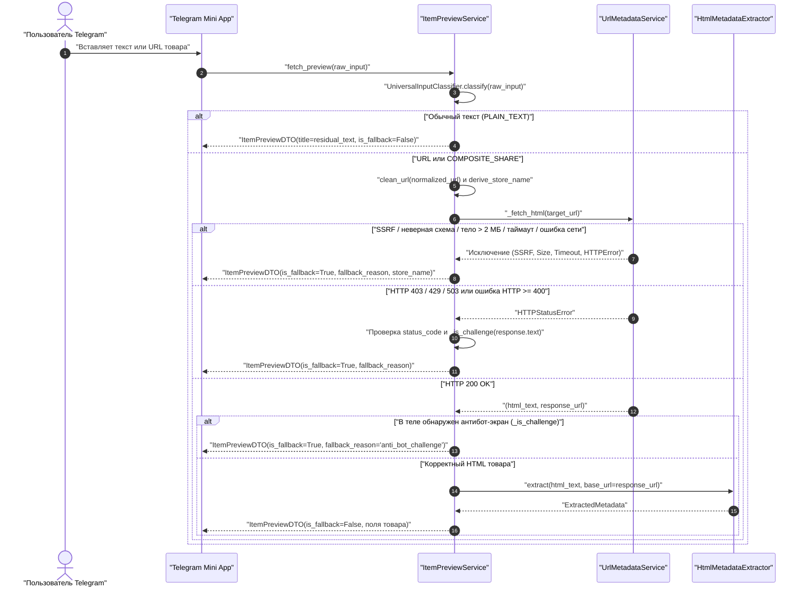

# Спецификация: WISHENKA-12 — Сервис извлечения метаданных товаров по ссылкам (Web Scraper & Metadata Extractor)

**Задача Jira:** WISHENKA-12 (эпик: WISHENKA-10)  
**Платформы и стек:** Python 3.12+, HTTPX, BeautifulSoup4, Pydantic v2, Telegram Mini App / Telegram Bot  
**Статус:** реализовано и верифицировано по итогам Top-Down workflow

## 1. Назначение и бизнес-цель

Сервис **«Вишенка» (Telegram Wishlist Service)** снижает порог создания списков желаний внутри Telegram. При ручном наполнении карточек пользователю приходится копировать из магазина название товара, цену, валюту, изображение и название площадки, что замедляет сценарий и снижает конверсию в добавление подарков.

Серверный модуль извлечения метаданных по веб-ссылкам (**Web Scraper & Metadata Extractor**) автоматизирует предзаполнение карточки желания из публичной ссылки или текста системного меню «Поделиться».

### Ключевые проблемы, решаемые задачей

1. **Разнородность веб-разметки:** интернет-магазины используют разные стандарты публикации товарных карточек — от структурированного JSON-LD (`@graph`, `Offer`, `AggregateOffer`) и OpenGraph до Microdata и базовых HTML-тегов.
2. **Агрессивная антибот-защита маркетплейсов:** популярные площадки используют WAF, Cloudflare Turnstile, Qrator и DDoS-Guard, блокирующие серверные запросы.
3. **Угрозы информационной безопасности (`SSRF`):** приём произвольных URL от пользователей создаёт риск обращений к внутренней инфраструктуре и облачным метаданным.
4. **Риски отказа в обслуживании (`DoS`):** ссылки на крупные медиафайлы или медленные серверы способны исчерпать память и пул соединений.

### Бизнес-цели и ценность

- **Минимизация пользовательского трения (Zero Friction):** автозаполнение названия, фото, цены, валюты, бренда магазина и иконки по одной ссылке за несколько секунд.
- **Эстетичность и точность витрины подарков:** унифицированные карточки желаний с актуальным ценником и прямой ссылкой на товар помогают дарителю избежать ошибки выбора модели или модификации.
- **Гарантированная деградация (Graceful Degradation):** любой сбой внешнего ресурса (блокировка, капча, таймаут, ошибка сети или SSL) не приводит к ошибке HTTP 500 и не теряет введённую ссылку — сервис возвращает валидный объект предпросмотра для ручного ввода с распознанным магазином и очищенным URL.
- **Сетевая безопасность и предсказуемость ресурсов:** жёсткие проверки `SSRF`, ограничение схемы, таймауты и потоковое отсечение ответов свыше 2 МБ.

### Границы решения (Non-Goals)

- Не выполняется пакетный парсинг нескольких ссылок в одном запросе.
- Не запускается headless-браузер (Chromium/Playwright) для исполнения клиентского JavaScript: страницы SPA без серверного рендеринга OpenGraph или JSON-LD переводятся в режим резервного ручного ввода (`fallback`).
- Не осуществляется обход CAPTCHA или антибот-проверок.

## 2. Функциональные требования и пользовательские сценарии

### 2.1. Пользовательские сценарии

- **US-1. Добавление товара по ссылке владельцем вишлиста:**
  - *Сценарий 1.1 (Успешное извлечение):* пользователь вставляет публичную ссылку на товар; сервис за 1–3 секунды загружает HTML, извлекает название, описание, изображение, цену, валюту и магазин и возвращает карточку предпросмотра для подтверждения.
  - *Сценарий 1.2 (Товар с маркетплейса и мобильного «Поделиться»):* при вставке ссылки с Ozon, Wildberries, Яндекс Маркета, Авито или Мегамаркета (включая короткие домены и мобильные поддомены) сервис очищает её от трекинговых и реферальных параметров, определяет бренд площадки, очищает заголовок от рекламных суффиксов или при антибот-экране переводит форму в ручной ввод с сохранённой ссылкой и магазином.
  - *Сценарий 1.3 (Ручная корректировка предпросмотра):* пользователь может изменить любое автоматически извлечённое поле перед финальным сохранением желания.
- **US-2. Просмотр карточки подарка дарителем / гостем:**
  - Даритель видит структурированную карточку с названием, фото, ориентировочной ценой (при наличии) и переходит по сохранённой очищенной ссылке непосредственно на страницу товара.
- **US-3. Защита и операционная стабильность платформы:**
  - Запросы к локальным, приватным, канальным и зарезервированным адресам блокируются до установки TCP-соединения и на каждом шаге перенаправления; загрузка крупных ответов (> 2 МБ) и зависших соединений прерывается с переходом в безопасный fallback.

### 2.2. Классификация входа и очистка URL

`UniversalInputClassifier.classify(raw_text)` классифицирует входную строку без сетевых запросов в один из четырёх типов (`InputType`):

| Тип входа | Условие распознавания | Поведение системы |
| --- | --- | --- |
| `plain_text` | Ссылки не обнаружены | Возвращает `ItemPreviewDTO` с `title=residual_text`, `is_fallback=False` без сетевых запросов |
| `explicit_url` | Обнаружен явный URL с `http://` или `https://` без сопроводительного текста | Очищает URL и запускает загрузку метаданных |
| `implicit_url` | Обнаружен доменный URL без схемы (например, `wb.ru/...`, `ozon.ru/...`) | Нормализует схему в `https://`, очищает URL и запускает загрузку |
| `composite_share` | Текст содержит и ссылку, и комментарий пользователя | Выделяет `normalized_url` для загрузки и сохраняет комментарий в `residual_text` как резервный заголовок |

Функция `clean_url(url)` в модуле [marketplaces.py](file:///home/src/wishenka/items/marketplaces.py) удаляет маркетинговые и трекинговые query-параметры до выполнения HTTP-запроса:

- префиксы `utm_*` (`TRACKING_QUERY_PREFIXES`);
- параметр `from` со значением `share` или содержащим `share` (например, `from=share_android`);
- ключи из `TRACKING_QUERY_KEYS`: `targeturl`, `clid`, `src`, `promo`, `track`, `_ref`, `ref`, `fbclid`, `gclid`, `yclid`, `dclid`, `sub_id`, `_bqv_`;
- все остальные значащие параметры товара, фрагмент URL и путь сохраняются без изменений.

### 2.3. Каскадное извлечение метаданных

`HtmlMetadataExtractor.extract(html, base_url)` извлекает атрибуты строго по иерархии приоритетов (с заполнением только недостающих полей на последующих ступенях):

1. **JSON-LD (`<script type="application/ld+json">`):**
   - Итеративный обход корневых объектов, массивов и контейнеров `@graph`.
   - Распознавание `@type` как `Product`, полных URI (`https://schema.org/Product`, `http://schema.org/Product`) или массивов типов.
   - Извлечение `name`, `description`, `image` (строка, словарь `ImageObject` с `url`/`contentUrl` или список изображений; относительные пути разрешаются относительно `base_url` через `urljoin`), `brand` (`name` или строка).
   - Извлечение цены из `offers` (`Offer` и `AggregateOffer`, списки предложений и вложенные `priceSpecification`/`offers`) с приоритетом полей `price` $\rightarrow$ `lowPrice` $\rightarrow$ `minPrice` $\rightarrow$ `highPrice` $\rightarrow$ `maxPrice` и сопоставлением `priceCurrency`.
2. **OpenGraph (`<meta property="og:*">`, `<meta property="product:*">`):**
   - `og:site_name`, `og:title`, `og:description`, `og:image` / `og:image:url`.
   - `product:price:amount` / `og:price:amount` и `product:price:currency` / `og:price:currency`.
3. **Microdata (`itemprop`):**
   - `[itemprop="name"]`, `[itemprop="description"]`, `[itemprop="image"]`, `[itemprop="price"]`, `[itemprop="priceCurrency"]`.
4. **Стандартный HTML (Fallback):**
   - `<title>`, `<meta name="description">`, иконка сайта `<link rel*="icon">` / `apple-touch-icon` (разрешённая через `urljoin`).

### 2.4. Нормализация заголовков, цен, валют и магазина

- **Очистка заголовка (`clean_title`):** удаляет маркетинговые суффиксы и рекламные хвосты (например, `— купить в интернет-магазине ...`, `по выгодной цене`, `в наличии`, `на маркетплейсе`, `объявление на Авито`, а также названия площадок `Ozon`, `Wildberries`, `Яндекс Маркет`, `Вайлдберриз`, `Озон`, `Lamoda`, `Авито`, `Мегамаркет`, `СберМегамаркет`).
- **Парсинг цены (`parse_price` / `parse_decimal_price`):**
  - удаляет неразрывные и обычные пробелы-разделители тысяч (`15 990 ₽`, `1 250 000 ₸`);
  - поддерживает префиксы и диапазоны (`от 15 990 ₽` $\rightarrow$ `15990`, `от 1 490 - 2 500 ₽` $\rightarrow$ `1490`), десятичные запятые и точки (`12 500,50 руб.`);
  - `parse_price` возвращает положительное целое число (`int | None`), `parse_decimal_price` сохраняет дробную часть (`float | None`); отрицательные, нулевые и нечисловые строки (`"Бесплатно"`) возвращают `None`.
- **Нормализация валюты (`normalize_currency` / `extract_currency`):**
  - приводит символы, слова и коды к ISO 4217 в верхнем регистре: `₽`/`руб.` $\rightarrow$ `RUB`, `$`/`usd` $\rightarrow$ `USD`, `€`/`eur` $\rightarrow$ `EUR`, `₸`/`kzt` $\rightarrow$ `KZT`, `byn`/`br` $\rightarrow$ `BYN`, `£`/`gbp` $\rightarrow$ `GBP`, `¥`/`cny` $\rightarrow$ `CNY`, `jpy` $\rightarrow$ `JPY`, `try` $\rightarrow$ `TRY`, `gel` $\rightarrow$ `GEL`, `amd` $\rightarrow$ `AMD`;
  - валюта по умолчанию при отсутствии или нераспознанном обозначении — `RUB` (`DEFAULT_CURRENCY`).
- **Определение магазина (`derive_store_name`):** приоритет `og:site_name` $\rightarrow$ `brand` из JSON-LD $\rightarrow$ таблица `KNOWN_STORES` $\rightarrow$ `MarketplaceRegistry.derive_store_name` $\rightarrow$ очищенный домен без `www.`.

### 2.5. Продуктовые и доменные инварианты

1. Ни один внешний сбой (блокировка, таймаут, `SSRF`, превышение 2 МБ, ошибка HTTP или сети) не приводит к необработанному исключению и HTTP 500.
2. При деградации (`is_fallback=True`) всегда сохраняются очищенный `url`, определённое `store_name` и `residual_text` (если был передан пользователем), а текст антибот-экрана не попадает в `title`.
3. Все автоматически заполненные поля доступны пользователю для ручного редактирования перед сохранением в вишлист.

## 3. Архитектура, компоненты и интерфейсы

### 3.1. Модульная структура

| Модуль | Основные компоненты | Назначение |
| --- | --- | --- |
| [classifier.py](file:///home/src/wishenka/items/classifier.py) | `UniversalInputClassifier` | Классификация текста и нормализация URL без сети |
| [marketplaces.py](file:///home/src/wishenka/items/marketplaces.py) | `clean_url`, `MarketplaceRule`, `BaseMarketplaceRule`, `MarketplaceRegistry`, правила площадок | Правила маркетплейсов, алиасы доменов и удаление трекинг-параметров |
| [parser.py](file:///home/src/wishenka/items/parser.py) | `HtmlMetadataExtractor`, `clean_title`, `parse_price`, `parse_decimal_price`, `normalize_currency`, `derive_store_name` | Каскадный парсер HTML, обход JSON-LD `@graph` / `AggregateOffer`, очистка данных |
| [ssrf.py](file:///home/src/wishenka/items/ssrf.py) | `ALLOWED_SCHEMES`, `MAX_RESPONSE_BYTES`, `is_ip_safe`, `resolve_and_validate_host`, `SSRFSafeTransport`, `SSRFSafeNetworkBackend` | Защита от SSRF, проверка IP/DNS, пиннинг IP на редиректах |
| [fetcher.py](file:///home/src/wishenka/items/fetcher.py) | `UrlMetadataService`, `DEFAULT_TIMEOUT`, `DEFAULT_HEADERS` | Безопасная потоковая загрузка HTML с лимитом 2 МБ и таймаутами |
| [service.py](file:///home/src/wishenka/items/service.py) | `ItemPreviewService`, `CHALLENGE_SIGNATURES` | Оркестратор предпросмотра, детекция антибот-экранов и graceful fallback |
| [models.py](file:///home/src/wishenka/items/models.py) | `InputType`, `InputClassificationResult`, `ExtractedMetadata` | Доменные модели и структуры результата парсинга |
| [schemas.py](file:///home/src/wishenka/items/schemas.py) | `ItemPreviewDTO` | Неизменяемый Pydantic-контракт ответа для API и Telegram Mini App |
| [exceptions.py](file:///home/src/wishenka/items/exceptions.py) | `ItemParsingError`, `SSRFError`, `SSRFBlockedError`, `InvalidUrlSchemeError`, `ResponseBodyTooLargeError` | Типизированные исключения сетевого и парсинг-слоёв |
| [\_\_init\_\_.py](file:///home/src/wishenka/items/__init__.py) | `__all__` | Публичный интерфейс пакета `wishenka.items` |

### 3.2. Реестр маркетплейсов и правила нормализации

В [marketplaces.py](file:///home/src/wishenka/items/marketplaces.py) реализована расширяемая модель на базе протокола `@runtime_checkable class MarketplaceRule(Protocol)`:

```python
@runtime_checkable
class MarketplaceRule(Protocol):
    domains: tuple[str, ...]
    store_name: str
    store_icon_url: str | None

    def matches(self, domain: str) -> bool: ...
    def clean_url(self, url: str) -> str: ...
```

Базовый класс `BaseMarketplaceRule` сопоставляет домен (без `www.`) с кортежем `domains` по точному совпадению или поддомену (`*.domain`). В `MarketplaceRegistry` зарегистрированы 5 правил по умолчанию:

| Класс правила | Домены и алиасы (`domains`) | Нормализованное имя (`store_name`) |
| --- | --- | --- |
| `OzonRule` | `ozon.ru`, `ozon.by`, `ozon.kz` | `Ozon` |
| `WildberriesRule` | `wildberries.ru`, `wb.ru` | `Wildberries` |
| `YandexMarketRule` | `market.yandex.ru`, `yandex.ru` | `Яндекс Маркет` |
| `AvitoRule` | `avito.ru`, `m.avito.ru`, `avito.st` | `Авито` |
| `MegamarketRule` | `megamarket.ru`, `sbermegamarket.ru` | `Мегамаркет` |

Публичный интерфейс `MarketplaceRegistry` предоставляет методы класса `register(rule)`, `get_rule(url_or_domain)`, `clean_url(url)` и `derive_store_name(url_or_domain)`. Для предотвращения циклического импорта между `parser.py` и `marketplaces.py` функция `derive_store_name` в `parser.py` выполняет ленивый импорт `MarketplaceRegistry`.

### 3.3. Контракты данных

**`ExtractedMetadata`** ([models.py](file:///home/src/wishenka/items/models.py)):

- `title: str | None = None` — очищенное название товара;
- `description: str | None = None` — описание товара;
- `image_url: str | None = None` — абсолютный URL изображения;
- `price: int | float | None = None` — нормализованная цена;
- `currency: str = DEFAULT_CURRENCY` — трёхбуквенный ISO-код валюты (`"RUB"` по умолчанию);
- `store_name: str | None = None` — нормализованное название магазина;
- `store_icon_url: str | None = None` — абсолютный URL иконки/фавикона магазина;
- `raw_html_title: str | None = None` — исходный текст `<title>`.

**`ItemPreviewDTO`** ([schemas.py](file:///home/src/wishenka/items/schemas.py), `frozen=True`):

- `input_type: InputType = InputType.PLAIN_TEXT`
- `url: str | None = None` — очищенный URL товара;
- `title: str | None = None` — извлечённый заголовок либо `residual_text`;
- `description: str | None = None`
- `image_url: str | None = None`
- `price: int | float | None = None`
- `currency: str = DEFAULT_CURRENCY`
- `store_name: str | None = None`
- `store_icon_url: str | None = None`
- `is_fallback: bool = False` — признак деградации к ручному вводу;
- `fallback_reason: str | None = None` — машиночитаемая причина деградации (`"ssrf_blocked"`, `"response_too_large"`, `"timeout"`, `"anti_bot_challenge"`, `"http_error"`).

### 3.4. Поток выполнения и переходы состояний



Матрица переходов и значений `fallback_reason` в `ItemPreviewService.fetch_preview`:

- `SSRFBlockedError` или `InvalidUrlSchemeError` $\rightarrow$ `is_fallback=True`, `fallback_reason="ssrf_blocked"`.
- `ResponseBodyTooLargeError` $\rightarrow$ `is_fallback=True`, `fallback_reason="response_too_large"`.
- `httpx.TimeoutException` $\rightarrow$ `is_fallback=True`, `fallback_reason="timeout"`.
- `httpx.HTTPStatusError`:
  - при статусе `403` либо наличии сигнатуры `_is_challenge(response.text)` (в том числе на `429`/`503`) $\rightarrow$ `is_fallback=True`, `fallback_reason="anti_bot_challenge"`;
  - при `429`/`503` без сигнатур challenge или при иных кодах `>= 400` $\rightarrow$ `is_fallback=True`, `fallback_reason="http_error"`.
- Прочие `httpx.HTTPError` и непредвиденные ошибки загрузки/парсинга $\rightarrow$ `is_fallback=True`, `fallback_reason="http_error"`.
- Ответ `200 OK` с сигнатурой `_is_challenge(html_text)` $\rightarrow$ `is_fallback=True`, `fallback_reason="anti_bot_challenge"`.
- Успешное извлечение (без challenge) $\rightarrow$ `is_fallback=False`, `fallback_reason=None`.

## 4. Нефункциональные требования, безопасность и наблюдаемость

### 4.1. Производительность и ресурсные ограничения

- **Таймауты сетевых запросов (`DEFAULT_TIMEOUT`):** общее время ожидания `4.0` секунды, время установки соединения `2.0` секунды.
- **Потолочный лимит размера HTML (`MAX_RESPONSE_BYTES`):** `2 МБ` (`2 097 152` байта). Контролируется дважды в `UrlMetadataService._stream_and_read`:
  1. До чтения тела по заголовку `Content-Length > 2 097 152`.
  2. Потоково при суммировании чанков `response.aiter_bytes()` с немедленным прерыванием и выбросом `ResponseBodyTooLargeError` (защита от chunked-потоков без `Content-Length`).
- **Ограничение обхода JSON-LD:** итеративный поиск `_find_jsonld_products` и проверка типа `_is_product_type` ограничены глубиной `128` и числом посещённых узлов `20 000`; рекурсивный разбор `_extract_offer_pricing` ограничен глубиной `_depth <= 16`.
- **Накладные расходы на нормализацию:** `clean_url` и `clean_title` работают на регулярных выражениях и строковых операциях за доли миллисекунды без сетевых обращений.

### 4.2. Безопасность и защита от антибот-экранов

- **Многоуровневая защита от SSRF (`wishenka.items.ssrf`):**
  - Допустимы исключительно схемы `http` и `https` (`ALLOWED_SCHEMES`); прочие протоколы (`file`, `ftp`, `data`, `gopher` и др.) отклоняются до запроса с `InvalidUrlSchemeError`.
  - Запрещены учётные данные в URL (`username`/`password`) и заголовок `Authorization`.
  - Все целевые IP-адреса (включая развёрнутые IPv6-mapped IPv4 вроде `::ffff:127.0.0.1`) проверяются функцией `is_ip_safe` против стандартных флагов (`is_global`, `is_private`, `is_loopback`, `is_link_local`, `is_multicast`, `is_reserved`, `is_unspecified`) и 20 запрещённых CIDR-диапазонов `FORBIDDEN_NETWORKS` (RFC 1918, `127.0.0.0/8`, `169.254.0.0/16` включая облачный адрес метаданных `169.254.169.254`, `100.64.0.0/10`, `::1/128`, `fc00::/7`, `fe80::/10`, multicast, broadcast).
  - Неблокирующее асинхронное разрешение DNS через `loop.getaddrinfo` с валидацией всех возвращённых IP-адресов; `SSRFSafeTransport` и `SSRFSafeNetworkBackend` проверяют каждый шаг редиректа и подключаются к проверенным закреплённым IP (защита от DNS rebinding / TOCTOU).
  - Политика `RejectCookies` запрещает сохранение и отправку origin-cookies между перенаправлениями.
- **Распознавание антибот-защиты (`CHALLENGE_SIGNATURES` и HTTP-статусы):**
  - Анализируются коды ответа `403`, `429`, `503`, а также тело HTML (включая ответы `200 OK`) на наличие сигнатур Cloudflare (`_cf_chl_opt`, `challenge-running`, `just a moment...`, `cf-mitigated`, `turnstile`, `checking your browser`), Qrator (`qrator`, `qrator_jsid`, `qrator-js`), DDoS-Guard / WAF (`ddos-guard`, `access denied`, `waf`) и других экранов проверки.

### 4.3. Наблюдаемость, структурированное логирование и метрики

Все компоненты используют логгер `wishenka.items` со структурированным полем `extra={...}`, готовым к индексации в системах агрегации логов (Loki, ELK, Vector).

**Инвариант приватности и безопасности логов:** в логи **никогда не попадают** сырые HTML-документы, фрагменты DOM-дерева, секреты, cookies или значения query-параметров. При очистке URL (`marketplace_url_cleaned`) логируются только имена удалённых ключей (`removed_keys`), количество (`removed_params_count`) и домен (`url_domain`).

| Уровень | Событие (`extra["event"]`) | Источник | Ключевые поля контекста |
| --- | --- | --- | --- |
| `ERROR` | `item_metadata_parsing_error` | `ItemPreviewService.fetch_preview` | `url_domain`, `input_type`, `duration_ms`, `fallback_reason` |
| `WARNING` | `item_preview_ssrf_blocked` | `ItemPreviewService.fetch_preview` | `url_domain`, `host`, `ip`, `reason`, `duration_ms`, `fallback_reason` |
| `WARNING` | `item_preview_invalid_scheme` | `ItemPreviewService.fetch_preview` | `url_domain`, `scheme`, `reason`, `duration_ms`, `fallback_reason` |
| `WARNING` | `item_preview_response_too_large` | `ItemPreviewService.fetch_preview` | `url_domain`, `content_length`, `max_allowed`, `duration_ms`, `fallback_reason` |
| `WARNING` | `item_preview_timeout` | `ItemPreviewService.fetch_preview` | `url_domain`, `input_type`, `duration_ms`, `fallback_reason` |
| `WARNING` | `item_preview_anti_bot` | `ItemPreviewService.fetch_preview` | `status_code`, `url_domain`, `input_type`, `duration_ms`, `fallback_reason` |
| `WARNING` | `item_preview_http_error` | `ItemPreviewService.fetch_preview` | `status_code`, `url_domain`, `input_type`, `duration_ms`, `fallback_reason` |
| `WARNING` | `item_preview_network_error` | `ItemPreviewService.fetch_preview` | `url_domain`, `input_type`, `duration_ms`, `fallback_reason` |
| `INFO` | `marketplace_url_cleaned` | `clean_url` | `url_domain`, `removed_params_count`, `removed_keys` |
| `INFO` | `anti_bot_challenge_detected` | `ItemPreviewService.fetch_preview` | `status_code`, `url_domain`, `input_type`, `duration_ms`, `fallback_reason` |
| `INFO` | `metadata_extraction_completed` | `HtmlMetadataExtractor.extract` | `url_domain`, `duration_ms`, `has_title`, `has_price`, `price`, `currency`, `has_image` |
| `INFO` | `item_preview_success` | `ItemPreviewService.fetch_preview` | `url_domain`, `input_type`, `duration_ms`, `price`, `currency`, `is_fallback` |
| `DEBUG` | `marketplace_rule_matched` | `MarketplaceRegistry.get_rule` | `store_name`, `url_domain` |
| `DEBUG` | `jsonld_graph_traversal` | `HtmlMetadataExtractor._find_jsonld_products` | `graph_items_count` |
| `DEBUG` | `jsonld_aggregate_offer_extracted` | `HtmlMetadataExtractor._extract_offer_pricing` | `url_domain`, `offer_price` |
| `DEBUG` | `metadata_extraction_started` | `HtmlMetadataExtractor.extract` | `url_domain`, `parser_stage` |
| `DEBUG` | `metadata_stage_resolved` | `HtmlMetadataExtractor.extract` | `url_domain`, `parser_stage` |
| `DEBUG` | `item_preview_plain_text` | `ItemPreviewService.fetch_preview` | `input_type`, `duration_ms` |

Двойная публикация `item_preview_anti_bot` (`WARNING`) и `anti_bot_challenge_detected` (`INFO`) сохраняет обратную совместимость с потребителями телеметрии и пороговым алертингом.

**Метрики, собираемые из структурированных логов:**

- **Производительность:** задержка `duration_ms` (через `time.perf_counter()`) для `HtmlMetadataExtractor.extract` и всех успешных/деградационных веток `ItemPreviewService.fetch_preview`.
- **Пропускная способность и очистка:** частота событий `item_preview_success`, `item_preview_plain_text` и `marketplace_url_cleaned`.
- **Доля ошибок и влияние антибот-защиты:** частота `item_preview_anti_bot`, `item_preview_timeout`, `item_preview_ssrf_blocked`, `item_preview_response_too_large` и соотношение `item_preview_anti_bot` к `item_preview_success` в разрезе `url_domain`.
- **Бизнес-метрики:** распределение обращений к маркетплейсам по полю `store_name` в `marketplace_rule_matched`.

## 5. Верификация и критерии приёмки

### 5.1. Критерии приёмки

Задача считается выполненной при соблюдении всех следующих условий:

1. Извлечение стандартных мета-тегов OpenGraph (`og:title`, `og:image`, `og:description`, `og:site_name`, `product:price:amount`, `product:price:currency`) и очистка текста от лишних пробелов.
2. Извлечение структурированных данных Schema.org JSON-LD (`@graph`, `Product` и URI-типы, `Offer` и `AggregateOffer` с `lowPrice`/`highPrice`, `ImageObject`) с приведением цены к положительному числу и валюты к ISO 4217 (по умолчанию `RUB`).
3. Каскадный откат к Microdata (`itemprop`) и стандартным тегам HTML (`<title>`, `<meta name="description">`, иконки `<link rel="icon">` / `apple-touch-icon`).
4. Распознавание доменов и алиасов ключевых маркетплейсов (Ozon, Wildberries, Яндекс Маркет, Авито, Мегамаркет), очистка трекинга в `clean_url` и рекламных суффиксов в `clean_title`.
5. Отказоустойчивость и безопасность: блокировка `SSRF` (включая редиректы), таймаут до 4 секунд, лимит ответа 2 МБ, отсутствие HTTP 500 и возврат `ItemPreviewDTO(is_fallback=True)` при 403/404/429/5xx, таймаутах, Qrator и Cloudflare Turnstile.
6. Возможность редактирования любых извлечённых полей пользователем перед сохранением желания.

### 5.2. Тестовые сценарии и статус проверки

Автоматизированные тесты сосредоточены в [test_metadata_extractor_service.py](file:///home/src/tests/test_metadata_extractor_service.py) (с модульным ограничением `pytestmark = pytest.mark.timeout(30)` и детерминированными синтетическими HTML / моками `httpx.Response` без внешних сетевых вызовов) и `tests/test_item_observability.py`:

- `TestJsonLdGraphAndAggregateOffers`: обход `@graph` и `https://schema.org/Product`, `AggregateOffer` (`lowPrice` и fallback на `highPrice`), массив `ImageObject`, разрешение относительного пути изображения относительно `base_url`.
- `TestMarketplaceRegistryAndRules`: наличие модулей и классов правил, разрешение алиасов (`wb.ru`, `ozon.kz`, `ozon.by`, `m.avito.ru`, `sbermegamarket.ru`, `market.yandex.ru`), удаление трекинговых параметров в `clean_url`, удаление рекламных хвостов в `clean_title`.
- `TestPriceAndCurrencyNormalization`: парсинг локализованных форматов (`от 15 990 ₽`, `12 500,50 руб.`, `2 499.00 USD`, `от 1 490 - 2 500 ₽`, `1 250 000 ₸`, `Бесплатно` $\rightarrow$ `None`) и нормализация валют (`₽`, `руб.`, `kzt`, `₸`, `eur`, `€`, `usd`, `$`, `br`, `byn`, `try`, `gel`, `amd`).
- `TestAntiBotChallengeDetectionAndFallback`: деградация при HTTP 200 с `qrator_jsid.js`, HTTP 403 с `qrator-js.js` на `wb.ru`, HTTP 503 с Cloudflare Turnstile на `ozon.ru`, обязательная предварительная очистка URL в `ItemPreviewService.fetch_preview`.
- `TestObservabilityAndLogging`: проверка структурированных событий `marketplace_url_cleaned`, `marketplace_rule_matched`, `jsonld_graph_traversal`, `jsonld_aggregate_offer_extracted`, `item_preview_anti_bot` и инварианта отсутствия сырого HTML и значений query-токенов в логах.

По данным отчётов приёмки задачи ([00-roadmap.md](file:///home/src/ai-tasks/WISHENKA-12/00-roadmap.md), [40-code-cleanup.md](file:///home/src/ai-tasks/WISHENKA-12/40-code-cleanup.md), [50-observability.md](file:///home/src/ai-tasks/WISHENKA-12/50-observability.md), [60-tech-debt.md](file:///home/src/ai-tasks/WISHENKA-12/60-tech-debt.md)):

- 49 тестов в `tests/test_metadata_extractor_service.py` — пройдены;
- полный набор тестов репозитория (268 тестов на этапах 4–5 и 272 теста после добавления тестов наблюдаемости на этапах 6–7) — пройден с нулём падений;
- статический анализ `make analyze` (`ruff check`, `ruff format`, `mypy` по 67 файлам) — 0 ошибок и 0 предупреждений.

### 5.3. Известные ограничения и задачи технического долга

По результатам анализа технического долга в [60-tech-debt.md](file:///home/src/ai-tasks/WISHENKA-12/60-tech-debt.md) зафиксированы следующие компромиссы и последующие задачи развития в эпике `WISHENKA-10`:

- **Принятые ограничения:**
  1. Статические регулярные выражения в `clean_url` и `clean_title` чувствительны к появлению новых форматов трекинга и рекламных слоганов.
  2. Парсинг статического HTML не извлекает цены/описания из чистых SPA-страниц без SSR-тегов OpenGraph или JSON-LD (такие ссылки переводятся в режим `fallback`).
  3. Списки `TRACKING_QUERY_PREFIXES`, `TRACKING_QUERY_KEYS` и правила `MarketplaceRegistry._rules` заданы в исходном коде.
  4. На этапе `WISHENKA-12` отсутствовали воспроизводимые веб-кассеты (`VCR.py`) живых страниц и расширенное интеграционное покрытие азиатских/европейских валют (`CNY`, `GBP`, `JPY`).
  5. Синхронный разбор DOM до 2 МБ через `BeautifulSoup` (20–60 мс CPU в event loop) и создание одноразового `httpx.AsyncClient` при отсутствии переданного клиента (150–350 мс на TCP/TLS-рукопожатие).
- **Задачи технического долга (Follow-up Tasks):**
  - **DEBT-1 ([WISHENKA-52](https://pypost.atlassian.net/browse/WISHENKA-52), 2.0 SP, Medium):** Неблокирующий парсинг HTML в пуле потоков (`asyncio.to_thread`) или через высокопроизводительный C-парсер (`selectolax` / `lxml`).
  - **DEBT-2 ([WISHENKA-53](https://pypost.atlassian.net/browse/WISHENKA-53), 3.0 SP, Medium):** Постоянный пул HTTP-клиента `httpx.AsyncClient` и TTL/LRU-кэш предпросмотров.
  - **DEBT-6 ([WISHENKA-96](https://pypost.atlassian.net/browse/WISHENKA-96), 5.0 SP, Low):** Вынесение правил маркетплейсов и трекинг-ключей во внешнюю конфигурацию (YAML/JSON) с поддержкой обновления без передеплоя.
  - **DEBT-7 ([WISHENKA-97](https://pypost.atlassian.net/browse/WISHENKA-97), 3.0 SP, Low):** Инструментарий записи и воспроизведения кассет реальных страниц маркетплейсов (`vcrpy` / `pytest-recording`).
  - **DEBT-8 ([WISHENKA-98](https://pypost.atlassian.net/browse/WISHENKA-98), 2.0 SP, Low):** Расширение набора тестов для международных валют (`CNY`, `GBP`, `JPY`, `TRY`) и региональных форматов разделителей.
  - **DEBT-9 ([WISHENKA-99](https://pypost.atlassian.net/browse/WISHENKA-99), 5.0 SP, Low):** Оценка фонового рендеринга (headless worker) для клиентских SPA-маркетплейсов без серверных метаданных.
