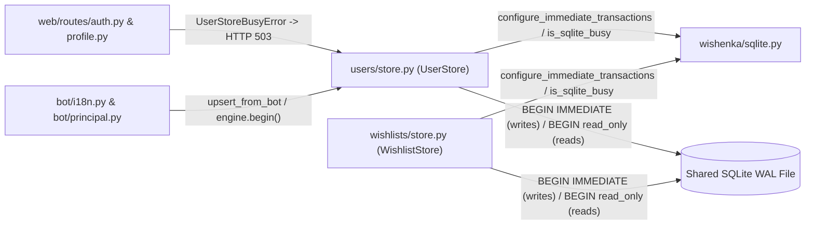

# WISHENKA-121: Serialize User Write Operations on the Shared Data Store

## Research

### Existing Concurrency Contract in `WishlistStore`

- In `wishenka/wishlists/store.py`, `WishlistStore.__init__` creates an `AsyncEngine` (`create_async_engine(database_url, connect_args={"timeout": 5}, hide_parameters=True)`) and registers `_configure_immediate_transactions(self.engine.sync_engine)`.
- `_configure_immediate_transactions` attaches two SQLAlchemy `sync_engine` event listeners:
  - `connect`: sets `dbapi_connection.isolation_level = None` (disabling `sqlite3`'s implicit deferred `BEGIN`), then executes `PRAGMA foreign_keys=ON` and `PRAGMA busy_timeout=5000`.
  - `begin`: executes `PRAGMA busy_timeout=5000`, then emits `BEGIN` when `conn.get_execution_options().get("read_only")` is truthy, or `BEGIN IMMEDIATE` otherwise.
- `WishlistStore._immediate(work)` runs write transactions via `conn.begin()` (receiving `BEGIN IMMEDIATE`), commits on success, and rolls back on `BaseException`.
- `WishlistStore.execute_read(work)` sets `execution_options(read_only=True)` before `conn.begin()` so read-only queries use a deferred `BEGIN` snapshot and never block writers.
- `_is_sqlite_busy(exc)` (using `_sqlite_error_is_busy`) walks `exc`, `exc.orig`, and `exc.__cause__` to detect `sqlite3.SQLITE_BUSY` (`sqlite_errorcode & 0xFF == sqlite3.SQLITE_BUSY`) or `"database is locked"` / `"database is busy"` messages. `WishlistStore` maps busy errors to `InventoryBusyError` (a retryable error mapped to HTTP 503 in item, reservation, and receipt routes).

### Current Gap in `UserStore`

- `wishenka/users/store.py` (`UserStore.__init__`) opens its own `AsyncEngine` on `settings.database_url` with `connect_args={"timeout": 5}`, **without** `isolation_level = None` and **without** a `begin` listener emitting `BEGIN IMMEDIATE`.
- Write methods (`initialize`, `upsert_user`, `set_locale`, `set_birthdate`, `clear_birthdate`) use `async with self.engine.begin() as conn:`, which opens a **deferred** SQLite transaction.
  - `upsert_user` and `set_locale` execute a `SELECT` before `INSERT`/`UPDATE`. In a deferred transaction, `SELECT` acquires a `SHARED` lock on the current snapshot; if a concurrent `WishlistStore` write commits before `UserStore` executes its `INSERT`/`UPDATE`, SQLite cannot upgrade `SHARED` to `RESERVED` across the committed change and immediately fails with `SQLITE_BUSY` (bypassing `busy_timeout`).
  - Conversely, `UserStore` holding a deferred-upgraded write lock surfaces raw `sqlalchemy.exc.OperationalError` on timeout rather than a retryable busy error.
- Read methods (`get_by_telegram_id`, `get_by_id`) use `async with self.engine.connect() as conn:` with SQLAlchemy 2.0 autobegin. Once `BEGIN IMMEDIATE` listeners are attached to `UserStore.engine`, `connect()` without `execution_options(read_only=True)` would emit `BEGIN IMMEDIATE` on `SELECT` and unnecessarily block writers.
- External callers in `wishenka/bot/principal.py` (`ensure_private_bot_user`), `wishenka/bot/entry.py` (`/reservation_confirmations`, `reservation_confirmations`), and `wishenka/notices/preferences.py` (`NotificationPreferencesStore`) also call `users.engine.begin()` / `users.engine.connect()` directly.
- Web routes calling `UserStore` writes (`wishenka/web/routes/auth.py` `auth_telegram`, `wishenka/web/routes/profile.py` `update_profile_locale`, `update_profile_birthdate`) do not currently catch a user-store busy exception, so a lock timeout would surface as HTTP 500 instead of HTTP 503.

### Scope Boundaries

- Wish quantity formulas, reservation capacity rules, and `WishlistStore` inventory logic (`wishenka/wishlists/service.py`, `repo_ops.py`, `repository.py`) are strictly out of scope and remain untouched.

---

## Implementation Plan

1. **Extract Shared SQLite Transaction & Busy-Detection Helpers (`wishenka/sqlite.py`)**:
   - Move `_configure_immediate_transactions` and `_is_sqlite_busy` (plus `_sqlite_error_is_busy`) from `wishenka/wishlists/store.py` into a shared module `wishenka/sqlite.py` as `configure_immediate_transactions` and `is_sqlite_busy`.
   - Update `wishenka/wishlists/store.py` to import and use `configure_immediate_transactions` and `is_sqlite_busy` with zero behavioral change to wishlist/inventory operations.

2. **Enforce `BEGIN IMMEDIATE` and Retryable Busy Mapping in `UserStore` (`wishenka/users/store.py`, `wishenka/users/__init__.py`)**:
   - Add `UserStoreBusyError(RuntimeError)` in `wishenka/users/store.py` and export it in `wishenka/users/__init__.py`.
   - In `UserStore.__init__`, support `database_url: str` (preserving all existing callers) and optional `engine: AsyncEngine | None = None`. When creating the engine, call `configure_immediate_transactions(self.engine.sync_engine)`.
   - Add `_immediate(self, work, *, operation: str)` in `UserStore`: runs `work` inside `conn.begin()` (`BEGIN IMMEDIATE`), commits on success, rolls back on `BaseException`, and catches `SQLAlchemyError`:
     - If `is_sqlite_busy(exc)` is true, logs a structured `WARNING` (`event="user_store_busy"`, `operation=operation`, without PII or raw driver text) and raises `UserStoreBusyError` from `exc`.
     - Otherwise, logs a structured `ERROR` (`event="user_store_error"`, `operation=operation`) and raises `RuntimeError("User storage operation failed") from exc`.
     - Domain errors (`UserNotFoundError`, `ValueError`) propagate untouched after rollback.
   - In `UserStore.initialize`, execute `PRAGMA journal_mode=WAL` (and `PRAGMA synchronous=NORMAL`, `PRAGMA busy_timeout=5000`) on an autocommit connection (`execution_options(isolation_level="AUTOCOMMIT")` before `_immediate(...)`), because SQLite cannot change `journal_mode` inside an active `BEGIN IMMEDIATE` transaction; then execute schema DDL (`CREATE TABLE IF NOT EXISTS ...`, index creation, `PRAGMA table_info`, `ALTER TABLE`, and backfill/repair) inside `_immediate(..., operation="initialize")`.
   - Route all other `UserStore` write methods (`upsert_user`, `set_locale`, `set_birthdate`, `clear_birthdate`) through `_immediate(...)`.
   - Add `_read(self, work)` in `UserStore` using `execution_options(read_only=True)` before `conn.begin()` (matching `WishlistStore.execute_read`) and route `get_by_telegram_id` and `get_by_id` through `_read(...)` so read-only lookups use deferred `BEGIN` and never block writers.

3. **Map `UserStoreBusyError` to HTTP 503 in Web Routes (`wishenka/web/routes/auth.py`, `wishenka/web/routes/profile.py`)**:
   - Catch `UserStoreBusyError` in `POST /api/auth/telegram` (`auth.py`), `PATCH /api/profile/locale` (`update_profile_locale` in `profile.py`), and `PATCH /api/profile/birthdate` (`profile.py`), returning `HTTP 503 Service Unavailable` with a clear retryable detail.
   - Bot middleware/helpers (`wishenka/bot/i18n.py`, `wishenka/bot/principal.py`) receive `UserStoreBusyError` as a typed retryable exception without partial state mutation.

4. **Verify**:
   - Run the Step 3 failing-repro test suite and full repository test/static-analysis checks (`make check` / `pytest`) to confirm green behavior and no regressions.

**Mandatory — Failing Repro (next Step 3):**
- **File**: `tests/test_user_store_concurrency_repro.py` (with `pytestmark = pytest.mark.timeout(60)`).
- **What it asserts (desired behavior)**:
  1. *No deferred-upgrade failure across concurrent `WishlistStore` commit*: A `UserStore.upsert_user` (and `set_locale`) that pauses after its initial `SELECT` while a concurrent `WishlistStore.transaction` commits on the same SQLite WAL file serializes cleanly via `BEGIN IMMEDIATE` and both operations commit without `OperationalError` or lost updates.
  2. *Timed-out write lock maps to `UserStoreBusyError`*: When an external connection holds a `BEGIN IMMEDIATE` write lock past `busy_timeout`, `UserStore.upsert_user`, `set_locale`, `set_birthdate`, and `clear_birthdate` roll back cleanly, leave previously persisted user attributes unchanged, and raise `UserStoreBusyError` (not raw `OperationalError`).
  3. *Read-only lookups do not block*: While a `BEGIN IMMEDIATE` write lock is held by another connection, `UserStore.get_by_telegram_id` and `UserStore.get_by_id` succeed immediately without waiting for the write lock or raising `UserStoreBusyError`.
- **How to force failure without live external deps**:
  - Use a temporary SQLite WAL file (`tmp_path / "shared.sqlite"`) shared by `WishlistStore(db_url)` and `UserStore(db_url)`.
  - For (1), use an `asyncio.Event` / monkeypatched hook between `UserStore`'s `SELECT` and `INSERT`/`UPDATE` to trigger `WishlistStore.transaction` mid-transaction; on the unfixed deferred `UserStore`, `UserStore` fails with `OperationalError: database is locked` when trying to upgrade `SHARED` -> `RESERVED` across `WishlistStore`'s commit.
  - For (2) and (3), hold a `BEGIN IMMEDIATE` transaction on a separate `sqlite3` connection (and use a short `busy_timeout` override or 5s wait within the 60s test timeout) to force a lock timeout deterministically.
- **Sequencing**: research (Step 2) → write red tests in `tests/test_user_store_concurrency_repro.py` and verify they fail (Step 3) → implement `wishenka/sqlite.py`, `UserStore`, and route 503 mappings until all tests pass (Step 4).

---

## Architecture

### Module Diagram

### Module Responsibilities & Interfaces

1. **`wishenka/sqlite.py` (Shared SQLite Coordination Helper)**
   - `configure_immediate_transactions(sync_engine: Engine, *, busy_timeout_ms: int = 5000) -> None`: Configures `isolation_level = None`, `PRAGMA foreign_keys=ON`, `PRAGMA busy_timeout=<ms>` on `connect`, and `PRAGMA busy_timeout=<ms>` + `BEGIN` (when `read_only=True`) or `BEGIN IMMEDIATE` (otherwise) on `begin`.
   - `is_sqlite_busy(exc: BaseException) -> bool`: Inspects exception chains (`orig`, `__cause__`) for `sqlite3.SQLITE_BUSY` or SQLite busy/locked messages.

2. **`wishenka/users/store.py` (`UserStore` & `UserStoreBusyError`)**
   - `UserStoreBusyError(RuntimeError)`: Retryable exception raised when a `UserStore` write transaction exceeds `busy_timeout`.
   - `UserStore.__init__(self, database_url: str, *, engine: AsyncEngine | None = None) -> None`: Attaches `configure_immediate_transactions` to its own engine (or uses an injected shared engine).
   - `UserStore._immediate(self, work: Callable[[AsyncConnection], Awaitable[T]], *, operation: str) -> T`: Executes writes in a `BEGIN IMMEDIATE` transaction and maps `is_sqlite_busy(exc)` to `UserStoreBusyError`.
   - `UserStore.initialize(self) -> None`: Enables `PRAGMA journal_mode=WAL` (with `PRAGMA synchronous=NORMAL` and `PRAGMA busy_timeout=5000`) on an autocommit connection before running schema DDL (`CREATE TABLE IF NOT EXISTS ...`) and column migrations inside `_immediate(..., operation="initialize")`.
   - `UserStore._read(self, work: Callable[[AsyncConnection], Awaitable[T]]) -> T`: Executes reads with `execution_options(read_only=True)` in a deferred `BEGIN` transaction.

3. **`wishenka/wishlists/store.py` (`WishlistStore`)**
   - Imports `configure_immediate_transactions` and `is_sqlite_busy` from `wishenka.sqlite` instead of defining duplicate copies; all wish/inventory semantics and `InventoryBusyError` remain unchanged.

4. **`wishenka/web/routes/auth.py` & `wishenka/web/routes/profile.py`**
   - Catch `UserStoreBusyError` on user write endpoints and return `HTTP 503 Service Unavailable`.

---

## Q&A

- **Q**: Should `UserStore` share `WishlistStore.engine` or configure its own engine with `BEGIN IMMEDIATE`?
  **A**: Configuring `configure_immediate_transactions` on `UserStore`'s own `AsyncEngine` (while optionally accepting `engine: AsyncEngine | None = None`) preserves the `UserStore(database_url)` constructor used across `app.py`, `bot/__main__.py`, `auth/dependencies.py`, and all existing tests, while enforcing the exact same SQLite file-level `BEGIN IMMEDIATE` + `busy_timeout=5000` contract across both single-process and multi-process deployments.
- **Q**: Why must `UserStore.get_by_telegram_id` and `UserStore.get_by_id` set `execution_options(read_only=True)`?
  **A**: With `configure_immediate_transactions` attached to `sync_engine`, SQLAlchemy 2.0's autobegin on `engine.connect()` fires the `begin` event. Without `read_only=True`, read-only lookups would emit `BEGIN IMMEDIATE` and unnecessarily contend with writers.
- **Q**: Should `UserStore` raise `InventoryBusyError` or its own `UserStoreBusyError`?
  **A**: `UserStore` should raise `UserStoreBusyError` (defined in `wishenka/users/store.py` and exported from `wishenka/users/__init__.py`) so the `users` domain stays decoupled from `wishenka.wishlists.exceptions.InventoryBusyError` while web routes can map it to HTTP 503 identically.
