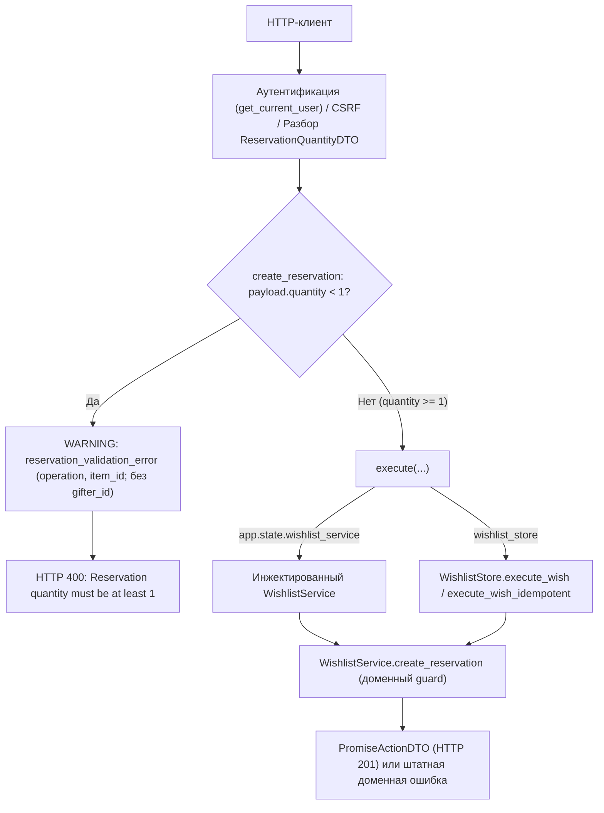
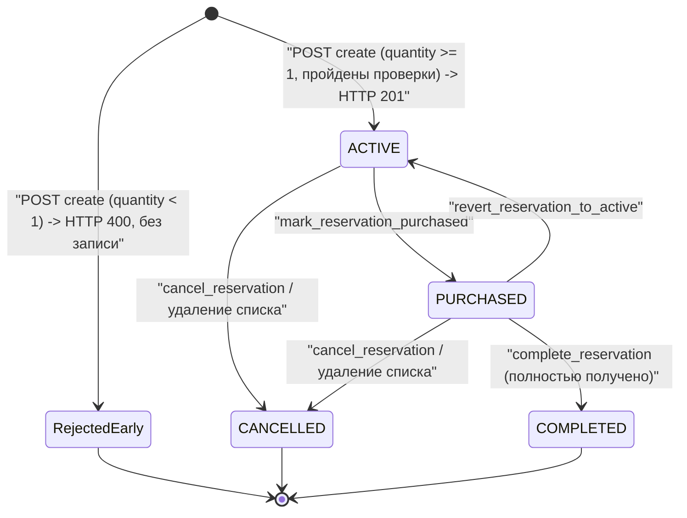

# Спецификация: WISHENKA-122 — Единообразное отклонение некорректного количества при создании бронирования

**Задача:** WISHENKA-122  
**Источник:** технический долг [WISHENKA-18](../WISHENKA-18/60-tech-debt.md)  
**Язык реализации:** Python  
**Затронутые компоненты:** `wishenka/web/routes/reservations.py`, `wishenka/wishlists/service.py`, `tests/test_reservation_invalid_quantity_repro.py`, `doc/dev/reservations.md`  
**Статус:** реализовано и принято

## 1. Назначение и бизнес-цель

### 1.1. Контекст и проблема

В подсистеме бронирования подарков действуют клиентские HTTP-маршруты из `wishenka/web/routes/reservations.py`, делегирующие бизнес-операции в `WishlistService` через транзакционную обёртку хранилища `WishlistStore.execute_wish` (или через внедрённый `app.state.wishlist_service` в тестовом режиме).

До доработки `WISHENKA-122` маршрут создания бронирования (`create_reservation`) возвращал разные HTTP-ответы для одного и того же некорректного значения количества (`quantity < 1`, например `0` или `-1`) в зависимости от того, удавалось ли загрузить указанное желание:

- если желание существовало и загружалось в `execute_wish`, метод `WishlistService.create_reservation` отклонял запрос с `ValueError("Reservation quantity must be at least 1")`, что преобразовывалось в `HTTP 400`;
- если желание отсутствовало или не могло быть загружено, `WishlistStore.execute_wish` завершался ошибкой `ItemNotFoundError` до вызова доменной проверки, и клиент получал `HTTP 404` (`"Resource not found"`).

Такое расхождение делало поведение API несогласованным и вызывало лишнее обращение к хранилищу для заведомо невалидного ввода.

### 1.2. Цели и бизнес-ценность

- **Предсказуемость для клиента и дарителя:** возвращать единое понятное сообщение об ошибке валидации (`HTTP 400`, `"Reservation quantity must be at least 1"`) для любого запроса на создание бронирования с количеством меньше `1`, независимо от существования желания.
- **Исключение лишней работы хранилища:** отклонять невалидные запросы до обращения к `WishlistStore.execute_wish` и без создания или изменения записей о бронировании.
- **Приватность диагностики для оператора:** фиксировать события ошибки валидации в структурированном журнале без идентификатора дарителя и без раскрытия существования желания.
- **Сохранение доменной и маршрутной совместимости:** сохранить доменную проверку в `WishlistService` для прямых вызовов вне HTTP-пути создания, не нарушить контракты аутентификации, CSRF, других действий с бронями и ответы `HTTP 404` для валидных запросов к отсутствующим желаниям.

### 1.3. Границы задачи

В область задачи входит:

- добавление ранней проверки `quantity < 1` в аутентифицированном обработчике `create_reservation` до вызова `execute` (и соответственно до `execute_wish` или внедрённого сервиса);
- использование единой строковой константы сообщения об ошибке `RESERVATION_QUANTITY_MIN_ERROR` на маршруте и в `WishlistService`;
- сохранение доменной проверки количества в `WishlistService.create_reservation` для прямых вызовов;
- добавление ограниченных по времени регрессионных тестов и обновление документации разработчика (`doc/dev/reservations.md`).

В область задачи не входит:

- изменение общей схемы запроса `ReservationQuantityDTO` (в том числе добавление ограничений Pydantic, которое изменило бы формат ошибки на `HTTP 422`);
- изменение семантики, порядка проверок и поведения маршрута изменения количества (`update_reservation_quantity`) и остальных действий с бронью;
- перенос валидации в неаутентифицированный middleware;
- добавление новых метрик, счётчиков или панелей мониторинга.

## 2. Функциональные требования и пользовательские сценарии

### 2.1. Роли и доменные сущности

- **Даритель (`AuthenticatedUser`):** аутентифицированный пользователь, отправляющий запрос на создание бронирования подарка.
- **Оператор:** администратор или инженер сопровождения, анализирующий структурированные журналы ошибок валидации без доступа к идентификаторам дарителей.
- **Доменные сущности:** вишлист (`wishlist_id`), желание (`item_id`), содержащий его список желаний и запись бронирования (`Reservation`) с запрошенным количеством экземпляров (`quantity`).

### 2.2. Функциональные правила и поведение

1. **Порядок обработки HTTP-запроса:** при обращении к `POST /api/wishlists/{wishlist_id}/items/{item_id}/reservations` сначала выполняются штатные проверки безопасности и разбора запроса (CSRF-защита для cookie-запросов в middleware, аутентификация через зависимость `get_current_user` и валидация структуры JSON через `ReservationQuantityDTO`).
2. **Раннее отклонение некорректного количества:** если в обработчике `create_reservation` получено `payload.quantity < 1` (например, `0` или `-1`), запрос немедленно завершается ответом `HTTP 400 Bad Request` с телом `{"detail": "Reservation quantity must be at least 1"}` без обращения к хранилищу и без создания или изменения бронирований.
3. **Независимость от существования желания:** ответ `HTTP 400` с указанным текстом детализации возвращается одинаково как для существующего, так и для отсутствующего желания, а также как при работе через SQLite-хранилище `wishlist_store`, так и при использовании внедрённого `app.state.wishlist_service`.
4. **Обработка корректного количества:** при `payload.quantity >= 1` запрос передаётся в `execute`, где сохраняется весь действующий поток транзакции, проверок прав и тайны сюрприза, расчёта остатка и проекции результата; при отсутствующем желании или списке возвращается прежний ответ `HTTP 404` (`{"detail": "Resource not found"}`).
5. **Сохранение доменного барьера:** метод `WishlistService.create_reservation` продолжает проверять `quantity < 1` и выбрасывать `ValueError(RESERVATION_QUANTITY_MIN_ERROR)` для прямых вызывающих вне HTTP-маршрута создания.
6. **Неизменность прочих операций:** изменение количества бронирования (`PATCH .../{reservation_id}`), отмена, отметка покупки, возврат в активное состояние и завершение бронирования сохраняют прежние правила валидации и коды ответов.

| Сценарий | Аутентификация | Значение `quantity` | Состояние желания | HTTP-ответ и `detail` | Вызов хранилища / сервиса |
| --- | --- | --- | --- | --- | --- |
| Некорректное количество на существующем желании | Валидная | `0` или `< 0` | Существует | `400`, `"Reservation quantity must be at least 1"` | Нет (`execute` не вызывается) |
| Некорректное количество на отсутствующем желании | Валидная | `0` или `< 0` | Отсутствует | `400`, `"Reservation quantity must be at least 1"` | Нет (`execute` не вызывается) |
| Корректное количество на отсутствующем желании | Валидная | `>= 1` | Отсутствует | `404`, `"Resource not found"` | Да (`execute_wish` загружает желание) |
| Корректное количество на доступном желании | Валидная | `>= 1` | Доступно дарителю | `201`, `PromiseActionDTO` | Да (создаётся запись в БД) |
| Неаутентифицированный запрос с `quantity < 1` | Отсутствует | `0` или `< 0` | Любое | `401`, `"Authentication required"` | Нет (отказ на `get_current_user`) |

### 2.3. Пользовательские сценарии

- **UC-122-01. Отклонение некорректного количества для существующего желания:** аутентифицированный даритель отправляет `POST` на создание брони с `quantity: 0` или `-1` для существующего желания и получает `HTTP 400` с текстом `"Reservation quantity must be at least 1"`, при этом состояние бронирований в БД остаётся неизменным.
- **UC-122-02. Отклонение некорректного количества для отсутствующего желания:** аутентифицированный даритель отправляет `POST` на создание брони с `quantity: 0` или `-1` для несуществующего `item_id` и получает точно такой же ответ `HTTP 400` с текстом `"Reservation quantity must be at least 1"`, без обращения к `execute_wish` и без раскрытия отсутствия желания.
- **UC-122-03. Сохранение ответа для корректного количества на отсутствующем желании:** аутентифицированный даритель отправляет `POST` с `quantity >= 1` для несуществующего `item_id` и получает штатный ответ `HTTP 404` (`"Resource not found"`).
- **UC-122-04. Сохранение приоритета аутентификации:** неаутентифицированный клиент отправляет `POST` с `quantity: 0` и получает `HTTP 401` (`"Authentication required"`), не достигая логики валидации и её журнала.
- **UC-122-05. Прямой вызов сервиса:** внутренний клиент кода вызывает `WishlistService.create_reservation` напрямую с `quantity < 1` и получает `ValueError("Reservation quantity must be at least 1")` без создания записи.
- **UC-122-06. Приватная диагностика валидации:** оператор просматривает журналы после отклонённого HTTP-запроса и видит запись `reservation_validation_error` уровня `WARNING` с полями `operation` и `item_id` без идентификатора дарителя и тела запроса.

### 2.4. Входные/выходные данные и продуктовые инварианты

- **Входные данные HTTP-маршрута:** параметры пути `wishlist_id: int` и `item_id: int`, JSON-тело модели `ReservationQuantityDTO` (`{"quantity": int}` с запретом лишних полей), аутентифицированный пользователь `AuthenticatedUser` и объект `Request`.
- **Выходные данные HTTP-маршрута:**
  - при `quantity < 1`: `HTTP 400` с JSON `{"detail": "Reservation quantity must be at least 1"}`;
  - при ошибке схемы JSON (отсутствует `quantity`, нецелый тип, лишние ключи): стандартный ответ FastAPI `HTTP 422`;
  - при `quantity >= 1` и успехе: `HTTP 201` с моделью `PromiseActionDTO`.
- **Ключевые инварианты:**
  1. **Единообразие контракта ошибки:** одинаковый невалидный ввод на создании брони всегда даёт одинаковый `HTTP 400` независимо от состояния хранилища и наличия желания.
  2. **Атомарная неизменность данных:** отклонённый запрос не создаёт и не изменяет ни одной строки бронирований.
  3. **Изоляция приватности и существования сущностей:** ранняя ошибка валидации не раскрывает наличие или отсутствие желания и не записывает идентификатор дарителя в журнал.
  4. **Сохранение порядка безопасности:** проверка количества никогда не предшествует проверкам аутентификации, CSRF и парсинга входной схемы.

## 3. Архитектура, компоненты и интерфейсы

### 3.1. Архитектурные решения и поток обработки

Вместо ограничения `ge=1` на уровне Pydantic-модели `ReservationQuantityDTO` или перехвата в неаутентифицированном middleware ранняя проверка размещена непосредственно в аутентифицированном обработчике маршрута `create_reservation` после разрешения зависимостей FastAPI и до вызова `execute`. Это решение обусловлено двумя причинами:

- модель `ReservationQuantityDTO` используется совместно маршрутами создания и изменения количества (`update_reservation_quantity`), а ограничение на модели Pydantic изменило бы статус ошибки на стандартный FastAPI `HTTP 422` и затронуло бы второй маршрут;
- размещение внутри обработчика гарантирует, что существующие middleware (включая CSRF для cookie-запросов) и зависимость `get_current_user` выполняются раньше валидации количества.

### 3.2. Модули, классы и функции

- **`wishenka/web/routes/reservations.py`:**
  - `router` — маршрутизатор с префиксом `/api/wishlists/{wishlist_id}/items/{item_id}/reservations`.
  - `User = Annotated[AuthenticatedUser, Depends(get_current_user)]` — зависимость аутентификации вызывающего.
  - `logger = logging.getLogger("wishenka.web.reservations")` — логгер HTTP-действий маршрута.
  - `_request_scope(operation: str, *, item_id: int | None, reservation_id: int | None) -> dict[str, object]` — формирует словарь области запроса для логов (`operation` и присутствующие идентификаторы из URL).
  - `create_reservation(wishlist_id: int, item_id: int, payload: ReservationQuantityDTO, user: User, request: Request) -> PromiseActionDTO | Response` — проверяет `if payload.quantity < 1:`, логирует событие `reservation_validation_error` на уровне `WARNING` и поднимает `HTTPException(status_code=400, detail=RESERVATION_QUANTITY_MIN_ERROR)`; при `quantity >= 1` передаёт действие `svc.create_reservation(...)` и `project_reservation_action(...)` в `execute`.
  - `execute(...)` — общий адаптер выполнения действий через `app.state.wishlist_service` либо `request.app.state.wishlist_store` (`execute_wish` / `execute_wish_idempotent`) и преобразования доменных исключений в HTTP-ответы (включая `ValueError` -> `HTTP 400` с событием `reservation_validation_error`).
- **`wishenka/wishlists/service.py`:**
  - `RESERVATION_QUANTITY_MIN_ERROR = "Reservation quantity must be at least 1"` — общая константа текста ошибки валидации минимального количества.
  - `WishlistService.create_reservation(self, item_id: int, user: AuthenticatedUser | None, quantity: int = 1, *, wishlist_id: int | None = None) -> Reservation` — сохраняет доменную проверку `if quantity < 1: raise ValueError(RESERVATION_QUANTITY_MIN_ERROR)` для прямых вызовов сервиса.
  - `WishlistService.update_reservation_quantity(...)` — использует ту же константу `RESERVATION_QUANTITY_MIN_ERROR` при `new_quantity < 1`, сохраняя существующее поведение изменения количества.
- **`wishenka/wishlists/schemas.py` (без изменений):**
  - `ReservationQuantityDTO` — входная схема (`extra="forbid"`, поле `quantity: int`).
  - `PromiseActionDTO` — неизменяемая выходная схема успешного действия с бронью (`reservation_id`, `wish_item_id`, `quantity`, `status`, `available_quantity`, `item: WishItemGifterViewDTO`).

### 3.3. Контракты данных и последовательность проверок

При обработке `POST /api/wishlists/{wishlist_id}/items/{item_id}/reservations` действует строгий порядок проверок:

1. **Безопасность и сессия:** CSRF-проверка (для cookie-запросов без bearer-токена) и `get_current_user` (`HTTP 401` `"Authentication required"` при отсутствии сессии).
2. **Валидация формата JSON:** `ReservationQuantityDTO` с `extra="forbid"` (`HTTP 422` при отсутствии `quantity`, нецелом значении или постороннем поле).
3. **Ранняя проверка количества в `create_reservation`:** при `payload.quantity < 1` — `HTTP 400` `{"detail": "Reservation quantity must be at least 1"}` без обращения к хранилищу и без записи в очередь идемпотентности.
4. **Транзакция и доменные проверки в `execute` (только для `quantity >= 1`):**
   - загрузка желания и вишлиста (`ItemNotFoundError`, `WishlistNotFoundError`, `WishlistDeletedError` -> `HTTP 404` `"Resource not found"`);
   - проверка архивности (`WishlistArchivedError` -> `HTTP 409`);
   - проверка получателя (`SelfReservationError` -> `HTTP 403` `"Cannot promise this wish"`);
   - проверка свободного остатка (`InsufficientQuantityError` -> `HTTP 409`);
   - конкурентная занятость SQLite (`InventoryBusyError` -> `HTTP 503`).

### 3.4. Переходы состояний

Ранняя валидация `quantity < 1` завершает запрос до создания сущности `Reservation` и не инициирует ни одного перехода жизненного цикла бронирования (`ReservationStatus`), оставляя состояние хранилища и таблицы `wl_reservations` неизменным. Для корректных запросов (`quantity >= 1`) жизненный цикл бронирования сохраняется без изменений.

## 4. Нефункциональные требования, безопасность и наблюдаемость

### 4.1. Производительность и ресурсные ограничения

- Запросы на создание бронирования с `quantity < 1` отсекаются в памяти на границе HTTP-маршрута до вызова `WishlistStore.execute_wish`, что устраняет открытие SQLite-транзакции `BEGIN IMMEDIATE` и чтение графа желания для невалидного ввода.
- Запросы с `quantity >= 1` сохраняют прежний путь транзакции и исключения конкурентной записи через SQLite WAL без дополнительных блокировок и без дополнительных запросов к базе данных.

### 4.2. Безопасность и защита приватности

- **Аутентификация и CSRF перед валидацией:** проверка `quantity < 1` не вынесена в неаутентифицированный middleware; неаутентифицированные запросы отклоняются с `HTTP 401` до выполнения логики маршрута.
- **Нераскрытие существования ресурса:** поскольку ошибка `HTTP 400` возвращается до загрузки желания, злоумышленник не может использовать невалидное количество (`0` или `-1`) для различения существующих и несуществующих идентификаторов `item_id` или `wishlist_id`.
- **Защита персональных данных дарителя:** ни HTTP-ответ об ошибке, ни запись структурированного журнала при раннем отклонении не содержат идентификатор дарителя (`gifter_id`, `user_id`, `telegram_id`), токен или переданное тело запроса.

### 4.3. Наблюдаемость: структурированное логирование и метрики

- **Структурированное логирование:** ранняя проверка в `wishenka.web.routes.reservations.create_reservation` использует существующее событие `reservation_validation_error` на логгере `wishenka.web.reservations` с уровнем `WARNING`. Тот же уровень и событие сохраняются на пути обработки `ValueError` в `execute`.

| Событие (`event`) | Уровень | Логгер | Поля контекста (`extra`) | Исключённые поля (приватность) |
| --- | --- | --- | --- | --- |
| `reservation_validation_error` | `WARNING` | `wishenka.web.reservations` | `event`, `operation` (`"create_reservation"`), `item_id` (из URL-пути) | `gifter_id` / идентификатор пользователя, тело запроса, `quantity`, `reservation_id` |

> [!NOTE]
> Значение `item_id` в событии `reservation_validation_error` берётся напрямую из пути HTTP-запроса и не подтверждает существование такого желания в хранилище.

- **Метрики:** новые метрики, счётчики или интеграции систем мониторинга в рамках задачи не добавлялись, так как путь валидации не обращается к хранилищу и покрывается существующим мониторингом HTTP-запросов и ошибок, а введение отдельного счётчика требует общепроектного стандарта метрик.

## 5. Верификация и критерии приёмки

### 5.1. Тестовые сценарии и результаты проверок

Регрессионная проверка реализована в модуле `tests/test_reservation_invalid_quantity_repro.py` с ограничением времени выполнения `pytestmark = pytest.mark.timeout(30)`, реальным приложением FastAPI (`create_app`), SQLite-хранилищем и токенами `SessionTokenService`:

- **`test_invalid_quantity_precedes_missing_wish_lookup` (параметризация `quantity` in `[0, -1]`):**
  - проверяет, что `POST` с `quantity` `0` или `-1` на существующее желание возвращает `HTTP 400` и `detail == "Reservation quantity must be at least 1"`;
  - проверяет контрольный запрос с `quantity == 1` на несуществующее желание (`HTTP 404`);
  - проверяет, что `POST` с `quantity` `0` или `-1` на несуществующее желание возвращает `HTTP 400` и `detail == "Reservation quantity must be at least 1"`, а таблица `wl_reservations` остаётся пустой (`0` записей).
- **`test_invalid_create_skips_storage_and_injected_service_and_logs_safely`:**
  - проверяет с замокированным `app.state.wishlist_store.execute_wish`, что при `quantity == 0` возвращается `HTTP 400`, а `execute_wish` не вызывается (`assert_not_awaited`);
  - проверяет через `caplog` (`WARNING`, `wishenka.web.reservations`), что зафиксировано ровно одно событие `reservation_validation_error` с `operation == "create_reservation"`, `item_id == 7`, без поля `gifter_id` и без значения ID дарителя (`"987654"`) в атрибутах записи;
  - проверяет режим с внедрённым `app.state.wishlist_service = AsyncMock()`: `POST` с `quantity == -1` возвращает идентичный ответ `HTTP 400` без вызова `service.create_reservation`;
  - проверяет, что неаутентифицированный `POST` с `quantity == 0` возвращает `HTTP 401`.

**Зафиксированные результаты проверок в артефактах задачи (`40-code-cleanup.md`, `50-observability.md`):**

- `make test PYTEST_ARGS='-n 0 tests/test_reservation_invalid_quantity_repro.py'` — **3 passed** (с одним предупреждением Starlette об устаревании зависимости).
- `make analyze` — проверки Ruff lint, Ruff format (144 исходных файла) и `mypy` пройдены без замечаний; `git diff --check` без ошибок.
- `make check` — статический анализ и **846 тестов** пройдены.

### 5.2. Критерии приёмки

1. Запрос на создание бронирования с количеством меньше `1` возвращает `HTTP 400` и сообщение `"Reservation quantity must be at least 1"`, независимо от того, может ли желание быть загружено.
2. Невалидный запрос не создаёт и не изменяет ни одного бронирования.
3. Некорректное количество отклоняется до поиска/загрузки желания, а событие валидации (`reservation_validation_error`) не содержит идентификатора дарителя.
4. Запрос с допустимым количеством (`quantity >= 1`) для отсутствующего желания продолжает возвращать прежний ответ `HTTP 404` (`"Resource not found"`).
5. Существующая проверка минимального количества сохраняет силу в `WishlistService.create_reservation` для вызывающих вне HTTP-маршрута создания.
6. Все прочие действия с бронями, проверки прав доступа, расчёты остатков и ответы на корректные запросы остаются без изменений.

### 5.3. Известные ограничения и технический долг

По результатам анализа технического долга (`ai-tasks/WISHENKA-122/60-tech-debt.md`):

- **Осознанное дублирование проверки на границе HTTP и в сервисе:** проверка `quantity < 1` присутствует как в обработчике `create_reservation`, так и в `WishlistService.create_reservation`. Это осознанное архитектурное решение для разных типов вызывающих (единообразный `HTTP 400` без загрузки желания на HTTP-границе и защита прямых вызовов на уровне доменного сервиса). Риск расхождения сообщений снят использованием общей константы `RESERVATION_QUANTITY_MIN_ERROR`.
- **Граница применимости (без изменения маршрута обновления):** ранняя проверка до загрузки желания не распространяется на маршрут изменения количества (`update_reservation_quantity`), который намеренно сохраняет прежнее поведение.
- **Пробелы в тестах, производительные риски и последующие задачи:** не выявлены; отдельных follow-up задач в рамках `WISHENKA-122` не требуется.
