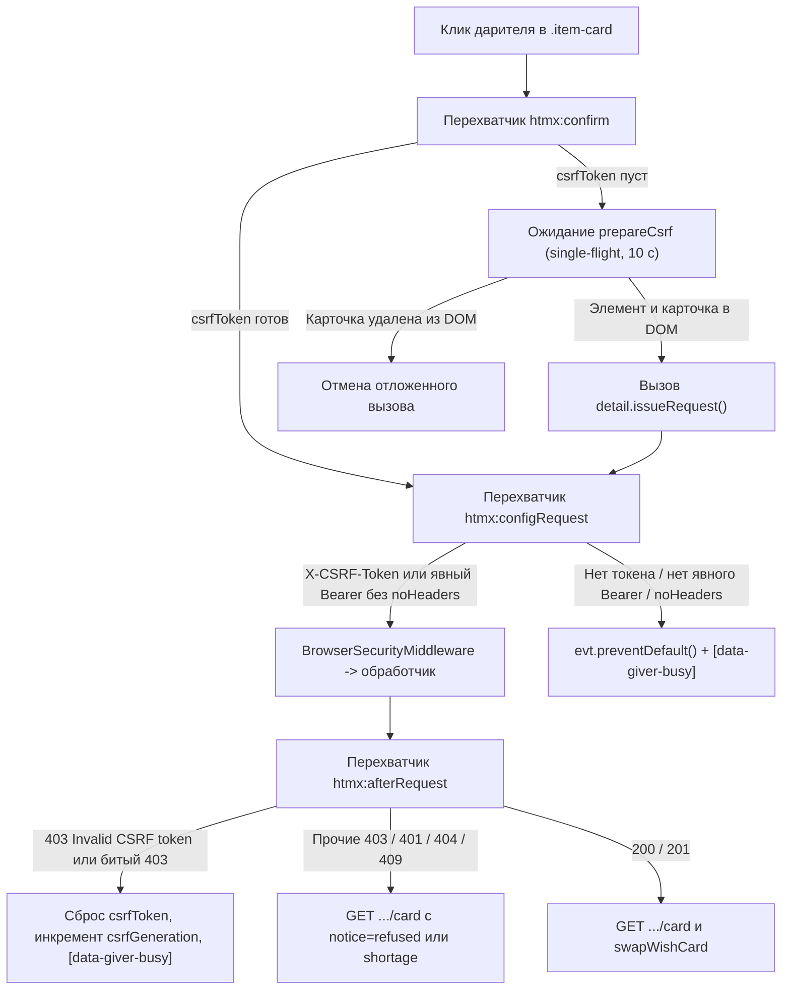
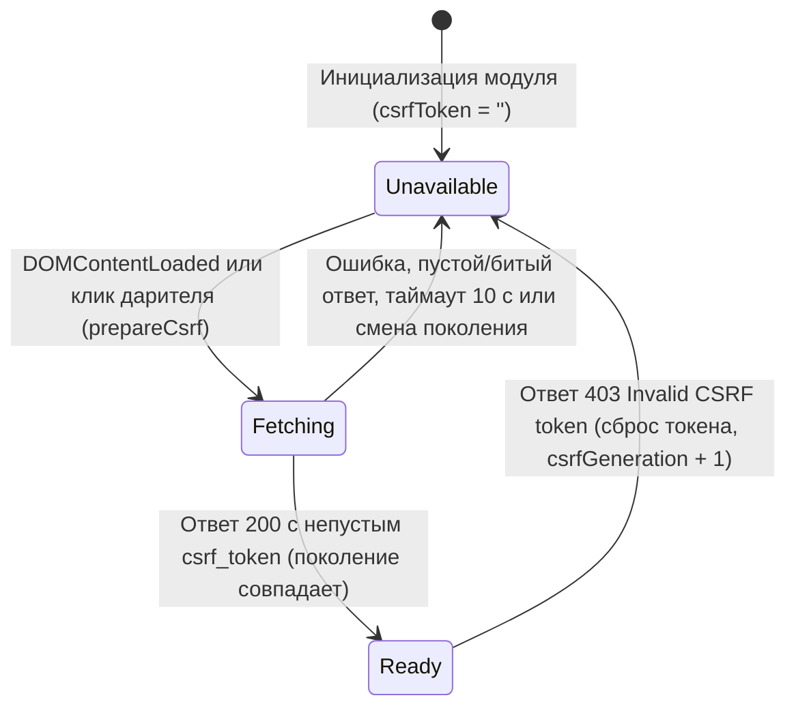

# Спецификация: WISHENKA-123 — Надёжная подготовка CSRF и классификация отказов для действий дарителя

**Задача:** WISHENKA-123  
**Статус:** реализовано и принято  
**Компоненты:** клиентский JavaScript (HTMX 1.9.12), HTML-шаблоны, middleware безопасности FastAPI / Starlette, браузерные тесты (pytest + CDP)

## 1. Назначение и бизнес-цель

### 1.1. Постановка проблемы

В веб-интерфейсе сервиса вишлистов («Вишенка») действия дарителя на карточке желания (бронирование, изменение количества, отметка покупки, возврат в бронь, отмена) выполняются через HTMX-мутации (`POST`, `PATCH`) к маршрутам `/reservations`. Для cookie-сессий `BrowserSecurityMiddleware` требует заголовок `Origin` и связанный с сессией токен `X-CSRF-Token`, который клиент запрашивает асинхронно после события `DOMContentLoaded` через `GET /api/auth/csrf`.

До внесения изменений синхронный перехватчик `htmx:configRequest` не мог дождаться завершения асинхронного запроса CSRF-токена, а обработчик `htmx:afterRequest` трактовал любой HTTP-ответ `403` как отказ со стороны получателя. В результате ранний клик дарителя на карточке желания до готовности токена приводил к отправке незащищённого запроса, его отклонению со статусом `403` (`{"detail": "Invalid CSRF token"}`) и обновлению карточки с вводящим в заблуждение уведомлением `notice=refused` («Бронь не изменилась.»).

### 1.2. Цели и ценность решения

- Обеспечить надёжное срабатывание ранних взаимодействий дарителя в cookie-сессии: мутация карточки удерживается до завершения подготовки CSRF-токена и не отправляется без необходимой защиты.
- Исключить ложное отображение сбоя инициализации безопасности или отклонения CSRF-токена как отказа получателя подарка, сохраняя состояние бронирования неизменным при сбоях.
- Сохранить без изменений существующие правила бронирования, права получателя, инвариант тайны сюрприза и поддержку API/HTMX-клиентов с Bearer-аутентификацией без заголовка `X-CSRF-Token`.
- Гарантировать конфиденциальность CSRF-токена (хранение только в памяти JavaScript, без попадания в HTML, URL, DOM-атрибуты и логи).

## 2. Функциональные требования и пользовательские сценарии

### 2.1. Пользовательские сценарии

1. **Ранний клик дарителя при отложенной инициализации сессии:** даритель в cookie-сессии нажимает кнопку управления бронью на карточке желания до завершения фонового `GET /api/auth/csrf`. Запрос приостанавливается на уровне HTMX до готовности токена, после чего автоматически отправляется один раз с заголовком `X-CSRF-Token`.
2. **Конкурентные и повторные клики во время ожидания:** одновременные действия с разных элементов используют один общий запрос инициализации CSRF, а повторные нажатия на один и тот же ожидающий элемент управления объединяются (`coalescing`) и не создают дублирующих запросов.
3. **Удаление карточки во время ожидания:** если карточка желания или инициирующий элемент были удалены из DOM до завершения подготовки токена, отложенная мутация не отправляется.
4. **Сбой, пустой/невалидный ответ или таймаут подготовки токена:** если `GET /api/auth/csrf` завершился ошибкой сети или HTTP-ошибкой, вернул пустой либо синтаксически неверный ответ или превысил таймаут (10 секунд), мутация без токена и без явного Bearer-заголовка отменяется до отправки XHR. Бронь остаётся без изменений, на карточке показывается локализованное сообщение с предложением повторить действие, а следующий клик запускает новую попытку получения токена.
5. **Отклонение CSRF на сервере (`403` с `Invalid CSRF token`) и повтор:** при ответе `403` с телом `{"detail": "Invalid CSRF token"}` (а также при непарсируемом теле или отсутствии строкового поля `detail` в `403`) карточка не запрашивает обновление с `notice=refused`, сбрасывает кэшированный токен, инкрементирует поколение инициализации и предлагает пользователю повторить действие. Автоматический повтор отклонённой мутации не выполняется; новый токен запрашивается при следующем явном клике.
6. **Подлинный отказ получателя / авторизации (`403`):** для корректно сформированного ответа `403` с иным `detail` (например, `"Cannot promise this wish"` или `"Forbidden"`) сохраняется прежний сценарий: запрос обновления карточки `GET /wishlists/{wishlist_id}/items/{item_id}/card?...&notice=refused` (при этом проекция получателя по-прежнему не получает `notice` и блок `.item-giver`).
7. **Авторизация через `Authorization: Bearer` и подавление заголовков:** при наличии явного непустого заголовка `Authorization: Bearer <token>` в конфигурации HTMX-запроса (имя заголовка проверяется без учёта регистра) мутация карточки разрешается без `X-CSRF-Token`, даже если инициализация CSRF завершилась неудачей. Исключение не применяется, если на элементе или его предке включено подавление заголовков (`noHeaders`), либо если учётные данные добавляются скрытно вне конфигурации HTMX.

### 2.2. Границы применимости и входные/выходные контракты

- **Область перехвата шлюза:** только небезопасные HTMX-запросы (`POST`, `PATCH`, отличные от `GET`, `HEAD`, `OPTIONS`), исходящие от элементов внутри `.item-card`, у которых на самом элементе или предке задан атрибут `hx-post` или `hx-patch` с подстрокой `/reservations`.
- **Что не затрагивается:** безопасные запросы (`GET`, `HEAD`, `OPTIONS`), остальные потоки карточек и модальных окон, строки кабинета «Мои бронирования» (`.reservation-row`), а также отдельный поток получения CSRF в SPA-клиенте Mini App (`wishenka/web/static/miniapp.js`).
- **Входные сигналы клиента:**
  - Атрибут `data-viewer-identified` и строка локализации `data-i18n-prepare-error` на элементе `<body>`.
  - JSON-ответ `GET /api/auth/csrf`: `{"csrf_token": "<string>"}`.
  - Конфигурация HTMX-событий `htmx:confirm`, `htmx:configRequest`, `htmx:afterRequest`, а также атрибуты `hx-request` / `data-hx-request`.
- **Выходные эффекты клиента:**
  - Прикрепление заголовка `X-CSRF-Token` к небезопасным HTMX-запросам при наличии токена и отсутствии `noHeaders`.
  - Отмена отправки (`evt.preventDefault()`) до XHR и отображение сообщения ошибки подготовки в слоте `[data-giver-busy]` (русская локаль: `Не удалось подготовить запрос. Повторите попытку.`, английская локаль: `Could not prepare the request. Please try again.`).
  - При релевантных HTTP-ответах сервера (`200`, `201`, `401`, `404`, `409`, немаскированный `403`) — запрос обновления фрагмента карточки; при `403 Invalid CSRF token` или сбое подготовки — сохранение текущей карточки на месте.

### 2.3. Продуктовые и доменные инварианты

1. **Отсутствие незащищённых cookie-мутаций:** ни один запрос карточки дарителя не отправляется по сети с cookie-сессией без непустого `X-CSRF-Token` или явного непустого `Authorization: Bearer ...` в конфигурации HTMX.
2. **Принцип безопасного отказа (`fail closed`):** неизвестные или скрытые от HTMX учётные данные (расширения браузера, прокси, обёртки `fetch`), пустые/невалидные ответы `/api/auth/csrf`, таймаут, а также конфигурации с `noHeaders` (или невалидным JSON в `hx-request`) никогда не допускают отправку мутации без CSRF-токена. Клиент не пытается угадывать тип аутентификации через сторонние запросы вроде `/api/auth/me`.
3. **Запрет утечки токена:** значение CSRF-токена не встраивается в HTML-ответы, URL, атрибуты DOM и консольные сообщения.
4. **Инвариант тайны сюрприза:** разграничение CSRF-ошибок и отказов получателя не раскрывает получателю наличие бронирований или личность дарителя.

## 3. Архитектура, компоненты и интерфейсы

### 3.1. Общая схема взаимодействия

### 3.2. Клиентский модуль (`wishenka/web/static/app.js` и `wishenka/web/templates/base.html`)

> [!NOTE]
> В исходном коммите реализации `WISHENKA-123` клиентский координатор находился во встроенном теге `<script>` шаблона `wishenka/web/templates/base.html` с фиксированной русскоязычной строкой ошибки; в актуальной кодовой базе он вынесен в статический скрипт `wishenka/web/static/app.js` (подключаемый с `defer`), а текст сообщения передаётся через атрибут `data-i18n-prepare-error` элемента `<body>`.

Координатор безопасности страницы инкапсулирован в IIFE внутри `wishenka/web/static/app.js` и хранит состояние исключительно в памяти JavaScript:

- `CSRF_TIMEOUT_MS = 10000` — верхняя граница ожидания инициализации токена (10 секунд).
- `csrfToken` (`string`) — текущий кэшированный токен.
- `csrfPending` (`Promise<string> | null`) — активный общий промис инициализации.
- `csrfGeneration` (`number`) — счётчик поколений токена для защиты от гонки при инвалидации.
- `pendingGiverControls` (`WeakSet`) — множество элементов управления, уже ожидающих `prepareCsrf()`.

Основные функции и обработчики:

| Символ | Назначение и контракт |
| --- | --- |
| `prepareCsrf()` (`window.prepareCsrf`) | Возвращает готовый `csrfToken` либо активный `csrfPending`; иначе запускает `fetch('/api/auth/csrf', { credentials: 'same-origin', signal })` с `AbortController` и таймером `CSRF_TIMEOUT_MS`. При не-OK статусе, таймауте, сетевой ошибке или нестроковом/пустом `csrf_token` разрешается в `''`. Присваивает `csrfToken = token` только при `generation === csrfGeneration`, затем сбрасывает `csrfPending = null`. |
| `reservationRequestPath(elt)` | Поднимается по цепочке `parentElement` от `elt` и возвращает первый атрибут `hx-post` или `hx-patch`, содержащий `/reservations`, иначе `''`. |
| `requestSuppressesHeaders(elt)` | Проверяет атрибуты `hx-request` и `data-hx-request` на `elt` и его предках; возвращает `true`, если `JSON.parse(setting).noHeaders` истинно или при ошибке парсинга JSON. |
| `explicitBearer(headers)` | Проверяет наличие ключа `authorization` (регистронезависимо) со значением, удовлетворяющим регулярному выражению `/^Bearer \S/`. |
| `giverPreparationError(card)` | Находит элемент `[data-giver-busy]` внутри `card`, снимает `hidden` и выставляет текст из `document.body.getAttribute('data-i18n-prepare-error')` (fallback: `'Could not prepare the request. Please try again.'`). |
| `swapWishCard(card, markup)` | Заменяет `.item-card` по `outerHTML`, сохраняя раскрытое состояние (`aria-expanded="true"` и снятый `hidden` у `.item-card-details`). |

Порядок работы перехватчиков HTMX (при наличии `data-viewer-identified` на `<body>`):

1. **`DOMContentLoaded`:** сразу запускает фоновую инициализацию `prepareCsrf()`.
2. **`htmx:confirm`:** для элементов внутри `.item-card` с непустым `reservationRequestPath(elt)` и `detail.issueRequest`: при пустом `csrfToken` отменяет немедленный запуск (`evt.preventDefault()`), игнорирует повторный клик при наличии `elt` в `pendingGiverControls`, иначе ожидает `prepareCsrf()` и возобновляет отправку через `detail.issueRequest()`, только если `elt.isConnected && card.isConnected`.
3. **`htmx:configRequest`:** пропускает `GET`, `HEAD`, `OPTIONS`. Для небезопасных запросов добавляет `X-CSRF-Token`, если `csrfToken` непустой и `!suppressed` (дополнительно для путей `/reservations` без `noHeaders` поддерживается `Idempotency-Key`). Если запрос относится к карточке дарителя (`giver = card && resPath`) и выполняется `suppressed || (!csrfToken && !explicitBearer(evt.detail.headers))`, вызывает `evt.preventDefault()` и `giverPreparationError(card)`.
4. **`htmx:afterRequest`:** для запросов с `/reservations` внутри `.item-card`:
   - При `status === 403`: парсит `xhr.responseText`. При ошибке `JSON.parse`, отсутствии строкового `rejection.detail` или точном совпадении `rejection.detail === 'Invalid CSRF token'` — при последнем дополнительно очищает `csrfToken = ''` и увеличивает `csrfGeneration += 1` — вызывает `giverPreparationError(card)` и выходит без обновления карточки.
   - При прочих `403`, `401`, `404` или `409` (без подстроки `'available'`) запрашивает фрагмент карточки с `notice=refused`. При `503` оставляет карточку на месте и заполняет `[data-giver-busy]` текстом занятости (`data-i18n-busy-error`).

### 3.3. Серверные компоненты и шаблоны

- **`wishenka/web/routes/auth.py` (`get_csrf`, `GET /api/auth/csrf`):** требует аутентифицированного пользователя (`get_current_user`) с `auth_method == "cookie"` и наличием cookie `settings.session_cookie_name` (для Bearer возвращает `401 {"detail": "Cookie session required"}`). Выставляет `Cache-Control: no-store` и возвращает `{"csrf_token": csrf_value(settings.csrf_secret_key, cookie)}`.
- **`wishenka/web/security.py` (`BrowserSecurityMiddleware`):** для небезопасных методов при наличии сессионной cookie и отсутствии `Authorization: Bearer ...` проверяет совпадение `Origin == settings.application_origin` и `hmac.compare_digest(token, expected)`. При нарушении возвращает `JSONResponse({"detail": "Invalid CSRF token"}, status_code=403)`. Запросы с непустым `Authorization: Bearer ...` пропускаются без проверки `X-CSRF-Token`, даже если вместе с ним передана cookie.
- **`wishenka/web/templates/partials/item_card.html`:** в блоке `.item-giver` содержит элементы управления бронированием и скрытый контейнер `

`.
- **`wishenka/i18n/catalog.py`:** хранит локализованные сообщения `web.common.request_prepare_error` для языков `en` и `ru`.

### 3.4. Переходы состояний клиентской инициализации CSRF

## 4. Нефункциональные требования, безопасность и наблюдаемость

### 4.1. Производительность и ограничения

- Максимальная длительность ожидания инициализации CSRF-токена ограничена фиксированным порогом `CSRF_TIMEOUT_MS = 10000` (10 секунд) с принудительной отменой запроса через `AbortController.abort()`.
- Конкурентные обращения к `prepareCsrf()` разделяют один активный промис `csrfPending` (`single-flight`), исключая шквал повторных запросов к `/api/auth/csrf`.
- Повторные клики по одному ожидающему элементу управления не накапливают отложенных вызовов благодаря `WeakSet` (`pendingGiverControls`).
- Дополнительные клиентские проверки ограничены элементами `.item-card` с путями `/reservations`; новых серверных сканирований или операций с БД задача не вводит.
- Потенциальное ограничение: при активном атрибуте `data-viewer-identified` на странице явный HTMX Bearer-запрос карточки также может ожидать завершения текущей инициализации CSRF на этапе `htmx:confirm` (не более 10 секунд) перед переходом к проверке заголовков в `htmx:configRequest`.

### 4.2. Безопасность и приватность

- **Защита cookie-мутаций:** ни одна незащищённая мутация карточки дарителя не покидает браузер при сбое, задержке или отсутствии `X-CSRF-Token`.
- **Защита от подмены и утечек:** клиент не копирует Bearer-учётные данные из HTML или сторонних запросов, не выполняет эвристический зонд `/api/auth/me` и не логирует CSRF-токен, cookie, заголовок `Authorization` или тело ответа в консоль браузера.
- **Заголовки безопасности ответов:** `/api/auth/csrf` возвращает `Cache-Control: no-store`; `BrowserSecurityMiddleware` добавляет к ответам `Referrer-Policy: no-referrer`, `X-Content-Type-Options: nosniff` и `Cache-Control: no-store`.
- **Приватность при отказах:** `get_item_card_partial` не передаёт `notice` для проекции `WishItemRecipientViewDTO`, а отклонённые CSRF-запросы не подменяются сценарием отказа получателя.

### 4.3. Наблюдаемость (логирование и метрики)

- **Новые логи и метрики:** в рамках `WISHENKA-123` новые серверные/браузерные логи, метрики (Prometheus, Grafana), алерты и сборщики логов не добавлялись.
- **Клиентская диагностика:** единственным клиентским диагностическим сигналом при сбое подготовки или отклонении CSRF-токена является отображение локализованного текста в слоте `[data-giver-busy]` на карточке. Запросы, отменённые до отправки XHR, не достигают сервера и не оставляют следов в серверных логах.
- **Существующие структурированные события на сервере** (при обращении к серверу):

| Логгер | Событие (`event`) | Уровень | Контекстные поля | Назначение |
| --- | --- | --- | --- | --- |
| `wishenka.web.routes.auth` | `csrf_cookie_missing` | `WARNING` | `event`, `telegram_id` | Запрос `/api/auth/csrf` без cookie-сессии или с не-cookie аутентификацией (без значения cookie/токена) |
| `wishenka.web.routes.auth` | `csrf_token_issued` | `INFO` | `event`, `telegram_id` | Выдача CSRF-токена для cookie-сессии (без значения cookie/токена) |
| `wishenka.web.security` | `csrf_origin_mismatch` | `WARNING` | `event`, `path`, `origin` | Несовпадение заголовка `Origin` при небезопасном cookie-запросе без Bearer |
| `wishenka.web.security` | `csrf_token_invalid` | `WARNING` | `event`, `path` | Отсутствующий или неверный `X-CSRF-Token` при небезопасном cookie-запросе без Bearer |

## 5. Верификация и критерии приёмки

### 5.1. Автоматизированные сценарии тестирования

Браузерный тестовый набор `tests/test_giver_csrf_repro_browser.py` (`pytest.mark.browser`, `pytest.mark.timeout(45)`) использует реальный сервер приложения, БД SQLite, барьеры перехвата `fetch` (без sleep-синхронизации) и локально сервируемые файлы HTMX `tests/browser_assets/htmx-1.9.12.min.js` и `tests/browser_assets/htmx-json-enc-1.9.12.js` (с `htmx-LICENSE.txt`):

1. **Задержка инициализации (`test_giver_click_waits_for_csrf_before_dispatch`):** при удержании ответа `GET /api/auth/csrf` клик не отправляет мутацию; после освобождения барьера отправляется ровно один запрос с заголовком `X-CSRF-Token`.
2. **Классификация CSRF 403 (`test_csrf_403_does_not_refresh_card_as_booking_refusal`):** ответ `403` с `{"detail": "Invalid CSRF token"}` не вызывает запрос обновления карточки с `notice=refused`.
3. **Повтор после сбоя и объединение кликов (`test_failed_initialization_retries_and_coalesces_clicks`):** ответ `503` на первом `/api/auth/csrf` блокирует мутацию и отображает `[data-giver-busy]`; два быстрых последующих клика инициируют ровно одну повторную попытку получения токена и выполняют одну мутацию.
4. **Проверка заголовков и отказ получателя (`test_header_guard_and_forbidden_classification`):** в `htmx:configRequest` пустые заголовки, пустой `Bearer ` и наличие `hx-request='{"noHeaders":true}'` блокируются (`false`), тогда как явный `Authorization: Bearer explicit-token` пропускается (`true`); обычный `403` (`{"detail": "Forbidden"}`) вызывает обновление карточки с `notice=refused`.
5. **Удалённая карточка (`test_detached_card_is_not_submitted_after_token_arrives`):** удаление `.item-card` до завершения `GET /api/auth/csrf` предотвращает отправку отложенной мутации.
6. **Сбойные ответы и таймаут (`test_failed_token_response_blocks_and_allows_retry`):** параметризовано для `"empty"` (`{}`), `"malformed"` (`{`) и `"timeout"` (истечение 10-секундного таймера); во всех трёх случаях первая мутация блокируется и выводится `[data-giver-busy]`, а повторный клик успешно получает токен, выполняет запрос (`201`) и сохраняет запись в таблице `wl_reservations` SQLite.
7. **Явный Bearer после сбоя CSRF (`test_real_bearer_request_after_csrf_failure`):** параметризовано по `with_cookie=[False, True]`; при провале `/api/auth/csrf` запрос с явным `Authorization: Bearer ...` уходит на сервер без `X-CSRF-Token` (без cookie даёт `201`, а cookie `viewer` + Bearer `owner` даёт `403`, подтверждая приоритет Bearer на сервере).
8. **Скрытый Bearer (`test_hidden_bearer_cannot_bypass_header_guard`):** добавление `Authorization: Bearer ...` на уровне `fetch` вне конфигурации HTMX не обходит барьер и приводит к отмене запроса с отображением `[data-giver-busy]`.
9. **Сквозной сценарий с реальным HTMX 1.9.12 (`test_real_htmx_waits_and_persists_cookie_booking`):** задержка `/api/auth/csrf`, реальная обработка события `htmx:confirm` библиотекой HTMX 1.9.12 и расширением `json-enc`, отправка единственного `POST` (`201`), обновление DOM (`.item-giver .giver-own`) и проверка сохранённой брони в SQLite.

### 5.2. Зафиксированные результаты прогонов

- Полный контроль качества `make check` (из `40-code-cleanup.md`): статический анализ и **858 тестов** пройдены (зафиксированы 6 предупреждений deprecation Starlette).
- Финальный сфокусированный прогон после форматирующей правки теста: все **12** браузерных проверок в `tests/test_giver_csrf_repro_browser.py`, `ruff check`, `ruff format --check` и `git diff --check` пройдены успешно.
- В рамках задачи не выполнялись проверка доступности метрик и агрегации логов в развёрнутой среде, а также отдельный тест захвата серверных логов (`50-observability.md`).

### 5.3. Критерии приёмки

1. При нажатии дарителем на элемент управления карточкой до готовности CSRF-токена мутация ожидает завершения подготовки и никогда не отправляется без необходимого токена.
2. При ошибке или таймауте подготовки токена незащищённая cookie-мутация не отправляется, бронь не изменяется, а сообщение об ошибке не имитирует отказ получателя.
3. Отклонение CSRF-токена (`403` с `Invalid CSRF token`) не приводит к отображению отказа получателя и позволяет повторить попытку при следующем клике.
4. Подлинный отказ получателя/доступа (`403` с иным валидным `detail`) сохраняет обновление карточки и уведомление об отказе (`notice=refused`).
5. Значение CSRF-токена отсутствует в доставляемом клиенту HTML-документе.
6. Авторизованные запросы с явным заголовком `Authorization: Bearer ...` остаются работоспособными без заголовка `X-CSRF-Token`.
7. Все указанные сценарии (задержка, сбои/таймаут, отклонение CSRF, отказ получателя, Bearer-авторизация, удаление карточки) покрыты автоматизированными тестами.

### 5.4. Известные ограничения и технический долг

По результатам анализа `60-tech-debt.md` приняты следующие архитектурные компромиссы (отдельные follow-up задачи не требуются):

- **Привязка к глобальному скрипту и HTMX 1.9.12:** шлюз реализован без отдельного клиентского фреймворка и опирается на событийный контракт HTMX `1.9.12`.
- **Фиксированный таймаут (10 секунд):** при истечении `CSRF_TIMEOUT_MS` запрос отменяется (`fail closed`), и пользователь должен повторить действие вручную; автоматический повтор не выполняется.
- **Скрытые Bearer-учётные данные:** заголовки авторизации, добавляемые прокси или расширениями браузера вне конфигурации HTMX, не могут быть безопасно распознаны на клиенте; при отсутствии CSRF-токена такие UI-действия блокируются (прямые серверные Bearer-вызовы API продолжают работать).
- **Отдельный поток Mini App:** клиент Mini App (`wishenka/web/static/miniapp.js`) управляет CSRF-инициализацией независимо и в рамках данной задачи не изменялся.
- **Локальные тестовые копии HTMX:** файлы `tests/browser_assets/htmx-1.9.12.min.js`, `tests/browser_assets/htmx-json-enc-1.9.12.js` и `tests/browser_assets/htmx-LICENSE.txt` при обновлении версии HTMX в шаблонах должны поддерживаться в синхронизированном состоянии с проверкой лицензии и источника.
- **Граница кабинета «Мои бронирования»:** шлюз ожидания CSRF и специальная обработка `403 Invalid CSRF token` применяются только к карточкам желаний (`.item-card`) и не распространяются на строки кабинета (`.reservation-row`).
