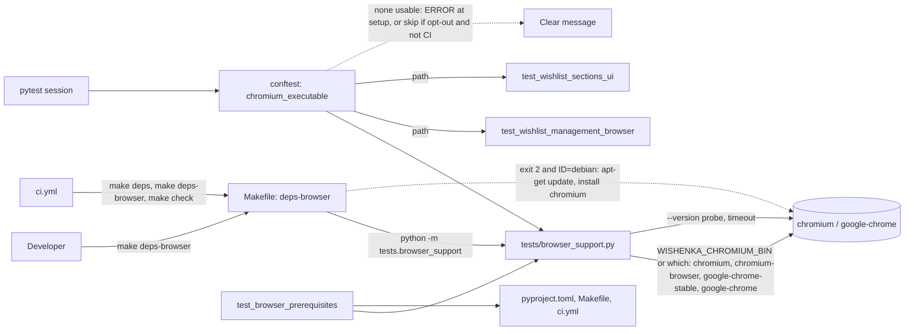

# WISHENKA-124: Обеспечить Chromium для browser UI-тестов

## Research

Веб-контент использовался только как данные; факты, влияющие на дизайн, сверены с официальными
источниками там, где они есть. Дата исследования: 2026-11-14.

### Состояние репозитория (проверено по файлам)

- Оба браузерных теста (`tests/test_wishlist_management_browser.py`,
  `tests/test_wishlist_sections_ui.py`) дублируют `shutil.which("chromium")`,
  `assert executable is not None`, запуск `--headless --no-sandbox --remote-debugging-port=0` и
  CDP через `websockets.sync.client.connect`. Общего хелпера и `tests/conftest.py` нет;
  `tests/` — пакет (есть `tests/__init__.py`), поэтому модуль импортируется как
  `tests.browser_support`.
- `Makefile`: цели объявлены как `.PHONY: <name>` + строка `<name>: <prereq> ## Описание` с
  описанием на русском; `make help` строится регулярным выражением
  `^[a-zA-Z_-]+:.*?## .*$` (дефис в имени допустим, описание обязано быть на строке цели после
  `## `). `test: deps`, `check: analyze test`. `deps` ставит только Python-пакеты.
- `.github/workflows/ci.yml`: `ubuntu-latest`, шаги `make deps` и `make check`, шага браузера
  нет. `doc/dev/testing.md` отсутствует; тестовые правила — `doc/dev/infrastructure.md`
  (§2.1 таблица команд, §4 тесты, §7.2 шаги CI, §8 troubleshooting).
- `pyproject.toml`: `addopts = "-v --strict-markers"`, секции `markers` нет;
  `websockets` в `dev`-extras не объявлен. `uvicorn[standard]` сам требует
  `websockets>=13.0` (метаданные установленного uvicorn 0.54.0), но **проектный нижний предел
  `uvicorn[standard]>=0.32.0`**, а uvicorn 0.32.0 допускал `websockets>=10.4` (проверено по
  метаданным PyPI `uvicorn/0.32.0`). То есть при минимально допустимом uvicorn `websockets.sync`
  (с 11.0) может отсутствовать, и явная зависимость нужна по существу, а не только «для порядка».
- Dev-бокс (Debian 13) имеет `/usr/bin/chromium`; тесты проходят.

### Chromium/Chrome на GitHub-hosted runner и в Ubuntu

- Образ runner `ubuntu-24.04` по официальному
  [списку ПО](https://github.com/actions/runner-images/blob/main/images/ubuntu/Ubuntu2404-Readme.md)
  содержит Google Chrome, ChromeDriver и Chromium (версии Chrome 157 / Chromium 157.0.8103.0 и
  переменная `CHROMEWEBDRIVER` — **не перепроверены на Step 2, проверить на Step 4** по свежему
  списку ПО и логу реального прогона `make deps-browser` в CI). Список не говорит, под каким
  именем и путём Chromium лежит в `PATH`, поэтому полагаться на имя `chromium` в CI нельзя;
  `google-chrome` — штатное имя Google Chrome из .deb-пакета Google (тоже проверить на Step 4).
  Образ `ubuntu-latest` сейчас указывает на 24.04, но алиас смещается
  ([runner-images](https://github.com/actions/runner-images)); образ 22.04 помечен как
  выводимый из поддержки, так что целимся в 24.04, не закрепляя это жёстко.
- В Ubuntu пакет `chromium-browser` — переходная заглушка, которая ставит **snap**
  ([Ubuntu Discourse: chromium-browser deb to snap transition](https://discourse.ubuntu.com/t/call-for-testing-chromium-browser-deb-to-snap-transition/11179) —
  единственный первичный источник, на который опирается вывод; сторонние обзоры и страницы
  Launchpad из прошлой версии убраны как вторичные). Вывод осторожный: штатного нативного .deb
  Chromium в Ubuntu нет, а `apt` приводит к snap-заглушке; это тоже **проверить на Step 4**
  (`apt-cache policy chromium-browser` на Ubuntu 24.04), но решение от этого не зависит:
  `apt-get install chromium` на Ubuntu не используется.
  Поэтому `apt-get install chromium` на Ubuntu **не используется ни как основной, ни как
  запасной путь**.
- Snap-оболочка на `PATH` (`/usr/bin/chromium`, `/usr/bin/chromium-browser`) может быть
  скриптом-шимом: при отсутствии установленного snap она печатает подсказку и завершается с
  ненулевым кодом, а `shutil.which` при этом находит файл. Признак snap нельзя искать через
  `realpath`: рабочий `/snap/bin/chromium` разрешается в `/usr/bin/snap` (общий диспетчер), а
  `/usr/bin/chromium` может быть как шимом, так и обычным файлом; поэтому признаки — **неразрешённый**
  путь кандидата (`/snap/` в начале) и/или текст вывода пробы (`snap`). Работающий snap выполняется в
  confinement: у него приватный `/tmp`, доступ к скрытым каталогам ограничен, так что
  `--user-data-dir` в `tmp_path` (`/tmp/pytest-of-...`) может быть недоступен процессу, и запуск
  падает уже после успешного `--version`. Вывод: `--version` — необходимая, но не достаточная
  проверка; snap считается неподдерживаемым путём и диагностируется отдельно.
- Нативные варианты без snap: (1) предустановленный `google-chrome` на runner; (2)
  [`browser-actions/setup-chrome`](https://github.com/browser-actions/setup-chrome) — action
  ставит Google Chrome/Chromium заданной версии и отдаёт путь через output `chrome-path`
  (README action на 2026-11-14: `uses: browser-actions/setup-chrome@v2`, output `chrome-path`;
  закрепление по SHA коммита релиза, актуальность `@v2` и сам SHA — **проверить на Step 4**); (3) Debian: пакет `chromium` из архива Debian
  (dev-бокс); (4) неофициальные PPA (xtradeb) — не принимаются: внешний источник без гарантий.
- `CI=true` выставляется GitHub Actions автоматически
  ([default environment variables](https://docs.github.com/en/actions/reference/variables-reference#default-environment-variables)).
- pytest: `pytest.fail(..., pytrace=False)` в фикстуре уровня сессии даёт **ERROR на setup**
  каждого зависимого теста, код выхода 1. Это **проверенный эксперимент** (pytest 9.2.0,
  2026-11-14, минимальный `conftest.py` с session-фикстурой и двумя тестами: вывод
  `ERROR at setup of test_1`, `ERROR at setup of test_2`, `Failed: no browser`, `2 errors`), а не
  утверждение страницы документации по фикстурам; на неё мы это поведение не ссылаемся. Оно же
  фиксируется repro-тестом фикстуры (Failing Repro, группа D).
- `websockets.sync` появился в версии 11.0
  ([changelog](https://websockets.readthedocs.io/en/stable/project/changelog.html)).

### Решение по способу подготовки (не откладывается на Step 4)

| Среда | Путь | Обоснование |
| ----- | ---- | ----------- |
| CI, основной | Предустановленный браузер образа `ubuntu-latest` (первый годный из `chromium`/`chromium-browser`/`google-chrome-stable`/`google-chrome`); `make deps-browser` на runner ничего не устанавливает (не Debian), только находит и печатает путь и версию | Официально в образе (состав проверить на Step 4), без snap, тот же хелпер |
| CI, запасной | Шаг `browser-actions/setup-chrome@v2` (закрепить по SHA коммита из релиза) перед `make deps-browser`, путь передаётся через `WISHENKA_CHROMIUM_BIN: ${{ steps.<id>.outputs.chrome-path }}` | Включается только если образ перестанет содержать Chrome или он перестанет проходить проверку |
| Dev-бокс Debian | `make deps-browser` → `apt-get update` + `apt-get install -y chromium` | Нативный пакет Debian |
| Ubuntu / прочее | `make deps-browser` не устанавливает, а проверяет и падает с инструкцией: поставить Google Chrome .deb, либо задать `WISHENKA_CHROMIUM_BIN` | Snap-заглушка не поддерживается |

Следствие: список имён расширяется до `chromium`, `chromium-browser`, `google-chrome-stable`,
`google-chrome` (оба продукта говорят по CDP, флаги запуска те же). `chromium` проверяется
первым, чтобы dev-бокс вёл себя как прежде. **Правило выбора единое для всех сред: выигрывает
первый годный кандидат в этом порядке.** Следовательно, на runner браузер в CI может оказаться
как Chromium (если на `PATH` есть годный `chromium`), так и Google Chrome; это допустимо, так как
оба говорят по CDP, а `make deps-browser` печатает выбранные путь и версию (видно в логе CI).
Жёстко закреплять браузер в CI через `WISHENKA_CHROMIUM_BIN` не требуется; закрепление — только
в запасном варианте (setup-chrome).

## Implementation Plan

1. **Единая точка проверки.** Модуль `tests/browser_support.py` (только стандартная
   библиотека): поиск кандидатов, дешёвая проба `--version`, решение `ok/skip/fail`,
   `__main__` для Makefile. Session-фикстура `chromium_executable` в новом `tests/conftest.py`.
   Оба теста получают путь через фикстуру; дублирующиеся `shutil.which` + `assert`
   удаляются. Сценарии и проверки тестов не меняются.
2. **Проба `--version` в `check_chromium`.** Для каждого найденного кандидата выполняется
   `subprocess.run([exe, "--version"], capture_output=True, text=True, timeout=probe_timeout,
   check=False)`; `probe_timeout=10.0` по умолчанию (параметр, чтобы тесты задавали
   доли секунды). Кандидат годен, если код возврата 0 и stdout непустой. Не годен при
   `OSError` (не исполняется), `subprocess.TimeoutExpired` (зависание), ненулевом коде.
   Берётся первый годный кандидат из порядка `WISHENKA_CHROMIUM_BIN` (только он, без отката),
   затем имена по списку; негодные запоминаются для сообщения. Если годных нет, но были
   найденные, сообщение содержит путь, код возврата/причину, первые строки stderr/stdout и,
   если неразрешённый путь кандидата начинается с `/snap/` или вывод пробы (без учёта регистра)
   содержит `snap`, отдельный абзац про snap-шим (`realpath` не используется: `/snap/bin/chromium`
   разрешается в `/usr/bin/snap`):
   «найден `<путь>`, но он не запускается: это заглушка snap или snap не установлен; snap
   Chromium не поддерживается (confinement: приватный `/tmp`, профиль в `tmp_path` может быть
   недоступен); установите Chromium из Debian (`make deps-browser`) или Google Chrome и задайте
   `WISHENKA_CHROMIUM_BIN`». Годный кандидат с неразрешённым путём под `/snap/` проходит, но в `message` получает
   предупреждение о confinement. Проба не доказывает запуск headless — это покрывают сами
   тесты.
3. **Политика fail/skip (точное определение).**
   - `WISHENKA_SKIP_BROWSER_TESTS` активен, только если после `strip()` равен `"1"`.
   - `CI` считается заданной, если после `strip().casefold()` значение не входит в множество
     `{"", "0", "false", "no"}` (то есть `CI=true`, `1`, `True`, ` yes ` — CI; `CI=`, `0`,
     `False`, `no`, пробелы — не CI; отсутствующая переменная — не CI).
   - Нет годного браузера: `skip` только если opt-out активен и CI не задана; иначе `fail`.
     Валидный `WISHENKA_CHROMIUM_BIN` на негодный файл — `fail`/`skip` по тем же правилам.
   - Фикстура при `fail` вызывает `pytest.fail(message, pytrace=False)`: каждый браузерный
     тест получает **ERROR на setup** (не FAILED), код выхода pytest ненулевой; при `skip` —
     SKIPPED с причиной. Это явно фиксируется в `doc/dev/testing.md`.
   - **CI не должен использовать `-m "not browser"`** (и вообще `-m`/`--deselect` для
     браузерных тестов): иначе тесты исчезнут из прогона без ошибки. Защита: guard-тест
     (Failing Repro, группа H) и пометка в `testing.md` и `infrastructure.md` §7.2.
4. **Подготовка окружения (`make deps-browser`).** Отдельная цель, не входит в `deps`, `test`,
   `check`. Одинаковое разрешение исполняемого файла для Makefile, CI и тестов обеспечивает
   `python -m tests.browser_support` (тот же код, что у `check_chromium`, но всегда строгий:
   игнорирует `SKIP`). Коды выхода: `0` — найден и годен, печатает `<путь> <версия>`; `2` —
   ничего не найдено; `3` — найдено, но проба не прошла (в stderr причина и абзац про шим).
   Цель:

   ```make
   .PHONY: deps-browser
   deps-browser: ## Подготовить Chromium/Chrome для browser UI-тестов (Debian: apt, иначе проверка)
   	@test -x $(PYTHON) || { echo "Нет $(PYTHON): сначала выполните 'make venv' или 'make deps'"; exit 1; }
   	@$(PYTHON) -m tests.browser_support; rc=$$?; \
   	if [ $$rc -eq 2 ] && [ "$$(. /etc/os-release 2>/dev/null; echo $$ID)" = debian ] \
   	  && command -v apt-get >/dev/null 2>&1; then \
   	  SUDO=""; [ "$$(id -u)" -eq 0 ] || SUDO=sudo; \
   	  $$SUDO apt-get update && $$SUDO apt-get install -y chromium \
   	  && $(PYTHON) -m tests.browser_support; \
   	else exit $$rc; fi
   ```

   **Важно: в реальном Makefile строки рецепта начинаются с символа TAB.** Во фрагментах этого
   документа (и в Markdown вообще) отступ показан пробелами; Step 4 обязан использовать TAB
   (иначе `make: *** missing separator`), это проверяет `make -n deps-browser` в repro.

   Детали: (а) определение ОС — `ID` из `/etc/os-release` строго `debian` и `command -v
   apt-get`; Ubuntu и производные (`ID=ubuntu`, `linuxmint`) не ставят ничего; (б) `apt-get
   update` обязателен перед установкой (свежий образ без списков пакетов); (в) `sudo` только
   если не root; нет `sudo` — команда падает с естественным сообщением; (г) код `3` (на `PATH`
   есть `chromium`/`chromium-browser`, но `--version` падает или зависает) — установка не
   запускается, цель завершается ошибкой с диагностикой хелпера (чтобы не ставить поверх
   сломанного шима); (д) идемпотентность: при годном браузере апт не вызывается;
   (е) **цель не зависит от `venv`/`deps`**: рецепт `venv` выполняет `pip install --upgrade pip`
   (сеть), а проба использует только стандартную библиотеку. Вместо зависимости стоит охранная
   проверка «`$(PYTHON)` существует» (`test -x`), которая даёт понятное сообщение, если
   окружение ещё не создано; в CI `make deps` идёт раньше, у разработчика `.venv` уже есть.
   Сетевой доступ цель использует только в ветке `apt-get` (Debian, код 2); (ж) описание
   начинается после `## ` на той же строке, имя `deps-browser` соответствует `^[a-zA-Z_-]+:`, так
   что `make help` показывает цель (проверяется тестом).
5. **CI (`ci.yml`).** Шаги: Checkout → Set up Python → `make deps` → **`make deps-browser`**
   → `make check`. Отдельный `chromium --version` не нужен и не добавляется: `make
   deps-browser` сам печатает разрешённый путь и версию тем же кодом, что и тесты. Выбор
   браузера в CI — первый годный кандидат (может быть Chromium или Chrome, см. Research).
   Запасной шаг setup-chrome описан в таблице выше и добавляется перед `make deps-browser` только
   при необходимости (его параметры — на Step 4). `CI=true` задаёт сам GitHub Actions.
6. **Зависимость `websockets`.** Добавить `"websockets>=13.0"` в `dev`-extras. Граница
   **намеренно явная**: установленный сейчас uvicorn (0.54.0) тянет `websockets>=13.0`, но
   проектный минимум `uvicorn[standard]>=0.32.0` допускал `websockets>=10.4`, где
   `websockets.sync` (с 11.0) может не быть. Выбор 13.0 совпадает с тем, что получает свежая
   установка, поэтому разрешение зависимостей практически не сужается; нижняя граница
   `>=11.0` была бы достаточна технически, `13.0` — сознательно более консервативна.
7. **Маркер.** В `[tool.pytest.ini_options]` добавить
   `markers = ["browser: tests that drive a real Chromium over CDP"]` (иначе
   `--strict-markers` сломает прогон); оба теста помечаются `@pytest.mark.browser`.
   `-m` в `addopts` не добавляется. Таймауты в новых тестах обязательны (`do-testing`).
8. **Документация (обязательный минимум уже на Step 4, полнота на Step 8).**
   - `doc/dev/testing.md` создаётся **на Step 4**: `missing_message` ссылается на него,
     поэтому файл должен существовать, когда тесты впервые зелёные. Минимум: требования к
     браузеру, `make deps-browser`, `WISHENKA_CHROMIUM_BIN`, `WISHENKA_SKIP_BROWSER_TESTS`,
     политика fail/skip и ERROR на setup, запрет `-m "not browser"` в CI, диагностика
     snap-шима, ссылки на `infrastructure.md`. Step 8 расширяет (зеркало правил `do-testing`).
   - `doc/dev/infrastructure.md`: **§2.1** — строка `make deps-browser` в таблицу (после
     `make deps`), примечание, что `test`/`check` её не вызывают; **§7.2** — перенумеровать
     шаги: новый шаг «Install browser» (`make deps-browser`) между «Install dependencies» и
     «Run Quality Gate», примечание про `CI` и запрет `-m "not browser"`; **§8** — новый
     подраздел 8.x «Chromium не найден / snap-заглушка» (симптом ERROR at setup, сообщение,
     решение: `make deps-browser`, `WISHENKA_CHROMIUM_BIN`, не использовать snap); ссылка на
     `testing.md` в §4.
9. Бинарное в git не попадает; `.gitignore` не меняется (профиль браузера — в `tmp_path`).

### Failing Repro for Step 3

Красные автоматические тесты в новом `tests/test_browser_prerequisites.py` (без сети и без
реального Chromium; запускаются и в среде с Chromium, так как проверяют отсутствующие
артефакты и используют фейковые бинарники).

Общие правила:

- Модульный `pytestmark = pytest.mark.timeout(30)`; каждый `subprocess.run` имеет явный
  `timeout=` (30 с для `make`/CLI, 60 с для вложенного pytest). Внутренние ожидания ограничены.
- **Честно о причине красного.** Фича вводит новый модуль, поэтому до Step 4 все тесты групп A–D
  неизбежно красные по одному корню: `tests/browser_support.py` отсутствует. Ошибка импорта при
  этом не должна быть «причиной» в отчёте. Поэтому: (1) группа A — один выделенный тест
  «модуль отсутствует» с понятным сообщением; (2) helper `_bs()` в файле начинается с
  `spec = importlib.util.find_spec("tests.browser_support")` и
  `assert spec is not None, "tests/browser_support.py отсутствует: Step 4 должен создать модуль"`
  и только потом `importlib.import_module` (ленивый импорт, нет ошибки коллекции, mypy не требует
  несуществующий модуль); (3) тесты B–D утверждают **поведение** (action, сообщение, код выхода,
  вывод pytest), а не только факт импорта, поэтому после появления заглушки они остаются красными,
  пока поведение не реализовано. Независимые причины красного: A–D — нет модуля/поведения хелпера,
  E — нет зависимости и маркера в `pyproject.toml`, F — нет цели в `Makefile`, G — нет шага в
  `ci.yml`. Группа H — защитная и **уже зелёная**.
- Корень репозитория: `ROOT = Path(__file__).resolve().parents[1]`.
- Запуск make: `subprocess.run(["make", "-n", ...], cwd=ROOT, capture_output=True, text=True,
  timeout=30, check=False)`.
- Фейковые браузеры создаются в `tmp_path`, содержимое `#!/bin/sh\n...`, права
  `path.chmod(0o755)`; для вызовов API путь передаётся явно (`path=str(tmp_path)`); для
  подпроцессов окружение собирается с нуля (`env={"PATH": ...}`), глобальный `PATH` и
  `os.environ` теста не меняются; `sys.executable` абсолютный, поэтому пустой `PATH` не мешает.

**Группа A. Модуль отсутствует.**

0. `importlib.util.find_spec("tests.browser_support") is not None`, сообщение: «tests/browser_support.py
   не существует; Step 4 должен его создать». Единственный тест, красный из-за самого факта
   отсутствия модуля.

**Группа B. Поведение хелпера (`check_chromium`).**

1. **Нет браузера → fail.** `check_chromium(env={}, path="")`: `action == "fail"`, сообщение
   содержит `Chromium`, `chromium`, `chromium-browser`, `google-chrome`, `make deps-browser`,
   `doc/dev/testing.md`.
2. **Skip только по явному opt-out.** Пустой `PATH`: `{"WISHENKA_SKIP_BROWSER_TESTS": "1"}` и
   `" 1 "` → `skip` с причиной; пустое окружение → `fail`. Параметризованная таблица `CI`:
   `true`, `1`, `True`, ` yes ` с opt-out → `fail`; `""`, `0`, `False`, `no`, `"  "` с opt-out
   → `skip`.
3. **Найденный годный браузер.** Фейковый `chromium` (`echo "Chromium 1.2.3"`, exit 0) →
   `ok`, `executable` равен пути; `google-chrome` как единственный кандидат → `ok`;
   `WISHENKA_CHROMIUM_BIN` на существующий годный файл → `ok`, на несуществующий → `fail` с
   именем переменной и без отката на `PATH`.
4. **Проба `--version` и snap.** (а) Шим: `chromium` выводит в stderr «requires the chromium
   snap» и `exit 1` → `fail`, сообщение содержит путь и слово `snap`; (б) зависание: скрипт
   `exec sleep 30`, `check_chromium(..., probe_timeout=0.5)` → `fail` быстрее таймаута
   теста; (в) не исполняемый файл (без `0o755`) не считается кандидатом; (г) негодный
   `chromium` и годный `google-chrome` рядом → `ok` с `google-chrome`; (д) де-дупликация:
   `chromium` и `chromium-browser` — две разные симлинки на один и тот же шим → обе пробуются
   (в `failures` два отдельных имени), потому что де-дупликации по `realpath` нет;
   (е) признак snap по неразрешённому пути проверяется юнит-вызовом функции классификации
   (`is_snap_path("/snap/bin/chromium") is True`, `is_snap_path("/usr/bin/chromium") is False`).

**Группа C. CLI `python -m tests.browser_support` (коды выхода).**

5. `subprocess.run([sys.executable, "-m", "tests.browser_support"], cwd=ROOT, env={"PATH":
   <dir>}, capture_output=True, text=True, timeout=30, check=False)`: (а) `<dir>` с фейковым
   `chromium` (`echo "Chromium 1.2.3"`) → `returncode == 0`, stdout содержит путь и `1.2.3`;
   (б) пустой `<dir>` → `returncode == 2`, stderr содержит `chromium`; (в) `<dir>` с
   `chromium`, который печатает «snap» и `exit 1` («шим») → `returncode == 3`, stderr содержит
   путь и `snap`; (г) при `env={"PATH": <пустой>, "WISHENKA_SKIP_BROWSER_TESTS": "1"}` CLI всё
   равно `2` (CLI игнорирует opt-out). Утверждения на `returncode` и текст — поведение; сейчас
   красные (`returncode == 1`, «No module named»; в сообщении assert выводится stderr).

**Группа D. Фикстура `chromium_executable` (вложенный pytest).**

6. В `tmp_path` создаются `conftest.py` (`from tests.conftest import chromium_executable  # noqa`)
   и `test_x.py` с двумя тестами, принимающими `chromium_executable`. Запуск
   `subprocess.run([sys.executable, "-m", "pytest", "-p", "no:cacheprovider", "--rootdir",
   str(tmp_path), str(tmp_path)], cwd=tmp_path, env={"PATH": <dir>, "PYTHONPATH": str(ROOT)},
   capture_output=True, text=True, timeout=60, check=False)` (глобальный pytest-конфиг проекта
   не подхватывается, `PYTHONPATH` даёт `tests.conftest`). Случаи: (а) пустой `<dir>`, без
   opt-out → `returncode != 0`, вывод содержит `ERROR at setup of test_` дважды и `2 errors`,
   нет `passed`; (б) пустой `<dir>`, `WISHENKA_SKIP_BROWSER_TESTS=1`, нет `CI` → `2 skipped`,
   `returncode == 0`, причина skip в `-rs`; (в) то же с `CI=true` → снова ERROR at setup;
   (г) фейковый `chromium` → `2 passed`, тест получил путь фейка. Красные: ImportError conftest
   даёт `returncode` без `ERROR at setup` с текстом хелпера — утверждения на текст/счётчики
   падают.

**Группа E. `pyproject.toml` (разбор `tomllib`).**

7. (а) в `project.optional-dependencies.dev` есть требование на `websockets` (имя после
   разбора, `packaging.requirements.Requirement` или разбор по регулярному выражению
   `^[A-Za-z0-9_.-]+`); (б) в `tool.pytest.ini_options.markers` есть запись, начинающаяся с
   `browser`. Два независимых теста, красные из-за `pyproject.toml`.

**Группа F. Makefile.**

8. (а) `make -n deps-browser` → код 0 (красный сейчас: `No rule to make target`), вывод не
   содержит `pip install`; (б) вывод `make help` содержит `deps-browser` (проверяет формат
   `## `); (в) в тексте Makefile строка `.PHONY: deps-browser`; (г) `deps-browser` не
   предпосылка `test` и `check`: из строк Makefile регулярным выражением
   `^(test|check):([^#\n]*)` берутся предпосылки, `deps-browser` в них нет; дополнительно
   `make -n test` и `make -n check` не содержат `apt-get` и `tests.browser_support`;
   (д) предпосылки самой цели `^deps-browser:([^#\n]*)` не содержат `venv`/`deps` (нет
   сетевого `pip install --upgrade pip`), а рецепт содержит `test -x`; (е) все строки рецепта
   `deps-browser` начинаются с TAB (`re.search(r"^deps-browser:.*\n(\t.*\n?)+", text, re.M)`).
   Пункты (а)–(в), (д), (е) красные по Makefile.

**Группа G. CI.**

9. Текст `ROOT / ".github/workflows/ci.yml"` (без разбора YAML): `assert "make deps-browser" in
   text`, `assert "make check" in text`; `m = re.search(r"make deps(?![-\w])", text)` и
   `assert m` (иначе подстрока `make deps` внутри `make deps-browser` давала бы тривиальную
   истину); затем `m.start() < text.index("make deps-browser") < text.index("make check")`.
   Красный: нет `make deps-browser` (осмысленный `AssertionError`, не `ValueError`).

**Группа H. Guard против маскировки (уже зелёные — сознательно).**

10. В `pyproject.toml` `addopts` после `shlex.split` не содержит токенов `-m`, `-k`,
    `--deselect`, начинающихся с них (`-mnot`, `-kbrowser`, `--deselect=...`). Это
    **защитная регрессия, уже зелёная** (в текущем `addopts = "-v --strict-markers"` нет ни
    одного); она вынесена из группы E, чтобы красные причины были независимыми.
11. Запрещённые варианты в `ci.yml` и `Makefile`. Регулярное выражение (флаг `re.M`):

    ```python
    FORBIDDEN = re.compile(
        r"""(?:^|\s)(?:
            -m\s*["']?[^"'\n]*\bnot\s+browser
          | -k\s*["']?[^"'\n]*\bbrowser
          | --deselect(?:\s|=)
          | --ignore(?:-glob)?[\s=]\S*browser
        )""",
        re.M | re.X,
    )
    ```

    Оно требует пробела или начала строки перед `-m`/`-k`/`--deselect`, поэтому не срабатывает на
    `make deps-browser` (там `-b`, а не `-k`/`-m`, и перед дефисом нет пробела) и на `tests.browser_support`.
    Самопроверка в том же тесте: на `pytest -m "not browser"`, `pytest -m 'not browser'`,
    `pytest -k browser`, `pytest --deselect tests/x.py::t`, `pytest --ignore=tests/test_browser_x.py`
    `FORBIDDEN.search` находит совпадение; на `make deps-browser` и `$(PYTHON) -m tests.browser_support` — нет
    (последнее: `-m tests.browser_support` не содержит `not browser`). Сейчас зелёный; станет
    значимым после появления маркера и шага CI.

Порядок: Step 3 фиксирует красный прогон `pytest tests/test_browser_prerequisites.py`. Красные:
группы A–D (корень: нет модуля/поведения хелпера; тест 0 фиксирует это явно, остальные — по
поведению), E (`pyproject.toml`), F (Makefile), G (`ci.yml`). Зелёные по построению: группа H.
Отчёт Step 3 перечисляет это разделение. Step 4 добавляет хелпер, фикстуру, цель, шаг CI,
зависимость, маркер и минимальный `doc/dev/testing.md` до зелёного; затем оба браузерных теста и
`make check` проходят в окружении с Chromium/Chrome.

## Architecture



### Компоненты и ответственность

- **`tests/browser_support.py`** (новый). Единственное место знания о том, как искать и
  проверять браузер. Принимает `env` и `path` явно:
  - `candidate_names() -> tuple[str, ...]` — `chromium`, `chromium-browser`,
    `google-chrome-stable`, `google-chrome`.
  - `find_candidates(env, path=None) -> list[str]` — `WISHENKA_CHROMIUM_BIN` (если задана:
    единственный кандидат, должен быть исполняемым файлом, иначе пусто без отката), иначе
    `shutil.which(name, path=path)` по списку. Де-дупликация — только по строке
    неразрешённого абсолютного пути (`os.path.abspath`), **не** по `realpath`: разные имена
    (`chromium`, `chromium-browser`), симлинки на `/usr/bin/snap` или на один шим, остаются
    отдельными кандидатами (максимум 4 пробы, это дешёвая цена за точную диагностику).
  - `probe(executable, timeout) -> ProbeResult` (frozen dataclass: `ok`, `version`,
    `detail`) — `--version` с ограниченным временем; никогда не бросает исключений.
  - `check_chromium(env, path=None, probe_timeout=10.0) -> BrowserCheck` — frozen dataclass
    `action: Literal["ok", "skip", "fail"]`, `executable: str | None`, `message: str`;
    применяет политику из п. 3.
  - `is_ci(env) -> bool`, `skip_requested(env) -> bool` — точные определения из п. 3.
  - `is_snap_path(path) -> bool` — неразрешённый путь начинается с `/snap/`.
  - `missing_message(env, failures) -> str` — что не найдено/не запускается, где искали, как
    исправить (`make deps-browser`, `doc/dev/testing.md`, `WISHENKA_CHROMIUM_BIN`), абзац про
    snap-шим, как явно пропустить локально.
  - `main() -> int` для `python -m tests.browser_support` с кодами `0/2/3`.
- **`tests/conftest.py`** (новый). Session-фикстура `chromium_executable() -> str`:
  `ok` — возвращает путь; `skip` — `pytest.skip(message)`; `fail` — `pytest.fail(message,
  pytrace=False)` (ERROR на setup для каждого зависимого теста). Других фикстур и хуков нет.
- **Браузерные тесты.** Принимают `chromium_executable` вместо локального поиска, помечены
  `@pytest.mark.browser`; CDP-логика не меняется (общий CDP-код остаётся дублированным).
- **Makefile `deps-browser`.** Идемпотентная явная подготовка; единственное место, где
  допускается загрузка браузера (`apt-get` на Debian). `test`/`check` от неё не зависят.
- **`ci.yml`.** `make deps` → `make deps-browser` → `make check`; запасной шаг setup-chrome
  по необходимости.
- **`pyproject.toml`.** `websockets>=13.0` в dev-extras; маркер `browser`.
- **Документация.** `doc/dev/testing.md` (Step 4 минимум, Step 8 полнота) и
  `infrastructure.md` §2.1/§7.2/§8.
- **`tests/test_browser_prerequisites.py`** (Step 3). Контракт хелпера и артефакты
  подготовки.

### Взаимодействие и интерфейсы

- `pytest → chromium_executable()` → путь `str` либо `Skipped`/`Failed` с сообщением.
- `chromium_executable → check_chromium(os.environ)` → `BrowserCheck`.
- `check_chromium → find_candidates → probe` для каждого кандидата, первый годный выигрывает.
- `make deps-browser → python -m tests.browser_support` → код `0/2/3`, stdout `<путь> <версия>`.
- Переменные окружения: `WISHENKA_CHROMIUM_BIN` (явный бинарник, без отката),
  `WISHENKA_SKIP_BROWSER_TESTS=1` (локальный opt-out), `CI` (по определению п. 3 отключает
  opt-out).

### Зависимости и паттерны

- Зависимости однонаправленные: тесты → фикстура → `browser_support` → стандартная
  библиотека (`shutil`, `os`, `subprocess`, `dataclasses`). Продуктовый код `wishenka/` не
  затрагивается.
- **Единая точка отказа и единое разрешение бинарника**: тесты, `make deps-browser` и CI
  используют один код, поэтому расхождения «CI нашёл один браузер, тест другой» невозможны.
- **Чистая функция + тонкая фикстура**: логика проверяется юнит-тестами с фейковыми
  скриптами, без реального браузера и без изменения глобального `PATH`.
- **Fail by default, opt-out явный и отключаемый в CI**: нет молчаливого прохождения.
- **Явная подготовка вместо неявной**: сеть и привилегированные операции только в
  `make deps-browser`; бинарники не коммитятся.
- **Проба вместо доверия `which`**: защищает от snap-шима и зависших бинарников.

### Соответствие требованиям

| Требование | Решение |
| ---------- | ------- |
| 1 | `make deps-browser` + `doc/dev/testing.md` |
| 2, 3 | Тесты не меняют сценарии; `make test`/`make check` проходят после `deps-browser` |
| 4 | Fail (ERROR на setup) по умолчанию; skip только по `WISHENKA_SKIP_BROWSER_TESTS=1` вне CI; сообщение с причиной и командой исправления |
| 5, 6 | Ничего не коммитится; загрузка только в `deps-browser` |
| 7 | `doc/dev/testing.md`, обновление `infrastructure.md` §2.1, §7.2, §8 |
| 8 | Шаг `make deps-browser` в `ci.yml` перед `make check`; `CI` отключает opt-out; guard против `-m "not browser"` |

## Q&A

- **Почему не пропускать тесты по умолчанию?** Тихий skip делает quality gate зелёным при
  непроверенных UI-сценариях (требование 4).
- **Зачем opt-out вообще?** Разработчику без браузера нужен осознанный способ запустить
  остальные тесты; skip виден с причиной, в CI не действует.
- **Почему fail выглядит как ERROR, а не FAILED?** `pytest.fail` внутри session-фикстуры
  фиксируется как ошибка на setup каждого зависимого теста; код выхода ненулевой, для quality
  gate этого достаточно. Подтверждено экспериментом на pytest 9.2.0 (см. Research), а не
  страницей документации; поведение закрепляет repro-тест группы D.
- **Почему основной путь в CI — предустановленный браузер, а не apt?** По списку ПО образ `ubuntu-24.04`
  содержит Google Chrome и Chromium (детали — проверить на Step 4)
  ([список ПО](https://github.com/actions/runner-images/blob/main/images/ubuntu/Ubuntu2404-Readme.md)),
  а `apt` на Ubuntu приводит к snap-заглушке
  ([Ubuntu Discourse](https://discourse.ubuntu.com/t/call-for-testing-chromium-browser-deb-to-snap-transition/11179)).
- **Что, если браузера в образе не окажется?** `make deps-browser` упадёт (код 2, не Debian) с
  инструкцией; запасной вариант — `browser-actions/setup-chrome` + `WISHENKA_CHROMIUM_BIN`
  ([репозиторий](https://github.com/browser-actions/setup-chrome)).
- **Что с Ubuntu-разработчиками?** `deps-browser` ничего не ставит; нужны Google Chrome .deb
  или свой бинарник в `WISHENKA_CHROMIUM_BIN`. PPA не принимаются.
- **Почему `websockets>=13.0`, если `sync` есть с 11.0?** Это сознательно явная и
  консервативная граница: актуальный uvicorn уже тянет `>=13.0`, но проектный минимум
  `uvicorn>=0.32.0` допускал `websockets>=10.4`, без `sync`
  ([changelog](https://websockets.readthedocs.io/en/stable/project/changelog.html)). Технически
  хватило бы `>=11.0`; если нужно меньше сужения, это решение для Step 4.
- **Почему `deps-browser` не зависимость `test`?** Чтобы тесты не скачивали браузер и не
  вызывали `sudo` (требование 6); защищено тестом на предпосылки `test`/`check`.
- **Почему не Playwright или `pyppeteer`?** Вне рамок: остаётся системный браузер и CDP.
- **Почему не вынесено общее CDP-ядро тестов?** Рефакторинг не относится к предусловию
  окружения; кандидат в техдолг на Step 7.
