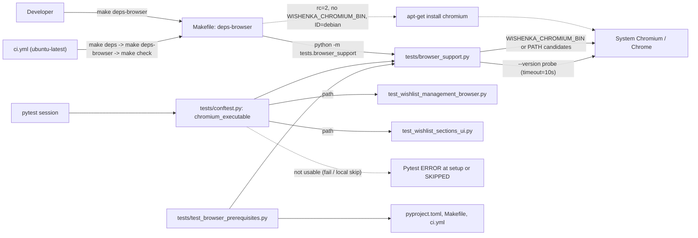

# Спецификация: WISHENKA-124 — Обеспечение воспроизводимого окружения Chromium для browser UI-тестов

**Задача Jira:** WISHENKA-124  
**Тип реализации:** тестовая и сборочная инфраструктура (Python, Makefile, Pytest, GitHub Actions)  
**Статус:** реализована и принята  
**Область:** `tests/`, `Makefile`, `pyproject.toml`, `.github/workflows/ci.yml`, `doc/dev/`

## 1. Назначение и бизнес-цель

### 1.1. Постановка проблемы

Два браузерных UI-теста Mini App защищают ключевые пользовательские сценарии интерфейса:

- `tests/test_wishlist_management_browser.py::test_browser_copy_share_and_role_controls` — копирование и шаринг ссылки на вишлист, скрытие управляющих элементов для участника;
- `tests/test_wishlist_sections_ui.py::test_mini_app_home_sections_and_badges_browser` — отображение секций главной страницы Mini App, ролевых бейджей и навигация по истории просмотров.

Оба теста управляют реальным headless-экземпляром Chromium через Chrome DevTools Protocol (CDP) с помощью `websockets.sync` (без Playwright). До выполнения задачи WISHENKA-124 предусловие наличия системного браузера не было зафиксировано ни в `Makefile`, ни в `pyproject.toml`, ни в CI-пайплайне `.github/workflows/ci.yml`, ни в документации разработчика (`doc/dev/` и `README.md`).

При отсутствии браузера в окружении оба теста дублировали вызов `shutil.which("chromium")` и падали на неинформативной проверке `assert executable is not None` (baseline зафиксирован в WISHENKA-111). Дополнительно пакет `websockets`, необходимый для работы с CDP, отсутствовал в явных `dev`-зависимостях проекта и подтягивался только транзитивно через `uvicorn[standard]` (чей минимально допустимый предел `uvicorn[standard]>=0.32.0` допускал `websockets>=10.4` без модуля `websockets.sync`, появившегося в версии `11.0`).

### 1.2. Цели и ценность для пользователей и системы

**Бизнес-цель:** обеспечить каждому разработчику и любому CI-подобному окружению единый, воспроизводимый и документированный способ подготовки Chromium/Chrome для browser UI-тестов, а также однозначный сигнал quality gate (`make test` и `make check`).

Ключевые цели решения:

1. **Воспроизводимость подготовки:** предоставить отдельную явную команду `make deps-browser`, пригодную как для локальной среды разработчика, так и для CI-раннера, без коммита бинарных файлов браузера в репозиторий.
2. **Прозрачная диагностика вместо шума:** при отсутствии или неработоспособности браузера явно сообщать, что именно не найдено или не запускается (включая распознавание snap-заглушки в Ubuntu), и указывать конкретную команду или документ для исправления.
3. **Защита от скрытого пропуска тестов:** запретить молчаливое прохождение quality gate без выполнения UI-сценариев; локальный пропуск допускается только явным флагом и полностью игнорируется в CI.
4. **Изоляция прогона тестов от сети:** исключить скачивание браузера во время выполнения `pytest`, `make test` и `make check`.

### 1.3. Границы решения (Out of Scope)

Следующие направления сознательно не входят в рамки данной задачи:

- Переписывание браузерных тестов на Playwright, Selenium или другие фреймворки.
- Изменение или расширение пользовательских сценариев и проверок самих UI-тестов.
- Поддержка других браузеров (Firefox, WebKit) и операционных систем Windows / macOS.
- Изменение продуктового кода приложения (`wishenka/`).
- Выделенная контейнеризация тестового окружения.
- Вынесение общего CDP-кода двух браузерных тестов в отдельный модуль.

## 2. Функциональные требования и пользовательские сценарии

### 2.1. Порядок поиска и выбора браузера

Единым источником правил поиска и проверки браузера является модуль `tests/browser_support.py`. Поиск исполняемого файла выполняется детерминированно:

1. **Явный путь (`WISHENKA_CHROMIUM_BIN`):** если переменная окружения задана и не пуста после обрезки пробелов (`strip()`), единственным кандидатом считается указанный путь. Проверяется, что это обычный файл (`os.path.isfile`) с правом на выполнение (`os.access(..., os.X_OK)`). Если проверка не пройдена, список кандидатов пуст — **откат на поиск по `PATH` не выполняется**.
2. **Поиск по `PATH`:** если `WISHENKA_CHROMIUM_BIN` не задана, по `PATH` (`shutil.which`) ищутся имена в фиксированном порядке приоритета:
   1. `chromium`
   2. `chromium-browser`
   3. `google-chrome-stable`
   4. `google-chrome`
3. **Де-дупликация кандидатов:** найденные пути приводятся к абсолютному виду через `os.path.abspath` (но **не** через `os.path.realpath`), дубликаты отбрасываются. Отказ от разыменования символических ссылок гарантирует, что разные имена (например, `chromium` и `chromium-browser`), ссылающиеся на общий snap-диспетчер `/usr/bin/snap` или общий шим, проверяются как отдельные кандидаты и попадают в диагностику.

### 2.2. Проба работоспособности (`--version`)

Для каждого кандидата из сформированного списка выполняется проверка запуска:

- Запускается процесс `[executable, "--version"]` с ограничением времени `probe_timeout` (по умолчанию `10.0` с, `DEFAULT_PROBE_TIMEOUT`).
- Кандидат признаётся годным, если код возврата равен `0` и `stdout` не пуст (первая строка `stdout` фиксируется как строка версии).
- Кандидат признаётся непригодным без выброса исключений при `subprocess.TimeoutExpired`, `OSError` / `ValueError`, ненулевом коде возврата или пустом `stdout`.
- Выбирается **первый** пригодный кандидат по списку. Неудавшиеся пробы сохраняются для формирования диагностического отчёта.
- Функция `is_snap_path(path)` классифицирует неразрешённый путь, начинающийся с `/snap/`. Если пригодный кандидат расположен под `/snap/`, он используется фикстурой, но в сообщение `BrowserCheck.message` добавляется предупреждение о возможном ограничении доступа к профилю в `tmp_path` из-за snap confinement. Если проба провалилась и хотя бы у одного кандидата путь начинается с `/snap/` либо текст отказа содержит `"snap"` (без учёта регистра), диагностика дополняется пояснением про неподдерживаемый snap-шим.

### 2.3. Политика `ok / skip / fail` и работа фикстуры

Поведение системы при отсутствии пригодного браузера определяется переменными окружения:

| Переменная / условие | Правило оценки | Влияние на решение |
| --- | --- | --- |
| Браузер найден и прошёл пробу | Первый годный кандидат | `action = "ok"`, возвращается путь |
| `WISHENKA_SKIP_BROWSER_TESTS` | Активен только при значении `"1"` после `strip()` | Включает локальный opt-out (прочие значения вроде `"true"`, `"yes"`, `"0"`, `""` не действуют) |
| `CI` | Истинна, если после `strip().casefold()` значение не входит в `{"", "0", "false", "no"}` | Отключает opt-out (`true`, `1`, `True`, ` yes `, а также прочие не-ложные строки вроде `off` считаются средой CI) |
| Нет годного браузера, opt-out активен, не CI | `skip_requested(env) and not is_ci(env)` | `action = "skip"`, тесты помечаются `SKIPPED` с указанием причины |
| Нет годного браузера во всех остальных случаях | По умолчанию и при любом истинном `CI` | `action = "fail"`, `pytest.fail(..., pytrace=False)` → `ERROR at setup` |

Сессионная фикстура `chromium_executable` в `tests/conftest.py` преобразует `BrowserCheck` в результат для `pytest`: при `fail` каждый зависимый браузерный тест завершается со статусом **`ERROR at setup`** (без стектрейса), а весь прогон `pytest` возвращает ненулевой код выхода.

### 2.4. Подготовка окружения (`make deps-browser`) и интеграция с CI

1. **Команда `make deps-browser`:**
   - Является отдельной `.PHONY`-целью в `Makefile` и отображается в `make help`.
   - Не зависит от целей `venv` и `deps` (чтобы не инициировать сетевой `pip install --upgrade pip`), но проверяет наличие исполняемого `.venv/bin/python` (`test -x`); при его отсутствии выводит подсказку выполнить `make venv` или `make deps` и завершается с кодом `1`.
   - Вызывает `python -m tests.browser_support` в строгом режиме (`WISHENKA_SKIP_BROWSER_TESTS` игнорируется).
   - Выполняет установку через `apt-get` **только** при одновременном соблюдении условий: CLI вернул код `2` (кандидаты не найдены), переменная `WISHENKA_CHROMIUM_BIN` не задана, в `/etc/os-release` указано `ID=debian` и в системе присутствует `apt-get`. В этом случае выполняются `apt-get update` и `apt-get install -y chromium` (через `sudo`, если пользователь не `root`), после чего запускается повторная проверка `python -m tests.browser_support`.
   - На Ubuntu (`ID=ubuntu`), производных дистрибутивах, при коде `3` (найден нерабочий бинарник / snap-шим) или при негодном `WISHENKA_CHROMIUM_BIN` установка не запускается; выводится диагностика и возвращается код выхода CLI.
2. **Конфигурация CI (`.github/workflows/ci.yml`):**
   - Шаги пайплайна на `ubuntu-latest` выполняются в строгом порядке: `make deps` → `make deps-browser` (`Install browser for UI tests`) → `make check`.
   - Основной путь в CI использует браузер, предустановленный в образе `ubuntu-latest` (Chromium/Google Chrome). Запасной шаг `browser-actions/setup-chrome` с передачей `WISHENKA_CHROMIUM_BIN` предусмотрен архитектурой, но не включается без необходимости.

### 2.5. Пользовательские сценарии

- **UC-01. Подготовка чистой машины Debian:** разработчик запускает `make deps` и `make deps-browser`; при отсутствии браузера устанавливается пакет `chromium`, в консоль выводятся путь и версия, после чего `make test` и `make check` проходят вместе с обоими браузерными тестами.
- **UC-02. Подготовка на Ubuntu или с пользовательским бинарником:** разработчик устанавливает нативный пакет Google Chrome (`.deb`) или задаёт `export WISHENKA_CHROMIUM_BIN=/path/to/chrome` и проверяет готовность через `make deps-browser`; если на `PATH` присутствует только нерабочий snap-шим, команда завершается с кодом `3` и пояснением, почему snap не поддерживается.
- **UC-03. Локальный запуск небраузерных тестов без Chromium:** разработчик осознанно передаёт `WISHENKA_SKIP_BROWSER_TESTS=1 make test`; браузерные тесты пропускаются (`SKIPPED`) с выводом полной причины в `pytest -rs`.
- **UC-04. Запуск quality gate в CI:** GitHub Actions (`CI=true`) выполняет `make deps`, затем `make deps-browser` (фиксирует выбранный браузер и версию в логе или падает с кодом `2`/`3`) и `make check`; любая попытка передать `WISHENKA_SKIP_BROWSER_TESTS=1` игнорируется.

### 2.6. Ключевые инварианты

1. **Отсутствие скрытого пропуска:** без браузера тесты по умолчанию падают (`ERROR at setup`), а в CI пропуск невозможен ни через переменную окружения, ни через опции отбора `pytest`.
2. **Запрет фильтрации в конфигах:** в `pyproject.toml` (`addopts`), `Makefile` и `.github/workflows/ci.yml` запрещены токены `-m "not browser"`, `-k ...browser...`, `--deselect` и `--ignore`.
3. **Независимость прогона тестов от сети и привилегий:** `deps-browser` не входит в предпосылки `test` и `check`; загрузка пакетов допустима только при явном вызове `make deps-browser` на Debian.
4. **Единая точка разрешения:** `make deps-browser`, CI и фикстура `chromium_executable` используют одну реализацию в `tests/browser_support.py`, исключая расхождение в выборе браузера.
5. **Чистота репозитория:** бинарные файлы браузера и временные профили (`tmp_path`) не попадают в систему контроля версий.

## 3. Архитектура, компоненты и интерфейсы

### 3.1. Общая схема взаимодействия

Зависимости строго однонаправленные: браузерные тесты → сессионная фикстура `chromium_executable` → `tests/browser_support.py` → стандартная библиотека Python. Продуктовый пакет `wishenka/` не затрагивается.

### 3.2. Модули и программные интерфейсы

#### `tests/browser_support.py`

Модуль написан исключительно на стандартной библиотеке Python (`os`, `shutil`, `subprocess`, `sys`, `collections.abc`, `dataclasses`, `typing`).

Константы модуля:

- `BIN_VAR = "WISHENKA_CHROMIUM_BIN"`
- `SKIP_VAR = "WISHENKA_SKIP_BROWSER_TESTS"`
- `DEFAULT_PROBE_TIMEOUT = 10.0`
- `_NOT_CI = frozenset({"", "0", "false", "no"})`
- `EXIT_OK = 0`, `EXIT_NOT_FOUND = 2`, `EXIT_BROKEN = 3`

Контракты данных (immutable `frozen=True` dataclasses):

| Тип | Поля | Назначение |
| --- | --- | --- |
| `ProbeResult` | `ok: bool`, `version: str`, `detail: str` | Результат выполнения `<executable> --version` |
| `BrowserCheck` | `action: Literal["ok", "skip", "fail"]`, `executable: str \| None`, `message: str` | Итоговое решение политики проверки браузера |

Публичные функции:

- `candidate_names() -> tuple[str, ...]` — возвращает приоритетный кортеж имён: `("chromium", "chromium-browser", "google-chrome-stable", "google-chrome")`.
- `is_ci(env: Mapping[str, str]) -> bool` — определяет выполнение в среде CI по переменной `CI`.
- `skip_requested(env: Mapping[str, str]) -> bool` — проверяет точное значение `"1"` (после `strip()`) для `WISHENKA_SKIP_BROWSER_TESTS`.
- `is_snap_path(path: str) -> bool` — возвращает `True`, если неразрешённый путь начинается с `"/snap/"`.
- `find_candidates(env: Mapping[str, str], path: str | None = None) -> list[str]` — формирует список исполняемых кандидатов без отката на `PATH` при заданном `WISHENKA_CHROMIUM_BIN` и с де-дупликацией по `os.path.abspath`.
- `probe(executable: str, timeout: float = DEFAULT_PROBE_TIMEOUT) -> ProbeResult` — запускает `--version` с таймаутом и никогда не поднимает исключений.
- `missing_message(env: Mapping[str, str], failures: Mapping[str, str]) -> str` — собирает многострочное сообщение об отсутствии или поломке браузера, причинах отказа, snap-подсказке и способах исправления.
- `check_chromium(env: Mapping[str, str], path: str | None = None, probe_timeout: float = DEFAULT_PROBE_TIMEOUT) -> BrowserCheck` — выполняет поиск, пробу первого годного кандидата и применяет политику `ok` / `skip` / `fail`.
- `main() -> int` — CLI-точка входа (`python -m tests.browser_support`), игнорирующая `WISHENKA_SKIP_BROWSER_TESTS` и возвращающая коды `0`, `2` или `3`.

#### `tests/conftest.py` и браузерные тесты

- Сессионная фикстура `@pytest.fixture(scope="session") def chromium_executable() -> str`:
  - вызывает `check_chromium(os.environ)`;
  - при `action == "ok"` и непустом `executable` возвращает путь к браузеру;
  - при `action == "skip"` вызывает `pytest.skip(result.message)`;
  - в остальных случаях вызывает `pytest.fail(result.message, pytrace=False)`.
- В модулях `tests/test_wishlist_management_browser.py` и `tests/test_wishlist_sections_ui.py` удалён локальный поиск `shutil.which("chromium")`, целевые тесты принимают параметр `chromium_executable: str` и помечены декоратором `@pytest.mark.browser`.

#### Конфигурационные и инфраструктурные файлы

- **`pyproject.toml`:**
  - в `[project.optional-dependencies].dev` добавлена явная зависимость `"websockets>=13.0"`;
  - в `[tool.pytest.ini_options].markers` добавлен маркер `"browser: tests that drive a real Chromium over CDP"`.
- **`Makefile`:** добавлена цель `.PHONY: deps-browser` с описанием после `## ` и рецептом на TAB-отступах.
- **`.github/workflows/ci.yml`:** добавлен шаг `Install browser for UI tests` (`make deps-browser`) между `make deps` и `make check`.
- **Документация:** создан `doc/dev/testing.md`, обновлены разделы §2.1, §4, §7.2 и §8.5 в `doc/dev/infrastructure.md`, добавлена ссылка на `doc/dev/testing.md` в `README.md`.

### 3.3. Контракт кодов выхода и переходов состояний

| Состояние проверки | Выход CLI (`tests.browser_support`) | Поток вывода CLI | Результат `check_chromium` | Статус тестов в `pytest` |
| --- | --- | --- | --- | --- |
| Найден годный кандидат | `0` (`EXIT_OK`) | `stdout`: `<путь> <версия>` | `action="ok"` (с пометкой при `/snap/`) | `PASSED` / штатное выполнение |
| Кандидаты отсутствуют (`PATH` или `WISHENKA_CHROMIUM_BIN`) | `2` (`EXIT_NOT_FOUND`) | `stderr`: `missing_message` | `skip` при opt-out вне CI; иначе `fail` | `ERROR at setup` (или `SKIPPED`) |
| Кандидаты есть, все провалили `--version` | `3` (`EXIT_BROKEN`) | `stderr`: `missing_message` (+ snap-подсказка) | `skip` при opt-out вне CI; иначе `fail` | `ERROR at setup` (или `SKIPPED`) |

Переходы в цели `make deps-browser`:

1. Проверка `test -x $(PYTHON)` — при провале выход `1` с подсказкой выполнить `make venv` или `make deps`.
2. Запуск `$(PYTHON) -m tests.browser_support` → при коде `0` или `3` немедленный выход с тем же кодом.
3. При коде `2`: если `WISHENKA_CHROMIUM_BIN` пуста, `ID=debian` в `/etc/os-release` и есть `apt-get` → `apt-get update && apt-get install -y chromium` → повторный запуск `$(PYTHON) -m tests.browser_support`. Иначе немедленный возврат кода `2`.

## 4. Нефункциональные требования, безопасность и наблюдаемость

### 4.1. Производительность и ограничения времени

- **Ограничение пробы:** каждый кандидат запускается с таймаутом `DEFAULT_PROBE_TIMEOUT = 10.0` с. При 4 именах в `candidate_names()` худшее время пробы в одном сеансе ограничено 40 секундами, в штатном случае занимает доли секунды.
- **Сессионное кэширование в `pytest`:** благодаря `scope="session"` у фикстуры `chromium_executable` поиск и проба выполняются ровно один раз за тестовую сессию, а не перед каждым тестом.
- **Контракт таймаутов тестов:** все тестовые модули задачи объявляют модульный `pytestmark`: `tests/test_browser_prerequisites.py` — `pytest.mark.timeout(30)`, `tests/test_wishlist_management_browser.py` — `pytest.mark.timeout(45)`, `tests/test_wishlist_sections_ui.py` — `pytest.mark.timeout(60)`.
- **Без дублирования проб:** предложение добавить `pytest_report_header` для печати версии браузера при каждом запуске `pytest` отклонено, чтобы не замедлять и не усложнять прогоны без браузерных тестов.

### 4.2. Безопасность, приватность и качество кода

- **Изоляция привилегий и сети:** `apt-get update` и `apt-get install -y chromium` (с `sudo` только при `id -u != 0`) вызываются исключительно в явной цели `make deps-browser` и только на Debian. Неофициальные PPA-репозитории не допускаются.
- **Отсечение snap confinement:** snap-шим диагностируется явно как неподдерживаемый путь из-за изоляции `/tmp`, способной скрыть временный профиль браузера в `tmp_path`.
- **Детерминированность тестов:** в `tests/test_browser_prerequisites.py` подпроцессы запускаются с изолированным словарём `env`, не мутируя глобальные `os.environ` и `PATH`; фейковые исполняемые скрипты создаются в исполняемой временной директории (не на `noexec` tmpfs).
- **Приватность и утечка данных:** тестирование работает локально с синтетическими фикстурами и фейковыми скриптами без использования реальных пользовательских данных, токенов или персональных профилей.
- **Статический анализ:** весь код соответствует правилам Ruff (`E`, `W`, `F`, `I`, `B`, `C4`, `UP`, `SIM`, длина строки до 100 символов) и строгой проверке типов Mypy (`strict = true` в `pyproject.toml`).

### 4.3. Наблюдаемость и диагностика

Поскольку задача затрагивает исключительно инфраструктуру тестирования и разработки без изменений продуктового кода `wishenka/`, **production-логирование через `logging`, метрики Prometheus, дашборды Grafana и правила алертинга не применимы (N/A)**. Наблюдаемость обеспечивается диагностическим выводом в `stdout`/`stderr` и отчётом `pytest`:

1. **Успешное разрешение (`make deps-browser`, шаг CI `Install browser for UI tests`):** в `stdout` выводится одна строка формата `<абсолютный_путь> <первая_строка_версии>` (например, `/usr/bin/chromium Chromium 156.0.8078.79 built on Debian GNU/Linux 13 (trixie)`), что фиксирует в логе CI фактически выбранный браузер (Chromium или Google Chrome).
2. **Диагностика сбоев (`stderr` при кодах `2`/`3` и сообщение `ERROR at setup` в `pytest`):**
   - называет либо нерабочее значение `WISHENKA_CHROMIUM_BIN`, либо полный список проверенных имён (`chromium, chromium-browser, google-chrome-stable, google-chrome`);
   - перечисляет каждого неудачного кандидата с точной причиной (таймаут за `N` с, ошибка `OSError`/`ValueError`, код возврата);
   - ограничивает фрагмент `stderr` (или `stdout`) отказавшего процесса **300 символами**, предотвращая раздувание логов CI;
   - при наличии `/snap/` в пути или слова `"snap"` в ошибке добавляет абзац о несовместимости snap-шима и confinement;
   - указывает команды исправления (`make deps-browser`, `WISHENKA_CHROMIUM_BIN`, `doc/dev/testing.md`) и способ локального пропуска (`WISHENKA_SKIP_BROWSER_TESTS=1`).
3. **Диагностика пропуска:** при активном локальном opt-out причина в `pytest -rs` начинается с `WISHENKA_SKIP_BROWSER_TESTS=1: browser tests skipped.` и полностью дублирует сообщение о причине недоступности браузера.

## 5. Верификация и критерии приёмки

### 5.1. Тестовые сценарии и охранные проверки

Контракт задачи покрыт автоматизированным набором `tests/test_browser_prerequisites.py` (46 тестов в группах A–H, без использования сети и реального Chromium — с помощью фейковых shell-скриптов):

- **Группа A (наличие модуля, 1 тест):** `test_browser_support_module_exists` проверяет импортируемость `tests.browser_support`.
- **Группа B (логика `check_chromium`, 15 тестовых функций / 26 параметризованных прогонов):**
  - отсутствие кандидатов на пустом `PATH` → `action="fail"` с упоминанием всех имён кандидатов, `make deps-browser` и `doc/dev/testing.md`;
  - политика opt-out (`"1"`, `" 1 "` → `skip`; `"0"`, `"true"`, `"yes"`, `""` → `fail`);
  - матрица `CI` (`"true"`, `"1"`, `"True"`, `" yes "` блокируют opt-out; `""`, `"0"`, `"False"`, `"no"`, `"  "` сохраняют `skip`);
  - выбор `chromium` или `google-chrome` на `PATH`, выбор явного `WISHENKA_CHROMIUM_BIN`, отсутствие отката на `PATH` при невалидном `WISHENKA_CHROMIUM_BIN`;
  - диагностика snap-шима, ограничение зависания по `probe_timeout=0.5`, игнорирование неисполняемого файла (`0o644`), выбор годного `google-chrome` после негодного `chromium`, раздельная проба симлинков на один шим, проверка `is_snap_path`.
- **Группа C (CLI `python -m tests.browser_support`, 4 теста):** проверка кодов выхода `0` (`stdout` с путём и версией), `2` (`stderr` при пустом `PATH`), `3` (`stderr` с путём и `"snap"` для шима) и игнорирования `WISHENKA_SKIP_BROWSER_TESTS=1` (код `2`).
- **Группа D (фикстура `chromium_executable` во вложенном `pytest`, 4 теста):** два `ERROR at setup` и `2 errors` без браузера; `2 skipped` и код `0` при локальном opt-out; `2 errors` при `WISHENKA_SKIP_BROWSER_TESTS=1` + `CI=true`; `2 passed` и передача пути при наличии годного фейка.
- **Группа E (`pyproject.toml`, 2 теста):** проверка `websockets` в `project.optional-dependencies.dev` и маркера, начинающегося с `browser`, в `tool.pytest.ini_options.markers`.
- **Группа F (`Makefile`, 6 тестов):** `make -n deps-browser` успешен и не содержит `pip install`; `make help` содержит `deps-browser`; объявлен `.PHONY: deps-browser`; `deps-browser` не входит в предпосылки `test` и `check` (и их `make -n` не содержат `apt-get` и `tests.browser_support`); `deps-browser` не зависит от `venv`/`deps` и содержит `test -x`; строки рецепта начинаются с TAB.
- **Группа G (`.github/workflows/ci.yml`, 1 тест):** наличие и строгий порядок `make deps` → `make deps-browser` → `make check`.
- **Группа H (защитные guards против маскировки, 2 теста):** отсутствие `-m`, `-k`, `--deselect` в `addopts`; отсутствие запрещённых паттернов отключения браузерных тестов в `Makefile` и `ci.yml` (с самопроверкой регулярного выражения `FORBIDDEN`).

Зафиксированные результаты проверок при приёмке задачи:

- **Шаг 3 (Failing Repro):** `tests/test_browser_prerequisites.py` — 43 failed (группы A–G), 3 passed (защитные guards группы H), `make analyze` — без ошибок.
- **Шаги 4–5 (финальная реализация и очистка):**
  - `tests/test_browser_prerequisites.py` — 46 passed;
  - оба браузерных UI-теста (`test_browser_copy_share_and_role_controls` и `test_mini_app_home_sections_and_badges_browser`) — passed на реальном системном `/usr/bin/chromium` (`156.0.8078.79`, Debian 13);
  - полный `make test` — 512 passed, 1 warning (сторонний deprecation), 0 failed (424 с);
  - `make analyze` (Ruff check, Ruff format check, Mypy) — passed по всем 96 исходным файлам.
- **Шаг 6 (проверка диагностики вручную):** подтверждён вывод `make deps-browser` (код `0`), реакция на `WISHENKA_CHROMIUM_BIN=/nonexistent` (код `2` и текст ошибки) и `pytest -rs` с `WISHENKA_SKIP_BROWSER_TESTS=1`.

### 5.2. Критерии приёмки (Definition of Done)

1. В репозитории реализован и задокументирован единый воспроизводимый путь подготовки браузера (`make deps-browser` и `doc/dev/testing.md`), применимый в разработке и в CI.
2. На подготовленном окружении оба целевых браузерных теста (`test_browser_copy_share_and_role_controls` и `test_mini_app_home_sections_and_badges_browser`) проходят без изменения их сценариев.
3. Команды `make test` и `make check` на подготовленном окружении завершаются успешно.
4. При отсутствии или поломке Chromium тесты завершаются явным `ERROR at setup` с информативным сообщением (либо `SKIPPED` только при явном `WISHENKA_SKIP_BROWSER_TESTS=1` вне CI); молчаливое прохождение исключено.
5. Бинарные файлы браузера и временные профили не попадают в Git.
6. Во время выполнения `pytest` не выполняются сетевые загрузки браузера; загрузка ограничена веткой `apt-get` в `make deps-browser`.
7. Документация разработчика (`doc/dev/testing.md`, `doc/dev/infrastructure.md`, `README.md`) описывает требования к браузеру, подготовку, переменные окружения и диагностику сбоев.
8. Пайплайн `.github/workflows/ci.yml` включает шаг `make deps-browser` перед `make check` и не скрывает тесты с маркером `browser`.

### 5.3. Известные ограничения и задачи развития (из анализа техдолга)

Критических блокеров (`BLOCKER`) при завершении WISHENKA-124 не выявлено. Зафиксированные ограничения и неблокирующие follow-up задачи (`NON-BLOCKER` из `ai-tasks/WISHENKA-124/60-tech-debt.md`):

#### Известные ограничения реализации

- **Фактический состав ПО на GitHub Actions runner:** конфигурация полагается на предустановленный браузер в подвижном алиасе `ubuntu-latest`; на момент закрытия задачи реальный прогон в GitHub Actions не выполнялся, поэтому конкретное имя исполняемого файла и путь на `ubuntu-latest` не подтверждены в логе CI. Запасной шаг `browser-actions/setup-chrome` описан в документации, но в `ci.yml` не подключён.
- **Ветка установки на чистом Debian:** ветка `apt-get` в `Makefile` проверена через `make -n`, инспекцию кода и путь уже установленного браузера (`rc == 0`), но не прогонялась на чистом Debian без Chromium (рецепт напрямую читает `/etc/os-release` и не имеет инъекции пути для герметичного теста).
- **Текстовые проверки конфигов и отсутствие проверки применения маркера:** тесты проверяют объявление маркера `browser` в `pyproject.toml`, но не проверяют, что оба браузерных теста действительно помечены `@pytest.mark.browser`; также не тестируется пропуск `apt-get` в `Makefile` при заданном нерабочем `WISHENKA_CHROMIUM_BIN`.
- **Эвристики и захардкоженные лимиты:** детекция `"snap"` в stderr носит эвристический характер (влияет только на текст подсказки); таймаут пробы (`10.0` с) и обрезка stderr (`300` символов) не настраиваются из окружения (при 4 зависающих кандидатах суммарное время пробы 40 с приближается к таймауту 45 с первого браузерного теста).
- **Согласованность таймаутов в тестовом файле:** во вложенном вызове `_nested_pytest` в `tests/test_browser_prerequisites.py` задан `timeout=60`, что превышает модульный `pytest.mark.timeout(30)` (внутренний таймаут недостижим).
- **Сценарий snap confinement и дублирование CDP:** сценарий рабочего snap-браузера, проходящего `--version` и падающего на профиле в `tmp_path`, не воспроизведён тестами; дублированный CDP-код (`connect`, `ws.recv(timeout=15)`) оставлен в обоих браузерных тестах согласно архитектурному решению.

#### Список follow-up задач

| Идентификатор | Приоритет | Содержание доработки |
| --- | --- | --- |
| [WISHENKA-135](https://pypost.atlassian.net/browse/WISHENKA-135) | NON-BLOCKER | Проверить реальный прогон CI после слияния: зафиксировать путь и версию браузера в логе шага `Install browser for UI tests`, при необходимости подключить `browser-actions/setup-chrome` (с пиннингом по SHA и `WISHENKA_CHROMIUM_BIN`), а также проверить `apt-cache policy chromium-browser` на Ubuntu 24.04. |
| [WISHENKA-136](https://pypost.atlassian.net/browse/WISHENKA-136) | NON-BLOCKER | Прогнать и покрыть тестами `apt`-ветку `make deps-browser` на чистом Debian без Chromium; сделать путь `/etc/os-release` подменяемым (или перенести логику решения об установке в `browser_support`) и протестировать защиту `WISHENKA_CHROMIUM_BIN` и правило `ID=debian`. |
| [WISHENKA-137](https://pypost.atlassian.net/browse/WISHENKA-137) | NON-BLOCKER | Добавить тест на наличие маркера `@pytest.mark.browser` у браузерных тестов (`pytest --collect-only -m browser`), ужесточить проверку декларации маркера и устранить несоответствие `timeout=60` против модульного маркера `timeout(30)` в `tests/test_browser_prerequisites.py`. |
| [WISHENKA-138](https://pypost.atlassian.net/browse/WISHENKA-138) | NON-BLOCKER | Повысить устойчивость пробы: добавить опциональный `WISHENKA_BROWSER_PROBE_TIMEOUT` (или общий бюджет на все кандидаты, не превышающий 45 с), расширить вывод stderr при отказе и уточнить эвристику подсказки про snap. |
| WISHENKA-126 (ранее заведена) | NON-BLOCKER | Разобраться с неотслеживаемым крупным файлом `core` в корне репозитория (обнаружен ещё в WISHENKA-111, не относится к WISHENKA-124). |
