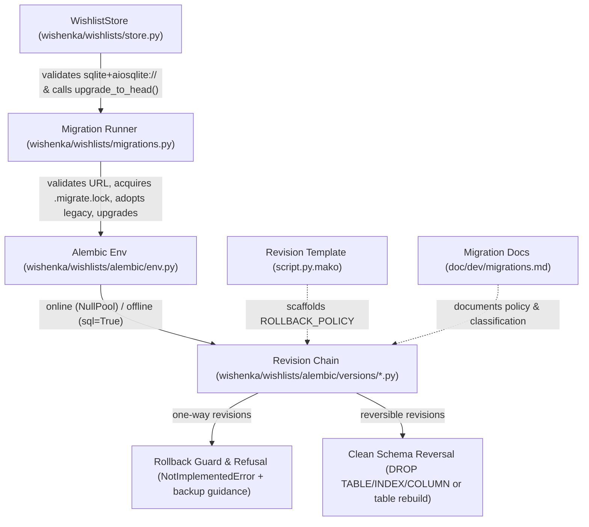

# WISHENKA-128: Define and Verify Data Migration Rollback Policy and Lifecycle Edge Cases

## Research

Inspection of the existing migration subsystem in `/home/src` revealed the following state:

1. **Migration Runner & Environment**:
   - [wishenka/wishlists/migrations.py](file:///home/src/wishenka/wishlists/migrations.py) manages legacy schema adoption (`_adopt_known_schema`), cross-process file locking (`_migration_lock` via `fcntl.flock` on `<db>.migrate.lock`), `command.upgrade(_configured(database_url), "head")`, and `PRAGMA journal_mode=WAL` selection.
   - `_database_path()` rejects non-SQLite URLs (not starting with `sqlite+aiosqlite:///`) with `ValueError("Wishlist migrations support only SQLite URLs")`.
   - [wishenka/wishlists/store.py](file:///home/src/wishenka/wishlists/store.py) (`WishlistStore.__init__`) rejects non-SQLite URLs with `ValueError("Wishlist storage requires SQLite")` and calls `upgrade_to_head()` during `initialize()`.
   - [wishenka/wishlists/alembic/env.py](file:///home/src/wishenka/wishlists/alembic/env.py) implements both `run_migrations_offline()` (using `literal_binds=True` and `dialect_opts={"paramstyle": "named"}`) and `run_migrations_online()` (using `pool.NullPool`).
   - [wishenka/wishlists/alembic/script.py.mako](file:///home/src/wishenka/wishlists/alembic/script.py.mako) defines the template for new revisions, currently without any rollback policy metadata or guidance.

2. **Existing Revision Chain (16 revisions, linear)**:
   - `base_normalized` → `add_warn_on_delete_reserved` → `add_display_order` → `add_item_order_index` → `add_gift_receipts` → `add_notice_outbox` → `add_bot_drafts` → `add_bot_capture_order` → `add_birthday_reminders` → `add_notice_uncertain` → `add_support_channel` → `add_idempotency_records` → `add_user_locale` → `add_deleted_session_revocations` → `add_notice_retention_columns` → `add_user_fk_cascades` (head).
   - **Current gaps in `downgrade()` implementations**:
     - `base_normalized.downgrade()` unconditionally executes `DROP TABLE` on all 9 core tables (`wl_counters`, `wl_invite_tokens`, `wl_tokens`, `wl_view_history`, `wl_favorites`, `wl_reservations`, `wl_items`, `wl_members`, `wl_lists`) with no safeguard or warning.
     - `add_warn_on_delete_reserved.downgrade()` and `add_display_order.downgrade()` raise `NotImplementedError("Downgrading this SQLite migration is not supported")` without explaining backup restoration.
     - `add_gift_receipts.downgrade()` raises `NotImplementedError("add_gift_receipts is irreversible")` without explaining backup restoration.
     - The remaining 12 revisions implement `downgrade()` (dropping added tables, indexes, or columns, or rebuilding tables), though not all have automated downgrade verification and none declare a uniform rollback classification attribute.

3. **Existing Documentation & Tests**:
   - [doc/dev/migrations.md](file:///home/src/doc/dev/migrations.md) explicitly notes under *Downgrade caveats*: `"The policy is not finalized (WISHENKA-128)."` and lists the ad-hoc state of each revision.
   - [tests/test_wishlist_alembic_migrations.py](file:///home/src/tests/test_wishlist_alembic_migrations.py) tests legacy adoption, fresh/`:memory:` head parity, `:memory:` temp-file cleanup, and malformed legacy schema rejection.
   - [tests/test_wishlist_migrations_observability.py](file:///home/src/tests/test_wishlist_migrations_observability.py) tests `started`, `completed`, `legacy_schema_adopted`, and `failed` log events.
   - [tests/test_gift_receipt_migration.py](file:///home/src/tests/test_gift_receipt_migration.py) tests `add_gift_receipts.downgrade()` raising `NotImplementedError`, and [tests/test_booking_idempotency_extended.py](file:///home/src/tests/test_booking_idempotency_extended.py) tests `add_idempotency_records` upgrade/downgrade.
   - Missing automated coverage: baseline safeguard, uniform one-way refusal messages, full reversible-tail downgrade verification, idempotent second startup (no-op + no duplicate `legacy_schema_adopted` event), non-SQLite URL rejection on `upgrade_to_head_sync` / `WishlistStore`, and Alembic offline mode (`--sql` / `sql=True`).

## Implementation Plan

1. **Standardize Rollback Policy Metadata & Refusal Helper**:
   - Introduce explicit rollback policy classification (`ROLLBACK_POLICY = "reversible"` or `"one-way"`) on every revision module in `wishenka/wishlists/alembic/versions/` and in `wishenka/wishlists/alembic/script.py.mako` for future revisions.
   - Provide a small shared helper (or consistent `NotImplementedError` message builder) for one-way revisions so every refusal message states: (a) the revision ID, (b) why rollback is not supported, and (c) that operators must restore from a database backup.

2. **Add Baseline Rollback Safeguard (`base_normalized.py`)**:
   - Guard `base_normalized.downgrade()` so that by default it raises `NotImplementedError` with a clear message explaining that dropping the baseline schema destroys all core wishlist data and directing operators to restore from a backup.
   - Support an explicit opt-in environment variable (`WISHENKA_ALLOW_DESTRUCTIVE_BASELINE_DOWNGRADE=1`) for disposable/test environments that intentionally need `downgrade base`, logging a warning before dropping tables.

3. **Update One-Way Refusal Messages**:
   - Update `add_warn_on_delete_reserved.py`, `add_display_order.py`, and `add_gift_receipts.py` to declare `ROLLBACK_POLICY = "one-way"` and raise `NotImplementedError` with clear, consistent, actionable backup-restoration guidance.
   - Annotate all 12 reversible revisions (`add_item_order_index` and `add_notice_outbox` through `add_user_fk_cascades`) with `ROLLBACK_POLICY = "reversible"` and concise docstrings noting any discarded state.

4. **Update Documentation**:
   - Update `doc/dev/migrations.md` to replace the provisional `"policy is not finalized (WISHENKA-128)"` note with the finalized rollback policy, classification table, baseline safeguard behavior, and backup-restoration guidance.

5. **Automated Verification**:
   - Add comprehensive tests covering rollback classification, baseline safeguard (blocked by default, allowed with opt-in), one-way refusal messages, reversible tail downgrades (`head` → `add_gift_receipts`), idempotent repeated startup, unsupported storage URL rejection, and offline SQL generation (`sql=True`).

**Mandatory — Failing Repro (next Step 3):**
Write an automated red test suite in `tests/test_wishlist_migration_rollback_policy.py` (with `pytestmark = pytest.mark.timeout(10)`) *before* any production/migration code changes:
- **What it asserts (desired behavior)**:
  1. Every revision in `ScriptDirectory` defines `ROLLBACK_POLICY in {"reversible", "one-way"}`.
  2. Calling Alembic `downgrade` on `base_normalized` (without opt-in) raises `NotImplementedError` mentioning backup restoration and does **not** drop `wl_lists` or seeded rows.
  3. Calling `downgrade` on one-way revisions (`add_warn_on_delete_reserved`, `add_display_order`, `add_gift_receipts`) raises `NotImplementedError` with a message mentioning backup restoration (`backup`).
  4. Reversible revisions from `head` down to `add_gift_receipts` (`add_user_fk_cascades` → `add_notice_outbox`) downgrade cleanly without error.
  5. Lifecycle edge cases pass: idempotent second startup (`upgrade_to_head_sync` twice on a legacy DB emits `wishlist_migration_legacy_schema_adopted` only once and preserves data), non-SQLite URLs raise `ValueError` in both `WishlistStore(...)` and `upgrade_to_head_sync(...)`, and offline mode (`command.upgrade(cfg, "head", sql=True)`) emits `CREATE TABLE` SQL to a `StringIO` buffer without creating a DB file.
- **Where it lives**: `tests/test_wishlist_migration_rollback_policy.py`.
- **How to force failure without live external deps**: Uses `tmp_path` SQLite files and in-memory `StringIO` buffers only—no external DB or network. Assertions (1), (2), and (3) will fail immediately on the current codebase because `ROLLBACK_POLICY` is absent, `base_normalized.downgrade()` drops all tables instead of raising, and the one-way revisions lack backup-restoration guidance.
- **Sequencing**: Step 3 writes `tests/test_wishlist_migration_rollback_policy.py` and verifies the policy tests fail (red) → Step 4 implements the policy attributes, baseline guard, refusal messages, and docs until all tests pass (green).

## Architecture

### System Module Diagram

### Module Descriptions and Responsibilities

| Module | Responsibility |
| --- | --- |
| `wishenka/wishlists/store.py` | Entry point at app startup (`WishlistStore.initialize()`). Rejects non-SQLite URLs at construction and delegates schema migration to `upgrade_to_head()`. |
| `wishenka/wishlists/migrations.py` | Owns `_database_path()` validation, `_migration_lock`, `_adopt_known_schema()`, `head_revision()`, and `upgrade_to_head_sync()` / `upgrade_to_head()`. |
| `wishenka/wishlists/alembic/env.py` | Configures Alembic `context` for online (`NullPool` synchronous SQLite engine) and offline (`literal_binds=True` SQL emission) execution. |
| `wishenka/wishlists/alembic/versions/*.py` | Ordered linear revisions. Each revision declares `ROLLBACK_POLICY` (`"reversible"` or `"one-way"`) and implements `upgrade()` and `downgrade()`. |
| `wishenka/wishlists/alembic/script.py.mako` | Template for new revisions, including `ROLLBACK_POLICY` placeholder so future revisions classify rollback behavior at creation time. |
| `doc/dev/migrations.md` | Authoritative developer and operator reference for the rollback policy, per-revision classification, baseline safeguard, and backup-restoration procedure. |

### Module Interaction Scheme

1. **Startup (Online)**: `WishlistStore.initialize()` → `upgrade_to_head()` → `upgrade_to_head_sync()` validates URL via `_database_path()`, acquires `_migration_lock`, runs `_adopt_known_schema()` (only if `alembic_version` is absent and `wl_*` tables exist), runs `command.upgrade(..., "head")`, sets `PRAGMA journal_mode=WAL`, and releases the lock. On a second startup, `_adopt_known_schema()` returns immediately because `alembic_version` exists, and `command.upgrade(..., "head")` is a no-op.
2. **Offline Inspection**: `command.upgrade(_configured(url), "head", sql=True)` (or `alembic -c alembic.ini upgrade head --sql`) enters `env.py:run_migrations_offline()` and emits ordered DDL statements without opening a database connection.
3. **Downgrade Attempt**:
   - **Reversible revision** (`ROLLBACK_POLICY = "reversible"`): executes reverse DDL (and notes any discarded transient/feature data in its docstring and docs).
   - **One-way revision** (`ROLLBACK_POLICY = "one-way"`): `downgrade()` raises `NotImplementedError` with a descriptive reason and backup-restoration instruction.
   - **Baseline revision** (`base_normalized`, `ROLLBACK_POLICY = "one-way"`): `downgrade()` checks `os.environ.get("WISHENKA_ALLOW_DESTRUCTIVE_BASELINE_DOWNGRADE") == "1"`. Without it, raises `NotImplementedError` preserving all data; with it, logs a warning and drops the nine baseline tables.

### Architectural Patterns and Justification

- **Explicit Policy Metadata (`ROLLBACK_POLICY` module constant)**: Placing `ROLLBACK_POLICY` directly in each revision module makes the classification co-located with `upgrade()`/`downgrade()`, zero-overhead at runtime, and automatically verifiable across all revisions via `ScriptDirectory` in pytest.
- **Fail-Safe Default Guard (Baseline Safeguard)**: Requiring an explicit environment opt-in (`WISHENKA_ALLOW_DESTRUCTIVE_BASELINE_DOWNGRADE=1`) for `base_normalized.downgrade()` prevents accidental `alembic downgrade base` data loss while preserving an escape hatch for automated test harnesses or disposable databases.
- **Uniform Refusal Contract (`NotImplementedError`)**: Consistent with existing `add_gift_receipts`, `add_display_order`, and `add_warn_on_delete_reserved`, raising `NotImplementedError` with a standardized message format (revision + reason + backup restoration guidance) integrates cleanly with Alembic and existing tests.

### Revision Rollback Classification (All 16 Revisions)

| # | Revision ID | Policy | Downgrade Behavior / Notes |
| --- | --- | --- | --- |
| 1 | `base_normalized` | `one-way` | Guarded: refuses by default (`NotImplementedError` + backup guidance); drops 9 core tables only if `WISHENKA_ALLOW_DESTRUCTIVE_BASELINE_DOWNGRADE=1`. |
| 2 | `add_warn_on_delete_reserved` | `one-way` | Refuses (`NotImplementedError`): SQLite column drop requires table rebuild; restore from backup. |
| 3 | `add_display_order` | `one-way` | Refuses (`NotImplementedError`): SQLite column drop requires table rebuild; restore from backup. |
| 4 | `add_item_order_index` | `reversible` | Drops `idx_wl_items_order` (no data loss). |
| 5 | `add_gift_receipts` | `one-way` | Refuses (`NotImplementedError`): irreversible backfill/normalization; restore from backup. |
| 6 | `add_notice_outbox` | `reversible` | Drops `wl_list_notification_settings`, `user_notification_settings`, `notification_outbox` (discards queued notices/settings). |
| 7 | `add_bot_drafts` | `reversible` | Drops `bot_drafts` (discards in-progress capture drafts). |
| 8 | `add_bot_capture_order` | `reversible` | Drops `bot_capture_order` (discards capture ordering watermarks). |
| 9 | `add_birthday_reminders` | `reversible` | Drops 6 reminder/birthday/destination tables (discards reminder & destination state). |
| 10 | `add_notice_uncertain` | `reversible` | Drops `requires_membership` & `notice_receipt_keys`, rebuilds `notification_outbox` mapping `uncertain` → `failed`. |
| 11 | `add_support_channel` | `reversible` | Drops `support_tickets` and `support_input` (discards support channel state). |
| 12 | `add_idempotency_records` | `reversible` | Drops `wl_idempotency_records` (discards cached idempotency responses). |
| 13 | `add_user_locale` | `reversible` | Drops `locale_source` and `locale` from `users` if present (discards user locale preferences). |
| 14 | `add_deleted_session_revocations` | `reversible` | Drops `deleted_session_revocations` (discards session revocation records). |
| 15 | `add_notice_retention_columns` | `reversible` | Drops retention indexes and `created_at`/`updated_at`/`deleted_at` columns (discards retention timestamps). |
| 16 | `add_user_fk_cascades` | `reversible` | Rebuilds `wl_view_history`, `wl_favorites`, `wl_members` without `user_id` cascade FKs (cleaned orphans are not restored). |

### Main Interfaces

- `ROLLBACK_POLICY: Literal["reversible", "one-way"]` — module-level constant on each revision under `wishenka/wishlists/alembic/versions/`.
- `WISHENKA_ALLOW_DESTRUCTIVE_BASELINE_DOWNGRADE` — environment variable (`"1"` to opt in) checked by `base_normalized.downgrade()`.
- `upgrade_to_head_sync(database_url: str) -> None` / `upgrade_to_head(database_url: str) -> None` — validated entry points in `wishenka/wishlists/migrations.py`.
- `head_revision(database_url: str = ...) -> str` — returns the single Alembic head revision ID.

## Q&A

- **Why use `NotImplementedError` for the baseline safeguard and one-way refusals?**
  It matches the existing convention in `add_gift_receipts.py`, `add_display_order.py`, and `add_warn_on_delete_reserved.py`, and existing tests in `tests/test_gift_receipt_migration.py` already assert `pytest.raises(NotImplementedError)`.
- **Why not implement table-rebuild downgrades for `add_warn_on_delete_reserved` and `add_display_order`?**
  Per the requirements and `doc/dev/migrations.md`, production rollbacks across schema-altering revisions are handled by restoring from a backup, and keeping those two historical SQLite `ALTER TABLE` revisions one-way avoids risky table rebuilds on core tables.
- **How are future revisions prevented from omitting rollback classification?**
  `script.py.mako` will include `ROLLBACK_POLICY`, and the automated test suite will iterate over all revisions in `ScriptDirectory` and fail if any revision lacks a valid `ROLLBACK_POLICY`.
