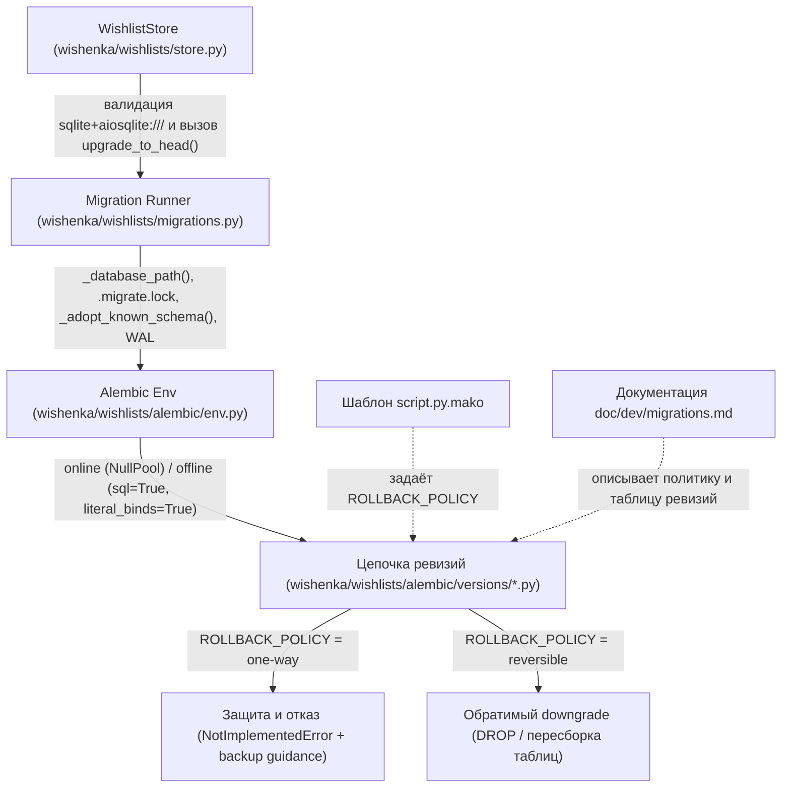
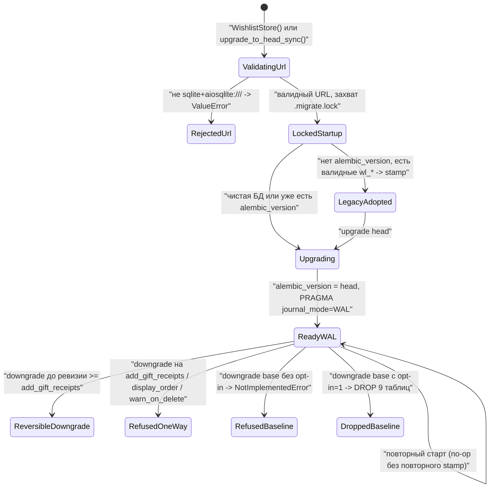

# Спецификация: WISHENKA-128 — Политика отката миграций данных и граничные сценарии жизненного цикла

**Задача в Jira:** WISHENKA-128  
**Подсистема:** миграции хранилища вишлистов (`wishenka/wishlists`, SQLite + Alembic, Python)  
**Затронутые компоненты:** `wishenka/wishlists/alembic/versions/*.py`, `wishenka/wishlists/alembic/script.py.mako`, `wishenka/wishlists/migrations.py`, `wishenka/wishlists/store.py`, `wishenka/wishlists/alembic/env.py`, `doc/dev/migrations.md`, `tests/test_wishlist_migration_rollback_policy.py`  
**Статус:** реализовано и верифицировано (на момент выполнения задачи охватывает линейную цепочку из 16 ревизий; шаблон `script.py.mako` распространяет контракт на все последующие ревизии)

## 1. Назначение и бизнес-цель

### 1.1. Контекст и проблема

После перехода хранилища вишлистов на версионированные миграции Alembic (`WISHENKA-111`) правила отката (`downgrade`) и ключевые граничные сценарии эксплуатации оставались неполными и не были защищены автоматическими тестами:

- ревизии в `wishenka/wishlists/alembic/versions/` и шаблон `wishenka/wishlists/alembic/script.py.mako` не содержали единого явного признака, разделяющего обратимые изменения и необратимые (односторонние) шаги;
- базовая ревизия `base_normalized` при вызове `downgrade()` безусловно выполняла `DROP TABLE` для всех 9 основных таблиц (`wl_lists`, `wl_members`, `wl_items`, `wl_reservations`, `wl_favorites`, `wl_view_history`, `wl_tokens`, `wl_invite_tokens`, `wl_counters`) без защитной блокировки и предупреждений, создавая риск случайного уничтожения всех данных вишлистов;
- исторические односторонние ревизии (`add_warn_on_delete_reserved`, `add_display_order`, `add_gift_receipts`) прерывали откат с `NotImplementedError` без единообразного сообщения о причине и без инструкции по восстановлению из резервной копии;
- отсутствовала автоматическая проверка граничных сценариев жизненного цикла: идемпотентности повторного запуска приложения на актуальной БД (включая ранее усыновлённую legacy-базу), немедленного отклонения неподдерживаемых URL хранилища (отличных от SQLite) и автономной генерации SQL-скриптов миграции в offline-режиме (`sql=True`), где часть ревизий обращалась к живому подключению без проверки `context.is_offline_mode()`.

### 1.2. Цели и бизнес-ценность

- **Защита пользовательских и операционных данных:** случайный запуск команды отката к базовому состоянию не должен приводить к молчаливому удалению всех таблиц и записей сервиса.
- **Предсказуемость эксплуатации и инцидент-реагирования:** операторы и разработчики заранее знают, какие изменения схемы обратимы, а какие требуют восстановления из резервной копии, и при попытке одностороннего отката получают понятное действие-ориентированное сообщение и структурированную запись в журнале.
- **Надёжность жизненного цикла хранилища:** повторный старт на мигрированной БД безопасен и идемпотентен, некорректная конфигурация URL блокируется до создания файлов и блокировок, а аудит предстоящих изменений схемы возможен без подключения к живой БД.
- **Регрессионный барьер:** автоматические тесты фиксируют контракт классификации для всех существующих и будущих ревизий Alembic.

### 1.3. Границы задачи

В рамки задачи входит:

- введение единой классификации отката (`ROLLBACK_POLICY = "reversible"` или `"one-way"`) для всех 16 ревизий на момент выполнения задачи и добавление её в шаблон `script.py.mako`;
- установка защитного барьера на `base_normalized.downgrade()` с явным opt-in через переменную окружения `WISHENKA_ALLOW_DESTRUCTIVE_BASELINE_DOWNGRADE=1` для одноразовых и тестовых сред;
- унификация отказов (`NotImplementedError` с указанием ревизии, причины и рекомендации восстановления из резервной копии) и warning-логирования в односторонних ревизиях;
- обеспечение корректной работы offline-режима (`context.is_offline_mode()`) в ревизиях `add_gift_receipts`, `add_notice_uncertain`, `add_user_locale`, `add_notice_retention_columns` и `add_user_fk_cascades`;
- актуализация документации разработчика `doc/dev/migrations.md` и создание набора автоматических тестов `tests/test_wishlist_migration_rollback_policy.py`.

В рамки задачи не входит:

- изменение пользовательской логики вишлистов, Telegram-бота, уведомлений или прав доступа;
- поддержка иных СУБД помимо SQLite (`sqlite+aiosqlite:///`);
- реализация табличных перестроек для отката исторических `ALTER TABLE` в `add_warn_on_delete_reserved` и `add_display_order` (сознательно оставлены односторонними ради сохранности данных);
- автоматизация создания или восстановления резервных копий на уровне приложения.

## 2. Функциональные требования и пользовательские сценарии

### 2.1. Участники и роли

| Роль / компонент | Ответственность и взаимодействие с политикой отката |
| --- | --- |
| Оператор продукта | Развёртывает обновления, проверяет SQL-скрипты в offline-режиме перед релизом, при откате опирается на политику ревизий и при необходимости восстанавливает БД из резервной копии |
| Разработчик | Создаёт новые ревизии по шаблону `script.py.mako`, явно задаёт `ROLLBACK_POLICY` и придерживается правил безопасного отката и offline-ветвления |
| Подсистема миграций (`migrations.py`, `alembic`) | Проверяет URL хранилища, сериализует конкурентный старт, выполняет однократное усыновление legacy-схемы, применяет обновления до `head`, исполняет обратимые откаты и блокирует односторонние |
| Хранилище вишлистов (`WishlistStore`, SQLite) | Выступает точкой входа при старте приложения, отклоняет не-SQLite URL при конструировании и защищено от непреднамеренного разрушения данных |

### 2.2. Функциональные требования

1. **Явная классификация политики отката для каждой ревизии:**
   - Каждый модуль ревизии в `wishenka/wishlists/alembic/versions/` обязан объявлять константу уровня модуля `ROLLBACK_POLICY` со значением `"reversible"` или `"one-way"`.
   - Ревизии, которые удаляют или трансформируют данные/структуры способом, не допускающим безопасный обратный переход в SQLite (рискованная перестройка базовых таблиц или необратимая нормализация/бэкфилл данных), классифицируются как `"one-way"`.
   - Обратимые ревизии (`"reversible"`) документируют в `doc/dev/migrations.md` и строках документации сопутствующий сброс эфемерных или функциональных данных (например, очередей уведомлений, черновиков или меток хранения).
   - Шаблон `wishenka/wishlists/alembic/script.py.mako` содержит `ROLLBACK_POLICY = "reversible"  # "reversible" or "one-way" (see doc/dev/migrations.md)`, чтобы каждая новая ревизия классифицировалась при создании.

2. **Защита отката базовой ревизии (`base_normalized`):**
   - `base_normalized` имеет политику `ROLLBACK_POLICY = "one-way"`.
   - По умолчанию вызов `base_normalized.downgrade()` отказывает в выполнении: записывает предупреждение в лог и возбуждает `NotImplementedError` с пояснением, что удаление базовой схемы уничтожит все основные данные вишлистов, и рекомендацией восстановить БД из резервной копии.
   - При явной установке переменной окружения `WISHENKA_ALLOW_DESTRUCTIVE_BASELINE_DOWNGRADE=1` (для одноразовых или тестовых БД) `base_normalized.downgrade()` записывает предупреждение о разрушительном откате и удаляет все 9 базовых таблиц в порядке, обратном зависимостям внешних ключей.

3. **Стандартизованный отказ односторонних ревизий:**
   - Каждая односторонняя ревизия (`base_normalized` без opt-in, `add_warn_on_delete_reserved`, `add_display_order`, `add_gift_receipts`) при вызове `downgrade()` фиксирует событие отказа в журнале на уровне `WARNING` и возбуждает человекочитаемое исключение `NotImplementedError`.
   - Текст исключения обязан включать: идентификатор ревизии, причину невозможности безопасного отката и прямое указание восстановить состояние из резервной копии БД (`Restore from a database backup instead`).

4. **Чистый откат обратимого хвоста ревизий:**
   - Все обратимые ревизии от актуальной `head` до `add_gift_receipts` включительно (11 верхних ревизий в наборе из 16 на момент задачи, а также обратимая `add_item_order_index`) выполняют `downgrade()` без ошибок, удаляя добавленные таблицы, индексы или столбцы либо восстанавливая прежнюю структуру таблиц.
   - При попытке общего отката вниз от `head` цепочка проходит обратимые ревизии и детерминированно останавливается на односторонней границе `add_gift_receipts`.

5. **Граничные сценарии жизненного цикла:**
   - **Идемпотентность повторного старта:** повторный вызов `upgrade_to_head_sync` на уже мигрированной БД (в том числе после усыновления поддерживаемой legacy-схемы) не вносит изменений в схему, полностью сохраняет пользовательские данные и не генерирует повторное событие `wishlist_migration_legacy_schema_adopted`.
   - **Раннее отклонение неподдерживаемых адресов хранилища:** передача URL, не начинающегося с `sqlite+aiosqlite:///`, немедленно отклоняется исключением `ValueError` как в конструкторе `WishlistStore(database_url)`, так и при прямом вызове `upgrade_to_head_sync(database_url)` / `upgrade_to_head(database_url)` до открытия файлов, блокировок и выполнения SQL.
   - **Автономная генерация SQL (offline mode):** запуск `command.upgrade(cfg, "head", sql=True)` (или `alembic -c alembic.ini upgrade head --sql`) генерирует упорядоченные DDL/DML-операторы без создания и открытия файла БД; ревизии, инспектирующие живые таблицы во время online-обновления, корректно ветвятся через `context.is_offline_mode()`.

### 2.3. Пользовательские и операционные сценарии

- **UC-128-01. Анализ допустимости отката при инциденте:** оператор перед откатом релиза сверяется с `doc/dev/migrations.md` и классификацией `ROLLBACK_POLICY`. Если в откатываемом диапазоне присутствуют только `"reversible"` ревизии, допустим штатный downgrade; если затрагивается `"one-way"` ревизия, оператор планирует восстановление из резервной копии до обновления.
- **UC-128-02. Блокировка случайного отката к `base`:** при ошибочном запуске `alembic downgrade base` без переменной opt-in `base_normalized.downgrade()` блокируется с `NotImplementedError`; таблица `wl_lists` и все пользовательские записи остаются нетронутыми.
- **UC-128-03. Разрешённый сброс в тестовой среде:** тестовый стенд выставляет `WISHENKA_ALLOW_DESTRUCTIVE_BASELINE_DOWNGRADE=1` и выполняет `downgrade base`; в лог пишется предупреждение, а все 9 базовых таблиц удаляются.
- **UC-128-04. Отказ на односторонней ревизии:** попытка выполнить `downgrade` через `add_gift_receipts`, `add_display_order` или `add_warn_on_delete_reserved` немедленно завершается `NotImplementedError` с указанием имени ревизии, причины и требования восстановить данные из бэкапа.
- **UC-128-05. Откат обратимого хвоста:** последовательный или целевой `downgrade` от `head` до `add_gift_receipts` завершается успешно и устанавливает `alembic_version = ('add_gift_receipts',)`.
- **UC-128-06. Повторный запуск сервиса и ошибочный DSN:** при рестарте или rolling-обновлении повторный `upgrade_to_head_sync` на legacy-базе проходит как no-op (событие усыновления фиксируется ровно один раз). При передаче PostgreSQL или MySQL DSN инициализация падает с `ValueError` на входе.
- **UC-128-07. Предаудит SQL без живой базы:** оператор или CI-пайплайн запускает `upgrade head --sql` с несуществующим путём БД и получает полный SQL-скрипт (`CREATE TABLE wl_lists`, `wl_receipts` и последующие инструкции), при этом файл БД на диске не создаётся.

### 2.4. Входные, выходные данные и продуктовые инварианты

- **Входные параметры:**
  - `database_url: str` — строка подключения формата `sqlite+aiosqlite:///<path>` (включая `sqlite+aiosqlite:///:memory:`);
  - переменная окружения `WISHENKA_ALLOW_DESTRUCTIVE_BASELINE_DOWNGRADE` (значением для включения служит строго строка `"1"`);
  - целевая ревизия Alembic (`"head"`, идентификатор ревизии или `"base"`) и флаг режима `sql: bool` (`context.is_offline_mode()`).
- **Выходные эффекты:**
  - обновлённая схема SQLite с таблицей `alembic_version` и установленным `PRAGMA journal_mode=WAL` (в online-режиме для файловых и `:memory:`-временных БД через `WishlistStore`);
  - SQL-листинг DDL/DML в `stdout` / буфер вывода (в offline-режиме);
  - исключения `NotImplementedError` (односторонний/базовый откат) или `ValueError` (неподдерживаемый URL) и структурированные события в логгере `wishenka.wishlists.migrations`.
- **Продуктовые и системные инварианты:**
  1. Ни одна ревизия в `ScriptDirectory` не может существовать без валидной константы `ROLLBACK_POLICY in {"reversible", "one-way"}`.
  2. Отсутствие переменной `WISHENKA_ALLOW_DESTRUCTIVE_BASELINE_DOWNGRADE=1` гарантирует неприкосновенность базовых таблиц при любых попытках отката к `base`.
  3. Восстановление из резервной копии — единственный поддерживаемый механизм отката через односторонние ревизии в промышленной среде.
  4. Повторный запуск на уже мигрированной или усыновлённой БД не изменяет существующие записи и не дублирует событие усыновления.
  5. Неподдерживаемые URL отклоняются до создания каталогов, lock-файлов или обращений к SQLite.

## 3. Архитектура, компоненты и интерфейсы

### 3.1. Архитектурные решения и взаимодействие компонентов

Обоснование ключевых архитектурных решений:

- **Метаданные `ROLLBACK_POLICY` внутри модуля ревизии:** размещение константы непосредственно рядом с `upgrade()` и `downgrade()` обеспечивает нулевые накладные расходы во время работы сервиса и позволяет тестам автоматически инспектировать всю цепочку через `ScriptDirectory.walk_revisions()`.
- **Fail-safe защита по умолчанию через opt-in переменную окружения:** переменная `WISHENKA_ALLOW_DESTRUCTIVE_BASELINE_DOWNGRADE=1` исключает случайное удаление таблиц в эксплуатации, сохраняя легальный способ полного сброса схемы для тестовой инфраструктуры.
- **Единый контракт отказа через `NotImplementedError`:** соответствует существующей практике тестов `tests/test_gift_receipt_migration.py` и интеграции с Alembic, дополняя исключение обязательным указанием причины и ссылки на восстановление из резервной копии. (Примечание: вынесение общей вспомогательной функции отказа вместо дублирования в четырёх файлах отложено в технический долг `WISHENKA-233`, см. раздел 5.3.)

| Модуль / файл | Ответственность в системе |
| --- | --- |
| `wishenka/wishlists/store.py` | Точка входа при старте приложения: `WishlistStore.__init__` валидирует префикс `sqlite+aiosqlite:///`, подменяет `:memory:` на изолированный временный файл `wishenka-*.sqlite`, а `initialize()` вызывает `upgrade_to_head()` и оборачивает ошибки запуска в `RuntimeError` |
| `wishenka/wishlists/migrations.py` | Проверяет URL в `_database_path()`, управляет межпроцессной блокировкой `_migration_lock`, выполняет строгое усыновление legacy-схемы `_adopt_known_schema()`, вызывает `command.upgrade(..., "head")`, включает `PRAGMA journal_mode=WAL` и предоставляет `head_revision()` |
| `wishenka/wishlists/alembic/env.py` | Разделяет выполнение на `run_migrations_offline()` (`literal_binds=True`, `dialect_opts={"paramstyle": "named"}`) и `run_migrations_online()` (`pool.NullPool`) |
| `wishenka/wishlists/alembic/versions/*.py` | Линейная цепочка ревизий; каждая ревизия декларирует `ROLLBACK_POLICY`, реализует `upgrade()` (с учётом `context.is_offline_mode()` при инспекции таблиц) и `downgrade()` |
| `wishenka/wishlists/alembic/script.py.mako` | Шаблон генерации новых ревизий Alembic с предзаполненной строкой `ROLLBACK_POLICY = "reversible"` |
| `doc/dev/migrations.md` | Авторитетный справочник по политике отката, защите `base_normalized`, классификации ревизий, offline SQL-генерации и процедурам восстановления |

### 3.2. Контракты модулей, интерфейсов и сообщений об ошибках

1. **Константа классификации и шаблон ревизии:**
   - В каждом модуле ревизии: `ROLLBACK_POLICY = "reversible"` или `ROLLBACK_POLICY = "one-way"`.
   - В `wishenka/wishlists/alembic/script.py.mako`: `ROLLBACK_POLICY = "reversible"  # "reversible" or "one-way" (see doc/dev/migrations.md)`.

2. **Точки входа и валидация URL:**
   - `WishlistStore(database_url: str)`: при нарушении префикса `"sqlite+aiosqlite:///"` немедленно возбуждает `ValueError("Wishlist storage requires SQLite")`.
   - `WishlistStore.initialize() -> None`: асинхронно вызывает `upgrade_to_head(self.database_url)`; при `(OSError, RuntimeError, ValueError, SQLAlchemyError)` возбуждает `RuntimeError("Unable to initialize wishlist storage") from exc`.
   - `_database_path(database_url: str) -> Path | None` (вызывается из `upgrade_to_head_sync` и `_adopt_known_schema`): при нарушении префикса `"sqlite+aiosqlite:///"` возбуждает `ValueError("Wishlist migrations support only SQLite URLs")`.
   - `upgrade_to_head_sync(database_url: str) -> None` и `upgrade_to_head(database_url: str) -> None` (через `asyncio.to_thread`): синхронный и асинхронный раннеры обновления до `head`.
   - `head_revision(database_url: str = "sqlite+aiosqlite:///:memory:") -> str`: возвращает ID единственной `head`-ревизии из `ScriptDirectory` без открытия БД.

3. **Контракт отказов `downgrade()` для односторонних ревизий (`NotImplementedError`):**

| Ревизия | Условие отказа | Сообщение `NotImplementedError` |
| --- | --- | --- |
| `base_normalized` | `os.environ.get("WISHENKA_ALLOW_DESTRUCTIVE_BASELINE_DOWNGRADE") != "1"` | `Refusing to downgrade 'base_normalized': dropping the baseline schema would destroy all core wishlist data. Restore from a database backup instead, or set WISHENKA_ALLOW_DESTRUCTIVE_BASELINE_DOWNGRADE=1 for disposable/test databases.` |
| `add_warn_on_delete_reserved` | Всегда | `Refusing to downgrade 'add_warn_on_delete_reserved': SQLite cannot drop a column without rebuilding the table. Restore from a database backup instead.` |
| `add_display_order` | Всегда | `Refusing to downgrade 'add_display_order': SQLite cannot drop a column without rebuilding the table. Restore from a database backup instead.` |
| `add_gift_receipts` | Всегда | `Refusing to downgrade 'add_gift_receipts': receipt backfill and archived-row normalisation are irreversible. Restore from a database backup instead.` |

4. **Контракт offline-режима (`context.is_offline_mode()`):**
   - `add_gift_receipts`: в offline-режиме выполняет `op.execute(text(_BACKFILL))` и `op.execute(text(_NORMALISE))`, минуя чтение `rowcount` через `op.get_bind()` и логирование счётчиков строк.
   - `add_notice_uncertain`: в offline-режиме безусловно выполняет `ALTER TABLE reminder_outbox ADD COLUMN requires_membership INTEGER NOT NULL DEFAULT 0`, минуя `PRAGMA table_info(reminder_outbox)`.
   - `add_user_locale`: в offline-режиме выполняет `CREATE TABLE IF NOT EXISTS users (...)`, создание индексов и `_REPAIR_INVALID_SQL`, минуя `PRAGMA table_info(users)` и условные `ALTER TABLE`.
   - `add_notice_retention_columns`: вспомогательная функция `_columns(table)` возвращает `set()` при `context.is_offline_mode()`, что вызывает безусловную эмиссию `ALTER TABLE ... ADD COLUMN` для колонок хранения.
   - `add_user_fk_cascades`: `_rebuild_table(spec, with_fk=...)` в offline-режиме напрямую эмитирует `INSERT INTO ... SELECT ...`, `DROP TABLE` и индексы, минуя подсчёт строк (`COUNT(*)`, `rowcount`) и логирование пересборки.

### 3.3. Классификация ревизий и переходы состояний

На момент выполнения `WISHENKA-128` линейная цепочка состояла из 16 ревизий (`base_normalized` -> ... -> `add_user_fk_cascades`; последующие ревизии, описанные в `doc/dev/migrations.md`, используют ту же схему `ROLLBACK_POLICY` из шаблона `script.py.mako`):

| # | Идентификатор ревизии | `ROLLBACK_POLICY` | Поведение `downgrade()` и примечания по данным |
| --- | --- | --- | --- |
| 1 | `base_normalized` | `one-way` | Защищён: по умолчанию отказ (`NotImplementedError`); при `WISHENKA_ALLOW_DESTRUCTIVE_BASELINE_DOWNGRADE=1` удаляет 9 базовых таблиц |
| 2 | `add_warn_on_delete_reserved` | `one-way` | Отказ (`NotImplementedError`): удаление столбца в SQLite требует пересборки `wl_lists` |
| 3 | `add_display_order` | `one-way` | Отказ (`NotImplementedError`): удаление столбца в SQLite требует пересборки `wl_items` |
| 4 | `add_item_order_index` | `reversible` | Выполняет `DROP INDEX IF EXISTS idx_wl_items_order` (без потери данных) |
| 5 | `add_gift_receipts` | `one-way` | Отказ (`NotImplementedError`): необратимый бэкфилл `wl_receipts` и нормализация `is_archived` |
| 6 | `add_notice_outbox` | `reversible` | Удаляет `wl_list_notification_settings`, `user_notification_settings`, `notification_outbox` и индекс (сбрасывает очередь и настройки уведомлений) |
| 7 | `add_bot_drafts` | `reversible` | Удаляет таблицу `bot_drafts` и её индексы (сбрасывает незавершённые черновики бота) |
| 8 | `add_bot_capture_order` | `reversible` | Удаляет таблицу `bot_capture_order` (сбрасывает водяные знаки порядка захвата) |
| 9 | `add_birthday_reminders` | `reversible` | Удаляет 6 таблиц напоминаний, дней рождений, получателей и лимитов (сбрасывает состояние напоминаний) |
| 10 | `add_notice_uncertain` | `reversible` | Удаляет `requires_membership` и `notice_receipt_keys`, пересобирает `notification_outbox`, отображая статус `uncertain` в `failed` |
| 11 | `add_support_channel` | `reversible` | Удаляет `support_tickets`, `support_input` и индекс (сбрасывает обращения в поддержку) |
| 12 | `add_idempotency_records` | `reversible` | Удаляет `wl_idempotency_records` и индекс (сбрасывает кэш идемпотентности) |
| 13 | `add_user_locale` | `reversible` | Удаляет `locale_source` и `locale` из `users`, если столбцы присутствуют (сбрасывает настройки языка) |
| 14 | `add_deleted_session_revocations` | `reversible` | Удаляет таблицу `deleted_session_revocations` (сбрасывает записи отзыва сессий) |
| 15 | `add_notice_retention_columns` | `reversible` | Удаляет индексы и столбцы `created_at`, `updated_at`, `deleted_at` из таблиц уведомлений/дней рождений (сбрасывает метки хранения) |
| 16 | `add_user_fk_cascades` | `reversible` | Пересобирает `wl_view_history`, `wl_favorites`, `wl_members` без внешних ключей на `users(telegram_id)` (очищенные при upgrade висячие строки не восстанавливаются) |

Переходы жизненного цикла запуска и отката:

## 4. Нефункциональные требования, безопасность и наблюдаемость

### 4.1. Производительность, блокировки и эксплуатационные пределы

- **Нулевые накладные расходы в рабочем режиме:** `ROLLBACK_POLICY` является строковой константой уровня модуля, а чтение `os.environ` в `base_normalized.py` выполняется исключительно при явном вызове `downgrade()` базовой ревизии.
- **Сериализация конкурентного старта:** `_migration_lock` захватывает неблокирующую файловую блокировку `fcntl.flock(..., LOCK_EX | LOCK_NB)` на sidecar-файле `<db>.migrate.lock` (права `0o600`), опрашивая каждые `_LOCK_POLL_SECONDS = 0.05` с до предельного времени `_LOCK_TIMEOUT_SECONDS = 60.0` с, после чего возбуждает `TimeoutError("Timed out waiting for another process to finish wishlist migration")`.
- **Платформенное ограничение:** модуль `wishenka/wishlists/migrations.py` импортирует `fcntl` на уровне модуля, поэтому пакет поддерживает только POSIX-системы (Windows не поддерживается).
- **Режим журналирования и `:memory:`-хранилища:** `PRAGMA journal_mode=WAL` выставляется однократно под блокировкой миграций только при наличии файлового пути (`path is not None`). `WishlistStore("sqlite+aiosqlite:///:memory:")` создаёт временный файл `wishenka-*.sqlite`, чтобы синхронный Alembic и асинхронный движок работали с одной БД; для удаления временного файла и `.migrate.lock` вызывающая сторона должна использовать `await store.dispose()`. Прямой вызов `upgrade_to_head_sync("sqlite+aiosqlite:///:memory:")` работает без файловой блокировки и без переключения WAL.
- **Ограниченное время тестов:** все тесты в `tests/test_wishlist_migration_rollback_policy.py` и `tests/test_wishlist_alembic_migrations.py` ограничены маркером `pytestmark = pytest.mark.timeout(10)`, а тесты наблюдаемости в `tests/test_wishlist_migrations_observability.py` — `pytest.mark.timeout(30)`.

### 4.2. Безопасность, сохранность и приватность данных

- **Защита от разрушительного отката:** `base_normalized.downgrade()` по умолчанию прерывается без модификации схемы и данных; разрушительное удаление возможно только при явном задании `WISHENKA_ALLOW_DESTRUCTIVE_BASELINE_DOWNGRADE=1`.
- **Строгая проверка схемы legacy-баз:** `_adopt_known_schema` сверяет точный набор из 9 базовых таблиц, маркерные колонки/индексы и структурную сигнатуру (включая внешние ключи и направление индекса `idx_wl_view_history_user_time`). Нераспознанная или повреждённая схема отклоняется ошибкой `RuntimeError("Unsupported wishlist database schema: ...")` без модификации файла БД.
- **Fail-fast валидация конфигурации:** не-SQLite URL отвергаются до создания родительских директорий, lock-файлов или временных БД.
- **Изоляция чувствительных сведений в логах:** журналы миграций никогда не включают `database_url`, пути к файлам БД, учётные данные или содержимое пользовательских строк (в отказах отката передаётся только идентификатор ревизии `revision`).
- **Ограничение offline-ветвления:** в offline-режиме (`sql=True`) `add_user_locale` пропускает `PRAGMA table_info(users)` и условный `ALTER TABLE`, эмитируя `CREATE TABLE IF NOT EXISTS users` и `_REPAIR_INVALID_SQL`, а `add_notice_retention_columns` возвращает пустое множество из `_columns()`, безусловно эмитируя `ALTER TABLE ... ADD COLUMN` (корректно для чистой схемы, но не идемпотентно на частично мигрированной таблице).

### 4.3. Наблюдаемость: структурированное логирование и метрики

Все события подсистемы миграций записываются в единый логгер `wishenka.wishlists.migrations` с обязательным полем `extra={"event": ...}`:

| Событие (`extra.event`) | Уровень | Поля `extra` | Когда генерируется и статус в WISHENKA-128 |
| --- | --- | --- | --- |
| `wishlist_migration_downgrade_refused` | `WARNING` | `event`, `revision` | При отказе одностороннего `downgrade()` в `base_normalized` (без opt-in), `add_warn_on_delete_reserved`, `add_display_order`, `add_gift_receipts` (**добавлено в WISHENKA-128**) |
| `wishlist_migration_destructive_baseline_downgrade` | `WARNING` | `event` | При запуске `base_normalized.downgrade()` с `WISHENKA_ALLOW_DESTRUCTIVE_BASELINE_DOWNGRADE=1` (существующее) |
| `wishlist_migration_started` | `INFO` | `event` | В начале `upgrade_to_head_sync()` (существующее) |
| `wishlist_migration_legacy_schema_adopted` | `INFO` | `event`, `revision` | При однократном усыновлении legacy-схемы в `_adopt_known_schema()` (существующее) |
| `wishlist_migration_completed` | `INFO` | `event`, `duration_ms` | При успешном завершении усыновления, обновления и настройки WAL (существующее) |
| `wishlist_migration_failed` | `ERROR` | `event` (+ traceback) | При любом исключении в `upgrade_to_head_sync()` перед повторным выбросом (существующее) |
| `legacy_receipts_backfilled` / `legacy_archived_rows_normalised` | `INFO` | `event`, `rows` | При online-выполнении `add_gift_receipts.upgrade()` (существующее) |
| `user_fk_migration_orphans_cleaned` / `user_fk_*` | `WARNING` / `INFO` | `event`, `table`, `rows_*`, `tables`, `total_orphans_removed` | При пересборке таблиц в online-выполнении/откате `add_user_fk_cascades` (существующее) |

**Метрики и мониторинг:**

- В качестве метрики длительности используется поле `duration_ms` (в миллисекундах, с учётом ожидания `.migrate.lock`) внутри структурированного события `wishlist_migration_completed`.
- Внешние экспортёры Prometheus, дашборды Grafana и правила алертинга для жизненного цикла миграций не применяются (**N/A**; отдельный запрос на алерт медленного старта вынесен ранее в `WISHENKA-125`).

## 5. Верификация и критерии приёмки

### 5.1. Критерии приёмки

1. Каждая ревизия в `ScriptDirectory` (16 ревизий на момент выполнения задачи) и шаблон `wishenka/wishlists/alembic/script.py.mako` объявляют `ROLLBACK_POLICY` со значением `"reversible"` или `"one-way"`.
2. Вызов `alembic downgrade base` (без `WISHENKA_ALLOW_DESTRUCTIVE_BASELINE_DOWNGRADE=1`) завершается `NotImplementedError` с рекомендацией восстановления из резервной копии, пишет `WARNING` `wishlist_migration_downgrade_refused` (`revision="base_normalized"`) и сохраняет базовые таблицы и строки в неприкосновенности.
3. При установленном `WISHENKA_ALLOW_DESTRUCTIVE_BASELINE_DOWNGRADE=1` откат `base_normalized` логирует `wishlist_migration_destructive_baseline_downgrade` и удаляет базовые таблицы.
4. Все односторонние ревизии (`add_warn_on_delete_reserved`, `add_display_order`, `add_gift_receipts`) отказывают в откате с `NotImplementedError`, содержащим руководство по восстановлению из резервной копии, и пишут `WARNING` `wishlist_migration_downgrade_refused` с точным именем ревизии.
5. Обратимые ревизии от `head` до `add_gift_receipts` откатываются без ошибок и переводят `alembic_version` на `add_gift_receipts`.
6. Повторный запуск `upgrade_to_head_sync` на усыновлённой legacy-базе проходит идемпотентно: данные сохраняются, а событие `wishlist_migration_legacy_schema_adopted` логируется ровно один раз.
7. Неподдерживаемые URL (PostgreSQL, MySQL и любые иные не-`sqlite+aiosqlite:///`) отклоняются исключением `ValueError` как в `WishlistStore(...)`, так и в `upgrade_to_head_sync(...)`.
8. Автономный режим `command.upgrade(cfg, "head", sql=True)` генерирует SQL-скрипт (`CREATE TABLE wl_lists`, `wl_receipts` и др.) в stdout без создания файла БД на диске.
9. Документация `doc/dev/migrations.md` обновлена, а статический анализ и целевые тесты проходят без ошибок.

### 5.2. Сценарии тестирования и результаты проверок

В файле `tests/test_wishlist_migration_rollback_policy.py` (`pytestmark = pytest.mark.timeout(10)`) реализованы 8 тестовых функций (11 параметризованных кейсов):

| Тест | Проверяемый сценарий и утверждения |
| --- | --- |
| `test_all_revisions_declare_valid_rollback_policy` | Обходит `ScriptDirectory.walk_revisions()`, проверяет наличие `ROLLBACK_POLICY in {"reversible", "one-way"}` на каждой ревизии и значение `"one-way"` для 4 ожидаемых ревизий |
| `test_baseline_downgrade_is_guarded_by_default` | Создаёт схему `base_normalized`, вставляет строку в `wl_lists`, без opt-in вызывает `downgrade("base")` — проверяет `NotImplementedError` (с упоминанием `backup`), лог `wishlist_migration_downgrade_refused` и сохранность строки |
| `test_baseline_downgrade_succeeds_with_explicit_opt_in` | Выставляет `WISHENKA_ALLOW_DESTRUCTIVE_BASELINE_DOWNGRADE=1`, вызывает `downgrade("base")` — проверяет лог `wishlist_migration_destructive_baseline_downgrade` и удаление `wl_lists` |
| `test_one_way_revisions_refuse_downgrade_with_backup_guidance` | Параметризованно (3 кейса: `add_warn_on_delete_reserved`, `add_display_order`, `add_gift_receipts`) проверяет `NotImplementedError` с `backup` и `WARNING`-лог `wishlist_migration_downgrade_refused` |
| `test_reversible_tail_downgrades_cleanly_to_gift_receipts` | Обновляет БД до `head`, откатывает до `add_gift_receipts` и проверяет `alembic_version == ("add_gift_receipts",)` |
| `test_repeated_startup_is_idempotent` | Создаёт legacy-БД через `_create_legacy_database`, дважды вызывает `upgrade_to_head_sync` — проверяет ровно одно событие `wishlist_migration_legacy_schema_adopted` и сохранность данных в `wl_lists` |
| `test_non_sqlite_urls_are_rejected` | Параметризованно (2 кейса: `postgresql+asyncpg://...`, `mysql+aiomysql://...`) проверяет `ValueError` (с `SQLite`) в `WishlistStore(...)` и `upgrade_to_head_sync(...)` |
| `test_offline_sql_generation_emits_ddl_without_creating_db` | Запускает `command.upgrade(cfg, "head", sql=True)` для несуществующего пути БД — проверяет наличие `CREATE TABLE wl_lists` и `wl_receipts` в stdout и отсутствие файла на диске |

Наблюдаемые результаты проверок после завершения изменений:

- `tests/test_wishlist_migration_rollback_policy.py`: **11/11 passed**.
- Объединённый прогон трёх наборов (`tests/test_wishlist_migration_rollback_policy.py`, `tests/test_wishlist_alembic_migrations.py`, `tests/test_wishlist_migrations_observability.py`): **20 passed** (`50.33` с на Шаге 5 и `48.46` с на Шаге 6; включая проверку `_assert_no_sensitive_data` об отсутствии путей и URL в логах).
- `make analyze`: `ruff check` — без замечаний; `ruff format --check` — 217 файлов отформатированы; `mypy` — 0 ошибок в 217 исходных файлах; `git diff --check` — чисто; длина строк в изменённом коде и тестах `<= 100` символов.

### 5.3. Известные ограничения и последующие задачи (Follow-ups)

По итогам анализа технического долга (`ai-tasks/WISHENKA-128/60-tech-debt.md`) **блокирующие проблемы отсутствуют**; все выявленные замечания имеют статус `NON-BLOCKER`:

| Идентификатор / тип | Содержание ограничения или последующей задачи |
| --- | --- |
| [WISHENKA-233](https://pypost.atlassian.net/browse/WISHENKA-233) (`NON-BLOCKER` — Refactor) | Вместо общей вспомогательной функции, предложенной в `20-architecture.md`, логика отказа (`logging.getLogger`, `logger.warning`, `NotImplementedError`) продублирована в `base_normalized.py`, `add_warn_on_delete_reserved.py`, `add_display_order.py` и `add_gift_receipts.py`. Запланировано выделение общего хелпера `refuse_one_way_downgrade(revision, reason)`. |
| [WISHENKA-234](https://pypost.atlassian.net/browse/WISHENKA-234) (`NON-BLOCKER` — Tests) | 1) В строке 1 `tests/test_wishlist_migration_rollback_policy.py` сохранился устаревший docstring Шага 3 (`"Red failing-repro tests..."`); 2) offline-генерация отката (`command.downgrade(cfg, "add_gift_receipts", sql=True)`) для обратимых ревизий не покрыта тестом; 3) `test_reversible_tail_downgrades_cleanly_to_gift_receipts` проверяет версию в `alembic_version`, но не утверждает сохранность базовых таблиц/строк (`wl_lists`, `wl_items`, `wl_receipts`) и удаление откаченных таблиц/столбцов. |
| [WISHENKA-232](https://pypost.atlassian.net/browse/WISHENKA-232) (`NON-BLOCKER` — Pre-existing) | Известный ранее существовавший сбой `tests/test_gift_receipt_migration.py::test_upgrade_is_repeatable` не затрагивался и не маскировался в рамках `WISHENKA-128`. |
| Принятые упрощения offline-режима | В `add_user_locale.py` при `context.is_offline_mode()` пропускается `PRAGMA table_info(users)` и условный `ALTER TABLE`; в `add_notice_retention_columns.py` `_columns()` возвращает пустое множество, поэтому `ALTER TABLE ... ADD COLUMN` эмитируется безусловно (безопасно для свежих схем, но не идемпотентно на предсуществующей таблице с уже добавленными колонками). |
