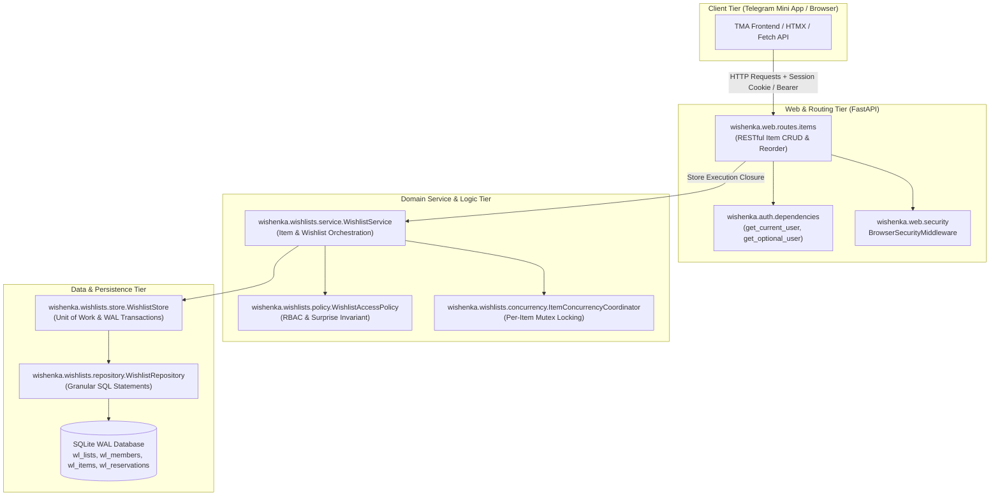

# WISHENKA-13: [Backend] CRUD API желаний со штучным учетом и безопасной архивацией

## Research

### 1. Context and Existing Architecture Analysis

Analysis of the current codebase in `wishenka/` revealed the following foundations and architectural integration points:

1. **Wishlist Aggregate & Domain Hierarchy (`wishenka.wishlists`)**:
   - `Wishlist` acts as the aggregate root containing `WishlistMember` and `WishItem` entities (`wishenka/wishlists/models.py`).
   - `WishItem` already contains fields for `price`, `currency`, `quantity`, `received_quantity`, `is_archived`, `recipient_user_id`, and `recipient_name`. However, `display_order` is missing from both the domain model `WishItem` and the SQLAlchemy database model `WishItemRow` (`wishenka/wishlists/db_models.py`).
   - `Reservation` represents gift commitments (`ACTIVE`, `PURCHASED`, `CANCELLED`, `COMPLETED`), with computed properties `reserved_quantity` and `available_quantity` on `WishItem`.
   - `WishlistAccessPolicy` (`wishenka/wishlists/policy.py`) encapsulates authorization rules:
     - `resolve_context(user, wishlist)`: resolves caller role (`OWNER`, `ADMIN`, `MEMBER`, or guest).
     - `can_add_or_edit_item(ctx, wishlist)`: requires member status and active wishlist state.
     - `is_recipient(user, item)`: implements the core Surprise Invariant logic (checks explicit `recipient_user_id`, external `recipient_name`, or personal wishlist ownership).

2. **Persistence and Transaction Model (`wishenka.wishlists.store` & `repository`)**:
   - SQLite WAL mode is configured with foreign keys and busy timeout:
     - `PRAGMA journal_mode = WAL`
     - `PRAGMA foreign_keys = ON`
     - `PRAGMA busy_timeout = 5000`
   - `WishlistStore` runs operations inside `execute(Callable[[WishlistService], Awaitable[T]])` with snapshot isolation and transaction synchronization.
   - `WishlistRepository` provides granular SQL queries on tables `wl_lists`, `wl_members`, `wl_items`, `wl_reservations`, `wl_favorites`, and `wl_view_history`.
   - Schema migration mechanism in `WishlistStore._initialize`: detects missing columns via `PRAGMA table_info` and issues `ALTER TABLE` statements (as done previously for JSON payload migration).

3. **Concurrency Control (`wishenka.wishlists.concurrency`)**:
   - `ItemConcurrencyCoordinator` provides keyed `asyncio.Lock` per `item_id`. This coordinates in-flight modifications (such as reducing quantity or creating reservations) to avoid race conditions.

4. **HTTP Transport & Route Organization (`wishenka.web.routes`)**:
   - Web application factory `create_app` in `wishenka/web/app.py` mounts routers for `auth`, `miniapp`, `wishlists`, and `sharing`.
   - Request authentication is established via Telegram WebApp `initData` or session cookies/Bearer tokens, resolved via FastAPI dependencies (`get_current_user`, `get_optional_current_user`).
   - Currently, wishlist items are only formatted as part of `get_wishlist_view` in `wishenka/web/routes/wishlists.py`. A dedicated RESTful router `wishenka.web.routes.items` mounted at `/api/wishlists/{wishlist_id}/items` provides clean modularity and separation of concerns.

5. **Existing DTOs & Projections**:
   - `CreateItemDTO` and `UpdateItemDTO` in `wishenka/items/schemas.py`.
   - `WishItemRecipientViewDTO` and `WishItemGifterViewDTO` in `wishenka/wishlists/schemas.py`.
   - Need to ensure `display_order` and `recipient_user_id` are consistently present in DTOs.

---

## Implementation Plan

### High-Level Execution Phases

1. **Phase 1: Step 3 Failing Repro Test Suite (`tests/test_wish_items_crud_api.py`)**:
   - Write comprehensive red test suite asserting all endpoints and invariant rules *before* any implementation changes.
   - Tests assert desired responses, status codes, data isolation, Reduction Lock violations, reorder integrity, and safe archive/restore persistence.

2. **Phase 2: Data Model and Storage Layer Extensions**:
   - Extend `WishItem` dataclass with `display_order: int = 0`.
   - Extend `WishItemRow` with `display_order: Mapped[int] = mapped_column(Integer, nullable=False, default=0, index=True)`.
   - Update `WishlistStore._initialize` with migration support: add `display_order INTEGER NOT NULL DEFAULT 0` and index `idx_wl_items_order ON wl_items(wishlist_id, display_order)`.
   - Update `WishlistRepository` methods (`get_wishlist`, `get_item`, `upsert_item`) to read, write, and sort by `display_order ASC`.
   - Update `WishlistStore._read` and `_write` to preserve `display_order` during domain synchronization.

3. **Phase 3: Domain Service Methods (`wishenka.wishlists.service.WishlistService`)**:
   - Add/enhance methods in `WishlistService`:
     - `add_wish_item(...)`: calculate `display_order` (current max + 1), validate member recipient in collaborative wishlists.
     - `get_wish_item(item_id, actor)`: resolve view projection (recipient vs gifter).
     - `list_wish_items(wishlist_id, actor, include_archived=False)`: return sorted items matching archive filter.
     - `update_wish_item(...)`: enforce Reduction Lock (`new_quantity >= reserved + received`), validate recipient assignment, update timestamp.
     - `reorder_wish_items(wishlist_id, actor, item_ids)`: validate complete permutation of active item IDs, update `display_order` atomically.
     - `archive_wish_item(item_id, actor)`: set `is_archived = True`, preserve all reservations, reject new reservations.
     - `restore_wish_item(item_id, actor)`: set `is_archived = False`, re-assign `display_order` to end of active list.

4. **Phase 4: API Router & Endpoint Integration (`wishenka.web.routes.items`)**:
   - Create router with endpoints:
     - `POST /api/wishlists/{wishlist_id}/items`
     - `GET /api/wishlists/{wishlist_id}/items`
     - `GET /api/wishlists/{wishlist_id}/items/{item_id}`
     - `PATCH /api/wishlists/{wishlist_id}/items/{item_id}`
     - `PUT /api/wishlists/{wishlist_id}/items/reorder`
     - `POST /api/wishlists/{wishlist_id}/items/{item_id}/archive`
     - `POST /api/wishlists/{wishlist_id}/items/{item_id}/restore`
   - Register new router in `wishenka/web/app.py`.
   - Integrate domain exception handlers for HTTP 400/403/404/409/422 responses.

5. **Phase 5: Observability & Dev Documentation**:
   - Emit structured logs on all CRUD, reorder, archive, and invariant rejection events.
   - Update `doc/dev/items.md` with full API reference, sequence diagrams, and concurrency contracts.

---

### Mandatory — Failing Repro (next Step 3)

The failing reproduction test suite will reside in `tests/test_wish_items_crud_api.py`.
It will declare a module-level timeout (`pytestmark = pytest.mark.timeout(30)`) and run against an isolated SQLite test database via `TestClient` and `create_app`.

**Asserted Behaviors**:
1. **Creation & Auto-Ordering**:
   - `POST /api/wishlists/{wishlist_id}/items` adds items with sequential `display_order` (0, 1, 2...).
   - Multi-quantity items (`quantity: 6`) are created with `available_quantity: 6`.
   - Target recipient assignment (`recipient_user_id` or `recipient_name`) persists properly.
2. **Access Control & RBAC**:
   - Non-members or unauthenticated callers attempting to mutate items receive 403 or 404 (IDOR protection).
3. **Parent Wishlist State Invariant**:
   - Attempting to add, edit, reorder, or archive items in an archived wishlist returns HTTP 409 (`WishlistArchivedError`).
   - Attempting mutations on a deleted wishlist returns HTTP 404 (`WishlistDeletedError`).
4. **Piece Accounting & Reduction Lock Invariant**:
   - Creating 5 items, reserving 3 units by a gifter.
   - Owner attempts `PATCH` with `quantity: 2` $\rightarrow$ returns HTTP 409 (`CannotReduceQuantityBelowReservedError`).
   - Owner attempts `PATCH` with `quantity: 3` or `10` $\rightarrow$ succeeds with HTTP 200, updating `available_quantity`.
5. **Reorder Permutation Integrity**:
   - Creating 3 items `[A, B, C]`.
   - `PUT /api/wishlists/{wishlist_id}/items/reorder` with `[C, A, B]` succeeds and alters order in `GET`.
   - Reordering with missing IDs `[C, A]` returns HTTP 400.
   - Reordering with duplicate IDs `[C, C, A]` returns HTTP 422 / 400.
   - Reordering with an ID belonging to another wishlist returns HTTP 400 without modifying order.
6. **Safe Archive & Reservation Integrity**:
   - Item with an active reservation is archived via `POST /api/wishlists/{wishlist_id}/items/{item_id}/archive`.
   - Item disappears from default `GET /api/wishlists/{wishlist_id}/items`, but appears with `include_archived=true`.
   - Active reservation is preserved in the database and visible in gifter's "My Reservations".
   - Attempting to book an archived item returns HTTP 409 (`WishlistArchivedError`).
   - Restoring via `POST /api/wishlists/{wishlist_id}/items/{item_id}/restore` brings the item back to active list at the end (`display_order` updated).
7. **Surprise Invariant & Projection Masking**:
   - Recipient caller accessing `GET /api/wishlists/{wishlist_id}/items` receives `WishItemRecipientViewDTO` without `available_quantity` or `my_reserved_quantity`.
   - Gifter caller accessing the same endpoint receives `WishItemGifterViewDTO` with accurate available counts.
   - Collaborative wishlist: designated recipient member sees recipient view; other members see gifter view.

---

## Architecture

### 1. System Module Diagram



---

### 2. Module Responsibilities & Main Interfaces

| Module / Class | Responsibility | Key Methods / Interfaces |
|---|---|---|
| `wishenka.web.routes.items` | HTTP presentation layer for wish items. Validates request schemas, maps domain exceptions to HTTP error codes, delegates to `WishlistStore`. | `create_item`, `list_items`, `get_item`, `update_item`, `reorder_items`, `archive_item`, `restore_item` |
| `wishenka.wishlists.service.WishlistService` | Core domain operations, invariant checks, state transitions, projection preparation, and concurrency coordination. | `add_wish_item`, `get_wish_item`, `list_wish_items`, `update_wish_item`, `reorder_wish_items`, `archive_wish_item`, `restore_wish_item` |
| `wishenka.wishlists.policy.WishlistAccessPolicy` | Pure stateless authorization and projection policy. Determines role capabilities and Surprise Invariant recipient status. | `resolve_context`, `can_add_or_edit_item`, `is_recipient`, `can_reserve_item` |
| `wishenka.wishlists.concurrency.ItemConcurrencyCoordinator` | Per-item mutex locks preventing race conditions between quantity modifications and reservation creations. | `acquire(item_id)` |
| `wishenka.wishlists.store.WishlistStore` | Transactional coordinator executing operations within atomic SQLite WAL boundaries with domain object re-hydration. | `execute(operation)`, `_initialize()`, `_read()`, `_write()` |
| `wishenka.wishlists.repository.WishlistRepository` | Granular database queries and statements with relational column mappings. | `get_item`, `upsert_item`, `delete_item`, `get_wishlist`, `list_items_by_wishlist` |

---

### 3. API Endpoint Specifications

All endpoints are prefixed with `/api/wishlists/{wishlist_id}/items`.

#### 3.1. Create Wish Item
- **Endpoint**: `POST /api/wishlists/{wishlist_id}/items`
- **Auth**: Required (`OWNER`, `ADMIN`, `MEMBER`).
- **Request Body** (`CreateItemDTO`):
  ```json
  {
    "title": "Sony WH-1000XM5",
    "description": "Цвет серебристый или черный",
    "link": "https://market.yandex.ru/product/123",
    "image_url": "https://avatars.mds.yandex.net/...",
    "price": 32000,
    "currency": "RUB",
    "quantity": 1,
    "priority": "high",
    "category": "Электроника",
    "recipient_user_id": null,
    "recipient_name": null
  }
  ```
- **Validation**:
  - `title`: 1..255 chars, non-empty stripped.
  - `quantity`: integer, $1 \le \text{quantity} \le 1000$.
  - `price`: integer $\ge 0$.
  - `recipient_user_id`: must be an active member of `wishlist_id` if provided.
- **Response**: `201 Created`
  - Returns `WishItemViewDTO` (projected according to caller's role).
- **Error Codes**: `400 Bad Request` (invalid recipient / parameters), `403/404` (not a member), `409 Conflict` (wishlist archived), `422 Unprocessable Entity` (schema validation failure).

#### 3.2. List Wish Items
- **Endpoint**: `GET /api/wishlists/{wishlist_id}/items`
- **Query Params**:
  - `include_archived`: `bool = False` (default returns only active items).
- **Auth**: Optional (public link access / members / gifters).
- **Behavior**:
  - Items sorted by `display_order ASC`.
  - Recipient caller receives `WishItemRecipientViewDTO` for all items where `is_recipient == True`.
  - Gifter receives `WishItemGifterViewDTO` with computed availability.
- **Response**: `200 OK`
  ```json
  [
    {
      "id": 10,
      "title": "Набор бокалов",
      "quantity": 6,
      "received_quantity": 0,
      "available_quantity": 4,
      "is_fully_reserved": false,
      "is_reserved_by_me": true,
      "my_reserved_quantity": 2,
      "my_reservation_status": "active",
      "display_order": 0,
      "is_archived": false,
      "is_recipient": false
    }
  ]
  ```

#### 3.3. Get Single Wish Item
- **Endpoint**: `GET /api/wishlists/{wishlist_id}/items/{item_id}`
- **Auth**: Optional / Authenticated.
- **Response**: `200 OK` $\rightarrow$ `WishItemViewDTO`.
- **Error Codes**: `404 Not Found` (item or wishlist does not exist or access denied).

#### 3.4. Update Wish Item
- **Endpoint**: `PATCH /api/wishlists/{wishlist_id}/items/{item_id}`
- **Auth**: Required (`OWNER`, `ADMIN`, `MEMBER`).
- **Request Body** (`UpdateItemDTO`):
  ```json
  {
    "title": "Новое название",
    "quantity": 5
  }
  ```
- **Invariants Enforced**:
  - Wishlist must be `ACTIVE`.
  - Item must not be archived.
  - Reduction Lock: `new_quantity >= reserved_quantity + received_quantity`.
  - If `recipient_user_id` specified, must be member of wishlist.
- **Response**: `200 OK` $\rightarrow$ `WishItemViewDTO`.
- **Error Codes**: `400/409 Conflict` (`CannotReduceQuantityBelowReservedError`, `WishlistArchivedError`), `404 Not Found`, `422 Unprocessable Entity`.

#### 3.5. Reorder Wish Items
- **Endpoint**: `PUT /api/wishlists/{wishlist_id}/items/reorder`
- **Auth**: Required (`OWNER`, `ADMIN`, `MEMBER`).
- **Request Body** (`ReorderItemsDTO`):
  ```json
  {
    "item_ids": [15, 12, 10, 18]
  }
  ```
- **Invariants Enforced**:
  - Wishlist must be `ACTIVE`.
  - `item_ids` must be an exact 1:1 permutation of all active non-archived items of the wishlist.
  - No duplicate IDs, no missing active IDs, no foreign IDs from other wishlists.
  - Atomic transaction: either all orders are updated or none.
- **Response**: `200 OK` $\rightarrow$ `list[WishItemViewDTO]` (items in updated order).
- **Error Codes**: `400 Bad Request` (invalid ID set / mismatch), `409 Conflict` (wishlist archived).

#### 3.6. Safe Archive Wish Item (Soft Delete)
- **Endpoint**: `POST /api/wishlists/{wishlist_id}/items/{item_id}/archive`
- **Auth**: Required (`OWNER`, `ADMIN`, `MEMBER`).
- **Behavior**:
  - Sets `is_archived = True`.
  - Existing reservations remain active and untouched.
  - Item hidden from normal list views.
  - New reservations on this item are blocked.
- **Response**: `200 OK` $\rightarrow$ `WishItemViewDTO` (`is_archived: true`).
- **Error Codes**: `404 Not Found`, `409 Conflict`.

#### 3.7. Restore Wish Item from Archive
- **Endpoint**: `POST /api/wishlists/{wishlist_id}/items/{item_id}/restore`
- **Auth**: Required (`OWNER`, `ADMIN`, `MEMBER`).
- **Behavior**:
  - Sets `is_archived = False`.
  - Item receives new `display_order` placing it at the end of active items.
  - Reservations continue to be recognized.
- **Response**: `200 OK` $\rightarrow$ `WishItemViewDTO` (`is_archived: false`).
- **Error Codes**: `404 Not Found`, `409 Conflict`.

---

### 4. Schema & Data Model Extensions

#### 4.1. Domain Model (`wishenka.wishlists.models.WishItem`)
```python
@dataclass
class WishItem:
    id: int = 0
    wishlist_id: int = 0
    recipient_user_id: int | None = None
    recipient_name: str | None = None
    title: str = ""
    description: str | None = None
    link: str | None = None
    price: int | None = None
    currency: str = "RUB"
    quantity: int = 1
    received_quantity: int = 0
    image_url: str | None = None
    store_name: str | None = None
    store_icon_url: str | None = None
    priority: ItemPriority = ItemPriority.MEDIUM
    category: str | None = None
    display_order: int = 0  # <--- NEW FIELD
    is_archived: bool = False
    wishlist: Wishlist | None = None
    reservations: list[Reservation] = field(default_factory=list)
    created_at: datetime = field(default_factory=lambda: datetime.now(UTC))
    updated_at: datetime = field(default_factory=lambda: datetime.now(UTC))
```

#### 4.2. Database Model (`wishenka.wishlists.db_models.WishItemRow`)
```python
class WishItemRow(Base):
    __tablename__ = "wl_items"

    id: Mapped[int] = mapped_column(Integer, primary_key=True)
    wishlist_id: Mapped[int] = mapped_column(
        ForeignKey("wl_lists.id", ondelete="CASCADE"), nullable=False, index=True
    )
    recipient_user_id: Mapped[int | None] = mapped_column(Integer, nullable=True, index=True)
    recipient_name: Mapped[str | None] = mapped_column(String, nullable=True)
    title: Mapped[str] = mapped_column(String, nullable=False)
    description: Mapped[str | None] = mapped_column(String, nullable=True)
    link: Mapped[str | None] = mapped_column(String, nullable=True)
    price: Mapped[int | None] = mapped_column(Integer, nullable=True)
    currency: Mapped[str] = mapped_column(String, nullable=False, default="RUB")
    quantity: Mapped[int] = mapped_column(Integer, nullable=False, default=1)
    received_quantity: Mapped[int] = mapped_column(Integer, nullable=False, default=0)
    image_url: Mapped[str | None] = mapped_column(String, nullable=True)
    store_name: Mapped[str | None] = mapped_column(String, nullable=True)
    store_icon_url: Mapped[str | None] = mapped_column(String, nullable=True)
    priority: Mapped[str] = mapped_column(String, nullable=False, default="medium")
    category: Mapped[str | None] = mapped_column(String, nullable=True)
    display_order: Mapped[int] = mapped_column(
        Integer, nullable=False, default=0, index=True
    )  # <--- NEW COLUMN
    is_archived: Mapped[int] = mapped_column(Integer, nullable=False, default=0)
    created_at: Mapped[str] = mapped_column(String, nullable=False)
    updated_at: Mapped[str] = mapped_column(String, nullable=False)
```

#### 4.3. Relational DDL Migration & Indexing in `WishlistStore._initialize`
```sql
-- DDL for table wl_items
CREATE TABLE IF NOT EXISTS wl_items (
    id INTEGER PRIMARY KEY,
    wishlist_id INTEGER NOT NULL REFERENCES wl_lists(id) ON DELETE CASCADE,
    recipient_user_id INTEGER,
    recipient_name TEXT,
    title TEXT NOT NULL,
    description TEXT,
    link TEXT,
    price INTEGER,
    currency TEXT NOT NULL DEFAULT 'RUB',
    quantity INTEGER NOT NULL DEFAULT 1,
    received_quantity INTEGER NOT NULL DEFAULT 0,
    image_url TEXT,
    store_name TEXT,
    store_icon_url TEXT,
    priority TEXT NOT NULL DEFAULT 'medium',
    category TEXT,
    display_order INTEGER NOT NULL DEFAULT 0,
    is_archived INTEGER NOT NULL DEFAULT 0,
    created_at TEXT NOT NULL,
    updated_at TEXT NOT NULL
);

-- Index for ordering within a wishlist
CREATE INDEX IF NOT EXISTS idx_wl_items_order ON wl_items(wishlist_id, display_order);
```

For existing databases, `WishlistStore._initialize` checks `PRAGMA table_info(wl_items)`:
```python
cursor_items = await conn.execute(text("PRAGMA table_info(wl_items)"))
cols = [r[1] for r in cursor_items.fetchall()]
if "display_order" not in cols:
    await conn.execute(
        text("ALTER TABLE wl_items ADD COLUMN display_order INTEGER NOT NULL DEFAULT 0")
    )
```

#### 4.4. DTO Projections (`wishenka.wishlists.schemas`)
Update `WishItemRecipientViewDTO` and `WishItemGifterViewDTO`:
```python
class WishItemRecipientViewDTO(BaseModel):
    model_config = ConfigDict(frozen=True)

    id: int
    title: str
    description: str | None = None
    link: str | None = None
    image_url: str | None = None
    price: int | None = None
    currency: str = "RUB"
    store_name: str | None = None
    store_icon_url: str | None = None
    quantity: int = 1
    received_quantity: int = 0
    priority: ItemPriority = ItemPriority.MEDIUM
    category: str | None = None
    display_order: int = 0  # <--- NEW FIELD
    is_archived: bool = False
    recipient_user_id: int | None = None  # <--- NEW FIELD
    recipient_name: str | None = None
    is_recipient: bool = True


class WishItemGifterViewDTO(BaseModel):
    model_config = ConfigDict(frozen=True)

    id: int
    title: str
    description: str | None = None
    link: str | None = None
    image_url: str | None = None
    price: int | None = None
    currency: str = "RUB"
    store_name: str | None = None
    store_icon_url: str | None = None
    quantity: int = 1
    received_quantity: int = 0
    available_quantity: int
    is_fully_reserved: bool
    is_reserved_by_me: bool
    my_reserved_quantity: int
    my_reservation_status: ReservationStatus | None = None
    my_reservation_id: int | None = None
    priority: ItemPriority = ItemPriority.MEDIUM
    category: str | None = None
    display_order: int = 0  # <--- NEW FIELD
    is_archived: bool = False
    recipient_user_id: int | None = None  # <--- NEW FIELD
    recipient_name: str | None = None
    is_recipient: bool = False
```

And in `wishenka.items.schemas`:
```python
class ReorderItemsDTO(BaseModel):
    """Payload for updating item display order in a wishlist."""

    model_config = ConfigDict(frozen=True)

    item_ids: list[int] = Field(..., min_length=1)
```

---

### 5. Concurrency & Transaction Boundaries

1. **Atomic Unit of Work Execution**:
   - Every mutating request delegates to `request.app.state.wishlist_store.execute(action)`.
   - SQLite `BEGIN IMMEDIATE` WAL transaction ensures single-writer serialization while readers proceed concurrently without blocking.
   - On exception (validation, reduction lock, invariant violation), the transaction is rolled back immediately; no partial state or corrupted `display_order` values are persisted.

2. **Reduction Lock Invariant**:
   - When updating `quantity` in `WishlistService.update_wish_item`:
     ```python
     active_locked = item.reserved_quantity + item.received_quantity
     if quantity is not None and quantity < active_locked:
         raise CannotReduceQuantityBelowReservedError(
             f"Cannot reduce quantity to {quantity}: {active_locked} units already locked"
         )
     ```
   - Race conditions between reservation creation and item reduction are coordinated using `ItemConcurrencyCoordinator.acquire(item_id)`.

3. **Reordering Permutation Integrity**:
   - `WishlistService.reorder_wish_items`:
     1. Fetches all active non-archived items of the wishlist.
     2. Verifies `set(item_ids) == {item.id for item in active_items}` and `len(item_ids) == len(active_items)` (exact 1-to-1 bijection).
     3. Assigns `display_order = index` for each item in the ordered list.
     4. Persists all updated items in the same atomic transaction.

---

### 6. Observability & Logging Strategy

Structured logging events (via `wishenka.wishlists` and `wishenka.items` loggers):

| Event Name | Log Level | When Emitted | Structured Fields (`extra`) |
|---|---|---|---|
| `item_created` | INFO | Successfully added wish item | `event`, `item_id`, `wishlist_id`, `actor_id`, `quantity`, `display_order` |
| `item_updated` | INFO | Successfully updated item attributes | `event`, `item_id`, `wishlist_id`, `actor_id`, `quantity`, `quantity_delta` |
| `item_archived` | INFO | Item safely archived | `event`, `item_id`, `wishlist_id`, `actor_id`, `active_reservations_count` |
| `item_restored` | INFO | Item restored from archive | `event`, `item_id`, `wishlist_id`, `actor_id`, `new_display_order` |
| `items_reordered` | INFO | Items successfully reordered | `event`, `wishlist_id`, `actor_id`, `count`, `item_ids` |
| `item_quantity_reduction_rejected` | WARNING | Attempted reduction below locked volume | `event`, `item_id`, `wishlist_id`, `actor_id`, `requested_quantity`, `locked_quantity` |
| `item_reorder_invalid` | WARNING | Reorder validation failed | `event`, `wishlist_id`, `actor_id`, `reason` |
| `item_access_denied` | WARNING | Actor lacking required permissions | `event`, `actor_id`, `wishlist_id`, `item_id`, `action` |

All capability tokens (such as public or invite tokens) are strictly excluded from logging payloads and extras to guarantee zero information leakage.

---

## Q&A

**Q1: Where should the items CRUD routes live — in `wishenka/web/routes/items.py` or `wishenka/web/routes/wishlists.py`?**  
*A1:* In `wishenka/web/routes/items.py`. Placing item operations in a dedicated router file maintains high cohesion, avoids inflating `wishlists.py` (which already handles list settings, members, favorites, history, and token management), and mirrors the domain structure. The router will be included in `create_app()` in `wishenka/web/app.py`.

**Q2: What happens to `display_order` when an item is archived and subsequently restored?**  
*A2:* When an item is archived, it leaves the active list. When restored, to prevent collisions or ambiguous gaps with other active items, it is appended to the end of the active list with `display_order = max(active_items.display_order) + 1`. The author can then use the reorder endpoint to move it to any desired position.

**Q3: How is the Surprise Invariant preserved if an unauthenticated user views a public shared wishlist?**  
*A3:* An unauthenticated user viewing via a public link is treated as an anonymous Gifter. Since an anonymous user cannot be the gift recipient, they receive `WishItemGifterViewDTO` with `available_quantity` and booking capabilities. The recipient view `WishItemRecipientViewDTO` is strictly reserved for the gift's target recipient (when authenticated).
