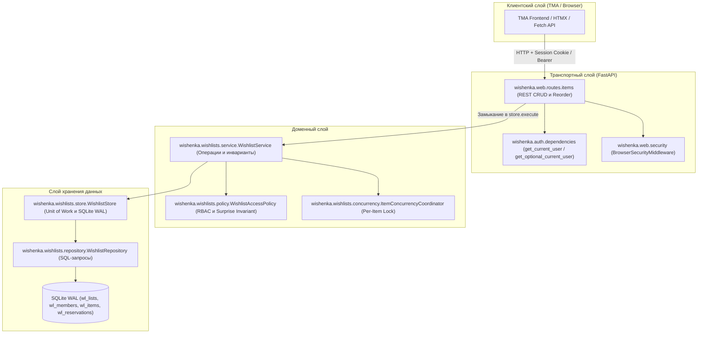
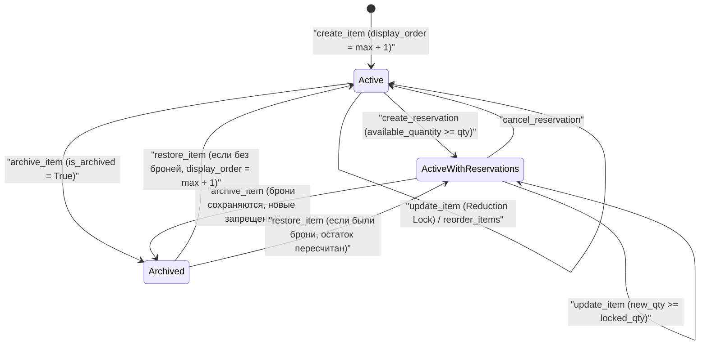

# Спецификация: WISHENKA-13 — CRUD API желаний со штучным учётом и безопасной архивацией

**Ключ задачи:** WISHENKA-13  
**Статус:** реализовано и верифицировано (Steps 1–8)  
**Оценка сложности:** 5.0 Story Points  
**Платформа и стек:** Python 3.12+, FastAPI, Pydantic v2, SQLAlchemy (SQLite WAL)  
**Основные модули:** `wishenka.wishlists`, `wishenka.items`, `wishenka.web.routes.items`

## 1. Назначение и бизнес-цель

Сервис списков желаний **«Вишенка» (Telegram Wishlist Service)** обеспечивает создание и совместное ведение вишлистов внутри Telegram с координацией дарителей и строгим сохранением тайны сюрприза для получателя. Центральной доменной сущностью сервиса является **Желание (`WishItem`)**.

### 1.1. Постановка проблемы

До выполнения задачи `WISHENKA-13` в системе отсутствовал выделенный RESTful API и целостный доменный слой для полного жизненного цикла желаний. В частности, требовалось закрыть следующие задачи:

- Поддержать создание, просмотр, частичное редактирование, ручное изменение порядка карточек, мягкое удаление (архивацию) и восстановление желаний.
- Обеспечить штучный учёт подарков (более одной единицы в одной позиции) с расчётом свободного остатка и защитой от нарушения уже выданных обязательств дарителей.
- Исключить автоматическое уничтожение активных и купленных броней при переносе желания в архив.
- Гарантировать соблюдение принципа тайны сюрприза на уровне серверных проекций, включая сценарии совместных вишлистов с адресацией на конкретного участника или внешнее лицо.

### 1.2. Бизнес-цели и ценность

1. **Гибкий жизненный цикл желаний:** авторы списков получают полноценное управление позициями, включая временное скрытие неактуальных желаний в архив и последующее восстановление без потери данных.
2. **Штучный учёт подарков (Piece Accounting):** поддержка позиций с количеством от `1` до `1000` экземпляров, динамический расчёт доступного остатка (`available_quantity`) и инвариант блокировки уменьшения количества (*Reduction Lock*) защищают планы дарителей от рассинхронизации.
3. **Адресация в совместных вишлистах:** желание в групповом списке можно адресовать конкретному участнику (`recipient_user_id`), внешнему человеку без аккаунта (`recipient_name`) или оставить общим. При этом тайна сюрприза скрывает брони только от фактического получателя, позволяя остальным соавторам выступать дарителями.
4. **Безопасная архивация (Safe Archive):** перенос желания в архив сохраняет все существующие бронирования (`ACTIVE` и `PURCHASED`) в личных кабинетах дарителей с отметкой об архивации, блокируя только оформление новых броней.
5. **Ручной порядок витрины (Reordering):** авторы задают приоритетную последовательность карточек (`display_order`) для гостей вишлиста с транзакционной проверкой целостности списка.

## 2. Функциональные требования и пользовательские сценарии

### 2.1. Сущность «Желание» (`WishItem`)

| Атрибут | Тип / Формат | Обязательность | Описание и ограничения |
| --- | --- | --- | --- |
| `id` | Целое число | Да (генерируется) | Уникальный идентификатор желания |
| `wishlist_id` | Целое число | Да | Идентификатор родительского вишлиста |
| `title` | Строка (`1..255`) | Да | Название подарка; не допускаются пустые строки и строки из одних пробелов |
| `description` | Текст (до `4000`) | Нет | Дополнительное описание, пожелания по цвету или размеру |
| `link` | URL-строка | Нет | Корректный абсолютный веб-URL со схемой `http://` или `https://` |
| `price` | Целое (`>= 0`) | Нет | Ориентировочная стоимость подарка |
| `currency` | Строка (`3` символа) | Да (по умолч. `"RUB"`) | Код валюты по стандарту ISO 4217 в верхнем регистре |
| `quantity` | Целое (`1..1000`) | Да (по умолч. `1`) | Требуемое количество экземпляров |
| `received_quantity` | Целое (`>= 0`) | Да (по умолч. `0`) | Количество уже полученных экземпляров (`0 <= received_quantity <= quantity`) |
| `image_url` | URL-строка | Нет | Ссылка на изображение товара |
| `store_name` | Строка | Нет | Название магазина или маркетплейса |
| `store_icon_url` | URL-строка | Нет | Ссылка на логотип или иконку магазина |
| `priority` | Enum (`high`, `medium`, `low`) | Да (по умолч. `medium`) | Приоритет желания для автора |
| `category` | Строка | Нет | Категория товара |
| `display_order` | Целое (`>= 0`) | Да (по умолч. `0`) | Порядковый индекс карточки при отображении |
| `is_archived` | Булево | Да (по умолч. `False`) | Признак архивации (мягкого удаления) |
| `recipient_user_id` | Целое число | Нет | Идентификатор участника совместного вишлиста — адресата подарка |
| `recipient_name` | Строка | Нет | Имя внешнего адресата без аккаунта (например, «Бабушка Нина») |
| `created_at` | Дата и время (UTC) | Да | Временная метка создания записи |
| `updated_at` | Дата и время (UTC) | Да | Временная метка последнего изменения |

### 2.2. Пользовательские сценарии

- **US-1. Добавление желания автором списка:** владелец, администратор или участник совместного списка добавляет одиночный подарок (по умолчанию `quantity = 1`), многоштучный подарок (например, 6 бокалов с начальным `available_quantity = 6`), либо указывает адресата в групповом вишлисте через `recipient_user_id` (из состава участников) или внешнее имя `recipient_name`. Новое желание помещается в конец списка.
- **US-2. Редактирование желания и защита забронированных единиц:** автор обновляет название, описание, фото, цену или количество. Увеличение `quantity` разрешено и увеличивает `available_quantity`. Попытка уменьшить `quantity` ниже суммы уже забронированных и полученных единиц отклоняется с бизнес-ошибкой и сохранением прежнего состояния.
- **US-3. Изменение порядка отображения карточек:** автор передаёт упорядоченный список ID активных желаний вишлиста; карточкам присваивается обновлённый `display_order`. Неполный список, дубликаты или идентификаторы из другого вишлиста отклоняются без изменения текущего порядка.
- **US-4. Безопасная архивация и восстановление:** при архивации свободного или забронированного желания карточка скрывается из основного списка и блокируется для новых броней, но существующие бронирования сохраняются в базе и остаются видимыми дарителям с признаком архивации (`is_item_archived = True`). При восстановлении желание возвращается в конец активного списка с сохранением всех броней и пересчётом остатка.
- **US-5. Просмотр списка с соблюдением тайны сюрприза:** даритель или гость видит актуальный `available_quantity` и статус собственного бронирования; получатель видит только запрошенное `quantity` и `received_quantity` без сведений о бронях и дарителях.

### 2.3. Матрица прав доступа (RBAC)

| Роль пользователя | Просмотр активных | Создание | Редактирование | Reorder | Архивация | Восстановление | Просмотр архива |
| --- | --- | --- | --- | --- | --- | --- | --- |
| **Владелец (`OWNER`)** | Да (проекция получателя в личном) | Да | Да | Да | Да | Да | Да |
| **Администратор (`ADMIN`)** | Да (с учётом адресата) | Да | Да | Да | Да | Да | Да |
| **Участник (`MEMBER`)** | Да (с учётом адресата) | Да | Да | Да | Да | Да | Да |
| **Авторизованный гость (Даритель)** | Да (проекция дарителя) | Нет | Нет | Нет | Нет | Нет | Нет |
| **Анонимный гость по ссылке** | Да (проекция дарителя) | Нет | Нет | Нет | Нет | Нет | Нет |

Дополнительные правила доступа:

- Все операции модификации требуют авторизованной сессии и членства в вишлисте с ролью `OWNER`, `ADMIN` или `MEMBER`.
- При статусе родительского вишлиста `archived` чтение сохраняется, но создание, редактирование, изменение порядка, архивация и восстановление желаний блокируются (`WishlistArchivedError`).
- Для удалённого вишлиста (`deleted`) доступ блокируется с ошибкой отсутствия ресурса (`WishlistDeletedError`).

### 2.4. Функциональные операции и правила обработки

1. **Создание желания (`POST /api/wishlists/{wishlist_id}/items`):**
   - Проверяет активность родительского вишлиста и права участника (`OWNER`, `ADMIN`, `MEMBER`).
   - Если указан `recipient_user_id`, проверяет, что этот пользователь является владельцем или активным участником данного вишлиста.
   - Присваивает `display_order = max(существующих display_order) + 1`, `is_archived = False`, `received_quantity = 0`.
   - Возвращает карточку со статусом `201 Created` в проекции, соответствующей роли вызывающего пользователя.
2. **Получение списка желаний (`GET /api/wishlists/{wishlist_id}/items`):**
   - Принимает query-параметр `include_archived: bool = False`. По умолчанию возвращает только активные желания; при `include_archived=True` включает архивные позиции.
   - Сортирует элементы по `display_order ASC` (и детерминированно по `id ASC`).
   - Для каждого элемента применяет проекцию `WishItemRecipientViewDTO` (если вызывающий пользователь — получатель) или `WishItemGifterViewDTO` (для дарителя/гостя).
3. **Получение одного желания (`GET /api/wishlists/{wishlist_id}/items/{item_id}`):**
   - Проверяет доступность вишлиста и принадлежность `item_id` указанному `wishlist_id`.
   - Возвращает карточку в проекции получателя или дарителя.
4. **Частичное обновление желания (`PATCH /api/wishlists/{wishlist_id}/items/{item_id}`):**
   - Разрешено только участникам активного вишлиста для неархивированного желания (редактирование архивной позиции отклоняется).
   - Поддерживает обновление полей `title`, `description`, `link`, `image_url`, `price`, `currency`, `quantity`, `priority`, `category`, `recipient_user_id`, `recipient_name`.
   - При передаче `quantity` проверяет инвариант *Reduction Lock*; при передаче `recipient_user_id` проверяет членство адресата; обновляет `updated_at`.
5. **Изменение порядка желаний (`PUT /api/wishlists/{wishlist_id}/items/reorder`):**
   - Принимает `item_ids: list[int]` (в схеме `ReorderItemsDTO` минимум 1 элемент).
   - Проверяет отсутствие дубликатов и точное взаимно-однозначное соответствие множеству ID всех активных (`is_archived == False`) желаний этого вишлиста.
   - Атомарно переприсваивает `display_order` (`0, 1, ..., N - 1`) и возвращает переупорядоченный список.
6. **Безопасная архивация (`POST /api/wishlists/{wishlist_id}/items/{item_id}/archive`):**
   - Устанавливает `is_archived = True`, обновляет `updated_at` и сохраняет все связанные бронирования `ACTIVE` и `PURCHASED` без изменений.
   - Скрывает элемент из дефолтного активного списка и блокирует создание новых бронирований.
7. **Восстановление из архива (`POST /api/wishlists/{wishlist_id}/items/{item_id}/restore`):**
   - Требует, чтобы желание находилось в архиве (`is_archived == True`).
   - Сбрасывает `is_archived = False`, помещает элемент в конец активного списка (`display_order = max(активных display_order, default=-1) + 1`) и восстанавливает возможность бронирования при `available_quantity > 0`.

### 2.5. Ключевые бизнес-инварианты

1. **Инвариант штучного учёта (Piece Accounting Invariant):**
   - Требуемое количество ограничено диапазоном `1 <= quantity <= 1000`.
   - Заблокированный объём: `locked_quantity = reserved_quantity + received_quantity`, где `reserved_quantity` — сумма `quantity` по всем броням в статусах `ACTIVE` и `PURCHASED`.
   - Свободный остаток для новых броней: `available_quantity = max(0, quantity - locked_quantity)`.
   - Сумма забронированных и полученных единиц не может превышать `quantity`.
2. **Инвариант блокировки уменьшения количества (Reduction Lock Invariant):**
   - При обновлении желания должно выполняться условие `new_quantity >= reserved_quantity + received_quantity`.
   - Нарушение отклоняется с ошибкой `CannotReduceQuantityBelowReservedError` (HTTP `409 Conflict`) с указанием текущего заблокированного объёма.
3. **Инвариант принципа сюрприза (Surprise Invariant):**
   - Если вызывающий пользователь признан получателем (`is_recipient = True`), проекция `WishItemRecipientViewDTO` полностью исключает поля о наличии и количестве броней, остатке `available_quantity`, статусах покупки и личностях дарителей.
   - Анонимный посетитель по публичной ссылке всегда считается дарителем и получает `WishItemGifterViewDTO`.
4. **Инвариант адресации в совместных вишлистах (Target Recipient Invariant):**
   - В личном вишлисте (`is_collaborative = False`) получателем всех желаний считается владелец списка.
   - В совместном вишлисте (`is_collaborative = True`) при заданном `recipient_user_id` получателем признаётся только этот участник; при внешнем `recipient_name` или отсутствии адресата ни один из участников не является получателем, и все участники могут видеть остатки и дарить подарок.
5. **Инвариант целостности бронирований при архивации (Safe Archive Invariant):**
   - Архивация сохраняет существующие активные и купленные бронирования, запрещает новые брони и сохраняет видимость позиции в кабинете дарителя с флагом `is_item_archived = True`.
6. **Инвариант состояния родительского вишлиста (Parent Wishlist State Invariant):**
   - Мутации желаний допустимы только при `wishlist.status == "active"`.
7. **Инвариант целостности порядка (Reordering Integrity Invariant):**
   - Входной список `item_ids` должен быть точной 1:1 перестановкой всех активных желаний вишлиста (без пропусков, повторов и идентификаторов других вишлистов).

### 2.6. Валидация входных данных и граничные случаи

- `title` очищается от крайних пробелов (`strip`); пустая строка или строка из пробелов отклоняется при валидации (`422` на уровне Pydantic-схемы или `400` в домене).
- `price` должен быть целым неотрицательным числом (`>= 0`); `quantity` — целым числом от `1` до `1000`.
- Попытка указать `recipient_user_id` пользователя, не входящего в состав владельца и участников вишлиста, отклоняется с ошибкой валидации (`400 Bad Request`).
- При удалении участника из совместного вишлиста ранее адресованные ему желания не удаляются, сохраняя целостность базы данных.
- При попытке `reorder` с дубликатом ID (`len(item_ids) != len(set(item_ids))`), неполным составом или чужим `item_id` транзакция откатывается и порядок элементов в БД не изменяется.

## 3. Архитектура, компоненты и интерфейсы

### 3.1. Компонентная архитектура

### 3.2. Модули, классы и ключевые интерфейсы

| Модуль / Класс | Назначение | Основные методы и интерфейсы |
| --- | --- | --- |
| `wishenka.web.routes.items` | HTTP-контроллер CRUD-операций; валидация DTO, маппинг доменных исключений в HTTP-коды, вызов `WishlistStore`; подключается в `create_app()` в `wishenka/web/app.py` | `execute`, `create_item`, `list_items`, `get_item`, `update_item`, `reorder_items`, `archive_item`, `restore_item` |
| `wishenka.wishlists.service.WishlistService` | Оркестрация бизнес-логики, проверка инвариантов, переходы состояний, подготовка ролевых проекций | `add_wish_item`, `get_wish_item`, `list_wish_items`, `update_wish_item`, `reorder_wish_items`, `archive_wish_item`, `restore_wish_item`, `project_wish_item` |
| `wishenka.wishlists.policy.WishlistAccessPolicy` | Бесстатусная политика авторизации и расчёта статуса получателя | `resolve_context`, `can_add_or_edit_item`, `is_recipient`, `can_reserve_item` |
| `wishenka.wishlists.concurrency.ItemConcurrencyCoordinator` | Ключевой асинхронный мьютекс (`asyncio.Lock`) на `item_id` для сериализации конкурентных обновлений количества и бронирований | `acquire(item_id)` |
| `wishenka.wishlists.store.WishlistStore` | Координатор транзакций SQLite WAL, инициализация/миграция схемы и синхронизация доменного снапшота | `execute`, `_init_db`, `_read`, `_write` |
| `wishenka.wishlists.repository.WishlistRepository` | SQL-запросы к таблицам вишлистов и желаний, сортировка по `display_order ASC` | `get_wishlist`, `get_item`, `save_item`, `_row_to_item` |
| `wishenka.wishlists.models` / `db_models` | Доменная и реляционная модели данных | `WishItem`, `Reservation`, `WishItemRow` |

### 3.3. Спецификация REST API и маппинг ошибок

Все эндпоинты смонтированы под префиксом `/api/wishlists/{wishlist_id}/items`:

| Метод | Путь | Авторизация | Входной DTO | Успешный ответ | Основные коды ошибок |
| --- | --- | --- | --- | --- | --- |
| `POST` | `/api/wishlists/{wishlist_id}/items` | `get_current_user` (`OWNER`, `ADMIN`, `MEMBER`) | `CreateItemDTO` | `201 Created` (`WishItemViewDTO`) | `400`, `403`, `404`, `409`, `422` |
| `GET` | `/api/wishlists/{wishlist_id}/items` | `get_optional_current_user` | Query `include_archived: bool = False` | `200 OK` (`list[WishItemViewDTO]`) | `403`, `404` |
| `GET` | `/api/wishlists/{wishlist_id}/items/{item_id}` | `get_optional_current_user` | Path `item_id` | `200 OK` (`WishItemViewDTO`) | `403`, `404` |
| `PATCH` | `/api/wishlists/{wishlist_id}/items/{item_id}` | `get_current_user` (`OWNER`, `ADMIN`, `MEMBER`) | `UpdateItemDTO` | `200 OK` (`WishItemViewDTO`) | `400`, `403`, `404`, `409`, `422` |
| `PUT` | `/api/wishlists/{wishlist_id}/items/reorder` | `get_current_user` (`OWNER`, `ADMIN`, `MEMBER`) | `ReorderItemsDTO` | `200 OK` (`list[WishItemViewDTO]`) | `400`, `403`, `404`, `409`, `422` |
| `POST` | `/api/wishlists/{wishlist_id}/items/{item_id}/archive` | `get_current_user` (`OWNER`, `ADMIN`, `MEMBER`) | Path `item_id` | `200 OK` (`WishItemViewDTO`) | `403`, `404`, `409` |
| `POST` | `/api/wishlists/{wishlist_id}/items/{item_id}/restore` | `get_current_user` (`OWNER`, `ADMIN`, `MEMBER`) | Path `item_id` | `200 OK` (`WishItemViewDTO`) | `403`, `404`, `409` |

Маппинг доменных исключений в HTTP-коды внутри `wishenka.web.routes.items.execute`:

- `WishlistNotFoundError`, `WishlistDeletedError`, `ItemNotFoundError` $\rightarrow$ `404 Not Found`
- `PermissionDeniedError` $\rightarrow$ `403 Forbidden`
- `WishlistArchivedError`, `CannotReduceQuantityBelowReservedError` $\rightarrow$ `409 Conflict`
- `ValueError` (некорректная перестановка reorder, адресат не является участником, пустое название) $\rightarrow$ `400 Bad Request`
- Нарушение контракта Pydantic-схем (`CreateItemDTO`, `UpdateItemDTO`, `ReorderItemsDTO`) $\rightarrow$ `422 Unprocessable Entity`

### 3.4. Контракты данных и схема хранения

#### Входные DTO (`wishenka.items.schemas`)

- `CreateItemDTO` (`frozen=True`): обязательное поле `title` (с валидацией непустой строки после `strip`), опциональные `description`, `link`, `image_url`, `price`, `currency` (по умолчанию `"RUB"`), `quantity` (`1..1000`, по умолчанию `1`), `priority` (по умолчанию `"medium"`), `category`, `recipient_user_id`, `recipient_name`.
- `UpdateItemDTO` (`frozen=True`): опциональные поля для частичного обновления с тем же валидатором `title` и ограничениями на `quantity` и `price`.
- `ReorderItemsDTO` (`frozen=True`): поле `item_ids: list[int]` с ограничением `min_length=1`.

#### Проекции ответов (`wishenka.wishlists.schemas`)

- **`WishItemRecipientViewDTO`** (`is_recipient: bool = True`): `id`, `title`, `description`, `link`, `image_url`, `price`, `currency`, `store_name`, `store_icon_url`, `quantity`, `received_quantity`, `priority`, `category`, `display_order`, `is_archived`, `recipient_user_id`, `recipient_name`, `is_recipient`. Поля бронирования полностью отсутствуют.
- **`WishItemGifterViewDTO`** (`is_recipient: bool = False`): включает все базовые поля карточки, а также `available_quantity`, `is_fully_reserved`, `is_reserved_by_me`, `my_reserved_quantity`, `my_reservation_status`, `my_reservation_id`.

#### Схема БД и миграция (`wl_items`)

Таблица `wl_items` содержит столбец `display_order INTEGER NOT NULL DEFAULT 0` и составной индекс `idx_wl_items_order ON wl_items(wishlist_id, display_order)`. При инициализации существующих баз данных `WishlistStore._init_db()` проверяет наличие столбца через `PRAGMA table_info(wl_items)` и при необходимости выполняет `ALTER TABLE wl_items ADD COLUMN display_order INTEGER NOT NULL DEFAULT 0` с созданием индекса.

### 3.5. Жизненный цикл и переходы состояний

Важные ограничения переходов:

- В состоянии `Archived` запрещены `update_item`, повторный выбор в `reorder_items` и создание новых бронирований.
- Если родительский вишлист переведён в статус `archived` или `deleted`, любые переходы состояний желаний блокируются.

## 4. Нефункциональные требования, безопасность и наблюдаемость

### 4.1. Производительность, транзакционность и конкурентность

- **Целевые задержки:** чтение списка желаний — до `50 мс` (для списка до `100` позиций); операции мутации (создание, редактирование, архивация, reorder) — до `100 мс`.
- **SQLite WAL и атомарность:** база данных настроена с `PRAGMA journal_mode = WAL`, `PRAGMA foreign_keys = ON` и `PRAGMA busy_timeout = 5000`. Каждая операция выполняется в границах транзакции `BEGIN IMMEDIATE` через `WishlistStore.execute(...)`; при нарушении инвариантов или валидации транзакция полностью откатывается без частичной записи.
- **Координация гонок:** `WishlistService.update_wish_item` захватывает блокировку `ItemConcurrencyCoordinator.acquire(item_id)` для исключения race conditions между уменьшением `quantity` автором и параллельным бронированием дарителем.

### 4.2. Безопасность и инварианты приватности

- **Контекстный RBAC:** проверка роли вызывающего пользователя (`OWNER`, `ADMIN`, `MEMBER`) и статуса родительского вишлиста на каждом мутирующем запросе.
- **Защита от IDOR:** чтение и изменение желания невозможны при несоответствии `item_id` и `wishlist_id` либо при отсутствии прав доступа к вишлисту.
- **Zero-Leak Projection:** разделение `WishItemRecipientViewDTO` и `WishItemGifterViewDTO` на уровне серверного сервиса исключает утечку данных о бронированиях получателю.
- **Санитизация телеметрии:**
  - *Zero capability tokens:* `public_token` и `invite_token` никогда не попадают в логи и поля `extra`.
  - *Zero auth secrets:* секреты Bearer-сессий, Telegram `init_data` и подписи аутентификации не логируются.
  - *Минимизация данных:* в события пишутся только скалярные ID, дельты количества, имена изменённых полей и причины отказов без дампов полных объектов.

### 4.3. Структурированное логирование и метрики

Все события формируются со словарём `extra={...}` через логгеры `wishenka.wishlists` и `wishenka.web.routes.items`, что обеспечивает готовность к агрегации в Vector, Loki и ELK.

#### Каталог событий доменного уровня (`wishenka.wishlists`)

| Имя события | Уровень | Контекстные атрибуты (`extra`) | Триггер события |
| --- | --- | --- | --- |
| `item_created` | `INFO` | `wishlist_id`, `item_id`, `actor_id`, `quantity`, `display_order`, `has_recipient` | Успешное добавление желания в вишлист |
| `item_updated` | `INFO` | `wishlist_id`, `item_id`, `actor_id`, `updated_fields`, `quantity`, `quantity_delta` | Успешное обновление атрибутов желания |
| `item_archived` | `INFO` | `wishlist_id`, `item_id`, `actor_id`, `active_reservations_count` | Безопасная архивация желания с сохранением броней |
| `item_restored` | `INFO` | `wishlist_id`, `item_id`, `actor_id`, `display_order` | Восстановление желания в конец активного списка |
| `items_reordered` | `INFO` | `wishlist_id`, `actor_id`, `item_count`, `item_ids` | Атомарное изменение порядка активных желаний |
| `item_quantity_reduction_rejected` | `WARNING` | `wishlist_id`, `item_id`, `actor_id`, `requested_quantity`, `locked_quantity`, `reason` | Попытка уменьшить `quantity` ниже заблокированного объёма |
| `item_reorder_invalid` | `WARNING` | `wishlist_id`, `actor_id`, `reason` | Нарушение целостности перестановки (дубли или несовпадение множества ID) |
| `item_access_denied` | `WARNING` | `wishlist_id`, `actor_id`, `action`, `role` | Попытка мутации пользователем без достаточных прав |

#### События транспортного слоя (`wishenka.web.routes.items.execute`)

При перехвате доменных исключений маршрутизатор фиксирует события уровня `WARNING`: `item_not_found` (`404`), `item_permission_denied` (`403`), `item_conflict` (`409`) и `item_validation_error` (`400`).

#### Производные метрики мониторинга

- **Производительность и конфликты:** поток мутаций по счётчикам `item_created`, `item_updated`, `items_reordered`; интенсивность архивации и восстановления (`item_archived`, `item_restored`); доля отказов по инвариантам (`item_quantity_reduction_rejected`, `item_reorder_invalid`).
- **Бизнес-метрики:** распределение многоштучных позиций (`quantity`), доля адресных желаний (`has_recipient` и обновления `recipient_user_id`/`recipient_name`), частота нарушений доступа (`item_access_denied` в разрезе `action` и `role`).
- **Интеграция телеметрии:** структурированное JSON/`extra`-логирование готово к сбору; экспорт метрик в Prometheus и дашборды Grafana отложены на последующий этап.

## 5. Верификация и критерии приёмки

### 5.1. Тестовые сценарии

Интеграционное и модульное покрытие сосредоточено в файле `tests/test_wish_items_crud_api.py` (с модульным ограничением `pytestmark = pytest.mark.timeout(30)` и запуском через FastAPI `TestClient` против изолированной SQLite-БД):

1. **Создание и автоинкремент порядка:** проверка последовательного `display_order` (`0, 1, 2...`), создания штучных подарков (`quantity=6`, `available_quantity=6`), сохранения `recipient_user_id` и `recipient_name`.
2. **Авторизация и IDOR:** отказ (`403`/`404`) при попытках мутации чужого вишлиста или вызове без авторизации.
3. **Состояние родительского вишлиста:** отказ `409` (`WishlistArchivedError`) при операциях в архивном списке и `404` (`WishlistDeletedError`) в удалённом.
4. **Штучный учёт и Reduction Lock:** при `quantity=5` и `3` забронированных единицах попытка установить `quantity=2` возвращает `409` (`CannotReduceQuantityBelowReservedError`); значения `3` и `10` возвращают `200` и пересчитывают `available_quantity`.
5. **Перестановка карточек (Reorder):** корректная перестановка `[C, A, B]` изменяет порядок выдачи `GET`; неполный набор ID (`400`), дубликаты (`422`/`400`) и чужой ID (`400`) отклоняются без модификации порядка.
6. **Безопасная архивация и восстановление:** архивное желание скрывается из стандартного `GET`, отображается при `include_archived=true`, сохраняет активные брони у дарителей, отклоняет новые брони (`409`), а `restore` возвращает элемент в конец активного списка.
7. **Принцип сюрприза:** получатель получает `WishItemRecipientViewDTO` без полей бронирования; дарители и нецелевые соавторы совместного вишлиста получают `WishItemGifterViewDTO` с корректным остатком.
8. **Наблюдаемость и приватность логов:**
   - `test_item_lifecycle_observability_events` — проверка всех 5 событий жизненного цикла (`INFO`) и их `extra`-полей.
   - `test_item_rejection_and_access_denied_observability_events` — проверка событий отказов (`WARNING`).
   - `test_item_observability_privacy_invariants_no_tokens_or_auth_data` — проверка отсутствия `public_token`, `invite_token` и секретов аутентификации в записях логов.

### 5.2. Критерии приёмки и результаты проверок

Критерии приёмки (`Definition of Done`):

- Реализованы и согласованы входные DTO (`CreateItemDTO`, `UpdateItemDTO`, `ReorderItemsDTO`) и раздельные проекции (`WishItemRecipientViewDTO`, `WishItemGifterViewDTO`).
- Реализованы все 7 REST-эндпоинтов под `/api/wishlists/{wishlist_id}/items` с проверкой прав и состояния родительского вишлиста.
- Обеспечены штучный учёт (`1..1000`), Reduction Lock, атомарный Reorder, безопасная архивация с сохранением броней и совместная адресация с защитой тайны сюрприза.
- Реализовано структурированное логирование без утечки токенов доступа и секретов.

Зафиксированные результаты верификации:

- **На этапе Code Cleanup:** пройдено `14/14` тестов в `tests/test_wish_items_crud_api.py` и `286/286` тестов по всему репозиторию.
- **После добавления тестов наблюдаемости:** пройдено `289` автоматических тестов за `~55s` с нулевым числом ошибок и падений.
- **Статический анализ:** Ruff — `All checks passed!` (0 ошибок, 0 нарушений форматирования при лимите 100 символов по 69 файлам); Mypy (strict mode) — `Success: no issues found in 69 source files`.

### 5.3. Известные ограничения и технический долг

По результатам анализа технического долга (`60-tech-debt.md`) зафиксированы следующие архитектурные компромиссы и отложенные задачи:

- **Компромиссы текущей реализации:**
  - *O(N) последовательных SQL-запросов при reorder:* обновление `display_order` выполняется отдельными `UPDATE wl_items` в рамках одной транзакции (достаточно быстро для типичных списков из 10–50 позиций, ~3–5 мс в WAL, но неоптимально при сотнях элементов).
  - *Снапшотная модель `WishlistStore.execute`:* чтение и сохранение состояния через полный снапшот в памяти упрощает доменную согласованность, но создаёт накладные расходы по мере роста числа списков и желаний.
  - *Проверка членства `recipient_user_id` по снапшоту:* полагается на сериализацию писателей в SQLite WAL без отдельной блокировки коллекции участников.
  - *Локальное дублирование и связность:* дублирование маппинга строк (`_row_to_item` и параметров сохранения) между `repository.py` и `store.py`, дублирование полей/валидатора `title` между `CreateItemDTO` и `UpdateItemDTO`, прямой доступ к `request.app.state` в `wishenka.web.routes.items.execute` вместо `Depends`.
  - *Пробелы в нагрузочном и конкурентном тестировании:* отсутствуют стресс-тесты reorder на 100–500 позиций и высококонкурентные гонки `reorder_wish_items` + `add_wish_item` / `archive_wish_item`; индекс `idx_wl_items_order` не является частичным (`WHERE is_archived = 0`).

- **Запланированные follow-up задачи в Jira (целевой эпик `WISHENKA-10`):**

| ID долга | Задача Jira | Сложность | Приоритет | Описание |
| --- | --- | --- | --- | --- |
| `DEBT-1` | [WISHENKA-100](https://pypost.atlassian.net/browse/WISHENKA-100) | 2.0 SP | Medium | Заменить N последовательных `UPDATE wl_items` при reorder на единый пакетный запрос (`CASE id WHEN ... THEN ... END`) в `WishlistStore._write` и `WishlistRepository.save_item` |
| `DEBT-2` | [WISHENKA-101](https://pypost.atlassian.net/browse/WISHENKA-101) | 2.0 SP | Low | Вынести дублирующуюся десериализацию строк `WishItem` и сборку SQL-параметров из `WishlistRepository` и `WishlistStore` в общий модуль маппинга |
| `DEBT-3` | [WISHENKA-102](https://pypost.atlassian.net/browse/WISHENKA-102) | 3.0 SP | Low | Добавить стресс-тесты и тесты гонок для параллельных вызовов `reorder_wish_items`, `add_wish_item` и `archive_wish_item` |
| `DEBT-4` | [WISHENKA-103](https://pypost.atlassian.net/browse/WISHENKA-103) | 1.0 SP | Low | Провести DRY-рефакторинг `CreateItemDTO` и `UpdateItemDTO` в `wishenka/items/schemas.py` с выделением общего базового класса `BaseItemPayloadDTO` |
