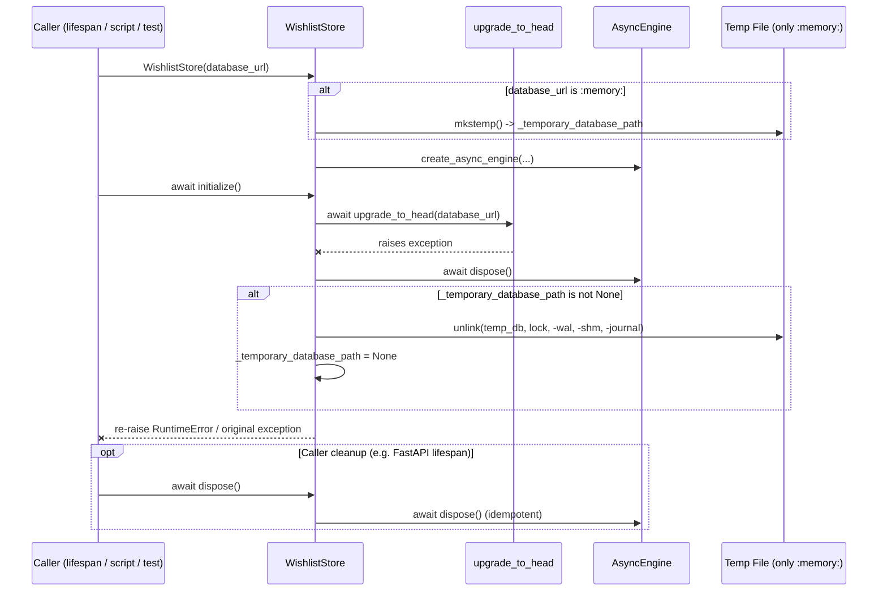

# WISHENKA-132: Освобождать ресурсы WishlistStore при ошибке initialize()

## Research

В ходе анализа кодовой базы изучены следующие модули и точки интеграции:

1. [`wishenka/wishlists/store.py`](file:///home/src/wishenka/wishlists/store.py#L371-L413):
   - `WishlistStore.__init__(self, database_url: str)`:
     - При `database_url == "sqlite+aiosqlite:///:memory:"` создаёт временный файл через `tempfile.mkstemp(prefix="wishenka-", suffix=".sqlite")`, закрывает файловый дескриптор, сохраняет `Path` в `self._temporary_database_path` и подменяет `self.database_url` на путь к этому временному файлу (чтобы синхронный Alembic и асинхронный `aiosqlite` работали с одной и той же БД).
     - Для файловой БД `self._temporary_database_path` остаётся `None`.
     - Создаёт `self.engine = create_async_engine(...)` и настраивает `configure_immediate_transactions(self.engine.sync_engine)`.
   - `WishlistStore.initialize(self)`:
     - Вызывает `await upgrade_to_head(self.database_url)` внутри `try ... except (OSError, RuntimeError, ValueError, SQLAlchemyError) as exc:`, оборачивая ошибку в `RuntimeError("Unable to initialize wishlist storage") from exc`.
     - **Проблема**: при исключении в `upgrade_to_head` метод `self.dispose()` не вызывается. В результате `self.engine` не освобождается, а `self._temporary_database_path` (и возможные сопутствующие файлы SQLite / lock-файл миграций) остаётся на диске.
   - `WishlistStore.dispose(self)`:
     - Вызывает `await self.engine.dispose()`.
     - Если `self._temporary_database_path is not None`, удаляет `self._temporary_database_path` и `migration_lock_path(self._temporary_database_path)` с `missing_ok=True`, а в `finally` сбрасывает `self._temporary_database_path = None`.
     - Повторный вызов `dispose()` уже идемпотентен: `AsyncEngine.dispose()` в SQLAlchemy безопасен при повторном вызове, а блок удаления временного файла пропускается, когда `self._temporary_database_path is None`.
     - Дополнительно: если SQLite успел создать sidecar-файлы (`-wal`, `-shm`, `-journal`) для временного файла до сбоя, их также целесообразно удалять в `dispose()` с `missing_ok=True`.

2. [`wishenka/users/store.py`](file:///home/src/wishenka/users/store.py#L68-L162):
   - `UserStore` не создаёт временный файл на диске для `:memory:` и в `dispose()` вызывает только `await self.engine.dispose()`. Доработки в `UserStore` не требуются и выходят за рамки задачи.

3. Точки жизненного цикла приложения:
   - [`wishenka/web/app.py`](file:///home/src/wishenka/web/app.py#L195-L240): `lifespan` вызывает `await app.state.wishlist_store.initialize()` и в `finally` вызывает `await app.state.wishlist_store.dispose()`.
   - [`wishenka/bot/__main__.py`](file:///home/src/wishenka/bot/__main__.py#L68-L103): аналогично вызывает `initialize()` и `dispose()` в `finally`.
   - Скрипты и тесты, вызывающие `store.initialize()` напрямую без `try/finally`, при сбое полагаются на самоочистку `initialize()`.

## Implementation Plan

1. Обновить `WishlistStore.initialize()` в `wishenka/wishlists/store.py`:
   - Обернуть тело `initialize()` в `try ... except BaseException:` с вызовом `await self.dispose()` перед повторным пробросом (`raise`).
   - Сохранить внутренний `try ... except (OSError, RuntimeError, ValueError, SQLAlchemyError) as exc:` для маппинга ожидаемых ошибок инициализации в `RuntimeError("Unable to initialize wishlist storage") from exc`.
   - Использование `except BaseException:` гарантирует освобождение ресурсов при любых сбоях (включая `asyncio.CancelledError` и нестандартные исключения), не подавляя исходное исключение.
2. Проверить/усилить `WishlistStore.dispose()` в `wishenka/wishlists/store.py`:
   - При наличии `self._temporary_database_path` удалять с `missing_ok=True` не только сам временный файл и `migration_lock_path(...)`, но и возможные SQLite sidecar-файлы (`-wal`, `-shm`, `-journal`).
   - Для постоянных (файловых) БД `self._temporary_database_path is None`, поэтому файл БД на диске гарантированно не затрагивается.
3. Проверить идемпотентность: повторный вызов `await store.dispose()` после неуспешной инициализации (например, в `lifespan` веб-приложения) завершается без ошибок.

**Mandatory — Failing Repro (next Step 3):**
- **Файл:** `tests/test_wishenka_132_initialize_dispose_repro.py` (с `pytestmark = pytest.mark.timeout(10)`).
- **Изоляция без внешних зависимостей:** подмена `wishenka.wishlists.store.upgrade_to_head` через `monkeypatch` асинхронной функцией, выбрасывающей ошибку (например, `RuntimeError("simulated migration failure")`), и шпионаж за `store.engine.dispose` без модификации production-кода.
- **Проверяемые утверждения (desired behavior):**
  1. `:memory:`-хранилище: при сбое `await store.initialize()` пробрасывается `RuntimeError("Unable to initialize wishlist storage")`, `store.engine.dispose` был вызван, временный файл `temp_path` и `migration_lock_path(temp_path)` удалены с диска (`not temp_path.exists()`), `store._temporary_database_path is None`. (До фикса этот тест падает — red repro.)
  2. Файловое хранилище (`tmp_path / "persistent.sqlite"`): при сбое `await store.initialize()` пробрасывается `RuntimeError`, `store.engine.dispose` был вызван, а постоянный файл БД остаётся на диске (`db_path.exists()`).
  3. Идемпотентность: повторный вызов `await store.dispose()` после сбоя `initialize()` завершается успешно без исключений.
- **Последовательность:** исследование (Step 2) → красный тест (Step 3) → исправление `WishlistStore` до зелёного прогона (Step 4).

## Architecture

Изменения локализованы в одном компоненте — `WishlistStore` (`wishenka/wishlists/store.py`) — и не меняют публичные интерфейсы или схему зависимостей между модулями.

### Взаимодействие компонентов при ошибке инициализации

### Модули, интерфейсы и паттерны

- **Модуль**: `wishenka/wishlists/store.py` (`WishlistStore`).
- **Интерфейсы** (без изменений сигнатур):
  - `async def initialize(self) -> None` — подготавливает схему БД; при любом исключении освобождает ресурсы через `await self.dispose()` и пробрасывает ошибку согласно контракту.
  - `async def dispose(self) -> None` — идемпотентно закрывает пул соединений `self.engine` и удаляет принадлежащие экземпляру временные файлы (только если `self._temporary_database_path is not None`).
- **Паттерн**: RAII / exception-safe cleanup на границе метода жизненного цикла (`try ... except BaseException` + идемпотентный `dispose()`), аналогичный управлению ресурсами в `contextlib` / `try-finally`.

## Q&A

- **В:** Нужно ли менять `UserStore.initialize()` / `UserStore.dispose()`?
  **О:** Нет, `UserStore` не создаёт временные файлы на диске для `:memory:` и выходит за рамки `WISHENKA-132`.
- **В:** Что делать, если исключение в `upgrade_to_head` не входит в кортеж `(OSError, RuntimeError, ValueError, SQLAlchemyError)`?
  **О:** Внешний `except BaseException:` всё равно вызовет `await self.dispose()` и перевыбросит исходное исключение без изменения его типа.
