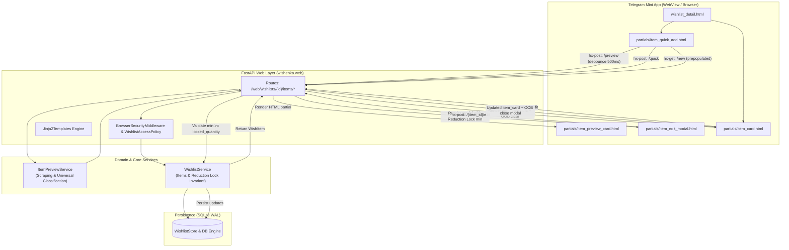

# WISHENKA-14: [Frontend/TMA] Форма быстрого добавления (универсальный инпут) и детального редактирования желания

## Research

### 1. Текущее состояние кодовой базы и точки интеграции

Исследование существующих модулей сервиса «Вишенка» показало готовность ключевых доменных компонентов для реализации пользовательского интерфейса добавления и редактирования желаний:

1. **Сервис предпросмотра ссылок и классификации ввода (`wishenka.items.service.ItemPreviewService`)**:
   - Классификатор `UniversalInputClassifier.classify(raw_input)` надежно разделяет входной текст на `InputType.PLAIN_TEXT` и URL-ссылки различных форматов (включая неявные домены `ozon.ru/...`).
   - Метод `ItemPreviewService.fetch_preview(raw_input)` асинхронно извлекает OpenGraph и Schema.org метаданные (название, цену, валюту, изображение, домен, название магазина), соблюдает строгую защиту от SSRF (`SSRFBlockedError`), ограничивает размеры ответов и время ожидания.
   - При блокировке анти-ботами или таймаутах сервис выполняет безопасную деградацию (`is_fallback=True`, `fallback_reason`), сохраняя нормализованный URL и домен магазина (`store_name`).
   - DTO предварительного просмотра представлен моделью `ItemPreviewDTO` (`wishenka.items.schemas`), содержащей все необходимые атрибуты для предзаполнения карточки предпросмотра и полей модального окна.

2. **Доменный сервис вишлистов (`wishenka.wishlists.service.WishlistService`)**:
   - Создание желания: `add_wish_item(wishlist_id, actor, title, description, link, image_url, price, currency, quantity, priority, category, recipient_user_id, recipient_name)` создает запись в базе данных с автоинкрементным порядком сортировки (`display_order`), проверяя членство автора в списке (`WishlistAccessPolicy`).
   - Редактирование желания: `update_wish_item(...)` атомарно обновляет поля и валидирует инвариант **Reduction Lock**: если `quantity < item.reserved_quantity + item.received_quantity`, выбрасывается `CannotReduceQuantityBelowReservedError`.
   - Защита тайны сюрприза (**Surprise Invariant**): функция `project_wish_item(item, current_user)` проецирует данные в `WishItemRecipientViewDTO` для получателя (исключая любые сведения о бронированиях дарителей) или `WishItemGifterViewDTO` для дарителей.
   - Архивация и восстановление: методы `archive_wish_item` и `restore_wish_item` корректно изолируют архивные сущности от активной выборки без потери бронирований дарителей.

3. **Веб-слой и шаблонизация (`wishenka.web`)**:
   - Серверный рендеринг построен на FastAPI + Jinja2 (`wishenka/web/templates.py`), базовый шаблон [`wishenka/web/templates/base.html`](file:///home/src/wishenka/web/templates/base.html) подключает Telegram WebApp JS SDK и HTMX 1.9.12.
   - Вспомогательные шаблоны и партиалы: [`wishenka/web/templates/partials/item_card.html`](file:///home/src/wishenka/web/templates/partials/item_card.html) отображает карточку желания с учетом `is_recipient` и статуса бронирования; [`wishenka/web/templates/share_wishlist.html`](file:///home/src/wishenka/web/templates/share_wishlist.html) демонстрирует публичную витрину списка.
   - Аутентификация и безопасность: аутентификация пользователя поддерживается через Bearer-токен сессии (`SessionTokenService`) и cookie сессии Telegram (`/api/auth/telegram`), проверенные `BrowserSecurityMiddleware`. Защита RBAC строится через `WishlistAccessPolicy.resolve_context(user, wishlist)`.

4. **Telegram Mini App (TMA) UX & HTMX Patterns**:
   - Документ [`doc/dev/miniapp.md`](file:///home/src/doc/dev/miniapp.md) и скрипт `miniapp.js` описывают интеграцию с `window.Telegram.WebApp` (темизация CSS-переменными Telegram, haptic feedback, полноэкранный режим `expand()`).
   - Использование HTMX позволяет реализовать бесшовную компонентную архитектуру без тяжелых клиентских SPA-фреймворков: форма ввода и модальные шторки обмениваются легковесными HTML-партиалами с сервером.

---

## Implementation Plan

### High-Level Execution Phases

1. **Фаза 1: Разработка падающего репро-теста (Step 3 Failing Repro)**:
   - Создать файл [`tests/test_wish_items_tma_ui.py`](file:///home/src/tests/test_wish_items_tma_ui.py) с набором интеграционных тестов для всех веб-эндпоинтов HTMX и шаблонов интерфейса добавления/редактирования желаний.
   - Зафиксировать состояние тестов: тесты должны падать (RED, статус 404/Not Found для новых эндпоинтов и шаблонов) до начала имплементации.
2. **Фаза 2: Разработка шаблонов и партиалов (Jinja2 / HTMX)**:
   - Создать `wishenka/web/templates/wishlist_detail.html` (основной экран вишлиста для членов и гостей с поддержкой нижней панели).
   - Создать `wishenka/web/templates/partials/item_quick_add.html` (плавающая нижняя панель быстрого добавления).
   - Создать `wishenka/web/templates/partials/item_preview_card.html` (карточка живого предпросмотра с богатыми метаданными и fallback-режимом).
   - Создать `wishenka/web/templates/partials/item_edit_modal.html` (модальная шторка детального редактирования и создания с валидацией и контролем Reduction Lock).
   - Обновить `wishenka/web/templates/partials/item_card.html`: добавить кнопку вызова редактирования для участников с правами и устранить XSS-уязвимость (DoD 4), удалив небезопасный фильтр `|safe` и заменив `{{ item.title|safe }}` на стандартный автоэкранируемый вывод `{{ item.title }}`.
   - Дополнить стили в `wishenka/web/static/miniapp.css` для позиционирования Quick Add Bar с учетом мобильной Safe Area и клавиатуры.
3. **Фаза 3: Реализация веб-эндпоинтов HTMX (`wishenka/web/routes/items_ui.py` или маршруты в `wishenka/web/routes/wishlists.py` / `items.py`)**:
   - Реализовать `POST /web/wishlists/{wishlist_id}/items/preview` (вызов `ItemPreviewService`, рендер `item_preview_card.html`).
   - Реализовать `POST /web/wishlists/{wishlist_id}/items/quick` (создание желания, возврат новой карточки и очистка инпута через OOB Swap).
   - Реализовать `GET /web/wishlists/{wishlist_id}/items/new` (открытие шторки создания с предзаполненными данными из превью).
   - Реализовать `GET /web/wishlists/{wishlist_id}/items/{item_id}/edit` (открытие шторки редактирования с расчетом `locked_quantity`).
   - Реализовать `POST /web/wishlists/{wishlist_id}/items/{item_id}/edit` (сохранение правок, обработка ошибок 409 Reduction Lock, возврат обновленной карточки).
   - Реализовать `POST /web/wishlists/{wishlist_id}/items/{item_id}/archive` (архивация желания через `WishlistService.archive_wish_item`, удаление карточки из DOM и закрытие шторки).
   - Реализовать `POST /web/wishlists/{wishlist_id}/items/{item_id}/restore` (восстановление желания через `WishlistService.restore_wish_item`, возврат карточки в активный список).
   - Реализовать `GET /web/wishlists/{wishlist_id}` (авторизованный/публичный экран вишлиста с отображением Quick Add Bar только для авторов).
4. **Фаза 4: Observability, линтинг и документация (Steps 5–8)**:
   - Внедрить структурированное логирование событий пользовательского интерфейса.
   - Проверить чистоту кода через `ruff check`, `ruff format`, `mypy`.
   - Провести анализ техдолга и актуализировать документацию в `doc/dev/miniapp.md`.

---

### Mandatory — Failing Repro (Step 3 Design)

- **Файл размещения**: [`tests/test_wish_items_tma_ui.py`](file:///home/src/tests/test_wish_items_tma_ui.py)
- **Изоляция и запуск**: использует `fastapi.testclient.TestClient`, фикстуру изолированной SQLite БД в `tmp_path`, мокирование сетевых HTTP-вызовов парсера через мок `ItemPreviewService` или мок-транспорт `httpx`, авторизацию через `SessionTokenService`.
- **Таймаут**: обязательный маркер `pytestmark = pytest.mark.timeout(10)` согласно [do-testing](../do-testing/SKILL.md).
- **Сценарии тестирования (Desired Behavior)**:
  1. `test_quick_add_bar_visibility_by_role`:
     - Владелец/соавтор видит форму `#quick-add-bar` и кнопку вызова детального добавления на странице `GET /web/wishlists/{id}`.
     - Гость и анонимный пользователь открывают `GET /web/wishlists/{id}` или `GET /share/{token}` и **не** видят `#quick-add-bar` и кнопок редактирования карточек.
     - В архивном вишлисте форма быстрого добавления скрыта даже для владельца.
  2. `test_item_preview_endpoint_url_rich_metadata`:
     - `POST /web/wishlists/{id}/items/preview` с телом `raw_input=https://ozon.ru/product/123` возвращает HTML-партиал `item_preview_card.html` с миниатюрой изображения, бейджем магазина Ozon, ценой и кнопками «Добавить» и «Подробнее».
  3. `test_item_preview_endpoint_graceful_fallback`:
     - `POST /web/wishlists/{id}/items/preview` при сетевой ошибке или защите от ботов возвращает fallback-партиал с распознанным доменом, сохраненной ссылкой и приглашением ввести название вручную (без падения 500).
  4. `test_item_preview_endpoint_plain_text`:
     - `POST /web/wishlists/{id}/items/preview` с простым текстом (например, «Кроссовки Nike») не запускает парсер ссылок и возвращает пустой ответ или подсказку без карточки предпросмотра ссылки.
  5. `test_quick_add_post_creates_item_and_updates_dom`:
     - `POST /web/wishlists/{id}/items/quick` с `raw_input="Настольная игра"` создает желание в базе, возвращает рендер `item_card.html` с атрибутом `hx-swap-oob` для очистки строки ввода и предпросмотра.
  6. `test_detailed_edit_modal_get_and_post`:
     - `GET /web/wishlists/{id}/items/{item_id}/edit` возвращает HTML модальной шторки со всеми предзаполненными полями.
     - `POST /web/wishlists/{id}/items/{item_id}/edit` с обновленным названием и ценой сохраняет изменения, возвращает обновленную карточку желания `#item-card-{item_id}` и закрывает модальное окно.
  7. `test_reduction_lock_ui_and_validation`:
     - Для желания с общим количеством 5 шт. и бронированием на 2 шт., `GET /web/wishlists/{id}/items/{item_id}/edit` отдает инпут количества с атрибутом `min="2"`, заблокированной кнопкой декремента и поясняющим баннером.
     - При отправке `POST` со значением `quantity=1` сервер возвращает HTTP 409 с дружелюбным сообщением об ошибке и сохраненными полями формы.
  8. `test_collaborative_recipient_targeting`:
     - В совместном вишлисте модальное окно содержит выпадающий список участников (`recipient_user_id`) и поле для произвольного имени (`recipient_name`).
     - В персональном вишлисте блок выбора адресата скрыт.
  9. `test_surprise_invariant_in_ui`:
     - Карточка желания и форма редактирования для получателя подарка строго скрывают информацию о том, кто забронировал подарок (имена и ID дарителей отсутствуют в разметке).
  10. `test_item_archive_and_restore_via_ui`:
     - Отправка `POST /web/wishlists/{wishlist_id}/items/{item_id}/archive` возвращает OOB swap для удаления карточки желания `#item-card-{item_id}` из DOM активного списка вишлиста и закрытия модальной шторки `#item-modal-container`.
     - Проверяется, что при архивации в БД сохраняются существующие бронирования дарителей.
     - Отправка `POST /web/wishlists/{wishlist_id}/items/{item_id}/restore` вызывает `WishlistService.restore_wish_item`, возвращает карточку желания обратно в активный список DOM с корректным сохранением ранее сделанных бронирований.
- **Sequencing**:
  На этапе Step 3 создается тест `test_wish_items_tma_ui.py`. Он запускается и выдает RED (404 Not Found на `/web/wishlists/.../items/preview` и т.д.). Переход к Step 4 выполняется только после подтверждения корректной фиксации провала.

---

## Architecture

### 1. Архитектурная диаграмма компонентов и потока данных



### 2. Описание компонентов и зон ответственности

| Модуль / Компонент | Расположение | Зона ответственности |
|---|---|---|
| **Web UI Routes** | `wishenka/web/routes/items_ui.py` | Обработка HTMX-запросов (`/web/wishlists/{wishlist_id}/items/...`), валидация прав доступа через `WishlistAccessPolicy`, оркестрация доменных сервисов, формирование контекста шаблонов. |
| **Main Wishlist View** | `wishenka/web/templates/wishlist_detail.html` | Полноценная HTML-страница списка желаний для веб-интерфейса и TMA: отображение шапки, списка подарков, контейнера модального окна и нижней панели добавления. |
| **Quick Add Component** | `wishenka/web/templates/partials/item_quick_add.html` | Закрепленная внизу экрана мобильная панель с универсальным текстовым инпутом, триггерами HTMX для дебаунса предпросмотра, кнопками мгновенного сохранения и перехода к деталям. |
| **Preview Card Partial** | `wishenka/web/templates/partials/item_preview_card.html` | Карточка живого предпросмотра распознанной ссылки: миниатюра фото, бейдж магазина/домена, цена, кнопка сброса «✕», fallback-режим при сбоях парсинга. |
| **Edit / Create Modal** | `wishenka/web/templates/partials/item_edit_modal.html` | Модальное окно (BottomSheet) детального создания/редактирования: полный состав полей, шагомер количества с визуализацией `Reduction Lock`, выбор адресата в совместном списке, кнопка архивации. |
| **Item Card Partial** | `wishenka/web/templates/partials/item_card.html` | Карточка подарка в списке: дополнена кнопкой вызова редактирования для авторов списка при сохранении инварианта тайны сюрприза. |
| **Styles & Layout** | `wishenka/web/static/miniapp.css` | Стилизация мобильного интерфейса: учет безопасных зон (`env(safe-area-inset-bottom)`), адаптивность клавиатуры, плавные CSS-анимации всплытия карточек. |

---

### 3. Спецификация HTTP-эндпоинтов (HTMX Transport)

#### 3.1. `POST /web/wishlists/{wishlist_id}/items/preview`
- **Назначение**: Получение данных предварительного просмотра ссылки или текста без сохранения в базу.
- **Авторизация**: Доступно только участникам с правом редактирования (`OWNER`, `ADMIN`, `MEMBER`). Недоступно для гостей и при архивном вишлисте.
- **Входные данные**: Form data `raw_input: str` (передается через HTMX при изменении инпута с задержкой `delay:500ms`).
- **Логика**:
  1. Вызов `UniversalInputClassifier.classify(raw_input)`.
  2. Если `PLAIN_TEXT` — возвращается пустой ответ `200 OK` (карточка превью не отображается, лишние сетевые запросы парсинга не производятся).
  3. Если URL — вызов `ItemPreviewService.fetch_preview(raw_input)`.
  4. При успешном извлечении возвращается `partials/item_preview_card.html` с заполненными полями (`title`, `image_url`, `price`, `currency`, `store_name`, `url`).
  5. При ошибке извлечения / блокировке анти-ботом — возвращается `partials/item_preview_card.html` в режиме деградации (`is_fallback=True`, сохраненный домен и очищенный URL).
- **Выходной контент**: HTML-партиал карточки предпросмотра.

#### 3.2. `POST /web/wishlists/{wishlist_id}/items/quick`
- **Назначение**: Мгновенное сохранение желания из универсального инпута или карточки предпросмотра.
- **Авторизация**: `can_edit_wishlist == True`, статус вишлиста `active`.
- **Входные данные**: Form data:
  - `raw_input: str` (обязательно)
  - Скрытые поля из карточки предпросмотра (если была активна): `title`, `link`, `price`, `currency`, `image_url`.
- **Логика**:
  1. Если переданы скрытые поля предпросмотра, используются они. Иначе заголовок формируется из `raw_input.strip()`, количество = 1, валюта по умолчанию = "RUB".
  2. Вызов `WishlistService.add_wish_item(...)`.
  3. Формирование HTML-ответа:
     - Основное тело: рендер `partials/item_card.html` для новой карточки (вставляется в `#items-list` через `hx-swap="beforeend"`).
     - Out-of-band swaps:
       - `<div id="quick-add-preview-target" hx-swap-oob="innerHTML"></div>` (очистка карточки предпросмотра).
       - `<input id="quick-add-input" hx-swap-oob="true" value="" ... />` (сброс поля ввода).
       - Удаление заглушки «В этом списке пока нет подарков», если она присутствовала.
- **Статус ответа**: `201 Created` (или `200 OK` для HTMX).

#### 3.3. `GET /web/wishlists/{wishlist_id}/items/new`
- **Назначение**: Отображение модальной шторки детального создания подарка с предзаполнением данными из строки быстрого добавления или предпросмотра.
- **Параметры запроса (Query Params)**:
  - `raw_input: str | None`
  - `title: str | None`
  - `link: str | None`
  - `price: int | None`
  - `currency: str | None`
  - `image_url: str | None`
- **Контекст рендеринга**:
  - `wishlist`: объект списка (включая признак `is_collaborative` и список участников `members` для адресации).
  - Предзаполненные поля формы.
  - `locked_quantity`: 0 (для новых элементов ограничение отсутствует).
- **Выходной контент**: `partials/item_edit_modal.html`.

#### 3.4. `GET /web/wishlists/{wishlist_id}/items/{item_id}/edit`
- **Назначение**: Отображение модальной шторки редактирования существующего желания.
- **Авторизация**: Проверка прав редактирования вишлиста.
- **Логика**:
  1. Получение карточки желания из `WishlistService`.
  2. Расчет порога блокировки: `locked_quantity = item.reserved_quantity + item.received_quantity`.
  3. Передача в шаблон списка активных участников списка (для выбора `recipient_user_id` при `is_collaborative=True`).
- **Выходной контент**: `partials/item_edit_modal.html` со значениями атрибутов желания, ограничением `min="{{ locked_quantity or 1 }}"` и предупреждающим баннером при `locked_quantity > 0`.

#### 3.5. `POST /web/wishlists/{wishlist_id}/items/{item_id}/edit`
- **Назначение**: Сохранение отредактированных атрибутов желания.
- **Входные данные (Form Data)**:
  - `title: str` (обязательно, 1..255 символов)
  - `link: str | None`
  - `price: int | None`
  - `currency: str`
  - `quantity: int` (валидация `quantity >= locked_quantity`)
  - `recipient_user_id: int | None` / `recipient_name: str | None`
  - `description: str | None`
  - `image_url: str | None`
  - `priority: str`
  - `category: str | None`
- **Логика**:
  1. Вызов `WishlistService.update_wish_item(...)`.
  2. При успешном сохранении:
     - Возврат обновленного `partials/item_card.html` с селектором `#item-card-{item_id}` (`hx-swap="outerHTML"`).
     - Out-of-band swap: `<div id="item-modal-container" hx-swap-oob="innerHTML"></div>` (закрытие модального окна).
  3. При перехвате `CannotReduceQuantityBelowReservedError`:
     - Возврат `partials/item_edit_modal.html` с HTTP статусом `409 Conflict` (или `422 Unprocessable Entity`), отображением красного блока ошибки и полным сохранением всех введенных пользователем данных.

#### 3.6. `POST /web/wishlists/{wishlist_id}/items/{item_id}/archive`
- **Назначение**: Архивация желания пользователем (владельцем или участником списка).
- **Авторизация**: Проверка RBAC через `WishlistAccessPolicy.resolve_context(user, wishlist)` (`OWNER`, `ADMIN`, `MEMBER`). При отсутствии прав или неизвестном списке — `404 Not Found`. Запрещено для архивного вишлиста (`409 Conflict`).
- **Логика**:
  1. Вызов `WishlistService.archive_wish_item(wishlist_id=wishlist_id, item_id=item_id, actor=current_user)`.
  2. Защита инварианта: бронирования дарителей остаются сохраненными в БД.
  3. Формирование ответа HTMX:
     - Out-of-band swap для удаления карточки из активного списка: `<div id="item-card-{{ item_id }}" hx-swap-oob="delete"></div>`.
     - Out-of-band swap для закрытия модальной шторки: `<div id="item-modal-container" hx-swap-oob="innerHTML"></div>`.
- **Статус ответа**: `200 OK`.
- **Выходной контент**: OOB-фрагменты для удаления карточки `#item-card-{item_id}` и закрытия `#item-modal-container`.

#### 3.7. `POST /web/wishlists/{wishlist_id}/items/{item_id}/restore`
- **Назначение**: Восстановление ранее заархивированного желания обратно в активный список подарков.
- **Авторизация**: Проверка RBAC через `WishlistAccessPolicy.resolve_context(user, wishlist)` (`OWNER`, `ADMIN`, `MEMBER`). Запрещено для архивного вишлиста (`409 Conflict`).
- **Логика**:
  1. Вызов `WishlistService.restore_wish_item(wishlist_id=wishlist_id, item_id=item_id, actor=current_user)`.
  2. Возврат обновленного `partials/item_card.html` для восстановленного желания (добавляется в `#items-list` через `hx-swap="beforeend"` или заменяет элемент в восстановленном виде с сохранением бронирований).
- **Статус ответа**: `200 OK`.
- **Выходной контент**: Рендер `partials/item_card.html` восстановленного желания.

---

### 4. Детализация UI-компонентов и пользовательского взаимодействия

#### 4.1. Quick Add Bar (`partials/item_quick_add.html`)
- **Позиционирование**:
  ```css
  .quick-add-container {
    position: fixed;
    bottom: 0;
    left: 0;
    right: 0;
    padding-bottom: max(12px, env(safe-area-inset-bottom));
    background: var(--tg-theme-bg-color, #ffffff);
    box-shadow: 0 -2px 10px rgba(0, 0, 0, 0.08);
    z-index: 40;
  }
  ```
- **Элементы управления**:
  - Текстовый инпут `#quick-add-input` с атрибутом `hx-post="/web/wishlists/{{ wishlist.id }}/items/preview"`, триггером `hx-trigger="input changed delay:500ms, paste"` и таргетом `hx-target="#quick-add-preview-target"`.
  - Кнопка «Добавить» (`#btn-quick-add`): инициирует отправку формы `POST /web/wishlists/{{ wishlist.id }}/items/quick`.
  - Кнопка «Подробнее» (`#btn-quick-details`): выполняет `hx-get="/web/wishlists/{{ wishlist.id }}/items/new"` с включением введенного значения (`hx-include="#quick-add-input"`).
- **UX мобильной клавиатуры**:
  - Использование `touch-action: manipulation`, минимальная высота кнопок 44px.
  - Поле ввода не зумируется на iOS (`font-size: 16px`).

#### 4.2. Preview Card (`partials/item_preview_card.html`)
- Всплывает непосредственно над полем ввода с плавной анимацией `transition: transform 0.2s ease, opacity 0.2s ease`.
- Содержит:
  - Миниатюру изображения (``).
  - Название товара и бейдж источника (`<span class="badge">{{ preview.store_name }}</span>`).
  - Стоимость с валютой (`{{ preview.price }} {{ preview.currency }}`).
  - Кнопку отмены «✕» (`hx-on:click="document.getElementById('quick-add-preview-target').innerHTML = ''"`).
  - Скрытые поля `<input type="hidden" name="image_url" value="..." />` и др., которые отправляются при нажатии кнопки «Добавить».

#### 4.3. Detailed Edit Modal (`partials/item_edit_modal.html`)
- Выполнен в виде полупрозрачного оверлея с выезжающей снизу шторкой (BottomSheet).
- **Визуализация Reduction Lock**:
  ```html
  <div class="quantity-control flex items-center gap-3">
    <button type="button"
            class="btn-step btn-decrement"
            disabled
            onclick="decrementQuantity({{ locked_quantity }})">-</button>
    <input type="number"
           name="quantity"
           id="item-quantity-input"
           value="{{ item.quantity }}"
           min="{{ locked_quantity or 1 }}"
           max="1000"
           class="w-20 text-center font-bold" />
    <button type="button"
            class="btn-step btn-increment"
            onclick="incrementQuantity()">+</button>
  </div>
  
  <div class="alert alert-warning text-xs mt-2 text-amber-700 bg-amber-50 p-2 rounded">
    ℹ️ Забронировано дарителями: {{ locked_quantity }} шт.
    Нельзя уменьшить количество ниже забронированного объема.
  </div>
  
  ```
- **Адресация в совместных вишлистах (`is_collaborative`)**:
  - Выпадающий список:
    - `<option value="">Общий подарок (для всех)</option>`
    - Цикл по участникам: `<option value="{{ m.user_id }}">{{ m.display_name }}</option>`
  - Альтернативный ввод внешнего имени (`recipient_name`) для родственников/детей.

#### 4.4. Item Card (`partials/item_card.html`) и защита от XSS (DoD 4)
- **Устранение XSS-уязвимости (DoD 4)**:
  - В исходном шаблоне используется небезопасный фильтр: `<h3 class="item-title text-lg font-semibold">{{ item.title|safe }}</h3>`.
  - В соответствии с критерием приемки DoD 4 фильтр `|safe` полностью удаляется и заменяется стандартным безопасным автоэкранированием Jinja2: `<h3 class="item-title text-lg font-semibold">{{ item.title }}</h3>`.
  - Все пользовательские поля карточки (`title`, `description`, `link`, `recipient_name`) строго экранируются шаблонизатором Jinja2, исключая внедрение вредоносного HTML/JS при отображении названий и метаданных.
- **Интеграция кнопки редактирования**:
  - Для авторов вишлиста с правами редактирования в карточку желания добавляется кнопка «Редактировать» / иконка карандаша:
    - `hx-get="/web/wishlists/{{ wishlist.id }}/items/{{ item.id }}/edit"`
    - `hx-target="#item-modal-container"`
    - `hx-swap="innerHTML"`
  - Для гостей и в режиме просмотра публичной ссылки кнопка редактирования скрывается.

---

### 5. Защита инвариантов и ролевая безопасность

1. **Surprise Invariant**:
   - При открытии модального окна и рендеринге карточки для пользователя, являющегося получателем (`is_recipient = True`), серверная логика исключает любые персональные данные дарителей (имена, юзернеймы, ID).
   - Выводится исключительно агрегированная цифра `locked_quantity` в контексте технического ограничения шагомера, без указания того, кем именно сделана бронь.
2. **RBAC & State Validation**:
   - Любые эндпоинты мутации (`/preview`, `/quick`, `/edit`, `/archive`) запрашивают проверку `WishlistAccessPolicy.resolve_context(user, wishlist)`. Если пользователь не является `OWNER`, `ADMIN` или `MEMBER` — немедленный ответ `404 Not Found` (чтобы не раскрывать существование приватного вишлиста).
   - Если вишлист заархивирован (`status == WishlistStatus.ARCHIVED`), любые попытки мутации пресекаются с ответом `409 Conflict`.

---

### 6. Стратегия наблюдаемости и логирования (Observability)

Все ключевые действия в интерфейсе фиксируются через структурированный логгер `wishenka.web.items_ui` с контекстными атрибутами:

| Событие (`event`) | Уровень | Ключевые атрибуты контекста | Описание |
|---|---|---|---|
| `ui_item_quick_add_preview` | INFO | `wishlist_id`, `user_id`, `input_type`, `is_fallback`, `store_name`, `duration_ms` | Пользователь ввел URL в инпут, получен предпросмотр. |
| `ui_item_quick_add_success` | INFO | `wishlist_id`, `item_id`, `user_id`, `title`, `has_link`, `price`, `quantity` | Желание успешно создано через форму быстрого добавления. |
| `ui_item_edit_opened` | INFO | `wishlist_id`, `item_id`, `user_id`, `locked_quantity`, `is_collaborative` | Открыта шторка детального редактирования. |
| `ui_item_edit_saved` | INFO | `wishlist_id`, `item_id`, `user_id`, `updated_fields`, `quantity` | Сохранены изменения в существующем желании. |
| `ui_reduction_lock_rendered` | INFO | `wishlist_id`, `item_id`, `locked_quantity` | Отрендерен интерфейс с активным ограничением Reduction Lock. |
| `ui_reduction_lock_rejected` | WARNING | `wishlist_id`, `item_id`, `user_id`, `requested_quantity`, `locked_quantity` | Предотвращена или отклонена попытка занизить количество ниже забронированного. |

---

## Q&A

**В1: Почему для быстрого добавления используется HTMX вместо клиентского JS в `miniapp.js`?**  
*О1:* Архитектура проекта «Вишенка» основывается на серверном рендеринге (FastAPI + Jinja2 + HTMX). Использование HTMX гарантирует единообразную валидацию, защиту инварианта тайны сюрприза на стороне сервера, устраняет дублирование шаблонов карточек на клиенте и обеспечивает мгновенный отклик при минимальном объеме клиентского JS-кода.

**В2: Как предотвратить избыточные сетевые запросы при быстром наборе текста в инпуте?**  
*О2:* В инпуте задействован HTMX-атрибут `hx-trigger="input changed delay:500ms, paste"`. При быстром наборе текста таймер сбрасывается. Кроме того, классификатор `UniversalInputClassifier` на бэкенде мгновенно определяет обычный текст и не обращается к сетевому парсеру, возвращая ответ за доли миллисекунды.

**В3: Как форма реагирует на конфликт версий или одновременное бронирование другим пользователем во время редактирования?**  
*О3:* Если в момент нахождения пользователя в форме редактирования даритель успел забронировать дополнительную единицу товара, попытка уменьшить количество перехватывается доменным исключением `CannotReduceQuantityBelowReservedError`. Сервер возвращает форму с кодом 409 и предупреждением, не сбрасывая введенные пользователем поля.

**В4: Где физически будут зарегистрированы новые маршруты HTMX?**  
*О4:* Рекомендуется вынести новые маршруты пользовательского интерфейса в отдельный модуль `wishenka/web/routes/items_ui.py` (подключенный в `wishenka/web/app.py`), чтобы строго разделить REST JSON API (`/api/wishlists/.../items`) и серверный рендеринг HTMX-партиалов (`/web/wishlists/.../items`).