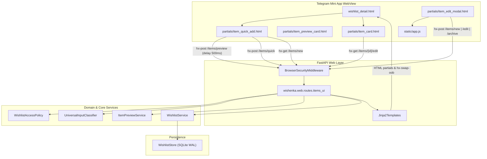

# Спецификация: WISHENKA-14 — Форма быстрого добавления (универсальный инпут) и детального редактирования желания

**Ключ задачи:** `WISHENKA-14`  
**Оценка сложности:** `5.0` Story Points  
**Статус:** реализовано и верифицировано (см. [00-roadmap.md](file:///home/src/ai-tasks/WISHENKA-14/00-roadmap.md))  
**Стек:** Python 3.12+, FastAPI, Jinja2, HTMX 1.9.12, JavaScript, CSS (Telegram Mini App WebView)  
**Связанные документы:** [00-high.md](file:///home/src/specs/00-high.md), [spec.md](file:///home/src/in-docs/spec.md), [items.md](file:///home/src/doc/dev/items.md), [miniapp.md](file:///home/src/doc/dev/miniapp.md)

## 1. Назначение и бизнес-цель

### 1.1. Постановка проблемы

Сервис списков желаний «Вишенка» (Telegram Wishlist Service) предназначен для создания и совместного ведения вишлистов в Telegram с координацией дарителей и защитой тайны сюрприза. До реализации `WISHENKA-14` в серверном интерфейсе Telegram Mini App отсутствовали интерактивная панель добавления новых подарков и полноценная форма редактирования существующих карточек желаний, несмотря на готовность доменных сервисов парсинга ссылок (`ItemPreviewService`) и управления элементами списка (`WishlistService`).

### 1.2. Цели

1. Предоставить авторам и соавторам активного вишлиста закреплённую внизу экрана панель быстрого добавления (**Quick Add Bar**) с универсальным полем ввода:
   - мгновенное сохранение идеи подарка по произвольному тексту без перехода на отдельные экраны;
   - автоматическое распознавание ссылок на товары (включая Ozon, Wildberries, Яндекс Маркет, Авито, Мегамаркет и другие сайты) с выводом карточки живого предпросмотра и возможностью сохранения в один клик;
   - плавная деградация (fallback) к ручному вводу названия при анти-бот блокировке, таймауте или недоступности метаданных.
2. Реализовать модальную шторку (**BottomSheet**) детального создания и редактирования желания с поддержкой всех атрибутов подарка: названия, ссылки, ориентировочной цены, валюты, требуемого количества (`1..1000`), адресации получателя в совместных вишлистах, описания/комментария, URL изображения, приоритета и категории, а также безопасной архивации.
3. Гарантировать соблюдение продуктовых инвариантов в веб-интерфейсе:
   - строгая ролевая изоляция (RBAC): скрытие элементов создания и редактирования от гостей, дарителей и в архивных вишлистах;
   - защита тайны сюрприза (**Surprise Invariant**): отсутствие в HTML и логах каких-либо сведений о бронированиях и личностях дарителей;
   - защита минимального количества при редактировании и защита всех пользовательских полей от XSS.

### 1.3. Ценность для пользователей и системы

- **Для владельцев и участников вишлиста:** фиксация текстового желания занимает одно действие без перезагрузки страницы, а при вставке ссылки сервис автоматически заполняет фото, магазин, название и цену. Переход «Подробнее» переносит уже распознанные данные в полную форму без повторного ввода.
- **Для дарителей и получателей:** чистая витрина без лишних элементов управления для гостей и сохранность существующих бронирований при архивации и редактировании желаний.
- **Для архитектуры системы:** серверный рендеринг HTMX-партиалов (`FastAPI` + `Jinja2`) исключает дублирование шаблонной логики и правил доступа на клиенте и обеспечивает единую точку применения санитизации и доменных политик.

## 2. Функциональные требования и пользовательские сценарии

### 2.1. Панель быстрого добавления (Quick Add Bar) и живой предпросмотр

Панель `#quick-add-bar` (`partials/item_quick_add.html`) закреплена в нижней части экрана детальной страницы вишлиста и отображается только при `can_edit_wishlist == True` (авторизованный `OWNER`, `ADMIN` или `MEMBER` при `WishlistStatus.ACTIVE`).

Поведение универсального ввода (`#quick-add-input`):

1. **Обычный текст (`InputType.PLAIN_TEXT`):**
   - классифицируется на сервере через `UniversalInputClassifier.classify(raw_input)`;
   - обработчик предпросмотра возвращает пустой HTML-ответ `200 OK`, не инициируя сетевых запросов парсинга;
   - по нажатию «Добавить» (`POST /web/wishlists/{wishlist_id}/items/quick`) создаётся желание с названием `raw_input.strip()`, количеством `1`, валютой `DEFAULT_CURRENCY` (`RUB`) и приоритетом `medium`.
2. **Ссылка на товар (`EXPLICIT_URL`, `IMPLICIT_URL`, `COMPOSITE_SHARE`):**
   - клиент инициирует запрос `POST /web/wishlists/{wishlist_id}/items/preview` по событию `input changed delay:500ms, paste`;
   - при успешном извлечении метаданных над строкой ввода рендерится карточка `#item-preview-card` (`partials/item_preview_card.html`): миниатюра фото (с `loading="lazy"`, `referrerpolicy="no-referrer"` и запасной иконкой при ошибке загрузки), бейдж магазина (`store_name`), очищенное название (`title`), цена с валютой, скрытые поля формы (`link`, `price`, `currency`, `image_url`, `store_name`, `title`), кнопка сброса «✕», кнопка «Подробнее» и кнопка «Добавить».
3. **Плавная деградация (Graceful Fallback):**
   - если `preview.is_fallback == True` или название не извлечено (анти-бот защита, таймаут, превышение размера ответа, блокировка SSRF, неподдерживаемый сайт), вместо ошибки сервера отображается fallback-состояние карточки: сохраняются очищенный `preview.url` и `preview.store_name`, выводится подсказка `web.item.preview_fallback_hint` и текстовое поле `name="title"` для ручного ввода названия либо перехода по кнопке «Подробнее».
4. **Динамическое обновление DOM после сохранения:**
   - при успешном быстром добавлении сервер возвращает `201 Created` с новой карточкой `partials/item_card.html` (добавляется в конец `#items-list`) и Out-of-Band (`hx-swap-oob`) фрагментами: очистка `#quick-add-preview-target`, сброс `#quick-add-input` (`value=""`), удаление заглушки `#empty-items-placeholder` и очистка `#item-modal-container`;
   - при пустом названии или ошибке разбора/валидации возвращается `400 Bad Request` с OOB-сообщением в `#list-notice` и закрытием модального контейнера.

### 2.2. Детальное создание и редактирование желания (BottomSheet)

Модальная шторка (`partials/item_edit_modal.html`, контейнер `#item-edit-sheet`) открывается в одном из двух режимов:

- **Создание (`is_edit=False`, `GET /web/wishlists/{wishlist_id}/items/new`):** вызывается кнопкой «Подробнее» из `#quick-add-bar` или из карточки предпросмотра (`hx-include="#quick-add-form"`). Предзаполняет поля формы данными предпросмотра или классификации `raw_input` (если передан только текст или ссылка), устанавливает `min_quantity = 1`. Сохранение выполняется через `POST /web/wishlists/{wishlist_id}/items/new`.
- **Редактирование (`is_edit=True`, `GET /web/wishlists/{wishlist_id}/items/{item_id}/edit`):** вызывается кнопкой «Редактировать» в раскрытой карточке желания (`.item-card-details`). Загружает текущие значения атрибутов и вычисляет порог `min_quantity = max(1, item.received_quantity)`. Сохранение выполняется через `POST /web/wishlists/{wishlist_id}/items/{item_id}/edit`.

Состав и валидация полей детальной формы:

| Поле (`name`) | Элемент ввода | Обязательность | Ограничения и правила обработки |
| --- | --- | --- | --- |
| `title` | `input[type="text"]` | Да | `1..255` символов; пробелы обрезаются; пустая строка отклоняется (`400`) |
| `link` | `input[type="url"]` | Нет | Строка URL; очищается от крайних пробелов (до `2048` символов в DTO) |
| `price` | `input[type="number"]` | Нет | `min="0"`, `max="999999999"`, `step="any"`; конечное число (целые сохраняются как `int`) |
| `currency` | `select` | Да (`RUB`) | 11 вариантов из `CURRENCY_OPTIONS`; неизвестная ранее сохранённая валюта сохраняется в списке |
| `quantity` | `input[type="number"]` + шагомер | Да (`1`) | Целое число от `min_quantity` до `1000`; кнопки `-`/`+` ограничены `[min, max]` |
| `recipient_user_id` | `select` | Только при `is_collaborative` | Выбор участника вишлиста (`owner_id` или `members`) либо «Общий подарок»; проверяется членство в списке |
| `recipient_name` | `input[type="text"]` | Только при `is_collaborative` | До `100` символов; произвольное имя получателя (например, «Малыш», «Бабушка») |
| `description` | `textarea` | Нет | В шаблоне `maxlength="4000"` (в REST DTO `max_length=2000`) |
| `image_url` | `input[type="url"]` | Нет | URL обложки; при наличии значения выводится ленивый предпросмотр миниатюры (`no-referrer`) |
| `priority` | `select` | Да (`medium`) | Значения `ItemPriority`: `low`, `medium`, `high` |
| `category` | `input[type="text"]` | Нет | До `50` символов |

Обработка ошибок при отправке формы создания/редактирования:

- **Ошибка валидации формы или доменного `ValueError`:** возвращается `400 Bad Request` с ререндером `partials/item_edit_modal.html`, заголовками `HX-Retarget: #item-modal-container`, `HX-Reswap: innerHTML`, блоком `[role="alert"]` и сохранением всех введённых пользователем значений (при `submit_new_item` также сохраняется перечень `collaborative_members` и выбранный адресат; при ошибке парсинга в `submit_edit_item` форма перерисовывается с `400` до чтения списка).
- **Нарушение минимального количества (`CannotReduceQuantityBelowReservedError`):** возвращается `409 Conflict` с ререндером модального окна, сохранением введённых полей и локализованным сообщением `web.item.quantity_below_reserved`.
- **Занятость транзакции желания (`InventoryBusyError`):** возвращается `503 Service Unavailable` с ререндером модального окна, сохранением введённых полей и нейтральным сообщением `web.item.edit_busy_error`.
- **Успешное редактирование:** возвращается `200 OK` с обновлённой карточкой `partials/item_card.html` (`#item-card-{item_id}`) и OOB-очисткой `#item-modal-container`.

### 2.3. Ограничение уменьшения количества и защита тайны сюрприза

- **Минимальное количество (`min_quantity`):** в согласованной модели сервиса (раздел 5.5 [spec.md](file:///home/src/in-docs/spec.md), [items.md](file:///home/src/doc/dev/items.md)) автор может уменьшать запрошенное количество вплоть до `max(1, received_quantity)` независимо от числа открытых броней дарителей, чтобы сам факт и объём бронирований оставались скрытыми. В `get_edit_item_modal` и `WishlistService.update_wish_item` используется именно этот порог (`min_quantity = max(1, item.received_quantity)`), а историческое имя исключения `CannotReduceQuantityBelowReservedError` и события `ui_reduction_lock_rejected` сохранено для совместимости.
- **Изоляция сведений о дарителях (Surprise Invariant):** при рендеринге `partials/item_edit_modal.html` и `partials/item_card.html` для получателя (`is_recipient == True`) сервер никогда не передаёт `item.reservations`, `reserved_quantity`, упоминаний «Забронировано дарителями», а также `user_id`, `username` и `first_name` дарителей. В сообщении об ошибке `409` указывается только уже полученное количество (`received_quantity`), а в сообщении `503` дарители не упоминаются.
- **Клиентский шагомер:** скрипт `wishenka/web/static/app.js` обрабатывает нажатия `[data-qty-step][data-qty-target]` и ограничивает значение поля `#item-quantity-input` диапазоном `[min, max]`, не блокируя кнопку `-` статическим `disabled` (чтобы её можно было нажимать после увеличения значения от `min`).

### 2.4. Архивация, восстановление и управление карточкой

- **Архивация из детального режима или с карточки:**
  - из модального окна редактирования кнопка «В архив» (`POST /web/wishlists/{wishlist_id}/items/{item_id}/archive`) запрашивает подтверждение через `hx-confirm` (`web.item.archive_inline_confirm`) с предупреждением о сохранении броней;
  - с раскрытой карточки желания кнопка «Архивировать» открывает модальное подтверждение `GET /archive-confirm` (`partials/item_archive_modal.html`), которое при наличии занятых/полученных единиц и активной настройки `warn_on_delete_reserved` показывает предупреждение `#archive-gifter-warning` (без раскрытия дарителей) и отметку `has_received` при частичном получении;
  - при архивации в БД сохраняются все существующие бронирования дарителей; в ответе возвращаются OOB-удаление `#item-card-{item_id}` (`hx-swap-oob="delete"`), закрытие `#item-modal-container` и обновление `#archived-items-section`.
- **Восстановление из архива (`POST /web/wishlists/{wishlist_id}/items/{item_id}/restore`):**
  - переводит желание обратно в активный список (`is_archived = False`) с добавлением в конец (`display_order = max(active_orders, default=-1) + 1`), сохраняя существующие бронирования;
  - возвращает отрендеренную карточку `partials/item_card.html`, OOB-удаление `#empty-items-placeholder` и обновлённый `#archived-items-section`.
- **Полностью полученное желание (`NothingRemainingError`):** попытка архивировать или восстановить желание без неполученного остатка возвращает `409 Conflict` с заголовком `X-Receipt-Refusal: nothing_remaining` и OOB-обновлением `#item-modal-container`, `#list-notice`, `#items-list`, `#archived-items-section` и `#gifted-items-section`.

### 2.5. Ролевая матрица и пользовательские сценарии

| Роль в вишлисте | Панель Quick Add Bar | Предпросмотр / быстрое добавление | Кнопка редактирования на карточке | Детальное создание / редактирование | Архивация и восстановление |
| --- | --- | --- | --- | --- | --- |
| Владелец (`OWNER`, активный список) | Отображается | Доступно | Отображается | Доступно | Доступно |
| Администратор (`ADMIN`, активный список) | Отображается | Доступно | Отображается | Доступно | Доступно |
| Участник (`MEMBER`, активный список) | Отображается | Доступно | Отображается | Доступно | Доступно |
| Авторизованный гость / даритель | Скрыто | Запрещено (`404`) | Скрыто | Запрещено (`404`) | Запрещено (`404`) |
| Анонимный посетитель по публичной ссылке | Скрыто | Запрещено (`401`/`403`) | Скрыто | Запрещено (`401`/`403`) | Запрещено (`401`/`403`) |
| Любая роль в архивном списке (`ARCHIVED`) | Скрыто | Запрещено (`409`) | Скрыто | Запрещено (`409`) | Запрещено (`409`) |

Покрываемые пользовательские сценарии (`10-requirements.md`):

- **US-1:** быстрое добавление желания по текстовому названию из нижней панели ввода.
- **US-2:** автоматическое распознавание вставленной ссылки маркетплейса и отображение карточки живого предпросмотра.
- **US-3:** плавная деградация (fallback) к ручному вводу названия при анти-бот блокировке, таймауте или неизвестном сайте.
- **US-4:** переход из быстрого ввода или карточки предпросмотра к полной форме («Подробнее») с переносом распознанных полей.
- **US-5:** детальное редактирование существующей карточки желания с обновлением в DOM без перезагрузки страницы.
- **US-6:** контроль минимально допустимого количества при редактировании с защитой тайны сюрприза (порог `max(1, received_quantity)` без раскрытия броней дарителей).
- **US-7:** выбор получателя (`recipient_user_id` или `recipient_name`) в совместном вишлисте и скрытие этого блока в личном списке.
- **US-8:** безопасная архивация желания с сохранением бронирований и его восстановление в активный список.
- **US-9:** изоляция интерфейса гостей и анонимных посетителей от элементов создания и редактирования.

## 3. Архитектура, компоненты и интерфейсы

### 3.1. Компонентная модель и поток данных

Модули, шаблоны и статические ресурсы:

| Компонент | Расположение | Назначение и ключевые символы |
| --- | --- | --- |
| HTMX UI роутер | `wishenka/web/routes/items_ui.py` | Маршруты `/web/wishlists/{wishlist_id}` (`items_ui_router`), проверка доступа `_ensure_member_and_active`, парсинг форм `_parse_item_modal_form`, рендер ответов и OOB-фрагментов |
| Регистрация приложения | `wishenka/web/app.py` | Подключение `items_ui_router`, инициализация `ItemPreviewService` с `PreviewCache` и `safe_direct_route` в `lifespan`, подключение `BrowserSecurityMiddleware` |
| Базовый шаблон | `wishenka/web/templates/base.html` | Подключение `miniapp.css`, Telegram WebApp SDK, HTMX 1.9.12, `app.js`, `wishlist.js`, `receipt.js` и `data-i18n-*` атрибутов |
| Страница вишлиста | `wishenka/web/templates/wishlist_detail.html` | Отображение шапки списка, `#list-notice`, `#items-list`, секций подаренного и архива, `#item-modal-container` и `#quick-add-bar` |
| Панель Quick Add | `wishenka/web/templates/partials/item_quick_add.html` | Нижняя фиксированная панель с `#quick-add-input`, `#quick-add-preview-target`, `#btn-quick-details` и `#btn-quick-add` |
| Карточка предпросмотра | `wishenka/web/templates/partials/item_preview_card.html` | Отображение распознанных метаданных и скрытых полей либо fallback-ввода названия; кнопка сброса с `data-clear-target` |
| Модальное окно создания/редактирования | `wishenka/web/templates/partials/item_edit_modal.html` | BottomSheet `#item-edit-sheet` с полями формы, шагомером `data-qty-step`, адресацией в совместных списках и кнопкой «В архив» |
| Карточка желания | `wishenka/web/templates/partials/item_card.html` | Карточка `#item-card-{id}` с автоэкранированным выводом (`{{ item.title }}`), блоком дарителя (вне `is_recipient`) и кнопками автора |
| Модальное окно архивации | `wishenka/web/templates/partials/item_archive_modal.html` | Диалог `#item-archive-modal` с предупреждением о бронях (`show_gifter_warning`) и настройкой `warn_on_delete_reserved` |
| Клиентская логика и стили | `wishenka/web/static/app.js`, `wishenka/web/static/miniapp.css` | Делегированные обработчики `handleDelegatedClick` (`data-clear-target`, `data-qty-step`), стили `.quick-add-container`, `.btn-step`, `.modal-sheet` |

### 3.2. Спецификация HTTP/HTMX-эндпоинтов

Все маршруты зарегистрированы на роутере `router` с префиксом `/web/wishlists/{wishlist_id}` в [items_ui.py](file:///home/src/wishenka/web/routes/items_ui.py):

| Метод | Путь | Обработчик | Доступ | Входные данные | Ответ и OOB-эффекты | Статусы |
| --- | --- | --- | --- | --- | --- | --- |
| `GET` | `/web/wishlists/{wishlist_id}` | `view_wishlist_detail` | Опционально (`OptionalUser`) | `wishlist_id` | `wishlist_detail.html`; `#quick-add-bar` и кнопки правки только при `can_edit_wishlist` | `200`, `404` |
| `POST` | `/web/wishlists/{wishlist_id}/items/preview` | `preview_item_input` | Участник активного списка | Form: `raw_input` | Пустой ответ (`PLAIN_TEXT`) или `partials/item_preview_card.html` | `200`, `404`, `409` |
| `POST` | `/web/wishlists/{wishlist_id}/items/quick` | `quick_add_item` | Участник активного списка | Form: `raw_input`, `title`, `link`, `price`, `currency`, `image_url`, `store_name`, `description`, `quantity`, `priority`, `category`, `recipient_user_id`, `recipient_name` | `partials/item_card.html` + OOB сброс `#quick-add-preview-target`, `#quick-add-input`, `#item-modal-container`, удаление `#empty-items-placeholder`; либо OOB `#list-notice` при ошибке | `201`, `400`, `404`, `409` |
| `GET` | `/web/wishlists/{wishlist_id}/items/new` | `get_new_item_modal` | Участник активного списка | Query: `raw_input`, `title`, `link`, `price`, `currency`, `image_url`, `description`, `quantity`, `priority`, `category` | `partials/item_edit_modal.html` (`is_edit=False`, `min_quantity=1`) | `200`, `404`, `409` |
| `POST` | `/web/wishlists/{wishlist_id}/items/new` | `submit_new_item` | Участник активного списка | Form: поля детальной формы | `partials/item_card.html` + OOB сбросы; на `400` ререндер модального окна с `HX-Retarget: #item-modal-container` | `201`, `400`, `404`, `409` |
| `GET` | `/web/wishlists/{wishlist_id}/items/{item_id}/edit` | `get_edit_item_modal` | Участник активного списка | `wishlist_id`, `item_id` | `partials/item_edit_modal.html` (`is_edit=True`, `min_quantity=max(1, received_quantity)`) | `200`, `404`, `409` |
| `POST` | `/web/wishlists/{wishlist_id}/items/{item_id}/edit` | `submit_edit_item` | Участник активного списка | Form: поля детальной формы | `partials/item_card.html` + OOB очистка `#item-modal-container`; на `400`/`409`/`503` ререндер модального окна с сохранением полей | `200`, `400`, `404`, `409`, `503` |
| `GET` | `/web/wishlists/{wishlist_id}/items/{item_id}/archive-confirm` | `archive_confirm_ui` | Участник активного списка | `wishlist_id`, `item_id` | `partials/item_archive_modal.html` | `200`, `404`, `409` |
| `POST` | `/web/wishlists/{wishlist_id}/items/{item_id}/archive` | `archive_item_ui` | Участник активного списка | Form: `warn_on_delete_reserved` | OOB удаление `#item-card-{item_id}`, очистка `#item-modal-container`, обновление `#archived-items-section` | `200`, `404`, `409` |
| `POST` | `/web/wishlists/{wishlist_id}/items/{item_id}/restore` | `restore_item_ui` | Участник активного списка | `wishlist_id`, `item_id` | `partials/item_card.html` + OOB удаление `#empty-items-placeholder` и обновление `#archived-items-section` | `200`, `404`, `409` |

Примечание: в том же файле маршрутов [items_ui.py](file:///home/src/wishenka/web/routes/items_ui.py) также размещены добавленные позднее маршруты сортировки `POST /items/reorder` (`reorder_items_ui`) и `POST /items/{item_id}/move` (`move_item_ui`).

Ключевые вспомогательные функции контроллера:

- `_execute(request, action)` и `wishlist_store.execute_wish(...)`: выполнение операций в транзакционной БД (или через `request.app.state.wishlist_service` в тестах), где `submit_edit_item` использует блокировку желания `execute_wish(..., operation_name="submit_edit_item")`.
- `_ensure_member_and_active(wishlist, user)`: проверяет `WishlistAccessPolicy.resolve_context(user, wishlist).is_member` и статус `WishlistStatus.ACTIVE`.
- `_collaborative_members(wishlist, locale)`: формирует список участников совместного вишлиста для селектора адресата.
- `_parse_item_modal_form(...) -> _ParsedItemModalForm`: нормализует поля формы через `_parse_optional_price`, `_parse_optional_int`, `_parse_priority` и проверяет непустоту названия.
- `_modal_domain_error_response(...)` и `_nothing_remaining_response(...)`: возвращают OOB-ответы с закрытием `#item-modal-container` и уведомлением в `#list-notice` при доменных конфликтах или `NothingRemainingError`.

### 3.3. Контракты данных и переходы состояний

- **Контракт предпросмотра (`ItemPreviewDTO`):** `input_type: InputType`, `url: str | None`, `title: str | None`, `description: str | None`, `image_url: str | None`, `price: int | float | None`, `currency: str`, `store_name: str | None`, `store_icon_url: str | None`, `is_fallback: bool`, `fallback_reason: str | None`.
- **Контракты проекции карточки (`project_wish_item`):**
  - `WishItemRecipientViewDTO`: поля отображения желания и `received_quantity` / `remaining_quantity` при `is_recipient=True` без каких-либо полей бронирований.
  - `WishItemGifterViewDTO`: дополнительно содержит `available_quantity`, `is_fully_reserved`, `is_reserved_by_me`, `my_reserved_quantity`, `my_reservation_status`, `my_reservation_id`, `my_latest_reservation_quantity`, `my_occupying_reservation_count`, `is_fully_received` при `is_recipient=False`.

Переходы состояний панели Quick Add Bar:

1. `Idle` (пустой `#quick-add-input`) → ввод текста без URL → `PlainTextTyping` (сетевого предпросмотра нет) → отправка `POST /items/quick` → `Created` и сброс в `Idle`.
2. `Idle` → ввод или вставка URL → задержка `500ms` (`hx-trigger="input changed delay:500ms, paste"`) → `POST /items/preview`:
   - при успехе → `PreviewRendered` (карточка с метаданными) → «Добавить» (`POST /items/quick`), «Подробнее» (`GET /items/new`) или «✕» (`Idle`);
   - при сбое/анти-боте → `GracefulFallback` (очищенный URL, `store_name`, ручное поле `title`) → «Добавить», «Подробнее» или «✕».

Жизненный цикл карточки через UI:

- `Active` (`is_archived=False`, `received_quantity < quantity`) ⇄ `Archived` (`is_archived=True`, `received_quantity < quantity`) через `/archive` и `/restore` с сохранением бронирований дарителей; если `received_quantity >= quantity`, архивация/восстановление отклоняются (`NothingRemainingError`, `409`).

## 4. Нефункциональные требования, безопасность и наблюдаемость

### 4.1. Производительность, лимиты и мобильная эргономика

- **Снижение лишней сетевой нагрузки:** клиентская задержка `delay:500ms` на `#quick-add-input` отменяет промежуточные запросы при быстром наборе, а `UniversalInputClassifier` отсекает `PLAIN_TEXT` без вызова HTTP-клиента.
- **Ограничения внешнего парсинга (`ItemPreviewService` / `UrlMetadataService`):** таймаут `4.0` с общий (`2.0` с на соединение), жёсткий потолок тела ответа `2 MB` (`MAX_RESPONSE_BYTES = 2 * 1024 * 1024`), пул соединений `httpx.Limits(max_connections=20, max_keepalive_connections=10, keepalive_expiry=5)` и кэш `PreviewCache` в `app.state.item_preview_service`.
- **Границы данных и транзакций:** количество `1..1000`, цена `0..999_999_999`, название `1..255`. Запись правок в `submit_edit_item` выполняется через `execute_wish` в режиме SQLite WAL; при истечении `busy_timeout` возвращается контролируемый ответ `503` без сброса формы.
- **Мобильный UX TMA (`miniapp.css`):** минимальный размер области нажатия `--touch-target: 44px`, шрифт `16px` (исключает автозум в iOS WebView), отступ с учётом безопасной нижней зоны `padding-bottom: max(12px, env(safe-area-inset-bottom))`, `touch-action: manipulation` на кнопках шагомера и поддержка цветовых токенов Telegram (`--tg-theme-bg-color`, `--tg-theme-text-color`).

### 4.2. Безопасность и инварианты приватности

- **Защита от XSS:** фильтр `|safe` полностью удалён из `partials/item_card.html` (`{{ item.title }}`); все шаблоны Jinja2 используют автоматическое HTML-экранирование, а в Python OOB-фрагментах используется `oob_text` / `html.escape`. Внешние ссылки открываются с `target="_blank" rel="noopener noreferrer"`, а изображения — с `loading="lazy" referrerpolicy="no-referrer"`.
- **RBAC и скрытие существования приватных списков:** при отказе в доступе (не-участник), отсутствии или удалении списка/желания маршруты возвращают `404 Not Found`; при попытке мутации архивного вишлиста — `409 Conflict`.
- **Защита браузерного канала (`BrowserSecurityMiddleware`):** проверка строгого совпадения `Origin` с `application_origin` и постоянновременная проверка HMAC-SHA256 заголовка `X-CSRF-Token` для cookie-сессий при небезопасных HTTP-методах; установка заголовков `Referrer-Policy: no-referrer`, `X-Content-Type-Options: nosniff`, `Cache-Control: no-store`.
- **Защита от SSRF:** все запросы предпросмотра проходят через `SSRFSafeTransport` и `SSRFSafeNetworkBackend` (только `http`/`https`, запрет приватных, loopback, link-local и metadata IP, привязка проверенных IP на уровне сокета против DNS rebinding).
- **Приватность телеметрии:**
  - в логах фиксируются только нормализованное доменное имя (`extract_domain`) и `store_name`, без полных URL, путей и query-параметров (`utm_*`, `partner_token`);
  - в логах отсутствуют `public_token`, `invite_token`, Bearer-токены, секретные ключи, полные HTML-тела и пользовательские текстовые значения;
  - в логах редактирования отсутствуют идентификаторы, имена и количества бронирований дарителей.

### 4.3. Структурированное логирование и метрики

Маршруты UI используют логгер `wishenka.web.items_ui` и передают структурированный словарь `extra={...}` с едиными корреляционными полями `wishlist_id`, `actor_id`, `user_id` и идентификатором события `event`:

| Событие (`event`) | Уровень | Ключевые атрибуты контекста | Условие генерации |
| --- | --- | --- | --- |
| `ui_item_quick_add_preview` | `INFO` | `wishlist_id`, `actor_id`, `user_id`, `input_type`, `domain`, `is_fallback`, `store_name`, `duration_ms` | Классификация ввода и рендер предпросмотра (или пустого ответа для текста) |
| `ui_item_quick_add_success` | `INFO` | `wishlist_id`, `item_id`, `actor_id`, `user_id`, `has_link`, `price`, `quantity` | Успешное создание желания через Quick Add Bar |
| `ui_item_quick_add_validation_error` | `WARNING` | `reason`, `status_code`, `wishlist_id`, `actor_id`, `user_id` | Ошибка валидации быстрого добавления (`400`: `empty_title`, `parse_error`, `domain_validation`) |
| `ui_item_create_success` | `INFO` | `wishlist_id`, `item_id`, `actor_id`, `user_id`, `has_link`, `price`, `quantity` | Успешное создание желания через детальную модальную форму |
| `ui_item_create_validation_error` | `WARNING` | `stage`, `status_code`, `wishlist_id`, `actor_id`, `user_id` | Ошибка валидации детального создания (`400`, `stage="form"` или `"domain"`) |
| `ui_item_edit_opened` | `INFO` | `wishlist_id`, `item_id`, `actor_id`, `user_id`, `mode`, `received_quantity` (для `edit`), `is_collaborative` | Открытие шторки создания (`mode="create"`) или редактирования (`mode="edit"`) |
| `ui_item_edit_saved` | `INFO` | `wishlist_id`, `item_id`, `actor_id`, `user_id`, `quantity`, `has_recipient` | Успешное сохранение правок желания |
| `ui_item_edit_validation_error` | `WARNING` | `stage`, `status_code`, `wishlist_id`, `item_id`, `actor_id`, `user_id` | Ошибка валидации формы редактирования (`400`) |
| `ui_reduction_lock_rejected` | `WARNING` | `wishlist_id`, `item_id`, `actor_id`, `user_id`, `requested_quantity`, `received_quantity` | Отклонение попытки уменьшить количество ниже полученного (`409 Conflict`) |
| `ui_item_edit_busy` | `WARNING` | `wishlist_id`, `item_id` | Конкурентная блокировка транзакции желания (`503`, без упоминания дарителей) |
| `ui_modal_domain_error` | `WARNING` | `operation`, `error_type`, `status_code`, `wishlist_id`, `item_id`, `actor_id`, `user_id` | Доменная ошибка (`404` или `409` для архивного списка) с выдачей OOB-уведомления |
| `ui_item_archived` | `INFO` | `wishlist_id`, `item_id`, `actor_id`, `user_id`, `warn_on_delete_reserved` | Безопасная архивация желания из UI |
| `ui_item_restored` | `INFO` | `wishlist_id`, `item_id`, `actor_id`, `user_id`, `display_order` | Восстановление архивного желания в конец активного списка |

*(Примечание: запланированное в раннем [50-observability.md](file:///home/src/ai-tasks/WISHENKA-14/50-observability.md) отдельное событие `ui_reduction_lock_rendered` в актуальной реализации объединено с `ui_item_edit_opened`, куда передаётся `received_quantity`.)*

Метрики и мониторинг:

- **Производительность и деградация парсеров:** отслеживание `duration_ms` и доли `is_fallback=True` по `domain` в событиях `ui_item_quick_add_preview`.
- **Бизнес-метрики:** соотношение `input_type` / `has_link`, частота адресации получателя (`has_recipient`) в совместных списках, частота конфликтов `ui_reduction_lock_rejected` и `ui_item_edit_busy`.
- **Система сбора:** события готовы к агрегации через ELK / Loki / Vector по `extra`-полям; отдельный экспорт Prometheus, дашборды Grafana и правила алертинга не настраивались.

## 5. Верификация и критерии приёмки

### 5.1. Тестовые сценарии

Автоматизированные интеграционные тесты сосредоточены в [tests/test_wish_items_tma_ui.py](file:///home/src/tests/test_wish_items_tma_ui.py) (`pytestmark = pytest.mark.timeout(30)`, `FastAPI TestClient`, изолированная SQLite БД в `tmp_path`, `SessionTokenService`, мокирование `ItemPreviewService.fetch_preview` и проверка логов через `caplog`):

1. `test_quick_add_preview_plain_text` — проверка отсутствия карточки предпросмотра для обычного текста и отображения `#quick-add-bar` владельцу.
2. `test_quick_add_preview_marketplace_url_success` — рендер карточки предпросмотра для ссылки Ozon с фото, ценой, бейджем магазина и кнопкой «Подробнее».
3. `test_quick_add_preview_anti_bot_fallback` — плавная деградация (`is_fallback=True`, `anti_bot_challenge`) с сохранением ссылки, магазина и приглашением ручного ввода названия без ошибки `500`.
4. `test_quick_add_submit_success` — создание текстового и обогащённого желания через `/items/quick`, проверка OOB-сбросов и экранирования XSS (`<script>` → `&lt;script&gt;`).
5. `test_detailed_add_modal_get_prepopulated` — открытие `GET /items/new` с предзаполнением полей из предпросмотра и `min="1"`.
6. `test_detailed_edit_modal_get_reduction_lock` — проверка `min="2"` по `received_quantity` (при сумме с бронью `5`), отсутствия текста «Забронировано дарителями», имени и ID дарителя в HTML.
7. `test_detailed_edit_submit_reduction_lock_enforcement` — проверка `409 Conflict` при попытке уменьшить количество ниже полученного с сохранением введённых полей, и `200 OK` при уменьшении до `received_quantity` с обновлением карточки и OOB-закрытием шторки.
8. `test_collaborative_recipient_targeting_ui` — скрытие полей адресации в личном вишлисте и их отображение/сохранение (`recipient_user_id`, `recipient_name`) в совместном списке.
9. `test_guest_and_anonymous_access_denied_to_item_ui` — отсутствие `#quick-add-bar` и кнопок редактирования на `/share/{token}` для гостей/анонимов, отказ на прямые вызовы UI-эндпоинтов (`401`/`403`/`404`), скрытие панели и ответ `409` при архивном вишлисте.
10. `test_item_archive_and_restore_via_ui` — архивация через UI с OOB-удалением карточки, закрытием шторки и сохранением бронирования дарителя в БД; последующее восстановление в активный список с сохранением бронирования.
11. `test_tma_ui_observability_events_and_attributes` — проверка публикации структурированных событий `wishenka.web.items_ui` и их атрибутов.
12. `test_tma_ui_observability_privacy_invariants` — аудит логов `wishenka` на отсутствие утечек полных URL с query-параметрами, токенов доступа/сессии, секретных ключей и имени/ID дарителя.

По результатам зафиксированных отчётов верификации задачи ([40-code-cleanup.md](file:///home/src/ai-tasks/WISHENKA-14/40-code-cleanup.md), [50-observability.md](file:///home/src/ai-tasks/WISHENKA-14/50-observability.md)):

- целевой набор `pytest tests/test_wish_items_tma_ui.py` прошёл (`10/10` на этапе очистки кода, далее расширен до `12` сценариев с двумя тестами наблюдаемости);
- полный шлюз качества `make check` на этапе завершения Шага 6 прошёл без ошибок (`ruff check`, `ruff format --check`, `mypy` по 71 файлу, 301 пройденный тест).

### 5.2. Критерии приёмки

- **Quick Add Bar:** закреплён внизу экрана активного вишлиста только для авторов и участников; скрыт от гостей/дарителей и в архивных списках; мгновенно сохраняет текст; запускает предпросмотр URL с debounce `500ms`; корректно деградирует при сбоях парсинга; сбрасывает инпут и предпросмотр через `hx-swap-oob` после сохранения.
- **Детальное редактирование:** открывается по «Подробнее» (с предзаполнением) и с карточки желания; поддерживает все поля формы; валидирует пустое название и доменные ошибки без потери пользовательского ввода; отображает адресацию только в совместных вишлистах; поддерживает архивацию с подтверждением и восстановление.
- **Инварианты количества и сюрприза:** минимальный порог в модальном окне и на сервере равен `max(1, received_quantity)`; попытка снижения ниже полученного возвращает `409` с сохранением формы; в HTML и логах получателя не раскрываются бронирования и личности дарителей.
- **Безопасность:** автоэкранирование Jinja2 без `|safe` во всех шаблонах, защита RBAC, CSRF/Origin (`BrowserSecurityMiddleware`) и SSRF (`ItemPreviewService`).
- **Наблюдаемость и тесты:** все ключевые события и ошибки логируются через `wishenka.web.items_ui` без утечки токенов и полных URL; сценарии покрыты тестами в `tests/test_wish_items_tma_ui.py`.

### 5.3. Известные ограничения и задачи на доработку (из 60-tech-debt.md)

В анализе технического долга [60-tech-debt.md](file:///home/src/ai-tasks/WISHENKA-14/60-tech-debt.md) зафиксированы следующие ограничения и сопутствующие задачи бэклога (с указанием актуального состояния по текущему коду):

1. **Кэширование и пул HTTP-клиента предпросмотра (`WISHENKA-53`, `3.0` SP, Medium) и неблокирующий парсинг HTML (`WISHENKA-52`, `2.0` SP, Medium):**
   - *Статус:* в `wishenka/web/app.py` (`lifespan`) уже подключены общий `PreviewCache` и пул `safe_direct_route`, однако при отсутствии `app.state.item_preview_service` `preview_item_input` всё ещё создаёт `ItemPreviewService()` на запрос, а неблокирующий HTML-парсинг отслеживается в `WISHENKA-52`.
2. **Вынос встроенного JS и OOB HTML-строк (`WISHENKA-104`, `2.0` SP, Medium):**
   - *Статус:* инлайн-обработчики `onclick` в шаблонах уже перенесены в делегированный обработчик `app.js` (`data-clear-target`, `data-qty-step`), но часть `hx-swap-oob` разметки (`_render_created_item_response`, `submit_edit_item`, `archive_item_ui`) по-прежнему формируется строками в `items_ui.py`, а динамический обработчик `visualViewport` / `HapticFeedback` для Quick Add Bar не реализован (панель опирается на CSS `position: fixed; bottom: 0` и `env(safe-area-inset-bottom)`).
3. **Инкапсуляция контекста редактирования и имён соавторов (`WISHENKA-105`, `2.0` SP, Medium):**
   - *Ограничение:* `get_edit_item_modal` и `submit_edit_item` обращаются напрямую к `svc._items.get(item_id)` для получения `received_quantity`, а `_collaborative_members` подписывает соавторов (кроме владельца) шаблонной меткой `web.common.member_fallback` («Участник #<id>») без подтягивания имён из `UserStore`. Требуется выделение публичного метода в `WishlistService` и гидратация имён участников.
4. **Унификация разбора форм и зависимости `_execute` (`WISHENKA-103`, `1.0` SP, Low):**
   - *Ограничение:* ручной разбор и нормализация полей в `_parse_item_modal_form`, `_parse_optional_price`, `_parse_optional_int`, `_parse_priority`, а также хелпер `_execute` дублируют правила `CreateItemDTO`/`UpdateItemDTO` и логику других роутеров и подлежат консолидации в общие Pydantic-модели форм и зависимости FastAPI.
5. **Браузерные E2E-тесты Playwright для Quick Add, шагомера и клавиатуры TMA (`WISHENKA-106`, `3.0` SP, Low):**
   - *Ограничение:* тесты в `tests/test_wish_items_tma_ui.py` используют `TestClient` и не исполняют реальный клиентский `htmx.min.js` (отмена таймера `delay:500ms`, работа кнопок `+`/`-` в браузере, поведение `visualViewport` при виртуальной клавиатуре).
6. **Оптимизация загрузки внешних изображений (`WISHENKA-107`, `1.0` SP, Low):**
   - *Статус:* атрибуты `loading="lazy"`, `referrerpolicy="no-referrer"` и запасной плейсхолдер `data-img-fallback` уже добавлены в шаблоны карточек, предпросмотра и редактирования; оценка целесообразности серверного прокси/кэша миниатюр остаётся в бэклоге `WISHENKA-107`.
