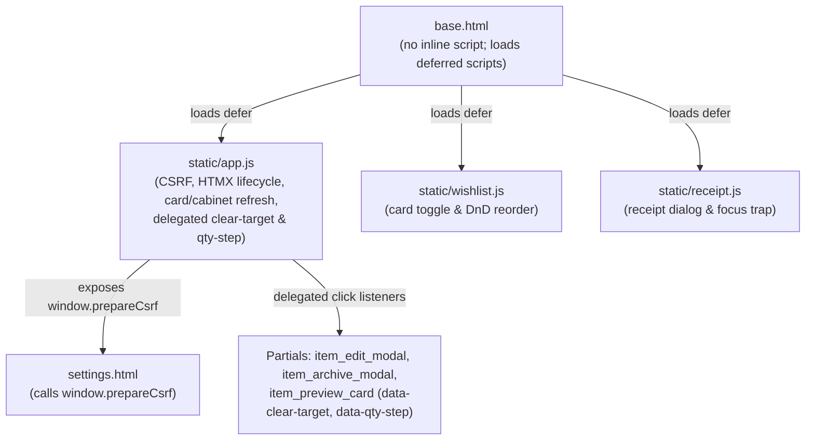

# WISHENKA-140: Remove Remaining Inline JavaScript and Inline Event Handlers for Strict CSP

## Research

Inspection of the templates, static scripts, and test suite in `/home/src` identified the exact scope and existing contracts:

1. **Remaining inline `` block (lines 13–260).
   - Add `` after `json-enc.js` and before `/static/wishlist.js` and `/static/receipt.js`.
3. **Update modal and preview partials to declarative `data-*` attributes**:
   - `wishenka/web/templates/partials/item_edit_modal.html`: replace `onclick` on `.btn-modal-close` and `.btn-cancel` with `data-clear-target="#item-modal-container"`; replace `onclick` on `.btn-decrement` with `data-qty-step="-1" data-qty-target="#item-quantity-input"` and on `.btn-increment` with `data-qty-step="1" data-qty-target="#item-quantity-input"`.
   - `wishenka/web/templates/partials/item_archive_modal.html`: replace `onclick` on `.btn-modal-close` with `data-clear-target="#item-modal-container"`.
   - `wishenka/web/templates/partials/item_preview_card.html`: replace `onclick` on `.btn-preview-dismiss` with `data-clear-target="#quick-add-preview-target"`.
4. **Update existing inline-script-inspecting tests**:
   - Update `tests/test_receipt_static_script.py` to assert zero inline `<script>` elements in `base.html` pages and verify `/static/app.js` is served as JS with `defer` after `htmx.org`.
   - Update `tests/test_wish_card_giver_controls.py` (`assert_expanded_refresh_clears_hidden`) and `tests/test_reservations_cabinet_ui.py` (`refresh_script_problems` callers) to inspect `/static/app.js` instead of `base.html` inline scripts.

**Mandatory — Failing Repro (next Step 3):**
- **File**: `tests/test_csp_inline_removal_repro.py` (uses FastAPI `TestClient`, `create_app`, isolated `tmp_path` SQLite DB, and `BeautifulSoup` — no live browser or external network).
- **What it asserts (desired behavior)**:
  1. Rendered owner wishlist page (`GET /web/wishlists/{id}`) and public share page (`GET /share/{token}`) contain zero inline `<script>` tags (tags without `src`), and load `<script src="/static/app.js" defer>` after `htmx.org` and before `/static/wishlist.js` and `/static/receipt.js`.
  2. `GET /static/app.js` returns HTTP `200` with a JavaScript `Content-Type`.
  3. Rendered modal and preview fragments (`item_edit_modal.html`, `item_archive_modal.html`, `item_preview_card.html` via their routes or template rendering) contain zero `on*` attributes and carry `data-clear-target`, `data-qty-step`, and `data-qty-target` attributes on the corresponding controls.
- **How to force failure without live external deps**: Running `pytest tests/test_csp_inline_removal_repro.py` against the current repository fails immediately because `base.html` still embeds the inline `<script>`, `/static/app.js` returns `404`, and the three partials still contain `onclick` attributes.
- **Sequencing**: Research (Steps 1–2) → write red test `tests/test_csp_inline_removal_repro.py` and verify it fails (Step 3) → implement `app.js`, update `base.html` and the three partials, and update existing inline-script tests until all tests pass (Step 4).

## Architecture

### Module Diagram

### Module Responsibilities

| Module | Responsibility |
| --- | --- |
| `wishenka/web/static/app.js` | Global app wiring: CSRF token fetching/caching (`window.prepareCsrf`), HTMX reservation headers (`X-CSRF-Token`, `Idempotency-Key`), `htmx:confirm` queuing, `htmx:afterRequest` cabinet/card refresh (`swapWishCard`), `htmx:beforeSwap` modal error handling, and delegated `click` handlers for `[data-clear-target]` and `[data-qty-step]`. |
| `wishenka/web/templates/base.html` | Base HTML shell: loads external/static scripts (`app.js`, `wishlist.js`, `receipt.js` with `defer`) and provides `data-viewer-identified` and `data-i18n-*` attributes on `<body>`; contains zero inline executable scripts. |
| `wishenka/web/templates/partials/item_edit_modal.html` | Edit/create item modal markup with `data-clear-target="#item-modal-container"` on close/cancel buttons and `data-qty-step` / `data-qty-target` on `-`/`+` quantity buttons. |
| `wishenka/web/templates/partials/item_archive_modal.html` | Archive confirmation modal markup with `data-clear-target="#item-modal-container"` on the cancel button. |
| `wishenka/web/templates/partials/item_preview_card.html` | Quick-add preview card markup with `data-clear-target="#quick-add-preview-target"` on the dismiss button. |

### Architectural Patterns & Justification

1. **Dedicated `/static/app.js` over merging into `wishlist.js` or `receipt.js`**:
   - Preserves existing invariants in `tests/test_receipt_static_script.py`: `wishlist.js` and `receipt.js` each keep exactly one `htmx.ajax(` call and their refusal header namespaces (`X-Reorder-Refusal` vs `X-Receipt-Refusal`) remain strictly isolated.
   - `app.js` applies to all pages extending `base.html` (including reservations cabinet and settings), not just wishlist pages.
2. **Document-level Event Delegation with `data-*` attributes**:
   - Modals (`#item-modal-container`) and quick-add previews (`#quick-add-preview-target`) are injected dynamically via HTMX swaps. Delegated `click` listeners on `document` work identically on initial load and after any HTMX swap without re-binding.
   - Reading `min` and `max` from the target `<input>` element avoids duplicating Jinja template bounds inside JS.
3. **IIFE encapsulation with explicit `window.prepareCsrf` bridge**:
   - Keeps internal state (`csrfToken`, `csrfPending`, `csrfGeneration`, `pendingGiverControls`) private inside the IIFE while preserving backward compatibility for `settings.html` (`typeof prepareCsrf === 'function'`).

### Main Interfaces

- **DOM `<body>` contract**:
  - `data-viewer-identified="true"` — enables CSRF pre-fetch and HTMX header injection.
  - `data-i18n-prepare-error`, `data-i18n-busy-error` — localized fallback error messages.
- **Declarative action attributes**:
  - `data-clear-target="<CSS selector>"` — clears `innerHTML` of the matched container on click.
  - `data-qty-step="-1" | "1"` + `data-qty-target="<CSS selector>"` — steps the target `<input type="number">` value within its `[min, max]` bounds.
- **Global JS bridge**:
  - `window.prepareCsrf(): Promise<string>` — returns cached or freshly fetched CSRF token (or `''` on timeout/failure).

## Q&A

- **Q**: Why expose `window.prepareCsrf` instead of keeping it private inside the IIFE?
  **A**: `wishenka/web/templates/settings.html` (outside the scope of WISHENKA-140) calls `prepareCsrf()` when `typeof prepareCsrf === 'function'`. Exposing `window.prepareCsrf` prevents a regression on `/settings`.
- **Q**: Why not add the `Content-Security-Policy` header in this task?
  **A**: Enabling the CSP header is explicitly out of scope for WISHENKA-140 and tracked as a follow-up step once inline scripts and handlers are removed.
