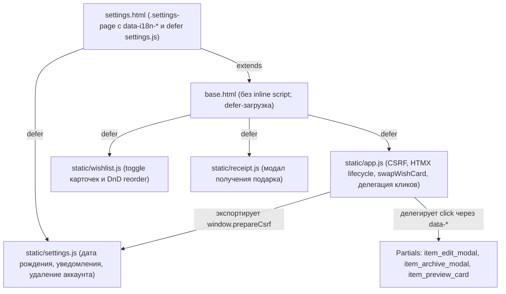

# Спецификация: WISHENKA-140 — Вынос оставшегося inline JavaScript и inline-обработчиков событий для строгой CSP

**Задача Jira:** WISHENKA-140

**Область действия:** веб-интерфейс Wishenka (базовый и пользовательский шаблоны `base.html`, `settings.html`, модальные и preview-фрагменты, статические скрипты `/static/app.js` и `/static/settings.js`, UI-тесты и документация разработчика)

**Языки реализации:** Python / JavaScript

**Статус:** реализована и задокументирована в рамках Top-Down workflow

## 1. Назначение и бизнес-цель

### 1.1. Постановка проблемы

После выполнения задачи WISHENKA-108 (вынос логики раскрытия карточек и drag-and-drop сортировки в `/static/wishlist.js`) в HTML-шаблонах веб-интерфейса сохранялся исполняемый inline-код, блокирующий внедрение строгой политики безопасности контента (`Content-Security-Policy` без директивы `'unsafe-inline'` для скриптов):

1. **Встроенный блок `<script>` в `wishenka/web/templates/base.html`:** содержал клиентскую логику подготовки и кэширования CSRF-токенов (`prepareCsrf`), постановки в очередь запросов дарителя через `htmx:confirm`, добавления заголовков `X-CSRF-Token` и `Idempotency-Key` в `htmx:configRequest`, обновления кабинета бронирований (`#reservations-cabinet`) и карточек желаний (`swapWishCard`) в `htmx:afterRequest`, а также сохранения HTMX-подмен для 4xx/5xx HTML-ответов в модальных окнах (`htmx:beforeSwap`).
2. **Встроенный блок `<script>` и inline-обработчики в `wishenka/web/templates/settings.html`:** страница настроек профиля содержала inline-скрипт и встроенные HTML-атрибуты обработчиков событий (`onsubmit`, `onclick`, `onchange`), привязанные к функции `prepareCsrf` из `base.html`.
3. **Шесть inline-атрибутов `onclick` в трёх динамически подгружаемых фрагментах (partials):**
   - `wishenka/web/templates/partials/item_edit_modal.html`: кнопка закрытия `.btn-modal-close`, кнопка отмены `.btn-cancel`, кнопка уменьшения количества `.btn-decrement` и кнопка увеличения количества `.btn-increment` (4 атрибута).
   - `wishenka/web/templates/partials/item_archive_modal.html`: кнопка отмены `.btn-modal-close` (1 атрибут).
   - `wishenka/web/templates/partials/item_preview_card.html`: кнопка закрытия предпросмотра `.btn-preview-dismiss` (1 атрибут).

Пока эти встроенные скрипты и атрибуты `on*` присутствовали в отдаваемом HTML, включение строгой CSP без `'unsafe-inline'` нарушило бы ключевые пользовательские сценарии.

### 1.2. Цели задачи

- **Готовность к строгой CSP:** полностью устранить inline-блоки `<script>` (без атрибута `src`) и inline-атрибуты обработчиков событий (`on*`) во всех HTML-страницах и динамически загружаемых фрагментах.
- **Полный паритет поведения:** сохранить без изменений все существующие сценарии — подготовку CSRF-токенов, защиту бронирований ключами идемпотентности, обновление кабинета бронирований и карточек желаний (включая сохранение раскрытого состояния карточки), работу 4xx/5xx ошибок в модальных формах, закрытие модальных окон и preview-карточки, пошаговое изменение количества желания в допустимых границах и операции на странице `/settings`.
- **Регрессионная защита:** расширить автоматизированные тесты так, чтобы отсутствие inline-скриптов и inline-обработчиков проверялось как на полных страницах (`/web/wishlists/{id}`, `/share/{token}`, `/settings`), так и на фрагментах модальных окон и предпросмотра, а существующие проверки клиентского кода опирались на раздаваемые статические ассеты.

### 1.3. Ценность для пользователей и системы

- **Безопасность и платформа:** снят последний блокер для последующего включения строгого HTTP-заголовка `Content-Security-Policy` без `'unsafe-inline'`.
- **Даритель и посетитель вишлиста:** бронирование, изменение и отмена броней, отображение ошибок занятости/отказа, идемпотентность и CSRF-защита работают без регрессий.
- **Владелец и соавтор вишлиста:** открытие и закрытие модальных окон редактирования и архивации, изменение количества экземпляров в пределах допустимых границ, закрытие предпросмотра быстрого добавления и управление настройками профиля в `/settings` работают идентично прежней реализации.
- **QA и сопровождение:** клиентская логика изолирована в классических статических скриптах с единым паттерном (`IIFE`, `'use strict'`, JSDoc), а регрессионный набор гарантирует, что inline-код не вернётся в шаблоны и фрагменты.

### 1.4. Границы задачи (Non-Goals)

В рамки WISHENKA-140 **не входят**:

- Включение или изменение самого HTTP-заголовка `Content-Security-Policy` в middleware или веб-сервере (вынесено в отдельный последующий шаг).
- Настройка политики кэширования статики (`Cache-Control` / версионирование URL ассетов) — отслеживается в `WISHENKA-139`.
- Параметризация URL переупорядочивания желаний (`WISHENKA-141`), поддержка touch drag-and-drop (`WISHENKA-109`) и расширение браузерного Playwright/CDP-набора для выполнения DOM-кликов (`WISHENKA-110`).

## 2. Функциональные требования и пользовательские сценарии

### 2.1. Функциональные требования

#### FR-1. Отсутствие inline-скриптов и inline-обработчиков в HTML

- Отрендеренные HTML-страницы на базе `base.html` (включая `/web/wishlists/{wishlist_id}`, `/share/{public_token}` и `/settings`) не должны содержать тегов `<script>` без атрибута `src`.
- Ни одна страница и ни один динамически загружаемый HTML-фрагмент (`partials/item_edit_modal.html`, `partials/item_archive_modal.html`, `partials/item_preview_card.html`, модал получения подарка) не должны содержать HTML-атрибутов событий `on*` (таких как `onclick`, `onsubmit`, `onchange` и т. п.).

#### FR-2. Подготовка CSRF-токена, очередь запросов дарителя и идемпотентность (`static/app.js`)

- При событии `DOMContentLoaded`, если у `document.body` присутствует атрибут `data-viewer-identified`, запускается предварительная загрузка CSRF-токена `prepareCsrf()` и регистрируются обработчики `htmx:confirm` и `htmx:configRequest`.
- Функция `prepareCsrf()`:
  - Возвращает кэшированный `csrfToken` при его наличии либо переиспользует активный промис `csrfPending` (дедупликация параллельных запросов).
  - Выполняет `fetch('/api/auth/csrf', { credentials: 'same-origin', signal: controller.signal })` с ограничением ожидания `CSRF_TIMEOUT_MS = 10000` (через `AbortController` и `Promise.race`); при ошибке, таймауте или некорректном ответе возвращает пустую строку `''`.
  - Сохраняет полученный токен в `csrfToken` только при совпадении счётчика поколений `generation === csrfGeneration` (защита от гонки после сброса невалидного токена).
  - Экспортируется как `window.prepareCsrf = prepareCsrf` для совместимости с внешними потребителями (в частности `/static/settings.js`).
- Обработчик `htmx:confirm`:
  - Для элементов управления дарителя внутри `.item-card`, отправляющих запрос по пути с `/reservations` (`reservationRequestPath(elt)`), при отсутствии `csrfToken` отменяет немедленную отправку (`evt.preventDefault()`), регистрирует элемент в `WeakSet` (`pendingGiverControls`) во избежание дублей и после завершения `prepareCsrf()` повторно инициирует запрос (`detail.issueRequest()`), если и элемент, и карточка остаются в DOM (`elt.isConnected && card.isConnected`).
- Обработчик `htmx:configRequest`:
  - Пропускает безопасные методы `GET`, `HEAD`, `OPTIONS`.
  - Для остальных запросов при наличии `csrfToken` и отсутствии подавления (`requestSuppressesHeaders(elt)`) добавляет заголовок `X-CSRF-Token`.
  - Для запросов бронирования (`reservationRequestPath(elt)`) при отсутствии подавления и отсутствии уже заданного заголовка `Idempotency-Key` генерирует уникальный ключ (`nextIdempotencyKey()` через `window.crypto.randomUUID()` с fallback-генератором), сохраняет его в `elt.dataset.idempotencyKey` и прикрепляет в заголовок `Idempotency-Key`.
  - Если запрос исходит из контрола дарителя внутри `.item-card` и при этом заголовки подавлены (`noHeaders` или невалидный JSON в `hx-request`/`data-hx-request`) либо отсутствуют как `csrfToken`, так и явный заголовок `Authorization: Bearer <token>` (`explicitBearer`), запрос отменяется (`evt.preventDefault()`), а в слоте `[data-giver-busy]` карточки выводится локализованное сообщение из `body[data-i18n-prepare-error]` (функция `giverPreparationError(card)`).

#### FR-3. Обработка ответов на бронирование и перерисовка DOM (`htmx:afterRequest`)

- Для любого запроса, соответствующего `reservationRequestPath(elt)`, при получении окончательного HTTP-статуса (`reqStatus !== 0 && reqStatus !== 503`) кэшированный `elt.dataset.idempotencyKey` удаляется, чтобы следующий запрос получил новый ключ; при `0` (сетевая ошибка) или `503` (временная занятость) ключ сохраняется для безопасного повтора.
- **Ветка строки в кабинете бронирований (`.reservation-row`):**
  - При `503`: отображает локализованное сообщение из `body[data-i18n-busy-error]` в `[data-reservation-busy]` без замены `#reservations-cabinet`.
  - При `409`: выбирает `notice=shortage`, если `responseText` содержит `'available'`, иначе `notice=refused`.
  - При `401`, `403`, `404`: выбирает `notice=refused`.
  - При прочих неуспешных статусах (кроме `200` и `201`) обновление не выполняется.
  - При `200`, `201` и обработанных ошибках `409`/`401`/`403`/`404` запрашивает `GET /web/reservations/list` (с параметрами `notice` и `reservation_id` для `shortage`), заменяет `#reservations-cabinet` через `outerHTML` и повторно инициализирует HTMX через `window.htmx.process(next)`.
- **Ветка карточки желания (`.item-card`):**
  - При `403`: пытается разобрать JSON-ответ; если `rejection.detail === 'Invalid CSRF token'`, сбрасывает `csrfToken = ''`, увеличивает `csrfGeneration += 1` и вызывает `giverPreparationError(card)`; при невалидном JSON или отсутствии строкового `detail` также вызывает `giverPreparationError(card)`.
  - При `503`: показывает локализованный текст из `body[data-i18n-busy-error]` в `[data-giver-busy]` карточки без перерисовки карточки.
  - При `409`, `401`, `403` (не CSRF), `404`, `200`, `201`: вычисляет `notice` аналогично ветке кабинета, запрашивает актуальный фрагмент карточки `GET /wishlists/{wishlistId}/items/{itemId}/card?is_first=...&is_last=...[&notice=...]` и заменяет карточку функцией `swapWishCard(card, markup)`.
  - `swapWishCard(card, markup)` считывает `aria-expanded` у `.item-card-summary` до замены `card.outerHTML = markup` и при `wasExpanded === 'true'` восстанавливает `aria-expanded="true"` у новой `.item-card-summary` и выставляет `.item-card-details.hidden = false`, сохраняя раскрытое состояние карточки.

#### FR-4. Подмена HTML-ошибок 4xx/5xx в модальных окнах (`htmx:beforeSwap`)

- Обработчик `htmx:beforeSwap` разрешает HTMX-своп (`detail.shouldSwap = true`, `detail.isError = false`) для ответов со статусом `>= 400` и типом содержимого `text/html`, если цель или источник относятся к модальным контейнерам (`target.id` равен `item-modal-container`, `item-edit-sheet` или `item-archive-modal`, либо `detail.elt.closest('#item-modal-container')`, либо `target.id === 'items-list'` с OOB-фрагментом `id="item-modal-container"` и `hx-swap-oob`).
- Явные исключения: ответы с заголовками `X-Reorder-Refusal` (обрабатываются `wishlist.js`) или `X-Receipt-Refusal` (обрабатываются `receipt.js`), запросы бронирования (`reservationRequestPath(detail.elt)`), а также ответы, отличные от `text/html`, не затрагиваются.

#### FR-5. Делегированные взаимодействия в модальных окнах и preview-карточке (`handleDelegatedClick`)

- Один делегированный слушатель `click` на `document` обрабатывает динамически подставляемые элементы без повторной привязки:
  - **`[data-clear-target]`:** находит элемент по CSS-селектору из атрибута `data-clear-target` и очищает его (`container.innerHTML = ''`). Используется для закрытия модального окна редактирования/создания (`.btn-modal-close`, `.btn-cancel` -> `#item-modal-container`), модального окна архивации (`.btn-modal-close` -> `#item-modal-container`) и карточки предпросмотра быстрого добавления (`.btn-preview-dismiss` -> `#quick-add-preview-target`).
  - **`[data-qty-step][data-qty-target]`:** считывает целочисленный шаг `data-qty-step` (`-1` или `1`) и находит целевой `<input>` по селектору `data-qty-target` (`#item-quantity-input` в `item_edit_modal.html`). Границы считываются из атрибутов `min` (fallback `DEFAULT_QTY_MIN = 1`) и `max` (fallback `DEFAULT_QTY_MAX = 1000`) самого `<input>`. Текущее значение разбирается функцией `parseIntOr(String(input.value), min)`: если поле пустое или содержит нечисловой текст (`NaN`), базой становится `min`, после чего итоговое значение `current + step` ограничивается диапазоном `[min, max]` через `Math.min(max, Math.max(min, current + step))`.

#### FR-6. Вынесенное поведение страницы настроек (`static/settings.js`)

- Скрипт `wishenka/web/static/settings.js` (подключаемый с `defer` после `/static/app.js`) заменяет inline-скрипт и inline-обработчики `settings.html`, инициализируя слушатели по `DOMContentLoaded` (или немедленно при `document.readyState !== 'loading'`) на `.settings-page`:
  - Отправка и очистка даты рождения (`#birthdate-form`, `#birthdate-clear-btn` -> `PATCH /api/profile/birthdate`).
  - Делегированные изменения (`change`) глобальных уведомлений (`input[data-global-category]` -> `PUT /api/profile/notifications/global`) и переопределений на уровне вишлиста (`select[data-wishlist-override]` -> `PUT /api/profile/notifications/wishlists/{wishlistId}`).
  - Двухшаговое удаление аккаунта (`#delete-account-start-btn` -> `GET /api/profile/deletion-preview`, `#delete-account-cancel-btn`, `#delete-account-confirm-btn` -> `POST /api/profile/delete`).
  - Все мутирующие JSON-запросы выполняются через `settingsFetch()`, который вызывает `window.prepareCsrf()` и при наличии токена добавляет `X-CSRF-Token`.

### 2.2. Пользовательские сценарии

- **UC-140-01 (Бронирование и защита от двойного клика / устаревшего CSRF):** авторизованный даритель на странице вишлиста или публичной ссылке нажимает кнопку бронирования до завершения фонового `GET /api/auth/csrf` -> запрос ставится в очередь через `htmx:confirm`, после получения токена отправляется с `X-CSRF-Token` и `Idempotency-Key`; при протухшем CSRF (`403` `Invalid CSRF token`) кэш токена сбрасывается, а в `[data-giver-busy]` выводится сообщение с возможностью повтора.
- **UC-140-02 (Сохранение раскрытой карточки и уведомления в кабинете):** даритель раскрывает карточку желания и меняет бронь (либо обновляет бронь в кабинете `#reservations-cabinet`) -> после `200`/`409`/`503` карточка перерисовывается с сохранением `aria-expanded="true"` и видимого `.item-card-details`, либо обновляется кабинет, либо выводится локализованное сообщение о занятости без потери текущего интерфейса.
- **UC-140-03 (Закрытие модальных окон и предпросмотра):** владелец открывает модал редактирования/создания (`item_edit_modal.html`), подтверждение архивации (`item_archive_modal.html`) или предпросмотр по ссылке (`item_preview_card.html`), затем нажимает кнопку закрытия/отмены -> делегированный обработчик `[data-clear-target]` очищает `#item-modal-container` или `#quick-add-preview-target` независимо от того, что фрагмент был загружен асинхронно после старта страницы.
- **UC-140-04 (Изменение количества в модальном окне редактирования):** владелец нажимает `-` или `+` рядом с `#item-quantity-input` -> значение изменяется на `-1`/`+1` строго в пределах `[min, max]` (где `min` учитывает `min_quantity` уже полученных экземпляров, а `max = 1000`); при пустом или повреждённом вводе поле безопасно устанавливается относительно `min` без появления `NaN`.
- **UC-140-05 (Работа страницы настроек без inline-JS):** пользователь открывает `/settings`, сохраняет/очищает дату рождения, переключает уведомления или проходит подтверждение удаления аккаунта -> все запросы отправляются обработчиками `settings.js` с CSRF-токеном через `window.prepareCsrf()`.
- **UC-140-06 (Защита от возврата inline-кода в CI):** при запуске pytest проверяется, что ни основные страницы, ни модальные/preview-фрагменты не содержат inline-скриптов и `on*`-атрибутов, а `/static/app.js` и `/static/settings.js` отдаются с корректным JavaScript `Content-Type` и подключены с `defer`.

### 2.3. Ключевые инварианты

1. **Нулевой inline-JS:** ни один HTML-ответ (полная страница или фрагмент) на охваченных маршрутах не содержит тегов `<script>` без `src` и атрибутов `on*`.
2. **Порядок загрузки `defer`-скриптов:** в `base.html` загрузка строго упорядочена: `htmx.org` -> `json-enc.js` -> `/static/app.js` -> `/static/wishlist.js` -> `/static/receipt.js`; в `settings.html` скрипт `/static/settings.js` подключается в конце `` с `defer`, что гарантирует инициализацию `window.prepareCsrf` до исполнения `settings.js`.
3. **Изоляция пространств отказов:** `app.js` не содержит логики `/receipt` и не перехватывает ответы с `X-Reorder-Refusal` (`wishlist.js`) и `X-Receipt-Refusal` (`receipt.js`).
4. **Независимость от динамических перерисовок:** делегирование на `document` для `[data-clear-target]` и `[data-qty-step][data-qty-target]` и чтение `min`/`max` из `<input>` работают после любых HTMX-свопов без дублирования шаблонных ограничений в JS.

## 3. Архитектура, компоненты и интерфейсы

### 3.1. Компонентная схема и потоки взаимодействия

### 3.2. Модули и ответственность

| Модуль / файл | Ответственность |
| --- | --- |
| `wishenka/web/static/app.js` | Глобальная клиентская обвязка: получение и кэширование CSRF-токена (`prepareCsrf`, экспорт `window.prepareCsrf`), постановка запросов в очередь (`htmx:confirm`), добавление `X-CSRF-Token` и `Idempotency-Key` (`htmx:configRequest`), обновление `#reservations-cabinet` и `.item-card` (`htmx:afterRequest`, `swapWishCard`), разрешение свопов HTML-ошибок в модалках (`htmx:beforeSwap`), делегированные клики для `[data-clear-target]` и `[data-qty-step][data-qty-target]` (`handleDelegatedClick`). |
| `wishenka/web/static/settings.js` | Контроллер страницы `/settings`: обработка формы даты рождения, переключателей глобальных и списочных уведомлений и двухшагового удаления аккаунта через `settingsFetch()` с использованием `window.prepareCsrf()`. |
| `wishenka/web/templates/base.html` | Базовый HTML-каркас: подключает внешние CDN-скрипты и `/static/app.js`, `/static/wishlist.js`, `/static/receipt.js` с атрибутом `defer`; задаёт `data-viewer-identified` и `data-i18n-*` на `<body>`; не содержит inline-скриптов. |
| `wishenka/web/templates/settings.html` | Шаблон настроек профиля: хранит локализованные строки в `.settings-page[data-i18n-*]`, декларативные `data-*` и `id`-атрибуты на элементах формы и подключает `/static/settings.js` с `defer`. |
| `wishenka/web/templates/partials/item_edit_modal.html` | Модальная форма создания/редактирования желания с `data-clear-target="#item-modal-container"` на `.btn-modal-close` и `.btn-cancel`, и `data-qty-step`/`data-qty-target="#item-quantity-input"` на `.btn-decrement` и `.btn-increment`. |
| `wishenka/web/templates/partials/item_archive_modal.html` | Модальное окно подтверждения архивации с `data-clear-target="#item-modal-container"` на кнопке отмены `.btn-modal-close`. |
| `wishenka/web/templates/partials/item_preview_card.html` | Карточка предпросмотра быстрого добавления с `data-clear-target="#quick-add-preview-target"` на кнопке `.btn-preview-dismiss`. |
| `wishenka/web/app.py` | Монтирует директорию статики на `/static` через `StaticFiles`, обеспечивая раздачу `/static/app.js` и `/static/settings.js`, а также оборачивает приложение в `RequestLoggingMiddleware` и `BrowserSecurityMiddleware`. |

### 3.3. Ключевые элементы `wishenka/web/static/app.js` и `wishenka/web/static/settings.js`

Оба файла построены как классические скрипты внутри `IIFE` (`(() => { 'use strict'; ... })();`) с JSDoc-аннотациями:

- **Константы и состояние `app.js`:**
  - `CSRF_TIMEOUT_MS = 10000`, `DEFAULT_QTY_MIN = 1`, `DEFAULT_QTY_MAX = 1000`.
  - Приватное замыкание: `csrfToken`, `csrfPending`, `csrfGeneration`, `pendingGiverControls` (`WeakSet`).
  - Вспомогательные функции: `prepareCsrf()`, `giverPreparationError(card)`, `requestSuppressesHeaders(elt)`, `explicitBearer(headers)`, `nextIdempotencyKey()`, `reservationRequestPath(elt)`, `swapWishCard(card, markup)`, `parseIntOr(raw, fallback)`, `handleDelegatedClick(evt)`.
  - Публичный мост: `window.prepareCsrf = prepareCsrf`.
- **Функции `settings.js`:**
  - `getI18n(page, key, fallback)`, `readErrorDetail(resp, fallback)`, `settingsFetch(url, method, body)`, `saveBirthdate(evt, page)`, `clearBirthdate(page)`, `updateGlobalNotification(category, enabled, feedbackId, page)`, `updateWishlistOverride(wishlistId, category, rawVal, page)`, `openDeletionPreview(page)`, `cancelDeletionPreview()`, `confirmAccountDeletion(page)`, `initSettingsPage()`.

### 3.4. Контракты данных и интерфейсы

#### Контракт HTML-атрибутов `<body>` (`base.html` -> `app.js`)

| Атрибут | Назначение |
| --- | --- |
| `data-viewer-identified="true"` | Активирует предзагрузку CSRF, `htmx:confirm`-очередь и подстановку заголовков в `htmx:configRequest` для идентифицированного пользователя. |
| `data-i18n-prepare-error` | Локализованный текст ошибки подготовки запроса в слоте `[data-giver-busy]`. |
| `data-i18n-busy-error` | Локализованный текст ошибки блокировки желания (`503`) в `[data-giver-busy]` и `[data-reservation-busy]`. |
| `data-i18n-receipt-failure`, `data-i18n-receipt-summary`, `data-i18n-item-unavailable`, `data-i18n-list-changed` | Сохраняемые атрибуты `<body>` для `receipt.js` и `wishlist.js`. |

#### Контракт декларативных атрибутов в partials (`partials/*.html` -> `app.js`)

| Атрибут | Элемент-носитель | Поведение |
| --- | --- | --- |
| `data-clear-target="#item-modal-container"` | `.btn-modal-close`, `.btn-cancel` (`item_edit_modal.html`); `.btn-modal-close` (`item_archive_modal.html`) | Очищает контейнер `#item-modal-container` (`innerHTML = ''`). |
| `data-clear-target="#quick-add-preview-target"` | `.btn-preview-dismiss` (`item_preview_card.html`) | Очищает контейнер `#quick-add-preview-target` (`innerHTML = ''`). |
| `data-qty-step="-1"` + `data-qty-target="#item-quantity-input"` | `.btn-decrement` (`item_edit_modal.html`) | Уменьшает значение `#item-quantity-input` на `1`, не опуская ниже `min` (`{{ min_quantity }}`, fallback `1`). |
| `data-qty-step="1"` + `data-qty-target="#item-quantity-input"` | `.btn-increment` (`item_edit_modal.html`) | Увеличивает значение `#item-quantity-input` на `1`, не превышая `max` (`1000`). |

#### Контракт `.settings-page` (`settings.html` -> `settings.js`)

- Локализованные атрибуты на `.settings-page`: `data-i18n-saved`, `data-i18n-birthdate-source-explicit`, `data-i18n-invalid-birthdate`, `data-i18n-invalid-notification`, `data-i18n-state-enabled`, `data-i18n-state-disabled`, `data-i18n-delete-completed`, `data-i18n-delete-failed`.
- Атрибуты делегирования в `.settings-page`: `data-global-category` и `data-feedback-target` на чекбоксах глобальных уведомлений; `data-wishlist-override`, `data-wishlist-id` и `data-category` на `<select>` списочных переопределений; `[data-effective-for="{id}-{cat}"] strong` для обновления эффективного бейджа.

#### HTTP и программные интерфейсы

- `GET /static/app.js`, `GET /static/settings.js` -> `200 OK`, заголовок `Content-Type` содержит `javascript`.
- `GET /api/auth/csrf` -> JSON `{ "csrf_token": "<hex>" }` (используется `prepareCsrf()`).
- `window.prepareCsrf(): Promise<string>` -> возвращает валидный токен или `''` при таймауте/ошибке.
- Мутирующие запросы (`POST`/`PATCH`/`PUT`/`DELETE`) используют заголовки `X-CSRF-Token` и (для маршрутов с `/reservations`) `Idempotency-Key`.

### 3.5. Переходы состояний

1. **Жизненный цикл CSRF-токена в `app.js`:**
   - `Empty` (`csrfToken = ''`, `csrfPending = null`) --(`prepareCsrf()`)--> `Fetching` (`csrfPending = Promise`, таймер `10000` мс).
   - `Fetching` --(успешный ответ и `generation === csrfGeneration`)--> `Ready` (`csrfToken = token`, `csrfPending = null`).
   - `Fetching` --(таймаут/ошибка/`generation !== csrfGeneration`)--> `Empty` (`csrfToken = ''`, возвращается `''`).
   - `Ready` --(`403` `Invalid CSRF token` в `htmx:afterRequest`)--> `Empty` (`csrfToken = ''`, `csrfGeneration += 1`, отображение ошибки в `[data-giver-busy]`).
2. **Идемпотентность запроса бронирования:**
   - Нет ключа -> генерация `nextIdempotencyKey()` и запись в `elt.dataset.idempotencyKey` -> отправка заголовка `Idempotency-Key`.
   - Ответ со статусом `0` или `503` -> ключ **сохраняется** в `elt.dataset.idempotencyKey` для безопасного повтора пользователем.
   - Ответ с любым иным статусом (`200`, `201`, `401`, `403`, `404`, `409` и др.) -> `delete elt.dataset.idempotencyKey`.
3. **Пошаговое изменение количества (`[data-qty-step][data-qty-target]`):**
   - Чтение `min` (fallback `1`), `max` (fallback `1000`), `current = parseIntOr(input.value, min)` -> `next = Math.min(max, Math.max(min, current + step))` -> запись `String(next)` в `input.value`.

## 4. Нефункциональные требования, безопасность и наблюдаемость

### 4.1. Производительность и ограничения

- **Загрузка скриптов:** `/static/app.js`, `/static/wishlist.js`, `/static/receipt.js` и `/static/settings.js` загружаются с атрибутом `defer`, не блокируя первичный разбор HTML-документа.
- **Сложность делегирования:** единый обработчик `click` на `document` выполняет только `Element.closest()` (сложность `O(1)` по числу элементов на странице независимо от размера вишлиста).
- **Таймауты и предотвращение дублирования запросов:** запрос `GET /api/auth/csrf` ограничен по времени константой `CSRF_TIMEOUT_MS = 10000` с принудительным прерыванием через `AbortController.abort()`; одновременные вызовы `prepareCsrf()` объединяются через `csrfPending`, а повторные клики по контролу дарителя до получения токена фильтруются через `WeakSet` (`pendingGiverControls`).
- **Ограничения кэширования:** `BrowserSecurityMiddleware` (`wishenka/web/security.py`) устанавливает `Cache-Control: no-store` на все ответы, включая `/static/*`. Это гарантирует доставку актуального кода без cache-busting, но запрещает браузерное кэширование статики (выделено в задачу `WISHENKA-139`).

### 4.2. Безопасность и приватность

- **Готовность к строгой CSP:** полное удаление inline `<script>` из `base.html` и `settings.html` и шести inline `onclick` из модальных и preview-фрагментов (а также inline-обработчиков из `settings.html`) позволяет в дальнейшем запретить `'unsafe-inline'` для `script-src`. Сам заголовок CSP в рамках WISHENKA-140 не включается.
- **Защита CSRF и Origin:** `BrowserSecurityMiddleware` (`wishenka/web/security.py`) для небезопасных cookie-аутентифицированных запросов проверяет совпадение заголовка `Origin` с `settings.application_origin` и валидность HMAC-токена `X-CSRF-Token` (`csrf_value`). Клиентские скрипты не обходят серверную авторизацию и не передают токены в URL или логах.
- **Приватность диагностик в DOM:** при сбоях подготовки CSRF, протухшем токене (`403`) или временной блокировке (`503`) в слотах `[data-giver-busy]` и `[data-reservation-busy]` выводятся только статические локализованные сообщения из `data-i18n-*` без токенов, стектрейсов и персональных данных.
- **Безопасность DOM-операций:** в `app.js` и `settings.js` не используются `eval()` и вставка произвольных строк через `innerHTML` (применяется только очистка контейнера `container.innerHTML = ''` для `[data-clear-target]` и штатные замены `outerHTML` серверно-отрендеренных фрагментов `swapWishCard` / `#reservations-cabinet`).

### 4.3. Наблюдаемость: логирование и метрики

- **Клиентское логирование:** `wishenka/web/static/app.js` и `wishenka/web/static/settings.js` намеренно не содержат вызовов `console.log` и `console.debug`, чтобы не засорять консоль браузера и не допускать утечки токенов/данных в клиентский вывод. Все пользовательские ошибки отображаются штатно в DOM (`[data-giver-busy]`, `[data-reservation-busy]`, `#*-feedback`).
- **Серверное структурированное логирование:** доставка `/static/app.js` и `/static/settings.js` через `StaticFiles` и все вызовы `/api/auth/csrf`, `/web/reservations/list`, `/wishlists/.../card` и `/api/profile/*` покрываются существующим `RequestLoggingMiddleware.dispatch` (`wishenka/web/app.py`, логгер `wishenka.web`, настройка `configure_logging` с поддержкой JSON-формата через `settings.log_json`):
  - `DEBUG`: `HTTP request started: %s %s` с `extra={"method", "path"}`.
  - `INFO`: `HTTP request completed: %s %s status=%d duration=%.2fms` с `extra={"method", "path", "status_code", "duration_ms"}`.
  - `ERROR` (`logger.exception`): `HTTP request unhandled exception: %s %s duration=%.2fms` с `extra={"method", "path", "duration_ms"}`.
  - Дополнительно `BrowserSecurityMiddleware` (`wishenka.web.security`) логирует `WARNING` при несовпадении Origin или невалидном CSRF-токене (`event="origin_mismatch"`, `"csrf_origin_mismatch"`, `"csrf_token_invalid"`).
- **Метрики и мониторинг:** новых бизнес-метрик, счётчиков Prometheus или дашбордов в задаче не вводилось (N/A); время ответа (`duration_ms`) и коды ответов (`status_code`) по статическим файлам и API-запросам фиксируются через `RequestLoggingMiddleware`.

## 5. Верификация и критерии приёмки

### 5.1. Критерии приёмки (Definition of Done)

1. Отрендеренные HTML-страницы (`base.html` и его наследники, включая страницу владельца, публичную ссылку и `/settings`) содержат ноль inline-тегов `<script>` (без `src`) и ноль inline-атрибутов `on*`.
2. Динамически загружаемые фрагменты (`partials/item_edit_modal.html`, `partials/item_archive_modal.html`, `partials/item_preview_card.html`, модал получения подарка) содержат ноль inline-атрибутов `on*` и используют декларативные `data-clear-target`, `data-qty-step` и `data-qty-target`.
3. Сохранена полная поведенческая эквивалентность CSRF-подготовки (`window.prepareCsrf`), постановки запросов в очередь (`htmx:confirm`), генерации и очистки `Idempotency-Key`, обработки `403`/`503`/`409` и сохранения раскрытого состояния карточки при `swapWishCard`.
4. Закрытие модалок редактирования и архивации, пошаговое изменение количества в границах `[min_quantity, 1000]` с безопасной обработкой нечислового ввода, закрытие preview-карточки и работа страницы `/settings` сохранены без регрессий.
5. Автоматические тесты покрывают модальные/preview-фрагменты и страницу `/settings`, проверяют раздаваемый `/static/app.js` и `/static/settings.js` вместо inline-кода, а статический анализ и проверка синтаксиса JS проходят без ошибок.
6. Документация разработчика (`doc/dev/miniapp.md`, `doc/dev/wishlists.md`, `doc/dev/gift-receipt.md`, `doc/dev/i18n.md`, `doc/dev/testing.md`) обновлена в соответствии с новыми статическими скриптами и тестами.

### 5.2. Тестовые сценарии и результаты проверок

Все тестовые модули используют изолированную временную БД SQLite (`tmp_path`), FastAPI `TestClient` без внешнего браузера и сети и явный маркер таймаута `pytestmark = pytest.mark.timeout(30)`:

| Тестовый модуль | Ключевые сценарии и проверяемые контракты |
| --- | --- |
| `tests/test_csp_inline_removal_repro.py` | `test_app_script_is_served_as_javascript` (HTTP `200` и JS `Content-Type` для `/static/app.js` и `/static/settings.js`); `test_pages_have_no_inline_scripts_and_load_app_script_deferred` (параметризация `owner`, `share`: 0 inline `<script>`, 0 `on*`, `defer`-порядок `htmx.org` < `app.js` < `wishlist.js`, `receipt.js`); `test_item_edit_modal_has_no_inline_handlers_and_uses_data_attributes`; `test_item_archive_modal_has_no_inline_handlers_and_uses_data_attributes`; `test_item_preview_card_has_no_inline_handlers_and_uses_data_attributes`; `test_settings_page_has_no_inline_scripts_and_loads_settings_script_deferred` (`defer` и загрузка `settings.js` после `app.js`). |
| `tests/test_receipt_static_script.py` | `test_base_has_no_inline_scripts_and_loads_app_script_deferred` (0 inline-скриптов, порядок `defer`-скриптов, отсутствие `/receipt` в `app.js`); расширенный `test_pages_and_partials_carry_no_inline_handlers` (страница владельца, `/settings`, модал получения подарка, edit modal, archive confirm, quick-add preview); изоляция `X-Reorder-Refusal` (`wishlist.js`) и `X-Receipt-Refusal` (`receipt.js`). |
| `tests/test_reservations_cabinet_ui.py` | `base_script()` и `refresh_script_problems()` проверяют в отдаваемом `/static/app.js` обновление `#reservations-cabinet` через `GET /web/reservations/list` и обработку `503` без замены контейнера. |
| `tests/test_wish_card_giver_controls.py` | `test_expanded_refresh_clears_hidden_on_details` / `assert_expanded_refresh_clears_hidden()` проверяет в отдаваемом `/static/app.js` наличие `swapWishCard`, чтение `aria-expanded` до `outerHTML` и сброс `hidden` на `.item-card-details`. |

Зафиксированные результаты проверок в `ai-tasks/WISHENKA-140/40-code-cleanup.md` и `ai-tasks/WISHENKA-140/00-roadmap.md` по завершении задачи:

- Целевой прогон профильных тестов (`.venv/bin/pytest tests/test_csp_inline_removal_repro.py tests/test_receipt_static_script.py tests/test_reservations_cabinet_ui.py tests/test_wish_card_giver_controls.py::test_expanded_refresh_clears_hidden_on_details -v`): `28 passed` (`6/6` в `test_csp_inline_removal_repro.py`).
- Статический анализ Python (`make analyze`: `ruff check`, `ruff format --check`, `mypy`): 0 ошибок в 218 файлах.
- Проверка синтаксиса JavaScript (`node --check wishenka/web/static/app.js`): код возврата 0, длина строк `<= 100` символов, `0` вхождений `console.log`.

### 5.3. Известные ограничения и дальнейшие задачи (`60-tech-debt.md`)

Блокирующих дефектов не выявлено; зафиксированы следующие технические долги, принятые компромиссы и follow-up задачи:

1. **Предуществующий неблокирующий сбой в смежном тесте ([WISHENKA-235](https://pypost.atlassian.net/browse/WISHENKA-235)):** `tests/test_wish_card_giver_controls.py::test_anonymous_share_shows_availability_without_a_book_control` зафиксирован как pre-existing failure, не связанный с WISHENKA-140.
2. **Дублирование обработки ответов бронирования в `wishenka/web/static/app.js` ([WISHENKA-236](https://pypost.atlassian.net/browse/WISHENKA-236)):** внутри слушателя `htmx:afterRequest` ветки `.reservation-row` и `.item-card` дублируют чтение `data-i18n-busy-error` при `503` и маппинг статусов `409`/`401`/`403`/`404` в параметр `notice` (`shortage` vs `refused`). Код перенесён из `base.html` без изменений ради точного паритета и вынесен в задачу консолидации.
3. **Отсутствие браузерных тестов реального исполнения делегированных кликов (`app.js`):** текущие pytest-проверки валидируют HTTP-раздачу `/static/app.js`, порядок `defer`, отсутствие inline-скриптов/`on*`, присутствие атрибутов `data-clear-target`/`data-qty-step`/`data-qty-target` и синтаксис JS (`node --check`). Фактическое исполнение кликов в DOM (очистка `#item-modal-container` и `#quick-add-preview-target`, ограничение `#item-quantity-input` в `[min, max]`, fallback при `NaN`/пустом вводе) подлежит покрытию в рамках [WISHENKA-110](https://pypost.atlassian.net/browse/WISHENKA-110).
4. **Принятые технические упрощения (shortcuts):**
   - Глобальный мост `window.prepareCsrf` сохранён для `wishenka/web/static/settings.js` до возможного перехода на ES-модули.
   - Порядок `defer` в `base.html` и `settings.html` гарантирует инициализацию `window.prepareCsrf` до исполнения `settings.js` (при вызове из пользовательских обработчиков).
   - Для очистки контейнера `[data-clear-target]` сохранено `container.innerHTML = ''` вместо `replaceChildren()` (для паритета с прежним `onclick`).
   - Вспомогательная заглушка `mock_fetch_preview` продублирована локально в `tests/test_csp_inline_removal_repro.py` и `tests/test_receipt_static_script.py`.
5. **Смежные задачи вне скоупа:** включение заголовка `Content-Security-Policy`, политика кэширования `/static/*` (`WISHENKA-139`), параметризация URL переупорядочивания (`WISHENKA-141`) и touch DnD (`WISHENKA-109`).
