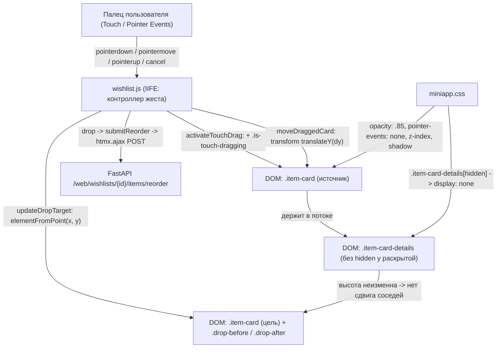

# WISHENKA-142: Убрать скачок списка при перетаскивании раскрытой карточки

## Research

### Анализ текущей реализации в репозитории

1. **CSS-правило, вызывающее скачок ([wishenka/web/static/miniapp.css](file:///home/src/wishenka/web/static/miniapp.css#L109-L117))**:
   - Для активного touch-перетаскивания карточка получает класс `.is-touch-dragging`:
     ```css
     .item-card.is-touch-dragging {
       position: relative;
       z-index: var(--layer-drag);
       opacity: .85;
       box-shadow: 0 6px 18px rgba(0, 0, 0, .25);
       pointer-events: none;
       will-change: transform;
     }
     .item-card.is-touch-dragging .item-card-details { display: none; }
     ```
   - Правило на строке 117 (`.item-card.is-touch-dragging .item-card-details { display: none; }`) принудительно скрывает блок подробностей у перетаскиваемой карточки независимо от состояния `hidden` / `aria-expanded`.
   - Так как `.item-card.is-touch-dragging` остаётся в нормальном потоке документа (`position: relative`) и визуально смещается через `transform: translateY(dy)`, удаление `.item-card-details` из потока мгновенно уменьшает высоту карточки-источника на высоту её блока подробностей. Все нижележащие карточки в `#items-list` скачком сдвигаются вверх прямо под пальцем пользователя.
   - При этом свёрнутые карточки и так имеют атрибут `hidden` на `.item-card-details` (строка 87: `.item-card-details[hidden] { display: none; }`), поэтому правило на строке 117 влияет исключительно на раскрытые карточки.

2. **Клиентская логика ([wishenka/web/static/wishlist.js](file:///home/src/wishenka/web/static/wishlist.js#L235-L348))**:
   - `activateTouchDrag(drag)` (строки 341–348) переводит жест в состояние `'active'`, добавляет `is-touch-dragging` на `drag.card` и `is-touch-reordering` на `document.body` / `document.documentElement`, запускает `autoScrollTick`. JS не изменяет `aria-expanded` и атрибут `hidden` у `.item-card-details`.
   - `moveDraggedCard(drag)` (строки 305–308) сдвигает карточку через `drag.card.style.transform = \`translateY(${dy}px)\`` — вычисление `dy` не зависит от высоты карточки.
   - `updateDropTarget(drag)` (строки 280–298) определяет целевую карточку через `document.elementFromPoint(drag.lastX, drag.lastY)`. Поскольку на `.item-card.is-touch-dragging` задано `pointer-events: none`, указатель «пробивает» перетаскиваемую карточку насквозь и попадает в карточку под пальцем. Без сдвига списка вверх координаты под пальцем точно соответствуют карточке, на которую пользователь визуально навёл палец.
   - `endTouchDrag()` / `cancelTouchDrag()` (строки 235–273) очищают `transform`, удаляют `is-touch-dragging` и `is-touch-reordering`, не затрагивая `aria-expanded` и `hidden`.
   - `submitReorder(list, card, target, after)` (строки 97–120) переставляет карточку в DOM и отправляет `POST /web/wishlists/{id}/items/reorder` через `htmx.ajax`, после чего сервер перерисовывает `#items-list` в стандартном свёрнутом виде.

3. **HTML-разметка ([wishenka/web/templates/partials/item_card.html](file:///home/src/wishenka/web/templates/partials/item_card.html#L156))**:
   - `.item-card-details` рендерится с атрибутом `hidden` по умолчанию и управляется через `toggleWishCard` в `wishlist.js`. Никаких изменений в шаблоне не требуется.

4. **Автоматизированные браузерные тесты ([tests/test_wishlist_touch_reorder_browser.py](file:///home/src/tests/test_wishlist_touch_reorder_browser.py#L62-L128), [tests/browser_helpers.py](file:///home/src/tests/browser_helpers.py#L222-L237))**:
   - В `tests/browser_helpers.py` функция `retarget_touch_drag` была введена именно как обходной путь для скачка разметки:
     > *"Activating a drag collapses an expanded dragged card (`.is-touch-dragging` hides its details), which shifts the cards below it up; coordinates computed before the gesture may then miss every card."*
   - В `tests/test_wishlist_touch_reorder_browser.py` тесты `test_touch_drag_handle_reorders[expanded-card]` (строка 84–85) и `test_expanded_card_stays_expanded_after_cancelled_touch_drag` (строка 118–119) явно опирались на это схлопывание и вызывали `retarget_touch_drag`.

5. **Документация ([doc/dev/miniapp.md](file:///home/src/doc/dev/miniapp.md#L618-L623))**:
   - В разделе touch-перетаскивания зафиксировано текущее поведение (`.item-card-details` скрыт через `display: none`, список сдвигается вверх при старте перетаскивания со ссылкой на `WISHENKA-142`). Обновление документации запланировано на Шаге 8 (`td-70-dev-docs`).

## Implementation Plan

1. **Шаг 3 (Failing Repro — `td-25-failing-repro`)**:
   - **Где разместить**: [tests/test_wishlist_touch_reorder_browser.py](file:///home/src/tests/test_wishlist_touch_reorder_browser.py) (использует существующие фикстуры `seed_wishlist`, `wishlist_page`, локальный FastAPI + SQLite + headless Chromium без внешних зависимостей).
   - **Что проверяет красный тест** (`test_expanded_card_drag_preserves_details_and_list_positions`):
     1. Раскрывает первую карточку (`ids[0]`) кликом по заголовку и проверяет `assert_cards(page, ids, expanded={ids[0]})`.
     2. До начала перетаскивания фиксирует `getBoundingClientRect().height` карточки `ids[0]`, видимость и `getComputedStyle(...).display` её `.item-card-details`, а также `getBoundingClientRect().top` нижележащих карточек `ids[1]` и `ids[2]`.
     3. Начинает touch-перетаскивание за ручку `handle(ids[0])` на `card(ids[2])` (`begin_touch_drag` без `retarget_touch_drag`) и дожидается активации жеста (`wait_gesture_active(page, ids[0])`).
     4. Пока класс `is-touch-dragging` активен, проверяет:
        - `getComputedStyle(details).display !== 'none'` и `details.getBoundingClientRect().height > 0`;
        - высота `ids[0]` не изменилась (совпадает с исходной в пределах `<= 1` px);
        - `top` карточек `ids[1]` и `ids[2]` не сдвинулся (совпадает с исходным в пределах `<= 1` px);
        - `parseFloat(getComputedStyle(card(ids[0])).opacity) < 1` (сохранено визуальное приглушение).
     5. Отменяет жест (`page.touch_cancel()` + `page.touch_end()`), проверяя, что `ids[0]` осталась раскрытой, позиции `ids[1]`/`ids[2]` не изменились, `assert_gesture_clean(page)` и `assert_clean_console(page)` проходят.
   - **Почему тест гарантированно падает (red) до фикса**: на текущем коде `miniapp.css` (строка 117) при добавлении `.is-touch-dragging` мгновенно выставляет `display: none` на `.item-card-details`, что обнуляет высоту блока подробностей и сдвигает `ids[1]` и `ids[2]` вверх на несколько десятков пикселей.
   - **Последовательность**: исследование (Шаг 2) → красный браузерный тест (Шаг 3) → правка CSS и обновление зависимых тестов (Шаг 4) → зелёный прогон всего набора тестов.

2. **Шаг 4 (Development — `td-30-development`)**:
   - Удалить правило `.item-card.is-touch-dragging .item-card-details { display: none; }` из [wishenka/web/static/miniapp.css](file:///home/src/wishenka/web/static/miniapp.css#L117).
   - Сохранить все остальные свойства `.item-card.is-touch-dragging` (`position: relative`, `z-index: var(--layer-drag)`, `opacity: .85`, `box-shadow`, `pointer-events: none`, `will-change: transform`) и `.item-card-details[hidden] { display: none; }`.
   - В [tests/test_wishlist_touch_reorder_browser.py](file:///home/src/tests/test_wishlist_touch_reorder_browser.py) убрать обходной вызов `retarget_touch_drag` и устаревшие комментарии о схлопывании карточки в `test_touch_drag_handle_reorders[expanded-card]` и `test_expanded_card_stays_expanded_after_cancelled_touch_drag` (убедиться, что перетаскивание раскрытой карточки до `ids[2]` работает напрямую по исходным координатам). Актуализировать docstring `retarget_touch_drag` в [tests/browser_helpers.py](file:///home/src/tests/browser_helpers.py) (или удалить неиспользуемый helper, если он больше нигде не вызывается).
   - Прогнать браузерные и unit-тесты через `Makefile` / `pytest`.

## Architecture

### Диаграмма модулей и потока взаимодействия



### Ответственность модулей

- **[wishenka/web/static/miniapp.css](file:///home/src/wishenka/web/static/miniapp.css)**:
  - Отвечает исключительно за визуальное представление состояний карточек и жеста перетаскивания.
  - `.item-card-details[hidden] { display: none; }` — единственный источник скрытия подробностей (только для свёрнутых карточек).
  - `.item-card.is-touch-dragging` — визуально выделяет и приглушает перетаскиваемую карточку целиком (`opacity: .85`, тень, `z-index`, `pointer-events: none`, `will-change: transform`), не изменяя её геометрию и не скрывая видимый `.item-card-details`.
- **[wishenka/web/static/wishlist.js](file:///home/src/wishenka/web/static/wishlist.js)**:
  - Управляет машиной состояний touch-жеста (`armed` → `active` → `drop` / `cancel`), вычислением смещения `translateY(dy)`, определением цели через `elementFromPoint`, автоскроллом, подавлением пост-жестового `click` и отправкой `htmx.ajax`.
  - Не вмешивается в состояние раскрытия (`aria-expanded` / `hidden`) во время перетаскивания и отмены.
- **[wishenka/web/templates/partials/item_card.html](file:///home/src/wishenka/web/templates/partials/item_card.html)**:
  - Рендерит `.item-card`, `.item-drag-handle` и `.item-card-details` (с `hidden` по умолчанию). Изменения не требуются.
- **[tests/test_wishlist_touch_reorder_browser.py](file:///home/src/tests/test_wishlist_touch_reorder_browser.py)** и **[tests/browser_helpers.py](file:///home/src/tests/browser_helpers.py)**:
  - Проверяют реальное поведение в headless Chromium (включая геометрическую стабильность списка, видимость/высоту `.item-card-details`, сохранение порядка и сценарии отмены).

### Схема взаимодействия при перетаскивании раскрытой карточки

1. **Исходное состояние**: карточка `A` раскрыта (`aria-expanded="true"`, у `.item-card-details` отсутствует `hidden`). Карточки `B`, `C` расположены ниже `A`.
2. **Захват (`pointerdown` на `.item-drag-handle`)**: `wishlist.js` переводит `touchDrag.state` в `'armed'`, запоминает `startY`, `startScrollY`, захватывает указатель и отключает вертикальные свайпы Telegram WebApp (если включены). Разметка не меняется.
3. **Активация (`pointermove` >= `DRAG_START_THRESHOLD_PX` = 4 px)**: `activateTouchDrag` добавляет `.is-touch-dragging` на `A`.
   - По правилам `miniapp.css` карточка `A` получает `opacity: .85`, тень, `z-index: 10`, `pointer-events: none`.
   - Так как правило скрытия `.item-card-details` при `.is-touch-dragging` удалено, блок подробностей остаётся видимым в приглушённом виде, а высота `A` в потоке документа остаётся неизменной.
   - Позиции `B` и `C` (`getBoundingClientRect().top`) не сдвигаются.
4. **Перемещение (`pointermove`)**: `moveDraggedCard` смещает `A` через `translateY(dy)`, `updateDropTarget` через `elementFromPoint` (проходя сквозь `pointer-events: none` на `A`) находит актуальную целевую карточку и ставит `.drop-before` / `.drop-after`.
5. **Завершение**:
   - **Успешный drop (`pointerup`)**: `endTouchDrag` снимает классы и `transform`, `submitReorder` отправляет новый порядок на сервер, после чего `#items-list` перерисовывается сервером (стандартно в свёрнутом виде).
   - **Отмена (`pointercancel`, `Escape`, `blur`, `visibilitychange`, `lostpointercapture`, второй палец, `htmx:beforeSwap`)**: `cancelTouchDrag` → `endTouchDrag` снимает `.is-touch-dragging` и `transform`. Карточка `A` остаётся раскрытой, порядок и координаты карточек не меняются.

### Интерфейсы (CSS / JS)

- **CSS-контракт**:
  - `.item-card-details[hidden]` → `display: none` (управляет сворачиванием).
  - `.item-card.is-touch-dragging` → `position: relative; z-index: var(--layer-drag); opacity: .85; box-shadow: 0 6px 18px rgba(0, 0, 0, .25); pointer-events: none; will-change: transform;` (визуальная индикация перетаскивания без изменения размеров карточки).
- **JS-контракт (`wishlist.js`)**:
  - `activateTouchDrag(drag: TouchDrag): void` — переключает `drag.state = 'active'`, вешает `.is-touch-dragging` и `.is-touch-reordering`.
  - `endTouchDrag(): void` — сбрасывает `drag.card.style.transform`, снимает `.is-touch-dragging`, `.is-touch-reordering`, `.drop-before`, `.drop-after`.
  - `toggleWishCard(event: Event, summary: Element): void` — единственный обработчик, переключающий `aria-expanded` и `details.hidden`.

### Выбранный архитектурный паттерн и обоснование

- **Разделение ответственности (State vs. Presentation)**: JS отвечает только за состояние жеста (`is-touch-dragging`) и координаты (`translateY`), а CSS отвечает за визуальное выделение активной карточки (`opacity`, тень, `pointer-events: none`) без вмешательства в видимость контента (`.item-card-details`).
- **Минимальность и локальность изменения**: удаление одного избыточного CSS-правила полностью устраняет первопричину скачка, не усложняя JS-код заглушками высоты или пересчётом координат, и не затрагивает mouse DnD, прокрутку, кнопки вверх/вниз и серверную логику.

## Q&A

- **Q: Требуются ли изменения в `wishlist.js`?**
  A: Нет. `wishlist.js` уже не изменяет `hidden` и `aria-expanded` при touch-перетаскивании; весь сдвиг вызывался исключительно CSS-правилом `.item-card.is-touch-dragging .item-card-details { display: none; }` в `miniapp.css`.
- **Q: Не помешает ли сохранение высоты раскрытой карточки попаданию в целевую карточку через `document.elementFromPoint`?**
  A: Нет. На `.item-card.is-touch-dragging` задано `pointer-events: none`, поэтому `elementFromPoint(lastX, lastY)` игнорирует перетаскиваемую карточку целиком (включая её видимый блок подробностей) и возвращает элемент списка под пальцем.
