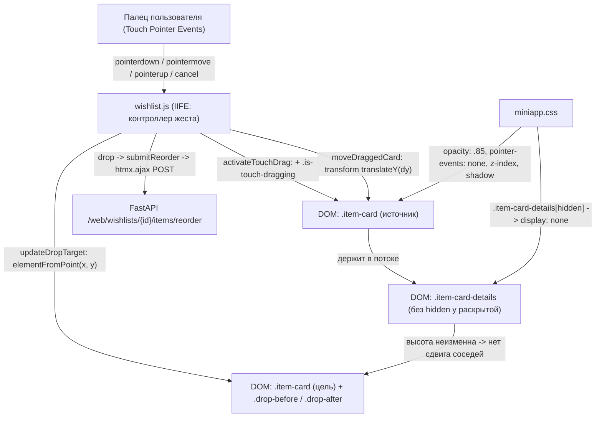
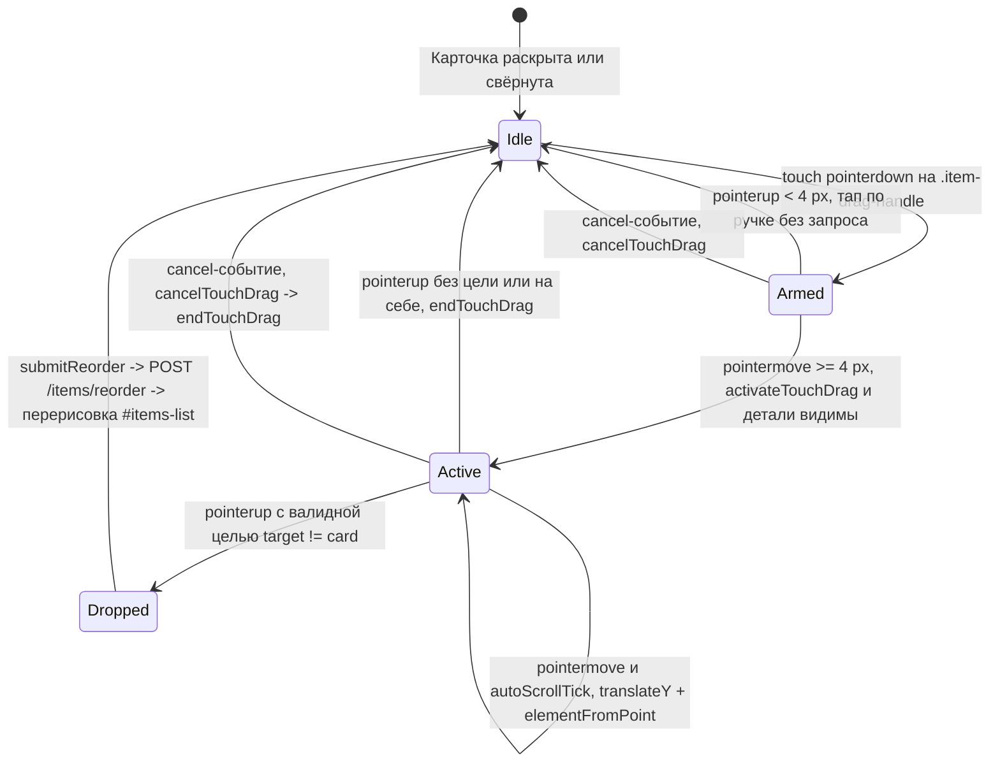

# Спецификация: WISHENKA-142 — Убрать скачок списка при перетаскивании раскрытой карточки

**Версия документа:** 1.0  
**Статус:** реализовано (включая браузерную верификацию, аудит наблюдаемости, анализ техдолга и обновление документации)  
**Задача в Jira:** WISHENKA-142  
**Язык реализации:** CSS, JavaScript (клиентская часть), Python (автоматизированные браузерные тесты)  
**Компоненты:** `wishenka/web/static/miniapp.css`, `wishenka/web/static/wishlist.js`, `wishenka/web/templates/partials/item_card.html`, `tests/test_wishlist_touch_reorder_browser.py`, `tests/browser_helpers.py`  
**Исходные артефакты:** `ai-tasks/WISHENKA-142/10-requirements.md`, `ai-tasks/WISHENKA-142/20-architecture.md`, `ai-tasks/WISHENKA-142/40-code-cleanup.md`, `ai-tasks/WISHENKA-142/50-observability.md`, `ai-tasks/WISHENKA-142/60-tech-debt.md`, `doc/dev/miniapp.md`, `doc/dev/testing.md`

---

## 1. Назначение и бизнес-цель

### 1.1. Постановка проблемы

В рамках задачи **WISHENKA-109** в Telegram Mini App было реализовано изменение порядка карточек желаний на сенсорных устройствах (touch reorder) с помощью перетаскивания за ручку `.item-drag-handle` на базе Pointer Events.

До реализации **WISHENKA-142** таблица стилей `wishenka/web/static/miniapp.css` содержала правило:

```css
.item-card.is-touch-dragging .item-card-details { display: none; }
```

Это правило принудительно скрывало блок подробностей `.item-card-details` у перетаскиваемой карточки сразу после перехода жеста в активное состояние (`is-touch-dragging`), независимо от значений `aria-expanded` и атрибута `hidden`. Поскольку сама карточка `.item-card.is-touch-dragging` оставалась в нормальном потоке документа (`position: relative`) и визуально следовала за пальцем с помощью `transform: translateY(dy)`, мгновенное исчезновение `.item-card-details` из потока уменьшало высоту перетаскиваемой карточки на десятки пикселей.

В результате все нижележащие карточки списка `#items-list` скачком смещались вверх прямо под пальцем пользователя в момент старта перетаскивания:

- пользователь терял визуальный ориентир целевой позиции при первом движении пальца;
- возникал резкий скачок разметки как при начале перетаскивания, так и при его отмене;
- даже в автоматизированных браузерных тестах приходилось использовать искусственный обходной вызов `retarget_touch_drag` в `tests/browser_helpers.py`, чтобы заново пересчитывать координаты целевых карточек после схлопывания раскрытой карточки.

### 1.2. Цели задачи

1. **Исключить позиционный скачок списка:** гарантировать стабильность положения всех соседних карточек в `#items-list` при начале, выполнении и отмене touch-перетаскивания раскрытой карточки желания.
2. **Сохранить визуальное выделение жеста:** оставить перетаскиваемую раскрытую карточку визуально отделённой от неподвижного списка (полупрозрачность, тень, приоритетный слой) без изменения её формы и высоты.
3. **Обеспечить отсутствие регрессий:** сохранить без изменений сценарии перетаскивания свёрнутых карточек, вертикальную прокрутку списка вне ручки, нативный drag-and-drop мышью на десктопе, кнопки перемещения вверх/вниз и серверный протокол сохранения порядка.
4. **Закрыть поведение регрессионным тестом:** добавить прямой браузерный тест, проверяющий видимость и геометрию `.item-card-details` и неподвижность нижележащих карточек во время активного touch-жеста, и очистить тестовые помощники от обходных костылей.

### 1.3. Ценность для пользователей и системы

- **Для владельца и соавторов вишлиста на мобильных устройствах:** перетаскивание раскрытой карточки становится предсказуемым — карточка плавно следует за пальцем, а остальные элементы списка остаются строго на тех местах, куда пользователь изначально наводил жест.
- **Для надёжности пользовательского интерфейса:** единый источник истины для сворачивания и раскрытия карточки (атрибут `hidden` и `aria-expanded`) упрощает модель состояний и убирает побочные перерасчёты макета (layout reflow) при старте и отмене жеста.
- **Для сопровождения и тестирования:** удаление обходного механизма `retarget_touch_drag` делает браузерные тесты более честными — они взаимодействуют с интерфейсом по реальным неизменным координатам пользователя.

### 1.4. Границы области (Scope и Non-Goals)

- **Входит в задачу:**
  - удаление принудительного скрытия `.item-card-details` во время `.is-touch-dragging` в `wishenka/web/static/miniapp.css` при сохранении визуальных эффектов перетаскивания;
  - добавление автоматизированной браузерной проверки сохранения видимости и высоты подробностей раскрытой карточки и стабильности координат соседних карточек;
  - обновление существующих тестов раскрытой карточки и удаление устаревшего помощника `retarget_touch_drag`;
  - актуализация технической документации в `doc/dev/miniapp.md` и `doc/dev/testing.md`.
- **Не входит в задачу:**
  - изменение серверной логики обработки `POST /web/wishlists/{id}/items/reorder`;
  - изменение поведения перетаскивания мышью (HTML5 DnD) и кнопок перемещения вверх/вниз;
  - сохранение раскрытого состояния карточки после успешного сброса и серверной перерисовки `#items-list` (после сохранения порядка список стандартно перерисовывается свёрнутым, как при перетаскивании мышью и кнопках перемещения);
  - проверка автоскролла на коротких экранах и ручное тестирование на физических устройствах (вынесены в отдельную задачу `WISHENKA-143`).

---

## 2. Функциональные требования и пользовательские сценарии

### 2.1. Выбранное UX-решение и отклоненные альтернативы

Для устранения скачка списка рассматривались три варианта:

| Вариант UX | Поведение при старте жеста | Решение и обоснование |
| --- | --- | --- |
| **Сохранение приглушённых подробностей** | `.item-card-details` остаётся видимым; вся карточка получает `opacity: .85`, тень и `z-index` | **Выбран.** Карточка сохраняет исходную высоту и форму, соседние карточки не сдвигаются ни на пиксель ни при старте, ни при отмене, а визуальное приглушение чётко отделяет перетаскиваемую карточку от списка. |
| Плавная анимация сворачивания | Высота `.item-card-details` анимированно уменьшается до нуля | **Отклонён.** Уменьшение высоты всё равно сдвигает карточки под пальцем пользователя, лишь растягивая смещение во времени и не решая проблему точного наведения на цель. |
| Пустая заглушка исходной высоты | Подробности скрываются, но под карточкой резервируется пустой блок прежней высоты | **Отклонён.** Создаёт неестественный пустой разрыв в разметке и резкую смену геометрии самой карточки в момент захвата, усложняя клиентский JS-код. |

### 2.2. Пользовательские сценарии

- **Сценарий 1 (Перетаскивание и успешный сброс раскрытой карточки):** владелец вишлиста на сенсорном устройстве раскрывает карточку желания (кликом или тапом по заголовку/сводке `.item-card-summary`), затем берёт её за ручку `.item-drag-handle` и перемещает за порог `4` px. Карточка переходит в активное состояние перетаскивания: она приподнимается по `z-index`, становится полупрозрачной (`opacity: .85`), отбрасывает тень и следует за пальцем, но её блок подробностей `.item-card-details` остаётся видимым. Карточки ниже неё остаются на своих исходных вертикальных позициях. При отпускании пальца над целевой карточкой отправляется один запрос на изменение порядка, после чего сервер перерисовывает `#items-list` в стандартном свёрнутом виде.
- **Сценарий 2 (Отмена перетаскивания раскрытой карточки):** пользователь начинает перетаскивание раскрытой карточки за ручку `.item-drag-handle` и отменяет жест любым поддерживаемым способом (`pointercancel`, `lostpointercapture`, второй палец, клавиша `Escape`, потеря фокуса окна `blur`, скрытие вкладки `visibilitychange` или внешняя замена `#items-list` через `htmx:beforeSwap`). Во время активной фазы и после отмены соседние карточки не смещаются, сетевой запрос перестановки не отправляется, а перетаскивавшаяся карточка остаётся раскрытой (`aria-expanded="true"`, атрибут `hidden` на `.item-card-details` отсутствует).
- **Сценарий 3 (Свёрнутые карточки, прокрутка и десктоп):** свёрнутые карточки по-прежнему скрывают `.item-card-details` за счёт правила `.item-card-details[hidden] { display: none; }` и перетаскиваются без изменений; вертикальный свайп по области карточки вне `.item-drag-handle` прокручивает страницу, не активируя перетаскивание; перетаскивание мышью и кнопки вверх/вниз работают без регрессий.

### 2.3. Входные и выходные данные

| Элемент взаимодействия | Тип / Источник | Ожидаемое поведение |
| --- | --- | --- |
| Касание и перемещение (`pointerdown`, `pointermove`) | Touch Pointer Events (`event.pointerType === 'touch'`) на `.item-drag-handle` | После смещения на `>= 4` px (`DRAG_START_THRESHOLD_PX`) на карточку добавляется `.is-touch-dragging`, на `body` и `html` — `.is-touch-reordering`, к карточке применяется `transform: translateY(dy)`. |
| Видимость блока подробностей | `.item-card-details` внутри раскрытой карточки | `aria-expanded="true"` на `.item-card-summary` и отсутствие `hidden` на `.item-card-details` не изменяются; вычисленный стиль `display` не равен `'none'`, высота элемента `> 0`. |
| Позиции соседних карточек | `getBoundingClientRect().top` следующих элементов в `#items-list` | Вертикальные координаты соседних карточек и высота перетаскиваемой карточки до и во время `.is-touch-dragging` совпадают (проверяемый допуск `<= 1.0` px). |
| Целевая карточка сброса | `document.elementFromPoint(drag.lastX, drag.lastY)` | За счёт `pointer-events: none` на `.item-card.is-touch-dragging` указатель проходит сквозь перетаскиваемую карточку (включая её видимый `.item-card-details`) и определяет реальную целевую карточку под пальцем, добавляя `.drop-before` или `.drop-after`. |
| Завершение сброса (`pointerup`) | Наличие `target` внутри `#items-list` (`target !== card`) | Вызывается `submitReorder`, переставляющий узел в DOM и отправляющий один `POST /web/wishlists/{id}/items/reorder` с полным списком `item_ids`. |
| Отмена жеста | `pointercancel`, `lostpointercapture`, второй палец, `Escape`, `blur`, `visibilitychange`, `htmx:beforeSwap` | Вызывается `cancelTouchDrag` → `endTouchDrag`: очищаются `transform`, `.is-touch-dragging`, `.is-touch-reordering`, `.drop-before`/`.drop-after`; состояние раскрытия и порядок в DOM сохраняются; запросы не отправляются. |

### 2.4. Продуктовые и доменные инварианты

1. **Единый источник скрытия подробностей:** сворачивание и раскрытие карточки регулируется исключительно атрибутом `hidden` на `.item-card-details` (`.item-card-details[hidden] { display: none; }`) и атрибутом `aria-expanded` на `.item-card-summary` через `toggleWishCard`. CSS-класс `.is-touch-dragging` никогда не должен переопределять видимость `.item-card-details`.
2. **Инвариант геометрической стабильности:** переход карточки в состояние `.is-touch-dragging` и выход из него не изменяют высоту карточки в потоке документа и не вызывают сдвига нижележащих элементов списка.
3. **Инвариант сквозного попадания в цель (Hit-Test Passthrough):** правило `pointer-events: none` распространяется на всю перетаскиваемую карточку `.item-card.is-touch-dragging`, включая её видимые потомки `.item-card-details`, благодаря чему `document.elementFromPoint` точно определяет целевую карточку под пальцем даже при увеличенной высоте раскрытой карточки.
4. **Инвариант разделения ответственности (State vs. Presentation):** `wishlist.js` управляет только состоянием жеста и сдвигом `translateY`, не вмешиваясь в `aria-expanded` и `hidden`; `miniapp.css` отвечает только за визуальное оформление состояния перетаскивания.
5. **Инварианты прав доступа и тайны сюрприза:** ручка `.item-drag-handle` и атрибут `draggable="true"` доступны только владельцу и уполномоченным редакторам списка; публичный режим просмотра для дарителей и анонимных посетителей, а также серверный маршрут перестановки не затрагиваются.

---

## 3. Архитектура, компоненты и интерфейсы

### 3.1. Архитектурная схема взаимодействия



### 3.2. Модули и ответственности

| Модуль | Ответственность и статус в задаче |
| --- | --- |
| `wishenka/web/static/miniapp.css` | **Изменён.** Удалено правило `.item-card.is-touch-dragging .item-card-details { display: none; }`. Сохранены `.item-card-details[hidden] { display: none; }`, визуальные стили `.item-card.is-touch-dragging`, индикаторы `.drop-before`/`.drop-after`, стили `.item-drag-handle` (`44` px, `touch-action: none`) и классы `.is-touch-reordering`. |
| `wishenka/web/static/wishlist.js` | **Не изменялся.** IIFE-контроллер раскрытия карточек (`toggleWishCard`), нативного DnD мышью и touch-перетаскивания на Pointer Events (`activateTouchDrag`, `moveDraggedCard`, `updateDropTarget`, `autoScrollTick`, `endTouchDrag`, `cancelTouchDrag`, `submitReorder`). |
| `wishenka/web/templates/partials/item_card.html` | **Не изменялся.** Рендерит `.item-card`, `.item-card-summary`, `.item-drag-handle` (для редакторов) и `.item-card-details` с атрибутом `hidden` по умолчанию. |
| `tests/test_wishlist_touch_reorder_browser.py` | **Изменён.** Добавлен регрессионный тест `test_expanded_card_drag_preserves_details_and_list_positions`; тесты `test_touch_drag_handle_reorders[expanded-card]` и `test_expanded_card_stays_expanded_after_cancelled_touch_drag` переведены на прямое перетаскивание без `retarget_touch_drag` с `viewport=(412, 1000)`. |
| `tests/browser_helpers.py` | **Изменён.** Удалён устаревший помощник `retarget_touch_drag`, ранее компенсировавший скачок разметки при схлопывании раскрытой карточки. |
| `doc/dev/miniapp.md`, `doc/dev/testing.md` | **Актуализированы.** Зафиксировано сохранение видимости `.item-card-details` и высоты карточки при touch drag (`WISHENKA-142`); удалено упоминание `retarget_touch_drag`. |

### 3.3. CSS- и JS-интерфейсы (контракты)

#### CSS-контракт (`wishenka/web/static/miniapp.css`)

```css
.item-card-details[hidden] { display: none; }

.item-drag-handle {
  display: inline-flex;
  align-items: center;
  justify-content: center;
  min-width: var(--touch-target);   /* 44px */
  min-height: var(--touch-target);  /* 44px */
  cursor: grab;
  padding: .5rem;
  touch-action: none;
  user-select: none;
  -webkit-user-select: none;
  -webkit-touch-callout: none;
}

.item-card.is-touch-dragging {
  position: relative;
  z-index: var(--layer-drag);       /* 10 */
  opacity: .85;
  box-shadow: 0 6px 18px rgba(0, 0, 0, .25);
  pointer-events: none;
  will-change: transform;
}
```

Ключевой контракт: селектор `.item-card.is-touch-dragging` стилизует исключительно саму карточку и не содержит правил, скрывающих или сжимающих `.item-card-details`.

#### Контракт клиентского контроллера (`wishenka/web/static/wishlist.js`)

Основные константы и структуры контроллера жеста:

- **Порог активации и параметры:** `DRAG_START_THRESHOLD_PX = 4`, `AUTOSCROLL_EDGE_PX = 64`, `AUTOSCROLL_MAX_PX = 14`, `CLICK_SUPPRESS_MS = 400`, `SWIPES_MIN_VERSION = '7.7'`, `HAPTIC_MIN_VERSION = '6.1'`.
- **Структура состояния `TouchDrag`:** хранит `state` (`'armed' | 'active'`), `pointerId`, `handle`, `card`, начальные координаты `startX`, `startY`, `startScrollY`, текущие `lastX`, `lastY`, целевой узел `target`, сторону `after`, идентификатор кадра `rafId` и флаг `swipesWereEnabled`.
- **Ключевые функции:**
  - `activateTouchDrag(drag)` — переводит `drag.state = 'active'`, добавляет `.is-touch-dragging` на `drag.card` и `.is-touch-reordering` на `document.body` и `document.documentElement`, вызывает `haptic('impact')`, запускает `autoScrollTick`. Не меняет `aria-expanded` и `details.hidden`.
  - `moveDraggedCard(drag)` — вычисляет `dy = drag.lastY - drag.startY + (window.scrollY - drag.startScrollY)` и устанавливает `drag.card.style.transform` в `translateY(${dy}px)`.
  - `updateDropTarget(drag)` — вызывает `document.elementFromPoint(drag.lastX, drag.lastY)`, находит ближайшую карточку `.item-card` внутри `#items-list` (исключая `drag.card`), вычисляет `isAfterMidpoint(drag.lastY, target.getBoundingClientRect())` и обновляет классы `.drop-before` / `.drop-after`.
  - `endTouchDrag()` — очищает `touchDrag`, отменяет `requestAnimationFrame`, снимает `.drop-before`/`.drop-after`, очищает `drag.card.style.transform`, удаляет `.is-touch-dragging` и `.is-touch-reordering`, освобождает pointer capture и при необходимости вызывает `restoreSwipes()`.
  - `cancelTouchDrag()` — при `state === 'active'` взводит `armClickSuppression()` на `400` мс и вызывает `endTouchDrag()`, не меняя порядок DOM и не отправляя HTTP-запрос.
  - `submitReorder(list, card, target, after)` — переставляет карточку в DOM и отправляет `htmx.ajax('POST', '/web/wishlists/' + wishlistId + '/items/reorder', ...)`.
  - `toggleWishCard(event, summary)` — единственный обработчик, переключающий `aria-expanded` и `details.hidden` (если цель клика не соответствует `TOGGLE_EXCLUSION`: `'a, button, input, select, textarea, [data-no-toggle]'`).

### 3.4. Переходы состояний (State Transitions)



---

## 4. Нефункциональные требования, безопасность и наблюдаемость

### 4.1. Производительность и ограничения

- **Отсутствие перерасчёта макета (Layout Reflow) во время жеста:** визуальное смещение карточки реализуется исключительно через свойство композитора `transform: translateY(dy)` с подсказкой `will-change: transform`. Удаление правила `display: none` на `.item-card-details` дополнительно устраняет скачкообразный пересчёт геометрии всего `#items-list` при входе в `.is-touch-dragging` и выходе из него.
- **Композитный слой для более высокой карточки:** при перетаскивании раскрытой карточки браузер композитит чуть более высокий элемент с `opacity: .85` и `box-shadow: 0 6px 18px rgba(0, 0, 0, .25)`. Поскольку `transform` выполняется на уровне GPU-композитора без пересчёта layout на каждом `pointermove`, влияние на плавность пренебрежимо мало.
- **Доставка обновления стилей:** согласно `doc/dev/miniapp.md`, `BrowserSecurityMiddleware` выставляет `Cache-Control: no-store` на все ответы, включая `/static/*`, поэтому обновлённый `miniapp.css` применяется при первой же загрузке страницы без кэш-бастинга.
- **Автоскролл и таймауты тестов:** автоскролл в `wishlist.js` работает в цикле `requestAnimationFrame` с шагом до `AUTOSCROLL_MAX_PX = 14` px/кадр в краевой зоне `AUTOSCROLL_EDGE_PX = 64` px. Браузерный модуль `tests/test_wishlist_touch_reorder_browser.py` защищён явным таймаутом `pytestmark = [pytest.mark.timeout(45), pytest.mark.browser]`.

### 4.2. Безопасность и приватность

- **Отсутствие изменений в модели доступа и сервере:** серверная часть Python/FastAPI, HTML-шаблоны и логика `wishlist.js` не модифицировались; переупорядочивание остаётся доступным только владельцу и соавторам, а публичная страница дарителя (share page) не содержит `.item-drag-handle` и атрибута `draggable="true"`.
- **Тайна сюрприза:** визуальное отображение собственных или совместных карточек в режиме редактирования порядка никак не затрагивает сокрытие данных о бронировании и покупке подарков от получателя.
- **Устойчивость интеграции с Telegram WebApp:** вызовы `disableVerticalSwipes()`, `enableVerticalSwipes()` (версия от `7.7`) и `HapticFeedback` (версия от `6.1`) изолированы в `try/catch` в `wishlist.js` и не могут заблокировать перетаскивание при сбое SDK.
- **Отсутствие новых векторов атак и утечек:** декларативное удаление одного CSS-правила не добавляет сетевых вызовов, клиентских скриптов, `eval`-конструкций или обработки пользовательского ввода.

### 4.3. Структурированное логирование и метрики

Согласно анализу наблюдаемости (`ai-tasks/WISHENKA-142/50-observability.md`), добавление нового runtime-логирования и метрик для задачи **WISHENKA-142** не требуется (**N/A**):

1. Единственное production-изменение ограничено удалением CSS-правила в `wishenka/web/static/miniapp.css`; CSS не исполняет бизнес-логику и не генерирует событий.
2. Серверный код (`POST /web/wishlists/{id}/items/reorder`) и существующие структурированные серверные события (`ui_items_reordered` с уровнем `INFO`, `ui_item_moved` с уровнем `INFO`, `ui_items_reorder_rejected` с уровнем `WARNING` и `reason=invalid_permutation`) не изменялись.
3. Клиентский скрипт `wishenka/web/static/wishlist.js` не изменялся; его существующие предупреждения `console.warn` (`reorder skipped`, однократный `Telegram SDK call failed (<call>)`) сохранены. Добавление отладочного `console.*`-вывода при обычном touch-перетаскивании нарушало бы контракт чистоты консоли (`assert_clean_console(page)`), а отправка клиентских телеметрических запросов во время перетаскивания создавала бы лишний трафик и задержки на чувствительном UI-жесте.
4. Отдельные метрики Prometheus, дашборды Grafana и правила алертинга не требуются; защита от регрессий геометрии и чистота браузерной консоли обеспечиваются автоматизированными браузерными тестами.

---

## 5. Верификация и критерии приёмки

### 5.1. Автоматизированные тестовые сценарии и результаты проверок

Верификация поведения выполняется в headless Chromium через собственный CDP-драйвер (`tests/browser_cdp.py`, `Input.dispatchTouchEvent`) против локального экземпляра FastAPI и SQLite с реальными файлами `wishlist.js` и `miniapp.css` в модуле `tests/test_wishlist_touch_reorder_browser.py` (`pytestmark = [pytest.mark.timeout(45), pytest.mark.browser]`):

1. **`test_expanded_card_drag_preserves_details_and_list_positions`** (`viewport=(412, 1000)`):
   - раскрывает первую карточку `ids[0]` кликом по заголовку (`assert_cards(page, ids, expanded={ids[0]})`);
   - замеряет исходные `card0Height`, `detailsDisplay`, `detailsHeight`, `card1Top`, `card2Top` и проверяет, что `detailsDisplay != "none"` и `detailsHeight > 0`;
   - запускает touch-перетаскивание на `ids[2]` (`LOWER_HALF`) через `begin_touch_drag` и дожидается `.is-touch-dragging` (`wait_gesture_active`);
   - пока жест активен, проверяет: `detailsDisplay != "none"`, `detailsHeight > 0`, `abs(during["card0Height"] - before["card0Height"]) <= 1.0`, `abs(during["card1Top"] - before["card1Top"]) <= 1.0`, `abs(during["card2Top"] - before["card2Top"]) <= 1.0` и `during["card0Opacity"] < 1.0`;
   - отменяет жест (`page.touch_cancel()`, `page.touch_end()`), проверяет сохранение `card1Top`/`card2Top` (`<= 1.0` px), раскрытое состояние `ids[0]`, отсутствие запросов перестановки (`assert_no_reorder_sent`), исходный порядок в DOM (`assert_order`), чистоту состояния жеста (`assert_gesture_clean`) и чистоту консоли (`assert_clean_console`).
2. **`test_touch_drag_handle_reorders[expanded-card]`** (`viewport=(412, 1000)`):
   - раскрывает `ids[0]` и перетаскивает её за ручку напрямую по исходным координатам `ids[2]` (`LOWER_HALF`) без пересчёта координат (`retarget_touch_drag` удалён);
   - подтверждает появление `.drop-after` на `ids[2]`, отправку ровно одного вызова `htmx.ajax` и одного сетевого `POST .../items/reorder` с новым порядком `[ids[1], ids[2], ids[0]]`, обновление DOM и чистое состояние жеста/консоли.
3. **`test_expanded_card_stays_expanded_after_cancelled_touch_drag`** (`viewport=(412, 1000)`):
   - перетаскивает раскрытую карточку `ids[0]` напрямую к `ids[2]`, отменяет жест через `touch_cancel()` и проверяет, что `ids[0]` осталась раскрытой, порядок и сервер не изменились, а состояние жеста и консоль чисты.
4. **Регрессионный набор `tests/test_wishlist_touch_reorder_browser.py`:**
   - перетаскивание свёрнутых карточек в верхнюю и нижнюю половины цели (`top-half`, `bottom-half`), тап по заголовку и игнорирование тапа по ручке, все 6 сценариев отмены (`pointercancel`, `lostpointercapture`, `escape`, `blur`, `visibilitychange`, `htmx-beforeSwap`), второй палец, `Escape` в фазах `armed` и `active`, вертикальная прокрутка свайпом вне ручки (`viewport=(412, 500)`), ровно один запрос на жест, срабатывание тапа после 400 мс окна подавления клика и вычисленные стили ручки/обратной связи (`touchAction == "none"`, `userSelect == "none"`, размер `>= 44x44`, `dragOpacity < 1`, непустой `targetShadow`).

По зафиксированным в артефактах `ai-tasks/WISHENKA-142/00-roadmap.md` и `ai-tasks/WISHENKA-142/40-code-cleanup.md` результатам финальной проверки (Шаг 5):

- `make analyze` (`ruff check`, `ruff format --check`, `mypy`): 0 ошибок и 0 предупреждений в 204 файлах.
- `.venv/bin/pytest tests/test_wishlist_touch_reorder_browser.py -q`: 20 пройдено (`20 passed in 22.29s`).

### 5.2. Критерии приёмки

1. При начале touch-перетаскивания раскрытой карточки желания нижележащие карточки в `#items-list` не смещаются вверх (допуск `<= 1.0` px).
2. Во время активного перетаскивания раскрытой карточки её блок `.item-card-details` остаётся видимым в приглушённом виде (`opacity: .85` на `.item-card.is-touch-dragging`) с сохранением исходной высоты карточки без пустых разрывов.
3. При отмене перетаскивания раскрытая карточка остаётся раскрытой (`aria-expanded="true"`, без атрибута `hidden`), позиции и порядок карточек не меняются, а запрос на сервер не отправляется.
4. При успешном сбросе новый порядок сохраняется одним запросом `POST /web/wishlists/{id}/items/reorder` без регрессий для свёрнутых карточек.
5. Свайп по списку вне `.item-drag-handle` продолжает прокручивать страницу, а перетаскивание мышью и кнопки вверх/вниз работают без изменений.
6. Статический анализ (`ruff`, `mypy`) и все целевые автоматизированные браузерные тесты проходят без ошибок и предупреждений в консоли.

### 5.3. Известные ограничения и дальнейшие задачи (из `60-tech-debt.md`)

По итогам анализа технического долга (`ai-tasks/WISHENKA-142/60-tech-debt.md`) проблем уровня `Blocker`, `High` или `Medium` не выявлено. Зафиксированы следующие `Low`-наблюдения и границы:

- **Увеличенный viewport в тестах раскрытой карточки (`Low`):** в `tests/test_wishlist_touch_reorder_browser.py` тесты `test_touch_drag_handle_reorders[expanded-card]`, `test_expanded_card_stays_expanded_after_cancelled_touch_drag` и `test_expanded_card_drag_preserves_details_and_list_positions` используют `viewport=(412, 1000)` вместо `(412, 800)`, чтобы третья карточка с учётом видимых подробностей первой не уходила в нижнюю краевую зону автоскролла (`64` px). Это осознанный тестовый параметр без влияния на production-код.
- **Автоскролл на коротких экранах и проверка на реальных устройствах (`Low`):** сценарии перетаскивания раскрытой карточки к нижней границе на компактных экранах (например, `412x800` или `375x667`) с активацией автоскролла, а также ручная проверка на реальных мобильных устройствах осознанно вынесены за пределы `WISHENKA-142` и отслеживаются в задаче **`WISHENKA-143`**.
- **Актуализация документации разработчика:** устаревшие упоминания скрытия `.item-card-details` при touch drag в `doc/dev/miniapp.md` и удалённого помощника `retarget_touch_drag` в `doc/dev/testing.md`, отмеченные на Шаге 7, закрыты на Шаге 8 (`td-70-dev-docs`) в рамках `WISHENKA-142` и отдельного тикета техдолга не требуют.
- **Композитинг более высокой карточки (`Low`):** удержание `.item-card-details` видимым увеличивает высоту композитного слоя перетаскиваемой карточки, однако использование `transform: translateY(dy)` с `will-change: transform` не вызывает пересчёта layout и не создаёт заметной нагрузки.
