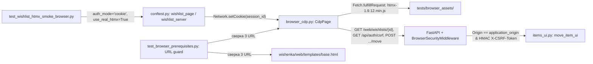

# WISHENKA-145: Добавить smoke-тест с настоящим htmx вместо заглушки

## Research

1. **Локальные вендорные ассеты `htmx` (`tests/browser_assets/`):**
   - В репозитории уже присутствуют закреплённые файлы:
     - `tests/browser_assets/htmx-1.9.12.min.js` (48 101 байт)
     - `tests/browser_assets/htmx-json-enc-1.9.12.js` (356 байт)
     - `tests/browser_assets/htmx-LICENSE.txt` (642 байта)
     - `tests/browser_assets/htmx_stub.js` (5 660 байт — используется существующими 53 тестами `WISHENKA-110`)
   - Внешние сетевые загрузки во время тестов не требуются.

2. **Дублирование внешних URL между шаблоном и CDP-драйвером:**
   - `wishenka/web/templates/base.html:8-10` подключает:
     - `https://telegram.org/js/telegram-web-app.js`
     - `https://unpkg.com/htmx.org@1.9.12`
     - `https://unpkg.com/htmx.org@1.9.12/dist/ext/json-enc.js`
   - `tests/browser_cdp.py:38-40` объявляет `TELEGRAM_URL`, `HTMX_URL`, `JSON_ENC_URL`, а `_stub_bodies()` (`tests/browser_cdp.py:115-120`) подменяет их через `Fetch.requestPaused`.
   - Сейчас нет автоматического теста-гарда, проверяющего совпадение этих трёх URL с `base.html`.

3. **Cookie-сессия, CSRF-цикл и `BrowserSecurityMiddleware`:**
   - `wishenka/web/templates/base.html:19-41,65-103`: при `DOMContentLoaded` (если на `<body>` есть `data-viewer-identified`) вызывается `prepareCsrf()`, запрашивающий `GET /api/auth/csrf` (`credentials: 'same-origin'`). На событие `htmx:configRequest` для мутирующих запросов (`POST`/`PATCH`/`DELETE` и др.) скрипт добавляет заголовок `X-CSRF-Token`.
   - `wishenka/web/routes/auth.py:151-179`: `GET /api/auth/csrf` требует cookie-сессию (`settings.session_cookie_name`, по умолчанию `"session_id"` в `wishenka/config.py:20`) и `current_user.auth_method == "cookie"`, возвращая `csrf_value(settings.csrf_secret_key, cookie)`.
   - `wishenka/web/security.py:21-76` (`BrowserSecurityMiddleware`): для `unsafe and cookie and not bearer` проверяет:
     1. `origin == settings.application_origin` (иначе 403 `csrf_origin_mismatch`);
     2. `hmac.compare_digest(token, csrf_value(settings.csrf_secret_key, cookie))` (иначе 403 `csrf_token_invalid`).
   - **Важная находка:** в `tests/conftest.py:224-230` фикстура `wishlist_server` создаёт `Settings(database_url=..., secret_key=BROWSER_TEST_SECRET)` без указания `application_origin`, из-за чего остаётся значение по умолчанию `"http://testserver"` (`wishenka/config.py:26`). Существующие тесты с `Bearer` обходили проверку `origin` (`not bearer == False`), но при переходе на cookie-сессию браузер отправляет `Origin: http://127.0.0.1:{port}`, что приведёт к 403 без передачи `application_origin=f"http://127.0.0.1:{port}"` в `Settings`. Так как `listen` биндится до `create_app(settings)`, порт уже известен.

4. **Кнопка перемещения с `hx-post` и серверный обработчик:**
   - `wishenka/web/templates/partials/item_card.html:200-219`: кнопки `.btn-move-up` и `.btn-move-down` имеют атрибуты `hx-post="{{ item_web }}/move?direction=up|down"`, `hx-target="#items-list"`, `hx-swap="innerHTML"`.
   - `wishenka/web/routes/items_ui.py:1162-1199` (`move_item_ui`): меняет порядок элементов в БД и возвращает перерисованный фрагмент списка `#items-list`.

5. **Правила маркировки браузерных тестов:**
   - `tests/test_browser_prerequisites.py:522-550` (`test_new_browser_modules_declare_marker_and_timeout`) проверяет все модули `tests/test_*_browser.py`: каждый обязан иметь маркер `browser` и `pytestmark` с `pytest.mark.timeout(45)`.

## Implementation Plan

1. **Расширить `tests/browser_cdp.py`:**
   - Добавить `_real_htmx_bodies() -> dict[str, bytes]`, отдающий `htmx-1.9.12.min.js`, `htmx-json-enc-1.9.12.js` и пустую заглушку для `TELEGRAM_URL`.
   - Добавить параметр `use_real_htmx: bool = False` в `CdpPage.__init__` и `CdpBrowser.new_page` (по умолчанию остаётся `htmx_stub.js`, чтобы 53 существующих теста не меняли поведение).
   - Добавить метод `CdpPage.set_cookie(self, name: str, value: str, url: str) -> None`, устанавливающий cookie через CDP `Network.setCookie` (`httpOnly=True`, `sameSite="Lax"`).
2. **Обновить фикстуры в `tests/conftest.py`:**
   - В `wishlist_server` передавать `application_origin=f"http://127.0.0.1:{port}"` в `Settings(...)` (после `listen.bind`).
   - В `_open_page` и `wishlist_page` добавить опциональные параметры `auth_mode: Literal["bearer", "cookie"] = "bearer"` и `use_real_htmx: bool = False`. При `auth_mode="cookie"` выставлять cookie `session_id` вместо `Authorization: Bearer ...`.
3. **Добавить браузерный smoke-тест `tests/test_wishlist_htmx_smoke_browser.py`:**
   - Объявить `pytestmark = [pytest.mark.timeout(45), pytest.mark.browser]`.
   - Реализовать `test_real_htmx_move_button_with_cookie_and_csrf`:
     - сидировать вишлист с 3 элементами;
     - открыть страницу через `wishlist_page(seeded, auth_mode="cookie", use_real_htmx=True)`;
     - проверить отсутствие внешних сетевых запросов (`external_requests == []`) и загрузку реального `htmx` (`window.htmx.version === "1.9.12"`);
     - дождаться получения CSRF-токена (`window.csrfToken` и `GET /api/auth/csrf` со статусом 200);
     - нажать реальную кнопку `.btn-move-down` первого элемента (`hx-post`);
     - дождаться обновления DOM в `#items-list` и проверить новый порядок, статус `200` для `POST .../move?direction=down`, сохранение порядка после перезагрузки страницы и чистую консоль (`assert_clean_console(page)`).
4. **Добавить гард совпадения URL в `tests/test_browser_prerequisites.py`:**
   - Реализовать `test_browser_cdp_urls_match_base_template()`, сверяющий внешние `<script src="https://...">` из `wishenka/web/templates/base.html` с `HTMX_URL`, `JSON_ENC_URL`, `TELEGRAM_URL` из `tests/browser_cdp.py`.

**Mandatory — Failing Repro (next Step 3):** `N/A — no behavioral change (pure test-addition debt)`. Задача добавляет только автотесты и тестовую инфраструктуру (`tests/`) без изменения продуктового поведения приложения (`wishenka/` не затрагивается).

## Architecture

### Ответственность компонентов

- **`tests/browser_cdp.py`**:
  - Управляет выбором офлайн-ассетов (`_stub_bodies()` vs `_real_htmx_bodies()` через флаг `use_real_htmx`).
  - Предоставляет `CdpPage.set_cookie(name, value, url)` поверх CDP `Network.setCookie` для тестирования реальной cookie-сессии без заголовка `Bearer`.
- **`tests/conftest.py`**:
  - `wishlist_server`: настраивает `Settings(..., application_origin=f"http://127.0.0.1:{port}")`, чтобы `BrowserSecurityMiddleware` принимал `Origin` локального браузера при cookie-мутациях.
  - `wishlist_page`: маршрутизирует `auth_mode="bearer" | "cookie"` и `use_real_htmx=False | True`, сохраняя полную обратную совместимость для существующих тестов.
- **`tests/test_wishlist_htmx_smoke_browser.py`**:
  - Единственный сфокусированный smoke-тест с настоящим `htmx.org@1.9.12`, реальной кнопкой `hx-post`, cookie-сессией, `GET /api/auth/csrf`, `htmx:configRequest` -> `X-CSRF-Token`, обновлением DOM и проверкой консоли/офлайна.
- **`tests/test_browser_prerequisites.py`**:
  - Статический гард `test_browser_cdp_urls_match_base_template()`, гарантирующий синхронность `HTMX_URL`, `JSON_ENC_URL`, `TELEGRAM_URL` с `wishenka/web/templates/base.html`.

### Команды верификации (для Шага 4)

- `make test-serial PYTEST_ARGS="tests/test_wishlist_htmx_smoke_browser.py tests/test_browser_prerequisites.py"`
- `make check`

## Q&A

- **Нужно ли скачивать `htmx.org@1.9.12` отдельно?**
  Нет, `tests/browser_assets/htmx-1.9.12.min.js`, `htmx-json-enc-1.9.12.js` и `htmx-LICENSE.txt` уже присутствуют в репозитории.
- **Почему нужно менять `application_origin` в `wishlist_server`?**
  Без этого `BrowserSecurityMiddleware` сравнивает `Origin: http://127.0.0.1:<port>` со значением по умолчанию `http://testserver` и отклоняет cookie-запросы `POST` с кодом 403. Для тестов с `Bearer` эта проверка не срабатывала из-за условия `not bearer`.
- **Затрагиваются ли существующие 53 теста на `htmx_stub.js`?**
  Нет: `auth_mode="bearer"` и `use_real_htmx=False` остаются значениями по умолчанию.
