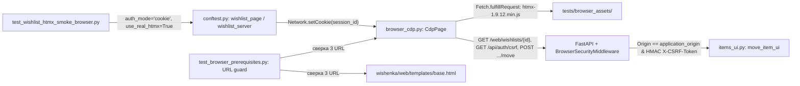

# Спецификация: WISHENKA-145 — Офлайн smoke-тест с настоящим htmx вместо заглушки

**Тип задачи:** Debt (3 SP, приоритет Low)  
**Источник:** `ai-tasks/WISHENKA-110/60-tech-debt.md` (follow-up 3)  
**Контур изменений:** тестовая инфраструктура и автотесты (`tests/`, `doc/dev/testing.md`)  
**Язык реализации:** Python (`pytest`, собственный CDP-драйвер)

## 1. Назначение и бизнес-цель

### 1.1. Постановка проблемы

Существующие браузерные UI-тесты списка желаний (`WISHENKA-110`: 53 теста в `tests/test_wishlist_cards_browser.py`, `tests/test_wishlist_mouse_reorder_browser.py`, `tests/test_wishlist_touch_reorder_browser.py`) и диалога получения подарка (`WISHENKA-24`) используют локальную упрощённую JS-заглушку `tests/browser_assets/htmx_stub.js` вместо настоящего `htmx` и авторизацию через заголовок `Authorization: Bearer ...` вместо пользовательской cookie-сессии и CSRF-защиты.

Такая изоляция оставляет четыре пробела достоверности:

- **Декларативная разметка `hx-*`:** `htmx_stub.js` эмулирует прямой вызов `window.htmx.ajax(...)` и замену `innerHTML`, но не обрабатывает HTML-атрибуты `hx-post`, `hx-target`, `hx-swap` на интерактивных элементах (в частности, на кнопках перемещения желания).
- **Событийная модель и обновления `htmx`:** заглушка не генерирует событие `htmx:configRequest` и не проверяет поведение реального XHR-конвейера `htmx` (в том числе при обновлении версии библиотеки).
- **Клиентский CSRF-контур и cookie-сессия:** тестовая авторизация по `Bearer` обходит проверку cookie-сессии (`session_id`), заголовка `Origin` и HMAC-валидацию `X-CSRF-Token` в `BrowserSecurityMiddleware`, где защита активируется при условии `unsafe and cookie and not bearer`.
- **Рассинхронизация внешних URL:** три внешних `<script>`-адреса из `wishenka/web/templates/base.html` продублированы в `tests/browser_cdp.py` без автоматического контроля совпадения.

### 1.2. Цели и ценность

**Бизнес-цель:** обеспечить владельцев, соавторов вишлистов и команду разработки уверенностью в том, что реальное браузерное взаимодействие с декларативными кнопками `htmx`, cookie-сессией и CSRF-защитой работает без регрессий после изменений шаблонов, клиентских скриптов или версии `htmx`, а проверки исполняются полностью офлайн и детерминированно в CI.

Ключевые цели задачи:

1. Добавить сфокусированный офлайн браузерный smoke-тест на локальной закреплённой копии `htmx.org@1.9.12` (с расширением `json-enc`), с реальной cookie-сессией и полным циклом CSRF-защиты.
2. Не нарушить работу существующих браузерных тестов на `htmx_stub.js` и авторизации по `Bearer` (сохранить текущее поведение по умолчанию).
3. Добавить автоматический статический гард, гарантирующий совпадение перехватываемых внешних URL в `tests/browser_cdp.py` с `wishenka/web/templates/base.html`.

### 1.3. Границы спецификации (Scope и Non-Goals)

В границы `WISHENKA-145` **входят**:

- один браузерный smoke-тест с настоящим `htmx.org@1.9.12`, реальной кнопкой перемещения на `hx-post`, cookie-сессией `session_id` и передачей `X-CSRF-Token` через `htmx:configRequest`;
- расширение `tests/browser_cdp.py` и `tests/conftest.py` опциональными режимами `use_real_htmx` и `auth_mode="cookie"` с настройкой `application_origin` тестового сервера;
- использование локальных вендорных файлов в `tests/browser_assets/` без обращений в сеть;
- проверка совпадения трёх внешних URL между `tests/browser_cdp.py` и `wishenka/web/templates/base.html`.

В задачу **не входят (Non-Goals)**:

- перевод всех существующих браузерных тестов с `htmx_stub.js` на настоящий `htmx`;
- изменение продуктовой логики перемещения элементов, CSRF-защиты или аутентификации (директория `wishenka/` не изменяется);
- покрытие всех `hx-*` сценариев приложения (бронирование, редактирование в модальных окнах, архивирование);
- объединение старых CDP-клиентов (`WISHENKA-146`) и настройка выгрузки артефактов CI (`WISHENKA-147`).

## 2. Функциональные требования и пользовательские сценарии

### 2.1. Пользовательские сценарии

- **UC-145-01 (Владелец или соавтор вишлиста):** пользователь открывает страницу списка желаний в аутентифицированной cookie-сессии, раскрывает карточку первого желания и нажимает кнопку перемещения вниз (`.btn-move-down` с `hx-post`). Настоящий `htmx` отправляет запрос с cookie и заголовком `X-CSRF-Token`, сервер переставляет элементы и возвращает обновлённый фрагмент `#items-list`, список перерисовывается в DOM, а новый порядок сохраняется после перезагрузки страницы.
- **UC-145-02 (Разработчик):** при поломке декларативной разметки `hx-*`, клиентского обработчика `htmx:configRequest` или конфигурации CSRF-проверки автоматический smoke-тест выявляет ошибку до релиза без влияния на остальные тесты на `htmx_stub.js`.
- **UC-145-03 (Ответственный за CI):** тест выполняется полностью офлайн (без запросов к внешним CDN), укладывается в явный лимит времени (`45` с) и контролирует согласованность URL перехвата с `base.html`.

### 2.2. Функциональные требования

| Идентификатор | Требование | Входы / условия | Ожидаемый результат |
| --- | --- | --- | --- |
| **FR-1** | Подключение локального настоящего `htmx@1.9.12` | `use_real_htmx=True` при создании `CdpPage` | Перехват `Fetch` отдаёт `htmx-1.9.12.min.js` и `htmx-json-enc-1.9.12.js` с HTTP `200` (`text/javascript`); `TELEGRAM_URL` отдаётся пустым телом; `window.htmx.version === "1.9.12"`. |
| **FR-2** | Обратная совместимость режима по умолчанию | `use_real_htmx=False`, `auth_mode="bearer"` | Используется `htmx_stub.js` и заголовок `Authorization: Bearer ...`; существующие 53 теста `WISHENKA-110` и тесты `WISHENKA-24` работают без изменений. |
| **FR-3** | Аутентификация по cookie-сессии и проверка `Origin` | `auth_mode="cookie"` в `wishlist_page` | Вкладка получает `HttpOnly`, `SameSite=Lax` cookie `session_id` через `Network.setCookie`; `wishlist_server` задаёт `application_origin=f"http://127.0.0.1:{port}"` в `Settings`. |
| **FR-4** | Сквозной сценарий `hx-post` и CSRF | Вишлист с 3 элементами `["Alpha", "Beta", "Gamma"]`, клик по карточке 1 и `.btn-move-down` | Страница запрашивает `GET /api/auth/csrf` (HTTP `200`), затем отправляет `POST /web/wishlists/{id}/items/{first}/move?direction=down` с `X-CSRF-Token` (HTTP `200`), порядок в DOM и после reload равен `[second, first, third]`. |
| **FR-5** | Контроль отсутствия внешних запросов и ошибок консоли | Завершение загрузки и перезагрузки страницы | `page.external_requests == []`; `assert_clean_console(page)` не фиксирует `warning`, `error` или `exception`. |
| **FR-6** | Статический гард внешних URL | Содержимое `wishenka/web/templates/base.html` и константы `tests/browser_cdp.py` | Множество `<script src="https://...">` в `base.html` точно совпадает с `{TELEGRAM_URL, HTMX_URL, JSON_ENC_URL}`. |

### 2.3. Инварианты

1. **Офлайн-детерминизм:** ни один запрос к внешним доменам не уходит в реальную сеть; любой запрос вне `_stubs`, `INTERNAL_SCHEMES` и `LOCAL_HOSTS` (`127.0.0.1`, `localhost`) отклоняется с `BlockedByClient` и записывается в `page.external_requests`.
2. **Неизменность продуктового кода:** все изменения `WISHENKA-145` ограничены тестовым контуром (`tests/`) и документацией разработчика (`doc/dev/testing.md`); модули приложения `wishenka/` не затрагиваются.
3. **Изоляция режимов:** флаг `use_real_htmx` и параметр `auth_mode` действуют строго в рамках конкретного вызова `new_page` / `wishlist_page` без глобального побочного эффекта на другие тесты.
4. **Маркировка браузерного модуля:** тестовый модуль `tests/test_wishlist_htmx_smoke_browser.py` обязан объявлять `pytestmark = [pytest.mark.timeout(45), pytest.mark.browser]` согласно проверке `test_new_browser_modules_declare_marker_and_timeout`.

## 3. Архитектура, компоненты и интерфейсы

### 3.1. Диаграмма взаимодействия компонентов

### 3.2. Модули, классы и интерфейсы

| Компонент | Изменённые / ключевые символы | Ответственность |
| --- | --- | --- |
| `tests/browser_assets/` | `htmx-1.9.12.min.js` (48 101 Б), `htmx-json-enc-1.9.12.js` (356 Б), `htmx-LICENSE.txt` (642 Б), `htmx_stub.js` (5 660 Б) | Локальное хранение закреплённых версий настоящего `htmx@1.9.12` (с расширением `json-enc` и лицензией) и прежней заглушки. |
| `tests/browser_cdp.py` | `HTMX_URL`, `JSON_ENC_URL`, `TELEGRAM_URL`, `_real_htmx_bodies()`, `CdpPage.__init__(..., use_real_htmx=False)`, `CdpPage.set_cookie(name, value, url)`, `CdpBrowser.new_page(..., use_real_htmx=False)` | Переключает карту офлайн-ответов `Fetch.fulfillRequest` между `_stub_bodies()` и `_real_htmx_bodies()`; выставляет cookie во вкладке через CDP `Network.setCookie`. |
| `tests/conftest.py` | `wishlist_server`, `_open_page(..., auth_mode="bearer", use_real_htmx=False)`, `wishlist_page(..., auth_mode="bearer", use_real_htmx=False)` | Конфигурирует `Settings(..., application_origin=f"http://127.0.0.1:{port}")` после привязки сокета и маршрутизирует режим аутентификации и ассетов `htmx`. |
| `tests/test_wishlist_htmx_smoke_browser.py` | `pytestmark = [pytest.mark.timeout(45), pytest.mark.browser]`, `test_real_htmx_move_button_with_cookie_and_csrf` | Исполняет сквозной smoke-сценарий: реальный `htmx@1.9.12`, cookie `session_id`, CSRF-цикл, клик `.btn-move-down`, обновление `#items-list`, перезагрузка и проверка чистоты консоли и сети. |
| `tests/test_browser_prerequisites.py` | `test_browser_cdp_urls_match_base_template()` | Статически проверяет равенство внешних `<script src="https://...">` в `wishenka/web/templates/base.html` и констант в `tests/browser_cdp.py`. |
| `doc/dev/testing.md` | Разделы «Устройство», «Офлайн-гарантия», «Дымовой тест с настоящим htmx и cookie/CSRF (WISHENKA-145)» | Документирует новые параметры драйвера и фикстур, сценарий smoke-теста и правила синхронизации URL. |

### 3.3. Контракты данных и конфигурация

1. **Карта перехвата внешних скриптов (`tests/browser_cdp.py`):**
   - `HTMX_URL = "https://unpkg.com/htmx.org@1.9.12"` -> `htmx-1.9.12.min.js` (при `use_real_htmx=True`) либо `htmx_stub.js` (по умолчанию);
   - `JSON_ENC_URL = "https://unpkg.com/htmx.org@1.9.12/dist/ext/json-enc.js"` -> `htmx-json-enc-1.9.12.js` (при `use_real_htmx=True`) либо `b""`;
   - `TELEGRAM_URL = "https://telegram.org/js/telegram-web-app.js"` -> `b""` в обоих режимах.
   - Ответ `Fetch.fulfillRequest`: `responseCode=200`, заголовок `Content-Type: text/javascript`, тело в `base64`.
2. **Параметры `CdpPage.set_cookie` (`Network.setCookie`):**
   - `{"name": name, "value": value, "url": url, "httpOnly": True, "sameSite": "Lax"}` (в `_open_page` передаётся `name="session_id"`).
3. **Серверные и клиентские контракты приложения (используются без изменений):**
   - **Конфигурация origin (`wishenka/config.py`, `tests/conftest.py`):** `Settings.application_origin` (по умолчанию `"http://testserver"`) в `wishlist_server` задаётся как `f"http://127.0.0.1:{port}"`, чтобы совпадать с заголовком `Origin` локального Chromium.
   - **Выпуск CSRF-токена (`wishenka/web/routes/auth.py`):** `GET /api/auth/csrf` требует cookie `settings.session_cookie_name` (по умолчанию `"session_id"`) и `current_user.auth_method == "cookie"` (иначе HTTP `401`), возвращая `{"csrf_token": csrf_value(settings.csrf_secret_key, cookie)}` с `Cache-Control: no-store`.
   - **Клиентский CSRF-хук (`wishenka/web/static/app.js`, `wishenka/web/templates/base.html`):** при наличии `data-viewer-identified="true"` на `<body>` обработчик `DOMContentLoaded` вызывает `prepareCsrf()` (`fetch('/api/auth/csrf', { credentials: 'same-origin' })`); на `htmx:configRequest` для мутирующих методов (не `GET`/`HEAD`/`OPTIONS`) подставляет `X-CSRF-Token`.
     - *Замечание по актуальному состоянию кода:* после выноса встроенного скрипта в IIFE-модуль `wishenka/web/static/app.js` (коммит `WISHENKA-140`) переменная `let csrfToken = ''` стала локальной для замыкания модуля и не выставляется в `window.csrfToken`, тогда как `tests/test_wishlist_htmx_smoke_browser.py` на строке 38 ожидает `Boolean(window.csrfToken)`.
   - **Серверная проверка CSRF (`wishenka/web/security.py`):** `BrowserSecurityMiddleware` для `unsafe and cookie and not bearer` проверяет `origin == settings.application_origin` и `hmac.compare_digest(token, csrf_value(settings.csrf_secret_key, cookie))`, при нарушении возвращая HTTP `403` (`Invalid CSRF token`).
   - **Разметка и обработчик перемещения (`wishenka/web/templates/partials/item_card.html`, `wishenka/web/routes/items_ui.py`):** кнопка `.btn-move-down` содержит `hx-post="{{ item_web }}/move?direction=down"`, `hx-target="#items-list"`, `hx-swap="innerHTML"`; `move_item_ui` меняет порядок элементов в БД и возвращает обновлённый HTML-фрагмент `#items-list`.

### 3.4. Переходы состояний в smoke-тесте

1. **Подготовка (`seed_wishlist` + `wishlist_page`):** создаётся вишлист с элементами `[first, second, third]`; вкладка запускается с `Fetch.enable`, `use_real_htmx=True` и cookie `session_id` для владельца.
2. **Загрузка и инициализация:** `Page.navigate` загружает страницу, `htmx@1.9.12` и `app.js` инициализируются, `DOMContentLoaded` вызывает `GET /api/auth/csrf` -> HTTP `200`.
3. **Раскрытие карточки:** клик по заголовку первого элемента раскрывает `.item-card-details`, кнопка `#item-card-{first} .btn-move-down` становится видимой (`height > 0`).
4. **Декларативная мутация через `htmx`:** клик по `.btn-move-down` запускает `htmx` `hx-post` -> `htmx:configRequest` добавляет `X-CSRF-Token` -> `BrowserSecurityMiddleware` валидирует `Origin` и HMAC CSRF -> `move_item_ui` сохраняет новый порядок в SQLite и возвращает HTML `#items-list` (HTTP `200`) -> `htmx` выполняет `innerHTML` swap.
5. **Проверка персистентности:** повторный `page.navigate(current_url)` загружает страницу заново и подтверждает порядок `[second, first, third]`.

## 4. Нефункциональные требования, безопасность и наблюдаемость

### 4.1. Производительность и ограничения времени выполнения

- Вендорные файлы (`htmx-1.9.12.min.js` ~48 КБ, `htmx-json-enc-1.9.12.js` ~356 Б) читаются локально с диска один раз на экземпляр `CdpPage(..., use_real_htmx=True)` без сетевых задержек.
- Таймауты тестовых модулей и ожиданий ограничены явно:
  - `tests/test_wishlist_htmx_smoke_browser.py`: `pytest.mark.timeout(45)`.
  - `tests/test_browser_prerequisites.py`: `pytest.mark.timeout(30)`.
  - `CdpPage.wait_for`: по умолчанию `5.0` с (шаг опроса `POLL_STEP = 0.025` с); `LOAD_TIMEOUT = 10.0` с; `COMMAND_TIMEOUT = 10.0` с.
- Историческое время последовательного прогона 49 тестов (`tests/test_wishlist_htmx_smoke_browser.py` и `tests/test_browser_prerequisites.py`) — `8.71` с (`40-code-cleanup.md`).

### 4.2. Безопасность и приватность

- **Cookie-флаги:** `CdpPage.set_cookie` устанавливает `httpOnly=True` и `sameSite="Lax"`, запрещая чтение сессионной cookie из клиентского JS и воспроизводя реальную модель доставки cookie браузером.
- **Проверка `Origin` и CSRF:** включение `application_origin=f"http://127.0.0.1:{port}"` в тестовом сервере гарантирует реальное исполнение обеих проверок `BrowserSecurityMiddleware` (совпадение `Origin` и `hmac.compare_digest` для `X-CSRF-Token`), а не их отключение.
- **Изоляция тестовых данных и сети:** для каждого теста создаётся отдельная копия БД в `tmp_path` с тестовым секретом `BROWSER_TEST_SECRET`, а перехват `Fetch` блокирует любые внешние сетевые вызовы (`BlockedByClient`).

### 4.3. Наблюдаемость и диагностика

- **Продуктовое логирование и метрики:** `N/A — изменения ограничены тестами (`tests/`)`. Код `wishenka/` не модифицировался; существующие структурные события в `wishenka.web.security` (`csrf_origin_mismatch`, `csrf_token_invalid`), `wishenka.auth` (`csrf_token_issued`, `csrf_cookie_missing`) и `wishenka.web.routes.items_ui` (`ui_item_moved`) работают без изменений.
- **Тестовые диагностические сигналы:**
  - `page.external_requests`: проверяется равенство `[]` после первичной загрузки и после перезагрузки, мгновенно выявляя неперехваченные внешние запросы.
  - `assert_clean_console(page)`: проверяет `page.console` на `warning`, `error` и `exception` с выводом `page.snapshot()` при падении.
  - `page.requests`: проверяет точное количество (`== 1`) и HTTP-статус `200` для `GET /api/auth/csrf` и `POST /web/wishlists/{wishlist_id}/items/{first}/move`.
  - `_browser_pages` (teardown-фикстура в `tests/conftest.py`): при провале теста сохраняет `diagnostics-N.txt` (`page.snapshot()`) и `failure-N.png` (`page.screenshot()`) в `tmp_path`.
  - `test_browser_cdp_urls_match_base_template`: сигнализирует о рассинхронизации внешних `<script>`-ссылок между `base.html` и `tests/browser_cdp.py`.

## 5. Верификация и критерии приёмки

### 5.1. Тестовые сценарии

1. **Smoke-сценарий реального `htmx` + cookie + CSRF (`tests/test_wishlist_htmx_smoke_browser.py::test_real_htmx_move_button_with_cookie_and_csrf`):**
   - Сидирование вишлиста с `["Alpha", "Beta", "Gamma"]`, открытие с `auth_mode="cookie", use_real_htmx=True`.
   - Проверка `page.external_requests == []`, `window.htmx.version == "1.9.12"`, начального порядка `[first, second, third]`.
   - Ожидание готовности CSRF после `GET /api/auth/csrf` (ровно 1 запрос, статус `200`).
   - Клик по заголовку первой карточки -> ожидание видимости `#item-card-{first} .btn-move-down` -> клик по кнопке -> ожидание обновления DOM до `[second, first, third]`.
   - Проверка ровно одного `POST /web/wishlists/{wishlist_id}/items/{first}/move` (статус `200`).
   - Перезагрузка страницы (`page.navigate(current_url)`) -> проверка порядка `[second, first, third]`, `page.external_requests == []` и `assert_clean_console(page)`.
2. **Статический гард URL (`tests/test_browser_prerequisites.py::test_browser_cdp_urls_match_base_template`):**
   - Сравнение внешних `<script src="https://...">` из `wishenka/web/templates/base.html` с `{TELEGRAM_URL, HTMX_URL, JSON_ENC_URL}` из `tests/browser_cdp.py`.
3. **Регрессия и статический анализ:**
   - Сохранение прохождения 53 существующих тестов `WISHENKA-110` на `htmx_stub.js` и `Bearer`-авторизации.
   - Успешное выполнение `make analyze` (`ruff check`, `ruff format --check`, `mypy`).

### 5.2. Критерии приёмки

1. В `tests/browser_assets/` используется локальная закреплённая копия настоящего `htmx.org@1.9.12` (вместе с `htmx-json-enc-1.9.12.js` и `htmx-LICENSE.txt`) без сетевых запросов при запуске тестов.
2. Smoke-тест открывает страницу по cookie-сессии, нажимает реальную кнопку перемещения с `hx-post`, проходит цикл CSRF-защиты, проверяет DOM-обновление списка и сохранение порядка после перезагрузки.
3. Smoke-тест не порождает ошибок или предупреждений в консоли браузера и соблюдает правила маркировки (`browser`, `timeout(45)`).
4. Существующие браузерные тесты на `htmx_stub.js` проходят без регрессий.
5. Автоматическая проверка подтверждает совпадение трёх внешних URL в `tests/browser_cdp.py` и `wishenka/web/templates/base.html`.
6. Статический анализ и релевантный набор тестов проходят успешно.

### 5.3. Наблюдаемый статус верификации

- **На момент завершения `WISHENKA-145` (по данным `00-roadmap.md` и `40-code-cleanup.md`):** `make analyze` (`ruff check`, `ruff format --check`, `mypy`) прошёл без замечаний по 205 файлам; последовательный запуск `make test-serial PYTEST_ARGS="tests/test_wishlist_htmx_smoke_browser.py tests/test_browser_prerequisites.py"` прошёл полностью (49 passed за `8.71` с), а в рамках Шага 4 прошли 119 тестов (браузерных, prerequisite, CSRF и auth).
- **В текущем состоянии репозитория (контрольный запуск `.venv/bin/pytest tests/test_wishlist_htmx_smoke_browser.py tests/test_browser_prerequisites.py -q`):** `48 passed, 1 failed` за `23.47` с. Все 48 тестов `tests/test_browser_prerequisites.py` (включая `test_browser_cdp_urls_match_base_template` и `test_new_browser_modules_declare_marker_and_timeout`) прошли успешно. Тест `test_real_htmx_move_button_with_cookie_and_csrf` упал по `PageWaitTimeout` (5 с) на строке 38 (`Boolean(window.csrfToken)` вернул `False`), несмотря на успешный запрос `GET /api/auth/csrf` со статусом `200`, так как после рефакторинга `WISHENKA-140` (перенос встроенного JS в IIFE-модуль `wishenka/web/static/app.js`) `csrfToken` стал локальной переменной замыкания и больше не публикуется в `window.csrfToken`.

### 5.4. Известные ограничения и задачи техдолга

По результатам анализа `ai-tasks/WISHENKA-145/60-tech-debt.md` блокеры, а также замечания уровней `High` и `Medium` отсутствуют; зафиксированы только ограничения и доработки уровня **Low** (`NON-BLOCKER`, `status: unticketed`):

1. **Игнорирование `accept_language` и зашитое имя cookie в `_open_page` (`tests/conftest.py`):** при `auth_mode="cookie"` значение `"session_id"` зашито литералом вместо чтения `Settings().session_cookie_name`, а `accept_language` передаётся только в `page.set_bearer(...)` (follow-up 1 в `60-tech-debt.md`).
2. **Хрупкий regex в `test_browser_cdp_urls_match_base_template` (`tests/test_browser_prerequisites.py`):** шаблон `r'<script\s+src="(https://[^"]+)"'` предполагает, что `src` — первый атрибут после `<script` в двойных кавычках; добавление атрибута перед `src` (например, `defer`) сломает проверку (follow-up 2 в `60-tech-debt.md`).
3. **Зашитые имена вендорных файлов в `_real_htmx_bodies()` (`tests/browser_cdp.py`):** `htmx-1.9.12.min.js` и `htmx-json-enc-1.9.12.js` привязаны к константам `HTMX_URL`/`JSON_ENC_URL` и требуют совместного обновления при смене версии `htmx`.
4. **Пустая заглушка для `TELEGRAM_URL` (`tests/browser_cdp.py`):** осознанное ограничение границ задачи (офлайн-режим и фокус на `htmx` + cookie + CSRF).
5. **Мягкая проверка в `CdpPage.set_cookie` (`tests/browser_cdp.py`) и сокращённая сигнатура в докстринге `wishlist_page` (`tests/conftest.py`):** `result.get("success", True)` по умолчанию считает ответ успешным при отсутствии ключа `"success"`, а в строке сигнатуры докстринга `wishlist_page` не перечислены новые параметры `auth_mode` и `use_real_htmx`.
6. **Охват сценариев (осознанная граница задачи):** smoke-тест проверяет только `hx-post` перемещения вниз; остальные `hx-*` потоки, браузерный негативный путь отказа `403` CSRF/`Origin` (покрыт серверными тестами) и 53 существующих теста на `htmx_stub.js` не переводятся на настоящий `htmx`.
