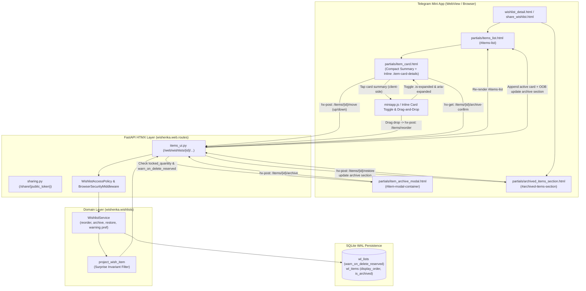

# WISHENKA-15: Vertical Wish List Display, Inline Card Expansion, and Manual Ordering

## Research

### 1. Current Codebase State and Integration Points

Inspection of the Wishenka repository (`wishenka/wishlists`, `wishenka/items`, and `wishenka/web`)
shows that core domain primitives for item ordering and archiving are already in place, while the
Telegram Mini App (TMA) server-rendered templates and HTMX UI endpoints require extension to
deliver the interactive vertical wish list experience:

1. **Domain Model and Persistence (`wishenka.wishlists`)**:
   - `WishItem` (`wishenka/wishlists/models.py`) already defines `display_order: int = 0` and
     `is_archived: bool = False`, along with piece-accounting properties `reserved_quantity` and
     `available_quantity`.
   - `WishlistService` (`wishenka/wishlists/service.py`) implements:
     - `get_wishlist_view(wishlist_id, current_user)`: sorts active items by
       `(item.display_order, item.id)` and projects each item via `project_wish_item` into
       `WishItemRecipientViewDTO` or `WishItemGifterViewDTO`. Currently, `WishlistDetailViewDTO`
       only includes `items` (active items) and omits `archived_items` and the per-wishlist archive
       warning preference `warn_on_delete_reserved`.
     - `reorder_wish_items(wishlist_id, actor, item_ids)`: validates RBAC
       (`WishlistAccessPolicy.can_add_or_edit_item`), enforces 1:1 permutation integrity across all
       active item IDs, updates `display_order` contiguously (`0..N-1`), and emits the
       `items_reordered` structured log event.
     - `archive_wish_item(wishlist_id, item_id, actor)` and
       `restore_wish_item(wishlist_id, item_id, actor)`: toggle `is_archived` while preserving
       existing `Reservation` records, with `restore_wish_item` placing the restored item at the
       tail of active items (`max(active_orders, default=-1) + 1`).
   - `WishlistStore` (`wishenka/wishlists/store.py`) and `WishlistRow`
     (`wishenka/wishlists/db_models.py`) persist `wl_items.display_order` and `wl_items.is_archived`
     in SQLite WAL mode. Adding `warn_on_delete_reserved` to `wl_lists` can follow the same
     idempotent `PRAGMA table_info(wl_lists)` auto-migration pattern already used for
     `wl_items.display_order`.

2. **Web UI Layer and Templates (`wishenka.web`)**:
   - `wishenka/web/routes/items_ui.py` mounts HTMX routes under
     `/web/wishlists/{wishlist_id}`: `GET ""`, `POST /items/preview`, `POST /items/quick`,
     `GET /items/new`, `GET /items/{item_id}/edit`, `POST /items/{item_id}/edit`,
     `POST /items/{item_id}/archive`, and `POST /items/{item_id}/restore`.
   - `wishenka/web/templates/partials/item_card.html` currently renders a flat card showing all
     fields at once without a compact/expanded state split, without category/priority/store/
     recipient badges, without directional reorder controls (`Move Up` / `Move Down`) or drag
     handles, and without a dedicated archive confirmation modal trigger.
   - `wishenka/web/templates/wishlist_detail.html` renders `#items-list` and `#item-modal-container`
     for authenticated members and guests, but lacks an `#archived-items-section` for viewing and
     restoring archived wishes.
   - `wishenka/web/templates/share_wishlist.html` (served by `GET /share/{public_token}` in
     `wishenka/web/routes/sharing.py`, and aliased for shared wishlist views) renders the public
     gift-selection view using `partials/item_card.html`, but still uses unsafe `|safe` filters on
     `wishlist.title` and `wishlist.owner_name` that must be removed for strict XSS safety.

3. **Client Interactivity (`wishenka/web/static/miniapp.js` and `miniapp.css`)**:
   - Inline card expansion/collapse must operate instantaneously on tap without server round-trips,
     while ignoring clicks on interactive controls (`a`, `button`, `input`, `[data-no-toggle]`).
   - Manual ordering requires both accessible server-driven directional buttons (`Move Up` /
     `Move Down`) and pointer/touch drag-and-drop handles that submit the new permutation to the
     HTMX reorder endpoint.

---

## Implementation Plan

### High-Level Execution Phases

1. **Phase 1: Failing Repro Test Suite (Step 3)**:
   - Create `tests/test_wish_items_list_reorder_ui.py` covering compact and expanded card anatomy,
     inline expansion toggle attributes, manual reordering via HTMX (`POST /items/reorder` and
     `POST /items/{item_id}/move`), safe archive confirmation modal (`GET /archive-confirm`) with
     and without active reservations and `warn_on_delete_reserved` preference handling, archived
     items section rendering and restoration (`POST /restore`), RBAC isolation, XSS escaping, and
     Surprise Invariant enforcement.
   - Run the test suite to verify it fails (RED) against the unimplemented endpoints and templates.

2. **Phase 2: Domain and Persistence Extension for `warn_on_delete_reserved` & Archived View**:
   - Add `warn_on_delete_reserved: bool = True` to `Wishlist` (`wishenka/wishlists/models.py`),
     `WishlistRow` (`wishenka/wishlists/db_models.py`), `WishlistStore`
     (`wishenka/wishlists/store.py` with idempotent `ALTER TABLE wl_lists` migration), and
     `WishlistDetailViewDTO` (`wishenka/wishlists/schemas.py`).
   - Extend `WishlistDetailViewDTO` with `archived_items: list[WishItemViewDTO]` (populated in
     `WishlistService.get_wishlist_view` only when the caller is an authorized wishlist member, and
     always empty for guests/non-members) and add a helper method on `WishlistService` to update
     `warn_on_delete_reserved` or pass it during archiving.

3. **Phase 3: HTMX Endpoints in `wishenka/web/routes/items_ui.py`**:
   - `POST /web/wishlists/{wishlist_id}/items/reorder`: accepts ordered `item_ids` (form list,
     comma-separated string, or JSON), delegates to `WishlistService.reorder_wish_items`, and
     renders `partials/items_list.html`.
   - `POST /web/wishlists/{wishlist_id}/items/{item_id}/move`: accepts `direction` (`up` or
     `down`), computes the adjacent swap among active items, calls
     `WishlistService.reorder_wish_items`, and renders `partials/items_list.html`.
   - `GET /web/wishlists/{wishlist_id}/items/{item_id}/archive-confirm`: renders
     `partials/item_archive_modal.html` into `#item-modal-container` with safe archiving
     explanation, `warn_on_delete_reserved` preference checkbox, and anonymous gifter reservation
     warning when `locked_quantity > 0` and warning is enabled.
   - Update `POST /web/wishlists/{wishlist_id}/items/{item_id}/archive` and
     `POST /web/wishlists/{wishlist_id}/items/{item_id}/restore` to synchronize both `#items-list`
     and `#archived-items-section` via HTMX Out-of-Band (`hx-swap-oob`) swaps while maintaining
     backward compatibility with existing WISHENKA-14 tests.

4. **Phase 4: Templates, Client Toggle & Drag-and-Drop (`wishenka/web/templates` & `static`)**:
   - Update `partials/item_card.html` with compact summary badges and collapsible
     `.item-card-details` drawer.
   - Create `partials/items_list.html`, `partials/item_archive_modal.html`, and
     `partials/archived_items_section.html`.
   - Update `wishlist_detail.html`, `share_wishlist.html`, `partials/item_edit_modal.html`,
     `base.html`, `miniapp.js`, and `miniapp.css`.

5. **Phase 5: Cleanup, Observability, Tech Debt Review, and Dev Docs (Steps 5-8)**:
   - Emit structured logs for reorder, move, archive confirmation, and restore UI actions.
   - Run `make check` (`ruff`, `mypy`, `pytest`) and update `doc/dev/miniapp.md` and
     `doc/dev/items.md`.

---

### Mandatory — Failing Repro (next Step 3)

- **Test File**: `tests/test_wish_items_list_reorder_ui.py`
- **Execution Environment**: Uses `fastapi.testclient.TestClient` with an isolated SQLite database
  in `tmp_path` and `SessionTokenService` bearer tokens, with `pytestmark = pytest.mark.timeout(30)`
  per [do-testing](/home/.gemini/antigravity-cli/skills/do-testing/SKILL.md).
- **What It Asserts (Desired Behavior)**:
  1. `test_compact_and_expanded_card_anatomy_and_inline_toggle`:
     - Verifies that `GET /web/wishlists/{id}` and `GET /share/{token}` render active items in
       saved `display_order` with compact summary elements (`.item-card-summary`, thumbnail or
       `.item-thumbnail-placeholder`, `.item-title`, formatted price/currency, `.badge-category`,
       `.badge-priority-high` / `.badge-priority-low` when non-medium, `.badge-quantity` `×N` when
       `quantity > 1`, `.badge-recipient` `Для: ...` in collaborative lists, and `.badge-store` when
       a link is present).
     - Verifies that each card has `aria-expanded="false"` and a collapsible `.item-card-details`
       container holding the full description, external store CTA link (`target="_blank"
       rel="noopener noreferrer"`), and (only when `can_edit_wishlist` is `True`) editor actions
       (Edit, Move Up, Move Down, Archive confirm trigger, and drag handle).
  2. `test_manual_reordering_via_htmx_reorder_and_directional_move`:
     - Seeds 3 active items `[A, B, C]`.
     - Calls `POST /web/wishlists/{id}/items/{item_c_id}/move` with `direction=up`, verifying 200 OK
       and rendered order `[A, C, B]` in HTML and persistent storage, with `Move Up` disabled on the
       first card and `Move Down` disabled on the last card.
     - Calls `POST /web/wishlists/{id}/items/reorder` with `item_ids=[C, A, B]`, verifying immediate
       persistence and updated rendering across both `GET /web/wishlists/{id}` and
       `GET /share/{token}`.
     - Verifies invalid permutations return HTTP 400 without corrupting the stored order.
  3. `test_archive_confirmation_modal_and_gifter_warning_surprise_invariant`:
     - Seeds an item reserved by `SecretGifterBob` (`user_id=777`).
     - Calls `GET /web/wishlists/{id}/items/{item_id}/archive-confirm` as owner.
     - Asserts 200 OK rendering `#item-archive-modal` explaining safe archiving, displaying the
       `warn_on_delete_reserved` preference control, and showing the anonymous warning that the wish
       is already reserved by a gifter (`#archive-gifter-warning`) while strictly excluding
       `SecretGifterBob` and `777` from the HTML response.
     - Verifies that when `warn_on_delete_reserved` is disabled (`False`) on the wishlist, the
       confirmation modal does not show the reservation warning banner.
  4. `test_archived_items_section_visibility_and_restore_flow`:
     - Archives an item via `POST /web/wishlists/{id}/items/{item_id}/archive` (with optional
       `warn_on_delete_reserved` form toggle), verifying OOB removal from active list and OOB update
       of `#archived-items-section`.
     - Verifies `GET /web/wishlists/{id}` shows `#archived-items-section` to the owner/collaborator
       with a "Восстановить" button, whereas `GET /share/{token}` and guest views completely omit
       `#archived-items-section`.
     - Calls `POST /web/wishlists/{id}/items/{item_id}/restore`, verifying the restored card is
       appended to the end of the active list (`display_order` at tail), removed from the archive
       section via OOB swap, and retains existing gifter reservations.
  5. `test_rbac_and_surprise_invariant_on_reorder_and_archive_confirm`:
     - Verifies guests and unauthenticated users receive 401/403/404 on `/items/reorder`,
       `/items/{id}/move`, and `/items/{id}/archive-confirm`, and that archived wishlists reject
       these mutations with 409 Conflict.
- **Sequencing**:
  Research $\rightarrow$ Write red test `tests/test_wish_items_list_reorder_ui.py` (Step 3) and
  confirm failure $\rightarrow$ Implement production changes in Step 4 until all tests pass (GREEN).

---

## Architecture

### 1. Component & Interaction Diagram

---

### 2. Module Responsibilities

- **`wishenka/wishlists/models.py`**:
  Adds `warn_on_delete_reserved: bool = True` to the `Wishlist` aggregate root dataclass.
- **`wishenka/wishlists/db_models.py`**:
  Adds `warn_on_delete_reserved: Mapped[int]` column mapping on `WishlistRow`.
- **`wishenka/wishlists/store.py`**:
  Executes idempotent `ALTER TABLE wl_lists ADD COLUMN warn_on_delete_reserved INTEGER NOT NULL
  DEFAULT 1` during initialization and serializes the field in `_read` and `_write`.
- **`wishenka/wishlists/schemas.py`**:
  Extends `WishlistDetailViewDTO` with `warn_on_delete_reserved: bool = True` and
  `archived_items: list[WishItemRecipientViewDTO | WishItemGifterViewDTO] = Field(...)`.
- **`wishenka/wishlists/service.py`**:
  Populates `archived_items` for wishlist members in `get_wishlist_view` (empty for guests) and
  supports updating `warn_on_delete_reserved` during archiving or settings mutation.
- **`wishenka/web/routes/items_ui.py`**:
  Implements HTMX endpoints for `/items/reorder`, `/items/{item_id}/move`, and
  `/items/{item_id}/archive-confirm`, and enhances `/archive` and `/restore` with OOB updates for
  `#archived-items-section` and `#items-list`.
- **`wishenka/web/templates/partials/item_card.html`**:
  Renders the compact summary header (thumbnail/placeholder, title, price, category, priority,
  quantity, recipient, and store badges) and the collapsible `.item-card-details` panel (full
  description, external store CTA button, and editor action bar).
- **`wishenka/web/templates/partials/items_list.html`**:
  Renders the ordered vertical list of `partials/item_card.html` with loop boundary flags
  (`is_first`, `is_last`, `total_items`) or `#empty-items-placeholder`.
- **`wishenka/web/templates/partials/item_archive_modal.html`**:
  Renders the accessible confirmation dialog explaining safe archiving, the
  `warn_on_delete_reserved` preference checkbox, and the anonymous gifter warning banner.
- **`wishenka/web/templates/partials/archived_items_section.html`**:
  Renders the collapsible `#archived-items-section` for wishlist editors with one-tap
  "Восстановить" buttons.
- **`wishenka/web/templates/wishlist_detail.html` & `share_wishlist.html`**:
  Include `partials/items_list.html` (and `partials/archived_items_section.html` in
  `wishlist_detail.html` when `can_edit_wishlist` is `True`), removing unsafe `|safe` filters in
  `share_wishlist.html`.
- **`wishenka/web/static/miniapp.css` & `base.html` / `miniapp.js`**:
  Provide responsive CSS rules for compact/expanded cards, badges, and drag states, plus client JS
  helpers for inline card expansion and pointer/touch drag-and-drop reordering.

---

### 3. Detailed Design of Subsystems

#### 3.1. Vertical Wish List & Card Anatomy (`partials/item_card.html` & `partials/items_list.html`)

1. **Compact State (Default)**:
   - Root container `<article class="card item-card ..." id="item-card-{{ item.id }}"`
     `data-item-id="{{ item.id }}" aria-expanded="false">`.
   - **Summary Toggle Area (`.item-card-summary`)**:
     - Configured with `role="button"`, `tabindex="0"`, `aria-expanded="false"`,
       `aria-controls="item-details-{{ item.id }}"`, and click/keydown handler
       `toggleWishCard(event, this)`.
     - **Thumbnail or Placeholder**:
       - If `item.image_url` is set: renders `` with an `onerror`
         handler that reveals the fallback `.item-thumbnail-placeholder`.
       - If `item.image_url` is absent: renders
         `
🎁
`.
     - **Title**: `<h3 class="item-title">{{ item.title }}</h3>` (clamped to 2 lines in compact
       mode, unclamped when `.item-card.is-expanded` is active).
     - **Formatted Price**: When `item.price is not none`, renders
       `{{ item.price }} {{ item.currency or "RUB" }}`.
     - **Compact Metadata Badges Row (`.item-compact-badges`)**:
       - **Category Badge**: Rendered when `item.category` is present
         (`.badge-category`).
       - **Priority Indicator**: Rendered when `item.priority != 'medium'`:
         - `high` $\rightarrow$ `.badge-priority-high` (`🔥 Очень хочется`)
         - `low` $\rightarrow$ `.badge-priority-low` (`Если останется`)
       - **Quantity Badge**: Rendered when `item.quantity > 1`
         (`.badge-quantity`: `×{{ item.quantity }} шт.`).
       - **Collaborative Recipient Badge**: Rendered when `item.recipient_name` or
         `item.recipient_user_id` is present (`.badge-recipient`:
         `Для: {{ item.recipient_name or ('Участник #' ~ item.recipient_user_id) }}`).
       - **External Store Badge**: Rendered when `item.store_name` or `item.link` is present
         (`.badge-store`: `{{ item.store_name or 'Магазин' }}`).
     - **Chevron Indicator**: `▾` that
       rotates 180 degrees when expanded.

2. **Inline Expanded State (`.item-card-details`)**:
   - Container `
` hidden in compact
     state via CSS (`display: none`) and revealed when parent `.item-card` has class `.is-expanded`
     (`display: block`).
   - **Full Description / Comments**:
     - Renders `item.description` inside `
` with
       `white-space: pre-line` to preserve multi-line notes (size, color, delivery details).
   - **Complete Metadata Summary**:
     - Displays desired quantity (`Количество: {{ item.quantity }} шт.`), priority label, category,
       and recipient designation.
   - **External Store Link CTA Button**:
     - When `item.link` is present, renders `<a href="{{ item.link }}" target="_blank"`
       `rel="noopener noreferrer" class="btn-store-link item-link" data-no-toggle="true">`
       `Перейти в магазин ({{ item.store_name or 'Ссылка' }}) ↗</a>`.
   - **Editor Management Action Bar (`.item-editor-actions`)**:
     - Rendered **strictly** when `can_edit_wishlist` is `True`:
       - **Edit Button (`.btn-edit-item`)**:
         `hx-get="/web/wishlists/{{ wid }}/items/{{ item.id }}/edit"`,
         `hx-target="#item-modal-container"`, `hx-swap="innerHTML"`, `data-no-toggle="true"`.
       - **Move Up Button (`.btn-move-up`)**:
         `hx-post="/web/wishlists/{{ wid }}/items/{{ item.id }}/move?direction=up"`,
         `hx-target="#items-list"`, `hx-swap="innerHTML"`, `aria-label="Переместить выше"`,
         `disabled`, `data-no-toggle="true"`.
       - **Move Down Button (`.btn-move-down`)**:
         `hx-post="/web/wishlists/{{ wid }}/items/{{ item.id }}/move?direction=down"`,
         `hx-target="#items-list"`, `hx-swap="innerHTML"`, `aria-label="Переместить ниже"`,
         `disabled`, `data-no-toggle="true"`.
       - **Archive Trigger Button (`.btn-archive-confirm`)**:
         `hx-get="/web/wishlists/{{ wid }}/items/{{ item.id }}/archive-confirm"`,
         `hx-target="#item-modal-container"`, `hx-swap="innerHTML"`, `data-no-toggle="true"`.
       - **Drag Handle (`.item-drag-handle`)**:
         `<button type="button" class="item-drag-handle" aria-label="Перетащить карточку"`
         `data-no-toggle="true">⠿</button>`.

3. **Click Propagation Guard**:
   - In `toggleWishCard(event, summaryEl)`, if `event.target.closest('a, button, input, select,`
     `textarea, [data-no-toggle]')` is non-null, the function returns early without toggling
     `.is-expanded`.

---

#### 3.2. Manual Ordering Protocol (Move Buttons & Drag-and-Drop)

1. **`POST /web/wishlists/{wishlist_id}/items/reorder`**:
   - **Access Control**: Requires authenticated wishlist member (`OWNER`, `ADMIN`, `MEMBER`) and
     `wishlist.status == WishlistStatus.ACTIVE`. Non-members receive `404 Not Found`; archived
     wishlists receive `409 Conflict`.
   - **Input Parsing**: Supports form-encoded `item_ids` (repeated fields `item_ids=3&item_ids=1` or
     comma-separated `item_ids=3,1,2`) as well as JSON payload `{"item_ids": [3, 1, 2]}`.
   - **Domain Execution**: Calls `WishlistService.reorder_wish_items(wishlist_id, user, item_ids)`.
   - **Response**:
     - On success (`200 OK`): Renders `partials/items_list.html` with the reordered active items and
       updated `is_first` / `is_last` flags.
     - On `ValueError` (`400 Bad Request`): Logs `ui_items_reorder_rejected` and returns HTTP 400.

2. **`POST /web/wishlists/{wishlist_id}/items/{item_id}/move`**:
   - **Access Control**: Same RBAC and active status check via `_ensure_member_and_active`.
   - **Input**: Query or form parameter `direction: Literal["up", "down"]`.
   - **Logic**:
     1. Fetches active items sorted by `(display_order, id)`.
     2. Locates index `idx` of `item_id` (raises `ItemNotFoundError` $\rightarrow$ 404 if absent).
     3. Computes target index: `target_idx = idx - 1` if `direction == "up"` else `idx + 1`.
     4. If `0 <= target_idx < len(active_ids)`, swaps `active_ids[idx]` and
        `active_ids[target_idx]` and invokes
        `WishlistService.reorder_wish_items(wishlist_id, user, active_ids)`. If already at boundary,
        keeps current order idempotently.
   - **Response (`200 OK`)**: Renders `partials/items_list.html` into `#items-list`.

3. **Client-Side Drag-and-Drop (`base.html` / `miniapp.js`)**:
   - Progressive enhancement attached to `#items-list[data-can-reorder="true"]`.
   - Dragging via `.item-drag-handle` reorders `.item-card` elements visually in the DOM.
   - On drop, collects `[...list.querySelectorAll('.item-card')].map(el => el.dataset.itemId)` and
     submits a form/HTMX POST to `/web/wishlists/{wishlist_id}/items/reorder`. If the request fails,
     restores the snapshot of DOM nodes and displays an error banner in `#reorder-error-banner`.

---

#### 3.3. Safe Archiving Confirmation Modal & Gifter Warning (`warn_on_delete_reserved`)

1. **`GET /web/wishlists/{wishlist_id}/items/{item_id}/archive-confirm`**:
   - **Access Control**: `_ensure_member_and_active(wl, user)`.
   - **Context Calculation**:
     - Locates active `item` in `wl`.
     - Computes `locked_quantity = item.reserved_quantity + item.received_quantity` and
       `has_active_reservations = locked_quantity > 0`.
     - Reads `warn_on_delete_reserved = wl.warn_on_delete_reserved`.
     - `show_gifter_warning = has_active_reservations and warn_on_delete_reserved`.
   - **Surprise Invariant Enforcement**:
     - The endpoint **never** passes `item.reservations`, gifter user IDs, usernames, or first names
       to the template context—only boolean `has_active_reservations`, `show_gifter_warning`, and
       `warn_on_delete_reserved`.
   - **Template (`partials/item_archive_modal.html`)**:
     - Renders an accessible modal dialog (`id="item-archive-modal"`, `role="dialog"`,
       `aria-modal="true"`, `aria-labelledby="archive-modal-title"`).
     - Explains that the wish will be moved to the archive (not permanently deleted), can be
       restored at any time, and existing gifter reservations remain intact.
     - If `show_gifter_warning` is `True`, renders `#archive-gifter-warning` (`role="alert"`):
       `⚠️ Обратите внимание: этот подарок уже забронирован или куплен кем-то из дарителей.`
       `При переносе в архив бронь сохранится.`
     - Includes a preference checkbox (`name="warn_on_delete_reserved"`, value `"true"` with hidden
       sentinel or explicit form value) allowing the author to configure whether to receive gifter
       presence warnings when archiving wishes on this wishlist.
     - Provides "Отмена" (closes `#item-modal-container`) and "Перенести в архив" (submits
       `hx-post="/web/wishlists/{{ wishlist_id }}/items/{{ item.id }}/archive"`).

2. **`POST /web/wishlists/{wishlist_id}/items/{item_id}/archive`**:
   - Accepts optional form parameter `warn_on_delete_reserved: str | None = Form(default=None)`.
   - If `warn_on_delete_reserved` is provided (`"true"`, `"1"`, `"on"` vs `"false"`, `"0"`,
     `"off"`), updates `wl.warn_on_delete_reserved` within the same transaction before calling
     `WishlistService.archive_wish_item`.
   - Renders OOB fragments:
     1. `

` (removes card from active list).
     2. `

` (closes confirmation or edit
        modal).
     3. Rendered `partials/archived_items_section.html` with `hx-swap-oob="outerHTML"` on
        `#archived-items-section` so the archived item immediately appears in the archive section.

---

#### 3.4. Archived Items Section & One-Tap Restoration (`partials/archived_items_section.html`)

1. **Visibility & Placement**:
   - Placed below `#items-list` in `wishlist_detail.html` inside
     `<section id="archived-items-section" ...>`.
   - Rendered **only** when `can_edit_wishlist` is `True` (or when the viewer is a wishlist member).
     Guests and public share viewers (`share_wishlist.html`) never receive archived items in DTOs or
     HTML.
   - When `archived_items` is non-empty, renders a collapsible
     `
` with
     `
Архив желаний ({{ archived_items|length }})
` and `#archived-items-list`.
   - Each archived item row (`#archived-item-{{ item.id }}`) displays the escaped title, formatted
     price, and (when `can_edit_wishlist` is `True`) a "Восстановить" button:
     `hx-post="/web/wishlists/{{ wishlist_id }}/items/{{ item.id }}/restore"`,
     `hx-target="#items-list"`, `hx-swap="beforeend"`.

2. **`POST /web/wishlists/{wishlist_id}/items/{item_id}/restore`**:
   - Calls `WishlistService.restore_wish_item(wishlist_id, item_id, user)` which sets
     `is_archived = False` and assigns `display_order = max(active_orders, default=-1) + 1`.
   - Returns:
     - Primary payload: rendered `partials/item_card.html` for the restored wish (appended to the
       end of `#items-list`).
     - OOB fragments:
       - `

`
       - Updated `partials/archived_items_section.html` (`id="archived-items-section"`
         `hx-swap-oob="outerHTML"`), removing the restored item from the archived list.

---

### 4. Structured Observability Events

All new UI operations in `wishenka.web.items_ui` emit structured logs with contextual attributes:

- **`ui_items_reordered`** (`INFO`):
  - Attributes: `wishlist_id`, `actor_id`, `user_id`, `item_count`, `item_ids`.
  - Description: Active items reordered via drag-and-drop or reorder form.
- **`ui_item_moved`** (`INFO`):
  - Attributes: `wishlist_id`, `item_id`, `actor_id`, `user_id`, `direction`.
  - Description: Single item moved up or down via directional control.
- **`ui_items_reorder_rejected`** (`WARNING`):
  - Attributes: `wishlist_id`, `actor_id`, `user_id`, `reason`.
  - Description: Invalid reorder permutation rejected with HTTP 400.
- **`ui_item_archive_confirm_opened`** (`INFO`):
  - Attributes: `wishlist_id`, `item_id`, `actor_id`, `user_id`, `has_active_reservations`,
    `gifter_warning_shown`.
  - Description: Archive confirmation modal opened (never logs gifter identities).
- **`ui_item_archived`** (`INFO`):
  - Attributes: `wishlist_id`, `item_id`, `actor_id`, `user_id`, `warn_on_delete_reserved`.
  - Description: Item archived via UI and moved to `#archived-items-section`.
- **`ui_item_restored`** (`INFO`):
  - Attributes: `wishlist_id`, `item_id`, `actor_id`, `user_id`, `display_order`.
  - Description: Item restored from archive to the tail of `#items-list`.

---

## Q&A

- **Q1: How does inline card expansion avoid conflicting with HTMX action buttons inside the card?**
  **A1**: The card summary toggle function checks `event.target.closest('a, button, input, select,
  textarea, [data-no-toggle]')`. Any click originating on an interactive element (store link, Edit,
  Move Up/Down, Drag Handle, or Archive button) executes its native/HTMX action without toggling the
  card's expanded state.

- **Q2: How is backward compatibility maintained with existing WISHENKA-14 archive/restore tests?**
  **A2**: `POST /web/wishlists/{wishlist_id}/items/{item_id}/archive` continues to accept requests
  without form body parameters and still emits `

` and `

`, while appending the `#archived-items-section` OOB swap.
  Similarly, `POST /web/wishlists/{wishlist_id}/items/{item_id}/restore` continues to return the
  rendered `item_card.html` with `id="item-card-{item_id}"` alongside the archive section OOB
  update.

- **Q3: How is the Surprise Invariant preserved when `warn_on_delete_reserved` is active?**
  **A3**: `GET /web/wishlists/{wishlist_id}/items/{item_id}/archive-confirm` evaluates only the
  boolean presence of locked units (`item.reserved_quantity + item.received_quantity > 0`) on the
  server. Neither gifter user IDs, usernames, first names, nor individual reservation objects are
  ever serialized into the template context, DOM attributes, or log records.
