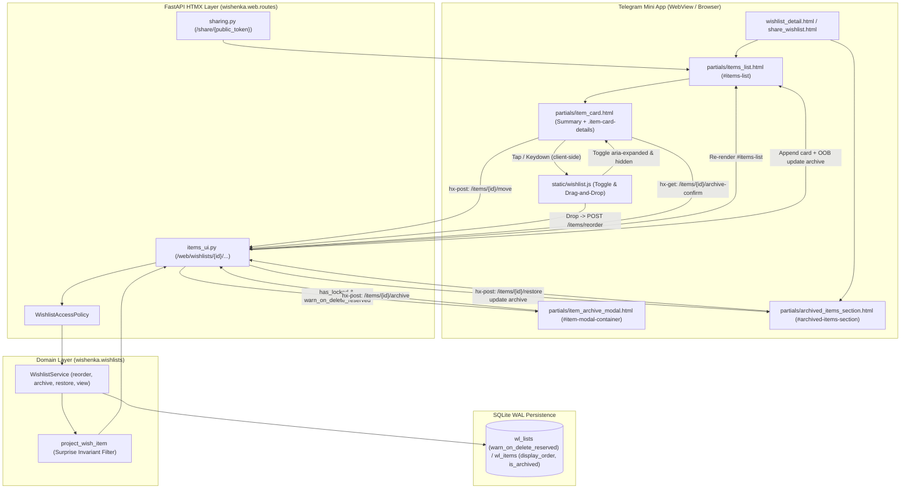

# Спецификация: WISHENKA-15 — Вертикальный список желаний (компактные и раскрытые карточки, ручной порядок)

**Задача в Jira:** `WISHENKA-15` (`3.0` Story Points)  
**Компоненты:** Telegram Mini App (FastAPI, Jinja2, HTMX, JavaScript, SQLite WAL)  
**Язык реализации:** Python 3.12+, JavaScript, HTML/CSS

## 1. Назначение и бизнес-цель

В сервисе «Вишенка» (Telegram Wishlist Service) список активных желаний является основным рабочим экраном как для авторов вишлиста (владельца, администраторов и соавторов), так и для дарителей, перешедших по публичной ссылке. До реализации `WISHENKA-15` в доменной модели уже существовали атрибуты порядка (`display_order`) и мягкого удаления (`is_archived`), а также базовые сервисные методы, однако пользовательский интерфейс Telegram Mini App отображал карточки плоским списком без визуальной компактности, без раскрытия деталей на месте, без элементов ручной расстановки приоритетов, без диалога безопасной архивации и без отдельного раздела для восстановления архивных желаний.

### Основные цели

- **Быстрое сканирование списка (Scannable Compact Cards):** обеспечить компактное отображение десятков желаний в вертикальном списке на узких мобильных экранах Telegram Mini App без визуальной перегрузки.
- **Раскрытие деталей на месте (Inline Card Expansion):** позволить зрителю по нажатию на карточку просмотреть полное описание, комментарии, ссылку на магазин и действия редактора без перехода на отдельный экран, перезагрузки страницы и потери позиции прокрутки.
- **Ручной порядок вместо сортировок и фильтров:** предоставить авторам прямое управление последовательностью активных желаний (перетаскивание и пошаговые кнопки перемещения вверх/вниз), чтобы самые важные подарки всегда отображались наверху у всех зрителей. Это соответствует продуктовой спецификации (`in-docs/spec.md`, раздел 5.4), явно исключающей поиск, фильтрацию и автоматическую сортировку внутри вишлиста.
- **Безопасная архивация с защитой тайны сюрприза:** заменить необратимое удаление переносом в архив с сохранением существующих бронирований дарителей, понятным диалогом подтверждения и опциональным обезличенным предупреждением о наличии брони на уровне вишлиста (`warn_on_delete_reserved`).
- **Восстановление из архива в одно касание:** предоставить редакторам отдельный сворачиваемый раздел архивных желаний с возможностью вернуть любое желание в активный список без повторного ввода данных.

### Границы задачи (Out of Scope)

В объём `WISHENKA-15` не входят:

- Поиск, фильтрация по категориям/приоритетам и автоматическая сортировка внутри вишлиста (`in-docs/spec.md`, раздел 5.4).
- Механика создания, изменения и отмены бронирований и отметки покупки дарителем на карточке (покрывается отдельными задачами бронирования).
- Отметка получения подарка и раздел «Подаренные» (покрываются задачами учёта получения, в частности `WISHENKA-24`).
- Отправка уведомлений дарителям в Telegram-бот при архивации желания (покрывается задачами подсистемы уведомлений).

## 2. Функциональные требования и пользовательские сценарии

### 2.1. Пользовательские сценарии

- **US-1 (Вертикальный список компактных карточек):** автор или гость открывает вишлист и видит активные желания в виде одноколоночного вертикального списка компактных карточек в заданном автором порядке с миниатюрой (или заглушкой), названием, ценой и бейджами метаданных.
- **US-2 (Раскрытие и сворачивание на месте):** зритель нажимает на компактную карточку, чтобы раскрыть полное описание, ссылку на магазин и подробности прямо в списке, и повторным нажатием сворачивает карточку обратно без смещения контекста.
- **US-3 (Ручное изменение порядка):** авторизованный редактор активного вишлиста (владелец, администратор или соавтор) перемещает карточки кнопками вверх/вниз или перетаскиванием; новый порядок сохраняется немедленно и отражается у всех зрителей.
- **US-4 (Подтверждение безопасной архивации и предупреждение о дарителе):** редактор при архивации видит диалог, объясняющий перенос желания в архив с сохранением броней, управляет настройкой предупреждений для этого вишлиста и при включённой настройке получает обезличенное предупреждение о том, что желание уже забронировано или куплено.
- **US-5 (Просмотр архива и восстановление):** редактор открывает раздел архивных желаний и восстанавливает выбранное желание в конец активного списка с сохранением всех данных и броней.
- **US-6 (Ролевая изоляция и тайна сюрприза):** гость или даритель видит сохранённый автором порядок и может раскрывать карточки, но не видит элементов редактирования, сортировки, архивации и раздела архива; получатель подарка никогда не видит личности дарителей, статусы покупки и счётчики бронирований.

### 2.2. Анатомия списка и карточки желания

1. **Вертикальный список (`#items-list`):**
   - Активные желания отображаются в одной вертикальной колонке в порядке возрастания `(display_order, created_at, id)`.
   - При отсутствии активных желаний отображается информативная заглушка пустого списка (`#empty-items-placeholder`).
2. **Компактное состояние карточки (по умолчанию):**
   - **Миниатюра или заглушка:** изображение товара (`` с `loading="lazy"`, `referrerpolicy="no-referrer"` и клиентским переключением на заглушку `.item-thumbnail-placeholder` при ошибке загрузки) либо визуальная заглушка `🎁` при отсутствии `image_url`.
   - **Название (`.item-title`):** заголовок желания (сокращается по строкам в компактном режиме и отображается полностью при раскрытии).
   - **Цена и валюта (`.item-price`):** отображается при `price is not none` с валютой (`item.currency` или резервное значение `DEFAULT_CURRENCY = "RUB"`).
   - **Компактные бейджи (`.item-badges`):**
     - категория (`.badge-category`, если задана);
     - индикатор приоритета при значении, отличном от `medium`: `.badge-priority-high` (`high`) или `.badge-priority-low` (`low`);
     - бейдж количества (`.badge-quantity`, `×N` при `quantity > 1`);
     - бейдж получателя (`.badge-recipient`) в совместном вишлисте при наличии `recipient_name`;
     - бейдж магазина (`.badge-store`) при наличии ссылки `link` (использует `store_name` или запасную подпись магазина).
   - **Ручка перетаскивания (`.item-drag-handle`, `⠿`):** отображается в сводке карточки только для редакторов (`can_edit_wishlist == True`).
3. **Раскрытое состояние карточки (`.item-card-details`):**
   - Переключается мгновенно на клиенте нажатием на область `.item-card-summary` (или клавишами `Enter`/`Space`) без серверного запроса.
   - Нажатие на интерактивные элементы внутри карточки (`a`, `button`, `input`, `select`, `textarea`, `[data-no-toggle]`) выполняет их собственное действие и не переключает состояние раскрытия.
   - Содержит полное многострочное описание/комментарии (`.item-description`), сводку по количеству (`.item-quantity`), кнопку перехода во внешний магазин (`.item-link.item-store-cta` с `target="_blank" rel="noopener noreferrer"`, если задан `link`) и панель действий редактора (`.item-actions`, только при `can_edit_wishlist == True`):
     - «Редактировать» (`.btn-edit-item`) — загрузка формы редактирования в `#item-modal-container`;
     - «Выше» (`.btn-move-up`) — отключена (`disabled`) на первой карточке;
     - «Ниже» (`.btn-move-down`) — отключена (`disabled`) на последней карточке;
     - «В архив» (`.btn-archive-confirm`) — открытие диалога подтверждения архивации в `#item-modal-container`.

### 2.3. Ручное упорядочивание активных желаний

- **Права и допустимое состояние:** изменение порядка доступно только участникам вишлиста (`OWNER`, `ADMIN`, `MEMBER`) при статусе списка `WishlistStatus.ACTIVE`. Для гостей и не-участников запросы возвращают `404 Not Found`; для архивных и удалённых списков — `409 Conflict` / `404 Not Found`.
- **Пошаговый сдвиг:** кнопки «Выше» и «Ниже» вызывают `POST /web/wishlists/{wishlist_id}/items/{item_id}/move?direction=up|down`, меняя выбранное желание с соседним активным элементом (на границах списка порядок сохраняется идемпотентно).
- **Пакетная перестановка (Drag-and-Drop):** по завершении перетаскивания клиент отправляет полный упорядоченный список идентификаторов активных желаний `item_ids` на `POST /web/wishlists/{wishlist_id}/items/reorder`.
- **Целостность перестановки:** перечень `item_ids` должен представлять собой строгую перестановку 1:1 всех текущих активных желаний вишлиста (без дубликатов, пропусков и чужих ID). При нарушении сервер отклоняет запрос с HTTP `400 Bad Request` (`X-Reorder-Refusal: stale_order`), не повреждая сохранённый порядок.
- **Добавление в конец списка:** новые желания и желания, восстановленные из архива, помещаются в конец активного списка (`display_order = max(active_orders, default=-1) + 1`).

### 2.4. Безопасная архивация, настройка `warn_on_delete_reserved` и восстановление

- **Диалог подтверждения (`GET .../archive-confirm`):** отображает модальное окно `#item-archive-modal` с пояснением, что перенос в архив не удаляет желание безвозвратно, сохраняет существующие бронирования и позволяет восстановить желание позже.
- **Настройка предупреждения о дарителе:**
  - Для каждого вишлиста хранится булев флаг `warn_on_delete_reserved` (по умолчанию `True`).
  - На сервере вычисляется факт наличия занятых/полученных единиц: `has_locked = (item.reserved_quantity + item.received_quantity) > 0`.
  - Если `has_locked` истинно и `warn_on_delete_reserved` включено, в модальном окне выводится баннер `#archive-gifter-warning` (`role="alert"`) с обезличенным предупреждением о наличии бронирования или покупки.
  - В форме диалога присутствует чекбокс `warn_on_delete_reserved` (в паре со скрытым полем `value="false"`), позволяющий автору включить или отключить предупреждение при подтверждении архивации.
- **Выполнение архивации (`POST .../archive`):**
  - При передаче параметра `warn_on_delete_reserved` обновляет соответствующий флаг вишлиста.
  - Устанавливает `item.is_archived = True`, не отменяя существующие бронирования.
  - Возвращает `hx-swap-oob`-фрагменты: удаляет `#item-card-{item_id}`, очищает `#item-modal-container` и обновляет `#archived-items-section`.
- **Раздел «Архив желаний» и восстановление (`POST .../restore`):**
  - Секция `#archived-items-section` (сворачиваемый блок `<details class="archived-items-details">`) отображается в `wishlist_detail.html` только при наличии прав редактирования и никогда не передаётся на публичную страницу `/share/{public_token}` и в гостевые DTO.
  - Каждая строка архивного элемента (`#archived-item-{item_id}`) показывает экранированное название, цену (если задана) и кнопку «Восстановить» (`.btn-restore-item`), вызывающую `POST .../restore`.
  - Восстановление снимает флаг `is_archived`, назначает `display_order` в хвосте активного списка, сохраняет все существующие бронирования, возвращает карточку для добавления в конец `#items-list` (`hx-swap="beforeend"`) и через `hx-swap-oob` удаляет `#empty-items-placeholder` и обновляет `#archived-items-section`.

### 2.5. Ролевая матрица видимости и Принцип сюрприза

| Роль / контекст | Просмотр пользовательского порядка | Раскрытие карточки | Изменение порядка | Редактирование и архивация | Раздел «Архив желаний» |
| --- | :---: | :---: | :---: | :---: | :---: |
| Владелец (активный список) | Да | Да | Да | Да | Да (с восстановлением) |
| Администратор / Участник (активный список) | Да | Да | Да | Да | Да (с восстановлением) |
| Гость / Даритель (публичная ссылка) | Да | Да | Нет | Нет | Нет |
| Любой пользователь (архивный список) | Да | Да | Нет | Нет | Скрыто / только чтение |

**Принцип сюрприза (Surprise Invariant):**

- Получатель подарка (владелец личного вишлиста или участник совместного вишлиста, указанный получателем конкретного желания) ни на компактной, ни на раскрытой карточке, ни в диалоге подтверждения архивации не видит количество забронированных единиц, остаток, статус покупки и данные о личности дарителей.
- Исключением из полного сокрытия факта бронирования является явная настройка `warn_on_delete_reserved` в диалоге архивации (`in-docs/spec.md`, раздел 5.5): она сообщает только о самом факте наличия брони и никогда не раскрывает `user_id`, имя или `username` дарителя.

## 3. Архитектура, компоненты и интерфейсы

### 3.1. Схема взаимодействия компонентов



*Примечание по эволюции реализации:* при завершении `WISHENKA-15` клиентский код раскрытия карточек и HTML5 Drag-and-Drop размещался инлайн в `<head>` шаблона `base.html`, а затем в рамках последующей задачи `WISHENKA-108` из `60-tech-debt.md` был вынесен в статический скрипт `wishenka/web/static/wishlist.js` с чтением `data-wishlist-id` из `#items-list` (и дополнен обработкой touch-перетаскивания через Pointer Events в `WISHENKA-109`).

### 3.2. Модули, классы и функции

#### Доменный слой и хранение (`wishenka/wishlists/`)

- `wishenka/wishlists/models.py`:
  - `Wishlist.warn_on_delete_reserved: bool = True` — настройка предупреждения при архивации забронированного желания.
  - `WishItem.display_order: int = 0` и `WishItem.is_archived: bool = False`, а также свойства `is_active`, `is_in_archive`, `reserved_quantity`, `available_quantity`.
- `wishenka/wishlists/db_models.py`, `store.py`, `repository.py`:
  - `WishlistRow.warn_on_delete_reserved: Mapped[int]` (`nullable=False, default=1`).
  - Персистенция и чтение `warn_on_delete_reserved` в `wl_lists` и `display_order`, `is_archived` в `wl_items`. В рамках `WISHENKA-15` столбец `warn_on_delete_reserved` добавлялся проверкой `PRAGMA table_info(wl_lists)` с `ALTER TABLE`; позднее в проекте добавлена ревизия Alembic `add_warn_on_delete_reserved`.
- `wishenka/wishlists/schemas.py`:
  - `WishlistDetailViewDTO` расширен полями `warn_on_delete_reserved: bool = True` и `archived_items: list[WishItemRecipientViewDTO] = Field(default_factory=list)`.
- `wishenka/wishlists/service.py`:
  - `WishlistService.get_wishlist_view(wishlist_id, current_user)` — сортирует активные желания по `(it.display_order, it.created_at, it.id)` и проецирует через `project_wish_item`; `archived_items` заполняет через `recipient_view(item)` только при `ctx.is_member`, возвращая `[]` для гостей и не-участников.
  - `WishlistService.reorder_wish_items(wishlist_id, actor, item_ids)` — проверяет статус вишлиста (`WishlistArchivedError`, `WishlistDeletedError`) и права (`WishlistAccessPolicy.can_add_or_edit_item`), валидирует отсутствие дубликатов и 1:1 соответствие `set(item_ids) == active_ids_set`, назначает `display_order = 0..N-1` и сортирует `wl.items`.
  - `WishlistService.archive_wish_item(wishlist_id, item_id, actor, warn_on_delete_reserved: bool | None = None)` — при переданном `warn_on_delete_reserved` сохраняет настройку на вишлисте, переводит `item.is_archived = True`, оставляя бронирования без изменений.
  - `WishlistService.restore_wish_item(wishlist_id, item_id, actor)` — переводит `item.is_archived = False` и устанавливает `display_order = max(active_orders, default=-1) + 1`.

#### Веб-маршруты (`wishenka/web/routes/`)

- `wishenka/web/routes/items_ui.py`:
  - `view_wishlist_detail` (`GET /web/wishlists/{wishlist_id}`) — рендерит `wishlist_detail.html` с `items`, `can_edit_wishlist` и контекстом участника/архива.
  - `reorder_items_ui` (`POST /web/wishlists/{wishlist_id}/items/reorder`) — принимает `item_ids: Annotated[list[int], Form()]`, делегирует `_reordered_response` и логирует `ui_items_reordered`.
  - `move_item_ui` (`POST /web/wishlists/{wishlist_id}/items/{item_id}/move`) — принимает `direction` (`up` или `down`), вычисляет обмен соседних позиций в `_reordered_response` и логирует `ui_item_moved`.
  - `_reordered_response` — проверяет `_ensure_member_and_active`, вызывает `svc.reorder_wish_items` при изменении порядка и рендерит `partials/items_list.html`; при `ValueError` возвращает HTTP 400 с заголовком `X-Reorder-Refusal: stale_order`.
  - `archive_confirm_ui` (`GET /web/wishlists/{wishlist_id}/items/{item_id}/archive-confirm`) — проверяет права, вычисляет `has_locked = item.reserved_quantity + item.received_quantity > 0` и `show_warning = has_locked and wl.warn_on_delete_reserved`, передавая в `partials/item_archive_modal.html` только `{"id", "title"}`, `wishlist_id`, `show_gifter_warning`, `warn_on_delete_reserved` (и `has_received`).
  - `archive_item_ui` (`POST /web/wishlists/{wishlist_id}/items/{item_id}/archive`) — разбирает форму `warn_on_delete_reserved`, вызывает `svc.archive_wish_item` и возвращает `200 OK` с OOB-удалением `#item-card-{item_id}`, очисткой `#item-modal-container` и обновлением `#archived-items-section`.
  - `restore_item_ui` (`POST /web/wishlists/{wishlist_id}/items/{item_id}/restore`) — вызывает `svc.restore_wish_item`, возвращает `partials/item_card.html` (`is_last=True`) вместе с OOB-удалением `#empty-items-placeholder` и обновлением `#archived-items-section`.
- `wishenka/web/routes/sharing.py`:
  - `view_public_share` (`GET /share/{public_token}`) — рендерит `share_wishlist.html` с активными элементами в порядке `display_order` без `archived_items` и без редакторских действий.

#### Шаблоны, стили и клиентские скрипты (`wishenka/web/`)

- `templates/partials/items_list.html` — перебирает `items`, передавая `is_first=loop.first`, `is_last=loop.last` в `partials/item_card.html`, или выводит `#empty-items-placeholder`.
- `templates/partials/item_card.html` — рендерит карточку `#item-card-{{ item.id }}` (`data-item-id`, `data-wishlist-id`, `data-is-first`, `data-is-last`, `draggable="true"` для редакторов), блок сводки `.item-card-summary` (`role="button"`, `tabindex="0"`, `aria-expanded="false"`, `aria-controls="item-details-{{ item.id }}"`) и скрытую панель `.item-card-details` (`hidden`) с действиями `.item-actions`.
- `templates/partials/item_archive_modal.html` — рендерит диалог `#item-archive-modal`, необязательный баннер `#archive-gifter-warning` (`role="alert"`) и форму подтверждения с чекбоксом `warn_on_delete_reserved`.
- `templates/partials/archived_items_section.html` — рендерит секцию `#archived-items-section` (с `hx-swap-oob="outerHTML"` при `oob=True`), сворачиваемый список `#archived-items-list` и кнопки `.btn-restore-item`.
- `templates/wishlist_detail.html` и `templates/share_wishlist.html` — подключают `partials/items_list.html` в `#items-list[data-wishlist-id]`; `wishlist_detail.html` включает `partials/archived_items_section.html` только при `can_edit_wishlist`; `share_wishlist.html` использует экранирование текста (`|text_escape`) вместо небезопасного `|safe`.
- `static/miniapp.css` и `static/wishlist.js` — обеспечивают визуальное скрытие `.item-card-details[hidden]`, стили бейджей (`.badge-*`), минимальную высоту/ширину целей касания `--touch-target: 44px`, переключение карточек и drag-and-drop сортировку.

### 3.3. HTTP-контракты и переходы состояний

| Метод и путь | Доступ и предусловия | Входные параметры | Успешный ответ | Ошибки |
| --- | --- | --- | --- | --- |
| `GET /web/wishlists/{id}` | Все (авторизованный участник видит редактор и архив) | `wishlist_id` | `200 OK`, HTML страницы `wishlist_detail.html` | `404` (не найден / удалён) |
| `GET /share/{public_token}` | Публичный просмотр по токену | `public_token` | `200 OK`, HTML `share_wishlist.html` без редактора и архива | `404` (не найден / удалён) |
| `POST /web/wishlists/{id}/items/reorder` | Участник (`OWNER`/`ADMIN`/`MEMBER`), список `active` | Форма `item_ids` (список int, полная перестановка) | `200 OK`, обновлённый `partials/items_list.html` | `400` (неверная перестановка), `404`, `409` |
| `POST /web/wishlists/{id}/items/{item_id}/move` | Участник, список `active` | Query `direction` (`up` или `down`) | `200 OK`, обновлённый `partials/items_list.html` | `404`, `409`, `422` (неверное направление) |
| `GET /web/wishlists/{id}/items/{item_id}/archive-confirm` | Участник, список `active` | `wishlist_id`, `item_id` | `200 OK`, `partials/item_archive_modal.html` | `404` (через OOB-уведомление), `409` |
| `POST /web/wishlists/{id}/items/{item_id}/archive` | Участник, список `active` | Форма `warn_on_delete_reserved` (опционально) | `200 OK`, OOB-удаление карточки, закрытие модала, обновление архива | `404`, `409` |
| `POST /web/wishlists/{id}/items/{item_id}/restore` | Участник, список `active` | `wishlist_id`, `item_id` | `200 OK`, `item_card.html` + OOB обновление архива и заглушки | `404`, `409` |

#### Жизненный цикл состояния карточки

```text
[Активное желание (is_archived=False, display_order=k)]
   |-- POST /move или /reorder -------------> [Активное желание (новый display_order 0..N-1)]
   |-- POST /archive (брони сохраняются) ---> [Архивное желание (is_archived=True)]
                                                  |
   <-- POST /restore (display_order=tail) --------+
```

## 4. Нефункциональные требования, безопасность и наблюдаемость

### 4.1. Адаптивность, доступность и производительность

- **Мобильная вёрстка:** список карточек, раскрытая панель, кнопки перемещения и модальное окно архивации рассчитаны на ширину экрана Telegram Mini App (`320px–430px`) без горизонтальной прокрутки; контейнер `wishlist-detail-view` имеет нижний отступ (`pb-24`) под фиксированную панель быстрого добавления.
- **Сенсорные цели и доступность (A11y):**
  - Элементы управления перетаскиванием и пошаговым сдвигом имеют размер цели касания не менее `44px` (`--touch-target: 44px`).
  - Сводка карточки (`.item-card-summary`) снабжена `role="button"`, `tabindex="0"`, `aria-expanded` и `aria-controls`, реагирует на `Enter` и `Space`, а кнопки `.btn-move-up` / `.btn-move-down` имеют явные `aria-label`.
  - Предупреждение о наличии дарителя `#archive-gifter-warning` помечено `role="alert"`.
- **Производительность:** переупорядочивание пересчитывает `display_order` для всех `N` активных желаний вишлиста (`O(N)` записей в SQLite WAL) и перерисовывает контейнер `#items-list`. Для типичных вишлистов (десятки позиций) это не создаёт заметной задержки.

### 4.2. Безопасность и приватность

- **Защита от XSS:** все пользовательские и извлечённые текстовые поля (название, описание, категория, магазин, имя получателя, название и описание вишлиста, имя владельца) экранируются автоэкранированием Jinja2 и фильтром `text_escape`. На публичной странице `share_wishlist.html` удалено использование `|safe`.
- **Изоляция внешних ресурсов:** ссылки на магазины открываются с `target="_blank" rel="noopener noreferrer"`, миниатюры загружаются с `referrerpolicy="no-referrer"`.
- **Строгий RBAC:** все мутирующие UI-эндпоинты проверяют `_ensure_member_and_active`; посторонние пользователи и не-участники получают `404 Not Found` без раскрытия существования вишлиста или желания, а архивные вишлисты отклоняют мутации с `409 Conflict`.
- **Инвариант тайны сюрприза:** `archive_confirm_ui`, шаблоны карточек для получателя и структурированные логи никогда не содержат `item.reservations`, идентификаторов, имён или `username` дарителей.

### 4.3. Структурированная наблюдаемость

В рамках `WISHENKA-15` в модулях `wishenka.web.items_ui` и `wishenka.wishlists` реализовано структурированное логирование через поле `extra["event"]` (отдельная инфраструктура метрик Prometheus/StatsD в проекте не используется):

| Логгер | Событие (`event`) | Уровень | Контекстные поля | Назначение |
| --- | --- | --- | --- | --- |
| `wishenka.web.items_ui` | `ui_items_reordered` | `INFO` | `wishlist_id`, `actor_id`, `user_id`, `item_count` | Пакетное переупорядочивание (массив `item_ids` намеренно не логируется) |
| `wishenka.web.items_ui` | `ui_item_moved` | `INFO` | `wishlist_id`, `item_id`, `actor_id`, `user_id`, `direction` | Пошаговый сдвиг карточки вверх или вниз |
| `wishenka.web.items_ui` | `ui_items_reorder_rejected` | `WARNING` | `wishlist_id`, `actor_id`, `user_id`, `reason` | Отклонение невалидной перестановки (`HTTP 400`) |
| `wishenka.web.items_ui` | `ui_item_archive_confirm_opened` | `INFO` | `wishlist_id`, `item_id`, `actor_id`, `user_id`, `has_active_reservations`, `gifter_warning_shown` | Открытие диалога подтверждения архивации (без данных дарителей) |
| `wishenka.web.items_ui` | `ui_item_archived` | `INFO` | `wishlist_id`, `item_id`, `actor_id`, `user_id`, `warn_on_delete_reserved` | Подтверждённая архивация желания и обновление настройки |
| `wishenka.web.items_ui` | `ui_item_restored` | `INFO` | `wishlist_id`, `item_id`, `actor_id`, `user_id`, `display_order` | Восстановление желания в хвост активного списка |
| `wishenka.wishlists` | `item_archived` | `INFO` | `item_id`, `wishlist_id`, `actor_id` | Фиксация архивации на уровне сервиса |
| `wishenka.wishlists` | `item_access_denied` | `WARNING` | `actor_id`, `wishlist_id`, `item_id`, `action`, `role` | Отказ в доступе к мутациям |
| `wishenka.wishlists` | `wishlist_view_projected` | `DEBUG` | `wishlist_id`, `user_id`, `role`, `items_count`, `archived_items_count` | Проекция активного и архивного списков для зрителя |

## 5. Верификация и критерии приёмки

### 5.1. Автоматизированные тестовые сценарии

Интеграционная проверка UI-эндпоинтов и шаблонов сосредоточена в `tests/test_wish_items_list_reorder_ui.py` (`pytestmark = pytest.mark.timeout(30)`, `FastAPI TestClient` + изолированная БД SQLite в `tmp_path`):

1. `test_vertical_list_compact_and_inline_expanded_card_anatomy`: проверяет компактную сводку карточек, миниатюры и заглушки, бейджи категории/приоритета/количества/получателя/магазина, атрибуты inline-раскрытия (`aria-expanded="false"`, `.item-card-details`), безопасность внешней ссылки (`target="_blank" rel="noopener noreferrer"`), наличие редакторских кнопок и экранирование XSS-полезных нагрузок (`<script>`) на `/share/{public_token}`.
2. `test_manual_reordering_move_up_down_and_batch_reorder`: проверяет исходный порядок `[A, B, C]`, состояние `disabled` на границах, последовательные вызовы `POST .../move?direction=up|down`, пакетное сохранение порядка через `POST .../items/reorder`, отображение обновлённого порядка на `/web/wishlists/{id}` и `/share/{token}` и отклонение неполной перестановки (`400`/`422`) без порчи порядка в БД.
3. `test_safe_archive_confirmation_modal_and_gifter_warning_preference`: проверяет рендер `#item-archive-modal` для незабронированного и забронированного желаний, показ `#archive-gifter-warning` при `warn_on_delete_reserved=True`, полное отсутствие в HTML имени, `username` и `user_id` дарителя, сохранение `warn_on_delete_reserved=false` при архивации и скрытие баннера при повторном открытии диалога на другом забронированном желании.
4. `test_archived_items_section_and_one_tap_restoration`: проверяет OOB-удаление карточки и OOB-обновление `#archived-items-section` при архивации, видимость секции для `OWNER` и `MEMBER`, восстановление элемента в конец активного списка (`[item_second, item_first]`) и сохранение существующего бронирования дарителя.
5. `test_rbac_and_surprise_invariant_on_reorder_and_archive`: проверяет отсутствие утечек сведений о дарителях на странице владельца, ответы `404` для постороннего пользователя на `/move`, `/reorder`, `/archive-confirm`, отсутствие редакторских контролов и `#archived-items-section` на `/share/{public_token}`, а также ответ `409 Conflict` для архивного вишлиста.

### 5.2. Критерии приёмки и статус проверок

Критерии приёмки считаются выполненными при соблюдении всех условий:

1. Все активные желания отображаются в вертикальном списке компактных карточек в точном сохранённом порядке для авторов и гостей.
2. Нажатие на карточку раскрывает и сворачивает детали на месте без перезагрузки страницы, а клики по внутренним кнопкам и ссылкам не вызывают лишнего переключения.
3. Авторизованные редакторы активного вишлиста могут менять порядок кнопками вверх/вниз и перетаскиванием; невалидные перестановки отклоняются без повреждения данных.
4. Архивация требует подтверждения, уважает и сохраняет настройку `warn_on_delete_reserved` и никогда не раскрывает личность дарителя.
5. Архивный раздел доступен только редакторам, а восстановление возвращает желание в конец активного списка с сохранением броней.
6. Все пользовательские строки экранированы от XSS; на момент завершения `WISHENKA-15` (согласно `40-code-cleanup.md`) пройдены проверки `make format` (72 файла без изменений), `make analyze` (`ruff` и `mypy` на 72 файлах без замечаний) и `make test` (`306 passed` при последовательном запуске).

### 5.3. Известные ограничения и последующие задачи (`60-tech-debt.md`)

В отчёте о техническом долге `ai-tasks/WISHENKA-15/60-tech-debt.md` зафиксированы следующие ограничения исходного решения `WISHENKA-15` и вынесенные follow-up задачи (с указанием последующих изменений, видимых в текущей кодовой базе):

- **Вынесение клиентского JS и отвязка от URL (`WISHENKA-108`):** на этапе сдачи `WISHENKA-15` функции `toggleWishCard` и DnD находились инлайн в `<head>` шаблона `base.html`, а URL для `reorder` вычислялся регулярным выражением из `window.location.pathname`. *Позднее реализовано в `wishenka/web/static/wishlist.js` с чтением `data-wishlist-id` из `#items-list`.*
- **Сенсорный Drag-and-Drop для мобильного Telegram (`WISHENKA-109`):** исходная реализация `WISHENKA-15` опиралась только на HTML5 Drag-and-Drop (не работающий на тач-экранах, где запасным вариантом выступали кнопки вверх/вниз). *Позднее дополнено Pointer Events обработчиком в `wishlist.js`.*
- **Отсутствие браузерных тестов клиентского JS (`WISHENKA-110`):** автотесты `tests/test_wish_items_list_reorder_ui.py` проверяют серверную разметку и HTMX-эндпоинты, но не тестируют в браузере (Playwright) клиентское переключение карточек, клавиатурную навигацию (`Enter`/`Space`), синхронизацию `aria-expanded`/`hidden` и перетаскивание.
- **Фреймворк миграций БД вместо ad-hoc `ALTER TABLE` (`WISHENKA-111`):** на момент `WISHENKA-15` столбец `warn_on_delete_reserved` добавлялся через `PRAGMA table_info` и `ALTER TABLE` в `store.py` без отдельного теста миграции существующей БД. *Позднее в репозитории появилась Alembic-ревизия `add_warn_on_delete_reserved`.*
- **Точечный рефакторинг маршрутов и шаблонов (`WISHENKA-112`):** в `60-tech-debt.md` отмечены переименование `_NOT_FOUND_ERRORS` (мапящего `WishlistArchivedError` на 409), упрощение сигнатуры колбэка в `_reordered_response`, удаление избыточного `hasattr(r, "warn_on_delete_reserved")` в `store.py`, устранение неявного `can_edit_wishlist=True` в `_archived_section_html` / `_items_list_html` и разбиение `item_card.html` на под-шаблоны. (*В текущем `items_ui.py` переименование `_DOMAIN_ERRORS` и упрощение `_reordered_response` выполнены.*)
- **Прочие ограничения из `60-tech-debt.md`:**
  - конкурентные переупорядочивания и устаревший `item_ids` (например, архивация карточки во время перетаскивания) обрабатываются общей ошибкой `400` (`Invalid item order`);
  - каждый `move` / `reorder` перезаписывает `display_order` для всех `N` активных элементов (`O(N)` записей) и перерисовывает весь `#items-list`;
  - на этапе `WISHENKA-15` строки интерфейса на русском языке и валюта `"RUB"` были захардкожены в шаблонах и маршрутах без слоя локализации;
  - скрипты HTMX загружаются с CDN `unpkg.com` без SRI-хеша.
