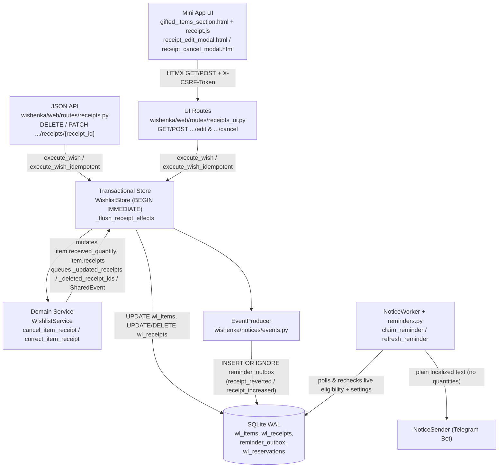

# WISHENKA-153: Undo and Correction of Gift Receipt

## Research

Research of the existing codebase (`doc/dev/gift-receipt.md`, `doc/dev/architecture.md`, and the
implemented modules from WISHENKA-22, WISHENKA-23, WISHENKA-24, WISHENKA-29, and WISHENKA-60)
revealed the following key facts and constraints:

1. **Domain model and derived views (`wishenka/wishlists/models.py`, `service.py`):**
   - `WishItem` derives `remaining_quantity = max(0, quantity - received_quantity)`,
     `is_fully_received = received_quantity >= quantity`, `is_gifted = received_quantity > 0`,
     `is_active = not is_archived and not is_fully_received`, and
     `is_in_archive = is_archived and not is_fully_received`.
   - `occupied_quantity` is the sum of `quantity` across `ACTIVE` and `PURCHASED` reservations,
     and `free_quantity = max(0, quantity - received_quantity - occupied_quantity)`.
   - `update_wish_item` enforces `new_quantity >= occupied + received_quantity`
     (`CannotReduceQuantityBelowReservedError`).
   - `CabinetRow.wish_received` (`wishenka/web/routes/reservations_ui.py`) and
     `MyReservationItemDTO.is_fully_received` (`wishenka/wishlists/service.py`) are both derived
     from `item.is_fully_received`.
   - Therefore, decrementing `item.received_quantity` automatically restores active visibility,
     ends the over-booked state when `received + occupied <= requested`, removes the cabinet
     "received" marker, and lowers the edit-quantity lock without touching any `Reservation` rows.

2. **Persistence & `wl_receipts` (`wishenka/wishlists/store.py`):**
   - `wl_receipts(id, wish_item_id, quantity, received_at, is_approximate)` stores one row per
     receipt act.
   - `WishlistStore.execute_wish` and `execute_wish_idempotent` run inside `BEGIN IMMEDIATE`
     wish-scoped WAL transactions (`_load_wish_service` → domain method → `_persist_wish` →
     `_flush_receipt_effects`).
   - Currently `WishlistService` only tracks `_new_receipts` (inserts) and `_new_shared_item_events`.
     Supporting cancel and quantity correction requires tracking `_updated_receipts` (`UPDATE
     wl_receipts SET quantity = :quantity WHERE id = :id AND wish_item_id = :wish_item_id`, leaving
     `received_at` and `is_approximate` untouched) and `_deleted_receipt_ids` (`DELETE FROM
     wl_receipts WHERE id = :id`) in `_flush_receipt_effects`.
   - **No Alembic schema migration is required**: `wl_receipts` and `wl_items.received_quantity`
     already hold all required columns.

3. **Critical outbox constraint (`notification_outbox` vs `reminder_outbox`):**
   - `notification_outbox.receipt_id` and `notice_receipt_keys.receipt_id` have
     `REFERENCES wl_receipts(id) ON DELETE CASCADE`, and `NoticeStore._eligible` requires
     `i.received_quantity > 0`.
   - Deleting a `wl_receipts` row cascades and removes any pending `notification_outbox` row for
     that receipt; therefore a cancellation notice **cannot** reference the deleted `receipt_id` in
     `notification_outbox`, nor can it pass `i.received_quantity > 0` when `received_quantity` drops
     to `0`.
   - Furthermore, `notice_receipt_keys` has `PRIMARY KEY (event_type, receipt_id, giver_user_id)`
     for `gift_received`, so an **upward correction** on an existing `receipt_id` cannot reuse
     `notification_outbox` without being silently deduplicated by `INSERT OR IGNORE INTO
     notice_receipt_keys`.
   - Meanwhile, `wishenka/notices/events.py` (`EventProducer`, `SharedEvent`) and
     `wishenka/notices/reminders.py` (`reminder_outbox`, drained in the exact same
     `NoticeWorker.run_once()` loop) already provide transaction-scoped, idempotent (`occurrence_key`),
     content-free notifications with live eligibility rechecks, `claim_token` fencing,
     user/list-level settings checks, and localization (`wishenka/i18n/catalog.py`).
   - Adding `"receipt_reverted"` (cancel & downward correction) and `"receipt_increased"` (upward
     correction) to `SAFE_SHARED_EVENTS` and mapping both to the `"gift_received"` preference
     category in `wishenka/notices/reminders.py` solves both constraints cleanly without any DDL
     migration.

4. **API & UI (`wishenka/web/routes/receipts.py`, `receipts_ui.py`, `gifted_view.py`, `receipt.js`):**
   - `ReceiptEntryDTO` (`schemas.py`) and `GiftedAct` (`gifted_view.py`) currently omit `receipt_id`;
     adding `id: int = 0` / `receipt_id: int = 0` lets UI controls and API callers target a specific
     receipt act while preserving backward compatibility.
   - `receipts._REFUSALS` and `receipt.js` `REFUSAL_REASONS` define the closed refusal set
     (`X-Receipt-Refusal`). Adding `ReceiptNotFoundError` (`reason = "receipt_not_found"`, HTTP 404)
     handles concurrent/stale undo or edit cleanly.
   - `base.html` has an inline `<script>` pinned by SHA-256 in
     `tests/test_receipt_static_script.py` (`test_inline_script_is_unchanged_and_free_of_receipt_code`).
     All new UI interaction must live in `wishenka/web/static/receipt.js` and partials without
     touching `base.html`'s inline script or adding inline event handlers.
   - `item_receipt_modal.html` currently renders `web.receipt.irreversible` ("cannot be undone"),
     which should be updated to reflect that mistakes can be corrected or undone in «Подаренные».

## Implementation Plan

1. **Exceptions & Schemas (`wishenka/wishlists/exceptions.py`, `schemas.py`):**
   - Add `ReceiptNotFoundError(WishRefusalError)` with `reason = "receipt_not_found"`.
   - Add `id: int = 0` to `ReceiptEntryDTO`.
2. **Domain Service & Store (`wishenka/wishlists/service.py`, `store.py`):**
   - Add `_updated_receipts` and `_deleted_receipt_ids` tracking on `WishlistService`, and flush
     them in `WishlistStore._flush_receipt_effects`.
   - Implement `WishlistService.cancel_item_receipt` and `WishlistService.correct_item_receipt`
     with fixed-order guards (not found → non-member → list deleted → list archived → quantity invalid
     → lock item → receipt not found → max quantity check / no-op), updating `item.received_quantity`
     and `item.receipts` (preserving `received_at` and `is_approximate` on correction) and queuing
     `SharedEvent` (`receipt_reverted` or `receipt_increased`) for open-promise givers (excluding
     `is_recipient_id`).
   - Populate `ReceiptEntryDTO.id = r.id` in `list_gifted_items`.
3. **Notifications (`wishenka/notices/events.py`, `reminders.py`, `wishenka/i18n/catalog.py`):**
   - Register `"receipt_reverted"` and `"receipt_increased"` in `SAFE_SHARED_EVENTS`.
   - In `reminders.py`, map both kinds to preference category `"gift_received"`, enforce open
     reservation (`ACTIVE`/`PURCHASED`) and non-recipient checks in `_event_authorized` and live
     refresh queries (plus `i.received_quantity > 0` for `receipt_increased`), and render
     `"notices.receipt_reverted"` / `"notices.gift_received"` in `_render`.
   - Add `notices.receipt_reverted` (RU/EN) and UI i18n strings in `wishenka/i18n/catalog.py`.
4. **JSON API (`wishenka/web/routes/receipts.py`):**
   - Add `ReceiptNotFoundError` to `_REFUSALS` and `_run`.
   - Add `DELETE /api/wishlists/{wishlist_id}/items/{item_id}/receipts/{receipt_id}` and
     `PATCH /api/wishlists/{wishlist_id}/items/{item_id}/receipts/{receipt_id}` with
     `Idempotency-Key` support and `ReceiptResultDTO` responses.
5. **Mini App UI (`wishenka/web/gifted_view.py`, `routes/receipts_ui.py`, `routes/items_ui.py`, templates, `receipt.js`, `miniapp.css`):**
   - Add `receipt_id: int = 0` to `GiftedAct`.
   - Pass `wishlist_id` and `can_edit_wishlist` to `partials/gifted_items_section.html` from
     `wishlist_detail.html`, `items_ui.py`, and `receipts_ui.py`; render per-act edit/cancel buttons
     only when `can_edit_wishlist` is true (active list + author).
   - Add `GET`/`POST` routes in `receipts_ui.py` for
     `/items/{item_id}/receipts/{receipt_id}/edit` and
     `/items/{item_id}/receipts/{receipt_id}/cancel` with confirmation modal, OOB updates for
     `#item-modal-container`, `#list-notice`, `#items-list`, `#gifted-items-section`, and
     `#archived-items-section`, and `X-Receipt-Refusal` error handling.
   - Extend `receipt.js` (`REFUSAL_REASONS` + `receipt_not_found`, `submitReceipt` handling forms
     without `quantity`).
   - Update `item_receipt_modal.html` copy (`web.receipt.irreversible` → reversible note).

**Mandatory — Failing Repro (next Step 3):**
- **File:** `tests/test_receipt_undo_correction_repro.py` (with `pytestmark = pytest.mark.timeout(20)`).
- **What it asserts:**
  1. *Cancel & active list / archive / over-booking:* Cancelling a receipt removes the `wl_receipts`
     row, decrements `received_quantity`, returns a fully received non-archived wish to the active
     list, removes it from `list_gifted_items` when `received_quantity == 0`, ends over-booking
     (`free_quantity > 0`), lowers the requested-quantity edit minimum, and keeps an archived
     remainder wish in the archive (`is_in_archive == True`, `is_active == False`).
  2. *Correction & invariants:* Downward and upward corrections preserve `received_at` and
     `is_approximate`; same-quantity correction is a no-op (no `updated_at` change, no notices);
     `<= 0` raises `QuantityInvalidError`; `> old_qty + remaining` raises
     `QuantityAboveRemainingError(max_allowed)` without leaking booked quantities.
  3. *Guards & concurrency:* Archived list raises `WishlistArchivedError`; non-member raises
     `PermissionDeniedError`; second concurrent cancel raises `ReceiptNotFoundError`.
  4. *Notifications (without live Telegram):* Using `WishlistStore` + `NoticeWorker` + `FakeSender`,
     cancel and downward correction deliver `notices.receipt_reverted` (without quantities or
     other-giver names) to open-promise givers only, respecting `gift_received` settings; upward
     correction delivers `notices.gift_received` even if the original receipt notice was already
     sent; rejected sends do not roll back the receipt mutation.
  5. *JSON & UI routes:* `DELETE` and `PATCH` JSON endpoints and `GET`/`POST` UI edit/cancel
     routes enforce permissions, confirmation, OOB section updates, `X-Receipt-Refusal`, and
     read-only «Подаренные» on archived lists.
- **Sequencing:** Write `tests/test_receipt_undo_correction_repro.py` in Step 3 and verify it fails
  red before any production edits; implement Steps 1–5 above in Step 4 until all repros and the
  existing suite pass green.

## Architecture

### System Module Diagram

### Module Responsibilities

| Module | Responsibility |
| ------ | -------------- |
| `wishenka/wishlists/exceptions.py` | Define `ReceiptNotFoundError(WishRefusalError)` with `reason = "receipt_not_found"`. |
| `wishenka/wishlists/schemas.py` | Expose `id: int = 0` on `ReceiptEntryDTO`. |
| `wishenka/wishlists/service.py` | Implement `cancel_item_receipt` and `correct_item_receipt` with fixed-order guards, item/receipt state updates, and `SharedEvent` drafting; populate `ReceiptEntryDTO.id`. |
| `wishenka/wishlists/store.py` | Flush `_updated_receipts` (`UPDATE wl_receipts SET quantity = ...`) and `_deleted_receipt_ids` (`DELETE FROM wl_receipts`) inside `_flush_receipt_effects` within the same `BEGIN IMMEDIATE` transaction. |
| `wishenka/notices/events.py` | Allow `"receipt_reverted"` and `"receipt_increased"` in `SAFE_SHARED_EVENTS`. |
| `wishenka/notices/reminders.py` | Map receipt-change events to `"gift_received"` preferences, enforce open-promise + non-recipient authorization, and render localized privacy-safe text. |
| `wishenka/i18n/catalog.py` | Provide RU/EN strings for `notices.receipt_reverted` and UI edit/cancel modals, notices, and refusals. |
| `wishenka/web/routes/receipts.py` | Expose `DELETE` and `PATCH` receipt endpoints with idempotency and closed refusal mapping. |
| `wishenka/web/gifted_view.py` | Carry `receipt_id` on `GiftedAct`. |
| `wishenka/web/routes/receipts_ui.py` | Expose `GET`/`POST` edit and cancel modal routes returning OOB fragments and `X-Receipt-Refusal`. |
| `wishenka/web/templates/partials/` & `receipt.js` | Render per-act edit/cancel controls on active lists only, confirmation/edit modals, and handle HTMX submission without inline scripts. |

### Transaction & Concurrency Flow

1. Every `cancel_item_receipt` and `correct_item_receipt` call runs via
   `WishlistStore.execute_wish` (or `execute_wish_idempotent` when `Idempotency-Key` is present)
   in a single `BEGIN IMMEDIATE` SQLite WAL transaction.
2. Inside the transaction, `_load_wish_service` hydrates the wish, its `wl_receipts`, and its
   `wl_reservations`.
3. `WishlistService` checks guards in order: item/list match → membership → list not deleted → list
   active → (for correction) `new_quantity >= 1` → receipt exists → (for correction)
   `new_quantity <= old_quantity + remaining_quantity`.
4. If valid and non-no-op, `item.received_quantity` and `item.receipts` are updated in memory and
   a `SharedEvent` (`receipt_reverted` or `receipt_increased`) is queued for distinct givers with
   `ACTIVE` or `PURCHASED` reservations who are not `is_recipient_id(user_id, item)`.
5. `_persist_wish` writes `wl_items` and calls `_flush_receipt_effects`, which executes `UPDATE` or
   `DELETE` on `wl_receipts` and invokes `EventProducer.record` to insert `reminder_outbox` rows.
   Any domain error or `SQLITE_BUSY` (`InventoryBusyError`) rolls back the entire transaction.
6. Two concurrent authors cancelling the same `receipt_id` serialize on `BEGIN IMMEDIATE`: the
   first commits the `DELETE`; the second loads `item.receipts` without that `receipt_id` and
   raises `ReceiptNotFoundError` (HTTP 404).

### Main Interfaces

- **Domain (`WishlistService`):**
  - `cancel_item_receipt(item_id: int, receipt_id: int, actor: AuthenticatedUser, *, wishlist_id: int | None = None) -> WishItem`
  - `correct_item_receipt(item_id: int, receipt_id: int, actor: AuthenticatedUser, new_quantity: int, *, wishlist_id: int | None = None) -> WishItem`
- **JSON API (`wishenka/web/routes/receipts.py`):**
  - `DELETE /api/wishlists/{wishlist_id}/items/{item_id}/receipts/{receipt_id}` → `200 ReceiptResultDTO` (`received_now=0`)
  - `PATCH /api/wishlists/{wishlist_id}/items/{item_id}/receipts/{receipt_id}` (`ReceiptRequestDTO`) → `200 ReceiptResultDTO` (`received_now=new_quantity`)
- **Mini App UI (`wishenka/web/routes/receipts_ui.py`):**
  - `GET /web/wishlists/{wishlist_id}/items/{item_id}/receipts/{receipt_id}/edit` → edit modal HTML
  - `POST /web/wishlists/{wishlist_id}/items/{item_id}/receipts/{receipt_id}/edit` → `200` OOB fragments / `4xx/503` with `X-Receipt-Refusal`
  - `GET /web/wishlists/{wishlist_id}/items/{item_id}/receipts/{receipt_id}/cancel` → confirmation modal HTML
  - `POST /web/wishlists/{wishlist_id}/items/{item_id}/receipts/{receipt_id}/cancel` → `200` OOB fragments / `4xx/503` with `X-Receipt-Refusal`

## Q&A

- **Q1. Why use `reminder_outbox` (`SharedEvent`) instead of `notification_outbox` for undo and correction notices?**
  A. `notification_outbox.receipt_id` has `ON DELETE CASCADE` on `wl_receipts(id)`, and
  `notice_receipt_keys` enforces uniqueness on `(event_type, receipt_id, giver_user_id)`.
  Deleting a receipt row would cascade-delete a cancellation notice in `notification_outbox`, and
  an upward correction on an existing `receipt_id` would be silently ignored by
  `notice_receipt_keys`. `reminder_outbox` has no FK to `wl_receipts`, uses per-event
  `occurrence_key`, is drained in the same `NoticeWorker.run_once()` loop, and requires zero
  Alembic migrations.

- **Q2. Does `item.is_archived` block cancelling or correcting a receipt?**
  A. No (FR-1.3, Corner Case 6). Only `wl.status != ACTIVE` (archived or deleted list) blocks
  undo/correction. A wish whose unreceived remainder was archived can still have its receipt
  cancelled or corrected, and its `is_archived = True` flag is preserved so it stays in the
  archive with the updated `remaining_quantity`.

- **Q3. How is the `test_inline_script_is_unchanged_and_free_of_receipt_code` invariant preserved?**
  A. `base.html`'s inline script is not modified; all modal, confirmation, and HTMX submission
  behavior is handled via delegated listeners in `wishenka/web/static/receipt.js`.
