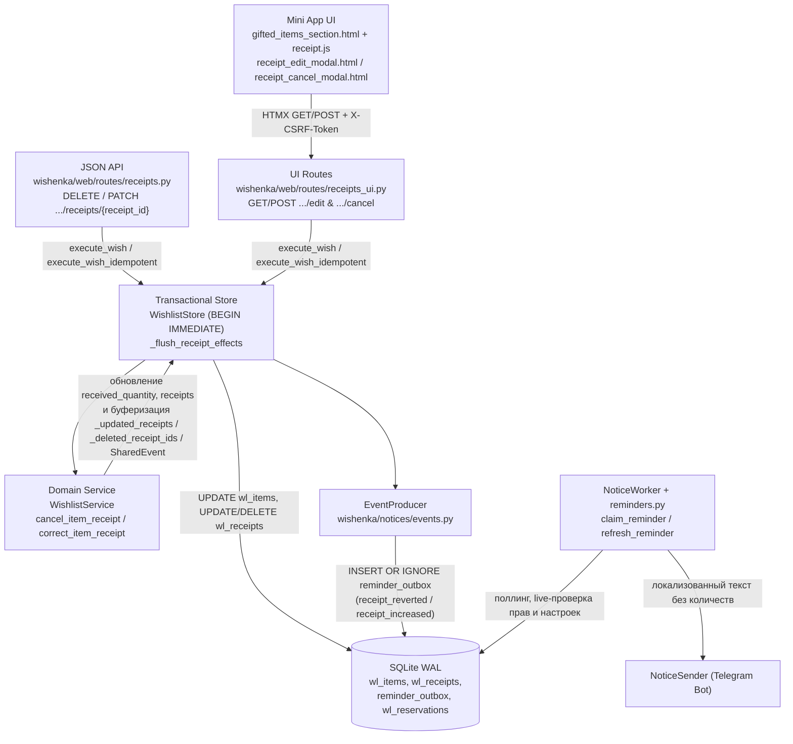

# Спецификация: WISHENKA-153 — Отмена и корректировка отметки о получении подарка

**Задача Jira:** `WISHENKA-153`  
**Статус:** реализована (источники: `10-requirements.md`, `20-architecture.md`, `40-code-cleanup.md`, `50-observability.md`, `60-tech-debt.md`, `in-docs/spec.md`, `doc/dev/gift-receipt.md`)  
**Стек реализации:** Python 3.12+ (FastAPI, Jinja2, HTMX, SQLite WAL), JavaScript (classic script), CSS  
**Языки интерфейса:** русский (`ru`), английский (`en`)

## 1. Назначение и бизнес-цель

### 1.1. Постановка проблемы

На предыдущих этапах реализации получения подарков (`WISHENKA-22`, `WISHENKA-23`, `WISHENKA-24`) действовало допущение о необратимости каждой отметки о получении (вопрос Q9 из `WISHENKA-22`, допущение C). На практике автор вишлиста может ошибочно указать слишком большое количество экземпляров (например, 3 вместо 1) или отметить получение не для того желания. При отсутствии механизма отмены и корректировки:

- желание преждевременно исчезает из активного списка и переходит только в раздел «Подаренные»;
- дарители теряют возможность бронировать фактически неполученные экземпляры;
- в разделе «Подаренные» фиксируется недостоверная история получений, которую невозможно исправить без удаления желания.

### 1.2. Цели и закрытые продуктовые решения

`WISHENKA-153` закрывает отложенные продуктовые вопросы из `WISHENKA-22` (Q9) и элемент технического долга N1, определяя и реализуя полный жизненный цикл отмены и корректировки актов получения подарка в домене, API, уведомлениях и интерфейсе Mini App («Подаренные»):

- поддерживаются обе операции над отдельной записью о получении: **полная отмена (удаление записи)** и **корректировка количества** с сохранением исходной даты акта;
- отменяются и корректируются не только свежие записи, но и исторические записи с примерной датой (`is_approximate = True`), созданные при миграции данных;
- ранее доставленные в Telegram уведомления не отзываются и не редактируются — вместо этого при отмене или уменьшении количества дарители с открытыми бронями получают отдельное уведомление;
- при уменьшении полученного количества автоматически снимается состояние превышения лимита («перебронь»), если сумма полученного и забронированного больше не превышает запрошенное количество;
- желание с архивированным неполученным остатком при отмене или уменьшении получения остаётся в архиве и не возвращается в активный список автоматически;
- на архивных вишлистах раздел «Подаренные» остаётся строго доступным только для чтения.

### 1.3. Бизнес-ценность и границы решения

**Ценность для пользователей и системы:**

- **Исправление ошибок без потери данных:** автор отменяет ошибочную отметку или уточняет количество, не удаляя желание и не теряя исходную дату получения.
- **Корректная доступность активного списка:** неполученные экземпляры возвращаются в активный список (если остаток не был архивирован), открывая дарителям актуальный остаток для бронирования.
- **Согласованная координация дарителей:** дарители с открытыми бронями своевременно узнают об отмене или уменьшении отметки и при снятии переброни снова могут создавать или увеличивать брони.
- **Гарантия тайны сюрприза:** ни при успешной операции, ни при отказе или подтверждении автор и получатель не получают сведений о наличии броней, личностях дарителей и отправленных уведомлениях.

**Вне рамок задачи (Out of Scope):**

- отзыв, удаление или редактирование уже отправленных сообщений Telegram-бота;
- автоматическое восстановление броней, которые даритель уже отменил после предыдущего уведомления;
- редактирование общих полей желания (названия, ссылки, цены, запрошенного количества) с экрана «Подаренные»;
- изменение правил авторства получения (соавтор-получатель, `WISHENKA-154`) или экранов настроек уведомлений (`WISHENKA-34`);
- добавление экспортеров метрик (`WISHENKA-84`).

## 2. Функциональные требования и пользовательские сценарии

### 2.1. Роли и доменные сущности

В сценариях отмены и корректировки участвуют следующие роли (`in-docs/spec.md`, раздел 3):

- **Автор вишлиста** — владелец, администратор или участник совместного списка с правами редактирования (включая соавтора, указанного получателем конкретного желания, при строгом соблюдении тайны сюрприза).
- **Даритель** — пользователь с открытой бронью (задуманной `ACTIVE` или купленной `PURCHASED`) или просматривающий активный вишлист.
- **Получатель** — адресат желания; изолирован от любой информации о бронированиях и покупках.
- **Анонимный посетитель** — просмотр по публичной ссылке без прав редактирования и без доступа к разделу «Подаренные».

Основные сущности и вычисляемые показатели:

- **Желание (`WishItem`)** — элемент вишлиста с запрошенным количеством `quantity` (по умолчанию `1`).
- **Запись о получении (`ReceiptRecord`, строка `wl_receipts`)** — датированный акт получения вида «получено `quantity` шт. на дату `received_at`» (с флагом `is_approximate` для мигрированных записей). У одного желания может быть несколько записей.
- **Полученное количество (`received_quantity`)** — сумма количеств всех активных (неотменённых) записей о получении желания.
- **Оставшееся количество (`remaining_quantity`)** — `max(0, quantity - received_quantity)`.
- **Бронирование (`Reservation`)** — независимое намерение дарителя (задуманное или купленное). Сумма открытых броней образует занятое количество (`occupied_quantity`).
- **Свободное количество (`free_quantity`)** — `max(0, quantity - received_quantity - occupied_quantity)`.
- **Перебронь (состояние превышения лимита)** — допустимое состояние, при котором `received_quantity + occupied_quantity > quantity` (`free_quantity == 0`).

### 2.2. Функциональные требования

#### FR-1. Права доступа и допустимость операции

- **FR-1.1.** Отменять или корректировать запись о получении может только **автор** вишлиста (владелец, администратор или участник). Дарители без прав участника и анонимные посетители не допускаются.
- **FR-1.2.** Операции разрешены только на **активном вишлисте** (`status == ACTIVE`, не архивирован и не удалён). На архивном или удалённом списке запрос отклоняется с понятной причиной, а в UI архивного списка раздел «Подаренные» отображается только для чтения.
- **FR-1.3.** Отмена и корректировка разрешены для желания, неполученная часть которого была архивирована (`item.is_archived == True`), пока сам вишлист остаётся активным.
- **FR-1.4.** Исторические записи с примерной датой (`is_approximate = True`) отменяются и корректируются по тем же правилам, что и обычные записи.

#### FR-2. Отмена (удаление) записи о получении

- **FR-2.1.** Автор может отменить любую отдельную запись о получении желания из раздела «Подаренные».
- **FR-2.2.** При отмене запись удаляется из истории (`wl_receipts`), а `received_quantity` уменьшается на количество отменённой записи.
- **FR-2.3.** Если суммарное `received_quantity` становится равно `0`, желание удаляется из раздела «Подаренные». Если остаются другие записи (`received_quantity > 0`), желание остаётся в «Подаренные» с обновлённым итогом и оставшимися записями.
- **FR-2.4.** Если неполученная часть желания **не архивирована** (`not item.is_archived`), уменьшение `received_quantity` делает `remaining_quantity > 0`:
  - ранее полностью полученное желание автоматически возвращается в активный список с обновлённым `remaining_quantity`;
  - у частично полученного активного желания увеличивается `remaining_quantity`.
- **FR-2.5.** Если неполученная часть желания **архивирована** (`item.is_archived == True`), желание остаётся в архиве (`is_in_archive == True`) с увеличенным `remaining_quantity` и **не** переносится автоматически в активный список.

#### FR-3. Корректировка количества записи о получении

- **FR-3.1.** Автор может изменить количество в существующей записи о получении.
- **FR-3.2.** Новое количество `new_quantity` должно быть целым положительным числом (`>= 1`) и не превышать `old_quantity + remaining_quantity` (чтобы суммарное полученное количество не превысило `quantity` желания):
  - значения `<= 0` отклоняются (`quantity_invalid`);
  - превышение допустимого максимума отклоняется (`quantity_above_remaining`) с указанием только допустимого остатка, без раскрытия забронированных единиц.
- **FR-3.3.** При корректировке сохраняются исходная дата записи (`received_at`) и признак `is_approximate`.
- **FR-3.4.** Если `new_quantity == old_quantity` (no-op), состояние желания, `updated_at` и история не меняются, а уведомления не формируются.
- **FR-3.5.** Корректировка **вниз** (`new_quantity < old_quantity`) применяет правила видимости и архива из FR-2.4 и FR-2.5.
- **FR-3.6.** Корректировка **вверх** (`new_quantity > old_quantity`) применяет стандартные правила получения: при достижении `received_quantity == quantity` желание уходит из активного списка.

#### FR-4. Влияние на бронирования и перебронь

- **FR-4.1.** Отмена и корректировка записи **никогда** не создают, не изменяют, не отменяют и не открывают заново ни одну бронь дарителя.
- **FR-4.2.** При уменьшении `received_quantity` пересчитывается `free_quantity = max(0, quantity - received_quantity - occupied_quantity)`:
  - если `received_quantity + occupied_quantity <= quantity`, состояние переброни **завершается автоматически**, а при строгом неравенстве становится доступным `free_quantity > 0` для новых и увеличенных броней;
  - если `received_quantity + occupied_quantity >= quantity`, `free_quantity` остаётся `0`, новые брони и увеличение текущих по-прежнему заблокированы (при уменьшении избытка переброни).
- **FR-4.3.** Если желание перестаёт быть полностью полученным (`is_fully_received` становится `False`), в личном кабинете дарителя («Мои бронирования») снимается отметка «Желание получено владельцем», а на активной неархивированной карточке желания снова становятся доступны элементы управления бронью.
- **FR-4.4.** При уменьшении `received_quantity` снижается вклад полученных единиц в нижнюю границу допустимого количества при редактировании желания (в контуре `WISHENKA-153` минимум учитывал `received_quantity + occupied_quantity`, в последующей доработке `WISHENKA-218` — `max(1, received_quantity)`).

#### FR-5. Уведомления дарителям

- **FR-5.1.** Уже отправленные сообщения Telegram-бота не отзываются и не редактируются.
- **FR-5.2.** При **отмене** или **корректировке вниз** (`new_quantity < old_quantity`) каждый уникальный даритель, удерживающий на момент операции **открытую бронь** (`ACTIVE` или `PURCHASED`) на это желание, получает одно уведомление `receipt_reverted` через Telegram-бота с учётом пользовательских и списочных настроек категории `gift_received`.
- **FR-5.3.** Текст уведомления об отмене или уменьшении отметки сообщает, что автор отменил или скорректировал отметку о получении для указанного желания в указанном вишлисте, и предлагает дарителю проверить свою бронь.
- **FR-5.4.** При **корректировке вверх** (`new_quantity > old_quantity`) дарителям с открытыми бронями отправляется стандартное уведомление о получении (`receipt_increased` -> шаблон `notices.gift_received`), даже если уведомление по первоначальной записи уже было доставлено.
- **FR-5.5.** Уведомления не содержат никаких количеств (старых, новых, полученных, запрошенных или забронированных), имён других дарителей и намёков на наличие переброни.
- **FR-5.6.** Дарители с уже отменёнными/завершёнными бронями, пользователи без открытых броней и получатель желания (`is_recipient_id`) уведомление не получают. Даритель с несколькими открытыми бронями на одно желание получает не более одного уведомления на акт.
- **FR-5.7.** Ошибка или задержка доставки уведомления никогда не откатывает и не блокирует отмену или корректировку получения.

#### FR-6. Интерфейс раздела «Подаренные» в Mini App

- **FR-6.1.** В разделе «Подаренные» для каждой записи о получении отображаются дата в формате `dd.mm.yyyy` (либо пометка `≈ date (дата примерная)` при `is_approximate`) и количество (`N шт.`). При активном вишлисте и правах автора (`can_edit_wishlist`) рядом с каждой записью отображаются кнопки редактирования и отмены.
- **FR-6.2.** В разделе «Подаренные» отсутствуют посторонние действия (редактирование полей желания, изменение порядка карточек или бронирование).
- **FR-6.3.** Отмена записи требует явного подтверждения через модальное окно.
- **FR-6.4.** После успешной отмены или корректировки через out-of-band обновления синхронно обновляются «Подаренные», активный список, секция архива и строка уведомления `#list-notice`.
- **FR-6.5.** При конкурентном удалении записи другим автором или при архивации/удалении списка повторное действие отклоняется с понятным сообщением на русском языке.
- **FR-6.6.** Ни один элемент управления, текст подтверждения, уведомление об успехе или сообщение об отказе не раскрывает наличие броней, количество забронированных единиц или факт отправки уведомлений.

### 2.3. Пользовательские сценарии и ключевые граничные случаи

**Основные сценарии:**

- **UC-01. Отмена ошибочной отметки о получении:** автор открывает «Подаренные», нажимает кнопку отмены рядом с конкретной записью, подтверждает действие в модальном окне. Запись удаляется; если других записей нет, желание уходит из «Подаренные» и возвращается в активный список.
- **UC-02. Корректировка количества в существующей записи:** автор открывает модальное окно редактирования рядом с записью, задаёт исправленное количество (`>= 1` и в пределах остатка) и сохраняет. Дата записи остаётся прежней, счётчики и разделы списка обновляются.
- **UC-03. Снятие переброни для дарителей:** после отмены или уменьшения отметки сумма `received + occupied` опускается до или ниже `quantity`; желание становится доступным для бронирования, маркер получения в «Мои бронирования» снимается, а держатели открытых броней получают уведомление.
- **UC-04. Сохранение архивного статуса остатка:** если неполученная часть частично полученного желания была перенесена в архив до отмены/уменьшения отметки, желание остаётся в архиве с увеличенным остатком.
- **UC-05. Работа на архивном списке:** автор просматривает «Подаренные» архивного вишлиста без кнопок редактирования и отмены; любые попытки мутации через API/маршруты отклоняются.

**Матрица граничных случаев (`10-requirements.md`, раздел Corner Cases):**

| № | Ситуация | Ожидаемое поведение |
| - | -------- | ------------------- |
| 1 | Желание на 5 шт., 1 запись на 5 шт. (полностью получено). Автор отменяет запись. | Запись удалена, `received = 0`, желание уходит из «Подаренные» и возвращается в активный список с остатком 5; у дарителей снимается маркер получения в кабинете и приходит уведомление `receipt_reverted`. |
| 2 | Желание на 5 шт., 2 записи: 2 шт. (10 ноя) и 3 шт. (12 ноя). Автор отменяет запись от 12 ноя. | Запись от 12 ноя удалена, запись от 10 ноя остаётся (`received = 2`). Желание возвращается в активный список с остатком 3 и остаётся в «Подаренные». |
| 3 | Желание на 5 шт., забронировано 3 (A) и 2 (B), ошибочно получено 2 (перебронь `2 + 5 = 7 > 5`). Отмена записи на 2 шт. | `received = 0`, `occupied = 5`, перебронь завершена (`free = 0`, избытка больше нет). A и B получают уведомление; при последующем освобождении 1 шт. `free` станет `1`. |
| 4 | Желание на 5 шт., забронировано 3 (A), ошибочно получено 4 (перебронь `7 > 5`). Корректировка `4 -> 1`. | `received = 1`, `occupied = 3`, `free = 1`. Перебронь завершена, 1 шт. доступна для новых броней, дата записи сохранена, A уведомлён. |
| 5 | Желание на 5 шт., забронировано 4 (A), получено 4. Корректировка `4 -> 3`. | `received = 3`, `occupied = 4` (`7 > 5`). Перебронь сохраняется с меньшим избытком (`free = 0`), новые брони заблокированы, A уведомлён. |
| 6 | Желание на 5 шт., получено 2, остаток 3 архивирован. Отмена записи на 2 шт. | Запись удалена, желание уходит из «Подаренные» и остаётся в архиве с остатком 5 (не возвращается в активный список). |
| 7 | Вишлист архивирован. Попытка отменить или изменить запись. | Кнопки в UI не отображаются; вызов маршрута/сервиса отклоняется (`WishlistArchivedError` / 409 `wishlist_not_active`). |
| 8 | Корректировка записи вверх (`1 -> 3` при запросе 5). | Разрешено (`3 <= 5`), исходная дата сохранена, в активном списке остаток 2; дарителям с открытыми бронями уходит `receipt_increased` (`notices.gift_received`). |
| 9 | Попытка скорректировать запись до `0`, `< 0` или больше `old_qty + remaining`. | Отклонено (`quantity_invalid` / `quantity_above_remaining`) без раскрытия занятого количества. |
| 10 | Даритель B отменил бронь после ошибочной отметки, A сохранил бронь. Автор отменяет отметку. | Уведомление получает только A; закрытая бронь B не открывается и уведомление B не отправляется. |
| 11 | Два автора одновременно отменяют одну запись `receipt_id`. | Первый коммит успешен; второй получает отказ `ReceiptNotFoundError` (404 `receipt_not_found`). |
| 12 | Корректировка записи на то же самое количество. | No-op: история и `updated_at` не меняются, уведомления не отправляются. |
| 13 | Историческая запись с примерной датой (`is_approximate = True`). | Корректировка и отмена разрешены; при корректировке флаг `is_approximate` и `received_at` сохраняются. |

### 2.4. Продуктовые инварианты

1. **Тайна сюрприза:** ответы API, HTML-фрагменты, тексты отказов и уведомлений никогда не содержат сведений о бронях, дарителях или свободных/занятых количествах.
2. **Независимость броней и получений:** операции над `wl_receipts` никогда не мутируют таблицу `wl_reservations`.
3. **Согласованность счётчиков:** в любой зафиксированной транзакции `0 <= received_quantity <= quantity` и `received_quantity` соответствует набору записей в `wl_receipts`.

## 3. Архитектура, компоненты и интерфейсы

### 3.1. Диаграмма взаимодействия компонентов

### 3.2. Модули и распределение ответственности

| Модуль | Ответственность |
| ------ | --------------- |
| `wishenka/wishlists/exceptions.py` | Определяет `ReceiptNotFoundError(WishRefusalError)` с `reason = "receipt_not_found"`. |
| `wishenka/wishlists/schemas.py` | Добавляет `id: int = 0` в `ReceiptEntryDTO`; использует `ReceiptRequestDTO`, `ReceiptResultDTO`, `GiftedItemDTO`. |
| `wishenka/wishlists/service.py` | Реализует `cancel_item_receipt` и `correct_item_receipt` с фиксированным порядком проверок, обновлением `WishItem` и очередью `SharedEvent`; заполняет `ReceiptEntryDTO.id` в `list_gifted_items`. |
| `wishenka/wishlists/store.py` | Выполняет операции в `BEGIN IMMEDIATE`; в `_flush_receipt_effects` применяет `_updated_receipts` (`UPDATE wl_receipts SET quantity = ...`) и `_deleted_receipt_ids` (`DELETE FROM wl_receipts`) и передаёт `SharedEvent` в `EventProducer.record`. |
| `wishenka/notices/events.py` | Регистрирует `"receipt_reverted"` и `"receipt_increased"` в `SAFE_SHARED_EVENTS`. |
| `wishenka/notices/reminders.py` | Отображает оба типа событий на категорию настроек `"gift_received"`, проверяет наличие открытой брони и отсутствие роли получателя в `_event_authorized` и при live-рефреше, рендерит тексты `notices.receipt_reverted` / `notices.gift_received`. |
| `wishenka/i18n/catalog.py` | Содержит RU/EN-строки для `notices.receipt_reverted` и ключи UI `web.receipt.*` (включая `web.receipt.error.receipt_not_found`). |
| `wishenka/web/routes/receipts.py` | Предоставляет `DELETE` и `PATCH /api/wishlists/{wishlist_id}/items/{item_id}/receipts/{receipt_id}` с поддержкой `Idempotency-Key` и маппингом `_REFUSALS`. |
| `wishenka/web/gifted_view.py` | Переносит `receipt_id: int = 0` в `GiftedAct`, экспортирует `RECEIPT_REFUSAL_HEADER` (`X-Receipt-Refusal`), `oob_text` и `read_gifted_rows`. |
| `wishenka/web/routes/receipts_ui.py` | Реализует `GET`/`POST` маршруты `.../edit` и `.../cancel`, возвращает модальные окна и OOB-фрагменты с заголовком `X-Receipt-Refusal`. |
| `wishenka/web/routes/items_ui.py`, `wishlist_detail.html` | Передают `wishlist_id` и `can_edit_wishlist` в паршиал `partials/gifted_items_section.html`. |
| `wishenka/web/templates/partials/` и `wishenka/web/static/receipt.js` | Отрисовывают кнопки редактирования/отмены по записям (только при `can_edit_wishlist`), модальные окна `receipt_edit_modal.html` и `receipt_cancel_modal.html`, обновляют формулировку обратимости в `item_receipt_modal.html`; обрабатывают отправку форм и `htmx:beforeSwap` без изменения встроенного скрипта `base.html`. |

### 3.3. Контракты данных и интерфейсов

#### Доменный сервис (`WishlistService`)

- `cancel_item_receipt(item_id: int, receipt_id: int, actor: AuthenticatedUser, *, wishlist_id: int | None = None) -> WishItem`
- `correct_item_receipt(item_id: int, receipt_id: int, actor: AuthenticatedUser, new_quantity: int, *, wishlist_id: int | None = None) -> WishItem`

Внутри транзакции `WishlistStore` хранение и миграции схемы БД не изменяются (Alembic-миграция не требуется): используются существующие столбцы `wl_items.received_quantity` и `wl_receipts(id, wish_item_id, quantity, received_at, is_approximate)`. При корректировке `UPDATE wl_receipts SET quantity = :quantity WHERE id = :id AND wish_item_id = :wish_item_id` не затрагивает `received_at` и `is_approximate`.

#### Причина маршрутизации уведомлений через `reminder_outbox`

Таблица `notification_outbox` (и `notice_receipt_keys`) имеет внешний ключ `receipt_id REFERENCES wl_receipts(id) ON DELETE CASCADE`, ограничение уникальности `(event_type, receipt_id, giver_user_id)` и требование `i.received_quantity > 0`. Из-за этого:

- удаление строки `wl_receipts` при отмене каскадно удалило бы строку уведомления из `notification_outbox`;
- корректировка вверх по существующему `receipt_id` была бы проигнорирована дедупликацией `notice_receipt_keys`.

Поэтому уведомления об отмене и корректировке направляются через `EventProducer` (`SharedEvent`) в `reminder_outbox`, которая не имеет внешнего ключа на `wl_receipts`, использует уникальный `occurrence_key` на событие и обрабатывается в том же цикле `NoticeWorker.run_once()` с соблюдением настроек `gift_received` и live-проверки открытых броней (`ACTIVE` / `PURCHASED`; для `receipt_increased` дополнительно проверяется `i.received_quantity > 0`).

#### JSON API (`wishenka/web/routes/receipts.py`)

Оба эндпоинта требуют аутентификацию `get_current_user` (401 при отсутствии), CSRF-токен `X-CSRF-Token` для cookie-сессий и поддерживают заголовок `Idempotency-Key` (`409 idempotency_conflict` при конфликте payload).

- **`DELETE /api/wishlists/{wishlist_id}/items/{item_id}/receipts/{receipt_id}`**
  - Ответ `200 OK`: `ReceiptResultDTO` (`item: WishItemRecipientViewDTO`, `received_now=0`, обновлённые `received_quantity`, `remaining_quantity`, `is_fully_received`).
- **`PATCH /api/wishlists/{wishlist_id}/items/{item_id}/receipts/{receipt_id}`**
  - Тело (`ReceiptRequestDTO`, `extra="forbid"`): `{"quantity": <int>}` (неизвестные поля и нецелые значения дают `422`).
  - Ответ `200 OK`: `ReceiptResultDTO` (`received_now=payload.quantity` и актуальные счётчики). При совпадении количества операция является no-op без генерации уведомлений.

Закрытый набор отказов API и UI (`_REFUSALS` + системные отказы):

| Исключение домена / инфраструктуры | HTTP | `reason` | Примечание |
| ---------------------------------- | :--: | -------- | ---------- |
| `QuantityInvalidError` | 400 | `quantity_invalid` | `new_quantity < 1` |
| `QuantityAboveRemainingError` | 409 | `quantity_above_remaining` | В JSON добавляет `remaining_quantity` (`max_allowed = old_qty + remaining`) |
| `WishArchivedError` | 409 | `wish_archived` | К отмене/корректировке существующей записи не применяется |
| `WishlistArchivedError` | 409 | `wishlist_not_active` | Вишлист в архиве |
| `WishlistDeletedError` | 404 | `wishlist_not_active` | Вишлист удалён |
| `NothingRemainingError` | 409 | `nothing_remaining` | Добавляет `remaining_quantity` |
| `PermissionDeniedError` | 403 | `forbidden` | Пользователь не участник списка |
| `ItemNotFoundError`, `WishlistNotFoundError` | 404 | `not_found` | Желание отсутствует или принадлежит другому списку |
| `ReceiptNotFoundError` | 404 | `receipt_not_found` | Запись о получении не найдена на данном желании |
| `InventoryBusyError` | 503 | `busy` | Конкурентная блокировка SQLite (`SQLITE_BUSY`) |
| `IdempotencyConflictError` | 409 | `idempotency_conflict` | Повторный `Idempotency-Key` с другим телом/параметрами |

#### Маршруты Mini App UI (`wishenka/web/routes/receipts_ui.py`)

- **`GET /web/wishlists/{wishlist_id}/items/{item_id}/receipts/{receipt_id}/edit`** — возвращает модальное окно редактирования (`receipt_edit_modal.html`) либо заблокированное модальное окно с `X-Receipt-Refusal`.
- **`POST /web/wishlists/{wishlist_id}/items/{item_id}/receipts/{receipt_id}/edit`** (поле формы `quantity`, поддержка `Idempotency-Key`) — возвращает `200 OK` с OOB-фрагментами (`#item-modal-container`, `#list-notice`, `#items-list`, `#gifted-items-section`, `#archived-items-section`) или `4xx`/`503` с `X-Receipt-Refusal` и OOB `#receipt-feedback`.
- **`GET /web/wishlists/{wishlist_id}/items/{item_id}/receipts/{receipt_id}/cancel`** — возвращает модальное окно подтверждения отмены (`receipt_cancel_modal.html`) либо заблокированное окно с `X-Receipt-Refusal`.
- **`POST /web/wishlists/{wishlist_id}/items/{item_id}/receipts/{receipt_id}/cancel`** (поддержка `Idempotency-Key`) — удаляет запись и возвращает `200 OK` с тем же набором OOB-фрагментов или отказ с `X-Receipt-Refusal`.

На клиенте (`wishenka/web/static/receipt.js`) множество `REFUSAL_REASONS` включает `receipt_not_found`, что позволяет слушателю `htmx:beforeSwap` разрешать swap 4xx/5xx-ответов при наличии допустимого заголовка `X-Receipt-Refusal`. Функция `submitReceipt` обрабатывает как формы с полем `quantity` (создание/корректировка), так и формы без поля `quantity` (подтверждение отмены).

### 3.4. Переходы состояний и порядок проверок

#### Порядок проверок в `cancel_item_receipt` и `correct_item_receipt`

Чтобы не раскрывать неавторизованному пользователю состояние вишлиста и желания, проверки выполняются строго в фиксированном порядке:

1. Проверка существования желания и принадлежности `wishlist_id` -> `ItemNotFoundError`.
2. Проверка членства автора в списке (`ctx.is_member`) -> `PermissionDeniedError`.
3. Проверка, что вишлист не удалён -> `WishlistDeletedError`.
4. Проверка активности вишлиста (не архивирован) -> `WishlistArchivedError`.
5. *(Только `correct_item_receipt`)* Проверка `new_quantity >= 1` -> `QuantityInvalidError`.
6. Поиск записи `receipt_id` среди записей желания -> `ReceiptNotFoundError`.
7. *(Только `correct_item_receipt`)* Проверка `new_quantity <= old_quantity + remaining_quantity` -> `QuantityAboveRemainingError`.
8. *(Только `correct_item_receipt`)* Если `new_quantity == old_quantity` -> возврат без изменений и событий.

#### Переходы состояний желания и доступности

Все представления опираются на единый набор вычисляемых свойств `WishItem`:

- `remaining_quantity = max(0, quantity - received_quantity)`
- `is_fully_received = received_quantity >= quantity`
- `is_gifted = received_quantity > 0`
- `is_active = (not is_archived) and (not is_fully_received)`
- `is_in_archive = is_archived and (not is_fully_received)`

При отмене или уменьшении записи:

- переход `is_fully_received: True -> False` при `is_archived == False` переводит `is_active` в `True` (возврат в активный список);
- при `is_archived == True` значение `is_in_archive` становится `True`, а `is_active` остаётся `False` (остаётся в архиве);
- переход `is_gifted: True -> False` (при `received_quantity == 0`) убирает желание из раздела «Подаренные»;
- значение `free_quantity = max(0, quantity - received_quantity - occupied_quantity)` при опускании суммы `received + occupied` ниже `quantity` автоматически выводит желание из состояния переброни.

#### Поток транзакции и конкурентность

Каждая мутация выполняется в одной транзакции SQLite WAL `BEGIN IMMEDIATE` (`WishlistStore.execute_wish` / `execute_wish_idempotent`): чтение желания, записей и броней (`_load_wish_service`) -> проверка инвариантов -> обновление `wl_items` -> обновление/удаление в `wl_receipts` и запись в `reminder_outbox` (`_flush_receipt_effects`) -> коммит. Два конкурирующих вызова отмены одного `receipt_id` сериализуются блокировкой `BEGIN IMMEDIATE`: первый фиксирует `DELETE`, второй на шаге 6 не находит запись и возвращает `ReceiptNotFoundError` (404). При `SQLITE_BUSY` транзакция откатывается с `InventoryBusyError` (503).

## 4. Нефункциональные требования, безопасность и наблюдаемость

### 4.1. Производительность, конкурентность и устойчивость

- **Блокировки и время ожидания:** операции используют wish-scoped транзакцию `BEGIN IMMEDIATE` с `busy_timeout = 5000 мс`. Изменения схемы базы данных отсутствуют.
- **Устойчивость к сбоям доставки:** отправка уведомлений выполняется асинхронно воркером `NoticeWorker` из таблицы `reminder_outbox` с lease-блокировкой `claim_token` и повторной проверкой прав перед отправкой; сбой Telegram API или отсутствие токена бота не приводят к откату транзакции отмены/корректировки.
- **Известный профиль производительности UI (`60-tech-debt.md`):** при каждом `POST .../edit` и `POST .../cancel` в `receipts_ui.py` функции `_read_full_mutation_state` и `_render_mutation_oob` перечитывают и перерисовывают три секции целиком (`#items-list`, `#gifted-items-section`, `#archived-items-section`). Для типовых вишлистов это пренебрежимо быстро и соответствует поведению `record_receipt_ui`, но на списках из сотен позиций стоимость OOB-рендера возрастает.

### 4.2. Безопасность, приватность и защита от утечек

- **Авторизация и изоляция:** требуется аутентифицированная сессия `get_current_user` и членство в списке; cookie-мутации защищены `X-CSRF-Token`. Попытка обратиться с валидным `receipt_id`, принадлежащим другому желанию или другому вишлисту, изолируется и отклоняется до изменения данных (`ItemNotFoundError` / `ReceiptNotFoundError`).
- **Инвариант тайны сюрприза:** ни ответы API, ни тексты ошибок (`max_allowed` рассчитывается только от `quantity - received_quantity`), ни UI-фрагменты, ни логи не содержат идентификаторов дарителей, статусов броней, `occupied_quantity`, `free_quantity` или счётчика поставленных уведомлений.
- **Защита от XSS и совместимость с CSP:** все названия желаний и пользовательские сообщения экранируются автоэкранированием Jinja2 или `oob_text` (`Markup.format`); клиентский код `receipt.js` обновляет только `textContent`. В соответствии с инвариантами безопасности шаблонов встроенный `<script>` в `base.html` не изменялся, а разметка модальных окон и паршиалов не содержит inline `<script>` и `on*`-атрибутов.

### 4.3. Структурированное логирование и метрики

Все события записываются в структурированном виде через `extra={"event": ...}` без передачи больших объектов, названий желаний, личностей дарителей или сведений о бронях:

| Событие (`event`) | Уровень | Логгер | Поля контекста |
| ----------------- | ------- | ------ | -------------- |
| `receipt_cancelled` | `INFO` | `wishenka.wishlists` | `wishlist_id`, `item_id`, `receipt_id`, `user_id`, `actor_id`, `received_quantity`, `total_quantity` |
| `receipt_corrected` | `INFO` | `wishenka.wishlists` | `wishlist_id`, `item_id`, `receipt_id`, `user_id`, `actor_id`, `old_quantity`, `new_quantity`, `received_quantity`, `total_quantity` |
| `receipt_cancelled_http`, `receipt_corrected_http` | `INFO` | `wishenka.web.receipts` | `item_id`, `receipt_id` |
| `ui_receipt_entry_form_opened` | `INFO` | `wishenka.web.receipts_ui` | `wishlist_id`, `item_id`, `actor_id`, `receipt_id` |
| `receipt_corrected_http`, `receipt_cancelled_http` | `INFO` | `wishenka.web.receipts_ui` | `wishlist_id`, `item_id`, `actor_id`, `receipt_id` |
| `access_denied` | `WARNING` | `wishenka.wishlists` | `actor_id`, `user_id`, `wishlist_id`, `item_id`, `action` |
| `receipt_refused`, `ui_receipt_entry_form_refused` | `WARNING` | `wishenka.web.receipts`, `wishenka.web.receipts_ui` | `wishlist_id`, `item_id`, `actor_id`, `reason`, `http_status` (и `remaining_quantity` только для `quantity_above_remaining` / `nothing_remaining`) |
| `receipt_inventory_busy`, `receipt_idempotency_conflict` | `WARNING` | `wishenka.web.receipts`, `wishenka.web.receipts_ui` | `wishlist_id`, `item_id`, `actor_id` (и `reason` для `idempotency_conflict`) |
| `shared_notice_events_queued` | `DEBUG` | `wishenka.wishlists.store` | `kind` (`receipt_reverted` / `receipt_increased`), `queued_count` (без ID дарителей) |
| `service_notice_skipped` | `DEBUG` | `wishenka.notices.reminders` | `outbox_id`, `kind`, `reason` |

**Метрики:** отдельный экспортер Prometheus/Grafana в проекте не применяется (вне рамок `WISHENKA-153`, отложено в `WISHENKA-84`). Операционный контроль строится по агрегации структурированных `INFO`/`WARNING`-логов и SQL-запросам к `wl_receipts` и `reminder_outbox`.

## 5. Верификация и критерии приёмки

### 5.1. Сценарии тестирования и результаты проверок

В рамках реализации `WISHENKA-153` сформирован набор регрессионных тестов и проведены проверки качества кода (`40-code-cleanup.md`):

- **Основной модуль сценариев `tests/test_receipt_undo_correction_repro.py` (5 тестов, `pytest.mark.timeout(20)`):**
  1. отмена записи, удаление строки `wl_receipts`, возврат полностью полученного желания в активный список, удаление из «Подаренные» при `received_quantity == 0`, автоматическое снятие переброни, снижение порога редактирования и сохранение в архиве желания с архивированным остатком;
  2. корректировка количества вниз и вверх с сохранением `received_at` и `is_approximate`, no-op при том же количестве (без обновления `updated_at` и без уведомлений), отказы `QuantityInvalidError` и `QuantityAboveRemainingError` без утечки броней;
  3. проверки прав доступа и конкурентности (`WishlistArchivedError`, `PermissionDeniedError`, `ReceiptNotFoundError` при повторной/конкурентной отмене);
  4. сквозная доставка уведомлений через `WishlistStore` + `NoticeWorker` + `FakeSender`: `notices.receipt_reverted` только для открытых броней (без количеств и чужих дарителей) с учётом настроек `gift_received`, повторная отправка `notices.gift_received` при корректировке вверх и неблокирующее поведение при отказе отправки;
  5. JSON-маршруты `DELETE`/`PATCH` и HTML/HTMX-маршруты `GET`/`POST .../edit` и `.../cancel` (права, подтверждение, OOB-обновление секций, `X-Receipt-Refusal`, read-only режим на архивных списках).
- **Сводный прогон на этапе приемки (`40-code-cleanup.md`):**
  - `90 passed` по 5 файлам: `tests/test_receipt_undo_correction_repro.py`, `tests/test_gift_receipt_api.py`, `tests/test_gift_receipt_service.py`, `tests/test_gifted_section_ui.py`, `tests/test_receipt_ui_routes.py` (все модули имеют явный маркер `pytest.mark.timeout(...)`);
  - `ruff check wishenka tests` — 0 замечаний (203 файла);
  - `ruff format --check wishenka tests` — 203 файла отформатированы;
  - `mypy wishenka tests` — 0 ошибок типизации (203 файла).

### 5.2. Критерии приёмки

1. Все открытые решения `WISHENKA-22` (Q9) / техдолга N1 (операции отмены и корректировки, судьба дат и `is_approximate`, политика уведомлений, поведение переброни и архива) зафиксированы без противоречий и отражены в `in-docs/spec.md` и `doc/dev/`.
2. Бэкенд поддерживает `cancel_item_receipt` и `correct_item_receipt` с выполнением требований FR-1..FR-5 и граничных случаев 1–13.
3. Отмена и уменьшение количества снимают перебронь при `received + occupied <= requested` и удаляют маркер «Желание получено владельцем» в кабинете дарителя, если желание перестало быть полностью полученным.
4. Дарители с открытыми бронями получают локализованные privacy-safe уведомления (`receipt_reverted` / `receipt_increased`), при этом сбой доставки не отменяет операцию.
5. Раздел «Подаренные» в Mini App позволяет авторам активных списков корректировать количество и отменять записи (с подтверждением), корректно обновляет «Подаренные» и активный список через OOB и остаётся read-only для архивных списков.
6. Инвариант тайны сюрприза соблюдается во всех ответах API, HTML-фрагментах, уведомлениях и логах.

### 5.3. Известные ограничения, технический долг и последующие задачи

По результатам анализа технического долга (`60-tech-debt.md`) зафиксированы следующие особенности и последующие задачи:

- **Два канала доставки уведомлений (`notification_outbox` и `reminder_outbox`):** первичное получение использует `notification_outbox`, тогда как отмена и корректировка идут через `SharedEvent` / `reminder_outbox`. Решение позволило обойтись без миграции БД, но разделяет пути авторизации и рендеринга уведомлений — вынесено в [WISHENKA-216](https://pypost.atlassian.net/browse/WISHENKA-216).
- **Дублирование отбора дарителей с открытыми бронями в `wishenka/wishlists/service.py`:** методы `_record_receipt_change_event` и `_draft_receipt_notices` повторяют фильтрацию `ACTIVE`/`PURCHASED` + `not is_recipient_id` — вынесено в рефакторинг [WISHENKA-215](https://pypost.atlassian.net/browse/WISHENKA-215).
- **Дополнительное покрытие крайних сценариев тестами (`Missing Tests` на момент завершения `WISHENKA-153`):** на этапе приёмки не были выделены отдельные тесты на replay/conflict по `Idempotency-Key` для новых эндпоинтов `DELETE`/`PATCH` и UI `edit`/`cancel`, изоляцию `receipt_id` между разными желаниями/списками, no-op через HTTP `PATCH` / UI `POST .../edit`, отказные ответы `GET .../edit|cancel` и клиентскую JS-логику `receipt.js` при отсутствии поля `quantity` — вынесено в [WISHENKA-217](https://pypost.atlassian.net/browse/WISHENKA-217).
- **Предуществующее падение теста (`NON-BLOCKER — pre-existing`):** `tests/test_receipt_static_script.py::test_inline_script_is_unchanged_and_free_of_receipt_code` падал на базовом коммите `f72e804` и не связан с изменениями `WISHENKA-153` — отслеживается в [WISHENKA-214](https://pypost.atlassian.net/browse/WISHENKA-214).
- **Минорные технические упрощения (принятые в рамках `WISHENKA-153`):**
  - повторное использование `ReceiptResultDTO.received_now` для `DELETE` (`0`) и `PATCH` (`payload.quantity`);
  - хранение `'cancel'` в `form.dataset.idempotencyQty` и устаревшие JSDoc-комментарии в `wishenka/web/static/receipt.js`;
  - защитный расчёт `max(0, ...)` при обновлении `received_quantity` вместо прямого суммирования `item.receipts`;
  - отличие формата хеширования `receipt_id` в `Idempotency-Key` между `receipts.py` и `receipts_ui.py` и логирование `receipt_corrected_http`/`receipt_cancelled_http` при идемпотентном повторе в `receipts_ui.py`;
  - отсутствие отдельной пагинации при полном OOB-рендере секций списка и сохранение прежнего имени/докстринга файла `tests/test_receipt_undo_correction_repro.py`.
