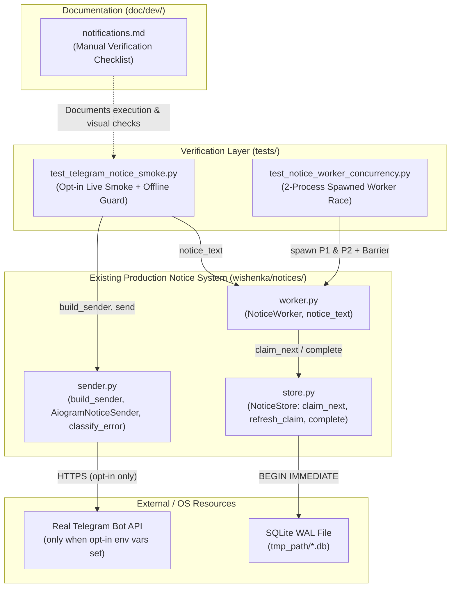

# WISHENKA-156: Opt-in Real Telegram Smoke Test and Multi-Process Notice Worker Race Test

## Research

### Existing Production Notice Path (`wishenka/notices/`)

- **Sender (`wishenka/notices/sender.py`):**
  - `AiogramNoticeSender(token, request_timeout)` wraps `aiogram.Bot(token, session=AiohttpSession(timeout=request_timeout))`.
  - `send(chat_id, text)` calls `await self._bot.send_message(chat_id, text)` without `parse_mode` (plain text) and classifies exceptions via `classify_error(error)` into `SendResult(outcome, retry_after, error_class)` with `SendOutcome` in `{DELIVERED, REJECTED, RETRYABLE, AMBIGUOUS}`.
  - `TelegramForbiddenError`, `TelegramBadRequest`, `TelegramNotFound`, `TelegramEntityTooLarge`, and `TelegramMigrateToChat` map to `SendOutcome.REJECTED`.
  - `build_sender(settings)` returns `None` when `bot_token` is empty, `PLACEHOLDER_TOKEN` (`"dummy_bot_token"`), or fails `aiogram.utils.token.validate_token`.
- **Worker (`wishenka/notices/worker.py`):**
  - `notice_text(wish_title, list_title, locale)` truncates `wish_title` and `list_title` to `TITLE_LIMIT = 100` characters and formats the localized `"notices.gift_received"` template.
  - `NoticeWorker.run_once(now=...)` drains all due rows in a loop: `claim_next(now)` -> `refresh_claim(claim)` -> `_send(refreshed)` -> `_settle(refreshed, result, now)` (plus reminder draining).
- **Queue Store (`wishenka/notices/store.py`):**
  - Every `NoticeStore` method executes inside a `BEGIN IMMEDIATE` transaction via `WishlistStore.transaction(...)` (SQLite WAL with `busy_timeout = 5000`).
  - `claim_next(now)` selects due `pending` or stale `sending` rows from `notification_outbox`, verifies `_eligible(conn, id)` (requiring `users`, active `bot_destinations`, non-deleted `wl_lists`, `wl_items.received_quantity > 0`, and `wl_reservations`), reserves a rate-limit permit via `reserve_permit(conn, chat_id, now, global_limit, chat_interval)`, and atomically marks the row `sending` with a unique `claim_token`.
  - `complete`, `reschedule`, `fail`, and `uncertain` use guarded writes (`WHERE id = :id AND status = 'sending' AND claim_token = :token`) so a stale worker cannot overwrite another worker's claim.

### Existing Concurrency & Opt-In Test Patterns (`tests/`, `pyproject.toml`)

- **Spawned-process race pattern (`tests/test_receipt_concurrency.py`):**
  - Uses `multiprocessing.get_context("spawn")` with `ctx.Barrier(2)`, `ctx.Queue()`, bounded timeouts (`_BARRIER_TIMEOUT = 20`, `_JOIN_TIMEOUT = 25`, `_DRAIN_TIMEOUT = 5`), `finally` process termination/join cleanup, and `pytestmark = pytest.mark.timeout(120)`.
  - Each spawned process initializes its own `WishlistStore(f"sqlite+aiosqlite:///{db}")`, runs `asyncio.run(...)`, and disposes `store.engine` in `finally`.
- **Test runner & static analysis constraints (`pyproject.toml`, `Makefile`):**
  - `addopts = "-v --strict-markers"` — any new pytest marker (if used) must be registered in `pyproject.toml`.
  - `pytest-timeout` is enforced across the suite: every test module must define `pytestmark = pytest.mark.timeout(...)`.
  - `mypy` runs with `strict = true` and `check_untyped_defs = true` on `tests.*`; `ruff` enforces `line-length = 100` and `I`, `B`, `C4`, `UP`, `SIM` rules.

## Implementation Plan

1. **Opt-in Real Telegram Smoke Test (`tests/test_telegram_notice_smoke.py` + `pyproject.toml`):**
   - Register a `telegram_smoke` marker in `pyproject.toml` (`[tool.pytest.ini_options].markers`) so operators can also target or filter it cleanly under `--strict-markers`.
   - Implement `tests/test_telegram_notice_smoke.py` with `pytestmark = [pytest.mark.timeout(60), pytest.mark.telegram_smoke]` and `@pytest.mark.skipif(...)` gated on valid `WISHENKA_TELEGRAM_SMOKE_TOKEN` and integer `WISHENKA_TELEGRAM_SMOKE_CHAT_ID`.
   - Cover:
     - Positive delivery: `build_sender` -> `notice_text` with HTML-like special characters (`<script>`, `&`, `"`, `'`, `>`) and >100-char wish/list titles -> `AiogramNoticeSender.send(chat_id, text)` -> `SendOutcome.DELIVERED`.
     - Negative/rejection check: `AiogramNoticeSender.send(invalid_chat_id, ...)` (defaulting `invalid_chat_id` to `0` or `WISHENKA_TELEGRAM_SMOKE_INVALID_CHAT_ID`, which Telegram rejects with `TelegramBadRequest` without messaging any real user) -> `SendOutcome.REJECTED` with non-empty `error_class`.
     - Always-running offline sanity checks (without `skipif`, or in a separate non-skipped test function in the module) verifying `build_sender` rejects `PLACEHOLDER_TOKEN` and `notice_text` truncation stays well below Telegram's 4096-character limit.
2. **Manual Verification Checklist (`doc/dev/notifications.md`):**
   - Add a **"Live Telegram Smoke Test & Manual Verification Checklist"** section to `doc/dev/notifications.md` (and cross-reference it in Step 8) covering prerequisites, safety rules (explicit test chat only, never commit secrets), automated smoke command, visual/plain-text/truncation/error-handling checks, and cleanup.
3. **Multi-Process Notice-Worker Race Test (`tests/test_notice_worker_concurrency.py`):**
   - Implement `tests/test_notice_worker_concurrency.py` with `pytestmark = pytest.mark.timeout(120)`.
   - Seed a file-backed WAL SQLite DB with `N` pending `notification_outbox` rows across `N` distinct givers (with `users`, active `bot_destinations`, `wl_lists`, `wl_items`, `wl_reservations`, and `record_item_fulfillment` receipts).
   - Spawn two independent OS processes (`multiprocessing.get_context("spawn")`) synchronized on `ctx.Barrier(2)`. Each process opens its own `WishlistStore` and `NoticeStore`, runs `NoticeWorker.run_once(now=...)` with a process-local recording `NoticeSender` (with a small bounded async delay to overlap execution), and reports delivered `(chat_id, text)` pairs and errors via `ctx.Queue()`.
   - Assert clean exit codes, zero unhandled lock/database errors, total deliveries == `N`, zero duplicate deliveries, zero lost notifications, and consistent final `notification_outbox` state (`status = 'sent'`, `claim_token IS NULL`, `claimed_at IS NULL`, `attempts = 1`).
4. **Verification:**
   - Run `make analyze` and `make test` to verify default offline CI runs pass cleanly (with live Telegram tests skipped when unconfigured) and the multi-process worker race test passes deterministically.

**Mandatory — Failing Repro (next Step 3):**
- **Where it lives:** `tests/test_telegram_notice_smoke.py` and `tests/test_notice_worker_concurrency.py`.
- **Behavioral note:** This task adds verification infrastructure (opt-in live smoke test, manual checklist, and multi-process worker race test) rather than modifying production notification logic. Therefore, once the new test files are written in Step 3 against the existing `wishenka.notices` implementation:
  - The tests are expected to **pass** against the current production implementation if no defect exists, **or fail (red)** if a cross-process SQLite locking / claim-race bug or sender contract mismatch is uncovered.
  - Because no production bug is known a priori and no production behavioral change is planned unless a defect is found, Step 3 will author the complete test modules (and verify `test_telegram_notice_smoke.py` skips cleanly without credentials while `test_notice_worker_concurrency.py` executes the 2-process race), establishing the baseline before any fix or Step 4 completion.

## Architecture

### System Module Diagram

### Module Responsibilities

| Module | Responsibility | Dependencies |
| --- | --- | --- |
| `tests/test_telegram_notice_smoke.py` | Reads opt-in env vars (`WISHENKA_TELEGRAM_SMOKE_TOKEN`, `WISHENKA_TELEGRAM_SMOKE_CHAT_ID`, optional `WISHENKA_TELEGRAM_SMOKE_INVALID_CHAT_ID`); skips live tests when unconfigured; exercises `build_sender`, `notice_text`, and `AiogramNoticeSender.send` for positive delivery (special chars + >100-char truncation) and negative rejection (`SendOutcome.REJECTED`). | `wishenka.config.Settings`, `wishenka.notices.sender`, `wishenka.notices.worker.notice_text`, `pytest` |
| `tests/test_notice_worker_concurrency.py` | Seeds a WAL SQLite DB with `N` eligible `notification_outbox` rows; spawns two OS processes synchronized via `Barrier`; runs `NoticeWorker.run_once` concurrently in each process; asserts exact-once delivery across processes and clean final DB state. | `wishenka.notices.store.NoticeStore`, `wishenka.notices.worker.NoticeWorker`, `wishenka.notices.sender`, `wishenka.wishlists.store.WishlistStore`, `wishenka.users.store.UserStore`, `tests.receipt_support` |
| `doc/dev/notifications.md` | Documents the repeatable manual verification checklist for live Telegram smoke testing (prerequisites, safety, execution, visual/escaping/truncation checks, negative check, cleanup). | None (documentation) |
| `pyproject.toml` | Registers the `telegram_smoke` pytest marker under `[tool.pytest.ini_options].markers` to satisfy `--strict-markers`. | `pytest` |

### Interaction Schemes

1. **Opt-In Live Telegram Smoke Flow:**
   - Default CI / `make test`: `WISHENKA_TELEGRAM_SMOKE_TOKEN` / `WISHENKA_TELEGRAM_SMOKE_CHAT_ID` are unset -> live tests in `test_telegram_notice_smoke.py` are skipped by `pytest.mark.skipif`; offline guard tests still run and pass.
   - Operator opt-in run: env vars are set -> `build_sender(Settings(...))` creates `AiogramNoticeSender` -> `send(chat_id, notice_text(...))` sends real message to test chat -> `SendOutcome.DELIVERED`; `send(invalid_chat_id, ...)` -> `SendOutcome.REJECTED`; `await sender.close()` releases aiohttp session.

2. **Multi-Process Notice-Worker Race Flow:**
   - Parent process creates `tmp_path / "notice_race.db"`, initializes `WishlistStore` (Alembic migrations + WAL) and `UserStore` (`users` + `bot_destinations`), creates a wish with `N` distinct givers' reservations, and records a receipt so `N` `pending` rows exist in `notification_outbox`.
   - Parent spawns Process 1 and Process 2 (`spawn` context) sharing `db_path`, `Barrier(2)`, and `Queue()`.
   - Both processes block at `barrier.wait(timeout=20)`, then simultaneously open `WishlistStore` -> `NoticeStore` -> `NoticeWorker(notice_store, RecordingSender(delay=0.01), settings)` and call `await worker.run_once(now=fixed_now)`.
   - `NoticeStore.claim_next` serializes claims across OS processes via SQLite `BEGIN IMMEDIATE` + `claim_token`, while `NoticeWorker._settle` commits `status = 'sent'` with guarded writes.
   - Parent joins both processes, collects all `(chat_id, text)` deliveries from `Queue()`, and verifies: `len(all_deliveries) == N`, `len(set(all_deliveries)) == N`, zero errors, and all `notification_outbox` rows are `status = 'sent'` with `claim_token IS NULL`.

### Architectural Patterns & Justification

- **Environment-Gated Opt-In Testing (`skipif` + dedicated marker):** Keeps `make test` 100% offline, fast, and deterministic while enabling on-demand live verification without modifying production code or risking accidental credential commits.
- **Spawned OS Process Isolation (`multiprocessing.get_context("spawn")`):** Mirrors `tests/test_receipt_concurrency.py` and exercises genuine cross-process SQLite WAL file locking, `busy_timeout`, and `BEGIN IMMEDIATE` serialization that single-process `asyncio.gather` tests cannot cover.
- **Process-Local Recording `NoticeSender`:** Avoids network calls in the concurrency test while introducing a small bounded async delay during `send()` so both processes remain active and overlap on `claim_next` / `complete`.

### Main Interfaces

- **Environment Contract (Test-Only):**
  - `WISHENKA_TELEGRAM_SMOKE_TOKEN: str` — Real Telegram bot token (opt-in; never logged).
  - `WISHENKA_TELEGRAM_SMOKE_CHAT_ID: int` — Explicit target test chat ID (opt-in).
  - `WISHENKA_TELEGRAM_SMOKE_INVALID_CHAT_ID: int = 0` — Optional override for negative rejection check (defaults to `0`).
- **Process Worker Entrypoint (`tests/test_notice_worker_concurrency.py`):**
  - `_worker_process(db_path: str, fixed_now: int, results: Queue[Any], barrier: Barrier) -> None` — Top-level picklable function for `spawn` context; returns `{"pid": int, "delivered": list[tuple[int, str]], "error": str | None}` via `results`.

## Q&A

- **Q1: Why use dedicated `WISHENKA_TELEGRAM_SMOKE_*` env vars instead of `WISHENKA_BOT_TOKEN`?**
  - **A:** `Settings` reads `WISHENKA_BOT_TOKEN` from `.env` or test fixtures. Using dedicated `WISHENKA_TELEGRAM_SMOKE_TOKEN` and `WISHENKA_TELEGRAM_SMOKE_CHAT_ID` prevents accidental live sends when `.env` happens to contain a dev bot token without an explicit smoke-test opt-in.
- **Q2: Why use `N` distinct givers in the multi-process worker race test?**
  - **A:** `NoticeStore.claim_next` enforces `notice_chat_interval_seconds` (minimum `1` second) per `chat_id`. Using distinct givers avoids artificial 1-second rate-limit deferrals so all `N` rows are immediately eligible and both worker processes contend on `claim_next` at full speed within a few seconds.
- **Q3: Does Step 2 require any changes to `wishenka/` production code?**
  - **A:** No. All required interfaces (`build_sender`, `AiogramNoticeSender`, `notice_text`, `NoticeWorker`, `NoticeStore`) already exist in `wishenka/notices/`.
