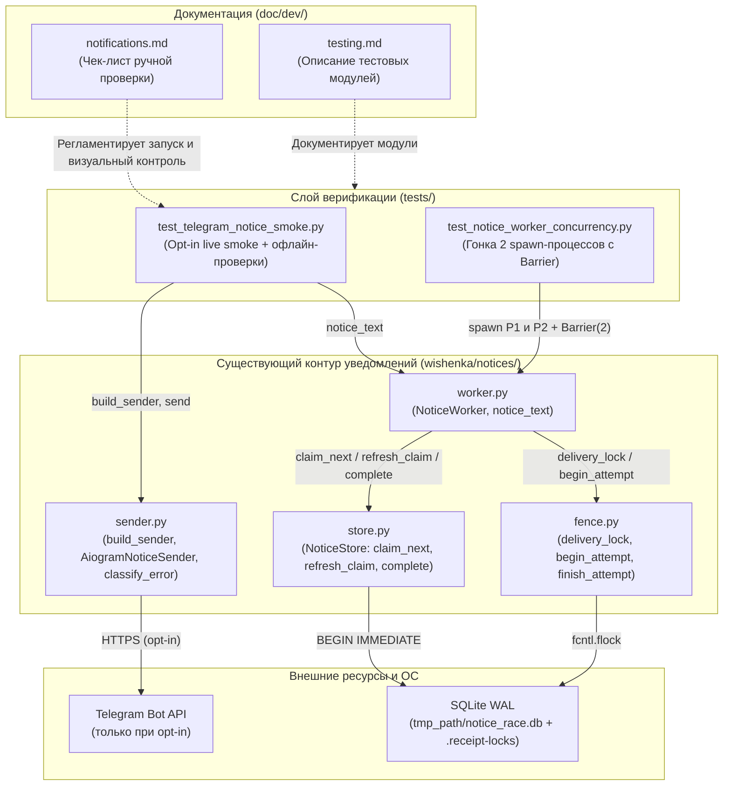

# Спецификация: WISHENKA-156 — Opt-in smoke-тест реальной отправки в Telegram и многопроцессный тест гонки воркера уведомлений

**Задача Jira:** WISHENKA-156  
**Контекст:** follow-up **T2** из `ai-tasks/WISHENKA-23/60-tech-debt.md`  
**Язык реализации:** Python 3.12+  
**Статус:** реализовано и верифицировано (без изменений продакшен-кода `wishenka/`)

## 1. Назначение и бизнес-цель

### Постановка проблемы

После внедрения уведомлений дарителям о получении подарка (`WISHENKA-23`) в системе оставались два пробела тестового и эксплуатационного контроля:

1. **Реальный контур отправки в Telegram не проверялся сквозным образом.** Валидация токена бота, отправка обычным текстом (`plain text` без `parse_mode`), отображение HTML-подобных спецсимволов, ограничение длины заголовков и классификация реальных ошибок Telegram Bot API проверялись только на имитации клиента (`FakeNoticeSender`). Дефекты конфигурации, форматирования или обработки ошибок сети могли оставаться незамеченными до эксплуатации.
2. **Конкурентный захват очереди несколькими процессами ОС не проверялся в реальном параллелизме.** В продакшене несколько процессов приложения могут одновременно обрабатывать общую очередь `notification_outbox` поверх файла БД SQLite WAL. Прежние тесты гонки выполнялись только внутри одного процесса (`asyncio`), не затрагивая межпроцессную сериализацию транзакций и файловых блокировок ОС.

### Цели

1. Обеспечить воспроизводимый opt-in smoke-тест реальной доставки уведомлений через Telegram Bot API и проверки ожидаемого отказа для недопустимого получателя.
2. Зафиксировать повторяемый ручной чек-лист предрелизной проверки для контроля визуального рендеринга сообщений в живом чате Telegram и безопасной очистки тестового окружения.
3. Подтвердить отдельным тестом на независимых процессах ОС, что конкурентный запуск воркеров (`NoticeWorker`) над общей БД SQLite WAL доставляет каждое отложенное уведомление ровно один раз без дублей, потерь и ошибок блокировки.
4. Сохранить стандартный прогон тестов (`make test`) быстрым, полностью офлайн и детерминированным по умолчанию.

### Ценность для пользователей и системы

- **Для дарителей и получателей:** снижение риска пропущенных или дублированных уведомлений о получении подарка, а также искажения текста при передаче произвольных названий желаний и списков.
- **Для разработки, QA и эксплуатации:** наличие безопасного механизма предрелизной живой проверки Telegram-доставки и доказанной межпроцессной корректности очереди без замедления локальных и CI-прогонов.

### Границы охвата (Scope)

- **Входит в охват:**
  - opt-in live smoke-тест и постоянные офлайн-проверки (`tests/test_telegram_notice_smoke.py`);
  - регистрация маркера `telegram_smoke` в `pyproject.toml`;
  - ручной чек-лист проверки живой доставки (`doc/dev/notifications.md`);
  - многопроцессный тест гонки воркера уведомлений (`tests/test_notice_worker_concurrency.py`);
  - описание новых тестовых модулей в `doc/dev/testing.md`.
- **Не входит в охват (Non-Goals):**
  - изменение продакшен-логики уведомлений, шаблонов сообщений или семантики доставки в `wishenka/notices/`;
  - регулярный запуск живых Telegram-тестов в офлайн-CI без явного opt-in;
  - распределённая координация между несколькими хостами;
  - задачи укрепления наблюдаемости (`WISHENKA-157`) и структурного рефакторинга (`WISHENKA-158`).

## 2. Функциональные требования и пользовательские сценарии

### Функциональные требования

#### FR-1. Opt-in smoke-тест реальной отправки в Telegram и офлайн-проверки

Реализован в `tests/test_telegram_notice_smoke.py`:

- Живые smoke-тесты помечены `@pytest.mark.telegram_smoke` и защищены условием `@pytest.mark.skipif(_smoke_credentials() is None, reason=_SKIP_REASON)`. Если не заданы обе переменные окружения (`WISHENKA_TELEGRAM_SMOKE_TOKEN` и целочисленный `WISHENKA_TELEGRAM_SMOKE_CHAT_ID`) либо передан `PLACEHOLDER_TOKEN` (`"dummy_bot_token"`), живые тесты автоматически пропускаются.
- **Позитивная проверка (`test_telegram_smoke_delivers_plain_text_with_special_chars_and_truncation`):** формирует текст через `notice_text(wish_title, list_title, locale="ru")` с HTML-подобными спецсимволами (`<script>`, `&`, `"`, `'`, `>`) и заголовками длиннее `100` символов, проверяет соблюдение лимита Telegram (`<= 4096` символов), отправляет реальное сообщение через `AiogramNoticeSender.send(chat_id, text)` и ожидает `SendResult(outcome=SendOutcome.DELIVERED)`.
- **Негативная проверка (`test_telegram_smoke_rejects_invalid_chat`):** отправляет сообщение `"Wishenka smoke negative check"` в заведомо некорректный/недостижимый чат `_invalid_chat_id()` (`WISHENKA_TELEGRAM_SMOKE_INVALID_CHAT_ID`, по умолчанию `0`) и ожидает `SendOutcome.REJECTED` с непустым `error_class` без отправки сообщений реальным пользователям.
- **Постоянные офлайн-проверки (выполняются в каждом прогоне `make test` без учётных данных):**
  - `test_build_sender_rejects_placeholder_and_invalid_tokens` проверяет, что `build_sender` возвращает `None` для пустой строки, `PLACEHOLDER_TOKEN` и синтаксически невалидного токена;
  - `test_notice_text_truncates_titles_and_preserves_plain_text` проверяет усечение обоих названий ровно по границе `TITLE_LIMIT = 100`, сохранение спецсимволов `<script>&"'>` без экранирования и укладывание результата в `_TELEGRAM_MESSAGE_LIMIT = 4096`.

#### FR-2. Ручной чек-лист верификации

Оформлен в разделе `Live Telegram Smoke Test & Manual Verification Checklist` документа `doc/dev/notifications.md` и охватывает:

- пререквизиты (выделенный тестовый токен бота, тестовый чат после `/start`, опциональный `WISHENKA_TELEGRAM_SMOKE_INVALID_CHAT_ID`, `.venv/bin/pytest`);
- правила безопасности (только явный тестовый чат, запрет хранения секретов в Git, сохранение офлайн-поведения по умолчанию);
- команды запуска автоматического smoke-прогона (`.venv/bin/pytest -m telegram_smoke`);
- пункты ручного инспектирования в клиенте Telegram (появление одного сообщения, буквальное отображение `<script>`, `&`, `"`, `'`, `>` как plain text, усечение заголовков до `100` символов, прохождение негативного теста);
- шаги очистки (`unset` переменных окружения и при необходимости удаление тестового сообщения).

#### FR-3. Многопроцессный тест гонки воркера уведомлений

Реализован в `tests/test_notice_worker_concurrency.py` (`test_two_spawned_worker_processes_claim_and_deliver_once`):

- Инициализирует временную файловую БД SQLite WAL (`tmp_path / "notice_race.db"`), применяет миграции и создаёт `_GIVER_COUNT = 10` различных дарителей (`_BASE_GIVER_ID = 2001..2010`) с активными строками `bot_destinations`, бронированиями по `1` единице и последующим вызовом `record_item_fulfillment(..., 1)`. Это порождает `10` отложенных строк `notification_outbox` со статусом `pending`.
- Порождает `2` независимых дочерних процесса ОС через `multiprocessing.get_context("spawn")`, синхронизирует их одновременный старт барьером `ctx.Barrier(2)` и запускает в каждом свой цикл `asyncio.run(_drain_in_process(...))` поверх собственных экземпляров `WishlistStore`, `NoticeStore` и `NoticeWorker` с `FakeNoticeSender(sleep=0.01)` и фиксированным временем `_FIXED_NOW = 2_000_000_000`.
- Проверяет: отсутствие живых/зависших процессов после ожидания, нулевые коды выхода (`exitcode == 0`), отсутствие ошибок в результатах дочерних процессов, ровно `10` доставок суммарно по обоим процессам, `10` уникальных пар `(chat_id, text)`, полное покрытие множества `giver_ids` и переход всех `10` строк `notification_outbox` в состояние `status = 'sent'`, `claim_token = None`, `claimed_at = None`, `attempts = 1`.

### Пользовательские сценарии

1. **Автоматический офлайн-прогон (разработчик / CI):** при запуске `make test` без переменных `WISHENKA_TELEGRAM_SMOKE_*` обе офлайн-проверки в `tests/test_telegram_notice_smoke.py` и многопроцессный тест в `tests/test_notice_worker_concurrency.py` проходят без доступа к сети, а два живых smoke-теста пропускаются с понятным пояснением.
2. **Предрелизная проверка реальной доставки (разработчик / QA-инженер):** экспортирует `WISHENKA_TELEGRAM_SMOKE_TOKEN` и `WISHENKA_TELEGRAM_SMOKE_CHAT_ID`, выполняет `.venv/bin/pytest -m telegram_smoke`, визуально сверяет сообщение в тестовом чате с чек-листом из `doc/dev/notifications.md` и удаляет переменные окружения из сессии.
3. **Проверка конкурентной безопасности очереди (разработчик / оператор):** после изменений в конфигурации SQLite, блокировках или воркере запускает `.venv/bin/pytest tests/test_notice_worker_concurrency.py` и убеждается в отсутствии гонок и блокировок между процессами ОС.

### Входы, выходы и инварианты

| Контур | Входные данные | Ожидаемый результат |
| --- | --- | --- |
| Live smoke (позитивный) | `WISHENKA_TELEGRAM_SMOKE_TOKEN`, `WISHENKA_TELEGRAM_SMOKE_CHAT_ID`, заголовки `>100` символов со спецсимволами | `SendResult(outcome=SendOutcome.DELIVERED)`, длина сообщения `<= 4096` |
| Live smoke (негативный) | `WISHENKA_TELEGRAM_SMOKE_TOKEN`, `WISHENKA_TELEGRAM_SMOKE_INVALID_CHAT_ID` (по умолчанию `0`) | `SendOutcome.REJECTED`, непустой `error_class` |
| Офлайн-проверки | Токены `""`, `PLACEHOLDER_TOKEN`, `"not-a-valid-token"`; строки с длиной `> TITLE_LIMIT` | `build_sender` возвращает `None`; `notice_text` усекает заголовки до `100` символов без экранирования |
| Многопроцессная гонка | Файловая WAL БД с `10` строками `pending`, `2` `spawn`-процесса, `FakeNoticeSender(sleep=0.01)` | `10` уникальных доставок, `0` дублей, `0` потерь, `10` строк `sent` с `attempts = 1` |

**Ключевые инварианты:**

- **Однократность доставки при конкуренции (Exact-Once):** при отсутствии сетевых сбоев каждая из `N` допустимых строк `notification_outbox` захватывается, доставляется и закрывается ровно одним процессом.
- **Изоляция живых вызовов:** живые запросы к Telegram Bot API невозможны без явной одновременной передачи валидного `WISHENKA_TELEGRAM_SMOKE_TOKEN` и целочисленного `WISHENKA_TELEGRAM_SMOKE_CHAT_ID`.
- **Plain-text контракт:** уведомления передаются без `parse_mode`, спецсимволы не экранируются и не удаляются, оба заголовка ограничиваются `TITLE_LIMIT = 100`.
- **Ограниченное время выполнения и уборка ресурсов:** все тесты имеют явные таймауты (`pytest.mark.timeout`), а процессы, HTTP-сессии `aiohttp` и движки SQLAlchemy гарантированно закрываются в `finally`.

## 3. Архитектура, компоненты и интерфейсы

### Схема взаимодействия компонентов

### Модули и ответственность

| Модуль / Файл | Назначение | Основные зависимости |
| --- | --- | --- |
| `tests/test_telegram_notice_smoke.py` | Чтение и валидация `WISHENKA_TELEGRAM_SMOKE_*`, пропуск live-тестов без opt-in, позитивный и негативный live-тесты, две постоянные офлайн-проверки | `wishenka.config.Settings`, `wishenka.notices.sender`, `wishenka.notices.worker` (`TITLE_LIMIT`, `notice_text`), `pytest` |
| `tests/test_notice_worker_concurrency.py` | Сидирование WAL-БД с `10` дарителями, запуск 2 `spawn`-процессов с `Barrier(2)` и `Queue`, проверка итоговых доставок и таблицы `notification_outbox` | `wishenka.notices.store.NoticeStore`, `wishenka.notices.worker.NoticeWorker`, `wishenka.wishlists.store.WishlistStore`, `wishenka.users.store.UserStore`, `tests.notice_support.FakeNoticeSender`, `tests.receipt_support` |
| `pyproject.toml` | Регистрация маркера `telegram_smoke` в `[tool.pytest.ini_options].markers` под `--strict-markers` | `pytest` |
| `doc/dev/notifications.md` | Раздел ручного чек-листа проверки живой отправки, безопасности и очистки окружения | — |
| `doc/dev/testing.md` | Документация контрактов, параметров и команд запуска новых тестов (`WISHENKA-156`) | — |
| `wishenka/notices/sender.py` *(без изменений)* | `AiogramNoticeSender`, `build_sender`, `classify_error`, `SendOutcome`, `SendResult`, `PLACEHOLDER_TOKEN` | `aiogram`, `wishenka.config.Settings` |
| `wishenka/notices/worker.py` *(без изменений)* | `NoticeWorker.run_once`, `_send`, `_settle`, `notice_text`, `TITLE_LIMIT = 100` | `wishenka.notices.store`, `wishenka.notices.fence`, `wishenka.notices.sender` |
| `wishenka/notices/store.py` *(без изменений)* | Транзакции `BEGIN IMMEDIATE` через `WishlistStore`, `claim_next`, `refresh_claim`, `complete`, `reschedule`, `fail`, `uncertain` | `wishenka.wishlists.store.WishlistStore`, `wishenka.notices.rate` |

### Контракты данных и интерфейсов

#### Контракт переменных окружения (только для тестов)

- `WISHENKA_TELEGRAM_SMOKE_TOKEN: str` — токен тестового Telegram-бота; пустое значение или `PLACEHOLDER_TOKEN` (`"dummy_bot_token"`) приводят к возврату `None` из `_smoke_credentials()`.
- `WISHENKA_TELEGRAM_SMOKE_CHAT_ID: int` — идентификатор тестового чата; парсится функцией `_parse_int_env`, нецелочисленное или пустое значение отключает live-тесты.
- `WISHENKA_TELEGRAM_SMOKE_INVALID_CHAT_ID: int` — опциональный идентификатор чата для негативной проверки; если не задан или невалиден, `_invalid_chat_id()` возвращает `0`.

#### Внутренние интерфейсы тестовых модулей

- В `tests/test_telegram_notice_smoke.py`:
  - `_parse_int_env(name: str) -> int | None`
  - `_smoke_credentials() -> tuple[str, int] | None`
  - `_invalid_chat_id() -> int`
- В `tests/test_notice_worker_concurrency.py`:
  - `async def _seed_pending_notices(db: Path, giver_ids: list[int]) -> None`
  - `async def _drain_in_process(db_path: str, fixed_now: int) -> dict[str, Any]`
  - `def _worker_process(db_path: str, fixed_now: int, results: Any, barrier: Any) -> None` — сериализуемая (picklable) точка входа верхнего уровня для контекста `spawn`; помещает в `results` словарь вида `{"pid": int, "delivered": list[tuple[int, str]], "processed": int, "error": str | None}`.

### Потоки взаимодействия и переходы состояний

#### 1. Классификация исхода отправки в `AiogramNoticeSender` (`wishenka/notices/sender.py`)

- Успешный `await self._bot.send_message(chat_id, text)` -> `SendResult(SendOutcome.DELIVERED)`.
- Исключения `_REJECTED` (`TelegramForbiddenError`, `TelegramBadRequest`, `TelegramNotFound`, `TelegramEntityTooLarge`, `TelegramMigrateToChat`) -> `SendResult(SendOutcome.REJECTED, error_class=...)` (повторная отправка не выполняется).
- `TelegramRetryAfter` -> `SendResult(SendOutcome.RETRYABLE, retry_after=float(error.retry_after), error_class=...)`; `TelegramUnauthorizedError` -> `SendResult(SendOutcome.RETRYABLE, error_class=...)`.
- Любые прочие исключения (сетевые ошибки, 5xx, таймаут) -> `SendResult(SendOutcome.AMBIGUOUS, error_class=...)`.

#### 2. Конкурентный цикл строки `notification_outbox` в многопроцессном тесте

1. **Начальное состояние:** после `WishlistService.record_item_fulfillment` в `notification_outbox` создаются `10` строк со статусом `pending`, `attempts = 0`, `claim_token = NULL`, `claimed_at = NULL`.
2. **Одновременный старт:** два дочерних `spawn`-процесса синхронизируются на `barrier.wait(timeout=_BARRIER_TIMEOUT)` и параллельно вызывают `NoticeWorker.run_once(now=_FIXED_NOW)`.
3. **Захват (`pending -> sending`):** `NoticeStore.claim_next` в транзакции `BEGIN IMMEDIATE` (с `PRAGMA busy_timeout=5000`) отбирает очередную доступную строку, проверяет `_eligible`, резервирует разрешение скорости (`reserve_permit`) и атомарно переводит строку в `sending` с уникальным `claim_token`, `claimed_at = now` и инкрементом `attempts`.
4. **Межпроцессная защита и отправка:** внутри `NoticeWorker.run_once` процесс берёт файловую блокировку `delivery_lock` (`fcntl.flock`), перепроверяет владение и актуальность в `NoticeStore.refresh_claim`, регистрирует попытку (`begin_attempt`) и выполняет `await sender.send(...)` (`FakeNoticeSender(sleep=0.01)`) вне транзакции БД, обеспечивая перекрытие работы обоих процессов во времени.
5. **Завершение (`sending -> sent`):** `NoticeStore.complete` выполняет защищённое обновление `WHERE id = :id AND status = 'sending' AND claim_token = :token`, устанавливает `status = 'sent'`, сбрасывает `claim_token = NULL` и `claimed_at = NULL`, удаляет запись из `receipt_delivery_fence`, после чего вызывается `finish_attempt`.

**Обоснование выбора `10` различных дарителей (`_BASE_GIVER_ID = 2001..2010`):** `NoticeStore.claim_next` применяет `notice_chat_interval_seconds` (минимум `1` секунда на один `chat_id`). Использование разных дарителей исключает откладывание строк на `+1` секунду и заставляет оба процесса непрерывно конкурировать за все `10` уведомлений.

## 4. Нефункциональные требования, безопасность и наблюдаемость

### Производительность, лимиты и ограничения ресурсов

- **Таймауты тестов (обязательное требование `pytest-timeout`):**
  - `tests/test_telegram_notice_smoke.py`: `pytestmark = pytest.mark.timeout(60)`, таймаут сетевого запроса клиента `receipt_notice_request_timeout_seconds = 15.0`.
  - `tests/test_notice_worker_concurrency.py`: `pytestmark = pytest.mark.timeout(120)`, константы `_BARRIER_TIMEOUT = 10`, `_JOIN_TIMEOUT = 15`, `_DRAIN_TIMEOUT = 5`, аварийное завершение живых процессов в `finally` (`proc.terminate()` + `proc.join(timeout=5)`).
- **Наблюдаемое время выполнения:** изолированный запуск `tests/test_notice_worker_concurrency.py` занимает `39.43` с (в основном за счёт прогона миграций Alembic при создании БД и старта двух процессов `spawn`). При параллельной нагрузке на CPU (например, `pytest-xdist` или фоновый `make analyze`) запас `_JOIN_TIMEOUT = 15` с оказался тесным и приводил к таймауту дочернего процесса на шаге проверки чистоты кода (см. Раздел 5).
- **Лимиты сообщений:** `TITLE_LIMIT = 100` символов на каждое название, суммарный размер сообщения контролируется в пределах `_TELEGRAM_MESSAGE_LIMIT = 4096`.
- **Качество кода и статический анализ (`pyproject.toml`):** длина строки не более `100` символов (`ruff`), строгая типизация (`mypy` со `strict = true` и `check_untyped_defs = true` для `tests.*`).

### Безопасность и приватность

- **Изоляция live-учётных данных:** вместо `WISHENKA_BOT_TOKEN` используются отдельные переменные `WISHENKA_TELEGRAM_SMOKE_TOKEN` и `WISHENKA_TELEGRAM_SMOKE_CHAT_ID`, поэтому локальный `.env` с токеном разработки никогда не запускает отправку в Telegram автоматически.
- **Запрет placeholder-токенов и утечки секретов:** `build_sender` отклоняет пустой токен, `PLACEHOLDER_TOKEN` и невалидный формат без логирования значения токена; чек-лист запрещает сохранять учётные данные в Git, `.env` или фикстурах и предписывает очищать переменные командой `unset`.
- **Исключение спама реальным пользователям:** позитивный тест отправляет сообщение только в явно заданный тестовый чат; негативный тест использует невалидный `chat_id` (`0` по умолчанию), который отвергается Telegram API без доставки кому-либо.
- **Освобождение ресурсов:** оба live-теста закрывают `AiogramNoticeSender` в блоке `try/finally`, а тест гонки освобождает движки `UserStore` и `WishlistStore` в `finally`.

### Наблюдаемость: структурированное логирование и метрики

Согласно `ai-tasks/WISHENKA-156/50-observability.md`, изменения продакшен-логирования и метрик **не применимы (N/A)** в рамках `WISHENKA-156`, так как продакшен-код под `wishenka/` не добавлялся и не изменялся.

- Существующие события логирования `wishenka.wishlists.notices`, `wishenka.notices.store` и `wishenka.notices.fence` (включая `receipt_notice_sent`, `receipt_notice_window_summary`, `notice_locale_resolved`) сохранены без модификации.
- Продакшен-метрики (Prometheus, Grafana, правила алертинга, агрегация логов) в задаче не добавлялись.
- Тестовая диагностика ограничена утверждениями `pytest`, именем класса ошибки `SendResult.error_class` (без текста исключения и секретов) и полем `"error"` в словаре результата дочернего процесса, передаваемом через `ctx.Queue`.
- Задачи по укреплению контрактов логирования и наблюдаемости уведомлений выделены в отдельную задачу **WISHENKA-157**.

## 5. Верификация и критерии приёмки

### Сценарии тестирования

| Модуль и тест | Режим | Проверяемое поведение и утверждения |
| --- | --- | --- |
| `tests/test_telegram_notice_smoke.py::test_telegram_smoke_delivers_plain_text_with_special_chars_and_truncation` | Opt-in (`telegram_smoke`) | Доставка уведомления (`locale="ru"`) со спецсимволами `<script> & "quotes" 'apos' >` и заголовками `>100` символов; длина `<= 4096`; результат `SendResult(outcome=SendOutcome.DELIVERED)` |
| `tests/test_telegram_notice_smoke.py::test_telegram_smoke_rejects_invalid_chat` | Opt-in (`telegram_smoke`) | Отправка в `_invalid_chat_id()` (`0` или `WISHENKA_TELEGRAM_SMOKE_INVALID_CHAT_ID`); ожидание `SendOutcome.REJECTED` и непустого `error_class` |
| `tests/test_telegram_notice_smoke.py::test_build_sender_rejects_placeholder_and_invalid_tokens` | Всегда (офлайн) | `build_sender` возвращает `None` для `""`, `PLACEHOLDER_TOKEN` и `"not-a-valid-token"` |
| `tests/test_telegram_notice_smoke.py::test_notice_text_truncates_titles_and_preserves_plain_text` | Всегда (офлайн) | Заголовки обрезаются до `TITLE_LIMIT = 100`, спецсимволы `<script>&"'>` остаются в открытом тексте, длина `< 4096` |
| `tests/test_notice_worker_concurrency.py::test_two_spawned_worker_processes_claim_and_deliver_once` | Всегда (офлайн) | 2 `spawn`-процесса над WAL БД с 10 строками `pending` завершаются с `exitcode == 0`, без ошибок, с 10 уникальными доставками по всем `giver_ids` и статусом `sent` (`claim_token=None`, `claimed_at=None`, `attempts=1`) |

#### Наблюдаемые результаты прогонов (по артефактам задачи)

- Целевой прогон (Шаг 4, `00-roadmap.md`): `.venv/bin/pytest tests/test_telegram_notice_smoke.py tests/test_notice_worker_concurrency.py tests/test_receipt_notices.py tests/test_notice_operator.py` — **37 passed, 2 skipped**.
- Изолированные прогоны (Шаг 5, `40-code-cleanup.md`):
  - `tests/test_notice_worker_concurrency.py` — **1 passed** за `39.43s`;
  - `tests/test_telegram_notice_smoke.py` — **2 passed, 2 skipped** (без live-переменных окружения).
- Статический анализ (`make analyze`): `ruff check wishenka tests` — без ошибок; `ruff format --check wishenka tests` — 225 файлов отформатированы; `mypy wishenka tests` — 0 ошибок в 225 файлах.
- Наблюдение на Шаге 5: при одновременном запуске тестов и фонового `make analyze` зафиксирован единичный отказ `test_two_spawned_worker_processes_claim_and_deliver_once` по `assert not proc.is_alive()` из-за таймаута `_JOIN_TIMEOUT = 15` (`SpawnProcess-1`); последующий изолированный прогон завершился успешно за `39.43s`.

### Критерии приёмки

- [x] Реализован opt-in smoke-тест реальной отправки в Telegram (`tests/test_telegram_notice_smoke.py`) с маркером `telegram_smoke` в `pyproject.toml`, автоматически пропускаемый в офлайн-запусках.
- [x] Реализованы постоянные офлайн-проверки `build_sender` и `notice_text` без необходимости сетевого доступа и секретов.
- [x] Задокументирован повторяемый ручной чек-лист живой проверки в `doc/dev/notifications.md` и описаны тестовые модули в `doc/dev/testing.md`.
- [x] Реализован многопроцессный тест гонки (`tests/test_notice_worker_concurrency.py`), подтверждающий отсутствие дублей, потерь и ошибок блокировки SQLite WAL при одновременной работе двух процессов ОС.
- [x] Статический анализ (`ruff check`, `ruff format --check`, `mypy`) и целевой набор тестов уведомлений выполнены без регрессий; продакшен-код `wishenka/` не изменён.
- [ ] Живой предрелизный прогон (`.venv/bin/pytest -m telegram_smoke`) с тестовыми учётными данными и прохождение ручного чек-листа в Telegram выполняются оператором вручную перед релизом.

### Известные ограничения и последующие задачи (`60-tech-debt.md`)

#### Известные ограничения

- **Только happy-path в многопроцессном тесте:** `tests/test_notice_worker_concurrency.py` проверяет конкуренцию `claim_next -> refresh_claim -> complete` для `10` разных дарителей (`FakeNoticeSender(sleep=0.01)`), но не охватывает межпроцессную гонку для `reschedule`, `fail`, `uncertain` (`AMBIGUOUS` / `RETRYABLE`) и перехвата истекших блокировок (`reclaim_after`).
- **Невыполненный live-прогон в офлайн-среде:** оба теста `@pytest.mark.telegram_smoke` не запускались против реального Telegram Bot API в офлайн-окружении разработки; позитивный smoke-тест также жёстко фиксирует `locale="ru"` без параметризации по `"en"`.
- **Малый запас таймаута дочерних процессов:** `_BARRIER_TIMEOUT = 10` и `_JOIN_TIMEOUT = 15` в `tests/test_notice_worker_concurrency.py` существенно строже, чем в родственном тесте `tests/test_receipt_concurrency.py` (`_BARRIER_TIMEOUT = 20`, `_JOIN_TIMEOUT = 25`), что создаёт риск таймаута при высокой параллельной нагрузке `pytest-xdist`.
- **Повтор кода инициализации отправителя:** в обоих live smoke-тестах дублируется цепочка `_smoke_credentials()` -> `Settings(...)` -> `build_sender(...)` -> `try/finally: await sender.close()`.

#### Последующие задачи (Follow-ups)

- **T1 (`NON-BLOCKER` — Надёжность тестов):** увеличить `_JOIN_TIMEOUT` (до `25`–`30` с) и `_BARRIER_TIMEOUT` (до `20` с) в `tests/test_notice_worker_concurrency.py` по аналогии с `tests/test_receipt_concurrency.py` для исключения флаков при параллельном запуске `pytest-xdist`. — Jira: [WISHENKA-244](https://pypost.atlassian.net/browse/WISHENKA-244).
- **T2 (`NON-BLOCKER` — Поддерживаемость тестов):** вынести настройку и закрытие `AiogramNoticeSender` (`Settings` + `build_sender` + `await sender.close()`) в общий async context-manager в `tests/test_telegram_notice_smoke.py`. — Jira: [WISHENKA-243](https://pypost.atlassian.net/browse/WISHENKA-243).
- **T3 (`NON-BLOCKER` — Предрелизная проверка):** перед релизом выполнить `.venv/bin/pytest -m telegram_smoke` с тестовыми `WISHENKA_TELEGRAM_SMOKE_TOKEN` и `WISHENKA_TELEGRAM_SMOKE_CHAT_ID` и пройти все пункты чек-листа в `doc/dev/notifications.md`.
