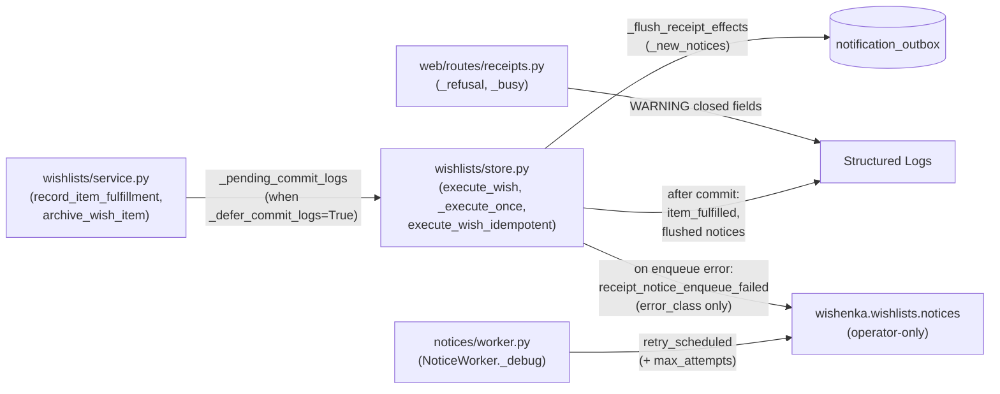

# WISHENKA-157: Hardening Gift-Receipt Notification Tests and Log Contracts

## Research

Codebase inspection of the current repository state (including post-WISHENKA-23 evolutions from WISHENKA-60 and WISHENKA-181) established the exact baseline for all nine items of WISHENKA-23 T3:

1. **Closed-field log assertions (`tests/test_receipt_observability.py`)**:
   - Lines 271 and 282 currently assert blacklist checks (`assert not set(extras) & {"quantity", "outbox_id", ...}`) for `receipt_refused` and `receipt_inventory_busy` emitted by `wishenka/web/routes/receipts.py` (`_refusal`, `_busy`).
   - Any unexpected new field added to those records would pass unnoticed.
2. **Wall-clock sleep in worker failure-streak test (`tests/test_receipt_notices_extra.py`)**:
   - `test_run_loop_logs_one_error_per_failure_streak` (lines 170–198) runs `NoticeWorker.run(stop)` with `receipt_notice_poll_interval_seconds=0.05`, sleeps `await asyncio.sleep(0.6)`, then sets `stop` and asserts `2 <= broken.calls < 12`.
   - `NoticeWorker.run` (`wishenka/notices/worker.py:110`) awaits `asyncio.wait_for(stop.wait(), timeout=delay)` where `delay = self._error_delay(failures)` (`min(self._poll * 2 ** min(failures, 16), MAX_ERROR_BACKOFF_SECONDS)`).
3. **Missing `max_attempts` on `receipt_notice_retry_scheduled` (`wishenka/notices/worker.py`)**:
   - `NoticeWorker._debug` (lines 297–311) logs `event`, `outbox_id`, `attempt`, and optionally `error_class`, omitting `max_attempts` (`self._max_attempts`).
   - `tests/test_receipt_observability.py:43` already includes `"max_attempts"` in `_PER_ROW_KEYS` (forbidden at `INFO`+ on `wishenka.wishlists.notices`).
   - `NoticeStore.claim_next` (`wishenka/notices/store.py:413`) now settles stale `sending` rows as `receipt_notice_uncertain` (not `receipt_notice_retry_scheduled`), so `NoticeWorker._settle` / `_debug` is the sole emitter of `receipt_notice_retry_scheduled`.
4. **Notice-enqueue failure diagnosability (`wishenka/wishlists/store.py`)**:
   - `WishlistStore._flush_receipt_effects` (lines 952–1009) inserts `notice_receipt_keys` and `notification_outbox` rows inside the receipt transaction.
   - Any failure propagates to `execute_wish` / `execute_wish_idempotent` / `_execute_once`, rolling back the receipt and logging only generic `wishlist_inventory_rolled_back` / storage error. Operators cannot distinguish an outbox enqueue failure from a `wl_receipts` / `wl_items` failure.
   - Conversely, emitting any owner-facing or `wishlist_id`/`item_id`-bearing signal would violate the no-presence-leak invariant (NFR-2).
5. **`last_error_class` and `ambiguous` semantics (`wishenka/notices/store.py`, `wishenka/notices/operator.py`, `doc/dev/notifications.md`)**:
   - `NoticeStore._settle` (`store.py:250–251`) sets `ambiguous = CASE WHEN :ambiguous THEN 1 ELSE ambiguous END` and `last_error_class = :error`. `NoticeStore.complete` passes `error_class=None`, clearing `last_error_class` to `NULL` on `sent`.
   - `operator.resolve(..., action="retry")` (`operator.py:67`) clears `ambiguous = 0` when resetting an `uncertain` row on `notification_outbox` to `pending`; `action="fail"` leaves `ambiguous = 1` on `failed`.
   - Consequently: `last_error_class` is a **current-state** attribute (not a historical failure counter), and `ambiguous = 1` includes both currently `uncertain` rows and historically ambiguous `failed`/`sent` rows unless filtered by `status`.
6. **`item_archived` `active_reservations_count` (`wishenka/wishlists/service.py`)**:
   - `WishlistService.archive_wish_item` (`service.py:1774–1788`) emits `item_archived` (`INFO`, `wishenka.wishlists`) with `"active_reservations_count"` on the owner stream, exposing reservation presence.
   - `tests/test_wish_items_crud_api.py:992` explicitly asserts `getattr(rec_arch, "active_reservations_count", None) == 0`.
7. **`item_fulfilled` pre-commit logging (`wishenka/wishlists/service.py`, `wishenka/wishlists/store.py`)**:
   - `WishlistService.record_item_fulfillment` (`service.py:2568–2584`) logs `item_fulfilled` (`INFO`, `wishenka.wishlists`) before `WishlistStore` commits the transaction. If `_flush_receipt_effects` or `conn.commit()` fails, `item_fulfilled` remains in logs for a rolled-back receipt.
   - `tests/test_reservation_observability.py:233–271` calls `WishlistService.in_memory().record_item_fulfillment(...)` directly without `WishlistStore` and asserts `item_fulfilled` is emitted.
   - `WishlistStore` already buffers and flushes post-commit logs (`_log_flushed_notices`, `_log_flushed_shared_events`) after `self._immediate(work)` commits in `execute_wish`, `execute_wish_idempotent`, and `_execute_once`.
8. **Worker-stop wording (`doc/dev/gift-receipt.md`, `doc/dev/notifications.md`, `tests/test_receipt_notices.py`)**:
   - `doc/dev/gift-receipt.md:854–856` already states that stopping writes `receipt_notice_worker_stopped` without summary counts.
   - `doc/dev/notifications.md` observability table (lines 460–478) does not list `receipt_notice_worker_started`, `receipt_notice_worker_stopped`, `receipt_notice_worker_disabled`, or `receipt_notice_retry_scheduled` (`max_attempts`), and no dedicated test explicitly asserts that stopping a worker with unprocessed window counts emits `receipt_notice_worker_stopped` without `receipt_notice_window_summary`.
9. **Direct CC-13 coverage (`tests/test_receipt_concurrency.py`, `tests/test_gift_receipt_api.py`)**:
   - `test_receipt_route_busy_503` checks `status_code == 503` when `InventoryBusyError` is raised, but does not directly verify that the 503 response body, headers, and logs are bounded and identical whether the wish has 0 or N active reservations (no presence/promise/giver leak under busy contention).

## Implementation Plan

1. **Harden `NoticeWorker` retry logging & failure-streak testability**:
   - Include `"max_attempts": self._max_attempts` in `receipt_notice_retry_scheduled` (`wishenka/notices/worker.py`).
   - Replace `asyncio.sleep(0.6)` in `tests/test_receipt_notices_extra.py::test_run_loop_logs_one_error_per_failure_streak` with deterministic interception of `wishenka.notices.worker.asyncio.wait_for` that records backoff timeouts and sets `stop` after N failure ticks.
2. **Add operator-only enqueue-failure diagnostic log**:
   - In `WishlistStore._flush_receipt_effects` (`wishenka/wishlists/store.py`), wrap the `_new_notices` enqueue loop in `try/except Exception as exc` that logs `receipt_notice_enqueue_failed` (`ERROR`, logger `wishenka.wishlists.notices`, `extra={"event": "receipt_notice_enqueue_failed", "error_class": type(exc).__name__}`) and re-raises so the transaction still rolls back atomically.
3. **Remove `active_reservations_count` from `item_archived`**:
   - Remove `"active_reservations_count"` from `item_archived` `extra` in `WishlistService.archive_wish_item` (`wishenka/wishlists/service.py`).
   - Update `tests/test_wish_items_crud_api.py` to assert `"active_reservations_count"` is absent from `item_archived`.
4. **Defer `item_fulfilled` logging until transaction commit**:
   - Add `_defer_commit_logs: bool = False` and `_pending_commit_logs: list[PendingCommitLog]` to `WishlistService`.
   - Set `service._defer_commit_logs = True` in `WishlistStore` hydration (`_load_wish`, `_load_service` / `_hydrate_service`) and flush `_pending_commit_logs` after `self._immediate(work)` commits in `execute_wish`, `execute_wish_idempotent`, and `_execute_once`.
   - Standalone `WishlistService.in_memory()` keeps `_defer_commit_logs = False`, emitting `item_fulfilled` immediately for isolated unit tests.
5. **Tighten observability tests & add direct CC-13 and worker-stop tests**:
   - Update `tests/test_receipt_observability.py` to assert exact key-set equality for `receipt_refused` and `receipt_inventory_busy`, verify `max_attempts` on `receipt_notice_retry_scheduled`, verify `receipt_notice_enqueue_failed` on enqueue failure, verify `item_fulfilled` is NOT logged on rollback, and verify `receipt_notice_worker_stopped` emits `INFO` without summary counts.
   - Add a direct CC-13 test in `tests/test_receipt_concurrency.py` verifying bounded 503 busy response and identical no-leak output/logs with 0 vs. active reservations.
6. **Update documentation**:
   - Align `doc/dev/notifications.md` and `doc/dev/gift-receipt.md` with `max_attempts` on `receipt_notice_retry_scheduled`, `receipt_notice_enqueue_failed` (operator-only `ERROR`, `error_class` only), `last_error_class` / `ambiguous` SQL gauge semantics, `receipt_notice_worker_stopped` wording, and `item_fulfilled` post-commit guarantee.

**Mandatory — Failing Repro (next Step 3):**
Write automated red tests *before* any production edit (all modules must declare `pytestmark = pytest.mark.timeout(...)` per `do-testing` / `lsr-python`):
- **Where**: `tests/test_receipt_observability.py` and `tests/test_receipt_concurrency.py`.
- **What they assert (desired behavior)**:
  1. `receipt_notice_retry_scheduled` DEBUG record includes `"max_attempts"` equal to `settings.receipt_notice_max_attempts` (fails today because `max_attempts` is omitted).
  2. `item_archived` INFO record does NOT contain `"active_reservations_count"` (fails today because `service.py:1784` emits it).
  3. When `_flush_receipt_effects` fails during notice enqueueing (`_new_notices` insert raises `RuntimeError` or `OperationalError`), `item_fulfilled` is NOT emitted on `wishenka.wishlists`, and `receipt_notice_enqueue_failed` IS emitted at `ERROR` on `wishenka.wishlists.notices` with `extra == {"event": "receipt_notice_enqueue_failed", "error_class": ...}` and no `wishlist_id`/`item_id`/`receipt_id`/`giver_user_id` (fails today because `item_fulfilled` is logged pre-commit and `receipt_notice_enqueue_failed` is not emitted).
  4. `receipt_refused` and `receipt_inventory_busy` exact key-set equality, deterministic failure-streak test, worker-stop without summary counts, and direct CC-13 bounded-busy no-leak test (exact key-set and CC-13 assertions can live alongside the red tests or be verified green once production fixes land).
- **How to force failures without live external deps**: Use `FakeNoticeSender`, `WishlistStore` on `tmp_path` SQLite, `monkeypatch` on `conn.execute` / `_flush_receipt_effects` / `execute_wish` (`InventoryBusyError`), and `caplog`.
- **Sequencing**: Step 3 writes and runs red tests (confirming expected failures on current production code) → Step 4 implements production fixes and updates `tests/test_wish_items_crud_api.py` & `tests/test_receipt_notices_extra.py` until the full suite is green.

## Architecture

### Architectural Decisions & Interfaces

1. **Deferred Post-Commit Domain Logging (`WishlistService` ↔ `WishlistStore`)**:
   - **Pattern**: Unit-of-Work / Outbox-aligned deferred logging, matching the existing `_new_notices` / `_flushed_shared_events` pattern in `wishenka/wishlists/store.py`.
   - **Interface**:
     - `WishlistService` adds `_defer_commit_logs: bool = False` and `_pending_commit_logs: list[PendingCommitLog]` (a small frozen dataclass with `level: int`, `message: str`, `args: tuple[Any, ...]`, `extra: dict[str, Any]`).
     - `WishlistStore` sets `service._defer_commit_logs = True` whenever hydrating a service for a transaction, and calls `_flush_pending_commit_logs(pending_logs)` after `await self._immediate(work)` commits.
     - **Justification**: Guarantees `item_fulfilled` is never logged on rollback while preserving immediate logging for standalone `WishlistService.in_memory()` unit tests (`tests/test_reservation_observability.py`).

2. **Operator-Only Enqueue-Failure Signal (`WishlistStore._flush_receipt_effects`)**:
   - **Decision**: Emit `receipt_notice_enqueue_failed` at `ERROR` on `wishenka.wishlists.notices` with `extra={"event": "receipt_notice_enqueue_failed", "error_class": type(exc).__name__}` and fixed message `"Receipt notice enqueue failed"`, then re-raise to roll back the transaction.
   - **Justification**: Gives operators immediate diagnosability for outbox enqueue failures without leaking `wishlist_id`, `item_id`, `receipt_id`, `giver_user_id`, or `outbox_id` (NFR-2). Relies on the established rule that `wishenka.wishlists.notices` is operator-only.

3. **Closed-Field & Privacy Contracts**:
   - `receipt_refused` exact keys: `{"event", "operation", "wishlist_id", "item_id", "actor_id", "reason", "http_status"}` (+ `"remaining_quantity"` iff `reason in {"quantity_above_remaining", "nothing_remaining"}`).
   - `receipt_inventory_busy` exact keys: `{"event", "operation", "wishlist_id", "item_id", "actor_id"}`.
   - `item_archived` keys: `{"event", "item_id", "wishlist_id", "actor_id"}` (`active_reservations_count` removed to eliminate owner-stream presence leak).
   - `receipt_notice_retry_scheduled` keys: `{"event", "outbox_id", "attempt", "max_attempts", "error_class"}` (DEBUG, `wishenka.wishlists.notices`).

4. **`last_error_class` and `ambiguous` Semantics**:
   - **Decision**: Preserve current DB transition behavior (avoiding schema or operator-CLI churn) and codify exact SQL gauge semantics in `doc/dev/notifications.md` and `doc/dev/gift-receipt.md`:
     - `last_error_class` is a **current-state** field (cleared to `NULL` on `sent`), so `GROUP BY last_error_class` is a gauge of currently non-sent rows (`status IN ('pending', 'uncertain', 'failed')`), not a historical failure counter.
     - `ambiguous = 1` marks rows with an unconfirmed send outcome; `operator.resolve(..., action="retry")` clears `ambiguous = 0` when returning to `pending`. Active unresolved ambiguity is queried via `WHERE status = 'uncertain'`; historical ambiguity within the retention window is `WHERE ambiguous = 1 AND status IN ('sent', 'failed')`.

5. **Deterministic Worker Loop Testing**:
   - `tests/test_receipt_notices_extra.py::test_run_loop_logs_one_error_per_failure_streak` intercepts `wishenka.notices.worker.asyncio.wait_for` to capture backoff delays and trigger `stop.set()` deterministically after a fixed number of failure ticks, eliminating `asyncio.sleep(0.6)`.

## Q&A

- **Q1: Why not remove `last_error_class` clearing on `sent`?**
  - **A1**: Existing tests (`tests/test_receipt_notices.py`) expect `last_error_class` to reflect the latest error of an unresolved/failed row, and `notification_outbox` is purged after 30 days (`receipt_notice_retention_days`). Documenting and testing `last_error_class` as a current-state gauge avoids breaking existing contracts while keeping metric queries accurate.
- **Q2: Why use `_defer_commit_logs` instead of moving `item_fulfilled` logging out of `WishlistService`?**
  - **A2**: `tests/test_reservation_observability.py::test_item_fulfilled_observability_event` invokes `WishlistService.in_memory().record_item_fulfillment(...)` directly without `WishlistStore`. Using `_defer_commit_logs` ensures transactional consistency under `WishlistStore` without breaking isolated service-level unit tests.
