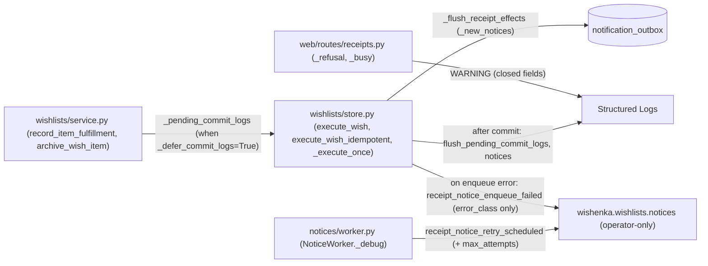

# Спецификация: WISHENKA-157 — Укрепление тестов и контрактов логирования уведомлений о получении подарков

**Задача Jira:** `WISHENKA-157`  
**Язык реализации:** Python  
**Статус:** реализовано, верифицировано и отражено в документации разработчика  
**Контекст:** закрытие пакета технического долга и наблюдаемости `T3` из задачи `WISHENKA-23`

## 1. Назначение и бизнес-цель

### 1.1. Постановка проблемы

В рамках задачи `WISHENKA-23` была реализована фиксация получения подарков и асинхронная доставка уведомлений дарителям. По итогам этапа наблюдаемости и анализа технического долга (пункт `T3`) были выявлены девять взаимосвязанных пробелов в контрактах структурированного логирования, семантике полей состояния очереди уведомлений, детерминизме автотестов и эксплуатационной документации:

1. Проверки закрытых наборов полей для событий `receipt_refused` и `receipt_inventory_busy` в `tests/test_receipt_observability.py` использовали чёрный список запрещённых ключей вместо строгого равенства множеств, что позволяло непредусмотренным полям незаметно проникать в журнал.
2. Тест `test_run_loop_logs_one_error_per_failure_streak` в `tests/test_receipt_notices_extra.py` опирался на реальную задержку `asyncio.sleep(0.6)`, создавая риск нестабильных падений (flakiness) при высокой нагрузке на среду выполнения.
3. Событие `receipt_notice_retry_scheduled` не содержало поле `max_attempts`, что противоречило спецификации наблюдаемости и не позволяло оператору без сверки с конфигурацией оценить близость строки к терминальному отказу.
4. Сбой постановки уведомлений о получении подарка в очередь (`notice_receipt_keys` / `notification_outbox`) не формировал отдельного диагностического сигнала, оставаясь неотличимым от прочих откатов транзакции получения инвентаря.
5. Поле `last_error_class` очищается в `NULL` при последующей успешной отправке (`sent`), а флаг `ambiguous = 1` сохраняется на строках в `status = 'failed'`, из-за чего требовалось однозначно зафиксировать SQL-семантику операционных метрик.
6. Событие `item_archived` на потоке владельца (`wishenka.wishlists`) содержало поле `active_reservations_count`, раскрывая факт наличия или отсутствия бронирований у желания.
7. Событие `item_fulfilled` записывалось в журнал до коммита транзакции `WishlistStore`, поэтому при последующем откате (например, из-за сбоя записи в outbox) в журнале оставалась ложная отметка об успешном получении подарка.
8. Документация и описания тестов содержали неточное утверждение о том, что остановка воркера «ничего не пишет», тогда как завершение работы публикует информационное событие `receipt_notice_worker_stopped` без сводных счётчиков окна.
9. Пограничный сценарий конкурентной занятости `CC-13` (ограниченный ответ `HTTP 503` без утечки данных о бронях) проверялся только косвенно, без выделенного прямого теста.

### 1.2. Бизнес- и операционные цели

- **Защита тайны сюрприза и приватности дарителей:** исключить любую утечку сведений о наличии бронирований, количестве занятых экземпляров и личности дарителей в логах потока владельца (`item_archived`), ответах и логах при конкурентной занятости (`CC-13`), а также при диагностике сбоев постановки уведомлений в очередь.
- **Достоверность наблюдаемости и диагностируемость:** гарантировать публикацию `item_fulfilled` исключительно для зафиксированных (committed) транзакций, обеспечить операторскую диагностику сбоев записи в `notification_outbox`, полноту метаданных повторов (`max_attempts`) и однозначную SQL-интерпретацию `last_error_class` и `ambiguous`.
- **Надёжность и детерминизм верификации:** заменить частичные проверки по чёрным спискам строгими контрактами равенства множеств ключей, устранить ожидания по настенным часам (`asyncio.sleep`) и закрепить прямое тестирование сценария `CC-13`.
- **Актуальность документации:** синхронизировать документацию разработчика и оператора с фактическим поведением остановки воркера и обновлёнными контрактами логов и метрик.

### 1.3. Ценность для пользователей и системы

- **Для владельца вишлиста и дарителя:** сохранение фундаментального инварианта тайны сюрприза во всех аудитных логах и при конкурентных обращениях к инвентарю.
- **Для оператора:** точный учёт успешных получений без искажения откатными записями, мгновенная оценка оставшихся попыток доставки уведомления, прозрачное выделение сбоев outbox без раскрытия бизнес-идентификаторов и корректные SQL-срезы очереди.
- **Для команды разработки и QA:** детерминированный тестовый набор без привязки к таймерам ОС и автоматический контроль дрейфа структуры логов.

### 1.4. Границы задачи (Non-Goals)

В рамки задачи `WISHENKA-157` сознательно не входят:

- Реализация экспортёра метрик (Prometheus / OpenTelemetry) — отслеживается отдельно в задаче `WISHENKA-84`.
- Декомпозиция и структурный рефакторинг модулей (`T4` / `WISHENKA-158`) и дополнительные fail-closed проверки (`T5` / `WISHENKA-159`).
- Изменение схемы базы данных `notification_outbox`, переходов состояний `NoticeStore` / `operator.resolve` или внешних контрактов HTTP-маршрутов (`WISHENKA-24`).

## 2. Функциональные требования и пользовательские сценарии

### 2.1. Функциональные требования

| Код    | Требование                                     | Поведение, входы и выходы                                                                                                                                                                                                       |
| ------ | ---------------------------------------------- | ------------------------------------------------------------------------------------------------------------------------------------------------------------------------------------------------------------------------------- |
| `FR-1` | Строгий контракт закрытых полей логов          | Проверки логов `receipt_refused` и `receipt_inventory_busy` выполняют строгое сравнение множества ключей `extra` с эталонным разрешённым набором; любое лишнее или недостающее поле считается ошибкой контракта.                |
| `FR-2` | Полнота метаданных повторной отправки          | Событие `receipt_notice_retry_scheduled` (`DEBUG`, `wishenka.wishlists.notices`) включает `max_attempts` (значение `self._max_attempts` воркера) наряду с `outbox_id`, `attempt` и `error_class` (при наличии `result`).         |
| `FR-3` | Диагностируемость сбоя постановки в очередь    | При исключении в цикле вставки в `notice_receipt_keys` / `notification_outbox` метод `WishlistStore._flush_receipt_effects` публикует `ERROR` `receipt_notice_enqueue_failed` с единственным полем `error_class` и пробрасывает исключение для отката. |
| `FR-4` | Однозначная семантика `last_error_class` и `ambiguous` | Зафиксирована и документирована SQL-семантика: `last_error_class` является метрикой текущего состояния незавершённых строк (`pending`, `uncertain`, `failed`), а активная и историческая неопределённость разделяются фильтром по `status`. |
| `FR-5` | Приватность потока владельца при архивировании | Событие `item_archived` (`INFO`, `wishenka.wishlists`) исключает `active_reservations_count` и содержит только `event`, `item_id`, `wishlist_id`, `actor_id`.                                                                    |
| `FR-6` | Согласованность `item_fulfilled` с коммитом    | При выполнении под управлением `WishlistStore` публикация `item_fulfilled` откладывается до успешного коммита SQLite-транзакции и подавляется при откате; автономный `WishlistService.in_memory()` сохраняет немедленное логирование. |
| `FR-7` | Прямая верификация сценария `CC-13`            | Выделенный автотест проверяет, что при `InventoryBusyError` маршрут фиксации получения возвращает ограниченный ответ `HTTP 503` и идентичный набор логов `receipt_inventory_busy` при `0` и при активных бронях.                  |
| `FR-8` | Достоверное описание остановки воркера         | Документация и docstrings тестов явно указывают, что остановка воркера публикует `INFO` `receipt_notice_worker_stopped` без полей и не формирует `receipt_notice_window_summary`.                                               |

### 2.2. Пользовательские и операционные сценарии

- **SC-01 (Откат получения при сбое outbox):** владелец отмечает получение подарка по желанию с открытым бронированием; `WishlistService.record_item_fulfillment` формирует отложенную запись `item_fulfilled`, но при записи в `notification_outbox` возникает исключение. Система логирует `ERROR` `receipt_notice_enqueue_failed` (`error_class` без бизнес-идентификаторов) на `wishenka.wishlists.notices`, откатывает транзакцию (таблицы `wl_receipts` и `wl_items` не изменяются) и не публикует `item_fulfilled`.
- **SC-02 (Успешный коммит получения и изолированный вызов сервиса):** при успешной фиксации транзакции через `WishlistStore.execute_wish`, `WishlistStore.execute_wish_idempotent` или `WishlistStore._execute_once` отложенные записи `PendingCommitLog` публикуются функцией `flush_pending_commit_logs` строго после коммита SQLite. При прямом вызове `WishlistService.in_memory().record_item_fulfillment(...)` (вне хранилища) событие `item_fulfilled` публикуется сразу.
- **SC-03 (Планирование повторной доставки уведомления):** при временной ошибке отправки (`retryable`) `NoticeWorker` переводит строку `notification_outbox` обратно в `pending` с вычисленной задержкой и пишет `DEBUG` `receipt_notice_retry_scheduled` с полями `outbox_id`, `attempt`, `max_attempts` и `error_class`.
- **SC-04 (Архивирование желания с бронированиями):** владелец или участник архивирует желание, на котором имеются активные брони дарителей. Доменное событие `item_archived` на `wishenka.wishlists` не содержит `active_reservations_count` и не выдаёт владельцу факт наличия броней.
- **SC-05 (Конкурентная занятость инвентаря — `CC-13`):** при возникновении `InventoryBusyError` на маршруте `POST /api/wishlists/{wishlist_id}/items/{item_id}/receipts` клиент получает ответ `503 Service Unavailable` с телом `{"detail": {"reason": "busy", "message": ...}}`. Тело ответа, заголовки `content-type` и структура `WARNING`-лога `receipt_inventory_busy` идентичны для пустого и забронированного желания и не содержат данных дарителей.
- **SC-06 (Остановка воркера при завершении приложения):** при штатном завершении `FastAPI` функция `_stop_notice_worker` отменяет фоновую задачу, закрывает отправителя уведомлений и публикует `INFO` `receipt_notice_worker_stopped` без счётчиков; незакрытый интервал окна не порождает `receipt_notice_window_summary`.
- **SC-07 (Операционный SQL-мониторинг очереди):** оператор выполняет регламентированные SQL-запросы к `notification_outbox` для получения текущего распределения незавершённых ошибок по `last_error_class`, числа активных `uncertain`-строк и числа исторических неоднозначностей в окне хранения.

### 2.3. Инварианты

1. **Принцип тайны сюрприза (No-Presence-Leak):** ни поток логов владельца (`item_archived`), ни диагностика сбоев outbox (`receipt_notice_enqueue_failed`), ни ответы и логи при занятости инвентаря (`CC-13`) не раскрывают присутствие броней, число бронирований, `outbox_id`, `receipt_id` или идентичность дарителя.
2. **Транзакционная достоверность доменного аудита:** при работе через `WishlistStore` запись `item_fulfilled` появляется в логах тогда и только тогда, когда транзакция получения зафиксирована в SQLite.
3. **Замкнутость схемы логов отказов:** набор ключей `receipt_refused` и `receipt_inventory_busy` является строго закрытым и контролируется проверкой равенства множеств.

## 3. Архитектура, компоненты и интерфейсы

### 3.1. Схема взаимодействия компонентов



### 3.2. Модули, классы и функции

#### 3.2.1. `wishenka/wishlists/service.py`

- **`PendingCommitLog`** (`@dataclass(frozen=True)`): неизменяемый контейнер отложенного доменного лога с полями:
  - `level: int` — уровень логирования;
  - `message: str` — шаблон сообщения;
  - `args: tuple[Any, ...]` — позиционные аргументы форматирования;
  - `extra: dict[str, Any]` — словарь структурированных полей.
- **`flush_pending_commit_logs(logs: list[PendingCommitLog]) -> None`**: синхронная функция, публикует переданные записи на логгер `wishenka.wishlists` через `logger.log(entry.level, entry.message, *entry.args, extra=entry.extra)`.
- **`WishlistService`**:
  - В `__init__` инициализируются поля `_defer_commit_logs: bool = False` и `_pending_commit_logs: list[PendingCommitLog] = []`.
  - `_emit_or_defer_commit_log(self, level: int, message: str, *args: Any, extra: dict[str, Any]) -> None`: при `_defer_commit_logs=True` добавляет `PendingCommitLog` в `_pending_commit_logs`, при `False` — немедленно вызывает `logger.log(...)`.
  - `record_item_fulfillment`: публикует `item_fulfilled` (`logging.INFO`) через `self._emit_or_defer_commit_log(...)`.
  - `archive_wish_item`: формирует `extra` события `item_archived` только с ключами `{"event", "item_id", "wishlist_id", "actor_id"}`, без `active_reservations_count`.

#### 3.2.2. `wishenka/wishlists/store.py`

- **Гидратация сервиса:** методы `WishlistStore._read` и `WishlistStore._load_wish` после вызова `WishlistService.in_memory()` устанавливают `service._defer_commit_logs = True`.
- **Транзакционные обёртки (`execute_wish`, `execute_wish_idempotent`, `_execute_once`):** внутри `work(conn)` сохраняют `pending_commit_logs = list(service._pending_commit_logs)` и после успешного возврата из `await self._immediate(work)` вызывают `_log_flushed_notices(flushed)`, `_log_flushed_shared_events(flushed_shared)` и `flush_pending_commit_logs(pending_commit_logs)`.
- **`WishlistStore._flush_receipt_effects`:** оборачивает цикл вставки записей в `notice_receipt_keys` и `notification_outbox` (`for draft in service._new_notices:`) в блок `try/except Exception as exc`. При перехвате исключения логирует на операторский логгер `wishenka.wishlists.notices` (`notice_logger.error`) событие `receipt_notice_enqueue_failed` с `error_class=type(exc).__name__` и повторно пробрасывает `exc`, обеспечивая атомарный откат транзакции (и предотвращая публикацию `item_fulfilled`).

#### 3.2.3. `wishenka/notices/worker.py`

- **`NoticeWorker._debug(self, event: str, message: str, claim: ClaimedNotice, result: SendResult | None = None) -> None`**:
  - Базовые поля: `event`, `outbox_id` (`claim.outbox_id`), `attempt` (`claim.attempt`).
  - При `event == "receipt_notice_retry_scheduled"` добавляет `"max_attempts": self._max_attempts`.
  - При `result is not None` добавляет `"error_class": result.error_class`.
- **`NoticeWorker.run(self, stop: asyncio.Event) -> None` и `_error_delay(self, failures: int) -> float`**:
  - Вычисляет задержку `min(self._poll * 2 ** min(failures, 16), MAX_ERROR_BACKOFF_SECONDS)` при `failures > 0` и ожидает пробуждения через `await asyncio.wait_for(stop.wait(), timeout=delay)`, что позволяет детерминированно перехватывать задержки в тестах через `wishenka.notices.worker.asyncio.wait_for`.

#### 3.2.4. `wishenka/web/routes/receipts.py` и `wishenka/web/app.py`

- **`_refusal` / `_busy`** (`wishenka/web/routes/receipts.py`): формируют закрытые `extra`-словари для `receipt_refused` и `receipt_inventory_busy`; при `InventoryBusyError` `_busy` возвращает `HTTP 503` с `detail={"reason": "busy", "message": str(exc)}`.
- **`_stop_notice_worker(app: FastAPI)`** (`wishenka/web/app.py`): отменяет задачу воркера, закрывает `sender` и публикует `INFO` `receipt_notice_worker_stopped` (`{"event": "receipt_notice_worker_stopped"}`) без счётчиков окна.

#### 3.2.5. `wishenka/notices/store.py` и `wishenka/notices/operator.py`

- Контракт переходов базы данных сохранён без изменений: `NoticeStore.complete` очищает `last_error_class = NULL` при переходе в `sent`, `NoticeStore.uncertain` выставляет `status = 'uncertain'` и `ambiguous = 1`, а `operator.resolve` для очереди `receipt` сбрасывает `ambiguous = 0` при `action="retry"` (возврат в `pending`) и сохраняет `ambiguous = 1` при `action="fail"` (переход в `failed`).

### 3.3. Контракты данных и переходы состояний

#### 3.3.1. Закрытые контракты полей событий (`extra`)

| Событие                          | Уровень   | Логгер                     | Точный набор ключей `extra`                                                                                                               |
| -------------------------------- | --------- | -------------------------- | ----------------------------------------------------------------------------------------------------------------------------------------- |
| `receipt_refused`                | `WARNING` | `wishenka.web.receipts`    | `event`, `operation`, `wishlist_id`, `item_id`, `actor_id`, `reason`, `http_status`; плюс `remaining_quantity` только при `reason` из `{"quantity_above_remaining", "nothing_remaining"}` |
| `receipt_inventory_busy`         | `WARNING` | `wishenka.web.receipts`    | `event`, `operation`, `wishlist_id`, `item_id`, `actor_id`                                                                                |
| `item_archived`                  | `INFO`    | `wishenka.wishlists`       | `event`, `item_id`, `wishlist_id`, `actor_id`                                                                                             |
| `item_fulfilled`                 | `INFO`    | `wishenka.wishlists`       | `event`, `wishlist_id`, `item_id`, `user_id`, `actor_id`, `quantity`, `received_quantity`, `total_quantity`, `fully_received`               |
| `receipt_notice_enqueue_failed`  | `ERROR`   | `wishenka.wishlists.notices` | `event`, `error_class`                                                                                                                    |
| `receipt_notice_retry_scheduled` | `DEBUG`   | `wishenka.wishlists.notices` | `event`, `outbox_id`, `attempt`, `max_attempts`, `error_class` (при наличии `result`)                                                     |
| `receipt_notice_worker_stopped`  | `INFO`    | `wishenka.wishlists.notices` | `event`                                                                                                                                   |

#### 3.3.2. Жизненный цикл отложенного логирования и состояния `notification_outbox`

1. **Отложенный лог `item_fulfilled` в транзакции `WishlistStore`:**
   - `record_item_fulfillment(...)` → запись `PendingCommitLog` в `service._pending_commit_logs` (если `_defer_commit_logs=True`).
   - Если `_persist_wish` / `_flush_receipt_effects` / `conn.commit()` завершаются ошибкой → транзакция откатывается, `PendingCommitLog` отбрасывается и `item_fulfilled` не логируется; при сбое вставки в outbox публикуется `receipt_notice_enqueue_failed`.
   - При успешном завершении `_immediate(work)` → вызывается `flush_pending_commit_logs(pending_commit_logs)`, и `item_fulfilled` попадает в журнал после коммита.
2. **Семантика полей `last_error_class` и `ambiguous` в `notification_outbox`:**
   - Инвариант схемы: `CHECK(ambiguous=0 OR status NOT IN ('pending','sending'))`.
   - Повторная ошибка отправки (`pending` / `failed` / `uncertain`): обновляет `last_error_class` на класс последней ошибки.
   - Успешная отправка (`NoticeStore.complete`): устанавливает `status = 'sent'` и `last_error_class = NULL` (поэтому `last_error_class` отражает только текущие недоставленные строки).
   - Ручное разрешение неопределённости (`operator.resolve`): `action="retry"` устанавливает `status = 'pending'`, `ambiguous = 0`; `action="fail"` устанавливает `status = 'failed'`, сохраняя `ambiguous = 1`.

## 4. Нефункциональные требования, безопасность и наблюдаемость

### 4.1. Производительность и ограничения

- **Накладные расходы памяти и БД:** `PendingCommitLog` буферизует в памяти не более одной компактной замороженной записи на вызов `record_item_fulfillment` внутри транзакции без дополнительных обращений к SQLite. Добавление `try/except` в `_flush_receipt_effects` и чтение `self._max_attempts` в `_debug` не влияют на латентность штатного пути.
- **Детерминизм и скорость тестов:** устранение `asyncio.sleep(0.6)` в `test_run_loop_logs_one_error_per_failure_streak` исключило зависимость длительности и результата теста от нагрузки на планировщик ОС.
- **Границы изменений:** конвейер уведомлений, таймеры хранения (`30` дней по умолчанию в `receipt_notice_retention_days`) и пропускная способность БД остались неизменными.

### 4.2. Безопасность, приватность и защита тайны сюрприза

- **Разделение аудиторий логов:** логгер `wishenka.wishlists.notices` является строго операторским. На уровне `DEBUG` события `receipt_notice_created` коррелируют по времени с `item_fulfilled`, поэтому операторский поток запрещено транслировать владельцам или другим пользователям.
- **Отсутствие утечек на потоке владельца:** удаление `active_reservations_count` из `item_archived` гарантирует, что логи архивирования не раскрывают владельцу или соавтору наличие чужих броней.
- **Минимизация данных в `receipt_notice_enqueue_failed`:** событие содержит только `{"event": "receipt_notice_enqueue_failed", "error_class": type(exc).__name__}` и фиксированное сообщение `"Receipt notice enqueue failed"`; запрещено включать `wishlist_id`, `item_id`, `receipt_id`, `giver_user_id`, `outbox_id` и текст исключения (`str(exc)`).
- **Симметрия и ограниченность ответа `503` (`CC-13`):** при блокировке инвентаря клиент получает одинаковый ответ `503` и идентичный по полям `WARNING`-лог `receipt_inventory_busy` вне зависимости от наличия активных бронирований; имена, идентификаторы дарителей и токены никогда не включаются ни в тело ответа, ни в логи.

### 4.3. Структурированное логирование и метрики

Все события используют `extra={"event": ...}`, фиксированные шаблоны сообщений без интерполяции секретов/токенов/сырых исключений и стандартные Python-логгеры (`wishenka.wishlists`, `wishenka.web.receipts`, `wishenka.wishlists.notices`).

#### 4.3.1. Затронутые и верифицированные события логирования

| Уровень   | Событие                          | Логгер                       | Назначение и условия эмиссии                                                                                                        |
| --------- | -------------------------------- | ---------------------------- | ----------------------------------------------------------------------------------------------------------------------------------- |
| `ERROR`   | `receipt_notice_enqueue_failed`  | `wishenka.wishlists.notices` | Ошибка записи в `notice_receipt_keys` или `notification_outbox` в `_flush_receipt_effects` перед откатом; только `error_class`.     |
| `ERROR`   | `receipt_notice_worker_error`    | `wishenka.wishlists.notices` | Логируется один раз на серию последовательных сбоев цикла `NoticeWorker.run`; только `error_class` (проверяется детерминированно).  |
| `WARNING` | `receipt_refused`                | `wishenka.web.receipts`      | Отказ маршрута получения по бизнес-правилу или правам доступа; строго закрытый набор ключей.                                        |
| `WARNING` | `receipt_inventory_busy`         | `wishenka.web.receipts`      | Конкурентная занятость инвентаря (`InventoryBusyError`, `HTTP 503`); строго закрытый набор ключей, идентичный при `0` и `N` бронях. |
| `INFO`    | `item_fulfilled`                 | `wishenka.wishlists`         | Фиксация получения подарка; под `WishlistStore` публикуется строго после коммита транзакции.                                        |
| `INFO`    | `item_archived`                  | `wishenka.wishlists`         | Архивирование желания; публикуется без `active_reservations_count`.                                                                 |
| `INFO`    | `receipt_notice_worker_stopped`  | `wishenka.wishlists.notices` | Штатная остановка воркера уведомлений; публикуется без полей и без `receipt_notice_window_summary`.                                 |
| `DEBUG`   | `receipt_notice_retry_scheduled` | `wishenka.wishlists.notices` | Планирование повторной попытки доставки уведомления; включает `outbox_id`, `attempt`, `max_attempts`, `error_class`.                |

#### 4.3.2. SQL-метрики и агрегаты по таблице `notification_outbox`

Реализован контракт чтения текущих и исторических показателей без отдельного экспортёра метрик (`WISHENKA-84`):

- **Текущий срез ошибок по классам (`last_error_class` current-state gauge):** поскольку `NoticeStore.complete` очищает `last_error_class = NULL` при переходе в `sent`, запрос оценивает только неразрешённые и терминально упавшие строки, а не исторический счётчик сбоев:

  ```sql
  SELECT last_error_class, count(*)
  FROM notification_outbox
  WHERE status IN ('pending', 'uncertain', 'failed')
  GROUP BY last_error_class;
  ```

- **Активная неразрешённая неопределённость (требует решения оператора):**

  ```sql
  SELECT count(*)
  FROM notification_outbox
  WHERE status = 'uncertain';
  ```

- **Историческая неопределённость в пределах окна хранения (`30` дней):**

  ```sql
  SELECT count(*)
  FROM notification_outbox
  WHERE ambiguous = 1 AND status IN ('sent', 'failed');
  ```

- **Лог-производные показатели:** пропускная способность `item_fulfilled` (`INFO`) отражает только зафиксированные получения и больше не завышается откатами; частота отказов и занятости отслеживается по `receipt_refused` и `receipt_inventory_busy` (`WARNING`), а сбои постановки в очередь — по `receipt_notice_enqueue_failed` (`ERROR`).

## 5. Верификация и критерии приёмки

### 5.1. Тестовые сценарии и покрытие

Все четыре изменённых тестовых модуля снабжены явными модульными таймаутами `pytestmark = pytest.mark.timeout(...)`:

- **`tests/test_receipt_observability.py`** (таймаут модуля `60` с, пройдено `12/12`):
  - `test_refusal_and_busy_records_carry_closed_fields_only` — проверяет точное равенство множеств `set(extras) == expected_keys` для `receipt_refused` (четыре причины отказа, `remaining_quantity` исключительно для `quantity_above_remaining` и `nothing_remaining`) и `receipt_inventory_busy`, а также отсутствие имён дарителей и `outbox_id`.
  - `test_retry_scheduled_includes_max_attempts` — проверяет `DEBUG` `receipt_notice_retry_scheduled` с точным набором `{"event", "outbox_id", "attempt", "max_attempts", "error_class"}` и равенством `max_attempts == settings.receipt_notice_max_attempts`.
  - `test_item_archived_never_logs_active_reservations_count` — проверяет, что при архивировании желания с активной бронью событие `item_archived` имеет строго 4 поля (`event`, `item_id`, `wishlist_id`, `actor_id`) без `active_reservations_count`.
  - `test_enqueue_failure_rolls_back_without_item_fulfilled_and_logs_operator_error` — моделирует сбой `INSERT INTO notification_outbox` (`RuntimeError`) и подтверждает отсутствие `item_fulfilled` при откате и наличие `ERROR` `receipt_notice_enqueue_failed` на `wishenka.wishlists.notices` только с `{"event": "receipt_notice_enqueue_failed", "error_class": "RuntimeError"}` без join-ключей.
  - `test_worker_stop_logs_info_without_summary_counts` — проверяет жизненный цикл `TestClient(app)` с активным воркером: при остановке публикуется `INFO` `receipt_notice_worker_stopped` с `{"event": "receipt_notice_worker_stopped"}` и не публикуется `receipt_notice_window_summary`.
- **`tests/test_receipt_concurrency.py`** (таймаут модуля `120` с):
  - `test_cc13_busy_503_bounded_and_identical_with_or_without_reservations` — прямая проверка сценария `CC-13`: при `InventoryBusyError` ответы `503` на желании с `0` бронями и с активной бронью совпадают по JSON-телу и `content-type`, не содержат имя дарителя и формируют идентичные по структуре `WARNING`-записи `receipt_inventory_busy`.
- **`tests/test_receipt_notices_extra.py`** (таймаут модуля `60` с):
  - `test_run_loop_logs_one_error_per_failure_streak` — детерминированная проверка серии сбоев воркера с перехватом `wishenka.notices.worker.asyncio.wait_for`; проверяет последовательность экспоненциальных задержек `[0.1, 0.2, 0.4, 0.8]` с и ровно одну ошибку `receipt_notice_worker_error` (`error_class="RuntimeError"`, без текста исключения) за 4 тика без реальных `asyncio.sleep`.
- **`tests/test_wish_items_crud_api.py`** (таймаут модуля `30` с):
  - `test_item_lifecycle_observability_events` — проверяет `assert not hasattr(rec_arch, "active_reservations_count")` для `item_archived`.

### 5.2. Критерии приёмки и результаты проверок

Критерии приёмки (Definition of Done):

1. Проверки `receipt_refused` и `receipt_inventory_busy` выполняют строгое сравнение равенства множества ключей вместо чёрных списков (`FR-1`).
2. `test_run_loop_logs_one_error_per_failure_streak` выполняется детерминированно без `asyncio.sleep` (`NFR-1`).
3. Событие `receipt_notice_retry_scheduled` включает `max_attempts` (`FR-2`).
4. Сбои постановки уведомлений в очередь диагностируются через операторский `ERROR` `receipt_notice_enqueue_failed` с полем `error_class` и без утечки присутствия броней (`FR-3`, `NFR-2`).
5. Семантика SQL-метрик для `last_error_class` и `ambiguous` однозначно определена и документирована (`FR-4`).
6. Событие `item_archived` не содержит `active_reservations_count` (`FR-5`, `NFR-2`).
7. Событие `item_fulfilled` под `WishlistStore` публикуется строго после коммита и не появляется при откате (`FR-6`).
8. Документация (`doc/dev/notifications.md`, `doc/dev/gift-receipt.md`, `doc/dev/items.md`, `doc/dev/reservations.md`) и docstrings тестов корректно описывают `receipt_notice_worker_stopped` без summary-счётчиков (`FR-8`).
9. Пограничный случай `CC-13` покрыт выделенным прямым тестом (`FR-7`).
10. Статический анализ и целевые тесты пройдены без регрессий.

Зафиксированные результаты проверок из отчётов задачи (`40-code-cleanup.md`, `50-observability.md`, `00-roadmap.md`):

- **`make analyze`:** `ruff check` — `All checks passed!`; `ruff format --check` — `225 files already formatted`; `mypy` — `Success: no issues found in 225 source files`.
- **Целевой прогон `pytest` по 4 изменённым файлам** (`tests/test_receipt_observability.py`, `tests/test_receipt_concurrency.py`, `tests/test_receipt_notices_extra.py`, `tests/test_wish_items_crud_api.py`): **41 passed, 1 failed** — единственное падение `tests/test_receipt_notices_extra.py::test_cleanup_cycle_survives_a_failing_notice_purge` является предсуществующей базовой ошибкой (`TypeError` вместо `RuntimeError`), не относящейся к `WISHENKA-157`. (На этапе разработки также зафиксирован расширенный прогон `81 passed` и та же предсуществующая ошибка).

### 5.3. Известные ограничения и дальнейшие шаги

По итогам анализа технического долга (`60-tech-debt.md`) зафиксированы следующие допущения, пробелы в тестах и вынесенные в Jira задачи:

1. **Ограниченный охват отложенного логирования (`WISHENKA-248`):** механизм `_emit_or_defer_commit_log` применён только к `item_fulfilled` в `record_item_fulfillment`. Остальные доменные `INFO`-события `WishlistService` (`item_archived`, `restore_wish_item`, `create_reservation` и др.) пока логируются до коммита, а отложенная публикация/подавление при откате не покрыты отдельными тестами для `execute_wish_idempotent` и `_execute_once`.
2. **Дублирование сброса логов и прямая установка приватного флага (`WISHENKA-246`):** `WishlistStore._read` и `WishlistStore._load_wish` выставляют `service._defer_commit_logs = True` напрямую вместо явного параметра `WishlistService.in_memory(defer_commit_logs=True)`, а `execute_wish`, `execute_wish_idempotent` и `_execute_once` дублируют трёхшаговый вызов сброса (`_log_flushed_notices`, `_log_flushed_shared_events`, `flush_pending_commit_logs`) вместо общего хелпера `_flush_post_commit_logs`.
3. **Отсутствие прямых интеграционных тестов SQL-срезов (`WISHENKA-247`):** регламентированные SQL-запросы для `last_error_class` и `ambiguous` описаны в документации, но отдельный тест, выполняющий их на `notification_outbox` после `NoticeStore.complete` и `operator.resolve(..., action="retry" | "fail")`, ещё не добавлен.
4. **Имитация занятости в тесте `CC-13`:** `test_cc13_busy_503_bounded_and_identical_with_or_without_reservations` инъектирует `InventoryBusyError` через `monkeypatch` на `app.state.wishlist_store.execute_wish`, не создавая реальную блокировку SQLite `BEGIN IMMEDIATE` (преобразование `SQLITE_BUSY` в `InventoryBusyError` проверяется существующими тестами хранилища).
5. **Предсуществующий падающий тест очистки (`WISHENKA-245`):** `tests/test_receipt_notices_extra.py::test_cleanup_cycle_survives_a_failing_notice_purge` (`NON-BLOCKER — pre-existing`) вынесен в отдельную задачу.
