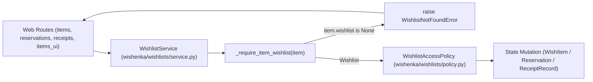

# WISHENKA-159: Fail-Closed Wishlist Context & Permission Enforcement

## Research

1. **Current Guard Sites in `wishenka/wishlists/service.py`**:
   Inspection of `wishenka/wishlists/service.py` (expanded since `ai-tasks/WISHENKA-23/60-tech-debt.md` item C-3 / T5) identified all fail-open `wl = item.wishlist; if wl is not None:` guards on wish item mutations:
   - **`update_wish_item`** (`wishenka/wishlists/service.py:1356-1410`, plus lines `1428`, `1485`, `1496`): When `wl is None`, skips `WishlistStatus.ARCHIVED` / `WishlistStatus.DELETED` checks, `WishlistAccessPolicy.resolve_context` + `can_add_or_edit_item` authorization, and `recipient_user_id` membership validation, then mutates `item`.
   - **`create_reservation`** (`wishenka/wishlists/service.py:1873-1902`, `1916-1933`, plus lines `1924`, `1945`): When `wl is None`, skips `ARCHIVED` / `DELETED` list-status checks, sets `ctx = None`, skips `WishlistAccessPolicy.can_reserve_item(user, ctx, item)` (including recipient self-reservation checks), and proceeds to create a `Reservation`.
   - **`record_item_fulfillment`** (`wishenka/wishlists/service.py:2498-2520`, plus lines `2538`, `2562`): When `wl is None`, skips `ctx.is_member` authorization and `DELETED` / `ARCHIVED` list-status checks, then increments `item.received_quantity` and appends a `ReceiptRecord`.
   - **`_validate_receipt_mutation_access`** (`wishenka/wishlists/service.py:2585-2609`, called by `cancel_item_receipt` at line `2628` and `correct_item_receipt` at line `2680`): When `wl is None`, skips `ctx.is_member` authorization and `DELETED` / `ARCHIVED` list-status checks, allowing receipt cancellation/correction without validation.

2. **Non-Guard `wl is not None` Sites (Out of Scope)**:
   - Lines `312-313` (`_record_reservation_confirmation`) and `374-376` (`_record_receipt_change_event`) are post-validation notification helpers.
   - Lines `2917`, `2981`, `2999`, `3062` are existence/error-branch checks for missing or deleted wishlists in favorites and view history, explicitly out of scope per `10-requirements.md`.

3. **Domain Exceptions & Web Route Mapping**:
   - `wishenka/wishlists/exceptions.py` defines `WishlistNotFoundError(WishlistError)`.
   - All relevant web route layers (`wishenka/web/routes/items.py`, `reservations.py`, `receipts.py`, `items_ui.py`) already catch `WishlistNotFoundError` and map it cleanly to HTTP 404 / not-found responses, whereas an `AssertionError` or `RuntimeError` would bubble as an unhandled 500 error (and `assert` statements are stripped under `python -O`).
   - `WishItem.wishlist` in `wishenka/wishlists/models.py:132` is typed as `"Wishlist | None" = None`.

4. **Existing Tests**:
   - Searching `tests/` for `wishlist=None` or `.wishlist = None` found no existing tests exercising missing-wishlist context on `WishItem`.

## Implementation Plan

1. **Shared Guard Helper in `WishlistService`** (`wishenka/wishlists/service.py`):
   - Introduce a small static/private helper `_require_item_wishlist(item: WishItem) -> Wishlist` that checks `if item.wishlist is None: raise WishlistNotFoundError(...)` and otherwise returns `item.wishlist`.
2. **Replace Fail-Open Branches**:
   - Replace `wl = item.wishlist` + `if wl is not None:` with `wl = self._require_item_wishlist(item)` in:
     1. `update_wish_item` (before any `item` mutation; also removes redundant `if wl else None` / `and wl is not None` checks at lines `1428`, `1485`, `1496`).
     2. `create_reservation` (before status/eligibility checks and reservation creation; `ctx = WishlistAccessPolicy.resolve_context(user, wl)` is now unconditional, removing `if wl else None` at lines `1924`, `1945`).
     3. `record_item_fulfillment` (before authorization, quantity checks, and receipt creation; removes `if wl else None` at lines `2538`, `2562`).
     4. `_validate_receipt_mutation_access` (shared gate for `cancel_item_receipt` and `correct_item_receipt`).
3. **Verify**:
   - Run targeted tests and the full quality gate (`make check` / `pytest` + static analysis) to confirm no regressions and clean type checking.

**Mandatory — Failing Repro (next Step 3):**
- **Where it lives**: `tests/test_wishlist_fail_closed_repro.py` (with module-level `pytestmark = pytest.mark.timeout(30)` per `do-testing` / `lsr-python`).
- **How to force failure without live external deps**: Use `WishlistService.in_memory()`, seed a wishlist and wish item (plus an initial receipt for cancel/correct cases), and set `service._items[item_id].wishlist = None` to simulate a detached `WishItem` with missing parent wishlist context.
- **What it asserts**: Calling each of `update_wish_item`, `create_reservation`, `record_item_fulfillment`, `cancel_item_receipt`, and `correct_item_receipt` with an unauthorized actor (e.g., `STRANGER` or recipient self-reservation) when `item.wishlist is None` MUST raise `WishlistNotFoundError` and leave `item` fields, `reservations`, `received_quantity`, and `receipts` completely unmutated.
- **Sequencing**: Research (Step 2, done) → write red test in Step 3 and observe failure (operations currently succeed / mutate state instead of raising `WishlistNotFoundError`) → implement `_require_item_wishlist` and update the four guard sites in Step 4 until all tests pass.

## Architecture

### System Module Diagram



### Module Responsibilities

- **`WishlistService` (`wishenka/wishlists/service.py`)**: Owns wish item mutation workflows (`update_wish_item`, `create_reservation`, `record_item_fulfillment`, `cancel_item_receipt`, `correct_item_receipt`) and enforces fail-closed parent wishlist resolution via `_require_item_wishlist(item)` before any authorization, lifecycle-state check, or state mutation.
- **`WishlistAccessPolicy` (`wishenka/wishlists/policy.py`)**: Resolves actor context (`resolve_context(actor, wl)`) and evaluates role/relationship permissions (`can_add_or_edit_item`, `can_reserve_item`, `ctx.is_member`) against a guaranteed non-`None` `Wishlist`.
- **Domain Exceptions (`wishenka/wishlists/exceptions.py`)**: Provides `WishlistNotFoundError`, already integrated into all web route exception mappers.

### Module Interaction Scheme

1. Caller invokes one of the five wish item mutation methods on `WishlistService`.
2. After resolving `item` (and verifying `wishlist_id` if provided), `WishlistService` calls `wl = self._require_item_wishlist(item)`.
3. If `item.wishlist is None`, `_require_item_wishlist` immediately raises `WishlistNotFoundError` before any state mutation or lock-held write.
4. Otherwise, `wl: Wishlist` is guaranteed non-`None`, and `WishlistService` unconditionally runs lifecycle-state checks (`ARCHIVED`, `DELETED`) and `WishlistAccessPolicy` checks.

### Architectural Patterns & Justification

- **Fail-Closed Guard / Early-Return Helper**: Centralizing the null-check in `_require_item_wishlist(item: WishItem) -> Wishlist` eliminates duplicated `if wl is None` boilerplate across four call sites, prevents future drift, and narrows the static type from `Wishlist | None` to `Wishlist`.
- **Domain Exception over `assert`**: Raising `WishlistNotFoundError` instead of `assert wl is not None` ensures the guard cannot be stripped by `python -O` and integrates with existing HTTP route handlers (`items.py`, `reservations.py`, `receipts.py`, `items_ui.py`).

### Main Interfaces

```python
@staticmethod
def _require_item_wishlist(item: WishItem) -> Wishlist:
    """Return the item's parent wishlist or fail closed if context is missing."""
```

- **Input**: `item: WishItem`
- **Output**: `Wishlist` (non-optional)
- **Raises**: `WishlistNotFoundError` when `item.wishlist is None`.

## Q&A

- **Q**: Why raise `WishlistNotFoundError` instead of `PermissionDeniedError` or `AssertionError`?
  **A**: `AssertionError` can be disabled with `python -O` and is not handled by web route mappers (resulting in 500). `WishlistNotFoundError` is a `WishlistError` subclass already handled by all item, reservation, and receipt routes, and accurately describes that the parent wishlist context is missing.
- **Q**: Should `_require_item_wishlist` fall back to `self._wishlists.get(item.wishlist_id)`?
  **A**: No. Per `10-requirements.md`, missing `item.wishlist` context itself must fail closed rather than masking a broken/detached item invariant.
