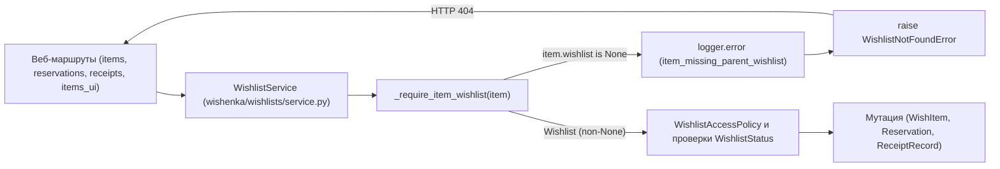
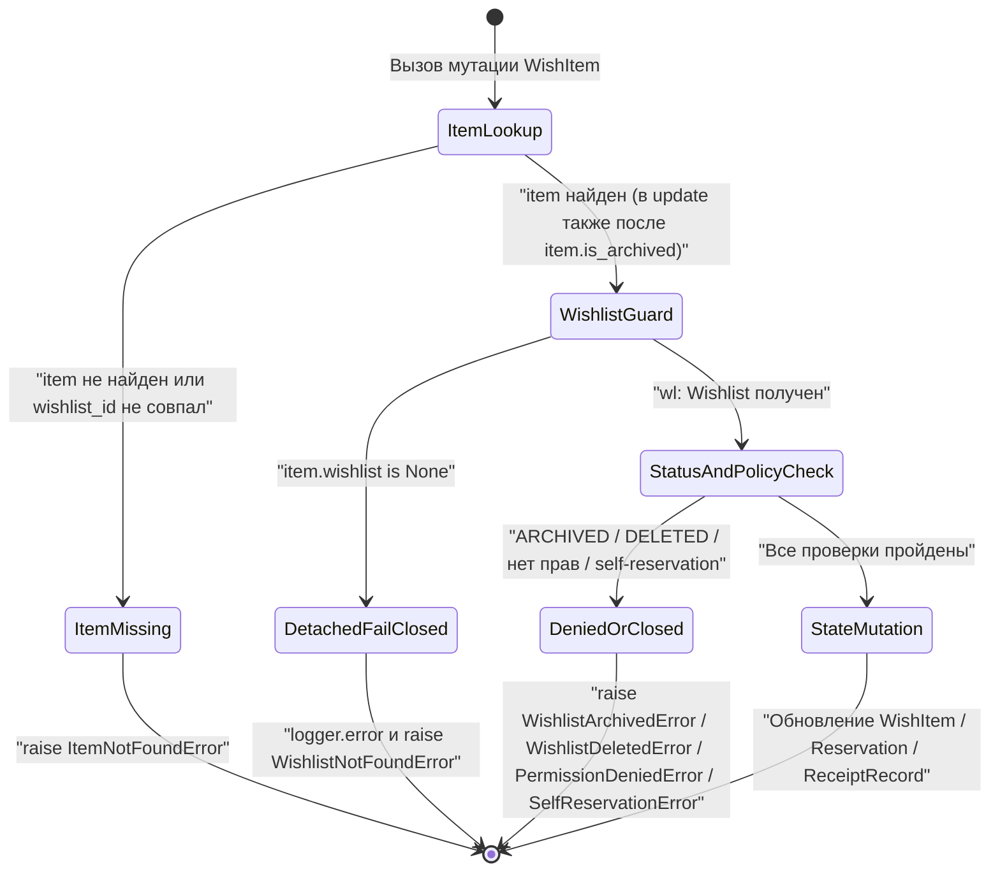

# Спецификация: WISHENKA-159 — Отказоустойчивая проверка контекста родительского вишлиста и прав доступа (Fail-Closed)

**Версия документа:** 1.0  
**Статус:** реализовано (включая регрессионный тест, аудит наблюдаемости, анализ техдолга и обновление документации)  
**Задача в Jira:** WISHENKA-159  
**Язык реализации:** Python  
**Компоненты:** `wishenka/wishlists/service.py`, `wishenka/wishlists/policy.py`, `wishenka/wishlists/models.py`, `wishenka/wishlists/exceptions.py`, `tests/test_wishlist_fail_closed_repro.py`, `doc/dev/wishlists.md`  
**Исходные артефакты:** `ai-tasks/WISHENKA-159/10-requirements.md`, `ai-tasks/WISHENKA-159/20-architecture.md`, `ai-tasks/WISHENKA-159/40-code-cleanup.md`, `ai-tasks/WISHENKA-159/50-observability.md`, `ai-tasks/WISHENKA-159/60-tech-debt.md`, `doc/dev/wishlists.md`

---

## 1. Назначение и бизнес-цель

### 1.1. Постановка проблемы

В модели домена желаний (`wishenka/wishlists/models.py`) ссылка на родительский вишлист `WishItem.wishlist` объявлена как опциональная (`"Wishlist | None" = None`). В штатном жизненном цикле персистентности и создания желания через `WishlistService.add_wish_item` родительский вишлист всегда привязан к экземпляру `WishItem`.

До реализации **WISHENKA-159** четыре критических пути мутации желаний в `wishenka/wishlists/service.py` содержали условные проверки вида `wl = item.wishlist; if wl is not None:` (принцип *fail-open*):

- **`update_wish_item`**: при `wl is None` пропускались проверки статуса вишлиста (`WishlistStatus.ARCHIVED`, `WishlistStatus.DELETED`), разрешение ролевого контекста через `WishlistAccessPolicy.resolve_context` и `can_add_or_edit_item`, а также валидация принадлежности `recipient_user_id` составу участников вишлиста — после чего изменения применялись к `item`.
- **`create_reservation`**: при `wl is None` пропускались проверки статуса `ARCHIVED` и `DELETED`, контекст `ctx` оставался `None`, а вызов `WishlistAccessPolicy.can_reserve_item` опирался на незаполненный контекст (и обходил запрет самобронирования для владельца личного вишлиста, поскольку `is_recipient_id` не видел `wishlist`), позволяя создать запись `Reservation`.
- **`record_item_fulfillment`**: при `wl is None` пропускались проверка членства `ctx.is_member` и проверки статусов `DELETED` / `ARCHIVED`, после чего увеличивалось `item.received_quantity` и добавлялась запись `ReceiptRecord`.
- **`_validate_receipt_mutation_access`** (общий шлюз для `cancel_item_receipt` и `correct_item_receipt`): при `wl is None` пропускались проверка членства `ctx.is_member` и проверки статусов `DELETED` / `ARCHIVED`, разрешая отмену или корректировку записей о получении подарка без авторизации.

Такой шаблон «отказа в открытом режиме» (fail-open) нарушал базовый принцип безопасности *secure-by-default*: при любом будущем рефакторинге, пограничном сценарии гидратации или тестовой конфигурации с отсоединённым объектом `WishItem` система молча отключала контроль доступа и проверки жизненного цикла вишлиста.

### 1.2. Цели задачи

1. **Исключить тихий обход авторизации и статусных ограничений:** гарантировать, что проверки прав доступа (`WishlistAccessPolicy`) и жизненного цикла вишлиста (`ARCHIVED`, `DELETED`) никогда не пропускаются из-за отсутствующей ссылки на родительский вишлист.
2. **Защитить доменный инвариант принадлежности:** закрепить правило, что желание не может изменяться, бронироваться или отмечаться полученным вне контекста родительского вишлиста; при нарушении этого инварианта операция немедленно отклоняется в режиме *fail-closed*.
3. **Обеспечить безопасность состояния при отказе:** исключить любые частичные мутации полей `WishItem`, коллекций `reservations` и `receipts`, а также счётчика `received_quantity` до срабатывания защиты.
4. **Зафиксировать поведение автоматизированными тестами:** добавить регрессионный набор тестов, воспроизводящий отсутствие `item.wishlist` для каждой из охваченных операций.

### 1.3. Ценность для пользователей и системы

- **Для владельца и соавторов вишлиста:** гарантируется, что редактирование желаний, фиксация, отмена и корректировка фактов получения подарков невозможны без подтверждённого членства и активного статуса родительского списка.
- **Для дарителей и получателей:** сохраняется нерушимость ограничений бронирования (активность списка и запрет самобронирования, защищающий принцип сюрприза).
- **Для сопровождения и безопасности платформы:** единая централизованная проверка устраняет класс скрытых уязвимостей при будущих изменениях кода и обеспечивает диагностируемое структурированное логирование нарушения инварианта.

### 1.4. Границы области (Scope и Non-Goals)

- **Входит в задачу:**
  - перевод четырёх `wl is not None`-проверок на мутациях `WishItem` в `wishenka/wishlists/service.py` (`update_wish_item`, `create_reservation`, `record_item_fulfillment`, `_validate_receipt_mutation_access`) в режим *fail-closed* через единый метод-страж `_require_item_wishlist`;
  - удаление сопутствующих избыточных условных выражений `if wl else None` и `and wl is not None` внутри указанных четырёх методов;
  - добавление структурированного `ERROR`-логирования при нарушении инварианта `item.wishlist is None`;
  - создание автоматизированных регрессионных тестов в `tests/test_wishlist_fail_closed_repro.py` и обновление документации в `doc/dev/wishlists.md`.
- **Не входит в задачу:**
  - проверки существования или удаления вишлиста в потоках вне стражей `WishItem` (например, избранное и история просмотров);
  - пост-валидационные вспомогательные методы уведомлений (`_record_reservation_confirmation`, `_record_receipt_change_event`);
  - существующие проверки на мутациях бронирования (`_ensure_reservation_writable`, `_guard_reservation_mutation` — вынесены в последующую задачу техдолга `WISHENKA-238`);
  - изменение нормального поведения персистентности и гидратации ORM/репозитория, а также изменение обязательности поля `WishItem.wishlist` в классе модели.

---

## 2. Функциональные требования и пользовательские сценарии

### 2.1. Функциональные требования

#### FR-1. Отказоустойчивое редактирование желания (`update_wish_item`)

При обновлении атрибутов желания в `WishlistService.update_wish_item`, если у найденного объекта `WishItem` отсутствует родительский вишлист (`item.wishlist is None`), система обязана немедленно отклонить операцию доменным исключением `WishlistNotFoundError` вместо пропуска проверок статуса вишлиста (`ARCHIVED` / `DELETED`), прав редактора и допустимости `recipient_user_id`. Ни одно поле желания не должно быть изменено.

#### FR-2. Отказоустойчивое бронирование желания (`create_reservation`)

При создании бронирования в `WishlistService.create_reservation`, если `item.wishlist is None`, система обязана немедленно отклонить операцию исключением `WishlistNotFoundError` вместо пропуска проверок статуса родительского вишлиста и правил допустимости бронирования (`WishlistAccessPolicy.can_reserve_item`, включая запрет самобронирования получателем). Новая запись `Reservation` не создаётся, а счётчик занятых экземпляров не меняется.

#### FR-3. Отказоустойчивая фиксация получения подарка (`record_item_fulfillment`)

При регистрации факта получения подарка в `WishlistService.record_item_fulfillment`, если `item.wishlist is None`, система обязана немедленно отклонить операцию исключением `WishlistNotFoundError` вместо пропуска проверки членства (`ctx.is_member`) и статусов `DELETED` / `ARCHIVED`. Счётчик `item.received_quantity` и список записей `item.receipts` остаются без изменений.

#### FR-4. Отказоустойчивое изменение и отмена записей получения (`cancel_item_receipt`, `correct_item_receipt`)

При отмене (`WishlistService.cancel_item_receipt`) или корректировке количества (`WishlistService.correct_item_receipt`) существующей записи о получении через общий шлюз `WishlistService._validate_receipt_mutation_access`, если `item.wishlist is None`, система обязана немедленно отклонить операцию исключением `WishlistNotFoundError` до каких-либо проверок количества и модификации `ReceiptRecord` или `item.received_quantity`.

#### FR-5. Сохранение штатного поведения для валидного контекста

Во всех операциях редактирования желания, бронирования, фиксации, отмены и корректировки получения, где ссылка `item.wishlist` присутствует, поведение системы (ролевая авторизация, статусные отказы, валидация данных и побочные эффекты) должно оставаться полностью эквивалентным прежнему.

### 2.2. Пользовательские и системные сценарии

- **Сценарий 1 (Неавторизованное редактирование отсоединённого желания):** посторонний пользователь (или любой актор) пытается вызвать `update_wish_item` для желания, у которого `item.wishlist is None`. Система отклоняет запрос исключением `WishlistNotFoundError` и сохраняет прежние значения всех полей (`title`, `quantity`, `recipient_user_id` и др.).
- **Сценарий 2 (Попытка бронирования или самобронирования при утраченном контексте):** получатель подарка (или даритель) вызывает `create_reservation` для желания с `item.wishlist is None`. Система отклоняет операцию исключением `WishlistNotFoundError`; бронирование не добавляется в `item.reservations` и `service._reservations`.
- **Сценарий 3 (Попытка фиксации получения подарка при утраченном контексте):** посторонний актор (или член списка) вызывает `record_item_fulfillment` для желания с `item.wishlist is None`. Система отклоняет операцию исключением `WishlistNotFoundError`; `item.received_quantity` и `item.receipts` не изменяются.
- **Сценарий 4 (Попытка отмены или корректировки получения при утраченном контексте):** актор вызывает `cancel_item_receipt` или `correct_item_receipt` для желания с существующей записью `ReceiptRecord`, но с `item.wishlist is None`. Проверка в `_validate_receipt_mutation_access` отклоняет обе операции исключением `WishlistNotFoundError`; существующая запись `ReceiptRecord` и `item.received_quantity` остаются нетронутыми.
- **Сценарий 5 (Штатное выполнение при валидном родительском вишлисте):** владелец, администратор, соавтор или даритель выполняет любую из пяти операций над желанием, привязанным к активному вишлисту. Метод-страж возвращает объект `Wishlist`, после чего выполняются стандартные проверки статуса, прав доступа и бизнес-логика без регрессий.

### 2.3. Входные и выходные данные

| Операция `WishlistService` | Ключевые входные параметры | Поведение при `item.wishlist is None` | Состояние после отказа |
| --- | --- | --- | --- |
| `update_wish_item` | `item_id`, `actor`, изменяемые поля, `wishlist_id` (опц.) | Генерирует `WishlistNotFoundError` после проверки существования и неархивности `item` | Все поля `WishItem` сохраняют исходные значения |
| `create_reservation` | `item_id`, `user`, `quantity`, `wishlist_id` (опц.) | Генерирует `WishlistNotFoundError` до проверок статуса списка и `can_reserve_item` | `item.reserved_quantity == 0`, новая `Reservation` не создаётся |
| `record_item_fulfillment` | `item_id`, `actor`, `received_quantity`, `wishlist_id` (опц.) | Генерирует `WishlistNotFoundError` до захвата блокировки и проверки `ctx.is_member` | `item.received_quantity` и `item.receipts` не меняются |
| `cancel_item_receipt` | `item_id`, `receipt_id`, `actor`, `wishlist_id` (опц.) | Через `_validate_receipt_mutation_access` генерирует `WishlistNotFoundError` | Существующая `ReceiptRecord` сохраняется, `received_quantity` не меняется |
| `correct_item_receipt` | `item_id`, `receipt_id`, `actor`, `new_quantity`, `wishlist_id` (опц.) | Через `_validate_receipt_mutation_access` генерирует `WishlistNotFoundError` | `ReceiptRecord.quantity` и `received_quantity` не меняются |

### 2.4. Доменные и продуктовые инварианты

1. **Отказ в закрытом режиме (Fail-Closed Default):** отсутствие обязательного доменного контекста авторизации или жизненного цикла всегда трактуется как отказ в выполнении операции и никогда не приводит к молчаливому пропуску проверок.
2. **Запрет скрытого восстановления (No Silent Fallback):** метод `_require_item_wishlist(item)` не обращается к `self._wishlists.get(item.wishlist_id)` при `item.wishlist is None`. Разрыв связи между `WishItem` и `Wishlist` свидетельствует о нарушении доменного инварианта и должен немедленно пресекаться.
3. **Атомарность до записи (Zero Partial Mutation):** проверка `_require_item_wishlist(item)` выполняется строго до каких-либо изменений в памяти, генерации отложенных событий и постановки записей в очереди изменений репозитория.
4. **Устойчивость защиты в production-режимах:** используется доменное исключение `WishlistNotFoundError` вместо оператора `assert`, так как `assert` отключается при запуске интерпретатора с флагом `python -O` и не перехватывается обработчиками ошибок веб-маршрутов.
5. **Сохранение принципа сюрприза и ролевой модели:** обязательное наличие `Wishlist` гарантирует корректную работу `WishlistAccessPolicy.is_recipient` (в том числе для владельца личного вишлиста) и ролевых проверок `can_add_or_edit_item` / `ctx.is_member`.

---

## 3. Архитектура, компоненты и интерфейсы

### 3.1. Архитектурная схема взаимодействия



### 3.2. Модули и ответственности

| Модуль / файл | Ответственность и изменения в рамках WISHENKA-159 |
| --- | --- |
| `wishenka/wishlists/service.py` | **Изменён.** Добавлен статический метод `_require_item_wishlist(item: WishItem) -> Wishlist` с `ERROR`-логированием; четыре `if wl is not None:` стража в `update_wish_item`, `create_reservation`, `record_item_fulfillment` и `_validate_receipt_mutation_access` заменены на безусловный вызов `self._require_item_wishlist(item)`; удалены избыточные ветки `if wl else None` внутри этих методов. |
| `wishenka/wishlists/policy.py` | **Не изменялся.** Предоставляет чистую доменную политику `WishlistAccessPolicy` (`resolve_context`, `can_add_or_edit_item`, `can_reserve_item`, `is_recipient`), которая теперь в защищённых сценариях всегда получает гарантированно непустой `Wishlist`. |
| `wishenka/wishlists/models.py` | **Не изменялся.** Определяет доменные сущности `Wishlist`, `WishItem` (с полем `wishlist: "Wishlist | None" = None`), `Reservation` и `ReceiptRecord`. |
| `wishenka/wishlists/exceptions.py` | **Не изменялся.** Определяет иерархию доменных исключений `WishlistError`, включая `WishlistNotFoundError`, используемое стражем. |
| `wishenka/web/routes/items.py`, `reservations.py`, `receipts.py`, `items_ui.py` | **Не изменялись.** Перехватывают `WishlistNotFoundError` и транслируют его в ответы HTTP `404 Not Found` / карточку ошибки без необработанных 500-сбоев. |
| `tests/test_wishlist_fail_closed_repro.py` | **Создан.** Регрессионный тестовый модуль с 5 тестами, проверяющими fail-closed отказ и нулевые мутации при `item.wishlist = None`. |
| `doc/dev/wishlists.md` | **Актуализирован.** Добавлены разделы об инварианте fail-closed для родительского вишлиста, событии `item_missing_parent_wishlist` и диагностике `WishlistNotFoundError`. |

### 3.3. Классы, методы и контракты данных

#### Централизованный метод-страж `WishlistService._require_item_wishlist`

```python
@staticmethod
def _require_item_wishlist(item: WishItem) -> Wishlist:
    """Return the item's parent wishlist or fail closed if context is missing."""
```

- **Вход:** `item: WishItem` — найденный и сопоставленный с `wishlist_id` (если задан) объект желания.
- **Выход:** `Wishlist` — суженный статическим типом непустой (`non-optional`) объект родительского вишлиста `item.wishlist`.
- **Исключение:** `WishlistNotFoundError(f"Wishlist {item.wishlist_id} not found")`, если `item.wishlist is None` (после записи события уровня `ERROR` в логгер `wishenka.wishlists`).

#### Охраняемые точки входа в `WishlistService`

1. `update_wish_item(self, item_id: int, actor: AuthenticatedUser, ..., wishlist_id: int | None = None) -> WishItem`
   Вызывает `wl = self._require_item_wishlist(item)` внутри блокировки `_concurrency_coordinator.acquire(item_id)` после проверки наличия `item`, соответствия `wishlist_id` и проверки `item.is_archived`. Далее безусловно проверяет `wl.status` (`ARCHIVED`, `DELETED`), `WishlistAccessPolicy.can_add_or_edit_item(ctx, wl)` и членство для `recipient_user_id`.
2. `create_reservation(self, item_id: int, user: AuthenticatedUser | None, quantity: int = 1, *, wishlist_id: int | None = None) -> Reservation`
   Вызывает `wl = self._require_item_wishlist(item)` внутри блокировки `_concurrency_coordinator.acquire(item_id)` после проверки `quantity >= 1`, наличия `user`, существования `item` и соответствия `wishlist_id`. Далее безусловно проверяет `wl.status` (`ARCHIVED`, `DELETED`), `item.is_archived`, `WishlistAccessPolicy.resolve_context(user, wl)` и `WishlistAccessPolicy.can_reserve_item(user, ctx, item)`.
3. `record_item_fulfillment(self, item_id: int, actor: AuthenticatedUser, received_quantity: int, *, wishlist_id: int | None = None) -> WishItem`
   Вызывает `wl = self._require_item_wishlist(item)` после поиска `item` и проверки `wishlist_id`, до проверки `ctx.is_member`, статусов `DELETED` / `ARCHIVED`, `item.is_archived`, `received_quantity < 1` и захвата блокировки `_concurrency_coordinator.acquire(item_id)`.
4. `_validate_receipt_mutation_access(self, item_id: int, actor: AuthenticatedUser, wishlist_id: int | None, action: str) -> WishItem`
   Общий синхронный шлюз для асинхронных методов `cancel_item_receipt` и `correct_item_receipt`. Вызывает `wl = self._require_item_wishlist(item)` сразу после проверки существования `item` и соответствия `wishlist_id`, затем безусловно проверяет `ctx.is_member` и статусы `DELETED` / `ARCHIVED`.

#### Интеграция с веб-слоем

- `wishenka/web/routes/items.py`, `wishenka/web/routes/reservations.py`, `wishenka/web/routes/receipts.py` и `wishenka/web/routes/items_ui.py` уже содержат перехват `WishlistNotFoundError` (с маппингом на HTTP `404 Not Found` / код `"not_found"`). Использование `WishlistNotFoundError` вместо `AssertionError` или `RuntimeError` предотвращает утечку необработанной ошибки `500 Internal Server Error`.

### 3.4. Порядок проверок и переходы состояний

Поток валидации для всех пяти охваченных мутаций подчиняется единому порядку выполнения до любой записи в состояние:



---

## 4. Нефункциональные требования, безопасность и наблюдаемость

### 4.1. Производительность и ограничения

- **Нулевые дополнительные накладные расходы I/O:** `_require_item_wishlist(item)` выполняет единственную проверку ссылки в памяти (`if item.wishlist is None:`) на уже загруженном объекте `WishItem` без дополнительных запросов к SQLite, репозиторию `WishlistRepository` или внешним сервисам.
- **Минимальное время удержания блокировок:** в `record_item_fulfillment`, `cancel_item_receipt` и `correct_item_receipt` вызов `_require_item_wishlist(item)` выполняется до входа в `self._concurrency_coordinator.acquire(item_id)`. В `update_wish_item` и `create_reservation` проверка выполняется сразу после извлечения `item` из `self._items`, предотвращая любые мутации под блокировкой.
- **Устойчивость к флагам оптимизации Python:** отказ реализован через явный условный оператор и исключение `WishlistNotFoundError`, что гарантирует исполнение защиты как в обычном режиме, так и при запуске с `-O` / `-OO`.

### 4.2. Безопасность и приватность

- **Защита по умолчанию (Secure-by-Default):** исключён класс уязвимостей, при котором потеря контекста родительского вишлиста превращала авторизационную и статусную проверку в пропуск операции (*fail-open*).
- **Обеспечение ролевых инвариантов и тайны сюрприза:** принудительное наличие `Wishlist` гарантирует, что:
  - посторонний пользователь не может изменять желания или управлять записями получения;
  - архивные и мягко удалённые вишлисты не могут быть модифицированы в обход блокировки жизненного цикла;
  - получатель подарка (включая владельца личного вишлиста) не может обойти запрет самобронирования (`SelfReservationError`).
- **Минимизация данных в диагностике:** в логи при нарушении инварианта передаются только скалярные идентификаторы `item.id` и `item.wishlist_id`. Полные объекты `WishItem`, `Wishlist`, токены доступа (`public_token`, `invite_token`), данные пользователей и сведения о бронированиях в лог не выводятся.

### 4.3. Структурированное логирование и метрики

Согласно отчёту по наблюдаемости (`ai-tasks/WISHENKA-159/50-observability.md`), в `WishlistService._require_item_wishlist` добавлено единое структурированное логирование на логгере `wishenka.wishlists`:

- **Уровень:** `ERROR` (`logger.error`).
- **Шаблон сообщения:** `"Invariant violation: item %s has no parent wishlist (wishlist_id=%s)"`.
- **Аргументы сообщения:** `item.id`, `item.wishlist_id`.
- **Поля `extra`:**

| Ключ `extra` | Значение | Назначение |
| --- | --- | --- |
| `event` | `"item_missing_parent_wishlist"` | Машиночитаемый идентификатор нарушения инварианта для фильтрации и алертинга |
| `item_id` | `item.id` | Идентификатор отсоединённого желания |
| `wishlist_id` | `item.wishlist_id` | Идентификатор ожидаемого родительского вишлиста |

- **Единое покрытие точек входа:** поскольку все четыре защитных участка (`update_wish_item`, `create_reservation`, `record_item_fulfillment` и `_validate_receipt_mutation_access` для `cancel_item_receipt` и `correct_item_receipt`) маршрутизируются через `_require_item_wishlist`, единственная точка логирования покрывает все пять путей мутации.
- **Метрики:** отдельные коллекторы Prometheus / Grafana в репозитории не используются (`N/A`); для производственного мониторинга и алертинга предназначено структурированное событие `event="item_missing_parent_wishlist"` уровня `ERROR`.

---

## 5. Верификация и критерии приёмки

### 5.1. Автоматизированные тестовые сценарии и результаты проверок

Регрессионный набор реализован в модуле `tests/test_wishlist_fail_closed_repro.py` с явным ограничением времени выполнения `pytestmark = pytest.mark.timeout(30)`. Тесты используют изолированный экземпляр `WishlistService.in_memory()` и вспомогательную функцию `_seed_detached_item`, которая создаёт валидный вишлист и желание (а при необходимости — запись получения), после чего отсоединяет родительскую ссылку через `service._items[item.id].wishlist = None`:

1. **`test_update_wish_item_fails_closed_when_wishlist_missing`**: посторонний актор (`stranger`) вызывает `update_wish_item` на желании с `wishlist=None` -> проверяется выброс `WishlistNotFoundError` и сохранение `item.title == "Original Gift"`.
2. **`test_create_reservation_fails_closed_when_wishlist_missing`**: владелец-получатель (`owner`, `recipient_user_id=1001`) вызывает `create_reservation` на желании с `wishlist=None` -> проверяется выброс `WishlistNotFoundError`, сохранение `item.reserved_quantity == 0` и пустота `service._reservations == {}`.
3. **`test_record_item_fulfillment_fails_closed_when_wishlist_missing`**: посторонний актор (`stranger`) вызывает `record_item_fulfillment` на желании с `wishlist=None` -> проверяется выброс `WishlistNotFoundError`, `item.received_quantity == 0` и `item.receipts == []`.
4. **`test_cancel_item_receipt_fails_closed_when_wishlist_missing`**: посторонний актор (`stranger`) вызывает `cancel_item_receipt` для существующей записи получения при `wishlist=None` -> проверяется выброс `WishlistNotFoundError`, сохранение `item.received_quantity == 1` и `len(item.receipts) == 1`.
5. **`test_correct_item_receipt_fails_closed_when_wishlist_missing`**: посторонний актор (`stranger`) вызывает `correct_item_receipt` (`new_quantity=2`) при `wishlist=None` -> проверяется выброс `WishlistNotFoundError`, сохранение `item.received_quantity == 1` и `item.receipts[0].quantity == 1`.

По результатам проверок, зафиксированным в проектных артефактах (`ai-tasks/WISHENKA-159/00-roadmap.md`, `40-code-cleanup.md`, `50-observability.md`):

- `.venv/bin/pytest tests/test_wishlist_fail_closed_repro.py -v`: `5 passed` (`0.59s` на Шаге 5 и `0.43s` на Шаге 6 после добавления логирования).
- `make analyze` (`ruff check`, `ruff format --check`, `mypy`): 0 ошибок и 0 предупреждений по `219` исходным файлам.
- Набор из `157` тестов домена вишлистов, бронирований и получений подарков на Шаге 4: пройден без регрессий (`00-roadmap.md`).

### 5.2. Критерии приёмки

1. Все операции над `WishItem`, проверяющие права родительского вишлиста, ролевой контекст актора или статус жизненного цикла (`update_wish_item`, `create_reservation`, `record_item_fulfillment`, `cancel_item_receipt`, `correct_item_receipt`), завершаются отказом (`WishlistNotFoundError`) при `item.wishlist is None`.
2. Ни одна из охваченных операций не пропускает молча проверки авторизации, допустимости бронирования или статуса вишлиста при отсутствии родительского контекста.
3. При срабатывании fail-closed отказа состояние `WishItem`, `Reservation` и `ReceiptRecord` не подвергается частичным изменениям.
4. Все 5 сценариев с отсутствующим контекстом вишлиста покрыты автоматизированными тестами в `tests/test_wishlist_fail_closed_repro.py` с таймаут-маркером.
5. Статический анализ (`ruff`, `mypy`) и существующие тесты домена вишлистов, бронирований и получений проходят без регрессий.

### 5.3. Известные ограничения и дальнейшие задачи (из `60-tech-debt.md`)

По итогам анализа технического долга (`ai-tasks/WISHENKA-159/60-tech-debt.md`) выявлены следующие осознанные ограничения и задачи-последователи (`NON-BLOCKER`):

- **Механизм отсоединения в тестах:** `tests/test_wishlist_fail_closed_repro.py` воспроизводит отсутствие `wishlist` прямой мутацией `service._items[item.id].wishlist = None` на in-memory сервисе, что опирается на внутреннее хранилище `_items`, так как нормальная персистентность и `add_wish_item` всегда прикрепляют родительский вишлист.
- **Граница охвата по типам мутаций:** в задаче изменены только четыре стража мутаций `WishItem`. Похожие fail-open проверки в стражах мутаций `Reservation` (`_ensure_reservation_writable` и `_guard_reservation_mutation` в `wishenka/wishlists/service.py`) и пост-валидационные хелперы уведомлений (`_record_reservation_confirmation`, `_record_receipt_change_event`) намеренно не изменялись.
- **Дублирование проверок статуса `ARCHIVED` / `DELETED`:** после вызова `_require_item_wishlist(item)` каждый из четырёх участков сохранил собственные проверки статусов вишлиста со слегка различающимися текстами ошибок и событиями логирования (консолидация не проводилась во избежание изменения существующих сообщений и событий).
- **Опциональная типизация поля в модели:** `WishItem.wishlist` в `wishenka/wishlists/models.py` остаётся типизированным как `Wishlist | None = None`, что требует проверки через `_require_item_wishlist` на границе сервиса.
- **Непокрытые проверки в текущих тестах:**
  - в `tests/test_wishlist_fail_closed_repro.py` отсутствует явная `caplog`-проверка записи лога `event="item_missing_parent_wishlist"` с полями `item_id` и `wishlist_id`;
  - отсутствует отдельный интеграционный HTTP-тест маршрута, напрямую проверяющий ответ `404` при выбросе `WishlistNotFoundError` из `_require_item_wishlist` (при этом обработчики маршрутов уже сопоставляют `WishlistNotFoundError` с `404`).
- **Созданные задачи-последователи в Jira:**
  - [WISHENKA-238](https://pypost.atlassian.net/browse/WISHENKA-238) (`NON-BLOCKER`): аудит и перевод оставшихся fail-open стражей мутаций `Reservation` (`_ensure_reservation_writable` и `_guard_reservation_mutation` в `wishenka/wishlists/service.py`) в режим *fail-closed*;
  - [WISHENKA-237](https://pypost.atlassian.net/browse/WISHENKA-237) (`NON-BLOCKER`): расширение `tests/test_wishlist_fail_closed_repro.py` проверкой через `caplog` структурированного события `item_missing_parent_wishlist` уровня `ERROR`.
