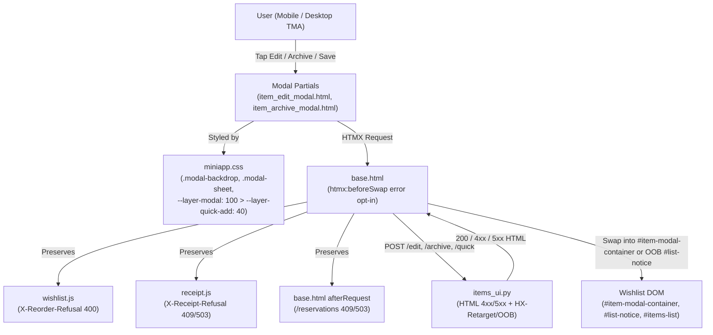

# WISHENKA-160: Older Modals (Edit, Archive) Error Visibility and Modal Presentation

## Research

Inspection of the existing Mini App templates, static assets, FastAPI UI routes, and test suite revealed three root causes for the defects described in [10-requirements.md](10-requirements.md):

1. **Silent 4xx/5xx HTMX failures & target mismatch (`base.html`, `item_edit_modal.html`, `items_ui.py`)**:
   - `base.html` loads `htmx.org@1.9.12`. In htmx 1.9.x, any response with HTTP status `>= 400` sets `detail.shouldSwap = false` and `detail.isError = true` in `htmx:beforeSwap`, so the response body is discarded unless a `htmx:beforeSwap` handler explicitly opts in.
   - `receipt.js` already uses `htmx:beforeSwap` to opt in for responses carrying `X-Receipt-Refusal` (including `nothing_remaining` on archive), and `wishlist.js` uses `htmx:responseError` for `X-Reorder-Refusal: stale_order` (`400`) and `htmx:beforeSwap` to cancel active touch drags. `base.html` has no `htmx:beforeSwap` handler at all — only `htmx:afterRequest` for `/reservations` endpoints.
   - In `item_edit_modal.html`, `#item-detailed-form` targets `#item-card-{{ form.id }}` (`hx-swap="outerHTML"`) in edit mode and `#items-list` (`hx-swap="beforeend"`) in create mode. When `submit_edit_item` returns `409 Conflict` (`CannotReduceQuantityBelowReservedError`) or `503 Service Unavailable` (`InventoryBusyError`), it renders `partials/item_edit_modal.html` without `HX-Retarget` / `HX-Reswap` headers. Even if swapped, targeting the item card instead of `#item-modal-container` would corrupt the list.
   - Several error paths in `items_ui.py` (`WishlistArchivedError` 409, `ItemNotFoundError` / `WishlistNotFoundError` / `PermissionDeniedError` 404, and validation `400` errors in `submit_edit_item`, `quick_add_item`, `archive_item_ui`, `archive_confirm_ui`, `get_edit_item_modal`, `get_new_item_modal`) raise `HTTPException`, which FastAPI serializes as JSON (`{"detail": "..."}`) rather than HTML.

2. **Missing CSS for `.modal-backdrop` and `.modal-sheet` (`miniapp.css`, `base.html`)**:
   - `base.html` only loads `/static/miniapp.css` (no Tailwind CSS is loaded).
   - `item_edit_modal.html` and `item_archive_modal.html` use `.modal-backdrop` and `.modal-sheet` along with Tailwind utility classes (`fixed`, `inset-0`, `z-50`, etc.) that have no definitions in `miniapp.css`.
   - Consequently, both modals render as static blocks in normal document flow inside `#item-modal-container` (at the bottom of `wishlist_detail.html`), where `.quick-add-container` (`position: fixed; bottom: 0; z-index: var(--layer-quick-add)` = `40`) overlaps the bottom controls, including the archive confirmation button.
   - By contrast, `.receipt-backdrop` and `.receipt-sheet` in `miniapp.css` already implement a working fixed bottom-sheet overlay at `z-index: var(--layer-receipt)` (`100`) with `env(safe-area-inset-bottom)` padding and `44px` touch targets.

3. **Missing `hx-target` on inline archive button (`item_edit_modal.html`)**:
   - The `.btn-archive-item` button inside `item_edit_modal.html` has `hx-post="/web/wishlists/{{ wishlist_id }}/items/{{ form.id }}/archive"` and `hx-confirm="..."`, but no `hx-target` or `hx-swap`.
   - Without `hx-target`, htmx targets the `<button>` itself (`innerHTML`), which can replace/corrupt the button content with response markup or fail to surface errors properly.

4. **Test infrastructure constraint (`tests/browser_assets/htmx_stub.js`)**:
   - Chromium CDP browser tests use `htmx_stub.js` (an offline `htmx.ajax` stand-in that dispatches `htmx:beforeSwap`, `htmx:responseError`, `htmx:afterSwap`, and processes `hx-swap-oob` attributes).
   - `htmx_stub.js` does not interpret `HX-Retarget` / `HX-Reswap` response headers, though it does read `detail.shouldSwap` and `detail.isError` from `htmx:beforeSwap` and applies `hx-swap-oob` elements when `detail.shouldSwap === true`.

## Implementation Plan

1. **Modal CSS & Layering (`wishenka/web/static/miniapp.css`)**:
   - Add `--layer-modal: 100;` (above `--layer-quick-add: 40`) in `:root`.
   - Define `.modal-backdrop` (fixed full-viewport overlay, `z-index: var(--layer-modal)`, flex alignment, dimmed backdrop) and `.modal-sheet` (max-width `var(--content-width)`, `max-height: 90vh`, `overflow-y: auto`, safe-area bottom padding, background/text theme variables, rounded top corners on mobile, centered/rounded dialog on desktop).
   - Add clean styles for `.modal-header`, `.modal-footer`, `.modal-sheet form` (resetting global `form` margin/padding/background), `.alert-error`, `.alert-warning`, `.form-group`, `.form-row`, `.quantity-control`, and modal action buttons (`.btn-confirm-archive`, `.btn-archive-item`, `.btn-save`, `.btn-cancel`, `.btn-modal-close`) ensuring `min-height: var(--touch-target)` (`44px`).

2. **HTMX `beforeSwap` Error Handling (`wishenka/web/templates/base.html`)**:
   - Add a targeted `htmx:beforeSwap` listener that enables swapping (`detail.shouldSwap = true; detail.isError = false`) for `4xx`/`5xx` HTML responses targeting `#item-modal-container`, `#item-edit-sheet`, or `#item-archive-modal` (or originating from an element inside `#item-modal-container`), while explicitly excluding:
     - `X-Reorder-Refusal` responses (preserving `wishlist.js` 400 `stale_order` reload flow),
     - `/reservations` requests (preserving `base.html` `htmx:afterRequest` 409/503/401/403/404 reservation handlers),
     - non-HTML / JSON responses (so unexpected JSON errors do not dump raw JSON into the DOM).

3. **Inline Archive Target & Modal Markup (`wishenka/web/templates/partials/item_edit_modal.html`, `item_archive_modal.html`)**:
   - Set `hx-target="#item-modal-container"` and `hx-swap="none"` on `.btn-archive-item` in `item_edit_modal.html` (matching `item_archive_modal.html`'s OOB-driven archive contract).
   - Ensure `item_archive_modal.html` and `item_edit_modal.html` retain their existing IDs (`#item-edit-sheet`, `#item-archive-modal`) and close/cancel behavior (`#item-modal-container`).

4. **HTML Error Responses for Modal Routes (`wishenka/web/routes/items_ui.py`, `wishenka/i18n/catalog.py`)**:
   - On `submit_edit_item` (`409` Reduction Lock, `503` Busy, and `400` validation errors): return `partials/item_edit_modal.html` with `HX-Retarget: #item-modal-container` and `HX-Reswap: innerHTML` headers so htmx 1.9.12 swaps the re-rendered modal with `error_message` and preserved `submitted_form` values into `#item-modal-container` instead of `#item-card-{id}`.
   - On `submit_edit_item` (`409 WishlistArchivedError`, `404` missing/forbidden), `archive_item_ui` (`409 WishlistArchivedError`, `404` missing/forbidden), `quick_add_item` (`400`/`409`/`404`), and modal `GET` routes (`409`/`404`): return HTML OOB responses (clearing `#item-modal-container` and writing a localized user-facing message to `#list-notice` via `oob_text`) with the original HTTP status code (`400`/`404`/`409`), preserving existing status-code contracts and surprise secrecy.

5. **Verification**:
   - Run unit/SSR tests (`test_wish_items_tma_ui.py`, `test_item_busy_responses.py`, `test_wish_items_list_reorder_ui.py`) and Chromium CDP browser tests covering modal layering/clickability over `#quick-add-bar` and 4xx/5xx error visibility.

**Mandatory — Failing Repro (next Step 3):**
- **What it asserts (desired behavior):**
  1. **Browser (Chromium CDP)** in a new test module `tests/test_older_modals_browser.py` (using `BrowserServer` + `browser_helpers.py`):
     - On a mobile viewport (`390x844`), opening `#item-archive-modal` or `#item-edit-sheet` while `#quick-add-bar` is present renders `.modal-backdrop` with `position === 'fixed'` and `z-index > quick-add-bar`, and `document.elementFromPoint(cx, cy)` at the center of `.btn-confirm-archive` (and `.btn-save` / `.btn-archive-item`) hits the modal button itself rather than `#quick-add-bar` or underlying page elements.
     - Submitting `#item-edit-sheet` with a `409` Reduction Lock or `503` `InventoryBusyError` (via `monkeypatch` on `app.state.wishlist_store.execute_wish`) triggers `htmx:beforeSwap` and renders the `[role="alert"]` error message visibly inside `#item-modal-container` without destroying `#item-card-{id}`.
     - Confirming archive on an archived wishlist (`409`) or missing item (`404`) displays a non-empty user-facing notice in `#list-notice` and clears `#item-modal-container` rather than failing silently.
  2. **SSR / Route tests** in `tests/test_wish_items_tma_ui.py` (or `tests/test_older_modals_browser.py` / `tests/test_item_busy_responses.py`):
     - `item_edit_modal.html` inline `.btn-archive-item` carries `hx-target="#item-modal-container"`.
     - `submit_edit_item` 409/503/400 responses include `HX-Retarget: #item-modal-container` and `HX-Reswap: innerHTML`, and `archive_item_ui` 409 (archived wishlist) / 404 (missing item) return `text/html` with `#list-notice` OOB feedback.
- **How to force the failure without live external deps:**
  - Use `BrowserServer` with SQLite `tmp_path` DB, `htmx_stub.js` + `base.html` inline scripts + `miniapp.css`, and `monkeypatch` `execute_wish` for `503` or `service.archive_wishlist` / `service.create_reservation` for `409`.
- **Sequencing:** Write red tests in Step 3 and verify they fail on the current codebase → implement CSS, `base.html` `beforeSwap`, template `hx-target`, and `items_ui.py` HTML error responses in Step 4 until all tests pass.

## Architecture

### System Module Diagram

### Modules and Responsibilities

| Module | Responsibility |
| --- | --- |
| `wishenka/web/static/miniapp.css` | Defines `--layer-modal: 100`, `.modal-backdrop`, `.modal-sheet`, modal form/alert/button styles, safe-area bottom padding, and `44px` touch targets above `--layer-quick-add` (`40`). |
| `wishenka/web/templates/base.html` | Registers a scoped `htmx:beforeSwap` listener allowing `4xx`/`5xx` HTML responses targeting modal elements (`#item-modal-container`, `#item-edit-sheet`, `#item-archive-modal`) to swap without interfering with `/reservations`, `X-Reorder-Refusal`, or `X-Receipt-Refusal`. |
| `wishenka/web/templates/partials/item_edit_modal.html` | Adds `hx-target="#item-modal-container"` and `hx-swap="none"` to the inline `.btn-archive-item` button so archive OOB updates never overwrite the button element. |
| `wishenka/web/templates/partials/item_archive_modal.html` | Retains `#item-archive-modal`, `.modal-backdrop`, `.modal-sheet`, and `#items-list` (`hx-swap="none"`) OOB form contract, styled by `miniapp.css`. |
| `wishenka/web/routes/items_ui.py` | Returns `HX-Retarget: #item-modal-container` + `HX-Reswap: innerHTML` on edit modal validation/conflict/busy re-renders (`400`/`409`/`503`), and returns OOB HTML notices (`#item-modal-container` clear + `#list-notice` message) instead of JSON `HTTPException` for archived/missing-resource errors (`404`/`409`). |
| `wishenka/i18n/catalog.py` | Provides localized (`en`, `ru`) strings for modal error notices (e.g., archived wishlist / unavailable item) without exposing gifter identities. |

### Interaction Scheme (Error Paths)

1. **Edit modal conflict / busy / validation (`409` / `503` / `400`)**:
   - `#item-detailed-form` posts to `/web/wishlists/{id}/items/{item_id}/edit`.
   - `submit_edit_item` returns `partials/item_edit_modal.html` with `error_message` and preserved `submitted_form` values, plus `HX-Retarget: #item-modal-container` and `HX-Reswap: innerHTML`.
   - `base.html` `htmx:beforeSwap` sees `detail.xhr.status >= 400`, HTML content, and target `#item-modal-container` (or `#item-edit-sheet`), sets `detail.shouldSwap = true; detail.isError = false`, and htmx swaps the updated modal into `#item-modal-container`.
2. **Archive modal or inline archive failure (`409` / `404`)**:
   - Form in `item_archive_modal.html` or `.btn-archive-item` in `item_edit_modal.html` posts to `/web/wishlists/{id}/items/{item_id}/archive` with `hx-swap="none"`.
   - On `NothingRemainingError` (`409`), `_nothing_remaining_response` returns `X-Receipt-Refusal: nothing_remaining` + OOB fragments (`receipt.js` & `base.html` allow swap).
   - On `WishlistArchivedError` (`409`) or `ItemNotFoundError` / `WishlistNotFoundError` (`404`), `archive_item_ui` returns HTML OOB fragments clearing `#item-modal-container` and setting `#list-notice` to a localized error message; `base.html` `htmx:beforeSwap` allows the OOB swap.
3. **Preserved existing handlers**:
   - Requests with `X-Reorder-Refusal` are ignored by `base.html`'s `beforeSwap` handler so `detail.isError` remains `true` and `wishlist.js`'s `htmx:responseError` handler reloads the list.
   - Requests matching `reservationRequestPath(elt)` are ignored by `base.html`'s `beforeSwap` handler so `base.html`'s `htmx:afterRequest` continues to handle `401`/`403`/`404`/`409`/`503` reservation errors.

### Patterns & Justification

- **Targeted `htmx:beforeSwap` opt-in**: Mirrors `receipt.js`'s existing `htmx:beforeSwap` pattern, avoiding global `htmx` error-swapping side effects and maintaining full compatibility with htmx 1.9.12 and `htmx_stub.js`.
- **Server-driven OOB + `HX-Retarget`**: Keeps `item_edit_modal.html` reusable for both `GET` (initial open) and `POST` (error re-render) while ensuring unrecoverable `404`/`409` (archived wishlist) errors close the modal cleanly and surface feedback in `#list-notice`.
- **Shared layer token hierarchy**: Using `--layer-modal: 100` alongside `--layer-receipt: 100` above `--layer-quick-add: 40` establishes a deterministic stacking order without touching receipt modal behavior (out of scope per WISHENKA-161).

### Interfaces

- **HTTP Response Headers (`items_ui.py`)**:
  - `HX-Retarget: #item-modal-container`
  - `HX-Reswap: innerHTML`
  - Preserved: `X-Receipt-Refusal: nothing_remaining`, `X-Reorder-Refusal: stale_order`
- **DOM Contracts**:
  - `#item-modal-container`: host for `#item-edit-sheet` and `#item-archive-modal`
  - `#list-notice`: `role="status" aria-live="polite"` container for unrecoverable modal/list notices
  - `.modal-backdrop` / `.modal-sheet`: overlay and scrollable sheet classes in `miniapp.css`

## Q&A

- **Q**: Why not use `htmx.config.responseHandling`?
  **A**: `base.html` uses `htmx.org@1.9.12`, where `responseHandling` is not available (it was introduced in htmx 2.0). Using `htmx:beforeSwap` works in both htmx 1.9.12 and the test `htmx_stub.js`.
- **Q**: Will `4xx`/`5xx` JSON responses (e.g., from API endpoints or unexpected server errors) be swapped into the modal?
  **A**: No. The `beforeSwap` handler checks that the response `Content-Type` is `text/html` before setting `shouldSwap = true`.
