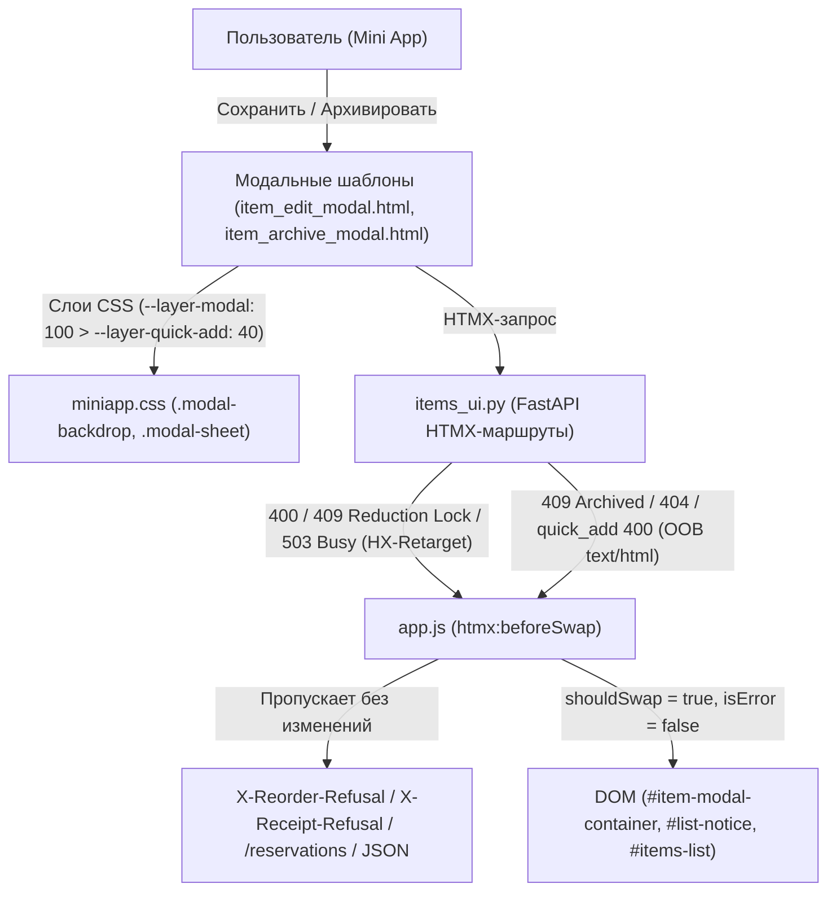

# Спецификация: WISHENKA-160 — Видимость ошибок и модальное отображение диалогов редактирования и архивирования желания

**Задача:** WISHENKA-160  
**Статус:** реализовано и верифицировано (с отражением актуального состояния модулей и последующих доработок в репозитории)  
**Платформа:** Telegram Mini App (FastAPI + Jinja2 + HTMX `1.9.12` + CSS / JavaScript)  
**Языки интерфейса:** русский (`ru`), английский (`en`)

## 1. Назначение и бизнес-цель

### 1.1. Постановка проблемы

При проверке сценариев отметки получения подарков в Telegram Mini App были выявлены системные дефекты в ранее созданных модальных диалогах управления желанием — модальном окне создания/редактирования желания (`#item-edit-sheet`) и модальном окне подтверждения архивирования (`#item-archive-modal`):

- **Невидимые ошибки `4xx`/`5xx`:** библиотека `htmx.org@1.9.12` при любом HTTP-ответе со статусом `>= 400` устанавливает в событии `htmx:beforeSwap` флаги `detail.shouldSwap = false` и `detail.isError = true`, отбрасывая тело ответа. Кроме того, обработчик `submit_edit_item` возвращал повторный рендер формы при `409 Conflict` (Reduction Lock) и `503 Service Unavailable` (`InventoryBusyError`) без заголовков `HX-Retarget` / `HX-Reswap`, а ряд доменных и валидационных сбоев (`WishlistArchivedError`, `ItemNotFoundError`, `WishlistNotFoundError`, `PermissionDeniedError`, ошибки `400`) выбрасывали `HTTPException` в формате JSON вместо HTML. Для пользователя это выглядело как «зависшая» кнопка без какого-либо объяснения.
- **Отсутствие стилей модального слоя и перекрытие кнопок на мобильных экранах:** в базовом шаблоне `wishenka/web/templates/base.html` подключается только `/static/miniapp.css` (без Tailwind CSS), а классы `.modal-backdrop` и `.modal-sheet` не были определены в таблице стилей. Из-за этого модальные окна рендерились как обычные блоки в потоке страницы внутри `#item-modal-container`, где фиксированная нижняя панель быстрого добавления `#quick-add-bar` (`.quick-add-container`, `z-index: var(--layer-quick-add)`) перекрывала нижние элементы управления, включая кнопку подтверждения архивирования `.btn-confirm-archive`.
- **Отсутствие цели обновления у встроенной кнопки архивирования:** кнопка `.btn-archive-item` внутри `partials/item_edit_modal.html` не задавала `hx-target` и `hx-swap`, из-за чего HTMX по умолчанию нацеливался на саму кнопку `<button>`, что при получении ответа могло исказить её содержимое.

### 1.2. Цели и ценность решения

- **Прозрачная обратная связь для авторов вишлиста:** владелец, администратор и участник совместного списка всегда видят понятное локализованное (`ru` / `en`) сообщение об ошибке при конфликтах количества, временной занятости желания, архивном вишлисте, отсутствии ресурса или некорректном вводе, не теряя заполненные поля формы на восстанавливаемых ошибках.
- **Комфортный интерфейс на мобильных и десктопных экранах:** оба модальных окна отображаются как изолированное наложенное полотно (`backdrop`) с прокручиваемым контейнером (`sheet`) поверх списка и панели быстрого добавления `#quick-add-bar`, с соблюдением минимальных областей нажатия (`44px`) и безопасного нижнего отступа (`env(safe-area-inset-bottom)`).
- **Единый и безопасный HTMX-контракт:** сохраняется совместимость с `htmx@1.9.12` и тестовой заглушкой `htmx_stub.js`, не нарушается работа смежных потоков (`X-Reorder-Refusal`, `X-Receipt-Refusal`, запросы `/reservations`) и строго соблюдаются инварианты тайны сюрприза и XSS-защиты.

### 1.3. Границы задачи (исключения)

В рамки WISHENKA-160 явно не входят:

- Глобальная система всплывающих уведомлений (toast) для произвольных сетевых или серверных сбоев (отдельная задача `WISHENKA-90`).
- Доработки доступности и UX диалога получения подарка, включая захват фокуса (`focus trap`) и масштабирование селектора количества (`WISHENKA-161`).
- Консолидация цветовых токенов в `miniapp.css` и рефакторинг общих вспомогательных функций веб-слоя (`WISHENKA-163`, `WISHENKA-165`).
- Замена тестовой заглушки `htmx_stub.js` на вендоринг реального `htmx` или реализация в ней заголовков `HX-Retarget` (`WISHENKA-145`, `WISHENKA-162`).
- Изменения доменных правил бронирования, блокировки снижения количества (Reduction Lock), архивирования и учёта получений.

## 2. Функциональные требования и пользовательские сценарии

### 2.1. Видимость ошибок при редактировании и создании желания

- **Восстанавливаемые ошибки редактирования (`POST /web/wishlists/{wishlist_id}/items/{item_id}/edit`):**
  - **Нарушение Reduction Lock (`409 Conflict`, `CannotReduceQuantityBelowReservedError`):** при попытке снизить запрошенное количество ниже уже полученного числа экземпляров модал не закрывается, вверху формы в блоке `[role="alert"]` выводится локализованное сообщение (`web.item.quantity_below_reserved`), `min` у поля количества обновляется до `max(1, received_quantity)`, все введённые поля формы и опции совместного получателя сохраняются, а карточка `#item-card-{item_id}` в списке остаётся нетронутой.
  - **Временная занятость желания (`503 Service Unavailable`, `InventoryBusyError`):** модал остаётся открытым, выводит нейтральное локализованное сообщение (`web.item.edit_busy_error`) в `[role="alert"]` с сохранением введённых пользователем данных для повторной отправки, не раскрывая наличие бронирований или дарителей.
  - **Ошибки валидации (`400 Bad Request`):** пустое название (`web.item.empty_title`), нечисловые значения цены или идентификатора получателя (`web.item.invalid_numeric`), неверный приоритет (`web.item.invalid_priority`) или доменное `ValueError` приводят к повторной отрисовке модала с `[role="alert"]` и сохранением введённых значений (`parsed.form_data`).
- **Восстанавливаемые ошибки в режиме создания (`POST /web/wishlists/{wishlist_id}/items/new`):**
  - При ошибке валидации формы или доменном `ValueError` (`400 Bad Request`) сервер повторно отрисовывает модал в режиме `is_edit=False` с `[role="alert"]`, сохраняя введённые значения и список участников совместного вишлиста (уточнение реализовано в рамках последующей доработки по задаче `WISHENKA-209`).
- **Невосстанавливаемые ошибки и ошибки быстрого добавления:**
  - **Архивный вишлист (`409 Conflict`, `WishlistArchivedError`)** и **отсутствующий, удалённый или запрещённый ресурс (`404 Not Found` для `WishlistNotFoundError`, `WishlistDeletedError`, `ItemNotFoundError`, `PermissionDeniedError`)** на маршрутах модальных окон (`get_new_item_modal`, `submit_new_item`, `get_edit_item_modal`, `submit_edit_item`, `archive_confirm_ui`, `archive_item_ui`) и быстрого добавления (`quick_add_item`) возвращают `text/html` с OOB-очисткой `#item-modal-container` и выводом локализованного сообщения (`web.item.archived_wishlist_error` или `web.item.resource_not_found`) в `#list-notice`.
  - **Ошибки валидации быстрого добавления (`400 Bad Request` в `quick_add_item`):** при пустом названии (`empty_title`), ошибке разбора (`parse_error`) или доменном `ValueError` (`domain_validation`) возвращается OOB-уведомление в `#list-notice` с очисткой `#item-modal-container`.

### 2.2. Ошибки архивирования и встроенная кнопка архивирования

- **Модал подтверждения архивирования (`#item-archive-modal`):** форма подтверждения отправляет `POST /web/wishlists/{wishlist_id}/items/{item_id}/archive` с `hx-target="#items-list"` и `hx-swap="none"`.
- **Встроенная кнопка архивирования (`.btn-archive-item` в `item_edit_modal.html`):** при `is_edit=True` кнопка выполняет `POST .../archive` с подтверждением `hx-confirm` и явными атрибутами `hx-target="#item-modal-container"` и `hx-swap="none"`, чтобы OOB-ответ не перезаписывал содержимое самой кнопки.
- **Успешное архивирование (`200 OK`):** удаляет карточку `#item-card-{item_id}` из DOM, очищает `#item-modal-container` и обновляет секцию архивных желаний через OOB-фрагменты.
- **Ошибки архивирования:**
  - `NothingRemainingError` (`409 Conflict`) возвращает OOB-ответ с заголовком `X-Receipt-Refusal: nothing_remaining`, закрывает модал, выводит уведомление в `#list-notice` и обновляет активный список, архив и раздел «Подаренные».
  - `WishlistArchivedError` (`409 Conflict`) и ошибки `404` (`WishlistNotFoundError`, `WishlistDeletedError`, `ItemNotFoundError`, `PermissionDeniedError`) закрывают модал и выводят локализованное уведомление в `#list-notice`.

### 2.3. Модальное представление и доступность элементов управления

- Оба модала (`#item-edit-sheet`, `#item-archive-modal`) отображаются внутри фиксированного полноэкранного оверлея `.modal-backdrop` (`z-index: var(--layer-modal)`, значение `100`), что гарантированно располагает их над фиксированной панелью быстрого добавления `#quick-add-bar` (`z-index: var(--layer-quick-add)`, значение `40`).
- Внутренний контейнер `.modal-sheet` ограничен максимальной высотой `90vh` с вертикальной прокруткой `overflow-y: auto` и нижним отступом `max(1rem, env(safe-area-inset-bottom))`; на узких экранах прижимается к нижней границе (`bottom sheet`), а при ширине экрана от `640px` центрируется как диалог со скруглёнными углами.
- Все кнопки действий (`.btn-save`, `.btn-archive-item`, `.btn-confirm-archive`, `.btn-cancel`, `.btn-modal-close`, `.btn-step`) и выпадающие списки `select` внутри `.modal-sheet` имеют минимальную высоту и ширину зоны касания `var(--touch-target)` (`44px`).

### 2.4. Пользовательские сценарии

- **Сценарий 1. Ошибка при сохранении редактируемого желания:** автор открывает модал редактирования, уменьшает количество ниже уже полученного (или сталкивается с занятостью желания / неверным вводом) и нажимает «Сохранить» → внутри `#item-edit-sheet` появляется красный блок ошибки `[role="alert"]`, введённые поля сохраняются, а карточка в списке остаётся без изменений.
- **Сценарий 2. Ошибка при подтверждении архивирования:** автор открывает `#item-archive-modal` и подтверждает архивирование, когда вишлист уже переведён в архив или желание удалено → модал закрывается, а в `#list-notice` выводится актуальное сообщение о недоступности операции.
- **Сценарий 3. Архивация прямо из окна редактирования:** автор нажимает `.btn-archive-item` внутри `#item-edit-sheet` и подтверждает диалог → при успехе карточка удаляется, модал закрывается и обновляется блок архива; при сбое модал закрывается и в `#list-notice` появляется сообщение об ошибке без порчи разметки кнопки.
- **Сценарий 4. Нажатие кнопок модала на мобильном экране:** на мобильном вьюпорте (например, `390x844`) при видимой панели `#quick-add-bar` пользователь открывает `#item-edit-sheet` или `#item-archive-modal` → кнопки `.btn-confirm-archive`, `.btn-save` и `.btn-archive-item` полностью доступны для нажатия и не перекрыты `#quick-add-bar`.

### 2.5. Доменные и UI-инварианты

- **Тайна сюрприза:** модальные окна, сообщения об ошибках и предупреждение об архивировании (`show_gifter_warning`) никогда не содержат `reservations`, `reserved_quantity`, имён или идентификаторов дарителей; в ответе на `InventoryBusyError` (`503`) дарители также не упоминаются.
- **Изоляция смежных обработчиков:** правила перехвата `4xx`/`5xx` в клиентском скрипте не затрагивают `X-Reorder-Refusal` (`wishlist.js`), `X-Receipt-Refusal` (`receipt.js`), запросы `/reservations` и не-HTML ответы.

## 3. Архитектура, компоненты и интерфейсы

### 3.1. Модули и зоны ответственности

| Модуль | Ответственность |
| --- | --- |
| `wishenka/web/static/miniapp.css` | Задаёт `--layer-modal: 100`, стили `.modal-backdrop`, `.modal-sheet`, `.modal-header`, `.modal-footer`, `.alert-error`, `.alert-warning`, `.form-group`, `.form-row`, `.quantity-control`, кнопок модального окна и медиа-запрос `@media (min-width: 640px)`. |
| `wishenka/web/static/app.js` | Подключается из `wishenka/web/templates/base.html` (`defer`); регистрирует ограниченный обработчик `htmx:beforeSwap` для `4xx`/`5xx` HTML-ответов модалов и делегированные клики `[data-clear-target]` / `[data-qty-step][data-qty-target]`. |
| `wishenka/web/templates/partials/item_edit_modal.html` | Рендерит `#item-edit-sheet`, `#item-detailed-form`, баннер ошибки `[role="alert"]` и кнопку `.btn-archive-item` с `hx-target="#item-modal-container"` и `hx-swap="none"`. |
| `wishenka/web/templates/partials/item_archive_modal.html` | Рендерит `#item-archive-modal`, предупреждение `#archive-gifter-warning` (при наличии), форму архивирования (`hx-target="#items-list"`, `hx-swap="none"`) и кнопки `.btn-confirm-archive` / `.btn-modal-close`. |
| `wishenka/web/routes/items_ui.py` | Реализует маршруты UI и вспомогательные функции `_oob_modal_notice`, `_modal_domain_error_response`, `_render_item_modal_error`, `_parse_item_modal_form`, константы `_RETARGET_MODAL_HEADERS` и `_DOMAIN_ERRORS`. |
| `wishenka/web/gifted_view.py` | Предоставляет `oob_text(element_id, text="")` для генерации OOB-блока `innerHTML` с автоматическим HTML-экранированием текста через `markupsafe.Markup`. |
| `wishenka/i18n/catalog.py` | Хранит переводы (`en`, `ru`) ключей `web.item.quantity_below_reserved`, `web.item.edit_busy_error`, `web.item.archived_wishlist_error`, `web.item.resource_not_found`, `web.item.invalid_numeric`, `web.item.invalid_priority`, `web.item.empty_title`. |

### 3.2. Схема взаимодействия при ошибках модальных окон

### 3.3. Клиентский контракт `htmx:beforeSwap` (`wishenka/web/static/app.js`)

Обработчик `htmx:beforeSwap` анализирует только ответы со статусом `xhr.status >= 400` и наличием `xhr.getResponseHeader`:

1. **Исключения (ранний выход без изменения `shouldSwap` / `isError`):**
   - присутствует заголовок ответа `X-Reorder-Refusal` (обрабатывается `wishlist.js` в `htmx:responseError`);
   - присутствует заголовок ответа `X-Receipt-Refusal` (обрабатывается `receipt.js` в `htmx:beforeSwap`);
   - `reservationRequestPath(detail.elt)` возвращает непустой путь (`/reservations`, обрабатывается `htmx:afterRequest` в `app.js`);
   - заголовок `Content-Type` (в нижнем регистре) не содержит подстроку `text/html`.
2. **Условия разрешения вставки (`detail.shouldSwap = true; detail.isError = false`):**
   - `detail.target.id` равен `'item-modal-container'`, `'item-edit-sheet'` или `'item-archive-modal'`; либо
   - `detail.elt.closest('#item-modal-container')` возвращает элемент; либо
   - `detail.target.id === 'items-list'` и `xhr.responseText` содержит одновременно подстроки `'id="item-modal-container"'` и `'hx-swap-oob'`.

### 3.4. Серверные контракты маршрутов (`wishenka/web/routes/items_ui.py`)

| Маршрут | Статус | Заголовки ответа | Формат и DOM-эффект |
| --- | :---: | --- | --- |
| `POST .../items/{item_id}/edit` (`submit_edit_item`) | `200` | — | Карточка `partials/item_card.html` и OOB-очистка `#item-modal-container`. |
| `POST .../items/{item_id}/edit` (`submit_edit_item`) | `400`, `409` (Reduction Lock), `503` | `HX-Retarget: #item-modal-container`, `HX-Reswap: innerHTML` | Повторный рендер `partials/item_edit_modal.html` с `error_message` и `form_data` (`_render_item_modal_error`). |
| `POST .../items/{item_id}/edit` (`submit_edit_item`) | `409` (`WishlistArchivedError`), `404` | — | OOB-очистка `#item-modal-container` и текст в `#list-notice` (`_modal_domain_error_response`). |
| `POST .../items/new` (`submit_new_item`) | `201` | — | Карточка, сброс `#quick-add-input` / `#quick-add-preview-target` и очистка `#item-modal-container`. |
| `POST .../items/new` (`submit_new_item`) | `400` | `HX-Retarget: #item-modal-container`, `HX-Reswap: innerHTML` | Повторный рендер `partials/item_edit_modal.html` (`is_edit=False`) с `error_message` и `form_data`. |
| `POST .../items/new`, `POST .../items/quick`, `GET .../items/new`, `GET .../items/{item_id}/edit`, `GET .../items/{item_id}/archive-confirm` | `409` (`WishlistArchivedError`), `404` (`_DOMAIN_ERRORS`) | — | OOB-очистка `#item-modal-container` и текст в `#list-notice` (`_modal_domain_error_response`). |
| `POST .../items/quick` (`quick_add_item`) | `400` | — | OOB-очистка `#item-modal-container` и сообщение валидации в `#list-notice` (`_oob_modal_notice`). |
| `POST .../items/{item_id}/archive` (`archive_item_ui`) | `200` | — | OOB-удаление `#item-card-{item_id}`, очистка `#item-modal-container`, обновление секции архива. |
| `POST .../items/{item_id}/archive` (`archive_item_ui`) | `409` (`NothingRemainingError`) | `X-Receipt-Refusal: nothing_remaining` | OOB-закрытие модала, `#list-notice`, обновление списка, архива и раздела «Подаренные». |
| `POST .../items/{item_id}/archive` (`archive_item_ui`) | `409` (`WishlistArchivedError`), `404` | — | OOB-очистка `#item-modal-container` и текст в `#list-notice` (`_modal_domain_error_response`). |

### 3.5. DOM-контракты и иерархия слоёв CSS

- **DOM-узлы на странице `wishlist_detail.html`:**
  - `#list-notice` (`role="status" aria-live="polite" tabindex="-1"`) — область отображения невосстанавливаемых и OOB-уведомлений.
  - `#items-list` — контейнер карточек желаний `#item-card-{id}`.
  - `#item-modal-container` — точка монтирования `#item-edit-sheet` и `#item-archive-modal`.
  - `#quick-add-bar` (`.quick-add-container`, подключается из `partials/item_quick_add.html`) — фиксированная нижняя панель быстрого добавления.
- **Иерархия `z-index` в `:root` (`wishenka/web/static/miniapp.css`):**
  - `--layer-drag: 10` (перетаскивание карточки);
  - `--layer-quick-add: 40` (фиксированная нижняя панель быстрого добавления);
  - `--layer-receipt: 100` (шторка отметки получения);
  - `--layer-modal: 100` (модальные окна редактирования и архивирования).

## 4. Нефункциональные требования, безопасность и наблюдаемость

### 4.1. Производительность и адаптивность

- CSS-оформление модальных окон задаётся статическими правилами без дополнительных сетевых запросов и без дополнительных обращений к базе данных на успешных сценариях.
- Клиентский обработчик `htmx:beforeSwap` выполняет проверки заголовков и элементов за время `O(1)`, обращаясь к поиску подстрок в `responseText` только при одновременном выполнении условий `status >= 400`, `text/html` и `targetId === 'items-list'`.
- Вертикальная прокрутка внутри `.modal-sheet` (`max-height: 90vh; overflow-y: auto`) и нижний отступ `max(1rem, env(safe-area-inset-bottom))` предотвращают выход кнопок за пределы мобильного экрана с учётом системных панелей Telegram Mini App.

### 4.2. Безопасность и приватность

- **XSS-защита:** текст OOB-уведомлений формируется исключительно через `oob_text()` (`markupsafe.Markup('
{}
').format(...)`), что обеспечивает HTML-экранирование любых сообщений; шаблоны Jinja2 автоматически экранируют `error_message` и значения полей формы.
- **Защита от утечки сырого JSON:** благодаря проверке `Content-Type` на `text/html` в `htmx:beforeSwap` JSON-ответы (например, `422` при ошибке разбора FastAPI или ответы JSON API) не подставляются в DOM.
- **Тайна сюрприза:** в контекстах модалов и в логах не присутствуют поля бронирований и данные дарителей; в ответе `503` на `InventoryBusyError` используется нейтральная формулировка без упоминания дарителя.
- **Конфиденциальность журналов событий:** пользовательский ввод (`title`, `price`, `raw_input`, `description`, `link`, `recipient_name`) и токены никогда не включаются в поля `extra` и текст логов.

### 4.3. Наблюдаемость (структурированное логирование и метрики)

В проекте не используется внешний сборщик метрик (Prometheus/OpenTelemetry); наблюдаемость реализована через структурированное логирование Python `logging` с параметром `extra={...}` на логгере `wishenka.web.items_ui`:

| Событие (`event`) | Уровень | Поля контекста (`extra`) | Условие генерации |
| --- | :---: | --- | --- |
| `ui_modal_domain_error` | `WARNING` | `operation`, `error_type`, `status_code`, `wishlist_id`, `item_id`, `actor_id`, `user_id` | `WishlistArchivedError` (`409`) или `404` (`WishlistNotFoundError`, `WishlistDeletedError`, `ItemNotFoundError`, `PermissionDeniedError`) в модальных и UI-маршрутах. |
| `ui_item_edit_validation_error` | `WARNING` | `stage` (`"form"` \| `"domain"`), `status_code` (`400`), `wishlist_id`, `item_id`, `actor_id`, `user_id` | Отказ валидации формы или доменного `ValueError` при сохранении редактирования. |
| `ui_item_quick_add_validation_error` | `WARNING` | `reason` (`"empty_title"` \| `"parse_error"` \| `"domain_validation"`), `status_code` (`400`), `wishlist_id`, `actor_id`, `user_id` | Ошибка валидации при быстром добавлении желания (`quick_add_item`). |
| `ui_item_edit_busy` | `WARNING` | `wishlist_id`, `item_id` | `InventoryBusyError` (`503`) при сохранении редактирования (сохранённое событие; без указания дарителя). |
| `ui_reduction_lock_rejected` | `WARNING` | `wishlist_id`, `item_id`, `actor_id`, `user_id`, `requested_quantity`, `received_quantity` | Отклонение уменьшения количества ниже полученного (`409`, сохранённое событие). |
| `ui_item_create_validation_error` | `WARNING` | `stage` (`"form"` \| `"domain"`), `status_code` (`400`), `wishlist_id`, `actor_id`, `user_id` | Ошибка валидации формы или доменного `ValueError` в `submit_new_item` (дополнительный маршрут создания). |
| `ui_item_edit_opened`, `ui_item_edit_saved`, `ui_item_archive_confirm_opened`, `ui_item_archived`, `ui_item_quick_add_success`, `ui_item_create_success` | `INFO` | `wishlist_id`, `item_id` (где применимо), `actor_id`, `user_id` и атрибуты операции | Успешное открытие, сохранение, создание или архивирование желания через UI. |

## 5. Верификация и критерии приёмки

### 5.1. Автоматизированные тестовые сценарии

- **HTTP / SSR-контракты и браузерные тесты Chromium CDP (`tests/test_item_modals_repro.py`, маркер `pytest.mark.timeout(45)`):**
  - `test_edit_modal_inline_archive_has_modal_container_target`: проверяет наличие `hx-target="#item-modal-container"` и `hx-swap="none"` на `.btn-archive-item` в `GET .../edit`.
  - `test_submit_edit_item_409_and_503_include_hx_retarget_headers`: проверяет заголовки `HX-Retarget: #item-modal-container` и `HX-Reswap: innerHTML` для `409` Reduction Lock и `503` `InventoryBusyError`.
  - `test_submit_edit_item_400_empty_title_returns_html_retargeted_to_modal`: проверяет статус `400`, `text/html`, заголовки перенацеливания и блок `role="alert"`.
  - `test_archive_item_ui_archived_wishlist_and_missing_item_return_oob_html`: проверяет, что `404` и `409` (архивный вишлист) на `POST .../archive` возвращают `text/html` с `#list-notice[hx-swap-oob]` и `#item-modal-container[hx-swap-oob]`.
  - `test_archive_modal_layers_above_quick_add_bar_and_button_is_clickable` (`@pytest.mark.browser`, вьюпорт `390x844`): проверяет `position === 'fixed'`, `backdropZ > quickAddZ` и попадание `document.elementFromPoint` в `#item-archive-modal .btn-confirm-archive`.
  - `test_edit_modal_layers_above_quick_add_bar_and_controls_unobstructed` (`@pytest.mark.browser`, вьюпорт `390x844`): проверяет фиксированное наложение, `backdropZ > quickAddZ` и достижимость `#item-edit-sheet .btn-save` и `#item-edit-sheet .btn-archive-item`.
  - `test_edit_modal_409_and_503_render_alert_inside_modal_container` (`@pytest.mark.browser`): проверяет видимый вывод `[role="alert"]` внутри `#item-modal-container` при `409` и `503` и сохранность карточки `#item-card-{item_id}`.
  - `test_archive_modal_409_archived_wishlist_shows_list_notice_and_closes_modal` (`@pytest.mark.browser`): проверяет непустой `#list-notice` и очистку `#item-modal-container` при `409` архивного вишлиста.
- **Тесты наблюдаемости (`tests/test_wishenka_160_observability.py`, маркер `pytest.mark.timeout(30)`):**
  - `test_edit_validation_error_logs_structured_warning_without_payload`: проверяет запись `ui_item_edit_validation_error` (`WARNING`, `stage="form"`) и отсутствие в логах пользовательских строк `title` и `price`.
  - `test_quick_add_validation_error_logs_structured_warning`: проверяет `ui_item_quick_add_validation_error` (`reason="empty_title"`).
  - `test_modal_domain_errors_log_structured_warning`: проверяет `ui_modal_domain_error` при `404` (`operation="archive_item"`, `ItemNotFoundError`) и `409` (`operation="submit_edit_item"`, `WishlistArchivedError`).
  - `test_edit_busy_logs_structured_warning`: проверяет `ui_item_edit_busy` при `503` `InventoryBusyError`.

### 5.2. Зафиксированные результаты проверок в артефактах WISHENKA-160

По отчётам `40-code-cleanup.md` (Шаг 5) и `50-observability.md` (Шаг 6):

- **Статический анализ (`make analyze` — `ruff check`, `ruff format --check`, `mypy`):** 0 ошибок и 0 предупреждений (проверено по `200` файлам на Шаге 5 и `201` файлу на Шаге 6).
- **Целевые прогоны тестов на Шаге 5 (`40-code-cleanup.md`):** `28 passed in 87.13s` (`tests/test_item_modals_repro.py`, `tests/test_wish_items_tma_ui.py`, `tests/test_item_busy_responses.py`, `tests/test_wish_items_list_reorder_ui.py`).
- **Целевые прогоны тестов на Шаге 6 (`50-observability.md`):** `15 passed in 45.00s` (`tests/test_wishenka_160_observability.py`, `tests/test_item_modals_repro.py`, `tests/test_item_busy_responses.py`).

### 5.3. Критерии приёмки

1. При ошибках редактирования (`400`, `409` Reduction Lock, `503` Busy) пользователь видит сообщение `[role="alert"]` внутри `#item-edit-sheet` с сохранёнными введёнными полями; карточка в `#items-list` не повреждается.
2. При ошибках архивного вишлиста (`409`), отсутствующего/удалённого ресурса (`404`) и ошибках валидации `quick_add` (`400`) модал закрывается (если был открыт), а `#list-notice` отображает локализованное сообщение.
3. Нажатие `.btn-archive-item` внутри `item_edit_modal.html` обновляет страницу через OOB без искажения самой кнопки.
4. Модальные окна `#item-edit-sheet` и `#item-archive-modal` располагаются поверх `#quick-add-bar` (`--layer-modal: 100 > --layer-quick-add: 40`), корректно прокручиваются, учитывают `env(safe-area-inset-bottom)` и обеспечивают область нажатия не менее `44px`.
5. Все логируемые события ошибок используют структурированный формат без утечек пользовательских строк и данных о бронированиях.

### 5.4. Известные ограничения и задачи развития (по `60-tech-debt.md`)

- **Упрощённый контекст при ранней ошибке `400` в `submit_edit_item`:** при сбое парсинга формы до чтения из хранилища (`parsed.validation_error is not None`) `_render_item_modal_error` вызывается с `min_quantity=1`, `is_collaborative=False` и `collaborative_members=[]`. Подсказка `min` по `received_quantity` и выбор получателя совместного списка временно скрываются до следующей отправки (серверная валидация при сохранении остаётся полной).
- **Строковая проверка OOB-ответов для `#items-list` в `htmx:beforeSwap` (`wishenka/web/static/app.js`):** условие `targetId === 'items-list'` опирается на наличие подстрок `'id="item-modal-container"'` и `'hx-swap-oob'`, что зависит от сохранения имени контейнера и формата атрибутов.
- **Ограничения тестовой заглушки `tests/browser_assets/htmx_stub.js`:** заглушка не обрабатывает `HX-Retarget` / `HX-Reswap`, поэтому перенацеливание проверяется в HTTP/SSR-тестах, а `htmx:beforeSwap` и вёрстка — в браузерных тестах Chromium CDP (отслеживается в `WISHENKA-145` / `WISHENKA-162`).
- **Нетестированный клиентский поток `422` JSON:** если клиент отправит нецелочисленное значение в `quantity: Annotated[int, Form()]`, FastAPI вернёт `422` JSON, который намеренно отфильтровывается проверкой `text/html` в `htmx:beforeSwap` (обычный ввод в браузере ограничен `<input type="number">`).
- **Невыполненный полный прогон всего `pytest`-набора в рамках Шагов 4–6** (выполнялись целевые наборы тестов и полный `make analyze`).
- **Задачи дальнейшего развития и связанные тикеты:**
  - **[WISHENKA-209](https://pypost.atlassian.net/browse/WISHENKA-209)** (сохранение введённых значений в модале создания `is_edit=False` при `400`): в `60-tech-debt.md` отмечено как ограничение, так как исходно модал создания использовал `quick_add_item` и закрывался через `_oob_modal_notice`; в текущей кодовой базе уже добавлен маршрут `submit_new_item` (`POST /web/wishlists/{wishlist_id}/items/new`) и общий разбор `_parse_item_modal_form`, возвращающий `_render_item_modal_error(..., is_edit=False)`, а обработчик `htmx:beforeSwap` вынесен из `base.html` в `wishenka/web/static/app.js`.
  - **WISHENKA-163:** замена литеральных hex-цветов в модальных стилях `miniapp.css` на переменные темы и удаление устаревших Tailwind-классов из `item_edit_modal.html` и `item_archive_modal.html`.
  - **WISHENKA-165:** вынос общих вспомогательных функций веб-слоя и декомпозиция `submit_edit_item`.
  - **WISHENKA-145 / WISHENKA-162:** вендоринг реального `htmx` или поддержка `HX-Retarget` в `htmx_stub.js`.
  - **WISHENKA-90:** глобальные toast-уведомления для общих сетевых и серверных ошибок.
