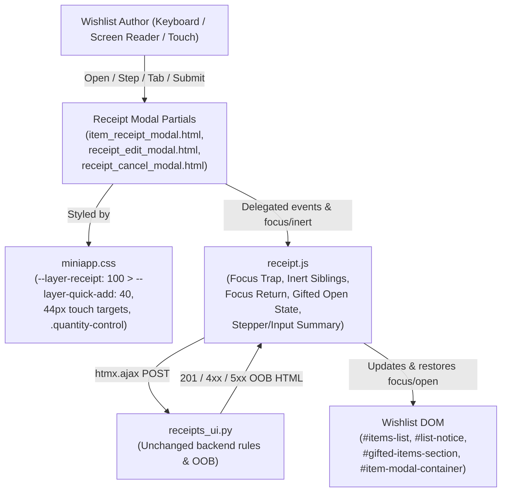

# WISHENKA-161: Gift Receipt Dialog Accessibility, Focus Management, and Mobile Behavior

## Research

Inspection of the Mini App templates, static scripts, CSS, routes, and test suite established the exact causes and constraints for the five areas in [10-requirements.md](10-requirements.md):

1. **Focus loss on receipt confirmation and refusal (`wishenka/web/static/receipt.js`, `wishenka/web/templates/wishlist_detail.html`)**:
   - `receipt.js` stores `openerCardId` when `.btn-receipt-item` is clicked, and `closeDialog()` returns focus to `#${openerCardId} .item-card-summary`.
   - However, when `submitReceipt(form)` succeeds (`201 Created`), the server (`wishenka/web/routes/receipts_ui.py`) returns OOB fragments that clear `#item-modal-container` and either replace `#item-card-{id}` (partial receipt) or replace `#items-list` innerHTML (full receipt).
   - In `tests/browser_assets/htmx_stub.js`, `htmx:afterSwap` is dispatched on `target` (`#receipt-feedback`) *after* `applyOutOfBand` has already detached `#receipt-feedback` from `document`, so a `document`-level `htmx:afterSwap` listener never sees it. Instead, `submitReceipt(form)` awaits the `htmx.ajax` Promise and calls `finishAttempt(form)` in `.then(done, done)`.
   - Currently `finishAttempt(form)` returns early when `!document.contains(form)`, leaving `openerCardId` uncleared and focus dropped onto `document.body`.
   - Additionally, on `quantity_above_remaining` refusals, `_effect_fragments` OOB-replaces `#item-receipt-modal` (detaching the old `form` while a new `#item-receipt-modal` is now in the DOM), and on other refusals the existing `#receipt-feedback` receives text without moving focus to `#receipt-feedback` or inside the dialog.
   - `#list-notice` in `wishlist_detail.html` currently lacks `tabindex="-1"`, so it cannot receive programmatic focus on full receipt when the wish leaves `#items-list`.

2. **Missing modal isolation and focus trap (`wishenka/web/static/receipt.js`, `wishenka/web/templates/partials/item_receipt_modal.html`, `receipt_edit_modal.html`, `receipt_cancel_modal.html`)**:
   - All three receipt modal partials (`item_receipt_modal.html`, `receipt_edit_modal.html`, `receipt_cancel_modal.html`) have `role="dialog" aria-labelledby="receipt-title"` but lack `aria-modal="true"`.
   - `receipt.js` has no `Tab` / `Shift+Tab` containment handler, so keyboard navigation escapes `#item-receipt-modal` into the underlying page.
   - `#item-modal-container` is a sibling of `<header>`, `#list-notice`, `#items-list`, `#gifted-items-section`, `#archived-items-section`, and `#quick-add-bar` inside `.wishlist-detail-view` (which is inside `<main>`, a sibling of `<nav class="top-nav">`). Placing `inert` on `<main>` would disable the modal itself; instead, walking ancestors from `#item-modal-container` to `document.body` and marking non-ancestor siblings with `inert` and `aria-hidden="true"` cleanly isolates all background content while keeping `#item-modal-container` interactive.

3. **«Подаренные» `
` collapses on OOB update (`wishenka/web/templates/partials/gifted_items_section.html`, `wishenka/web/static/receipt.js`)**:
   - `gifted_items_section.html` renders `<section id="gifted-items-section">` containing `
`.
   - Every receipt confirmation (`record_receipt_ui`, `edit_receipt_ui`, `cancel_receipt_ui`) returns `_gifted_oob` with `hx-swap-oob="outerHTML"`, replacing `#gifted-items-section` with a fresh `
` element that lacks the `open` attribute.
   - Capturing `details.open` in `receipt.js` before OOB swap (`htmx:beforeSwap` / `submitReceipt`) and restoring `details.open = true` after the swap completes preserves the user's expanded/collapsed state without backend changes.

4. **Unbounded `<select>` quantity list (`wishenka/web/templates/partials/item_receipt_modal.html`, `wishenka/web/static/receipt.js`, `wishenka/web/static/miniapp.css`)**:
   - `item_receipt_modal.html` renders `<option>` for every integer `1..remaining`. For `remaining = 500`, this creates 500 DOM options.
   - Existing unit/route tests (`tests/test_receipt_ui_routes.py`) expect `<select name="quantity">` for small quantities (e.g., `remaining = 5`) and `<input type="hidden" name="quantity" value="1">` for `remaining = 1`.
   - Using a threshold `RECEIPT_SELECT_MAX = 20` (passed as template context or constant in `item_receipt_modal.html`):
     - `remaining == 1`: hidden input `1` (unchanged).
     - `1 < remaining <= 20`: compact `<select id="receipt-quantity" name="quantity" data-receipt-quantity data-remaining="...">` (unchanged).
     - `remaining > 20`: `.quantity-control` with `-` / `+` `.btn-step` buttons (`data-receipt-step="-1"` / `"1"`) and `<input id="receipt-quantity" type="number" name="quantity" data-receipt-quantity data-remaining="..." min="1" max="..." step="1" inputmode="numeric" required>`.
   - **Important static-test constraint (`tests/test_receipt_static_script.py`)**:
     - `base.html`'s inline script is SHA-256 pinned (`INLINE_SCRIPT_SHA256`) and must **not** be modified.
     - `item_receipt_modal.html` must **not** contain inline `on*` event handlers (`test_pages_and_partials_carry_no_inline_handlers`).
     - `receipt.js` must have `htmx.ajax(` count `== 1`, no `innerHTML`/`eval(`/console.`, and **no string literals matching `[a-z]+(?:_[a-z]+)+`** outside `REFUSAL_REASONS` (`test_closed_reason_set_mirrors_the_refusal_table`). All new data attributes, selectors, and identifiers in `receipt.js` must use kebab-case (e.g., `data-receipt-step`) or camelCase.

5. **Browser test runner & CDP capabilities (`tests/browser_cdp.py`, `tests/test_receipt_modal_browser.py`)**:
   - The environment uses Chromium over CDP (`tests/browser_cdp.py`, `BrowserServer`, `htmx_stub.js`), not Playwright.
   - `CdpPage.press_key` currently supports `Enter`, `Space`, `Escape`, `ArrowDown`, and single letters, but not `Tab` or `Shift+Tab`. Extending `_KEYS` with `"Tab": ("Tab", "Tab", 9, "")` and supporting `Shift+Tab` (CDP `modifiers: 8`) enables real keyboard Tab/Shift+Tab containment tests.
   - `miniapp.css` already defines `--layer-receipt: 100` (> `--layer-quick-add: 40`), `--touch-target: 44px`, and `env(safe-area-inset-bottom)` on `.receipt-sheet`; `.receipt-sheet .quantity-control input` and `.receipt-sheet .btn-step` need explicit `min-height: var(--touch-target)` / `min-width: var(--touch-target)` alignment and browser verification at mobile viewport (`390x844`).

## Implementation Plan

1. **Modal Semantics & Scalable Quantity Markup (`wishenka/web/templates/partials/item_receipt_modal.html`, `receipt_edit_modal.html`, `receipt_cancel_modal.html`, `wishenka/web/templates/wishlist_detail.html`)**:
   - Add `aria-modal="true"` to `#item-receipt-modal` in all three receipt modal templates.
   - Add `tabindex="-1"` to `#list-notice` in `wishlist_detail.html` so it can receive programmatic focus after a full receipt.
   - In `item_receipt_modal.html`, keep `<input type="hidden">` for `remaining == 1` and `<select>` for `1 < remaining <= 20`; for `remaining > 20`, render `.quantity-control` with `-` / `+` `.btn-step` buttons (`data-receipt-step="-1"` / `"1"`, localized `aria-label` using existing `web.item.decrease_qty` / `web.item.increase_qty`) and `<input id="receipt-quantity" type="number" name="quantity" data-receipt-quantity data-remaining="{{ remaining }}" min="1" max="{{ remaining }}" step="1" inputmode="numeric" value="{{ chosen }}" required>` (no inline `on*` handlers).

2. **Modal CSS (`wishenka/web/static/miniapp.css`)**:
   - Ensure `.receipt-sheet .quantity-control` and `.receipt-sheet .btn-step` have `min-height: var(--touch-target)` (`44px`) and `.btn-step` has `min-width: var(--touch-target)` (`44px`), and style `.receipt-sheet input[type="number"]` cleanly with theme variables.

3. **Focus Management, Focus Trap, Background Isolation, «Подаренные» State, & Stepper Logic (`wishenka/web/static/receipt.js`)**:
   - **Background isolation**: Add `setBackgroundInert(active)` walking from `#item-modal-container` up to `document.body`, setting `inert` and `aria-hidden="true"` on non-ancestor element siblings (skipping `<script>`/`<style>`/`<template>`) and restoring only elements marked by `receipt.js` when the dialog closes.
   - **Focus trap**: In the `keydown` listener, when `MODAL_SELECTOR` is open and `event.key === 'Tab'`, query visible, enabled focusable descendants inside `#item-receipt-modal` and wrap focus between the first and last element on `Tab` / `Shift+Tab`.
   - **Focus lifecycle**:
     - On `htmx:afterSwap` into `#item-modal-container` when `#item-receipt-modal` is present: enable background `inert`, and focus `#receipt-feedback` (with `tabindex="-1"`) if it has non-empty text (blocked/refusal dialog), else focus the first interactive control (`[data-receipt-quantity], #receipt-edit-quantity, .btn-receipt-confirm, [data-modal-close]`).
     - On `closeDialog()` (Cancel / Escape / backdrop click): remove background `inert`, restore focus to `#${openerCardId} .item-card-summary` if present, else `openerElement` if connected, else `#list-notice`.
     - In `finishAttempt(form)` (after `htmx.ajax` settles):
       - Restore `gifted-items-details` `open` state if `giftedWasOpen` was true.
       - If `#item-receipt-modal` is still in `document` (refusal, including `quantity_above_remaining` OOB replacement, or network failure): keep background `inert`, reset busy state if `form` is still connected, and move focus to `#receipt-feedback` (with `tabindex="-1"`) if non-empty, else to the primary dialog control.
       - If `#item-receipt-modal` is no longer in `document` (receipt succeeded): remove background `inert`; if `openerCardId` card still exists (partial receipt), focus `#${openerCardId} .item-card-summary`; else (full receipt), focus `#list-notice` (ensuring `tabindex="-1"`). Clear `openerCardId`.
   - **«Подаренные» state**: Capture `Boolean(document.querySelector('#gifted-items-section details.gifted-items-details')?.open)` in `submitReceipt(form)` and in `htmx:beforeSwap` (when `#gifted-items-section` is in `xhr.responseText`), and restore `details.open = true` after swap.
   - **Scalable quantity control**:
     - Handle `click` on `[data-receipt-step]` to increment/decrement `[data-receipt-quantity]` within `[1, remaining]` and call `updateSummary`.
     - Handle `input` and `change` on `[data-receipt-quantity]` (clamping on `change`, updating summary live for valid integers in `[1, remaining]`).
     - In `submitReceipt(form)`, if `field` is an `<input type="number">` and `!field.checkValidity()`, call `field.reportValidity()` and abort submission cleanly.
   - Respect all `test_receipt_static_script.py` invariants (single `htmx.ajax(`, no `innerHTML`/`eval(`/console.`, no `snake_case` string literals outside `REFUSAL_REASONS`).

4. **CDP Keyboard Support (`tests/browser_cdp.py`)**:
   - Add `"Tab": ("Tab", "Tab", 9, "")` to `_KEYS` and support `"Shift+Tab"` (dispatching with `modifiers: 8`) in `CdpPage.press_key`.

**Mandatory — Failing Repro (next Step 3):**
- **What it asserts (desired behavior):**
  In `tests/test_receipt_accessibility_browser.py` (Chromium CDP, `BrowserServer` + `htmx_stub.js`, mobile viewport `390x844`) and SSR assertions in `tests/test_receipt_ui_routes.py`:
  1. **Modal semantics, background isolation, and Tab trap**: Opening `#item-receipt-modal` sets `aria-modal="true"`, marks background siblings (including `#items-list`, `#quick-add-bar`, `<nav>`) as `inert` and `aria-hidden="true"`, and pressing `Tab` / `Shift+Tab` cycles strictly within `#item-receipt-modal` without ever focusing background elements.
  2. **Focus return on partial receipt, full receipt, and refusal**:
     - Partial receipt closes the dialog, removes `inert`, and moves `document.activeElement` to `#item-card-{id} .item-card-summary`.
     - Full receipt closes the dialog, removes `inert`, and moves `document.activeElement` to `#list-notice` (not `document.body`).
     - In-dialog refusal (e.g., `InventoryBusyError` 503 or `quantity_above_remaining` 409) keeps focus inside `#item-receipt-modal` on `#receipt-feedback`.
  3. **«Подаренные» state preservation**: Expanding `details.gifted-items-details` before recording a receipt keeps `details.open === true` after the OOB update completes; when collapsed, it stays `false`.
  4. **Scalable quantity selection**: For a wish with `remaining = 500`, `GET .../receipt` renders no `<select>` / 500 `<option>`s and instead renders `input[type="number"][data-receipt-quantity][max="500"]` with `-`/`+` `[data-receipt-step]` buttons; clicking `+` / typing updates `[data-receipt-summary]` and submits the chosen quantity.
  5. **Mobile 44 px touch targets & quick-add bar overlay**: At `390x844` with `#quick-add-bar` present, all interactive controls in `#item-receipt-modal` (`select`/`input`, `.btn-step`, `.btn-receipt-confirm`, `.btn-modal-close`) have `getBoundingClientRect().width >= 44` and `height >= 44`, and `document.elementFromPoint(cx, cy)` on `.btn-receipt-confirm` and `.btn-modal-close` resolves to the dialog buttons rather than `#quick-add-bar`.
- **How to force the failure without live external deps:**
  - Use `BrowserServer` with SQLite `tmp_path` DB, `seed_wishlist`, `htmx_stub.js`, and `monkeypatch` on `app.state.wishlist_store.execute_wish` for `503` or `record_receipt` for `409`.
- **Sequencing:** Write red tests in Step 3 and verify they fail on the current codebase → implement template, CSS, `receipt.js`, and `browser_cdp.py` changes in Step 4 until all existing and new tests pass.

## Architecture

### System Module Diagram

### Modules and Responsibilities

| Module | Responsibility |
| --- | --- |
| `wishenka/web/templates/partials/item_receipt_modal.html` | Adds `aria-modal="true"`; renders `<select>` for `2..20` remaining and `.quantity-control` (`-`/`+` `[data-receipt-step]` + `input[type="number"]`) for `> 20` remaining without inline `on*` handlers. |
| `wishenka/web/templates/partials/receipt_edit_modal.html` & `receipt_cancel_modal.html` | Adds `aria-modal="true"` to `#item-receipt-modal` for consistent modal semantics across receipt dialogs. |
| `wishenka/web/templates/wishlist_detail.html` | Adds `tabindex="-1"` to `#list-notice` so it is a valid programmatic focus target after a full receipt. |
| `wishenka/web/static/miniapp.css` | Ensures `.receipt-sheet .btn-step` and `.receipt-sheet .quantity-control input` meet `--touch-target` (`44px`) and align cleanly on mobile viewports above `--layer-quick-add` (`40`). |
| `wishenka/web/static/receipt.js` | Manages background `inert`/`aria-hidden` isolation, `Tab`/`Shift+Tab` focus trap, focus placement on open/refusal/partial/full/dismissal, `details.gifted-items-details` open-state preservation across OOB swaps, and `[data-receipt-step]`/`[data-receipt-quantity]` stepper & validation. |
| `tests/browser_cdp.py` | Adds `Tab` and `Shift+Tab` dispatch support to `CdpPage.press_key` for browser keyboard-trap testing. |

### Interaction Scheme

1. **Dialog Open (`GET .../receipt` -> `htmx:afterSwap` on `#item-modal-container`)**:
   - `receipt.js` isolates all non-ancestor siblings of `#item-modal-container` up to `document.body` (`inert` + `aria-hidden="true"`).
   - Focus moves to `#receipt-feedback` (if blocked/non-empty) or the first interactive control (`[data-receipt-quantity]`, `#receipt-edit-quantity`, `.btn-receipt-confirm`, `[data-modal-close]`).
   - `Tab` / `Shift+Tab` wraps strictly within visible enabled controls in `#item-receipt-modal`.
2. **Receipt Submission (`POST .../receipt`)**:
   - `submitReceipt(form)` validates numeric input bounds, captures `giftedWasOpen` from `#gifted-items-section details.gifted-items-details`, and sends `htmx.ajax('POST', ...)`.
   - When the Promise settles, `finishAttempt(form)`:
     - Restores `details.gifted-items-details.open = true` if `giftedWasOpen` was set.
     - If `#item-receipt-modal` remains in `document` (refusal): keeps background `inert`, clears busy state if `form` is connected, and focuses `#receipt-feedback` (or primary control).
     - If `#item-receipt-modal` left `document` (success): removes background `inert`, focuses `#${openerCardId} .item-card-summary` (partial receipt) or `#list-notice` (full receipt), and clears `openerCardId`.
3. **Dismissal (Cancel button / Escape / Backdrop click)**:
   - `closeDialog()` clears `#item-modal-container`, removes background `inert`, and returns focus to `#${openerCardId} .item-card-summary` (or `openerElement` / `#list-notice`).

### Architectural Patterns & Justification

- **Ancestor-sibling `inert` + `aria-hidden`**: Marking siblings along the ancestor chain from `#item-modal-container` to `document.body` avoids making the modal itself inert while guaranteeing complete keyboard and screen-reader isolation of `#items-list`, `#quick-add-bar`, and `<nav>`.
- **Promise-settled lifecycle in `receipt.js`**: Relying on `finishAttempt(form)` after `htmx.ajax` settles (rather than `htmx:afterSwap` on a detached `#receipt-feedback`) works identically under both `htmx.org@1.9.12` and `htmx_stub.js`, without touching `base.html`'s SHA-256-pinned inline script.
- **Thresholded quantity control (`<= 20` select, `> 20` stepper)**: Preserves existing `<select>` contracts for small wishes while scaling to arbitrary quantities (e.g., 500+) without hundreds of `<option>` nodes.

### Interfaces

- **DOM Contracts**:
  - `#item-receipt-modal[role="dialog"][aria-modal="true"][aria-labelledby="receipt-title"]`
  - `[data-receipt-quantity][data-remaining]` (either `<select>` or `<input type="number">`)
  - `[data-receipt-step="-1" | "1"]` stepper buttons inside `.quantity-control`
  - `#list-notice[tabindex="-1"]` programmatic focus target on full receipt
  - `#gifted-items-section details.gifted-items-details` open state preserved across OOB replacement

## Q&A

- **Q**: Why not place the modal focus trap or `gifted-items-details` logic in `base.html`?
  **A**: `tests/test_receipt_static_script.py` pins the exact SHA-256 hash of `base.html`'s inline script and forbids `"receipt"` references in it. Keeping all receipt dialog logic in `wishenka/web/static/receipt.js` satisfies that invariant cleanly.
- **Q**: Why use `RECEIPT_SELECT_MAX = 20` instead of always rendering `<input type="number">`?
  **A**: Existing route/SSR and browser tests (`test_receipt_ui_routes.py`, `test_receipt_modal_browser.py`) assert `<select name="quantity">` for small quantities (e.g., 5) and `<input type="hidden">` for 1. Keeping `<select>` up to 20 preserves backward compatibility while eliminating large option lists above 20.
