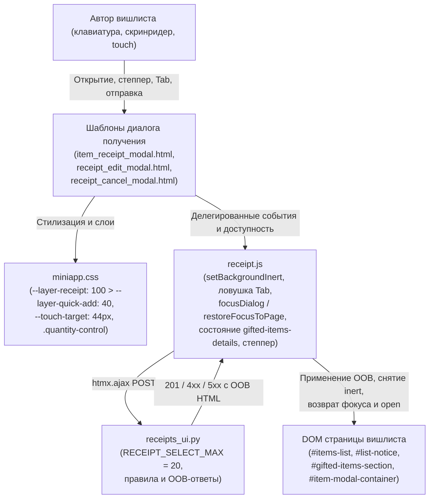

# Спецификация: WISHENKA-161 — Доступность, управление фокусом и мобильное поведение диалога получения подарка

**Статус:** реализовано (`WISHENKA-161`), с последующими точечными доработками в `WISHENKA-221` и `WISHENKA-222`  
**Платформы:** Telegram Mini App (FastAPI + Jinja2 + HTMX + CSS + клиентский JS)  
**Языки реализации:** Python, JavaScript, HTML, CSS  
**Основание:** пункт технического долга `T-2` из `ai-tasks/WISHENKA-24/60-tech-debt.md`

## 1. Назначение и бизнес-цель

### 1.1. Постановка проблемы

После внедрения пользовательского интерфейса отметки получения подарков (`WISHENKA-24`) в работе диалога получения (`#item-receipt-modal`) и раздела «Подаренные» оставались следующие ограничения доступности (accessibility) и мобильного UX:

1. **Потеря фокуса при подтверждении и отказе:** отмена или закрытие диалога по клавише `Escape` возвращали фокус на карточку желания, но после успешного подтверждения получения карточка обновлялась или удалялась из активного списка путём внеполосной (`hx-swap-oob`) замены DOM, из-за чего фокус сбрасывался на `document.body`. Поведение фокуса при отказе внутри диалога не было определено и проверено.
2. **Отсутствие модальной изоляции и удержания фокуса:** диалог не имел атрибута `aria-modal="true"`, фоновая страница не была изолирована от клавиатуры и программ экранного доступа, а навигация `Tab` / `Shift+Tab` могла выходить за пределы диалога на элементы подложки.
3. **Самопроизвольное сворачивание раздела «Подаренные»:** при каждой отметке получения сервер возвращал OOB-фрагмент `#gifted-items-section` (`outerHTML`), заменяя `
` новым элементом без атрибута `open`, даже если автор предварительно раскрыл раздел.
4. **Немасштабируемый выбор количества:** выпадающий список `<select>` перечислял все целые числа от `1` до оставшегося количества (`remaining`), порождая сотни элементов `<option>` для желаний с большим количеством экземпляров (например, `500`).
5. **Отсутствие браузерной проверки доступности и мобильной вёрстки:** автотесты не проверяли возврат фокуса после частичного и полного получения, удержание фокуса при отказе, ловушку `Tab` / `Shift+Tab`, минимальный размер зон касания `44 px` и перекрытие над фиксированной панелью быстрого добавления `#quick-add-bar` на мобильном экране.

### 1.2. Цели и ценность

- **Предсказуемая непрерывность фокуса:** пользователи клавиатуры и экранных дикторов не теряют позицию в вишлисте после подтверждения получения или при обработке отказа внутри диалога.
- **Строгая модальная изоляция:** открытый диалог получения изолирован от остальной страницы на уровне DOM, клавиатурной навигации и дерева доступности.
- **Сохранение контекста списка:** раскрытый раздел «Подаренные» остаётся открытым после OOB-обновлений, позволяя автору сразу увидеть новую запись о получении.
- **Масштабируемый ввод количества:** для малых остатков (`2..20`) сохраняется привычный компактный выбор, а для больших остатков (`> 20`) используется числовой ввод со степпером.
- **Подтверждённая мобильная эргономика:** размеры всех интерактивных элементов диалога (`>= 44x44 px`), отступы безопасной зоны и наложение поверх `#quick-add-bar` проверяются реальным Chromium по CDP на мобильном viewport `390x844`.

### 1.3. Границы задачи (Non-Goals)

В рамки `WISHENKA-161` не входят:

- Изменение доменных правил получения подарков, кодов отказов, идемпотентности и гарантий тайны сюрприза на стороне бэкенда.
- Исправление видимости ошибок и стилей старых модальных окон редактирования и архивирования желаний (`WISHENKA-160`).
- Замена тестовой заглушки `tests/browser_assets/htmx_stub.js` на реальный `htmx` (`WISHENKA-145`, `WISHENKA-162`).
- Структурный рефакторинг веб-слоя (`WISHENKA-163`), ревью русско- и англоязычных текстов (`WISHENKA-164`, `WISHENKA-33`) и рефакторинг CSS-токенов (`WISHENKA-165`).

## 2. Функциональные требования и пользовательские сценарии

### 2.1. Роли и основные сущности

| Сущность / Роль | Описание в контексте задачи |
| --- | --- |
| Автор вишлиста | Владелец, администратор или участник вишлиста (`can_edit_wishlist` / `is_member`), имеющий право отмечать получение подарков |
| Желание | Элемент активного списка (`#item-card-{id}`) с неполученным остатком `remaining >= 1` |
| Диалог получения | Модальное окно `#item-receipt-modal` (основная отметка получения `item_receipt_modal.html`, а также модалки исправления `receipt_edit_modal.html` и отмены `receipt_cancel_modal.html`) |
| Раздел «Подаренные» | Сворачиваемый раздел `#gifted-items-section` (`details.gifted-items-details`) со списком полученных желаний, доступный только участникам вишлиста |
| Панель быстрого добавления | Фиксированная внизу экрана форма `#quick-add-bar` для добавления новых желаний |

### 2.2. Функциональные требования

#### 2.2.1. Управление фокусом

1. **Открытие диалога (`htmx:afterSwap` в `#item-modal-container`):**
   - Если в диалоге присутствует непустое сообщение в `#receipt-feedback` (например, открыт заблокированный диалог с причиной отказа), фокус устанавливается на `#receipt-feedback` (`tabindex="-1"`).
   - Иначе фокус переводится на первый интерактивный элемент управления внутри диалога в приоритетном порядке: `[data-receipt-quantity]`, `#receipt-edit-quantity`, `.btn-receipt-confirm`, `[data-modal-close]`.
2. **Закрытие без подтверждения (`Cancel`, `Escape`, клик по затемнённому фону `.receipt-backdrop`):**
   - Диалог удаляется из `#item-modal-container` без HTTP-запроса, фоновая изоляция снимается.
   - Фокус возвращается на заголовок открывшей карточки `#${openerCardId} .item-card-summary`; если карточка отсутствует, фокус переходит на исходный `openerElement` (если он остался в DOM), а при его отсутствии — на `#list-notice`.
3. **Успешное частичное получение (желание остаётся в активном списке с уменьшенным остатком):**
   - После OOB-обновления карточки `#item-card-{id}` и закрытия диалога фоновая изоляция снимается, а фокус перемещается на обновлённый элемент `#${openerCardId} .item-card-summary`.
4. **Успешное полное получение (желание удаляется из `#items-list`):**
   - После OOB-обновления `#items-list` и закрытия диалога фоновая изоляция снимается, а фокус переводится на уведомление области списка `#list-notice` (`tabindex="-1"`), а не сбрасывается на `document.body`.
5. **Отказ внутри диалога или сетевой сбой:**
   - При ответе с заголовком `X-Receipt-Refusal` из закрытого набора `REFUSAL_REASONS` (включая `409 quantity_above_remaining`, при котором сервер OOB-заменяет сам `#item-receipt-modal`) или при сетевой ошибке (статус `0` / необработанный ответ с пустым `#receipt-feedback`, получающий резервный текст ошибки) диалог остаётся открытым.
   - Фоновая изоляция сохраняется; если форма осталась в DOM, с неё снимаются `data-pending="true"`, `aria-busy` и блокировка кнопки `.btn-receipt-confirm`; фокус устанавливается на `#receipt-feedback` (или при пустом сообщении — на основной элемент диалога).

#### 2.2.2. Модальная семантика, изоляция фона и ловушка фокуса

1. Элемент `#item-receipt-modal` во всех трёх шаблонах диалога получения (`item_receipt_modal.html`, `receipt_edit_modal.html`, `receipt_cancel_modal.html`) содержит `role="dialog"`, `aria-modal="true"` и `aria-labelledby="receipt-title"`.
2. Пока `#item-receipt-modal` находится в DOM, все не-предковые элементы-сиблинги вдоль цепочки от `#item-modal-container` до `document.body` (включая `#items-list`, `#quick-add-bar` и `<nav class="top-nav">`, но исключая `<script>`, `<style>` и `<template>`) получают `inert = true` и `aria-hidden="true"`.
3. При закрытии диалога `inert` и `aria-hidden` снимаются только с тех элементов, которые были помечены скриптом `receipt.js`.
4. Нажатие `Tab` и `Shift+Tab` при открытом диалоге перехватывается и циклически переносит фокус строго между видимыми доступными интерактивными элементами внутри `#item-receipt-modal`:
   - `Tab` с последнего элемента (или если фокус оказался вне диалога) переносит фокус на первый элемент;
   - `Shift+Tab` с первого элемента (или извне диалога) переносит фокус на последний элемент;
   - при отсутствии фокусируемых элементов внутри диалога переход по `Tab` отменяется (`preventDefault()`).

#### 2.2.3. Сохранение состояния раздела «Подаренные»

1. Перед отправкой формы получения фиксируется текущее значение `details.gifted-items-details.open` внутри `#gifted-items-section`.
2. После завершения запроса и применения OOB-обновления `#gifted-items-section`:
   - если раздел «Подаренные» был раскрыт до отправки (`open === true`), он принудительно остаётся раскрытым (`details.open = true`);
   - если раздел был свёрнут (`open === false`), он остаётся свёрнутым.

#### 2.2.4. Масштабируемый выбор количества (`RECEIPT_SELECT_MAX = 20`)

| Остаток (`remaining`) | Отображаемый элемент управления | Поведение ввода и сводки |
| --- | --- | --- |
| `remaining == 1` | Скрытое поле `<input type="hidden" name="quantity" value="1">` | Выбор не требуется; отображается краткая сводка |
| `1 < remaining <= 20` | Список `<select id="receipt-quantity" name="quantity" data-receipt-quantity data-remaining="...">` с опциями `1..remaining` | Изменение значения обновляет `[data-receipt-summary]` |
| `remaining > 20` | Контейнер `.quantity-control`: кнопки `-` / `+` (`.btn-step`, `data-receipt-step="-1"` / `"1"`) и `<input id="receipt-quantity" type="number" name="quantity" min="1" max="..." step="1" inputmode="numeric" required>` | Сотни `<option>` не рендерятся; кнопки степпера меняют количество в `[1, remaining]`; событие `input` обновляет сводку для валидных целых в `[1, remaining]`; событие `change` ограничивает (clamp) значение к `[1, remaining]`; при невалидном `number`-поле перед отправкой вызывается `reportValidity()` без отправки запроса |

#### 2.2.5. Мобильная эргономика и наложение слоёв

1. На мобильном viewport (`390x844`) все интерактивные элементы диалога (`select`, `.quantity-control input`, `.btn-step`, `.btn-receipt-confirm`, `.btn-modal-close`) имеют габариты не менее `44x44 px` (`--touch-target: 44px`).
2. Нижняя шторка `.receipt-sheet` учитывает безопасную область экрана (`padding: 1rem 1rem max(1rem, env(safe-area-inset-bottom))`).
3. Подложка `.receipt-backdrop` располагается на слое `--layer-receipt: 100` поверх фиксированной панели `--layer-quick-add: 40`, поэтому ни один элемент диалога не перекрывается `#quick-add-bar` и доступен для прямого нажатия (`document.elementFromPoint`).

### 2.3. Пользовательские сценарии

- **UC-161-01. Непрерывность фокуса после частичного или полного получения:** автор открывает диалог получения из карточки желания и подтверждает получение. При частичном получении фокус возвращается на `.item-card-summary` обновлённой карточки; при полном получении карточка уходит из активного списка, а фокус переходит на `#list-notice` с текстом подтверждения.
- **UC-161-02. Удержание фокуса при отказе:** автор подтверждает получение, но сервер возвращает `503 busy` или `409 quantity_above_remaining` (с обновлением остатка и OOB-перерисовкой диалога). Диалог остаётся открытым, а фокус перемещается на `#receipt-feedback`, чтобы пользователь и экранный диктор сразу восприняли причину отказа.
- **UC-161-03. Навигация с клавиатуры в открытом диалоге:** пока открыт `#item-receipt-modal`, автор перемещается клавишами `Tab` и `Shift+Tab` только по элементам диалога, фоновая страница недоступна для фокуса и скринридера, а нажатие `Escape` или кнопки отмены возвращает фокус на исходный триггер.
- **UC-161-04. Сохранение раскрытого раздела «Подаренные»:** автор раскрывает `
`, затем отмечает получение другого желания. После OOB-обновления раздел «Подаренные» остаётся раскрытым с обновлённым перечнем.
- **UC-161-05. Выбор количества для желания с большим остатком:** для желания с остатком `500` автор получает числовое поле с кнопками `-` и `+` размером не менее `44x44 px` поверх панели быстрого добавления, корректирует значение кнопкой `+` или вводом с клавиатуры, видит обновлённую сводку и отправляет форму.

### 2.4. Продуктовые и доменные инварианты

1. **Тайна сюрприза:** ни диалог, ни фокусируемые элементы (`#list-notice`, `#receipt-feedback`), ни `aria-label` кнопок степпера не содержат сведений о бронях, купленном статусе или дарителях.
2. **Неизменность серверного контракта:** доменные проверки, статусы HTTP, заголовки `X-Receipt-Refusal`, правила остатка и формат OOB-фрагментов остаются неизменными.
3. **Совместимость с малыми списками:** для `remaining == 1` и `2 <= remaining <= 20` сохраняются прежние элементы формы (`hidden` и `<select>`).

## 3. Архитектура, компоненты и интерфейсы

### 3.1. Схема взаимодействия компонентов

### 3.2. Модули и ответственность

| Модуль | Ответственность |
| --- | --- |
| `wishenka/web/routes/receipts_ui.py` | Определяет константу `RECEIPT_SELECT_MAX = 20` и передаёт `select_max` в контекст шаблона через `_dialog_html(...)` |
| `wishenka/web/templates/partials/item_receipt_modal.html` | Добавляет `aria-modal="true"`; рендерит `<select>` при `1 < remaining <= select_limit` и блок `.quantity-control` (кнопки `.btn-step` с `data-receipt-step="-1"` / `"1"` и `input[type="number"]`) при `remaining > select_limit` без inline-обработчиков `on*` |
| `wishenka/web/templates/partials/receipt_edit_modal.html` и `receipt_cancel_modal.html` | Добавляют `aria-modal="true"` на `#item-receipt-modal` и `tabindex="-1"` на `#receipt-feedback` (в последующей задаче `WISHENKA-221` в `receipt_edit_modal.html` также добавлен блок `.quantity-control` с кнопками `.btn-step`) |
| `wishenka/web/templates/wishlist_detail.html` | Добавляет `tabindex="-1"` на `#list-notice` для программной передачи фокуса после полного получения |
| `wishenka/web/static/miniapp.css` | Гарантирует `--touch-target: 44px` на `.receipt-sheet select`, `.receipt-sheet .quantity-control input`, `.receipt-sheet button` и `.btn-step`; задаёт `--layer-receipt: 100` (`> --layer-quick-add: 40`) и `env(safe-area-inset-bottom)` |
| `wishenka/web/static/receipt.js` | Управляет `setBackgroundInert`, ловушкой `Tab` / `Shift+Tab` (`getFocusable`), жизненным циклом фокуса (`focusDialog`, `restoreFocusToPage`, `closeDialog`, `finishAttempt`), сохранением `details.gifted-items-details.open`, логикой степпера и валидации (`handleStepClick`, `updateSummary`, `submitReceipt`) |
| `tests/browser_cdp.py` | Добавляет `"Tab": ("Tab", "Tab", 9, "")` в `_KEYS` и поддержку `"Shift+Tab"` (`modifiers = 8`) в `CdpPage.press_key` |

### 3.3. Жизненный цикл и переходы состояний в `receipt.js`

1. **Инициация открытия:** при клике на элемент, соответствующий `OPENER_SELECTOR` (`.btn-receipt-item`, а с учётом `WISHENKA-221` также `.btn-receipt-edit, .btn-receipt-cancel`), сохраняются `openerCardId`, `openerElement` (и в `WISHENKA-221` `openerGiftedItemId`).
2. **Вставка диалога (`htmx:afterSwap` для `#item-modal-container`):** при наличии `#item-receipt-modal` вызываются `setBackgroundInert(true)` и `focusDialog()`.
3. **Работа внутри диалога:**
   - клики по `[data-receipt-step]` вызывают `handleStepClick(stepBtn)`, изменяя количество в `[1, remaining]` и обновляя сводку;
   - `input` вызывает `updateSummary(field, false)` без принудительной подмены вводимого значения;
   - `change` вызывает `updateSummary(field, true)` с ограничением в `[1, remaining]`;
   - `keydown` перехватывает `Escape` (`closeDialog()`) и `Tab` / `Shift+Tab` (замыкание фокуса по `getFocusable(modal)`).
4. **Отправка формы (`submitReceipt(form)`):**
   - если `field` имеет `type === 'number'` и `!field.checkValidity()`, вызывается `field.reportValidity()`, отправка прерывается;
   - фиксируется `giftedWasOpen = Boolean(giftedDetails && giftedDetails.open)`;
   - форма переводится в состояние ожидания (`data-pending="true"`, `aria-busy="true"`, кнопка `.btn-receipt-confirm` отключается, `#receipt-feedback` очищается);
   - выполняется единственный вызов `window.htmx.ajax('POST', action, { target: '#receipt-feedback', swap: 'none', values, headers: { 'Idempotency-Key': idemKey } })`, результат которого обрабатывается в `.then(done, done)` через `finishAttempt(form, giftedWasOpen)`.
5. **Завершение попытки (`finishAttempt(form, giftedWasOpen)`):**
   - если `giftedWasOpen === true`, в обновлённом `#gifted-items-section details.gifted-items-details` выставляется `details.open = true`;
   - если `#item-receipt-modal` остался в DOM (отказ или сбой) — повторно подтверждается `setBackgroundInert(true)`, для подключённой формы сбрасываются флаги занятости, при пустом `#receipt-feedback` подставляется `data-i18n-receipt-failure` (или `DEFAULT_GENERIC_FAILURE`), вызывается `focusDialog()`;
   - если `#item-receipt-modal` удалён из DOM (успех) — вызывается `setBackgroundInert(false)` и `restoreFocusToPage()` (`#${openerCardId} .item-card-summary` -> `openerElement` -> `#list-notice`, с учётом последующего расширения `openerGiftedItemId` в `WISHENKA-221`), после чего ссылки на инициатора очищаются.

### 3.4. Контракты данных и DOM

- `#item-receipt-modal[data-receipt-modal][role="dialog"][aria-modal="true"][aria-labelledby="receipt-title"]`
- `#receipt-feedback.receipt-feedback[role="alert"][tabindex="-1"]`
- `[data-receipt-quantity][data-remaining]` (`<select>` для `2..20`, `<input type="number" min="1" max="..." step="1" inputmode="numeric" required>` для `> 20`)
- `[data-receipt-step="-1" | "1"]` внутри `.quantity-control`
- `#list-notice[role="status"][aria-live="polite"][tabindex="-1"]`
- `#gifted-items-section details.gifted-items-details`
- Временные маркеры изоляции на элементах фона: `data-receipt-inert="true"` (`INERT_MARKER`) и `data-receipt-hidden="true"` (`HIDDEN_MARKER`)

### 3.5. Обоснование архитектурных решений

- **Цепочка сиблингов `inert` + `aria-hidden` вместо `inert` на `<main>`:** `#item-modal-container` расположен внутри `<main>` (в `.wishlist-detail-view`), поэтому установка `inert` на `<main>` заблокировала бы сам диалог. Обход вверх до `document.body` с изоляцией только не-предковых сиблингов надёжно закрывает и `#items-list`, и `#quick-add-bar`, и `<nav class="top-nav">`.
- **Обработка завершения по Promise `htmx.ajax` в `receipt.js`:** в `tests/browser_assets/htmx_stub.js` событие `htmx:afterSwap` на `#receipt-feedback` срабатывает уже после того, как OOB-замены отсоединили `#receipt-feedback` от `document`, поэтому `document`-слушатель `htmx:afterSwap` его не получает. Ожидание завершения Promise через `finishAttempt` работает одинаково и с `htmx.org@1.9.12`, и с `htmx_stub.js`.
- **Размещение всей логики в `receipt.js` без правки `base.html`:** позволяет сохранить инварианты `tests/test_receipt_static_script.py` (отсутствие receipt-кода в `base.html` и отсутствие встроенных скриптов).
- **Пороговый рендеринг при `RECEIPT_SELECT_MAX = 20`:** сохраняет обратную совместимость с контрактами `<select>` для малых количеств и исключает генерацию сотен `<option>` при больших остатках.

## 4. Нефункциональные требования, безопасность и наблюдаемость

### 4.1. Производительность и ограничения

- Порог `RECEIPT_SELECT_MAX = 20` ограничивает размер выпадающего списка максимум 20 опциями.
- `setBackgroundInert` обходит только непосредственных соседних детей вдоль короткой цепочки предков от `#item-modal-container` до `document.body`.
- `getFocusable` опрашивает потомков исключительно внутри `#item-receipt-modal` и только при нажатии `Tab` / `Shift+Tab`.
- Все автотесты используют ограниченные ожидания и явные маркеры `pytest.mark.timeout` (`30` с для route/static модулей и `45` с + `pytest.mark.browser` для браузерных CDP-тестов).

### 4.2. Безопасность, приватность и гигиена клиентского кода

- **Тайна сюрприза:** ни клиентские скрипты, ни шаблоны диалогов, ни `#list-notice`, ни серверные логи не содержат сведений о дарителях, бронях и фактах покупки.
- **Защита от XSS и соответствие CSP:**
  - шаблоны диалогов и страницы вишлиста не содержат встроенных тегов `<script>` и атрибутов `on*` (`tests/test_receipt_static_script.py::test_pages_and_partials_carry_no_inline_handlers`);
  - `receipt.js` формирует текстовое содержимое исключительно через `textContent` и не содержит запрещённых конструкций `innerHTML`, `eval(` и `console.*` (`test_receipt_script_hygiene_and_wishlist_additions`);
  - в `receipt.js` ровно один вызов `htmx.ajax(` (`test_single_ajax_call_in_each_script`), а все строковые литералы вида `[a-z]+(?:_[a-z]+)+` (`REASON_LIKE`) принадлежат исключительно закрытому набору причин отказа `REFUSAL_REASONS` (`test_closed_reason_set_mirrors_the_refusal_table`); новые HTML-атрибуты и JS-идентификаторы используют `kebab-case` и `camelCase`;
  - пользовательские названия желаний в `#list-notice` и тексты отказов экранируются средствами Jinja autoescape и `oob_text`.

### 4.3. Наблюдаемость (логирование и метрики)

- **Клиентское логирование:** отсутствует; любые вызовы `console.*` в `receipt.js` явно запрещены автотестом `test_receipt_script_hygiene_and_wishlist_additions`.
- **Серверное логирование (`wishenka/web/routes/receipts_ui.py`):** в `WISHENKA-161` новые события не добавлялись, поскольку изменение ограничено клиентской доступностью, фокусом, степпером (`RECEIPT_SELECT_MAX = 20`) и разметкой. Действующие структурированные события логгера `wishenka.web.receipts_ui` (форматируемые через `wishenka/logging.py` `JsonFormatter` для агрегации из stdout) остаются без изменений:

| Событие (`extra.event`) | Уровень | Контекст и назначение |
| --- | --- | --- |
| `ui_receipt_form_opened` | `INFO` | Открытие диалога получения (`wishlist_id`, `item_id`, `actor_id`) |
| `receipt_recorded_http` | `INFO` | Успешное подтверждение получения через UI (`wishlist_id`, `item_id`, `actor_id`) |
| `ui_receipt_form_refused` | `WARNING` | Отказ при открытии диалога (`wishlist_id`, `item_id`, `actor_id`, `reason`, `http_status`, при необходимости `remaining_quantity`) |
| `receipt_refused` | `WARNING` | Доменный отказ при подтверждении получения (`wishlist_id`, `item_id`, `actor_id`, `reason`, `http_status`, при необходимости `remaining_quantity`) |
| `receipt_inventory_busy` | `WARNING` | Конфликт блокировки `InventoryBusyError` (HTTP `503`, `wishlist_id`, `item_id`, `actor_id`) |

- **HTTP middleware и метрики:** длительность и коды ответа HTTP-запросов к маршрутам `/web/wishlists/{wishlist_id}/items/{item_id}/receipt` регистрируются middleware приложения `wishenka/web/app.py` (включая `DEBUG`-трассировку и `logger.exception` при необработанных ошибках); отдельная библиотека метрик (Prometheus/OpenTelemetry) в репозитории не применяется, состояние сервиса проверяется через `/healthz`. Схема серверных логов закреплена тестом `tests/test_receipt_ui_observability.py::test_full_ui_flow_log_contract`.

## 5. Верификация и критерии приёмки

### 5.1. Автоматизированные тестовые сценарии

1. **Маршрутные и SSR-тесты (`tests/test_receipt_ui_routes.py`, `pytest.mark.timeout(30)`):**
   - `test_get_modal_large_quantity_renders_stepper_not_large_select`: при `remaining = 500` отсутствуют `<select>` и `<option>`, отображаются `input[type="number"][name="quantity"][data-receipt-quantity][min="1"][max="500"][data-remaining="500"]` и кнопки `[data-receipt-step="-1"]` / `[data-receipt-step="1"]` без `on*`-атрибутов.
   - Сохраняется покрытие `remaining = 1` (`hidden`) и `remaining = 5` (`<select>`).
2. **Браузерные CDP-тесты (`tests/test_receipt_accessibility_browser.py`, Chromium на viewport `390x844`, `pytest.mark.timeout(45)`, `pytest.mark.browser`):**
   - `test_modal_semantics_background_isolation_and_tab_trap`: проверка `aria-modal="true"`, установки и снятия `inert` / `aria-hidden="true"` на `#items-list`, `#quick-add-bar` и `nav.top-nav`, циклического удержания `Tab` и `Shift+Tab` внутри `#item-receipt-modal` и закрытия по `Escape`.
   - `test_focus_return_partial_full_and_refusal`: возврат фокуса на `#item-card-{id} .item-card-summary` после частичного получения, удержание фокуса на `#receipt-feedback` при отказах `503 InventoryBusyError` и `409 quantity_above_remaining` (с OOB-заменой модалки) и перевод фокуса на `#list-notice` после полного получения.
   - `test_gifted_section_open_state_preserved`: сохранение `details.gifted-items-details.open === false` и `true` при последующей OOB-замене `#gifted-items-section`.
   - `test_large_quantity_stepper_updates_summary_and_submits`: при `remaining = 500` проверяется рендеринг степпера вместо `<select>`, нажатие `+`, ввод значения `42`, обновление `[data-receipt-summary]` и отправка `quantity=42`.
   - `test_mobile_touch_targets_and_quick_add_overlay`: при `390x844` и наличии `#quick-add-bar` все контролы диалога (`[data-receipt-quantity]`, `.btn-step`, `.btn-receipt-confirm`, `.btn-modal-close`) имеют ширину и высоту `>= 44 px`, а `document.elementFromPoint` по центру кнопок попадает в них, а не в `#quick-add-bar`.
3. **Статические и инфраструктурные проверки:**
   - `tests/test_receipt_static_script.py` (гигиена `receipt.js`, закрытое множество `REFUSAL_REASONS`, отсутствие `on*`), `tests/test_receipt_ui_observability.py`, `.venv/bin/ruff check wishenka tests`, `.venv/bin/ruff format --check wishenka tests`, `.venv/bin/mypy wishenka tests`.

### 5.2. Зафиксированные результаты проверок в артефактах `WISHENKA-161`

По отчётам `ai-tasks/WISHENKA-161/40-code-cleanup.md` и `ai-tasks/WISHENKA-161/50-observability.md` на этапе приёмки `WISHENKA-161`:

- `.venv/bin/ruff check wishenka tests`, `.venv/bin/ruff format --check wishenka tests` и `.venv/bin/mypy wishenka tests`: `0` ошибок и замечаний по `204` исходным файлам.
- `tests/test_receipt_ui_routes.py`: `39 passed`.
- `tests/test_receipt_accessibility_browser.py`: `5 passed`.
- `tests/test_receipt_ui_observability.py`: `1 passed`.
- `tests/test_receipt_static_script.py`: `9 passed`, `1 failed` (`test_inline_script_is_unchanged_and_free_of_receipt_code` — предсуществовавший сбой в `base.html`, который в `WISHENKA-161` не изменялся; позднее решён в `WISHENKA-140`).

### 5.3. Критерии приёмки

1. После частичного получения фокус возвращается на `.item-card-summary` обновлённой карточки, после полного — на `#list-notice`, после отмены или `Escape` — на триггер открытия, а при отказе внутри диалога остаётся на `#receipt-feedback` (или основном контроле диалога).
2. Открытый диалог имеет `aria-modal="true"`, изолирует фоновую страницу (`inert` + `aria-hidden="true"`) и удерживает навигацию `Tab` / `Shift+Tab` внутри себя.
3. Состояние раскрытия раздела «Подаренные» (`details.gifted-items-details.open`) сохраняется при OOB-обновлении `#gifted-items-section`.
4. При `remaining > 20` вместо большого `<select>` отображается числовое поле со степпером `-` / `+` и корректным обновлением сводки и валидацией границ `1..remaining`.
5. Все интерактивные элементы диалога имеют размер не менее `44x44 px` и отображаются поверх `#quick-add-bar` при мобильной ширине `390x844`.
6. Целевые маршрутные, браузерные, наблюдаемостные и статические проверки проходят без нарушения тайны сюрприза и CSP-ограничений.

### 5.4. Известные ограничения и задачи технического долга (по `60-tech-debt.md`)

1. **Кастомная реализация модальной изоляции и ловушки фокуса (`receipt.js`):** использование `setBackgroundInert` и `keydown`-обработчика вместо нативного `<dialog>.showModal()` оставляет на сопровождении собственный код изоляции, однако избегает перестройки `#item-modal-container` и вмешательства в `base.html`.
2. **Ограниченный охват степпера и `44 px` стилей на момент `WISHENKA-161`:** `RECEIPT_SELECT_MAX = 20` и правила `.receipt-sheet .quantity-control input` изначально внедрялись только для `item_receipt_modal.html`, тогда как `receipt_edit_modal.html` содержал голое поле `#receipt-edit-quantity` *(устранено последующей задачей [WISHENKA-221](https://pypost.atlassian.net/browse/WISHENKA-221))*.
3. **Временное клиентское сохранение `gifted-items-details.open`:** флаг сохраняется только внутри потока `submitReceipt` и не переживает перезагрузку страницы или OOB-замену `#gifted-items-section` извне `submitReceipt`.
4. **Восстановление фокуса при OOB-замене `#gifted-items-section`:** на момент `WISHENKA-161` при отсоединении `openerElement` фокус для edit/cancel модалок отступал на `#list-notice`, а не на `#gifted-item-{id}` или `details > summary` *(устранено последующей задачей [WISHENKA-221](https://pypost.atlassian.net/browse/WISHENKA-221) с добавлением `openerGiftedItemId`)*.
5. **Структура обработчика и резервные строки в `receipt.js`:** многоцелевой `click`-слушатель на `document` совмещает запоминание триггера, шаг степпера и закрытие модалки; `DEFAULT_GENERIC_FAILURE` и `DEFAULT_SUMMARY_TEMPLATE` являются англоязычными fallback-строками на случай отсутствия `data-i18n-*` атрибутов на `document.body`.
6. **Пробелы тестового покрытия, зафиксированные в `WISHENKA-161`:**
   - явная проверка границы `20` и `21` для `RECEIPT_SELECT_MAX` *(закрыто в [WISHENKA-222](https://pypost.atlassian.net/browse/WISHENKA-222) тестом `test_get_modal_select_max_boundary`)*;
   - браузерная проверка выхода за границы диапазона (`0` и `501`), `checkValidity()`/`reportValidity()` и clamping по `change` *(закрыто в [WISHENKA-222](https://pypost.atlassian.net/browse/WISHENKA-222) тестом `test_large_quantity_out_of_range_validation_and_clamping`)*;
   - браузерное тестирование доступности, возврата фокуса и размеров зон касания для `receipt_edit_modal.html` и `receipt_cancel_modal.html` *(закрыто в [WISHENKA-221](https://pypost.atlassian.net/browse/WISHENKA-221) в `tests/test_receipt_accessibility_browser.py`)*.
7. **Предсуществовавшие внешние сбои (вне скоупа `WISHENKA-161`):**
   - [WISHENKA-214](https://pypost.atlassian.net/browse/WISHENKA-214): предсуществовавший сбой `tests/test_receipt_static_script.py::test_inline_script_is_unchanged_and_free_of_receipt_code`;
   - [WISHENKA-220](https://pypost.atlassian.net/browse/WISHENKA-220): предсуществовавший сбой `tests/test_receipt_modal_browser.py::test_unmarked_error_neither_shows_notice_nor_reloads`.
