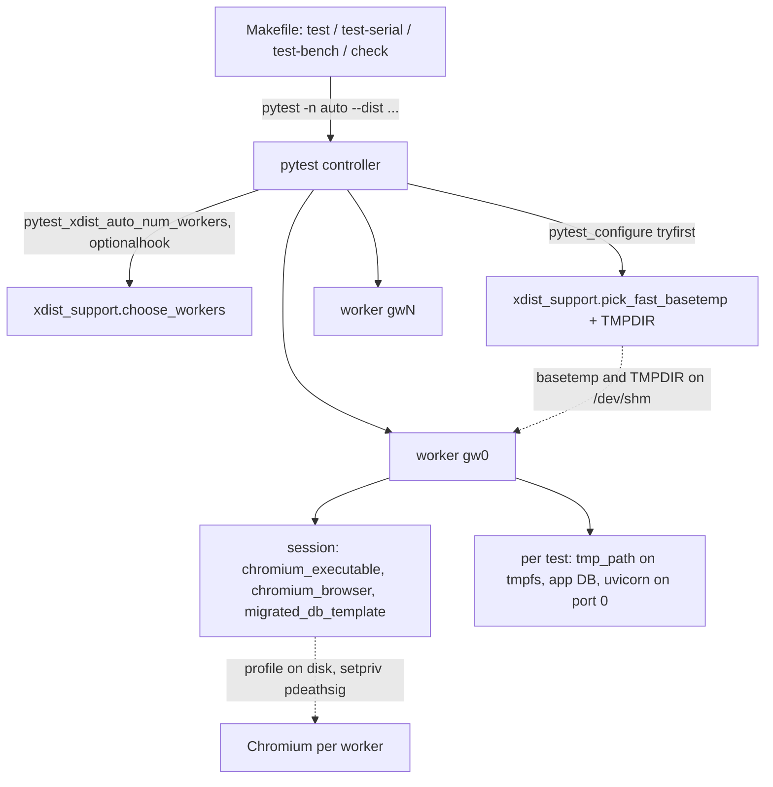

# WISHENKA-166: Parallel test run, full suite in no more than 2 minutes

Implementation language: Python 3.12+ (test infrastructure: `tests/`, `pyproject.toml`, `Makefile`).
Requirements: `10-requirements.md` (F-1..F-9, N-1..N-7, C-1..C-6, DoD 1..10, Q-1..Q-5).
Raw measured tables: `21-baseline-data.md`. Revision 2: all timing claims were re-measured with `-p no:randomly`
(the first revision used pytest-randomly by accident, see R3).

## Verdict

This section precedes Research on purpose: it is the one-screen answer for the reviewer; the template sections follow in
template order.

1. Measured serial baseline: **798 passed in 971.7 s** (16 min 11 s, default order). Setup is 56 % of the 957.7 s of
   reported phases (537 s), call 40 %.
2. Parallelism alone does not reach the goal. Six xdist workers on the same disk: **981 s, 28 failed and 9 errors**
   (file order, `-p no:randomly`; the earlier random-order run gave 842 s and 25 failed, 6 errors). The cause is I/O,
   not CPU: `/tmp` is virtiofs, one `fsync` costs 11 ms alone and 75 ms with six writers (the host serialises them);
   a fresh migration costs 1.6 s on `/tmp` and 0.013 s on tmpfs.
3. With test storage on tmpfs the same 798 tests need **112.6 to 114.1 s serial** and **48 to 63 s with six workers**
   (file order: `--dist load` 63, 57, 55 s; `--dist loadfile` 48 s; all 798 passed). The 120 s budget is met with a
   margin of 57 to 72 s, with no test removed or weakened.
4. Parallel runs exposed four test-side defects that must be fixed (a real startup race in the CDP helper, a shared
   default database path, exec-needing tests on a `noexec` tmpfs, orphan Chromium after a killed worker) and one
   design gap (tempfile users escape tmpfs). No production code change is needed (Q-2).
5. On a machine **without** fast test storage the parallel mode is red, so the design falls back to serial there
   (B2 rule in D2). The 120 s budget is claimed for the reference machine only (N-1, Q-5).

## Research

### R1. Measured baseline (serial, disk, default order, command of `make test` plus `--durations=0`)

| Item | Value |
| --- | --- |
| Command | `.venv/bin/pytest -q -p no:cacheprovider --durations=0 -o addopts="" --strict-markers --tb=short -rf` |
| Result | 798 passed, 1 warning, **971.70 s** wall of pytest, exit 0 (Step 1's "17 min 20 s" was an estimate) |
| Phases (sum **957.7 s** = reported phases; the other 14 s are start-up, collection and phases under 5 ms) | call 384.5 s (40.1 %), **setup 536.8 s (56.0 %)**, teardown 36.5 s (3.8 %); percentages are of 957.7 s |
| Longest single test / module | 9.30 s (`test_repeated_contention_many_copies`) / 81.6 s (`test_receipt_ui_routes.py`, 73 s setup) |
| Peak memory | serial run: 744 MiB drop of `MemAvailable` (sampler, 1 s) |

Groups (one definition everywhere in this document, by module; "tests" = tests that reported a call phase, **503 of
798**, the rest are under the 5 ms report threshold):

| Group | Modules | Tests | Total | Share of 957.7 s | Where the time goes |
| --- | --- | ---: | ---: | ---: | --- |
| other, in-process (FastAPI `TestClient`, stores, UI routes; includes `test_wishlist_sections_ui.py`, 6 tests of which 1 starts Chromium) | about 45 | 390 | 785.0 s | 82.0 % | setup 530 s: one fresh Alembic migration per test (about 1.6 s) |
| concurrency / multiprocess (`booking_ceiling_r5`, `receipt_concurrency`, `shared_inventory_multiprocess`, `wishlist_migrations_concurrency`) | 4 | 24 | 94.1 s | 9.8 % | spawned processes, `fsync` per commit |
| migration (`wishlist_alembic_migrations`, `gift_receipt_migration`, `wishlist_migrations_observability`) | 3 | 13 | 28.5 s | 3.0 % | fresh migrations by design |
| browser, Chromium (`cards`, `mouse_reorder`, `touch_reorder`, `receipt_modal`, `management_browser`) | 5 | 63 | 48.7 s (rows in the data file are rounded, their sum is 48.8) | 5.1 % | call 30 s; browser start is amortised by the session fixture |
| make / subprocess (`test_browser_prerequisites.py`) | 1 | 13 | 1.4 s | 0.1 % | `make -n`, fake browsers, nested pytest |

Chromium is not the bottleneck; the database file system is. Top slow tests (full list of 40 in
`21-baseline-data.md`): `test_booking_ceiling_r5.py::test_repeated_contention_many_copies` 9.30 s,
`test_wishlist_migrations_concurrency.py::...[legacy_base_normalized]` 8.67 s and `[fresh]` 7.83 s,
`test_booking_ceiling_r5.py::test_load_profile_one_copy_and_many_copies` 8.41 s,
`test_shared_inventory_multiprocess.py::test_locked_wish_raises_inventory_busy_and_leaves_balance` 7.98 s,
`test_receipt_notices.py::test_send_timeout_is_ambiguous` 6.67 s (5 s of it is one fresh migration in setup).

### R2. Root cause, measured

| Measurement | `/tmp` (virtiofs) | `/dev/shm` (tmpfs) |
| --- | ---: | ---: |
| `fsync` of 4 KB, one writer | 11.3 ms | 0.0 ms |
| `fsync`, six writers at once, per call | **75.4 ms** | 0.1 ms |
| `TestClient(create_app(...))` lifespan on an empty database (Alembic head, 7 revisions) | **1.4 to 2.5 s** | 0.013 to 0.03 s |
| same lifespan from a copy of an already migrated file | 0.04 to 0.13 s | 0.01 s |
| `test_receipt_ui_routes` + `test_wishlist_api` + `test_receipt_notices` (94 tests) | 177 s (baseline) | **11.1 s** |

`fsync` throughput of this host is one shared resource (about 90 calls/s). Every SQLite commit (default
`synchronous=FULL`) and every migration step pays it. More workers add no `fsync` throughput; they queue behind it.

### R3. Experiments

Two generations of runs. **Generation 1 (E1..G2) ran with `PYTHONPATH` containing pytest-randomly 5.1.0, so the order
was random** (headers showed `randomly-5.1.0` and a seed). The final configuration has no random order, so all
time-critical runs were **repeated with `-p no:randomly` (generation 2, H/I/J)**. Generation 2 is the reference.

| # | Setup | Wall | Result |
| --- | --- | ---: | --- |
| E0 | serial, disk, default order (no plugin outside `.venv`) | 971.7 s | 798 passed |
| I1 | `-n 6 --dist load`, disk, file order | **981 s** | **28 failed, 9 errors, 763 passed** (800 results: two tests failed in call and errored in teardown); 31 `Timeout` messages; failing modules: `auth_user_store*`, `token_cleanup_*`, `wishlists_sqlite_repo*`, `wishlists_htmx_*`, `wishlist_management_observability` (1 error), `alembic_migrations`, `shared_inventory`, `booking_ceiling`, `migrations_concurrency`, `management_browser` |
| H1 | serial, tmpfs, file order | **114.1 s** (115 s wall) | 798 passed |
| H2, H3 | `-n 6 --dist load`, tmpfs | **63.3 s, 56.6 s** | 798 passed both |
| H4 | `-n 6 --dist loadfile`, tmpfs | **47.8 s** | 798 passed |
| J1 | as H2 plus fast `TMPDIR` (N4 fix) | **55.1 s** | 798 passed |
| J2 | serial, tmpfs, fast `TMPDIR` | **112.6 s** | 798 passed |
| (gen. 1) E1 | `-n 6`, disk, random | killed after 19 min | hang of the last 2 tests |
| (gen. 1) E2 | `-n 6`, disk, random | 842 s | 25 failed, 6 errors, 768 passed (799 results for 798 tests, one counted twice), 28 timeouts of 10 s |
| (gen. 1) E3, E5 | `-n 6`, tmpfs, fixes one by one | E3 62 s (63 s wall), E5 52 s | E3: 788 passed, 10 failed (9 exec on `noexec`, 1 clone artefact); E5: 789 passed, 9 errors (CDP port-file race) |
| (gen. 1) E4 | `-n 6`, disk, `synchronous=OFF` for every SQLAlchemy connection | 394 s | 4 failed, 2 errors |
| (gen. 1) F1..F6, G1, G2 | tmpfs, load 51/63/66 s, worksteal 70 s, loadfile 51 s, `-n 4` 64 s, `-n 3` 65 s; serial 114.5 s | | 798 passed every time |

**Does file order change the picture?** No. Random and file order give the same result class: disk-parallel red,
tmpfs-parallel green; times moved by a few seconds (random load 51 to 66 s, file order load 55 to 63 s, loadfile 51 s
vs 48 s). The 120 s verdict does not change.

Sum of reported phases under six workers (generation 2): 312.6 s (H2), 274.5 s (H3), 211.2 s (H4 loadfile),
256.6 s (J1), against **110.9 s serial**. The factor "tests run slower under load" is therefore **1.9 to 2.8x**, not the
3.0x of generation 1 (loadfile is the lightest because browser tests concentrate on fewer workers).

Memory (sampler, 1 s, `MemAvailable` in MiB; start 4734 to 4859 MiB available): serial peak drop 744 MiB; `-n 6` on tmpfs
**peak drop 2737 to 3115 MiB, minimum available 1697 to 1997 MiB**, 42 to 59
Chromium processes (loadfile 42), `/dev/shm` use at most 5.6 MiB in generation 2 (6.4 MiB in generation 1, run G2). The disk run I1 dropped 2953 MiB, 73
Chromium processes. `/sys/fs/cgroup/memory.events` shows `oom_kill 0`. About
456 to 519 MiB per worker including its Chromium (2737 / 6 to 3115 / 6).

Amdahl bound on 6 cores: serial sum 110.9 s, longest test 5.92 s, longest module 13.5 s, so ideal 110.9 / 6 =
**18.5 s**, critical path 5.9 s. The measured 48 to 63 s is above ideal because of (a) the 1.9 to 2.8x slowdown under
load (Chromium, spawned test processes and `TestClient` threads share the cores; pure-CPU scaling measured 1.5x slower
per process at 6 processes) and (b) per-worker start-up (imports, collection, one Chromium each). **The 120 s budget is
reachable without removing coverage.**

### R4. Existing guards the design must keep green

`tests/test_browser_prerequisites.py` reads `Makefile`, `pyproject.toml`, `ci.yml`: `deps-browser` is not a prerequisite
of `test` or `check`; `make -n test` output has neither `apt-get` nor `tests.browser_support`; `addopts` and the Makefile
have no `-m ... not browser`, `-k ... browser`, `--deselect`, `--ignore ...browser`, and no `addopts` token starts with
`-m`, `-k`, `--deselect`; `markers` keeps `browser`; `ci.yml` keeps `make deps`, `make deps-browser`, `make check`.
Every module keeps its `pytest.mark.timeout` (do-testing forbids a global ini timeout as a substitute).

### R5. Isolation hazards (reading plus running) and verdict per risk area

| # | Hazard | Evidence | Verdict / action |
| --- | --- | --- | --- |
| H1 | `test_auth.py` (and `Settings()` users) use the default `sqlite+aiosqlite:///data/wishenka.db`, relative to the cwd. Five tests write the shared repo file; its mtime changed during the serial run | mtime before/after `test_auth.py` | **Fix**: autouse fixture sets `WISHENKA_DATABASE_URL` and `WISHENKA_SQLITE_DB_PATH` (the `WISHENKA_` prefix is read by `Settings`) to a per-test file. **Validated in scratch**: with the fixture, `data/wishenka.db` mtime is unchanged by `test_auth.py` and `test_infra.py` |
| H2 | **Race in `CdpBrowser._launch`**: reads `DevToolsActivePort` as soon as the file exists, before Chromium writes the port: `IndexError`, the session fixture fails, later browser tests of that worker error (9 errors in E5) | `tests/browser_cdp.py:624-633` | **Fix**: wait for a non-empty first line inside the existing 10 s deadline. Validated by gen.-1 runs F1..G2 (no error after the fix); red/green unit test in P3 |
| H3 | `/dev/shm` is `noexec` (and 64 MiB): `test_browser_prerequisites.py` runs executable fake browsers from `tmp_path` (9 failures in E3); Chromium profiles reach 104 MiB per worker | E3 | **Fix**: those executables and all Chromium profiles use a disk directory `WISHENKA_TEST_DISK_TMPDIR` (see D12); validated in the scratch clone (798 passed) |
| H4 | Starved bounded waits under disk contention: 31 `Timeout` messages, `server did not start` (8 s), `write lock was not acquired` (10 s `Event.wait`) | I1, E2 | **Root cause removed (I/O)**, no limit raised. Worst `duration/limit` on tmpfs under 6 workers: **0.24** (14.3 s of 60 s, `shared_inventory`), spawned `test_repeated_contention_many_copies` 22.3 s of its 90 s mark = 0.25. The 0.42 of revision 1 came from the `:memory:` store tests writing to `/tmp` (random order); with the fast `TMPDIR` (D12) they take 0.02 to 0.06 s |
| H5 | Spawned-process tests: CPU oversubscription; barriers 20 s, joins 25 s | J1/H2: worst 22 s of 90 s | **Safe**: no shared path (`tmp_path`), no fixed port, `spawn` context, 3.6x margin. Not serialised |
| H6 | Ports | `conftest.py:127` binds `127.0.0.1:0` and passes the socket to uvicorn; Chromium `--remote-debugging-port=0` (`browser_cdp.py:616`) with a per-profile port file; no fixed port in `tests/` | **Safe** |
| H7 | `make -n` / `make help` / nested `pytest` in `test_browser_prerequisites.py` | env of nested run is `PATH`/`PYTHONPATH` only | **Safe**: read-only, own rootdir; 2.0 s serial, 11 s under load |
| H8 | **End-of-run hang** (gen. 1, E1): 796 of 798 results, all workers idle in `futex`, one Chromium alive, 7 minutes without output, no per-test timeout fired (no test was running). Random order, disk-starved. Not reproduced in 20 later runs | E1 | **Open risk** (A8): guard plus diagnosis step defined; K=3 series must show none |
| H9 | Orphan Chromium: after the killed E1 controller a Chromium tree survived; one orphan (parent pid 1) was also found after the green experiment series (profile dir of the session fixture) | `ps` | **Fix** in D13, validated in scratch: `setpriv --pdeathsig KILL` leaves 0 processes after `kill -9` of the parent, plain launch 9, `start_new_session` alone 9 |
| H10 | `/tmp/pytest-of-<user>` kept 985 MiB after 3 runs | `du` | **Fix**: `tmp_path_retention_policy = "failed"`; the fast base is removed after a green run (validated: `/dev/shm` empty after J1 and J2) |
| H11 | Module-level singletons, env, cwd | grep of `wishenka/`, `tests/` | **Safe**: no mutable module state in `wishenka/`; `monkeypatch.setenv` only in `test_token_cleanup_background.py`; no `chdir`; logging/`caplog` per process |
| H12 | `time.sleep`/`asyncio.sleep` call sites: **15 lines** (list below) | grep | see below: polls with a deadline (9), negative observations (3), fake-sender delay and yields (2), **one fixed 0.01 s sleep** (W-5) |
| H13 | `tempfile` users outside `tmp_path`: `wishenka/wishlists/store.py:392` (`mkstemp` for `:memory:` stores) writes to `/tmp` | grep, timing | **Fix** D12 (fast `TMPDIR`); validated: those tests 0.44 s serial and 3 to 4 s under disk-ish load before, 0.02 to 0.06 s after |
| H14 | `multiprocessing` semaphores `/dev/shm/sem.mp-*` stay after killed runs | `ls /dev/shm` after E1 | Cleaned by hand; covered by the leftover check (DoD 9) for killed runs; green runs leave none |

H12 sites (file:line): polls with a deadline: `conftest.py:136`, `browser_cdp.py:629`, `test_receipt_modal_browser.py:103`,
`test_wishlist_management_browser.py:95` and `:116`, `test_wishlist_sections_ui.py:402` and `:424`;
poll helpers of the notice tests (deadline 10 s / 15 s): `test_receipt_notices.py:428`, `test_receipt_notices_extra.py:161`;
negative observations ("nothing happens in a window"): `test_receipt_modal_browser.py:544` (0.1 s step inside a 2.0 s
loop), `test_receipt_notices.py:649` (`time.sleep(0.4)`), `test_receipt_notices_extra.py:189` (`asyncio.sleep(0.6)`);
fake sender delay and yields: `notice_support.py:51` (configurable delay), `test_metadata_extractor_service.py:82`
(`sleep(0)` yield); **fixed wait**: `test_token_cleanup_observability.py:194` (`sleep(0.01)` "allow the background task to
start"). Together under 3 s of sleeping. Negative observations cannot become flaky by load; only the fixed one can.

Risk areas of C-4 (DoD 6), serial tmpfs time (H1, generation 2) and worst test under 6 workers (H2): `test_browser_prerequisites.py` 2.0 s,
safe (H3, H7); `booking_ceiling_r5` 11.7 s (worst test 22.3 s), `receipt_concurrency` 2.2 s,
`shared_inventory_multiprocess` 13.0 s (worst test 14.3 s), `wishlist_migrations_concurrency` 4.7 s, all safe (H5).

## Implementation Plan

Order is by risk reduction; each step has a measurable check. New test modules carry `pytest.mark.timeout`.

| Step | Work | Check |
| --- | --- | --- |
| P1 | `pyproject.toml`: `pytest-xdist>=3.6` in `dev`; `tmp_path_retention_policy = "failed"`; keep `addopts = "-v --strict-markers"` | `make deps` then `python -c "import xdist"`; `test_addopts_do_not_deselect_tests` green |
| P2 | `tests/xdist_support.py` (pure, typed, standard library) and `conftest.py` hooks: worker cap **as `@pytest.hookimpl(optionalhook=True)`** (B3), slow-storage rule (D2), fast `basetemp`, unique directory, stale cleanup, fast `TMPDIR`, removal after green, worker-side `faulthandler.dump_traceback_later` at session end (A8) | unit tests of the pure functions; `pytest -n 2 tests/test_infra.py` creates and removes `/dev/shm/wishenka-pytest-*`; `pytest -p no:xdist --collect-only` still works; a **failed** run keeps its directory and prints the path (not yet validated); `tmp_path_retention_policy` together with explicit `basetemp` (partially validated) |
| P3 | `tests/browser_cdp.py`: non-empty port-file wait (H2); profile directories are removed at teardown, which fixes the `/tmp/wk-*` leak seen in the scratch copy; one launcher helper `launch_chromium(args)` used by `CdpBrowser._launch` **and by the two own-`Popen` tests** (`test_wishlist_management_browser.py:98` and `test_wishlist_sections_ui.py:406`; their profile lines are `:97` and `:405`): `setpriv --pdeathsig KILL` wrapper when available, `start_new_session=True`, finalizer and `atexit` that `killpg` the group; profiles under `WISHENKA_TEST_DISK_TMPDIR`, removed at teardown | fake-Chromium red/green unit test; `kill -9` of a worker during a browser test leaves no process (all three launch sites); browser modules 10 loops under a CPU burner |
| P4 | `test_browser_prerequisites.py`: module-level override giving `tmp_path` on the disk directory | module green with the fast base active; `make -n` guards green |
| P5 | `conftest.py` autouse fixture for the default database (H1) | `data/wishenka.db` mtime unchanged by a full run; a test asserts `Settings().database_url` is under `tmp_path` |
| P6 | `Makefile`: `test`, `test-serial`, `test-bench`, `TEST_WALL_LIMIT`; **`tests/bench_suite.py` is created here** (runs `make test`, prints `nproc`, `free -m`, wall time, exit code, compares junit sets) | `make -n test` has `-n` and no `apt-get`; `make help` lists the targets; `python -m tests.bench_suite --budget 120` exits 0 |
| P7 | Tune on evidence: 3 runs each of `--dist load` and `loadfile`, pick the lower median; headroom audit `duration/limit`; W-1..W-5 | table in `21-baseline-data.md` section D; no limit raised without a written reason |
| P8 | DoD series (A9): K=3 parallel, 1 serial, leftovers, memory, OOM events, `make analyze` | all ten DoD rows recorded |
| P9 | `doc/dev/testing.md` (Step 8) | review |

### Failing repro for Step 3

The task changes how the suite runs, so the red evidence is a **contract test** that fails today and passes after P1..P6:
`tests/test_parallel_run_contract.py` (`pytestmark = pytest.mark.timeout(30)`, no Chromium, no network, does not run
the suite). Red set:

1. **Makefile**: `make -n test` shows `-n` and `--dist` (today plain `pytest`); `test-serial` exists, is `.PHONY`,
   is in `make help`, its dry run has `-n 0`; `check` still lists `analyze test`.
2. **pyproject**: `pytest-xdist` in `dev`; `tmp_path_retention_policy == "failed"`; `addopts` has no `-n`.
3. **Pure functions** (`tests.xdist_support`; module absent today): `choose_workers(cpu=6, mem_mb=4900, fast_storage=True)`
   is 5 or 6, `(6, 1500, True)` is 1, `(2, 8000, True)` is 2, **`(6, 4900, False)` is 1** (slow storage, B2);
   `pick_fast_basetemp` returns `None` for a missing, read-only or too small directory and a unique path otherwise;
   `fsync_is_fast(path)` is true on a tmpfs directory and takes under 1 s.
4. **CDP race**: `CdpBrowser._launch` with a fake executable that creates an empty `DevToolsActivePort`, waits 0.3 s and
   writes the port must not raise `IndexError`. The fake script lives in an **exec-capable disk directory**
   (fixture `disk_tmp_path` from `conftest.py`: `tempfile.mkdtemp(dir=WISHENKA_TEST_DISK_TMPDIR or the original
   tempdir)` plus `rmtree` finalizer), because the tmpfs base is `noexec` (N8).
5. **Default database isolation**: inside a test `Settings().database_url` does not resolve to `data/wishenka.db`.
6. **Pytest without xdist (B3)**: a subprocess `python -m pytest -p no:xdist --collect-only -q tests/test_infra.py`
   exits 0 (today green by construction; it turns red if the hook loses `optionalhook=True`; it was shown red with a
   plain hook in scratch: `PluginValidationError: unknown hook 'pytest_xdist_auto_num_workers'`).

The 972 s serial run is **not** a red test: it is the documented one-off baseline (R1). `bench_suite` is created in P6
and is acceptance evidence at P8, not a red test. Sequencing: research -> red contract tests 1..6 -> P1..P6 until
green -> P7/P8 measurements.

## Architecture

### A1. Components



| Module | Responsibility | Change |
| --- | --- | --- |
| `Makefile` | entry points `test`, `test-serial`, `test-bench`, `check` | edit |
| `pyproject.toml` | `pytest-xdist` in `dev`; retention policy; no `-n` in `addopts` | edit |
| `tests/xdist_support.py` | pure functions `choose_workers(cpu, mem_mb, fast_storage, reserve_mb=1200, per_worker_mb=600)`, `pick_fast_basetemp(...)`, `fsync_is_fast(path)`, `remove_stale(...)` | new |
| `tests/bench_suite.py` | `python -m tests.bench_suite --budget 120`: wall time of `make test`, `nproc`, `free -m`, junit set comparison | new (P6) |
| `tests/conftest.py` | hooks (worker cap with `optionalhook`, `pytest_configure` tryfirst, `pytest_unconfigure`, session-finish traceback timer), autouse default-database fixture, `disk_tmp_path` fixture, Chromium profile on disk | edit |
| `tests/browser_cdp.py` | port-file fix, `launch_chromium` helper with `setpriv`/session/`killpg` | edit |
| the two own-browser tests, `test_browser_prerequisites.py` | use `launch_chromium` / disk directory | edit |
| `doc/dev/testing.md` | documentation | Step 8 |

Dependencies: `Makefile` -> `pyproject.toml` -> `conftest.py` -> `xdist_support.py`; `wishenka/` is untouched.

### A2. Design decisions

| ID | Decision | Reason (evidence) |
| --- | --- | --- |
| D1 | **Runner `pytest-xdist` (>=3.6)** in `dev` extras (C-5). Verified: xdist 3.8.0 + execnet 2.1.2 install and run with pytest 9.2.0, pytest-timeout and pytest-asyncio; timeouts fire inside workers; a crashed worker is reported and the exit code is non-zero (F-9). **Offline (C-6) is not verified**: the first `make deps` needs network or a pip cache; after it, running is offline | measured |
| D2 | **Fast storage first, workers second, and a safe fallback.** `pick_fast_basetemp` chooses `$WISHENKA_TEST_TMPDIR`, else `/dev/shm` when writable and at least 48 MiB free. **Fallback rule (B2)**: if no fast base is found, `fsync_is_fast()` probes the default temp directory (five 4 KB `fsync` calls, median at most 2 ms; measured 11 ms on `/tmp` virtiofs, 0.0 on tmpfs); if the probe fails too, `choose_workers` returns **1** (one xdist worker behaves like a serial run) and the run prints `slow test storage: running with one worker; expected about 16 minutes; set WISHENKA_TEST_TMPDIR to a fast directory`. On slow storage the 120 s budget is **not met and not claimed**; the serial result is green (E0) while parallel is red (I1: 28 failed, 9 errors) | N-2/N-4 stay honest: no parallel mode that is known to time out is the default. The hook runs **before** `pytest_configure` (validated), so it calls the pure functions itself |
| D3 | The explicit `basetemp` is unique per run: `/dev/shm/wishenka-pytest-<uid>-<pid>`; stale directories of dead pids are removed at start; a green run removes it (`pytest_unconfigure` on the controller); a failed run keeps it with the path printed. A user `--basetemp` is respected | pytest wipes an explicit `basetemp` at start; N-6. Removal after green validated (J1, J2: `/dev/shm` empty); retention of a failed run is validated in P2 |
| D4 | **Distribution `--dist load` provisionally; P7 decides between `load` and `loadfile`.** Evidence is weak: file order gave load 63, 57, 55 s and loadfile 48 s (one run each); random order load 51, 63, 66 s, loadfile 51 s, worksteal 70 s (one run). `loadfile` was faster in both pairs and lighter on memory (42 Chromium processes, 2737 MiB), but one sample per cell cannot separate it from noise. No group markers, no `worksteal` | F-8: nothing to register either way |
| D5 | `-n auto` with the cap hook: `min(cpus, (MemAvailable - 1200 MiB) // 600 MiB)`, at least 1; `WISHENKA_TEST_WORKERS` overrides. `cpus` is `len(os.sched_getaffinity(0))`, not `cpu_count`. The formula is **not cgroup-aware** except that a finite `/sys/fs/cgroup/memory.max` is also taken as an upper bound (this host has `max`); on a loaded host the number is non-deterministic by design (it follows `MemAvailable`). Here it gives 5 or 6 | measured 456 to 519 MiB per worker, min available 1697 MiB at 6 |
| D6 | Session fixtures stay per worker (xdist semantics): probe once per worker, Chromium lazily on the first browser test of that worker, DB template once per worker in its own directory (1.7 s once, no cross-worker lock) | A1 |
| D7 | `-n` only in the Makefile, not in `addopts`; bare `pytest` stays serial with plain output; `make test-serial` is the documented serial path (also fast: 112 to 114 s on tmpfs) | F-1, F-3 |
| D8 | No retries, no reruns, no random order, no deselect. A flaky test is fixed | N-2, N-4, F-4, F-5 |
| D9 | Wall-clock guard `timeout -k 30 $(TEST_WALL_LIMIT)` (default 600 s) around the pytest call when `timeout` exists; a hang guard, not a pytest timeout | H8 |
| D10 | No `synchronous=OFF` hook, no template-database copy in this task. E4 (random order) gave 394 s and 6 failures; tmpfs already brings setup to 8.6 s. Template copy (measured 1.6 s to 0.04 s per migration on disk) is the follow-up for slow-storage machines (Q-6) | |
| D11 | Memory and time are recorded by a sampler (1 s: `MemAvailable`, Chromium RSS sum and process count, `/dev/shm` use) | N-3, DoD 8 |
| D12 | **Two temp areas.** Fast: `<base>` for `tmp_path` and `<base>-tmp` for `TMPDIR` and `tempfile.tempdir` (the controller sets the environment before workers start, so workers and spawned children inherit it). Disk: `WISHENKA_TEST_DISK_TMPDIR` (the original tempdir, exported by the controller) for Chromium profiles and executable fakes; `disk_tmp_path` fixture and a helper `disk_mkdtemp()`. Validated in scratch: 798 passed, `:memory:` store tests 0.02 to 0.06 s | N4/H13: tempfile users otherwise stay on `/tmp` and under `noexec` problems are avoided |
| D13 | **Browser lifetime.** One helper launches Chromium: `setpriv --pdeathsig KILL` as a wrapper when `shutil.which("setpriv")` (no `preexec_fn`, which is unsafe with threads), `start_new_session=True`, and a finalizer plus `atexit` that `killpg` the group for normal exits. `PDEATHSIG` is bound to the launching thread, which is the worker main thread for the session fixture and the tests. Without `setpriv` a `SIGKILL`ed worker can leave an orphan (documented; the leftover check detects it) | validated: parent `SIGKILL` leaves 0 processes with `setpriv`, 9 with plain or `start_new_session` only. Covers all three launch sites: `browser_cdp.py` `_launch`, `test_wishlist_management_browser.py:98`, `test_wishlist_sections_ui.py:406` (P3) |

Rule for tests that cannot run concurrently (F-8): take the exclusive resource from a per-test fixture (`tmp_path`, port
0, `disk_tmp_path`). If impossible, mark `@pytest.mark.xdist_group(name=...)` and switch the Makefile to
`--dist loadgroup` (equal to `load` for unmarked tests). None exists today; the first one is a design decision
recorded in the Step 4 log.

### A3. Makefile wiring (target behaviour)

```make
PYTEST_JOBS ?= auto
TEST_WALL_LIMIT ?= 600
TEST_TIMEOUT := $(shell command -v timeout >/dev/null 2>&1 && echo "timeout -k 30 $(TEST_WALL_LIMIT)")

test: deps ## Full suite in parallel (xdist, fast test storage)
	@echo "==> Running Pytest test suite in parallel..."
	@$(TEST_TIMEOUT) $(PYTEST) -n $(PYTEST_JOBS) --dist load $(PYTEST_ARGS)

test-serial: deps ## Strictly serial: make test-serial PYTEST_ARGS="tests/x.py::t"
	@$(PYTEST) -n 0 -v $(PYTEST_ARGS)

test-bench: ## Wall time of make test against the 120 s budget (prints nproc and free -m)
	@$(PYTHON) -m tests.bench_suite --budget 120
```

`check: analyze test` is unchanged. `deps` stays first, so its cost is inside N-1: measured
`pip install --dry-run -e ".[dev]"` 3.8 s, `pip install --upgrade pip` 0.5 s; `make analyze` pieces (mypy 0.8 s warm,
ruff under 0.1 s) are negligible. `deps-browser` is not added (R4). Failures print name, output and traceback with a
`[gwN]` prefix (F-9).

### A4. Per-environment behaviour

| Environment | Behaviour |
| --- | --- |
| Reference machine (6 cores, 5909 MiB, `/dev/shm` 64 MiB `noexec`) | tmpfs base, 5 to 6 workers, expected 48 to 63 s |
| No usable tmpfs and a slow disk (`fsync` over 2 ms) | one worker, warning, about 16 minutes, **green but far above 120 s**; budget not claimed |
| No tmpfs but a fast local disk (`fsync` at most 2 ms) | default base, parallel allowed; not measured here, best effort |
| CI (`ubuntu-latest`) | out of scope (Q-5); same recipe, the probe decides |
| Debugging a parallel-only failure | `make test-serial PYTEST_ARGS="tests/x.py::t"`; `WISHENKA_TEST_TMPDIR=disk` takes tmpfs out of the picture; `WISHENKA_TEST_WORKERS=2` keeps some concurrency |

### A5. Timeouts under load (N-4)

All `pytest.mark.timeout` markers stay; no limit is raised by this design. P7 computes `duration/limit` for every test
under six workers (today worst 0.24 to 0.25). Rule: a bounded wait whose worst observed value under load exceeds 50 %
of its bound is raised only with a written reason and never above the enclosing test timeout. Watch list:

| ID | Wait | Bound | Worst seen on tmpfs, 6 workers |
| --- | --- | ---: | --- |
| W-1 | `started.wait(timeout=10)` for the spawned holder, `test_locked_wish_raises_inventory_busy_and_leaves_balance` | 10 s | whole test 6.4 s (gen. 1) |
| W-2 | uvicorn start deadline 8 s (`conftest.py:28`, the two own-browser tests) | 8 s | whole tests 1.9 to 4.8 s |
| W-3 | Chromium launch deadline (`browser_cdp.py:625`) | 10 s | under 2 s |
| W-4 | multiprocess `barrier.wait(20)`, `join(25)` | 20/25 s | whole tests 11 to 25 s |
| W-5 | fixed `asyncio.sleep(0.01)` in `test_token_cleanup_observability.py:194` | 0.01 s fixed | passed in all 20 runs; technique if it ever flips: wait for the "started" log record with a deadline instead of a fixed sleep |

### A6. What must be sped up beyond parallelism

Nothing is mandatory: the bound (48 to 63 s) is inside the budget. If the K=3 series shows a run above 100 s, apply in
order (assertions unchanged):

| Candidate | Cost (serial / under load) | Technique |
| --- | --- | --- |
| `test_booking_ceiling_r5.py::test_repeated_contention_many_copies` | 5.7 s / 22 s | reuse one pre-spawned, pre-imported `spawn` pool per repetition instead of fresh interpreters; same barrier and invariants |
| `test_shared_inventory_multiprocess.py` (13 tests) | 13.0 s serial for the module (H1) / worst test 14.3 s under load | copy a migrated template per test for the setup (the migration tests keep a fresh file, their subject) |
| `test_receipt_notices.py::test_send_timeout_is_ambiguous` | 5.05 s | template copy; it needs one migration plus a 0.01 s timeout |
| `test_preview_resource_reuse.py::test_cache_capacity_evicts_least_recently_used` | 1.6 s / 5 to 11 s | none: 258 requests are the assertion |
| `test_wishlist_migrations_concurrency.py` (2 tests) | 4.7 s serial for the module (H1) / 12.9 s worst test under load (generation 1) | none: fresh migration by 4 processes is the subject |
| Browser modules (5 Chromium modules, 63 tests; R1 gives 48.7 s on disk, 40.5 s on tmpfs in generation 2 (H1), same tests, different storage) | 0.6 to 1.0 s per test | already share Chromium per worker; the per-test server is the cost; no change |
| Heavy module split | n/a, longest module 13.5 s | not needed |

### A7. Failure and rollback

* All changes are in `tests/`, `Makefile`, `pyproject.toml`; rollback is `git revert`; no data migration.
* Switches without a revert: `make test-serial`; `PYTEST_JOBS=0`; `WISHENKA_TEST_TMPDIR=disk`; `WISHENKA_TEST_WORKERS=2`.
* tmpfs full (64 MiB): the fast base holds DB files and the tempdir only (measured peak 5.6 MiB); `ENOSPC` fails the test
  loudly, no silent fallback during a run.
* A worker crash is reported by xdist and the exit code is non-zero.

### A8. Open risks

* **H8, end-of-run hang (open).** Seen once, in a random-order disk-starved run; not seen in 20 later runs. Mitigation:
  the 600 s guard (D9) turns it into a failure. **Diagnosis step**: each worker arms
  `faulthandler.dump_traceback_later(120, exit=False)` in `pytest_sessionfinish`, so a stuck teardown prints all thread
  stacks; the K=3 series and the 10-loop runs are executed with `-o faulthandler_timeout=300` for stuck tests. If it
  reappears, the series is red and the stack dump is attached before acceptance. The faulthandler timer is not yet
  validated (P2).
* Hook ordering and optional-hook behaviour are validated (A9 table); the worker formula is not cgroup-aware (D5).
* Time budget depends on storage: see A4.

### A9. Validation status of design claims

| Claim | Status |
| --- | --- |
| `pytest_xdist_auto_num_workers` without `optionalhook` breaks pytest without xdist (`PluginValidationError`), with `optionalhook=True` it works with and without xdist | **validated in scratch** |
| the hook runs before `pytest_configure` | **validated** |
| autouse env isolation of the default database (H1) | **validated in scratch** (mtime unchanged) |
| `setpriv --pdeathsig KILL` kills the whole Chromium tree on parent `SIGKILL`; `start_new_session` alone does not | **validated** |
| unique `basetemp` removed after a green run; fast `TMPDIR` | **validated** (J1, J2 leave `/dev/shm` empty) |
| retained directory of a failed run; retention policy together with explicit `basetemp`; stale cleanup; faulthandler timer | **to be validated in P2** |
| `launch_chromium` covering the two own-`Popen` tests | **to be validated in P3**; the scratch copy leaves its Chromium profile directories in `/tmp` (`tmpwk=6` after the six-worker run): an **expected leak until the P3 profile cleanup lands**, DoD 9 verifies that none remain |
| `fsync_is_fast` threshold 2 ms | measured 11 ms vs 0.0 ms; edge cases in P2 |

### A10. Verification plan (DoD)

| DoD | How |
| --- | --- |
| 1 | `make test-bench`: prints `nproc`, `free -m`, command, wall time; fails above 120 s |
| 2 | K=3 consecutive `make test` with `--junitxml`; compare sets of passed ids and counts (`bench_suite`) |
| 3 | one full `make test-serial --junitxml`; equal collected and passed sets with the parallel runs (N-5) |
| 4 | `pytest --collect-only -q` count equals 798 plus added tests; review `git diff -- tests/` for assertions: only fixtures, helpers, launch sites and the listed modules change |
| 5 | durations before (`21-baseline-data.md`) and after (`--durations=0`); action per test above 5 s |
| 6 | table of the four multiprocess modules and `test_browser_prerequisites.py` (R5) updated at Step 4 |
| 7 | `git grep -c "pytest.mark.timeout"` before/after; list of raised limits (none planned); `git grep -n "reruns\|flaky"` empty |
| 8 | sampler during run 1 of the series; `memory.events` `oom_kill` before and after; peak recorded |
| 9 | leftover check after a green run, a failing run and a `kill -9` of one worker: no Chromium (`pgrep`), no `wishenka-pytest-*` or `sem.mp-*` in `/dev/shm`, no `wk-*` profile dirs, `data/wishenka.db` mtime unchanged, `ss -ltnp` free of test ports |
| 10 | `make analyze` green (typed new modules); `doc/dev/testing.md` in Step 8 |

### A11. Traceability: requirement to design

| Requirement | Design element |
| --- | --- |
| F-1 default fast path | Makefile `test`, D1, D2, D7 |
| F-2 evidence first | R1..R3, `21-baseline-data.md` |
| F-3 serial stays | `test-serial`, D7 |
| F-4 no loss of coverage | D8, A10 DoD 3/4 |
| F-5 nothing excluded | no exclusion used |
| F-6 isolation | R5 H1..H14, D3, D12, D13 |
| F-7 `make`/own processes | R5 H5, H7 |
| F-8 new tests join by default | by-test or by-file distribution, no registration; `xdist_group` rule |
| F-9 failure report | xdist report, `[gwN]`, exit code, A3 |
| N-1 120 s | R3 (48 to 63 s), A4 scope of the claim, P8 |
| N-2 reproducibility | D8, K=3 series, A8 |
| N-3 memory | D5, D11, R3 (peak drop 2737 to 3115 MiB) |
| N-4 bounded waits | A5, W-1..W-5, no raised limit |
| N-5 same verdicts | A10 DoD 2/3 |
| N-6 no leftovers | D3, D13, H9, H10, H14, A10 DoD 9 |
| N-7 maintainability | config in `pyproject.toml`/`Makefile`/`tests/`, typed new modules, docs in P9 |
| C-1 semantics fixed | only fixtures, helpers, launch sites change |
| C-2 production untouched | no seam (Q-2) |
| C-3 reference machine | R3 measured on it |
| C-4 risk areas | R5, DoD 6 table |
| C-5 dependencies | D1 (`dev` extras) |
| C-6 offline | D1: not verified for the first `make deps`; runs are offline |

## Q&A

* **Q-1** 120 s hard? Keep it. Reachable on the reference machine: 48 to 63 s. State plainly: parallelism alone gave 981 s
  and red; the storage change is the enabler, and without it the design runs serial.
* **Q-2** Production seam? None. Everything is in `tests/`, `Makefile`, `pyproject.toml`.
* **Q-3** K=3? Yes for acceptance (about 3 to 4 minutes) plus 10 loops of the four multiprocess and five browser modules
  under a CPU burner during development (one hang and one load-only race were seen).
* **Q-4** Product defect found? None; the failures are test-side (H1..H4) or starved waits.
* **Q-5** Other machines or CI? No budget outside the reference machine; the probe in D2 chooses workers.
* **Q-6** (new) Template-database copy for slow-storage machines: follow-up story, not this task.
* Why not just `-n auto`? Measured 981 s and 37 non-passing results (I1).
* Is a test weakened? No assertion, marker or timeout changes; only where files live, how helpers wait for a file and how
  Chromium is launched and reaped. Durability is the only semantic that differs on tmpfs; no test checks it; WAL and
  locking behave the same (798 passed).
* Sources (facts above come from the measurements here and from reading the installed `xdist/workermanage.py` and
  `plugin.py`; links are for reference): pytest-xdist distribution modes
  <https://pytest-xdist.readthedocs.io/en/stable/distribution.html>; pytest `tmp_path` and retention
  <https://docs.pytest.org/en/stable/how-to/tmp_path.html>; `PR_SET_PDEATHSIG`
  <https://man7.org/linux/man-pages/man2/PR_SET_PDEATHSIG.2const.html>; `setpriv`
  <https://man7.org/linux/man-pages/man1/setpriv.1.html>.
