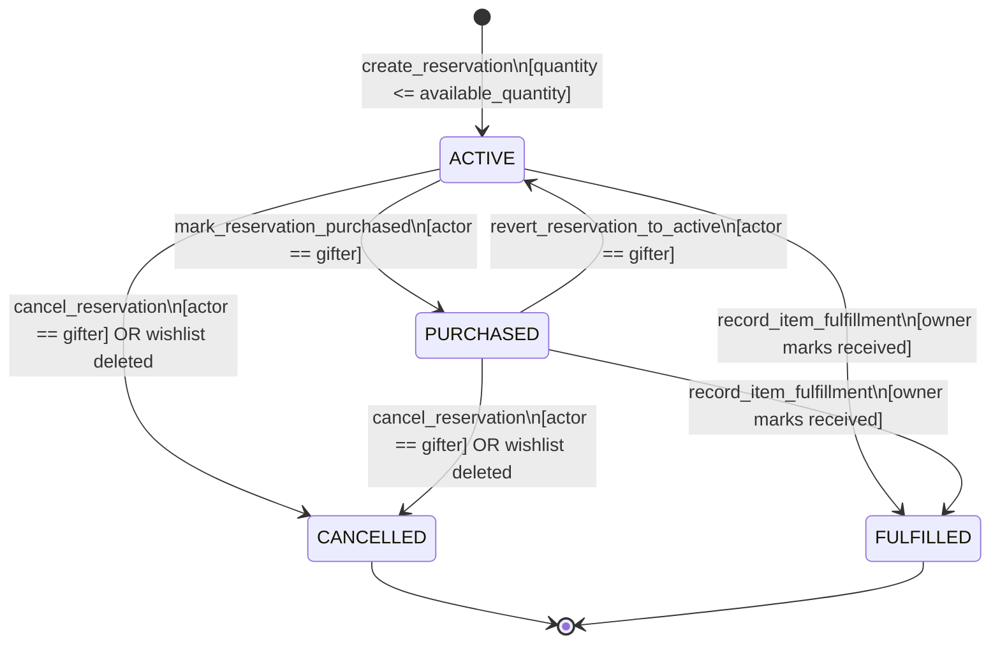

# WISHENKA-17: High-Level Architecture Design

## Research

### 1. Existing Reservation Models in Codebase & Gap Analysis

An inspection of the existing codebase (`wishenka/wishlists/models.py`, `wishenka/wishlists/service.py`, `wishenka/wishlists/schemas.py`, `wishenka/wishlists/policy.py`) reveals the following architectural baseline and functional gaps:

1. **Reservation Lifecycle Statuses (`ReservationStatus`)**:
   - *Current implementation*: `ReservationStatus(StrEnum)` defines `ACTIVE`, `COMPLETED`, `CANCELLED`.
   - *Business requirement (`10-requirements.md`)*: The lifecycle demands four discrete statuses:
     - `ACTIVE`: Initial booking of gift units by a gifter.
     - `PURCHASED`: Gifter confirmed real-world purchase (must still hold inventory reserve).
     - `CANCELLED`: Gifter cancelled booking or list was deleted; allocated units are returned to available balance.
     - `FULFILLED`: Gift recipient marked item as received; closes out the reservation.
   - *Gap*: `PURCHASED` is completely absent; `COMPLETED` is ambiguous and should be replaced or mapped to `FULFILLED`.

2. **Inventory Reserved Quantity Calculation**:
   - *Current implementation*:
     ```python
     @property
     def reserved_quantity(self) -> int:
         return sum(r.quantity for r in self.reservations if r.status == ReservationStatus.ACTIVE)
     ```
   - *Business requirement*: Both `ACTIVE` and `PURCHASED` reservations lock inventory from other gifters.
   - *Gap*: When a reservation transitions to `PURCHASED`, existing code would incorrectly free up units unless `reserved_quantity` includes `r.status in (ReservationStatus.ACTIVE, ReservationStatus.PURCHASED)`.

3. **Gifter View & Projection Schema**:
   - *Current implementation*: `WishItemGifterViewDTO` contains `available_quantity`, `is_fully_reserved`, `is_reserved_by_me`, `my_reserved_quantity`.
   - *Business requirement*: The gifter must see their own booking status (`ACTIVE` vs `PURCHASED`) to toggle the purchase state in the UI.
   - *Gap*: Missing `my_reservation_status: ReservationStatus | None` and `my_reservation_id: int | None`.

4. **Missing Service Mutations and Queries**:
   - Currently, `WishlistService` only provides `create_reservation(item_id, user, quantity)`.
   - Missing mutations:
     - `update_reservation_quantity(reservation_id, user, new_quantity)` (partial quantity adjustments).
     - `mark_reservation_purchased(reservation_id, user)` (transition to `PURCHASED`).
     - `revert_reservation_to_active(reservation_id, user)` (transition back to `ACTIVE`).
     - `cancel_reservation(reservation_id, user)` (cancellation and immediate restocking).
     - `record_item_fulfillment(item_id, actor, received_quantity)` (recipient marks items received).
   - Missing aggregated queries:
     - `get_user_reservations(user_id)`: Aggregated view of all user's active and purchased reservations grouped by wishlist.
     - `get_user_reservations_summary(user_id)`: Summary count of distinct booked items for badge display on home page.

5. **Archived Items & Reservation Retention**:
   - *Current implementation*: `create_reservation` rejects archived items.
   - *Business requirement (Edge Case 2)*: When an author archives an item with active bookings, existing reservations are *not* destroyed. They remain visible in the gifter's "My Reservations" cabinet with an indicator (`is_item_archived=True`), and gifters can still cancel or mark them as purchased.

---

### 2. Concurrency Control Patterns for SQLite WAL & Asyncio

The service runs asynchronously in Python 3.12+ (FastAPI + `asyncio`) with an embedded SQLite database utilizing WAL mode (`PRAGMA journal_mode = WAL; PRAGMA busy_timeout = 5000;`).

#### The Concurrency Challenge: Time-of-Check to Time-of-Use (TOCTOU)
When multiple gifters attempt to book the last remaining unit(s) simultaneously:
1. Gifter A reads `available_quantity = 1`.
2. Gifter B reads `available_quantity = 1`.
3. Gifter A executes booking $\to$ reserved = 1.
4. Gifter B executes booking $\to$ reserved = 2 (Overbooking! $2 > 1$).

#### Two-Level Concurrency Architecture:
1. **Application-Level In-Memory Synchronization (`ItemConcurrencyCoordinator`)**:
   - In Python `asyncio`, coroutines yield control at `await` points.
   - An in-memory keyed lock coordinator (`KeyedMutex`) assigns an `asyncio.Lock` per `item_id`.
   - Operations modifying an item's reservation balance (`create_reservation`, `update_reservation_quantity`, `cancel_reservation`, `record_item_fulfillment`, `update_wish_item`) acquire this lock during verification and mutation:
     ```python
     async with self._concurrency_coordinator.acquire(item_id):
         # Critical Section: Check availability and commit mutation atomically
         available = item.available_quantity
         if requested_qty > available:
             raise InsufficientQuantityError(...)
         # Apply mutation...
     ```
   - Lock lifecycle: Locks are retrieved or created on demand using an internal cache with automatic cleanup of idle locks to avoid memory leaks.

2. **Database-Level SQLite WAL Synchronization**:
   - **WAL Single-Writer Constraint**: While WAL mode allows unlimited concurrent readers without blocking writers, SQLite enforces strictly **one writer** at any given moment.
   - **`BEGIN IMMEDIATE` Pattern**: Standard transactions (`BEGIN DEFERRED`) allow multiple transactions to start reading simultaneously. If two transactions subsequently attempt an `UPDATE` or `INSERT`, SQLite must upgrade a read lock to a write lock, resulting in immediate `SQLITE_BUSY` errors that bypass `busy_timeout`.
   - **Resolution**: All write transactions must execute `BEGIN IMMEDIATE` (or equivalent SQLAlchemy `with_for_update()` / transaction isolation), ensuring write locks are claimed at the beginning of the transaction. Combined with `PRAGMA busy_timeout = 5000;`, competing write requests wait cooperatively up to 5 seconds rather than crashing.

---

### 3. State Machine Transitions (Reservation & Inventory Lifecycle)

```
                              +-------------------------+
                              |         INITIAL         |
                              +-------------------------+
                                           |
                                           | create_reservation
                                           v
                              +-------------------------+
            +---------------->|         ACTIVE          |<---------------+
            |                 | (Reserve locked)        |                |
            |                 +-------------------------+                |
            |                              |                             |
            | revert_reservation           | mark_reservation_purchased  |
            | _to_active                   v                             |
            |                 +-------------------------+                |
            +-----------------|        PURCHASED        |----------------+
                              | (Reserve locked)        |
                              +-------------------------+
                                 |                   |
               cancel_reservation|                   | cancel_reservation
               or wishlist delete|                   | or wishlist delete
                                 v                   v
                        +------------------------------------+
                        |             CANCELLED              |
                        | (Reserve released, balance restocked)
                        +------------------------------------+
                                 |                   |
               item_fulfilled    |                   | item_fulfilled
               (owner received)  v                   v (owner received)
                        +------------------------------------+
                        |             FULFILLED              |
                        | (Archived in completed gifts)      |
                        +------------------------------------+
```

#### Transition Rules:
- `ACTIVE` $\rightarrow$ `PURCHASED`: Permitted only for the reservation owner (gifter).
- `PURCHASED` $\rightarrow$ `ACTIVE`: Permitted only for the reservation owner.
- `ACTIVE` $\rightarrow$ `CANCELLED`: Permitted for the reservation owner, or triggered system-wide when the parent wishlist is deleted. Releases `quantity` back to available balance.
- `PURCHASED` $\rightarrow$ `CANCELLED`: Permitted for the reservation owner, or triggered system-wide on wishlist deletion. Releases `quantity` back to available balance.
- `ACTIVE` | `PURCHASED` $\rightarrow$ `FULFILLED`: Triggered when the wishlist owner marks items as received (`record_item_fulfillment`).
- `CANCELLED` and `FULFILLED` are terminal states; no further transitions are allowed.

---

### 4. Zero-Leak Projections (Surprise Invariant Enforcement)

The **Surprise Invariant** is a foundational security and functional guarantee of the platform:
> *The recipient of a gift must never observe or infer whether an item is reserved, who reserved it, how many units remain, or whether it has been purchased.*

#### Architectural Enforcement:
1. **Domain Policy Layer (`WishlistAccessPolicy`)**:
   - Evaluates caller context against the item's recipient attributes:
     - `recipient_user_id == caller.telegram_id` $\implies$ Recipient.
     - On personal lists with `recipient_user_id is None`, `wishlist.owner_id == caller.telegram_id` $\implies$ Recipient.
   - `can_reserve_item(user, ctx, item)` returns `False` if the caller is the recipient.
   - Any attempt to invoke reservation mutations as recipient raises `SelfReservationError`.

2. **Strict Schema Separation (`schemas.py`)**:
   - `WishItemRecipientViewDTO`: Contains only item description, link, price, image, and desired quantity (`quantity`, `received_quantity`).
   - Fields that **MUST NOT EXIST** in `WishItemRecipientViewDTO`:
     - `available_quantity`
     - `is_fully_reserved`
     - `is_reserved_by_me`
     - `my_reserved_quantity`
     - `my_reservation_status`
     - `reservations`
   - `WishItemGifterViewDTO`: Exposes `available_quantity`, `is_fully_reserved`, `is_reserved_by_me`, `my_reserved_quantity`, and `my_reservation_status`. Does NOT expose identities of other gifters.

---

## Implementation Plan

### High-Level Implementation Steps:
1. **Step 3: Automated Failing Repro Suite** (`tests/test_reservations_surprise_invariant.py`).
2. **Step 4.1: Domain Models and Enums**: Update `ReservationStatus` (`ACTIVE`, `PURCHASED`, `CANCELLED`, `FULFILLED`), update `WishItem.reserved_quantity` to include `PURCHASED`, update properties.
3. **Step 4.2: Concurrency Coordinator**: Implement `ItemConcurrencyCoordinator` (`KeyedMutex`) using `asyncio.Lock` with safe lifecycle management.
4. **Step 4.3: Service Mutation Methods**: Implement `update_reservation_quantity`, `mark_reservation_purchased`, `revert_reservation_to_active`, `cancel_reservation`, and `record_item_fulfillment` in `WishlistService`.
5. **Step 4.4: Aggregated Views & Projections**: Implement `get_user_reservations` and `get_user_reservations_summary` with DTO schemas (`MyReservationItemDTO`, `UserReservationsSummaryDTO`).
6. **Step 4.5: Reduction Lock Invariant Integration**: Enforce `quantity >= reserved_quantity + received_quantity` against both `ACTIVE` and `PURCHASED` units.
7. **Steps 5–8**: Code formatting and linting (Step 5), structured observability logging (Step 6), tech debt analysis (Step 7), developer documentation (Step 8).

---

### Mandatory — Failing Repro (next Step 3)

- **Target File**: `tests/test_reservations_surprise_invariant.py`
- **Purpose**: Create an automated test suite verifying all required behaviors *before* modifying production code, ensuring tests fail cleanly on the current codebase.

#### Test Cases to Implement in Step 3:
1. **`TestSurpriseInvariantIntegrity`**:
   - `test_recipient_view_has_no_reservation_attributes`: Assert that `get_wishlist_view` for the recipient returns items adhering strictly to `WishItemRecipientViewDTO` without leaking `available_quantity`, `is_reserved_by_me`, or `my_reservation_status`.
   - `test_recipient_cannot_book_own_gift_raises_self_reservation_error`: Assert that calling `create_reservation` on an item designated for oneself raises `SelfReservationError`.
   - `test_coauthor_cannot_book_item_where_they_are_explicit_recipient`: Assert that in a collaborative wishlist, a co-author assigned as `recipient_user_id` cannot book that item.

2. **`TestReservationLifecycleAndPurchasedState`**:
   - `test_mark_reservation_as_purchased_and_revert_to_active`: Assert transition from `ACTIVE` to `PURCHASED` and back to `ACTIVE`.
   - `test_purchased_reservation_retains_inventory_lock`: Assert that when a reservation is `PURCHASED`, `available_quantity` does *not* increase.
   - `test_cancel_reservation_restocks_available_quantity`: Assert that cancelling a reservation (`ACTIVE` or `PURCHASED`) immediately returns units to `available_quantity`.
   - `test_update_reservation_quantity_partial_adjustments`: Assert increasing reservation when balance permits, and decreasing reservation with immediate balance restocking.
   - `test_update_reservation_quantity_rejects_insufficient_balance`: Assert that requesting more units than available raises `InsufficientQuantityError`.

3. **`TestConcurrencyAndOverbookingGuards`**:
   - `test_concurrent_race_condition_prevented_by_coordinator`: Use `asyncio.gather` with multiple concurrent tasks attempting to reserve the last unit of an item. Exactly one must succeed, and the other must raise `InsufficientQuantityError`. Overbooking must be 0.

4. **`TestItemReductionLockWithReservations`**:
   - `test_cannot_reduce_item_quantity_below_active_plus_purchased_reservations`: Author attempting to reduce item quantity below `reserved_quantity + received_quantity` raises `CannotReduceQuantityBelowReservedError`.

5. **`TestMyReservationsAggregatedCabinet`**:
   - `test_get_user_reservations_returns_active_and_purchased_items`: Assert `get_user_reservations` returns all non-cancelled bookings of the user across wishlists.
   - `test_get_user_reservations_summary_counter`: Assert `get_user_reservations_summary` returns correct count of unique booked items.
   - `test_archived_item_persists_in_my_reservations_with_flag`: Assert that when an item is archived by the owner, it remains accessible in the gifter's reservations with `is_item_archived=True`.

#### How Failure is Forced:
- The tests will call methods (`mark_reservation_purchased`, `cancel_reservation`, `update_reservation_quantity`, `get_user_reservations`) that do not yet exist on `WishlistService` (raising `AttributeError`), reference `ReservationStatus.PURCHASED` which is not yet defined, or assert `reserved_quantity` locking for `PURCHASED` state which fails under the current implementation.

---

## Architecture

### System Architecture & Component Interaction

```mermaid
graph TD
    Client[Telegram Mini App / HTTP Client] -->|FastAPI Routes| Router[Wishlists & Reservations API]
    
    subgraph Service Layer
        Router --> Service[WishlistService / Reservation Coordinator]
        Service --> Policy[WishlistAccessPolicy\n(RBAC / ABAC / Surprise Invariant)]
        Service --> StateMachine[ReservationStateMachine\n(ACTIVE <-> PURCHASED -> CANCELLED/FULFILLED)]
        Service --> LockCoord[ItemConcurrencyCoordinator\n(Async KeyedMutex per item_id)]
    end

    subgraph Data & Persistence Layer
        LockCoord --> Storage[(In-Memory / SQLite WAL)]
        Storage --> WishlistEntity[Wishlist Aggregate Root]
        WishlistEntity --> WishItemEntity[WishItem & Multi-Quantity Inventory]
        WishItemEntity --> ResEntity[Reservation Entities]
    end

    subgraph Projection Layer
        Service --> RecipientProj[WishItemRecipientViewDTO\n(Zero-Leak: No Reservations)]
        Service --> GifterProj[WishItemGifterViewDTO\n(Available Qty, My Status)]
        Service --> CabinetProj[MyReservationItemDTO\n(My Bookings Cabinet)]
    end

    RecipientProj -->|Masked Response| Client
    GifterProj -->|Gifter View Response| Client
    CabinetProj -->|Aggregated Summary| Client
```

---

### Component Responsibilities

| Component | Responsibility |
|---|---|
| **`WishlistService`** | Application orchestrator. Exposes asynchronous methods for wishlist and reservation management, coordinates transactions, validates business rules, and delegates access control. |
| **`ItemConcurrencyCoordinator`** | Manages `asyncio.Lock` instances keyed by `item_id`. Ensures that check-and-mutate operations on item inventory and reservations execute atomically without TOCTOU races. |
| **`ReservationStateMachine`** | Validates and applies valid lifecycle transitions (`ACTIVE` $\leftrightarrow$ `PURCHASED` $\to$ `CANCELLED` / `FULFILLED`), preventing unauthorized or invalid state leaps. |
| **`WishlistAccessPolicy`** | Pure domain access policy evaluator. Determines user context (`Owner`, `Admin`, `Member`, `Gifter`), evaluates `is_recipient`, and enforces the Surprise Invariant and self-reservation guards. |
| **`WishItem` (Domain Model)** | Maintains multi-quantity invariants: calculates `reserved_quantity` across `ACTIVE` and `PURCHASED` bookings, computes `available_quantity`, and verifies reduction thresholds. |
| **Projection DTOs** | Decouples internal entities from presentation: `WishItemRecipientViewDTO` guarantees zero data leakage for recipients, while `WishItemGifterViewDTO` and `MyReservationItemDTO` serve gifters. |

---

### Reservation Lifecycle State Machine



---

### Concurrency Coordinator (`KeyedMutex`) Architecture

To guarantee atomicity in an asynchronous environment without global bottlenecking, an item-level lock coordinator is introduced:

```python
import asyncio
from contextlib import asynccontextmanager
from typing import AsyncIterator


class ItemConcurrencyCoordinator:
    """Coordinates per-item critical sections using keyed asyncio.Lock instances."""

    def __init__(self) -> None:
        self._locks: dict[int, asyncio.Lock] = {}
        self._master_lock = asyncio.Lock()

    @asynccontextmanager
    async def acquire(self, item_id: int) -> AsyncIterator[None]:
        """Acquire the lock for a specific item_id."""
        async with self._master_lock:
            if item_id not in self._locks:
                self._locks[item_id] = asyncio.Lock()
            lock = self._locks[item_id]

        async with lock:
            yield
```

#### Alignment with Future SQLite WAL Storage:
When transitioning to persistent SQLite:
- In SQLite WAL mode, write transactions use `BEGIN IMMEDIATE`.
- The `ItemConcurrencyCoordinator` provides application-level queuing before hitting the database writer lock, eliminating internal SQLite busy retry loops and providing consistent latency under contention.

---

### DTO Projections & Schema Definitions

```python
from datetime import datetime
from pydantic import BaseModel, ConfigDict, Field
from wishenka.items.models import ItemPriority
from wishenka.wishlists.models import ReservationStatus, WishlistStatus


class WishItemRecipientViewDTO(BaseModel):
    """Projection for Gift Recipient.

    Surprise Invariant: Absolutely no reservation fields, counts, or gifter data.
    """

    model_config = ConfigDict(frozen=True)

    id: int
    title: str
    description: str | None = None
    link: str | None = None
    image_url: str | None = None
    price: int | None = None
    currency: str = "RUB"
    store_name: str | None = None
    store_icon_url: str | None = None
    quantity: int = 1
    received_quantity: int = 0
    priority: ItemPriority = ItemPriority.MEDIUM
    category: str | None = None
    is_archived: bool = False
    recipient_name: str | None = None
    is_recipient: bool = True


class WishItemGifterViewDTO(BaseModel):
    """Projection for Gifters and Public Viewers.

    Exposes availability and caller's own reservation status.
    """

    model_config = ConfigDict(frozen=True)

    id: int
    title: str
    description: str | None = None
    link: str | None = None
    image_url: str | None = None
    price: int | None = None
    currency: str = "RUB"
    store_name: str | None = None
    store_icon_url: str | None = None
    quantity: int = 1
    received_quantity: int = 0
    available_quantity: int
    is_fully_reserved: bool
    is_reserved_by_me: bool
    my_reserved_quantity: int
    my_reservation_status: ReservationStatus | None = None
    my_reservation_id: int | None = None
    priority: ItemPriority = ItemPriority.MEDIUM
    category: str | None = None
    is_archived: bool = False
    recipient_name: str | None = None
    is_recipient: bool = False


class MyReservationItemDTO(BaseModel):
    """Record within the gifter's aggregated 'My Reservations' cabinet."""

    model_config = ConfigDict(frozen=True)

    reservation_id: int
    wish_item_id: int
    wishlist_id: int
    wishlist_title: str
    recipient_name: str
    item_title: str
    item_link: str | None = None
    item_image_url: str | None = None
    item_price: int | None = None
    currency: str = "RUB"
    reserved_quantity: int
    status: ReservationStatus
    event_title: str | None = None
    event_date: datetime | None = None
    is_item_archived: bool = False
    is_wishlist_archived: bool = False
    created_at: datetime
    updated_at: datetime


class UserReservationsSummaryDTO(BaseModel):
    """Summary badge counter for user's active commitments."""

    model_config = ConfigDict(frozen=True)

    user_id: int
    total_active_reservations: int
    total_distinct_items: int
```

---

### Service API Interfaces

```python
class WishlistService:
    """Extended interface for reservation mechanics and inventory coordination."""

    async def create_reservation(
        self,
        item_id: int,
        user: AuthenticatedUser,
        quantity: int = 1,
    ) -> Reservation:
        """Reserve quantity units of an item.
        
        Raises:
            ItemNotFoundError: If item does not exist.
            WishlistArchivedError: If wishlist or item is archived.
            WishlistDeletedError: If wishlist is deleted.
            SelfReservationError: If user is the recipient (Surprise Invariant).
            InsufficientQuantityError: If quantity > available_quantity.
        """
        ...

    async def update_reservation_quantity(
        self,
        reservation_id: int,
        user: AuthenticatedUser,
        new_quantity: int,
    ) -> Reservation:
        """Adjust reserved quantity up or down.
        
        Raises:
            ReservationError: If reservation not found.
            PermissionDeniedError: If user is not the reservation owner.
            InsufficientQuantityError: If delta > available_quantity.
            ValueError: If new_quantity < 1.
        """
        ...

    async def mark_reservation_purchased(
        self,
        reservation_id: int,
        user: AuthenticatedUser,
    ) -> Reservation:
        """Transition reservation from ACTIVE to PURCHASED.
        
        Raises:
            ReservationError: If reservation not found or not in ACTIVE state.
            PermissionDeniedError: If user is not the reservation owner.
        """
        ...

    async def revert_reservation_to_active(
        self,
        reservation_id: int,
        user: AuthenticatedUser,
    ) -> Reservation:
        """Transition reservation from PURCHASED back to ACTIVE.
        
        Raises:
            ReservationError: If reservation not found or not in PURCHASED state.
            PermissionDeniedError: If user is not the reservation owner.
        """
        ...

    async def cancel_reservation(
        self,
        reservation_id: int,
        user: AuthenticatedUser,
    ) -> Reservation:
        """Cancel reservation and restock available inventory balance.
        
        Raises:
            ReservationError: If reservation not found or already cancelled.
            PermissionDeniedError: If user is not the reservation owner.
        """
        ...

    async def get_user_reservations(
        self,
        user_id: int,
    ) -> list[MyReservationItemDTO]:
        """Fetch all active and purchased reservations for a gifter."""
        ...

    async def get_user_reservations_summary(
        self,
        user_id: int,
    ) -> UserReservationsSummaryDTO:
        """Fetch summary counts for the user's reservations badge."""
        ...

    async def record_item_fulfillment(
        self,
        item_id: int,
        actor: AuthenticatedUser,
        received_quantity: int,
    ) -> WishItem:
        """Record partial or full receipt of a gift by list author.
        
        Raises:
            ItemNotFoundError: If item does not exist.
            PermissionDeniedError: If actor lacks permission to update list.
            ValueError: If received_quantity exceeds remaining required quantity.
        """
        ...
```

---

## Q&A

### Q1: Why are `ACTIVE` and `PURCHASED` treated identically in available balance calculation?
**A**: Because both statuses represent committed gifts that another gifter must not duplicate. If `PURCHASED` were excluded from `reserved_quantity`, buying a gift would inadvertently reopen its slot for another user to book. `PURCHASED` is a sub-state meaningful to the gifter for personal tracking, but for inventory accounting, both statuses hold locked units.

### Q2: What happens if an author archives a wish item that has active reservations?
**A**: Per business rule (Edge Case 2), the reservation is **not cancelled**. The gifter committed to buying or has already bought the gift. In the gifter's "My Reservations" cabinet, the item remains with `is_item_archived=True`. The gifter retains the choice to cancel the reservation or keep it marked as purchased.

### Q3: How does the architecture prevent race conditions when using SQLite in WAL mode?
**A**: WAL mode permits concurrent readers, but serializes writers. To prevent deadlocks and `SQLITE_BUSY` exceptions caused by lock upgrade collisions, write transactions use `BEGIN IMMEDIATE`. Concurrently, the application layer uses `ItemConcurrencyCoordinator` (`KeyedMutex`) to serialize in-memory operations per item, ensuring zero overbooking even before transactions touch the database.

### Q4: Can a recipient circumvent the Surprise Invariant by calling reservation APIs directly?
**A**: No. The Surprise Invariant is enforced at the domain policy level (`WishlistAccessPolicy.can_reserve_item`). The service method `create_reservation` explicitly checks the policy and throws `SelfReservationError` (HTTP 403 Forbidden). Additionally, all view queries project through `WishItemRecipientViewDTO`, which structurally strips all reservation data from the payload.

### Q5: How is notification dispatch separated from reservation transactions?
**A**: Following the Transactional Outbox pattern established in `doc/dev/architecture.md`, state changes emit structured audit events. When fulfillment or cancellation occurs, notification events are enqueued in SQLite's `notification_outbox` table within the same atomic transaction, ensuring notifications are never lost or sent on rolled-back operations.
