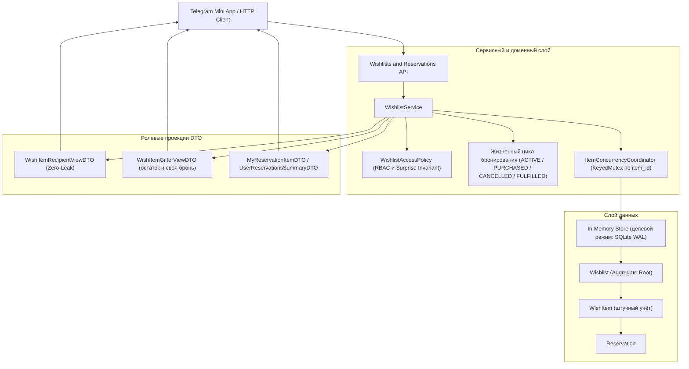
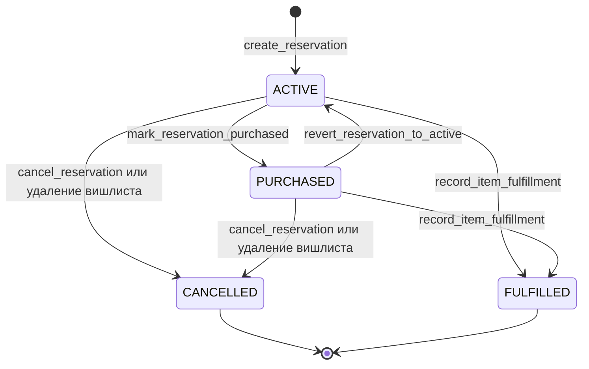

# Спецификация: WISHENKA-17 — Механика бронирования, координация остатков и гарантия тайны сюрприза

**Задача:** WISHENKA-17  
**Эпик:** WISHENKA-16 («Движок бронирования и принцип сохранения сюрприза»)  
**Платформы:** Telegram Bot + Telegram Mini App (TMA)  
**Язык реализации:** Python 3.12+  
**Статус:** реализовано и верифицировано (этапы 1–8 Top-Down workflow)

---

## 1. Назначение и бизнес-цель

### 1.1. Постановка проблемы

Сервис **«Вишенка» (Telegram Wishlist Service)** решает две системные проблемы традиционного планирования подарков:

- **Отсутствие координации при использовании текстовых списков:** дарители не знают о намерениях друг друга, покупают одинаковые вещи, ошибаются с количеством при покупке составных подарков или вынуждены координироваться в сторонних чатах, что создаёт организационное трение и повышает риск раскрытия сюрприза.
- **Разрушение эффекта сюрприза в открытых таблицах:** когда список ведётся в общедоступном документе, получатель видит вычеркнутые позиции, имена дарителей и статусы покупки, что лишает подарок неожиданности.

В рамках эпика **WISHENKA-16** задача **WISHENKA-17** задаёт и реализует ядро механизма бронирования, штучного учёта остатков и асимметричной видимости данных в доменном слое `wishenka.wishlists`.

### 1.2. Бизнес-цели

- **Мгновенное бронирование без трения:** даритель, открывший вишлист в Telegram Mini App по публичной ссылке, бронирует подарок в один клик без регистрации, паролей и предварительного онбординга.
- **Штучная координация многоштучных подарков:** точный целочисленный учёт позволяет нескольким дарителям независимо бронировать частичные количества составных желаний (например, бокалы, стулья, книги) в пределах свободного остатка.
- **Бескомпромиссная тайна сюрприза (Surprise Invariant):** абсолютная изоляция адресата подарка от любых сведений о наличии броней, дарителях, доступных остатках и статусах покупки как в личных, так и в совместных вишлистах.
- **Управляемость обязательств дарителя:** даритель может в любой момент скорректировать количество, отметить покупку («Куплено») или вернуть бронь в предварительный статус, отменить бронирование и отслеживать все обязательства в едином разделе «Мои бронирования».
- **Конкурентная и доменная целостность:** защита от овербукинга при одновременных запросах, блокировка деструктивного уменьшения количества автором списка и сохранение обязательств дарителя при архивации желания.

### 1.3. Ценность для пользователей и системы

- **Для дарителей:** исключение дублирующих покупок, прозрачный контроль свободного остатка и единый личный кабинет обязательств по всем праздникам и вишлистам.
- **Для получателей и соавторов:** свободное ведение и редактирование собственных списков желаний без утечки информации о том, какие подарки уже зарезервированы или куплены.
- **Для системы:** строгая доменная изоляция проекций данных (Zero-Leak Projections), атомарная координация конкурентных мутаций на уровне отдельного желания и структурированная наблюдаемость без утечек приватных данных в аудит-логи.

### 1.4. Границы задачи (Out of Scope)

В объём задачи `WISHENKA-17` и базовой версии подсистемы бронирования не входят:

- Совместный сбор средств и складчина на один неделимый товар (финансовые расчёты, кошельки, холд средств).
- Автоматическая интеграция с сервисами доставки маркетплейсов.
- Отслеживание физической доставки и логистических статусов (трек-номера, курьеры).
- Добавление дарителями секретных подарков вне перечня желаний, созданного авторами вишлиста.

---

## 2. Функциональные требования и пользовательские сценарии

### 2.1. Ролевая модель и правила адресации

| Роль | Назначение и границы действий |
| --- | --- |
| Даритель (Gifter) | Авторизованный через Telegram пользователь, просматривающий вишлист по ссылке или из сохранённых списков. Бронирует свободные экземпляры, меняет количество, отмечает покупку и управляет своими бронями |
| Получатель (Recipient) | Адресат конкретного желания. Изолирован от любой информации о бронях и не может бронировать подарки, предназначенные ему |
| Владелец списка (Owner) | Создатель вишлиста, управляющий параметрами, участниками, желаниями и фиксирующий получение подарков. В личном списке является получателем всех желаний |
| Соавтор / Участник (Co-author / Member) | Участник совместного вишлиста с правами ведения желаний. Может бронировать желания, адресованные другим лицам, и выступает получателем для желаний, где адресатом указан он сам |

Правила определения адресата в зависимости от типа вишлиста:

- **Личный вишлист (`is_collaborative = False`):** получателем каждого желания всегда является владелец списка (`wishlist.owner_id`).
- **Совместный вишлист (`is_collaborative = True`):** получатель определяется на уровне карточки желания по полю `recipient_user_id` (конкретный участник) либо как внешний получатель без привязки к `Telegram ID`.

### 2.2. Бизнес-сущности и модель штучного учёта

#### Сущность «Желание» (`WishItem`) в контексте бронирования

- `quantity` (`Desired Quantity`) — требуемое количество экземпляров (целое положительное число в диапазоне $1 \le Q \le 1000$).
- `reserved_quantity` — сумма единиц по всем бронированиям желания в статусах `ACTIVE` и `PURCHASED`. Оба статуса одинаково блокируют инвентарь от повторного бронирования другими дарителями.
- `received_quantity` (`Fulfilled / Received Quantity`) — количество единиц, фактически полученных владельцем/адресатом.
- `available_quantity` — вычисляемый свободный остаток для бронирования:

  $$\text{available\_quantity} = \max(0, \text{quantity} - \text{received\_quantity} - \text{reserved\_quantity})$$

- `recipient_user_id` / `recipient_name` — идентификатор и отображаемое имя адресата подарка.
- `is_archived` — признак переноса желания в архив.

#### Сущность «Бронирование» (`Reservation`)

- `id` — уникальный идентификатор бронирования.
- `wish_item_id` — ссылка на бронируемое желание.
- `user_id` — `Telegram ID` дарителя, оформившего бронь.
- `quantity` — забронированное количество экземпляров ($1 \le \text{quantity} \le \text{available\_quantity}$ при создании; дробные значения запрещены).
- `status` — текущее состояние жизненного цикла (`ReservationStatus`).
- `created_at` / `updated_at` — временные метки создания и обновления записи.

### 2.3. Функциональные требования

1. **Создание бронирования:**
   - Авторизованный пользователь Telegram, не являющийся получателем желания, может мгновенно забронировать от `1` до `available_quantity` единиц активного желания без подтверждения со стороны владельца списка.
   - Для единичного желания ($Q = 1$) бронирование выполняется в одно касание; для многоштучного ($Q > 1$) даритель выбирает количество экземпляров.
   - Бронирование отклоняется, если желание или вишлист находятся в архиве или удалены, либо если запрашиваемое количество превышает свободный остаток.
2. **Корректировка количества и отмена брони:**
   - Владелец бронирования может увеличить количество (при условии $\Delta = \text{new\_quantity} - \text{current\_quantity} \le \text{available\_quantity}$), уменьшить его до любого целого значения $\ge 1$ или полностью отменить бронь.
   - При уменьшении количества или отмене брони освободившиеся единицы мгновенно возвращаются в `available_quantity` и становятся доступны другим дарителям.
3. **Фиксация покупки («Куплено»):**
   - Даритель может перевести собственное бронирование из статуса `ACTIVE` («Забронировано») в статус `PURCHASED` («Куплено») и при необходимости вернуть его обратно в `ACTIVE`.
   - Смена статуса между `ACTIVE` и `PURCHASED` не освобождает забронированные единицы и полностью скрыта от получателя.
4. **Агрегированный раздел «Мои бронирования»:**
   - Отображает все активные и купленные бронирования пользователя (`ACTIVE` и `PURCHASED`), сгруппированные по вишлистам, с указанием названия желания, ссылки, забронированного количества, статуса, получателя / названия вишлиста и даты события (при наличии).
   - Для карточки раздела на главной странице формируется сводный счётчик уникальных забронированных желаний (`total_distinct_items`), не зависящий от количества единиц внутри каждого желания.
   - При архивации желания автором существующие бронирования не удаляются и остаются в кабинете дарителя с пометкой архивации (`is_item_archived = True`). Даритель сохраняет право отменить такую бронь или отметить её купленной.
5. **Защита зарезервированного объёма при редактировании (`Reduction Lock`):**
   - Автор вишлиста при редактировании желания не может уменьшить требуемое количество `quantity` ниже суммы уже зарезервированного и полученного количества ($\text{reserved\_quantity} + \text{received\_quantity}$), где $\text{reserved\_quantity}$ включает как `ACTIVE`, так и `PURCHASED` брони.
   - При попытке такого уменьшения операция отклоняется с указанием минимально допустимого значения без раскрытия личностей дарителей.
6. **Фиксация получения подарка:**
   - Владелец/автор списка может зафиксировать получение желания полностью или частично по количеству (`received_quantity`).
   - При частичном получении неполученный остаток сохраняется в активном списке; при полном получении желание переносится в раздел «Подаренные».

### 2.4. Пользовательские сценарии и граничные случаи

#### Базовые сценарии (`US-1` – `US-9`)

- **US-1 (Бронирование единичного подарка):** даритель нажимает «Забронировать» на свободном товаре ($1$ из $1$); карточка для него переходит в статус «Забронировано вами», а для других дарителей — в «Забронировано» (`available_quantity = 0`).
- **US-2 (Частичное и полное бронирование многоштучного подарка):** даритель бронирует $2$ из $4$ единиц («Доступно: 2 из 4»); второй даритель может занять оставшиеся $2$ единицы, переводя карточку в «Полностью забронировано».
- **US-3 (Изменение количества и отмена):** даритель уменьшает бронь с $3$ до $1$ шт. (возврат $2$ шт. в пул), увеличивает в пределах остатка или полностью отменяет бронь.
- **US-4 (Отметка о покупке):** даритель переводит бронь в состояние «Куплено» и при ошибке или возврате товара переводит обратно в «Забронировано».
- **US-5 (Раздел «Мои бронирования»):** даритель просматривает сводный список обязательств по всем вишлистам и видит бейдж уникальных забронированных желаний на главной странице.
- **US-6 (Просмотр получателем):** владелец открывает свой вишлист и видит только исходные поля желаний и `quantity` без остатков, статусов, имён дарителей и кнопок бронирования.
- **US-7 (Фиксация получения):** владелец отмечает получение всего подарка или части экземпляров; оставшаяся потребность пересчитывается.
- **US-8 (Совместный вишлист):** соавтор бронирует подарок, адресованный другому участнику списка, и видит собственные желания строго в режиме получателя без данных о бронях.
- **US-9 (Защита от уменьшения количества):** попытка автора уменьшить требуемое количество с $5$ до $3$ шт. при наличии $4$ зарезервированных единиц блокируется ошибкой.

#### Граничные случаи (Edge Cases)

1. **Конкурентная гонка за последний экземпляр:** при одновременном запросе двух и более дарителей на последнюю свободную единицу операции сериализуются атомарно; ровно один запрос создаёт бронь, остальные получают отказ (`InsufficientQuantityError`).
2. **Действия с бронью после архивации желания:** архивация не отменяет существующие брони; они остаются в «Мои бронирования» с `is_item_archived = True`, доступны для отмены или отметки покупки и сохраняют исходное состояние при восстановлении карточки из архива.
3. **Попытка самобронирования соавтором-адресатом:** при прямом вызове метода создания бронирования пользователем, который является `recipient_user_id` желания, операция немедленно отклоняется исключением `SelfReservationError`.
4. **Увеличение количества при параллельном исчерпании остатка:** при проверке $\Delta > \text{available\_quantity}$ увеличение отклоняется без изменения текущей брони, тогда как уменьшение количества выполняется всегда.
5. **Попытка уменьшения количества ниже зарезервированного:** при попытке установить `quantity < reserved_quantity + received_quantity` выбрасывается `CannotReduceQuantityBelowReservedError`.
6. **Частичное получение при активных бронях:** фиксация получения снижает оставшуюся к получению потребность, но не удаляет принудительно открытые брони дарителей.

### 2.5. Ключевые доменные инварианты

1. **Surprise Invariant (Тайна сюрприза):** получатель подарка ни при каких обстоятельствах (в UI, DTO-ответах API и аудит-логах) не может узнать факт наличия брони, количество забронированных или свободных единиц, статус покупки и личность дарителя.
2. **Overbooking Prevention (Запрет переполнения):** для каждого желания всегда выполняется условие:

   $$\text{reserved\_quantity} + \text{received\_quantity} \le \text{quantity}, \qquad \text{available\_quantity} \ge 0$$

3. **Self-Reservation Guard (Запрет самобронирования):** пользователь, определяемый политикой доступа как получатель желания, не может создать бронь на это желание.
4. **Reduction Lock:** автор не может снизить `quantity` ниже суммы фактически полученных и зарезервированных (`ACTIVE` + `PURCHASED`) единиц.
5. **Целочисленность учётных единиц:** любое количество в операциях создания, изменения, получения и редактирования — целое положительное число.

---

## 3. Архитектура, компоненты и интерфейсы

### 3.1. Архитектура подсистемы и поток взаимодействия

Подсистема бронирования реализована в домене `wishenka.wishlists` с разделением оркестрации (`WishlistService`), политики доступа (`WishlistAccessPolicy`), синхронизации конкурентных секций (`ItemConcurrencyCoordinator`), доменных моделей, исключений и ролевых проекций (DTO).

### 3.2. Модули и ответственность компонентов

| Компонент / Модуль | Ответственность |
| --- | --- |
| `wishenka/wishlists/models.py` | Доменные сущности `Wishlist`, `WishItem`, `Reservation` и перечисление `ReservationStatus`. Свойство `WishItem.reserved_quantity` учитывает брони в статусах `ACTIVE` и `PURCHASED`, а `available_quantity` рассчитывает доступный остаток |
| `wishenka/wishlists/concurrency.py` | Класс `ItemConcurrencyCoordinator` (`KeyedMutex`), управляющий экземплярами `asyncio.Lock` в разрезе `item_id` для сериализации критических секций «проверка остатка + мутация» |
| `wishenka/wishlists/policy.py` | Класс `WishlistAccessPolicy` — чистая доменная оценка ролей (`Owner`, `Admin`, `Member`, `Gifter`), предиката `is_recipient` и правила `can_reserve_item` |
| `wishenka/wishlists/schemas.py` | Иммутабельные Pydantic-модели проекций (`ConfigDict(frozen=True)`): `WishItemRecipientViewDTO`, `WishItemGifterViewDTO`, `MyReservationItemDTO`, `UserReservationsSummaryDTO` |
| `wishenka/wishlists/exceptions.py` | Иерархия доменных исключений бронирования (включая `ReservationNotFoundError`, экспортированное через `wishenka/wishlists/__init__.py`) |
| `wishenka/wishlists/service.py` | Оркестратор `WishlistService`: жизненный цикл броней, контроль конкурентности, фиксация получения, Reduction Lock при обновлении желаний, ролевые проекции и агрегированные запросы кабинета |

### 3.3. Контракты данных и ролевые проекции

#### Разделение проекций карточки желания

| Поле / Группа полей | `WishItemRecipientViewDTO` (получатель) | `WishItemGifterViewDTO` (даритель / гость) |
| --- | --- | --- |
| Базовые атрибуты желания (`id`, `title`, `description`, `link`, `image_url`, `price`, `currency`, `store_name`, `store_icon_url`, `priority`, `category`, `is_archived`, `recipient_name`) | Присутствуют | Присутствуют |
| Требуемое и полученное количество (`quantity`, `received_quantity`) | Присутствуют | Присутствуют |
| Флаг адресата (`is_recipient`) | `True` | `False` |
| Доступный остаток и статус занятости (`available_quantity`, `is_fully_reserved`) | Отсутствуют в схеме | Присутствуют |
| Собственная бронь (`is_reserved_by_me`, `my_reserved_quantity`, `my_reservation_status`, `my_reservation_id`) | Отсутствуют в схеме | Присутствуют |
| Сведения о других дарителях (`reservations`, имена, ID) | Отсутствуют в схеме | Отсутствуют (маскируются) |

#### Схемы кабинета дарителя

- `MyReservationItemDTO`: `reservation_id: int`, `wish_item_id: int`, `wishlist_id: int`, `wishlist_title: str`, `recipient_name: str`, `item_title: str`, `item_link: str | None`, `item_image_url: str | None`, `item_price: int | None`, `currency: str = "RUB"`, `reserved_quantity: int`, `status: ReservationStatus`, `event_title: str | None`, `event_date: datetime | None`, `is_item_archived: bool = False`, `is_wishlist_archived: bool = False`, `created_at: datetime`, `updated_at: datetime`.
- `UserReservationsSummaryDTO`: `user_id: int`, `total_active_reservations: int`, `total_distinct_items: int`.

### 3.4. Жизненный цикл и конечный автомат состояний

В задаче `WISHENKA-17` перечисление `ReservationStatus` расширено состоянием `PURCHASED`, которое наряду с `ACTIVE` удерживает зарезервированный остаток. Целевая машина состояний из архитектурного проекта:

*Примечание о реализации статусов:* в исходной кодовой базе до `WISHENKA-17` перечисление `ReservationStatus(StrEnum)` включало значения `ACTIVE`, `COMPLETED` и `CANCELLED`; в рамках `WISHENKA-17` оно было расширено значением `PURCHASED`, а в архитектурном проекте целевое терминальное состояние получения описано как `FULFILLED` (взаимозаменяемо с `COMPLETED` в базовом enum).

| Переход | Метод / Триггер | Предусловия | Эффект на остаток |
| --- | --- | --- | --- |
| `INITIAL` $\to$ `ACTIVE` | `create_reservation` | Не получатель; список и желание активны; `1 <= quantity <= available_quantity` | Уменьшает `available_quantity` на `quantity` |
| `ACTIVE` $\to$ `PURCHASED` | `mark_reservation_purchased` | Актор — владелец брони; статус `ACTIVE` | Остаток остаётся заблокированным |
| `PURCHASED` $\to$ `ACTIVE` | `revert_reservation_to_active` | Актор — владелец брони; статус `PURCHASED` | Остаток остаётся заблокированным |
| `ACTIVE` / `PURCHASED` $\to$ `CANCELLED` | `cancel_reservation` / удаление списка | Актор — владелец брони (или каскадное удаление списка) | Терминальное состояние; возвращает `quantity` в `available_quantity` |
| `ACTIVE` / `PURCHASED` $\to$ `FULFILLED` | `record_item_fulfillment` | Владелец/автор фиксирует получение | Терминальное состояние для завершённого подарка |

### 3.5. Программные интерфейсы сервиса и исключения

#### Методы `WishlistService`

- `create_reservation(item_id: int, user: AuthenticatedUser, quantity: int = 1) -> Reservation`  
  Создаёт бронь под блокировкой `item_id`. Выбрасывает `ItemNotFoundError`, `WishlistArchivedError`, `WishlistDeletedError`, `SelfReservationError`, `InsufficientQuantityError`.
- `update_reservation_quantity(reservation_id: int, user: AuthenticatedUser, new_quantity: int) -> Reservation`  
  Изменяет количество забронированных единиц вверх или вниз. Выбрасывает `ReservationError` / `ReservationNotFoundError`, `PermissionDeniedError`, `InsufficientQuantityError` (если $\Delta > \text{available\_quantity}$), `ValueError` (если `new_quantity < 1`).
- `mark_reservation_purchased(reservation_id: int, user: AuthenticatedUser) -> Reservation`  
  Переводит бронь из `ACTIVE` в `PURCHASED`. Выбрасывает `ReservationError` / `ReservationNotFoundError`, `PermissionDeniedError`.
- `revert_reservation_to_active(reservation_id: int, user: AuthenticatedUser) -> Reservation`  
  Возвращает бронь из `PURCHASED` в `ACTIVE`. Выбрасывает `ReservationError` / `ReservationNotFoundError`, `PermissionDeniedError`.
- `cancel_reservation(reservation_id: int, user: AuthenticatedUser) -> Reservation`  
  Отменяет бронь и возвращает единицы в доступный остаток. Выбрасывает `ReservationError` / `ReservationNotFoundError`, `PermissionDeniedError`.
- `record_item_fulfillment(item_id: int, actor: AuthenticatedUser, received_quantity: int) -> WishItem`  
  Фиксирует полное или частичное получение подарка автором вишлиста. Выбрасывает `ItemNotFoundError`, `PermissionDeniedError`, `ValueError` (при превышении оставшейся потребности).
- `get_user_reservations(user_id: int) -> list[MyReservationItemDTO]`  
  Возвращает список всех броней пользователя в статусах `ACTIVE` и `PURCHASED`, включая архивные желания с `is_item_archived=True`.
- `get_user_reservations_summary(user_id: int) -> UserReservationsSummaryDTO`  
  Возвращает агрегированные счётчики для бейджа на главной странице (`total_active_reservations`, `total_distinct_items`).

#### Предикат получателя и защита от самобронирования (`WishlistAccessPolicy`)

- В личном вишлисте (`is_collaborative = False`) при `recipient_user_id is None` получателем считается `wishlist.owner_id == caller.telegram_id`.
- В совместном вишлисте получатель определяется по `item.recipient_user_id == caller.telegram_id`.
- Метод `can_reserve_item(user, ctx, item)` возвращает `False`, если вызывающий пользователь является получателем; попытка создания бронирования приводит к исключению `SelfReservationError`.

### 3.6. Синхронизация конкурентного доступа

Для исключения гонки TOCTOU (Time-of-Check to Time-of-Use) в асинхронной среде Python `asyncio` реализован координатор `ItemConcurrencyCoordinator` (`KeyedMutex`):

- Координатор хранит словарь блокировок `_locks: dict[int, asyncio.Lock]` и защищает доступ/создание записи через `_master_lock: asyncio.Lock`.
- Операции над инвентарём желания (`create_reservation`, `update_reservation_quantity`, `cancel_reservation`, `record_item_fulfillment`, `update_wish_item` и др.) выполняют проверку остатков и мутацию внутри `async with self._concurrency_coordinator.acquire(item_id):`.
- Блокировка на уровне `item_id` сериализует конкурентные запросы к одному желанию, не создавая глобального узкого места для операций над разными желаниями.
- В целевой персистентной архитектуре SQLite WAL (`PRAGMA journal_mode = WAL;`, `PRAGMA busy_timeout = 5000;`) транзакции записи должны открываться с `BEGIN IMMEDIATE`, дополняя прикладную очередь `ItemConcurrencyCoordinator` на уровне БД.

---

## 4. Нефункциональные требования, безопасность и наблюдаемость

### 4.1. Нефункциональные требования и ограничения

| Идентификатор | Требование / Ограничение | Реализация в `WISHENKA-17` |
| --- | --- | --- |
| NFR-1 | Гарантия тайны сюрприза на доменном уровне | Строгое разделение DTO (`WishItemRecipientViewDTO` без полей брони) и запрет самобронирования в `WishlistAccessPolicy` |
| NFR-2 | Защита от гонок при одновременном бронировании | Сериализация критических секций по `item_id` через `ItemConcurrencyCoordinator` |
| NFR-3 | Высокая отзывчивость (целевой отклик $\le 300\text{ мс}$) | Асинхронный неблокирующий путь выполнения и локальные per-item блокировки |
| NFR-4 | Сохранность обязательств дарителя при архивации | Бронирования архивных желаний сохраняются и возвращаются в `get_user_reservations` с флагом `is_item_archived=True` |
| Лимит количества | Штучный диапазон $1 \le Q \le 1000$, только целые числа | Валидация целочисленных значений, запрет дробных единиц и значений $< 1$ |

### 4.2. Безопасность и приватность

- **Аутентификация:** нативная идентификация через Telegram (`AuthenticatedUser`), без отдельной регистрации, логинов и паролей.
- **Авторизация мутаций:**
  - Операции `update_reservation_quantity`, `mark_reservation_purchased`, `revert_reservation_to_active` и `cancel_reservation` проверяют совпадение `reservation.user_id` с вызывающим пользователем (иначе `PermissionDeniedError`).
  - Операция `create_reservation` проверяет `WishlistAccessPolicy.can_reserve_item` (иначе `SelfReservationError`).
  - Операция `record_item_fulfillment` проверяет права автора/участника списка (иначе `PermissionDeniedError`).
- **Маскирование и отсутствие утечек в логах:**
  - Проекция `WishItemRecipientViewDTO` не содержит атрибутов `available_quantity`, `is_fully_reserved`, `is_reserved_by_me`, `my_reserved_quantity`, `my_reservation_status`, `reservations`.
  - Взаимодействия получателя (просмотр вишлиста, аудит-трейл сессии получателя) не порождают логов, содержащих `reservation_id`, `Telegram ID` дарителей или их имена.
  - В структурированных логах передаются только скалярные идентификаторы, числовые количества и дельты без сериализации крупных объектов.

### 4.3. Структурированное логирование

Все события домена записываются через стандартный логгер `wishenka.wishlists` с передачей структурированного словаря `extra={"event": "<event_name>", ...}`, совместимого с форматом syslog/JSON.

| Событие (`event`) | Уровень | Поля контекста (`extra`) | Назначение |
| --- | --- | --- | --- |
| `item_reserved` | `INFO` | `event`, `wishlist_id`, `item_id`, `user_id`, `reservation_id`, `quantity` | Успешное создание бронирования |
| `reservation_purchased` | `INFO` | `event`, `wishlist_id`, `item_id`, `user_id`, `reservation_id`, `quantity` | Перевод брони в статус `PURCHASED` |
| `reservation_reverted` | `INFO` | `event`, `wishlist_id`, `item_id`, `user_id`, `reservation_id`, `quantity` | Возврат брони из `PURCHASED` в `ACTIVE` |
| `reservation_cancelled` | `INFO` | `event`, `wishlist_id`, `item_id`, `user_id`, `reservation_id`, `quantity` | Отмена брони и возврат остатка |
| `reservation_quantity_updated` | `INFO` | `event`, `wishlist_id`, `item_id`, `user_id`, `reservation_id`, `quantity`, `old_quantity` | Изменение забронированного количества |
| `item_fulfilled` | `INFO` | `event`, `wishlist_id`, `item_id`, `user_id`, `quantity`, `received_quantity`, `total_quantity` | Фиксация получения подарка |
| `self_reservation_blocked` | `WARNING` | `event`, `wishlist_id`, `item_id`, `user_id`, `recipient_user_id` | Блокировка попытки самобронирования получателем |
| `insufficient_quantity_blocked` | `WARNING` | `event`, `wishlist_id`, `item_id`, `user_id`, `requested_quantity`, `available_quantity` | Отказ из-за нехватки свободного остатка при создании или увеличении |
| Прочие отказы валидации и доступа (`item_not_found`, `reservation_blocked_archived`, `reservation_blocked_deleted`, `reservation_blocked_archived_item`, `reservation_not_found`, `access_denied`, `invalid_reservation_transition`, `reservation_already_cancelled`, `reservation_update_blocked`, `fulfillment_quantity_exceeded`) | `WARNING` | Контекст операции (`wishlist_id`, `item_id`, `user_id`, `reservation_id` и др.) | Фиксация нарушений бизнес-ограничений и прав доступа |
| `wishlist_view_projected` | `DEBUG` | Контекст просмотра списка | Диагностика построения ролевой проекции без утечек |

### 4.4. Метрики и мониторинг

- **Метрики производительности (уровень ASGI middleware):** время ответа (`http_request_duration_seconds`), пропускная способность (`http_requests_total`), частота ошибок по кодам HTTP 4xx/5xx и событиям `WARNING`/`ERROR`.
- **Бизнес-метрики (счётчики по событиям):** `wishlist_reservations_created_total` (`item_reserved`), `wishlist_reservations_purchased_total` (`reservation_purchased`), `wishlist_reservations_cancelled_total` (`reservation_cancelled`), `wishlist_items_fulfilled_total` (`item_fulfilled`), `wishlist_self_reservations_blocked_total` (`self_reservation_blocked`).
- **Метрики здоровья системы:** загрузка CPU/памяти и задержка event loop процесса Uvicorn, состояние пула соединений SQLite WAL и активных блокировок `ItemConcurrencyCoordinator`.
- **Интеграция мониторинга:** реализовано стандартизованное структурированное JSON/syslog-логирование; экспорт метрик в Prometheus, дашборды Grafana (по логам Loki/ELK) и правила алертинга определены как последующая интеграция инфраструктуры.

---

## 5. Верификация и критерии приёмки

### 5.1. Автоматизированные тестовые сценарии

#### Функциональные и инвариантные тесты (`tests/test_reservations_surprise_invariant.py`)

Модуль содержит 13 сценариев с ограничителем времени `pytestmark = pytest.mark.timeout(10)`:

1. **`TestSurpriseInvariantIntegrity`:**
   - `test_recipient_view_has_no_reservation_attributes` — отсутствие полей бронирования в `WishItemRecipientViewDTO` при запросе `get_wishlist_view` получателем.
   - `test_recipient_cannot_book_own_gift_raises_self_reservation_error` — блокировка самобронирования (`SelfReservationError`).
   - `test_coauthor_cannot_book_item_where_they_are_explicit_recipient` — запрет бронирования соавтором желания, где он указан в `recipient_user_id`.
2. **`TestReservationLifecycleAndPurchasedState`:**
   - `test_mark_reservation_as_purchased_and_revert_to_active` — переходы `ACTIVE` $\leftrightarrow$ `PURCHASED`.
   - `test_purchased_reservation_retains_inventory_lock` — сохранение блокировки остатка при переходе в `PURCHASED`.
   - `test_cancel_reservation_restocks_available_quantity` — мгновенный возврат остатка при отмене из `ACTIVE` или `PURCHASED`.
   - `test_update_reservation_quantity_partial_adjustments` — увеличение при достаточном остатке и уменьшение с возвратом единиц.
   - `test_update_reservation_quantity_rejects_insufficient_balance` — выброс `InsufficientQuantityError` при нехватке свободного остатка.
3. **`TestConcurrencyAndOverbookingGuards`:**
   - `test_concurrent_race_condition_prevented_by_coordinator` — параллельный запуск через `asyncio.gather` для последнего экземпляра: ровно 1 успешное бронирование, остальные получают `InsufficientQuantityError`, овербукинг равен 0.
4. **`TestItemReductionLockWithReservations`:**
   - `test_cannot_reduce_item_quantity_below_active_plus_purchased_reservations` — запрет снижения количества ниже суммы `ACTIVE`, `PURCHASED` и полученных единиц (`CannotReduceQuantityBelowReservedError`).
5. **`TestMyReservationsAggregatedCabinet`:**
   - `test_get_user_reservations_returns_active_and_purchased_items` — выборка активных и купленных броней дарителя по вишлистам.
   - `test_get_user_reservations_summary_counter` — корректный подсчёт уникальных забронированных желаний.
   - `test_archived_item_persists_in_my_reservations_with_flag` — сохранение брони архивного желания с `is_item_archived=True`.

#### Тесты наблюдаемости (`tests/test_reservation_observability.py`)

9 автоматизированных сценариев с использованием фикстуры `caplog`:

- Проверка генерации и структуры контекстных полей событий `item_reserved`, `reservation_purchased`, `reservation_reverted`, `reservation_cancelled`, `reservation_quantity_updated`, `item_fulfilled`.
- Проверка `WARNING`-событий при отказе по бизнес-правилам (`self_reservation_blocked`, `insufficient_quantity_blocked`, ошибки доступа и состояний).
- `test_zero_surprise_leaks_in_recipient_audit_trails` — строгая проверка отсутствия `reservation_id`, ID и имён дарителей в логах сессии получателя.

#### Результаты проверок качества

- **`make check` (этапы 4–5):** пройдено 83/83 тестов; `ruff` (линтинг и форматирование с длиной строки до 100 символов) — 0 ошибок и 0 предупреждений; `mypy` в strict mode по всем 35 исходным файлам — 0 ошибок.
- **Итоговый прогон после этапа 6 (`00-roadmap.md`, `60-tech-debt.md`):** все 92 автоматизированных теста проходят с 0 ошибок (`0` предсуществующих падений).

### 5.2. Критерии приёмки

Задача `WISHENKA-17` считается принятой при выполнении всех перечисленных критериев:

1. **Механика бронирования:** определён и реализован жизненный цикл бронирования (`ACTIVE` $\leftrightarrow$ `PURCHASED` $\to$ `CANCELLED` / завершение); поддерживаются мгновенное создание, изменение количества, отмена и сводный кабинет «Мои бронирования».
2. **Координация остатков и защита от гонок:** выполняется формула $\text{available\_quantity} = \max(0, \text{quantity} - \text{received\_quantity} - \text{reserved\_quantity})$ с учётом `ACTIVE` и `PURCHASED`; конкурентный доступ сериализован на уровне `item_id` без овербукинга.
3. **Гарантия тайны сюрприза:** `WishItemRecipientViewDTO` структурно не содержит данных о бронях, а `WishlistAccessPolicy` и аудит-логи исключают самобронирование и утечки сведений о дарителях.
4. **Защита целостности при изменениях владельца:** действует `Reduction Lock` (запрет уменьшения ниже суммы зарезервированного и полученного), сохраняются брони архивных желаний и поддерживается частичная/полная фиксация получения.
5. **Качество, наблюдаемость и документация:** пройдены все 92 теста (включая `caplog`-контракты), `ruff` и `mypy` без ошибок; актуализированы `doc/dev/reservations.md` и `doc/dev/architecture.md`.

### 5.3. Известные ограничения и задачи технического долга

По итогам анализа технического долга (`ai-tasks/WISHENKA-17/60-tech-debt.md`) выявлены неблокирующие ограничения текущей реализации и заведены соответствующие задачи в Jira под эпиком **WISHENKA-16**:

#### Зафиксированные ограничения текущей реализации

- **Однопроцессная синхронизация:** `ItemConcurrencyCoordinator` использует `asyncio.Lock` в памяти одного процесса и не обеспечивает взаимное исключение при запуске нескольких воркеров (`uvicorn --workers N`).
- **Эфемерное in-memory хранилище:** состояние в `WishlistService` (`_wishlists`, `_items`, `_reservations`) хранится в оперативной памяти и сбрасывается при перезапуске процесса.
- **Удержание блокировок в памяти:** словарь `ItemConcurrencyCoordinator._locks` не очищает неиспользуемые объекты `asyncio.Lock`, что приводит к монотонному росту памяти на длительных запусках; доступ к `_locks` проходит через общий `_master_lock`.
- **Линейное сканирование запросов кабинета:** `get_user_reservations` и `get_user_reservations_summary` выполняют полный проход $O(N)$ по `self._reservations.values()`.
- **Отсутствие Transactional Outbox и ключей идемпотентности:** дарители не получают автоматические Telegram-уведомления при архивации, удалении или получении подарка, а мутации не принимают заголовок `Idempotency-Key` для защиты от сетевых повторов в Mini App.
- **Монолитность сервисного слоя и зашитые значения по умолчанию:** `WishlistService` превышает 1600 строк, а константы (`"RUB"`, срок жизни токенов `timedelta(days=7)`) не вынесены в конфигурацию.
- **Пробелы в нагрузочном и property-based тестировании:** отсутствуют стресс-тесты с 100–500 параллельными корутинами, мультипроцессные тесты, сценарии скачков системного времени (clock drift) и фаззинг инвариантов на базе `hypothesis`.

#### Заведённые follow-up задачи (Jira)

| Идентификатор | Задача в Jira | Приоритет | Оценка | Содержание |
| --- | --- | --- | --- | --- |
| DEBT-1 | [WISHENKA-57](https://pypost.atlassian.net/browse/WISHENKA-57) | High | 5.0 SP | Перенос хранения и блокировок на SQLite WAL (`BEGIN IMMEDIATE`) / распределённое блокирование для безопасной работы в многопроцессном режиме |
| DEBT-2 | [WISHENKA-58](https://pypost.atlassian.net/browse/WISHENKA-58) | Medium | 2.0 SP | Сборка мусора и вытеснение неиспользуемых блокировок в `ItemConcurrencyCoordinator` (`WeakValueDictionary` или очистка неактивных замков) |
| DEBT-3 | [WISHENKA-59](https://pypost.atlassian.net/browse/WISHENKA-59) | Medium | 2.0 SP | Вторичные индексы по `user_id` и статусу бронирования для устранения линейного обхода $O(N)$ |
| DEBT-4 | [WISHENKA-60](https://pypost.atlassian.net/browse/WISHENKA-60) | Medium | 3.0 SP | Реализация Transactional Outbox и диспетчера уведомлений о событиях жизненного цикла подарков |
| DEBT-5 | [WISHENKA-61](https://pypost.atlassian.net/browse/WISHENKA-61) | Low | 3.0 SP | Поддержка клиентских ключей идемпотентности (`Idempotency-Key`) в мутациях бронирования |
| DEBT-6 | [WISHENKA-62](https://pypost.atlassian.net/browse/WISHENKA-62) | Low | 3.0 SP | Нагрузочные тесты высокой конкурентности (>100 воркеров) и property-based fuzzing инвариантов (Hypothesis) |
